<!-- spec-meta: {"schema":"spec-md/1.0","documentId":"CSHARP_ASPNET-BAS-STU-01","version":"1.2","path":"基本設計書/01_学生検索画面.md","sheets":[{"heading":"概要","kind":"GRID","sheet":"01_概要"},{"heading":"項目一覧","kind":"LIST","sheet":"02_項目一覧","key":["No"]},{"heading":"選択候補一覧","kind":"LIST","sheet":"03_選択候補一覧","key":["候補ID"]},{"heading":"イベント仕様","kind":"GRID","sheet":"04_イベント仕様"},{"heading":"補足説明","kind":"GRID","sheet":"05_補足説明"}]} -->
# 学生検索画面 基本設計書

| 属性 | 内容 |
| --- | --- |
| 文書ID | CSHARP_ASPNET-BAS-STU-01 |
| 文書種別 | basic-design |
| 版 | 1.2 |
| 正本path | 基本設計書/01_学生検索画面.md |
| 対象読者 | 業務システムのIT担当者、経験5年程度の実装者 |
| 記述基準 | ソースで観測した現行実装を説明する。参考設計の要求は「設計意図」と明記し、現行動作と区別する。 |

## 概要

### 業務の目的と範囲

利用者は、学生の識別情報、所属、在籍区分、住所地域、電話、入学日を条件に学生を探し、一覧の対象行から学生登録画面へ進む。Viewerは既存学生を参照し、Staff・Administratorは編集できる。作成権限のある利用者は新規登録にも進める。検索画面は学生基本情報を変更せず、最後に実行した条件と検索結果をサーバーのメモリへ保持する。検索自身による操作履歴の追記はない。根拠：`sources/Views/Students/Search.cshtml:3-8`、`sources/Core/SqlServerStudentService.cs:137-168`、`sources/Infrastructure/WebStudentCoordinator.cs:7-15`。

年度・学年は、学生の現在または最終所属を示すクラスの属性である。学生自身に年度・学年を保存する処理や、年度別の所属履歴を検索する処理はない。参考設計は単一校の学生基本情報を対象とし、成績、帳票、一覧直接編集、一括更新、削除済み照会を業務範囲に含めていない。根拠：`sources/Core/Contracts.cs:31-53`、`sources/Core/SqlServerStudentService.cs:82-90,143-146`。設計意図：`reference-designs/基本設計書/01_学生検索画面.md:14-24`。

業務入力は画面の検索条件と操作指定、業務出力は一覧とメッセージである。学生・マスタはDB参照、検索状態・編集Snapshot・Flashは一時情報として扱う。CSV、帳票、取込ファイルを入出力とする処理は接続されていない。参考設計もこれらを本機能の業務IOに含めていない。根拠：`sources/Web/Controllers/StudentsController.cs:8-25,38-40`。設計意図：`reference-designs/基本設計書/01_学生検索画面.md:75-100`。

### 操作入口と利用者

| 操作 | 接続された入口 | 受け渡す情報 | 権限・表示 |
| --- | --- | --- | --- |
| 初期表示・検索復帰 | GET `/students` | 任意のcontextId。既存状態への復帰はcontextRevisionも必要 | 認証済み利用者の参照 |
| 検索 | POST `/students/search` | Criteria接頭辞の12条件、状態ID・版・Tab、表示指定 | 参照 |
| 候補更新 | POST `/students/options` | 編集中の条件と制御値 | 参照。全画面HTMLを返す |
| 並び替え・ページ移動 | POST `/students/page` | 状態ID・版・Tab、Page・PageSize・SortKey・SortDirection | 参照。12条件は送らない |
| クリア | POST `/students/clear` | 状態ID・版・Tab | 参照 |
| 新規登録へ進む | GET `/students/new` | returnContextId | Viewerにはリンク非表示。入口でも作成権限を確認 |
| 編集・参照へ進む | GET `/students/{id:long}` | 学生管理番号、returnContextId | Viewerは参照、それ以外は編集 |

ProgramのController登録とWebHostSetupのIStudentService登録から、上記入口はSqlServerStudentServiceへ接続される。検索と候補更新はHTMLフォームの操作である。OptionsRequest、Coordinator.Options、StrictJson.Readの宣言から、公開学生JSON APIの存在を補わない。根拠：`sources/Program.cs:3-7`、`sources/Web/Controllers/StudentsController.cs:5-24`、`sources/Infrastructure/WebHostSetup.cs:13-19`、`sources/Infrastructure/WebStudentCoordinator.cs:16-17`、`sources/Infrastructure/StrictJson.cs:4-15`。

Roleの定義はViewer・Staff・Administratorである。検索ビューはViewerにも検索条件の操作を許し、Viewerの場合だけ新規リンクを隠して行操作の文言を「参照」にする。登録画面の削除操作は、既存学生かつAdministratorの場合だけ表示する。根拠：`sources/Core/Contracts.cs:4-4`、`sources/Views/Students/Search.cshtml:5-8`、`sources/Web/Models/StudentEditPageModel.cs:14-14`、`sources/Views/Students/Edit.cshtml:17-17`。

### 画面構成と非実行の静的投影

共有ヘッダー、学生検索見出し、情報・エラー表示、検索条件、クリア・新規登録、結果状態、表示指定、一覧、ページ操作の順に配置する。条件欄は2列、画面幅760px以下では1列になる。一覧は横スクロール領域に置き、表の最小幅は1050pxである。根拠：`sources/Views/_ViewStart.cshtml:1-1`、`sources/Views/Shared/_Layout.cshtml:1-1`、`sources/Views/Shared/_MessagePanel.cshtml:1-3`、`sources/Views/Students/Search.cshtml:3-8`、`sources/wwwroot/css/site.css:1-1`。

以下はStaff・Administratorの未検索状態を示す配置投影である。実画面撮影ではない。在籍区分にはseedで定義された4値を配置し、年度・学年・クラス・都道府県の実データは代入していない。共有CSSを内包し、JavaScriptは付けていない。実送信先はdata属性へ移し、ボタンはtype=button、登録リンクは文書内fragmentとする。

<!doctype html>
<html lang="ja">
<head>
<meta charset="utf-8">
<meta name="viewport" content="width=device-width,initial-scale=1">
<title>学生管理</title>
<style>
:root{font-family:Meiryo,'Yu Gothic UI',sans-serif;color:#243448;background:#f2f5f9;font-size:14px}*{box-sizing:border-box}body{margin:0}header{background:#153654;color:white;padding:16px 28px;display:flex;justify-content:space-between;gap:20px}main{background:white;max-width:1440px;margin:24px auto;padding:24px}h1{font-size:24px}fieldset{border:1px solid #c8d1dc;padding:18px;margin:12px 0}legend{font-weight:bold}.fields{display:grid;grid-template-columns:1fr 1fr;gap:14px 28px}label{display:flex;flex-direction:column;gap:5px}.full{grid-column:1/-1}input,select,textarea,button{font:inherit;padding:8px;border:1px solid #afbece;border-radius:3px}textarea{min-height:90px}input,select,textarea{max-width:100%;width:100%}.check{display:inline-flex;flex-direction:row;align-items:center;margin-right:12px}.check input{width:auto}.actions{display:flex;gap:10px;align-items:center;flex-wrap:wrap;margin:16px 0}button{background:white;cursor:pointer}.primary{background:#1c5985;color:white}.danger{color:#ae2534;border-color:#b44d59}button:disabled{cursor:default;color:#8a98a5;background:#f3f5f8}.message{padding:14px;border:1px solid #b6dccc;background:#edf7f3}.error{background:#fff1f1;border-color:#c66}.warning{background:#fff8eb;padding:12px}.grid{overflow-x:auto}table{border-collapse:collapse;min-width:1050px;width:100%;font-size:12px}th,td{padding:10px 8px;border:1px solid #d4dee8;vertical-align:top;overflow-wrap:anywhere}th{background:#e6eef6}tr:nth-child(even){background:#f8fafc}.pager{display:flex;gap:14px;align-items:center;justify-content:center;margin:18px}.wareki{display:flex;gap:6px;align-items:center;flex-wrap:wrap}.wareki input{width:65px}.wareki select{width:100px}.dialog{position:fixed;inset:10% 10%;overflow:auto;padding:28px;background:white;border:3px solid #153654;box-shadow:0 0 0 100vmax #0007;z-index:10}.dialog table{min-width:0}small{color:#5f7183}@media(max-width:760px){main{margin:0;padding:15px}.fields{grid-template-columns:1fr}header{flex-direction:column}.dialog{inset:5%}}
</style>
</head>
<body>
<header><strong>学生管理システム</strong><span>利用者［利用者名］　業務日［yyyy/MM/dd］</span></header>
<main>
<h1>学生検索</h1>
<form data-method="post" data-route="/students/search" data-search-form>
<input type="hidden" name="ContextId" value="［検索状態ID］">
<input type="hidden" name="ContextRevision" value="1">
<input type="hidden" name="TabId" value="［タブ識別］">
<input type="hidden" name="PageSize" value="20">
<input type="hidden" name="SortKey" value="studentNo">
<input type="hidden" name="SortDirection" value="asc">
<input type="hidden" name="__RequestVerificationToken" value="">
<fieldset><legend>検索条件</legend><div class="fields">
<label>学籍番号<input name="Criteria.StudentNo" id="SRC-001" maxlength="30" value=""></label>
<label>氏名<input name="Criteria.Name" id="SRC-002" maxlength="16" value=""></label>
<label>氏名カナ<input name="Criteria.Kana" id="SRC-003" maxlength="72" value=""></label>
<label>年度<select name="Criteria.SchoolYear" id="SRC-004"><option value="">すべて</option></select></label>
<label>学年<select name="Criteria.GradeCode" id="SRC-005"><option value="">すべて</option></select></label>
<label>クラス<select name="Criteria.ClassId" id="SRC-006"><option value="">すべて</option></select></label>
<label class="check"><input type="checkbox" name="Criteria.UnassignedOnly" id="SRC-007" value="true">未所属のみ</label>
<fieldset><legend>在籍区分</legend><label class="check"><input type="checkbox" name="Criteria.StatusCodes" value="01" checked>在学</label><label class="check"><input type="checkbox" name="Criteria.StatusCodes" value="02" checked>休学</label><label class="check"><input type="checkbox" name="Criteria.StatusCodes" value="03">卒業</label><label class="check"><input type="checkbox" name="Criteria.StatusCodes" value="04">退学</label><small>全解除はすべて</small></fieldset>
<label>都道府県<select name="Criteria.PrefectureCode" id="SRC-009"><option value="">すべて</option></select></label>
<label>電話番号<input name="Criteria.PhoneNumber" id="SRC-010" maxlength="40" value=""></label>
<label>入学日・開始<input name="Criteria.AdmissionFrom" id="SRC-011" type="date" value=""></label>
<label>入学日・終了<input name="Criteria.AdmissionTo" id="SRC-012" type="date" value=""></label>
</div><div class="actions"><button type="button" class="primary" data-method="post" data-route="/students/search">検索</button><button type="button" data-method="post" data-route="/students/options">候補を更新</button></div></fieldset>
</form>
<div class="actions"><form data-method="post" data-route="/students/clear"><input type="hidden" name="__RequestVerificationToken" value=""><input type="hidden" name="ContextId" value="［検索状態ID］"><input type="hidden" name="ContextRevision" value="1"><input type="hidden" name="TabId" value="［タブ識別］"><button type="button">クリア</button></form><a href="#registration-transition" data-route="/students/new?returnContextId={ContextId}">新規登録</a></div>
<p>未検索</p>
<form data-method="post" data-route="/students/page">
<input type="hidden" name="__RequestVerificationToken" value=""><input type="hidden" name="ContextId" value="［検索状態ID］"><input type="hidden" name="ContextRevision" value="1"><input type="hidden" name="TabId" value="［タブ識別］">
<div class="actions"><label>表示件数<select name="PageSize"><option value="20" selected>20</option><option value="50">50</option><option value="100">100</option></select></label><label>並び順<select name="SortKey"><option value="studentNo" selected>学籍番号</option><option value="name">氏名</option><option value="admissionDate">入学日</option><option value="updatedAt">更新日時</option></select></label><select name="SortDirection" aria-label="並び順方向"><option value="asc" selected>昇順</option><option value="desc">降順</option></select><button type="button" name="Page" value="1" disabled>並び順・件数を反映</button></div>
<div class="grid"><table><thead><tr><th>学籍番号</th><th>氏名</th><th>氏名カナ</th><th>生年月日</th><th>年度／学年</th><th>クラス</th><th>在籍区分</th><th>住所</th><th>本人電話</th><th>更新日時</th><th>操作</th></tr></thead><tbody></tbody></table></div>
<nav class="pager"><button type="button" name="Page" value="0" disabled>前へ</button><span>1 / 1</span><button type="button" name="Page" value="2" disabled>次へ</button></nav>
</form>
</main>
</body>
</html>

投影の根拠：`sources/Views/Students/Search.cshtml:3-8`、`sources/Views/Shared/_Layout.cshtml:1-1`、`sources/wwwroot/css/site.css:1-1`。在籍区分の定義：`sources/database/002_seed.sql:19-22`。

情報がある場合は見出し直後にclass="message info"、入力エラーがある場合はclass="message error"のパネルが入る。両方ともaria-live="polite"を持つ。info専用CSSではなく、messageの背景・枠が適用される。エラーはerrorの色も適用される。上限超過は結果状態の位置にclass="warning"の段落を表示する。根拠：`sources/Views/Shared/_MessagePanel.cshtml:2-3`、`sources/wwwroot/css/site.css:1-1`、`sources/Views/Students/Search.cshtml:7-7`。

### 状態別の表示・操作

| 状態 | 表示 | 条件・操作・保持への影響 |
| --- | --- | --- |
| 初期・クリア後 | 未検索。件数・検索日時・行なし | 在籍01・02、20件、学籍番号昇順。一覧枠は残り、反映・前へ・次へはdisabled |
| 正常0件 | 「該当する学生はありません。」 | 一覧操作はdisabled。内部結果には検索日時があるが、件数・日時の段落は表示しない |
| 上限超過 | 「10,000件を超えました。条件を追加してください。」 | 表示件数はNULL、行なし、一覧操作はdisabled。10001は超過検出値 |
| 通常結果 | 件数、検索日時、取得ページの行 | 1～10000件。反映ボタンは有効、先頭の前へ・最終の次へだけdisabled |
| 検索入力不正 | 再表示に到達すれば原入力、エラー、未検索・空一覧 | 前回Applied・LastResultは消去しない。候補取得・整形・描画は後続処理 |
| SearchのPageSize=0 | サービス到達時は入力拒否。Controllerは422を設定 | 0を再表示モデルへ戻すため、ページ数計算に到達するとゼロ除算。応答未開始なら共通middlewareが503を設定 |
| 候補更新後 | 未反映通知、または不適合クラスの解除通知。前回一覧 | 編集中条件と一覧の実行条件は異なり得る。Applied・LastResult・版・期限は変更なし |
| Optionsで未所属ON | 年度・学年・クラスを空にして再表示。3つのselectはdisabled | ControllerがDTOと対応ModelState値を消去する |
| Searchで未所属と所属条件を同時指定 | サービス到達時は矛盾を拒否 | SearchはDTO・ModelStateを消去しない。ビューの非活性化とJSのDOM値消去は別段階 |
| Viewer | 新規登録リンクなし。行操作は参照 | 検索条件は操作可。登録先の業務入力は参照モード |
| Viewer以外 | 新規登録リンクあり。行操作は編集 | 削除の表示・実行権限は登録側で追加確認 |
| フォーム送信中 | フォームにaria-busy="true" | 共通JSが送信ボタン以外のbuttonを無効化。送信ボタン自身は無効化しない |
| 共通失敗応答 | エラー文と「検索画面を開く」リンク | 共有ヘッダー・検索条件・一覧を再構成しない。応答開始後は同middlewareのcatch対象外 |

disabled・checked・selectedが必要な静的状態では属性を置き、不要な状態では属性を省略する。未所属OFFの投影にdisabled属性はない。未所属ONのサーバー再表示では、年度・学年・クラスのselectにdisabledを置く。検索欄にはreadonlyを付ける実装はない。根拠：`sources/Views/Students/Search.cshtml:5-8`。

参考設計の表示例は架空の検索済み状態であり、件数の表示範囲、未所属の「－」、名称欠損の不整合明示、一覧クラスの停止・期間外注記、検索専用の処理中表示を要求する。現行は件数・検索日時、本人電話NULLの「－」、住所の都道府県名称欠損の「[不整合]」を表示する。表示範囲欄、全名称の統一補完、一覧クラス注記、専用検索中表示は接続されていない。設計意図：`reference-designs/基本設計書/01_学生検索画面.md:28-71,122-138,459-483`。現行根拠：`sources/Core/SqlServerStudentService.cs:77-90`、`sources/Views/Students/Search.cshtml:7-8`、`sources/wwwroot/js/site.js:4-4`。

### 入出力と値の保持領域

| 領域 | 入力・保持内容 | 使用先・出力 |
| --- | --- | --- |
| 検索フォーム | 編集中の12条件、状態制御値、表示指定 | Searchは新条件を実行。Optionsは入力・候補を再表示 |
| 一覧操作フォーム | 状態制御値、ページ・件数・並び順 | Appliedを使って最新DBから再取得。編集中条件は送らない |
| 業務DB | 学生、クラス、コード、コード分類 | 存在検査、件数、一覧表示値、候補を供給 |
| 検索状態メモリ | 所有者、ログインセッション、Tab、期限、Revision、Applied、LastResult、Gate | 検索・ページ・クリア・復帰を制御 |
| 編集Snapshotメモリ | 登録読込時の対象・詳細・原入力複製・復帰版 | 登録側の取消・再表示・確定後復帰 |
| Flashメモリ | 主体・セッション・検索状態IDごとの確定通知 | 検索表示で一度だけ取り出す |
| HTML | 条件、候補、一覧、状態、情報・エラー | 学生IDと復帰先IDを登録画面へ渡す。条件を登録業務値へ転記しない |

HTTPフォーム文字列、MVCバインド後DTO、SearchCriteria、サービス内の正規化値、DB保存値、画面表示値は別の層である。年度はDTOでint?、クラスはstring?から手動変換するlong?、入学日両端はstring?からサービス内でDateOnly?にする。Appliedは入力側条件の複製で、氏名キー・カナキー・正規化電話をサービスから書き戻した値ではない。根拠：`sources/Web/Inputs/StudentSearchInput.cs:7-29`、`sources/Core/SqlServerStudentService.cs:113-121`、`sources/Infrastructure/WebStudentCoordinator.cs:8-15`、`sources/Infrastructure/SearchContextStore.cs:9-15`。

項目一覧のNoは文書上の一意キーである。SRC-001～007・009～012は実ビューのidへ対応する。在籍区分に固定SRC-008のDOM idはなく、候補別checkboxが共通nameを使う。操作・表示指定・共有表示のNoから、原画面にないDOM idを新設しない。項目の共通根拠：`sources/Views/Students/Search.cshtml:4-8`、`sources/Web/Inputs/StudentSearchInput.cs:7-29`、`sources/Web/Models/StudentSearchPageModel.cs:12-14`。

## 項目一覧

| No | グループ | 項目名 | 種類 | 入出力 | DB連携項目 | 候補取得元 | 必須 | 形式・桁 | 説明 |
| --- | --- | --- | --- | --- | --- | --- | --- | --- | --- |
| 01 | 検索条件 | 学籍番号 | 文字入力 | I | `m_student.student_no` | なし | 任意 | maxlength30コード単位、raw15スカラー、正規化後15以内 | SRC-001、input。`Criteria.StudentNo:string`→`SearchCriteria.StudentNo:string?`。初期空。NULL・空文字は条件なし。非空はTrim・FormKC・大文字化し、先頭英数字、以降英数字・ハイフンを検査。空白だけは拒否。前方一致。保存元`varchar(15) NOT NULL`、保存`VarChar(15)`、検索`@no VarChar(31)`。根拠：`sources/Core/StudentNormalizer.cs:59-64,124-124`、`sources/Core/SqlServerStudentService.cs:31-31,113-113,140-140`、`sources/database/001_schema.sql:9-9`。 |
| 02 | 検索条件 | 氏名 | 文字入力 | I | 検索`name_key`、原表記`student_name` | なし | 任意 | maxlength16コード単位、raw8スカラー、照合キー160スカラー以内 | SRC-002、input。`Criteria.Name:string`→`StudentName:string?`。初期空。NULL・Trim後空は条件なし。制御文字を拒否し、FormKC・大文字化・Unicode空白除去でキーを作り部分一致。原表記`nvarchar(16) NOT NULL`・8スカラー、キー`nvarchar(320) NOT NULL`・160スカラー。保存サイズ16・320、検索`@name NVarChar(642)`。根拠：`sources/Core/StudentNormalizer.cs:47-70,125-145`、`sources/Core/SqlServerStudentService.cs:31-32,114-115,141-141`、`sources/database/001_schema.sql:10-13,44-47`。 |
| 03 | 検索条件 | 氏名カナ | 文字入力 | I | 検索`kana_key`、表記`student_name_kana` | なし | 任意 | maxlength72コード単位、raw36スカラー、正規化後18スカラー | SRC-003、input。`Criteria.Kana:string`→`StudentNameKana:string?`。初期空。FormKC、空白整理、対象ひらがなのカタカナ化、許可文字検査後、半角空白除去キーで部分一致。NULL・空文字は条件なし、空白だけの非空入力は空キーLIKE条件。保存2列は各`nvarchar(36) NOT NULL`・18スカラー、保存サイズ各36、検索`@kana NVarChar(74)`。根拠：`sources/Core/StudentNormalizer.cs:72-85,126-145`、`sources/Core/SqlServerStudentService.cs:31-32,116-116,142-142`、`sources/database/001_schema.sql:11-13,45-47`。 |
| 04 | 検索条件 | 年度 | 選択 | I | 所属先`m_class.school_year` | OP-YEAR | 任意 | バインド後`int?`、1900～9998 | SRC-004、select、`Criteria.SchoolYear`。初期未設定「すべて」。指定年度のクラス存在を確認し完全一致。学生への独立保存なし。保存元`smallint NOT NULL`、存在確認・検索`@year SmallInt`、サイズ指定なし。根拠：`sources/Core/SqlServerStudentService.cs:109-109,126-130,143-143`、`sources/database/001_schema.sql:64-64`。 |
| 05 | 検索条件 | 学年 | 選択 | I | 所属先`m_class.grade_code` | OP-GRADE | 任意 | DTO・内部`string?`、raw2スカラー、正規化後数字2桁 | SRC-005、select、`Criteria.GradeCode`。初期未設定「すべて」。Trim・FormKC後、GRADEの存在確認。停止・期間外も検索可。00は「学年なし」の実コード。保存元`varchar(2) NOT NULL`、検索`@grade VarChar(2)`。存在確認の分類・値は`VarChar(24)`・`VarChar(10)`。根拠：`sources/Core/StudentNormalizer.cs:113-117`、`sources/Core/SqlServerStudentService.cs:118-125,144-144,218-222`、`sources/database/001_schema.sql:65-66`、`sources/database/002_seed.sql:78-84`。 |
| 06 | 検索条件 | クラス | 選択 | I | `m_student.class_id`→`m_class.class_id` | OP-CLASS | 任意 | DTO`string?`→`long?`。非空はASCII数字19文字以内、正の64bit整数 | SRC-006、select、`Criteria.ClassId`。NULL・空文字は未選択。IdParserで変換し不正は422。実在と指定年度・学年の一致を確認。送信値は管理番号。学生列`bigint NULL`、参照先`bigint IDENTITY NOT NULL`、検索`@class`・確認`@id`はBigInt、サイズ指定なし。根拠：`sources/Web/Inputs/StudentSaveInput.cs:57-60`、`sources/Core/SqlServerStudentService.cs:131-145`、`sources/database/001_schema.sql:28-28,63-63`。 |
| 07 | 検索条件 | 未所属のみ | チェック | I | `m_student.class_id IS NULL`、専用保存列なし | なし | 任意 | `Criteria.UnassignedOnly:bool`、初期false | SRC-007。true時は年度・学年・クラスとの同時指定を正規化前に拒否。非NULLの空学年文字列も同時指定検査では指定あり。値の解除はOptions・Search・DOM補助で異なる。SQLパラメータなし。根拠：`sources/Core/SqlServerStudentService.cs:110-110,146-146`、`sources/Web/Controllers/StudentsController.cs:13-16,22-22`。 |
| 08 | 検索条件 | 在籍区分 | 複数チェック | I | `m_student.enrollment_status_code` | OP-STATUS | 任意 | `Criteria.StatusCodes:string[]`、厳密な01～04、最大4値、重複不可 | 固定SRC-008 idなし。初期01・02。Search・Optionsはキー省略を空配列へ補正。空配列は全区分。Trim・全角変換なし。各INパラメータ`@statusN VarChar(2)`、保存元`varchar(2) NOT NULL`。NULL配列が届くとLength参照の一般例外。根拠：`sources/Web/Controllers/StudentsController.cs:14-15,22-22`、`sources/Core/SqlServerStudentService.cs:111-112,151-154`、`sources/database/001_schema.sql:25-26`。 |
| 09 | 検索条件 | 都道府県 | 選択 | I | `m_student.prefecture_code` | OP-PREFECTURE | 任意 | DTO・内部`string?`、raw2スカラー、正規化後数字2桁 | SRC-009、select、`Criteria.PrefectureCode`。初期未設定「すべて」。Trim・FormKC後、PREFECTUREの存在確認と完全一致。名称は送らない。保存元`varchar(2) NOT NULL`、検索`@prefecture VarChar(2)`、存在確認は分類24・値10のVarChar。根拠：`sources/Core/StudentNormalizer.cs:113-117`、`sources/Core/SqlServerStudentService.cs:119-125,147-147,218-222`、`sources/database/001_schema.sql:18-19`。 |
| 10 | 検索条件 | 電話番号 | 文字入力 | I | 本人`phone_number`・緊急`emergency_phone_number` | なし | 任意 | maxlength40コード単位、raw20スカラー、正規化値最大16文字 | SRC-010、input、`Criteria.PhoneNumber:string`→内部`string?`。初期空。NULL・Trim後空は条件なし。FormKC後、空白・対象ハイフン・括弧を除去。国内0始まり10～11桁、国際+と非ゼロ始まり7～15桁。2列の完全一致OR。両列`varchar(16) NULL`、保存・検索VarChar(16)。一覧は本人電話のみ。根拠：`sources/Core/StudentNormalizer.cs:87-94,133-141`、`sources/Core/SqlServerStudentService.cs:34-37,117-117,148-148`、`sources/database/001_schema.sql:22-22,32-32`。 |
| 11 | 検索条件 | 入学日・開始 | 日付入力 | I | `m_student.admission_date`の下限 | なし | 任意 | DTO・内部`string?`→`DateOnly?`、FormKC後ISO10文字 | SRC-011、type=date、`Criteria.AdmissionFrom`。初期未設定。NULL・空文字は下限なし。yyyy-MM-ddの実在日、1900-01-01～検索開始時の日本時間業務日。両端指定時は開始≦終了。開始を含む。保存元`date NOT NULL`、検索`@from Date`、サイズ指定なし。根拠：`sources/Core/JapaneseDateService.cs:52-59`、`sources/Core/SqlServerStudentService.cs:120-122,149-149`、`sources/database/001_schema.sql:24-24`。 |
| 12 | 検索条件 | 入学日・終了 | 日付入力 | I | `m_student.admission_date`の上限 | なし | 任意 | DTO・内部`string?`→`DateOnly?`、FormKC後ISO10文字 | SRC-012、type=date、`Criteria.AdmissionTo`。初期未設定。NULL・空文字は上限なし。開始と同じ許容範囲。終了を含み、片側指定も可。検索`@to Date`、サイズ指定なし。ブラウザー表示形式と送信ISO値は別。根拠：`sources/Core/JapaneseDateService.cs:52-59`、`sources/Core/SqlServerStudentService.cs:120-122,150-150`。 |
| 13 | 操作 | 検索 | ボタン | ‐ | 学生・クラス・コード読取 | なし | 非該当 | 検索フォーム、Page=1 | 新条件を実行し受入結果だけを保持。表示指定はhiddenで送信。根拠：`sources/Views/Students/Search.cshtml:4-5`、`sources/Infrastructure/WebStudentCoordinator.cs:7-10`。 |
| 14 | 操作 | 候補を更新 | ボタン | ‐ | コード・クラス候補読取 | OP-YEAR～OP-PREFECTURE | 非該当 | 検索フォーム、送信先options | 編集中条件を補正して前回一覧と再表示。学生再検索・状態版更新なし。根拠：`sources/Web/Controllers/StudentsController.cs:22-22`。 |
| 15 | 操作 | クリア | ボタン | ‐ | 業務更新なし、候補読取あり | OP-YEAR～OP-PREFECTURE | 非該当 | 独立フォーム | 同じ状態IDのApplied・LastResultを消去し初期条件へ戻す。根拠：`sources/Web/Controllers/StudentsController.cs:21-21,39-39`、`sources/Infrastructure/WebStudentCoordinator.cs:15-15`。 |
| 16 | 操作 | 新規登録 | リンク | ‐ | 遷移先で候補読取 | 登録用候補 | 非該当 | returnContextIdを移送 | Viewerには非表示。入口でも作成権限確認。検索条件を登録初期値へ流用しない。根拠：`sources/Views/Students/Search.cshtml:6-6`、`sources/Infrastructure/WebStudentCoordinator.cs:17-17`。 |
| 17 | 結果 | 件数・結果状態 | 表示 | O | 最大10001件のCOUNT_BIG結果 | なし | 非該当 | 表示件数0～10000。未検索・超過はNULL | `Data.outcome`・`totalCount`。10001は超過検出値。開始・終了位置の表示欄なし。根拠：`sources/Core/SqlServerStudentService.cs:156-168`、`sources/Infrastructure/WebStudentCoordinator.cs:21-21`、`sources/Views/Students/Search.cshtml:7-7`。 |
| 18 | 結果 | 検索日時 | 表示 | O | DB列なし、検索開始時刻 | なし | 非該当 | `DateTimeOffset`→日本時間19文字 | yyyy/MM/dd HH:mm:ss。未検索はNULL。0件にも内部時刻はあるがfoundの場合だけ段落表示。根拠：`sources/Core/SqlServerStudentService.cs:105-105,168-170`、`sources/Infrastructure/WebPresentation.cs:7-7`、`sources/Views/Students/Search.cshtml:7-7`。 |
| 19 | 表示指定 | 表示件数 | 選択 | I | DB保存なし、取得範囲 | UI-SIZE | 有効値を要求 | `PageSize:int`、20・50・100、既定20 | select name=PageSize、検索フォームではhidden。SQL`@size Int`、サイズ指定なし。変更時は1ページ。Searchは不正要求値も再表示モデルへ代入し、0は描画失敗原因となる。根拠：`sources/Core/SqlServerStudentService.cs:107-107,164-164`、`sources/Web/Controllers/StudentsController.cs:16-16`、`sources/Views/Students/Search.cshtml:8-8`。 |
| 20 | 一覧 | 学籍番号 | 表示 | O | `m_student.student_no` | なし | 非該当 | `StudentRow.StudentNo:string`、保存上限15 | 保存番号を表示。検索前方一致値とは別。`varchar(15) NOT NULL`、保存VarChar(15)。根拠：`sources/Core/SqlServerStudentService.cs:31-31,77-85`、`sources/database/001_schema.sql:9-9`。 |
| 21 | 一覧 | 氏名 | 表示 | O | `m_student.student_name` | なし | 非該当 | `StudentName:string`、保存上限8スカラー | 登録表記を表示しキーは表示しない。`nvarchar(16) NOT NULL`・8スカラーCHECK、保存NVarChar(16)。根拠：`sources/Core/StudentNormalizer.cs:125-125`、`sources/Core/SqlServerStudentService.cs:31-31,77-85`、`sources/database/001_schema.sql:10-10,44-44`。 |
| 22 | 一覧 | 氏名カナ | 表示 | O | `m_student.student_name_kana` | なし | 非該当 | `StudentNameKana:string`、保存上限18スカラー | 正規化済み表記を表示。`nvarchar(36) NOT NULL`・18スカラーCHECK、保存NVarChar(36)。根拠：`sources/Core/StudentNormalizer.cs:72-85,126-126`、`sources/Core/SqlServerStudentService.cs:31-31,77-85`、`sources/database/001_schema.sql:11-11,45-45`。 |
| 23 | 一覧 | 生年月日 | 表示 | O | `m_student.birth_date` | なし | 非該当 | `BirthDate:DateOnly`→和暦 | 固定元号境界、元年と2桁月日。時差を加えない。`date NOT NULL`、保存Date。表示変換範囲外はArgumentOutOfRangeException。根拠：`sources/Core/JapaneseDateService.cs:9-16,41-50`、`sources/Core/Contracts.cs:50-55`、`sources/database/001_schema.sql:14-14`。 |
| 24 | 一覧 | 年度／学年 | 表示 | O | `m_class.school_year`、分類付き学年→`m_code.code_name` | なし | 非該当 | `SchoolYear:int?`、`GradeName:string?`、名称上限12スカラー | 年度は所属先、学年は参照名称。保存元smallint NOT NULL、名称nvarchar(24) NOT NULL・12スカラー、名称保存NVarChar(24)。LEFT JOIN結果はNULL可。統一「－」補完なし。根拠：`sources/Core/SqlServerStudentService.cs:77-90`、`sources/Core/MasterMaintenanceService.cs:82-82,115-115`、`sources/database/001_schema.sql:64-66,115-128`。 |
| 25 | 一覧 | クラス | 表示 | O | `m_class.class_code`・`class_name` | なし | 非該当 | `ClassCode:string?`・`ClassName:string?`、コード9、名称18スカラー | 保存元varchar(9) NOT NULL、nvarchar(36) NOT NULL・18スカラー。保存サイズ9・36。未所属・結合不成立はNULL結果。一覧に停止・期間外注記なし。根拠：`sources/Core/MasterMaintenanceService.cs:33-35,73-73`、`sources/Core/SqlServerStudentService.cs:77-90`、`sources/database/001_schema.sql:67-68,81-81`。 |
| 26 | 一覧 | 在籍区分 | 表示 | O | 学生の分類・コード→`m_code.code_name` | なし | 非該当 | `EnrollmentStatusName:string?`、名称上限12スカラー | 名称保存元nvarchar(24) NOT NULL・12スカラー、保存NVarChar(24)。名称取得不成立でも学生行を残す。根拠：`sources/Core/SqlServerStudentService.cs:84-90`、`sources/Core/MasterMaintenanceService.cs:82-82,115-115`、`sources/database/001_schema.sql:115-128`。 |
| 27 | 一覧 | 住所 | 算出表示 | O | 都道府県名称＋`m_student.address_line1` | なし | 非該当 | `Address:string`、表示元上限12＋45スカラー | 区切りなしで連結。都道府県名称欠損は[不整合]。住所1はnvarchar(90) NOT NULL・45スカラー、保存NVarChar(90)。住所2はnvarchar(90) NULLの別列で一覧に含めない。根拠：`sources/Core/SqlServerStudentService.cs:34-34,80-90`、`sources/Core/StudentNormalizer.cs:131-132`、`sources/database/001_schema.sql:20-21,48-49`。 |
| 28 | 一覧 | 本人電話 | 表示 | O | `m_student.phone_number` | なし | 非該当 | `PhoneNumber:string?`、正規化値最大16文字 | varchar(16) NULL、保存VarChar(16)。NULLは「－」。緊急電話に検索一致しても本人電話を表示。根拠：`sources/Core/SqlServerStudentService.cs:34-34,80-85,148-148`、`sources/Views/Students/Search.cshtml:8-8`、`sources/database/001_schema.sql:22-22`。 |
| 29 | 一覧 | 更新日時 | 表示 | O | `m_student.updated_at` | なし | 非該当 | `DateTimeOffset`→日本時間19文字 | UTC保存値をyyyy/MM/dd HH:mm:ssに変換。datetimeoffset(7) NOT NULL・UTC CHECK、保存DateTimeOffset。根拠：`sources/Infrastructure/WebPresentation.cs:7-7,20-20`、`sources/Core/SqlServerStudentService.cs:300-300`、`sources/database/001_schema.sql:40-40,57-57`。 |
| 30 | 行操作 | 編集／参照 | リンク | ‐ | `m_student.student_id` | なし | 対象行がある場合 | 内部`long`→10進文字列 | 管理番号で遷移し非削除対象を再取得。PK bigint IDENTITY NOT NULL、再取得`@id BigInt`。検索時row_versionはWeb行出力に含めない。根拠：`sources/Infrastructure/WebPresentation.cs:20-20`、`sources/Core/SqlServerStudentService.cs:172-181`、`sources/database/001_schema.sql:8-8,43-43`。 |
| 31 | 一覧操作 | ページ移動 | ボタン・表示 | I／O | DB保存なし、取得範囲 | なし | 移送後Pageは正数 | `Page:int`、初期1 / 1 | 反映Page=1、前へ、次へ。先頭・最後専用ボタンなし。表示指定変更時は要求Pageに代えて1。SQL`@offset Int`、サイズ指定なし。根拠：`sources/Views/Students/Search.cshtml:8-8`、`sources/Infrastructure/WebStudentCoordinator.cs:12-12`、`sources/Core/SqlServerStudentService.cs:107-107,159-164`。 |
| 32 | 表示指定 | 並び順項目 | 選択 | I | 学籍番号・氏名キー・入学日・更新日時の取得順 | UI-SORT | 有効値を要求 | `SortKey:string`、許可4値、既定studentNo | nameは原表記でなくname_key順。変更時は1ページ。許可対応だけをSQL列へ移し、学生ID ASCを副順序にする。根拠：`sources/Core/SqlServerStudentService.cs:108-108,162-162`、`sources/Infrastructure/WebStudentCoordinator.cs:12-12`。 |
| 33 | 表示指定 | 並び順方向 | 選択 | I | DB保存なし、主ソート方向 | UI-DIRECTION | 有効値を要求 | `SortDirection:string`、asc・desc、既定asc | 変更時は1ページ。学生IDの副順序は方向によらずASC。根拠：`sources/Core/SqlServerStudentService.cs:107-108,162-162`、`sources/Infrastructure/WebStudentCoordinator.cs:12-12`。 |
| 34 | 状態制御 | 検索状態ID | hidden | I／O | DB保存なし、検索状態メモリキー | サーバー発行 | 既存状態操作に必要 | 要求`string`、発行値64桁小文字hex | ContextId。NULLは辞書呼出し前に409。空文字・キー不在・失効も409。Get自体に形式・長さ検査なし。根拠：`sources/Infrastructure/SearchContextStore.cs:9-13`。 |
| 35 | 状態制御 | 検索状態版 | hidden | I／O | DB保存なし、Entry.Revision | サーバー発行 | Search・Page・Clear・Resumeで一致必要 | 要求`string`、保持`long`、初期1 | ContextRevision。10進文字列の厳密一致。省略・旧版を最新版で補完しない。Optionsは照合なし。学生row_versionとは別。根拠：`sources/Infrastructure/SearchContextStore.cs:9-14`、`sources/Web/Controllers/StudentsController.cs:22-22`。 |
| 36 | 状態制御 | タブ識別 | hidden | I／O | DB保存なし、Entry.Tab | サーバー発行、またはCreate引数 | 非空で渡された場合に照合 | 要求`string`、未指定・空の発行時は64桁hex | TabId。フォームは状態のTabを返す。GetはNULL・空なら照合省略。GET復帰・登録遷移は渡さない。根拠：`sources/Views/Students/Search.cshtml:4-8`、`sources/Infrastructure/SearchContextStore.cs:12-14`、`sources/Web/Controllers/StudentsController.cs:8-25`。 |
| 37 | 要求制御 | CSRF情報 | hidden | I／O | 業務DB列なし、認証基盤 | Html.AntiForgeryToken | MVC POST検査対象 | 基盤の不透明値 | 認可・状態版・二重送信制御とは別。業務値として保存しない。根拠：`sources/Views/Students/Search.cshtml:4-8`、`sources/Infrastructure/WebHostSetup.cs:15-16`。 |
| 38 | 共有表示 | システム名 | 固定表示 | O | DB連携なし | なし | 非該当 | 学生管理システム | 共有headerのstrong。根拠：`sources/Views/Shared/_Layout.cshtml:1-1`。 |
| 39 | 共有表示 | 利用者名 | 表示 | O | 業務DB列なし、User.Identity.Name | 認証情報 | 非該当 | 表示名称、業務上限定義なし | 主体の識別値とは別。ビューで非空を検査しない。根拠：`sources/Views/Shared/_Layout.cshtml:1-1`、`sources/Infrastructure/RequestIdentity.cs:7-10`。 |
| 40 | 共有表示 | 業務日 | 算出表示 | O | DB列なし、表示時UTC現在 | WebPresentation.BusinessDate | 非該当 | 日本時間yyyy/MM/dd | 検索開始時の日付上限とは算出時点が異なる。根拠：`sources/Infrastructure/WebPresentation.cs:5-5`、`sources/Core/SqlServerStudentService.cs:44-45,105-105`。 |
| 41 | 情報表示 | 通知・入力エラー・上限警告 | パネル・段落 | O | ModelState、Flashメモリ | 呼出結果・Controller・Flash | 条件付き表示 | メッセージ文字列、業務長定義なし | 情報はmessage info、エラーはmessage error、両パネルにaria-live。上限はwarning。通知取得と描画成功は別段階。根拠：`sources/Views/Shared/_MessagePanel.cshtml:2-3`、`sources/Views/Students/Search.cshtml:7-7`、`sources/Infrastructure/FlashMessageStore.cs:6-9`。 |

## 選択候補一覧

| 候補ID | 使用先 | 取得元・抽出条件 | 順序 | キー・表示名 | 初期値 | 保持・解除・有効性 | 根拠 |
| --- | --- | --- | --- | --- | --- | --- | --- |
| OP-YEAR | 年度 | 全クラスのSchoolYearを重複除去。停止・過去年度を含む | 年度降順 | 年度を送信・表示。空はすべて | 未設定 | 未所属のOptionsで解除。年度変更だけで自動検索しない | `sources/Views/Students/Search.cshtml:5-5`、`sources/Core/SqlServerStudentService.cs:206-214`、`sources/Web/Controllers/StudentsController.cs:22-22` |
| OP-GRADE | 学年 | 全コード候補からGRADEを抽出。停止・期間外も含む | display_order、code_value | CodeValueを送信、CodeNameを表示。00は学年なし、空はすべて | 未設定 | 未所属のOptionsで解除。検索ビューにコード停止・期間外注記なし | `sources/Core/SqlServerStudentService.cs:203-212`、`sources/Views/Students/Search.cshtml:5-5`、`sources/database/002_seed.sql:78-84` |
| OP-CLASS | クラス | 全m_class取得後、ビューで編集中の年度・学年によって抽出 | 年度降順、学年表示順、クラス表示順、コード、ID | ClassIdを送信、年度・ClassCode・ClassNameを表示。空はすべて | 未設定 | 停止は（停止）を付け選択可。期間外も取得し注記なし。Optionsで不適合選択を解除。Occupied=0は人数集計省略値 | `sources/Core/SqlServerStudentService.cs:196-216`、`sources/Web/Controllers/StudentsController.cs:22-22,39-39`、`sources/Views/Students/Search.cshtml:5-5` |
| OP-STATUS | 在籍区分 | 全コード候補からENROLLMENT_STATUSを抽出 | display_order、code_value | CodeValue・CodeName。名称保存上限12スカラー | 01・02 | 全解除は全区分。停止・期間外も候補に含む。サービス受入値は01～04 | `sources/Core/SqlServerStudentService.cs:111-112,203-212`、`sources/Views/Students/Search.cshtml:5-5`、`sources/Core/MasterMaintenanceService.cs:82-82` |
| OP-PREFECTURE | 都道府県 | 全コード候補からPREFECTUREを抽出 | display_order、code_value | CodeValue・CodeName。空はすべて | 未設定 | 検索時に存在確認。Optionsには独立した都道府県解除・存在検査なし | `sources/Core/SqlServerStudentService.cs:119-125,203-212`、`sources/Web/Controllers/StudentsController.cs:22-22` |
| UI-SIZE | 表示件数 | ビュー・サービスの固定値 | 20、50、100 | 件数 | 20 | 変更後のページ操作は1ページ | `sources/Views/Students/Search.cshtml:8-8`、`sources/Core/SqlServerStudentService.cs:107-107`、`sources/Infrastructure/WebStudentCoordinator.cs:12-12` |
| UI-SORT | 並び順項目 | 固定4値 | 学籍番号、氏名、入学日、更新日時 | studentNo、name、admissionDate、updatedAt | studentNo | 変更時は1ページ。nameはname_key順 | `sources/Views/Students/Search.cshtml:8-8`、`sources/Core/SqlServerStudentService.cs:108-108` |
| UI-DIRECTION | 並び順方向 | 固定2値 | 昇順、降順 | asc、desc | asc | 変更時は1ページ。学生IDは常に昇順 | `sources/Views/Students/Search.cshtml:8-8`、`sources/Core/SqlServerStudentService.cs:107-108,162-162` |

## イベント仕様

### EV-01 初期表示

#### 処理概要

contextIdなしのGETで新しい検索状態と初期条件を用意する。学生を検索せず、候補を取得して未検索画面を返す。既存ID付きGETはEV-07へ進む。根拠：`sources/Web/Controllers/StudentsController.cs:8-11,39-39`。

#### 処理手順

1. MVCの認証後、RequestIdentityで主体・ログインセッション・Roleを確認する。
2. contextIdがNULL・空なら、所有者・セッションに結び付く状態を作る。版は1、期限はUTC現在＋30分、Applied・LastResultは未設定とする。
3. 在籍01・02、未所属false、その他未指定の条件を用意する。表示指定は20件、学籍番号昇順、ページ1とする。
4. 新状態についてもFlash.Takeを通り、その後LookupAsync(false)で候補を取得して表示データを整形する。
5. ビューを描画してHTMLを返す。候補取得成功後に必須マスタ不足を検出し検索を禁止する判定はない。

根拠：`sources/Infrastructure/RequestIdentity.cs:7-14`、`sources/Infrastructure/SearchContextStore.cs:9-13`、`sources/Web/Inputs/StudentSearchInput.cs:7-18`、`sources/Web/Controllers/StudentsController.cs:9-11,39-39`。

#### 処理フロー

サブフロー1。入口はGET、出口は未検索HTML、EV-07、またはF0である。F0は補足説明の共通例外処理を指し、以後の図でも例外理由と処理済み状態を引き継ぐ。

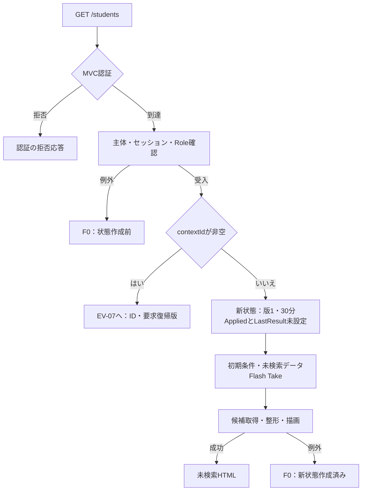

#### SQL・テーブル関連（ER図）

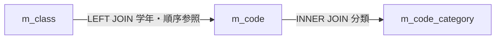

図は候補取得のJOINであり、実FKとは別の関連である。初期表示では学生人数を集計しない。

#### DB操作の詳細

コードとクラスの2結果集合を一つのSNAPSHOT読取トランザクションで取得し、commitして返す。コードと分類の利用状態を候補属性へ計算するが、停止・期間外を除外するWHEREはない。クラスは全取得し、検索用Occupiedは0を設定する。取得順・使用先は選択候補一覧に示す。根拠：`sources/Core/SqlServerStudentService.cs:197-216`。

#### 結果・例外時の扱い

正常時は未検索画面となる。認証・主体確認の拒否は状態作成前、候補取得・整形・描画の失敗は状態作成後である。後者で作成済み状態を削除する処理はない。

設計意図は、必須候補不足を検出して検索不可とし、既定値を先頭候補で代替しないことである。現行には不足による検索禁止がないため、候補取得失敗、取得成功だが0件、初期在籍01・02の候補不在を分けて扱う。設計意図：`reference-designs/基本設計書/01_学生検索画面.md:159-176,415-435`。

### EV-02 検索

#### 処理概要

編集中の条件で非削除学生を検索し、件数と1ページ目を取得する。正常0件と上限超過も受入結果として保持する。拒否時は今回の表示を未検索・空一覧にするが、前回保持条件・結果を消去しない。再表示にも候補取得・整形・描画の失敗段階がある。根拠：`sources/Web/Controllers/StudentsController.cs:13-16`、`sources/Infrastructure/WebStudentCoordinator.cs:7-10,20-21`。

#### 処理手順

1. サブフロー1：MVCの認証・CSRF検査とフォームバインドを経て、FormGuardで許可キー、書式メタ情報、同名複数値を検査する。
2. サブフロー1：在籍区分キー省略を空配列へ補正し、所有者・セッション・指定Tab・期限で最初の状態Getを行う。ここまでは局所catchの外である。
3. サブフロー1：ModelState不正ならサービスを呼ばず422を設定してサブフロー4へ進む。正常なら局所try内でCoordinatorを呼ぶ。
4. サブフロー2：参照情報確認後、DTOをSearchCriteriaへ移す。ClassIdを正のlong?へ変換しPage=1とする。Useで状態取得、Gate待機、取得後の所有者・セッション・Tab・期限再確認、要求版一致、版上限の順に確認する。
5. サブフロー3：サービスは自身のtry外でUserと検索開始時刻・日本時間業務日を取得する。try内で表示指定、年度・クラス、未所属の排他、在籍配列を検査し、文字・コード・日付を正規化する。
6. サブフロー3：接続とSNAPSHOT開始後、指定コード・年度・クラスの存在と上位条件の一致を確認する。全条件で最大10001件を確認し、超過なら行取得を省略、10000以下なら同じSNAPSHOTでページ行を取得してcommitする。
7. サブフロー3：Coordinatorは受入結果だけを保持する。入力側条件の複製をApplied、結果をLastResultへ設定し版を1加算する。Useの正常終了で期限を30分延長し、finallyでGateを解放する。
8. サブフロー4：SearchModelで別途候補を取得し表示データをJSONへ整形する。Controllerは要求PageSize・SortKey・SortDirectionをモデルへ代入し、流入枝の結果・Status・入力・ModelStateを引き継いで描画する。
9. サブフロー4：PageSize=0でページ数計算に到達するとゼロ除算となる。候補取得・整形・他の描画失敗もF0へ伝播する。検索拒否による状態未更新と、エラーHTMLの表示成功は別の結果である。

根拠：`sources/Web/Controllers/StudentsController.cs:14-16,39-41`、`sources/Web/Inputs/StudentSearchInput.cs:19-22`、`sources/Infrastructure/SearchContextStore.cs:13-15`、`sources/Core/SqlServerStudentService.cs:103-170`、`sources/Views/Students/Search.cshtml:8-8`。

#### 処理フロー

サブフロー1：入口検査。出口はサブフロー2、4、MVC拒否、F0。422枝は受信入力を保持し、状態を更新しない。

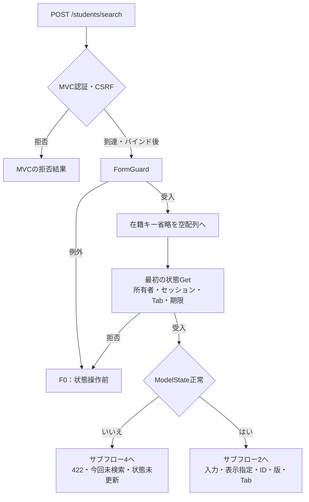

サブフロー2：状態操作開始。局所WebFault出口はそのStatusと項目エラーをサブフロー4へ渡す。その他の例外はF0へ渡す。

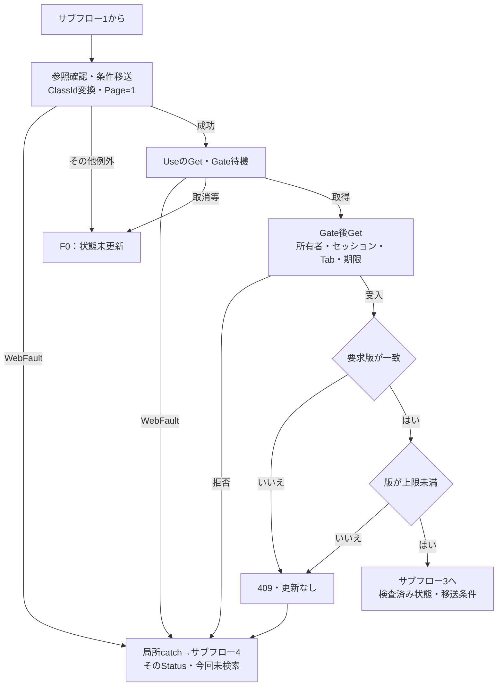

サブフロー3-1：サービス検索。出口は受入結果、入力拒否結果、F0。先行catchから順に分類し、一般例外を正常0件へ変えない。

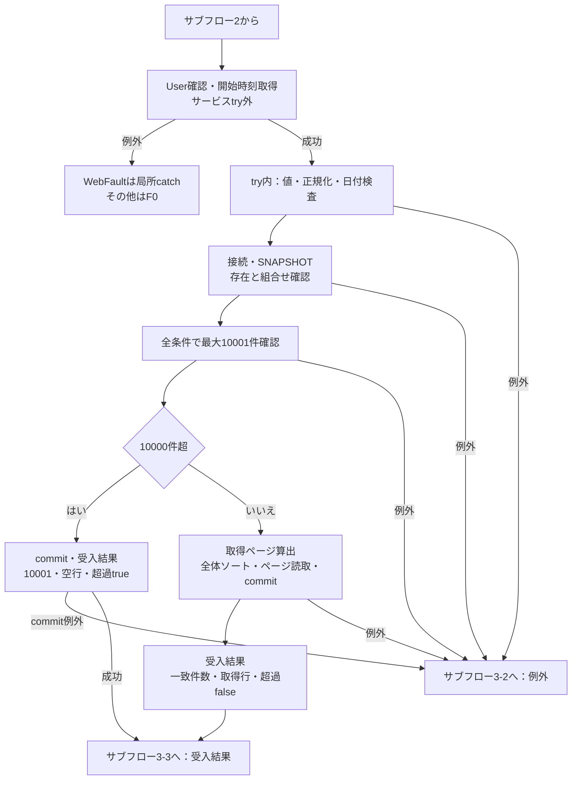

サブフロー3-2：サービスcatch。両入力拒否結果は件数0・空行・開始時刻・超過falseを持つが、正常0件として採用しない。

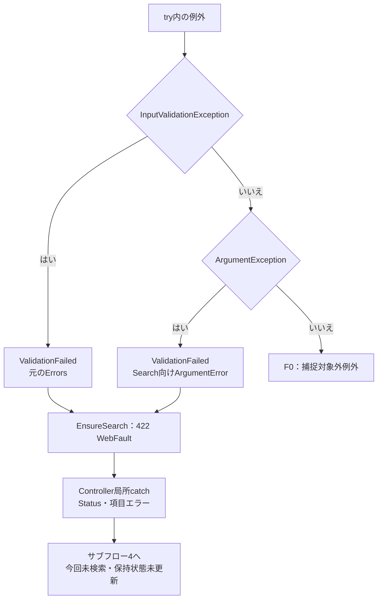

サブフロー3-3：受入結果の保持。tooMany・empty・foundの結果と、更新済み状態をサブフロー4へ渡す。Gate取得後の失敗もfinallyで解放する。

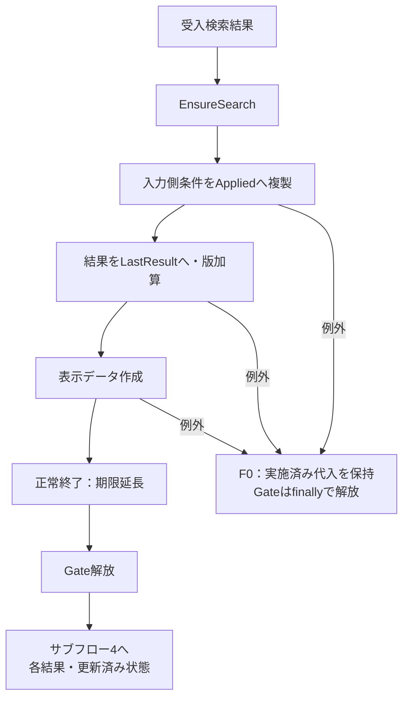

サブフロー4：応答作成。入口で受けたStatus・結果・保持状態を固定値へ置き換えない。

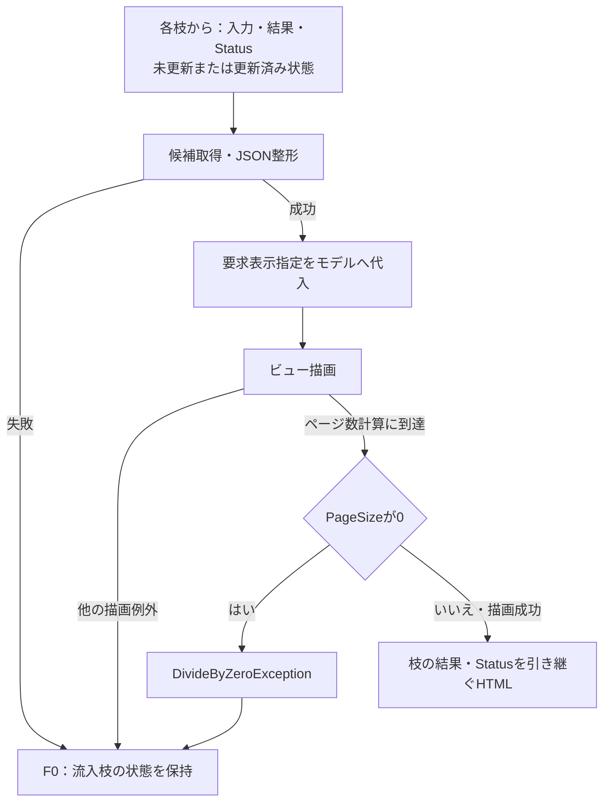

#### SQL・テーブル関連（ER図）

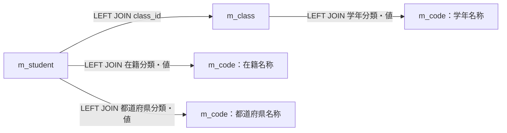

件数SQLは学生・クラス、行SQLは名称用コードも参照する。図は検索JOINで、実FKは補足説明に示す。根拠：`sources/Core/SqlServerStudentService.cs:82-90,156-168`。

#### DB操作の詳細

非削除条件に指定された12条件を追加する。条件間はAND、在籍内はIN、電話内は本人・緊急電話の括弧付きORである。番号は前方一致、氏名・カナは照合キーの部分一致、所属・地域・電話は一致、入学日は両端包含とする。全述語とパラメータは補足説明の検索DB契約に示す。

10001検出時は行SQLを実行せず読取commitし、NoChange・件数10001・空行・LimitExceeded=trueを返す。10000以下は全体ソート後にOFFSET/FETCHで取得し、NoChange・一致件数・取得行・LimitExceeded=falseを返す。検索のNoChangeは業務更新なしの受入結果で、登録画面の変更なし通知とは異なる。根拠：`sources/Core/SqlServerStudentService.cs:137-168`。

#### 結果・例外時の扱い

サービスはInputValidationException、ArgumentExceptionの順に入力拒否結果へ変換する。Coordinatorが先頭エラーから422 WebFaultを作り、Controllerの局所catchがField・MessageをModelStateへ追加しStatusを設定する。FormGuardと最初の状態Getはこのcatch外である。SQL、取消、NULL在籍配列のNullReferenceException等はサービスの二つのcatchに入らない。根拠：`sources/Core/SqlServerStudentService.cs:105-112,169-170`、`sources/Infrastructure/WebStudentCoordinator.cs:20-20`、`sources/Web/Controllers/StudentsController.cs:14-16`。

SearchでPageSize=0がサービスへ届いた枝は、入力拒否により検索状態を更新しない。ModelState不正でサービスを呼ばない枝も422となる。しかし両枝とも要求0をモデルへ戻す。未検索・空一覧でもビューはページ数を割算するため、候補取得・整形が成功して計算へ到達すればゼロ除算となる。F0は応答未開始なら503へ切り替え、開始済みなら同catchで処理しない。根拠：`sources/Web/Controllers/StudentsController.cs:13-16`、`sources/Views/Students/Search.cshtml:8-8`、`sources/Infrastructure/WebHostSetup.cs:23-23`。

### EV-03 候補更新・未所属連動

#### 処理概要

「候補を更新」で編集中の年度・学年に合うクラスを再表示し、不適合選択を解除する。学生を検索せず、前回LastResultを表示する。ブラウザーのDOM補助とサーバーのOptionsは別処理である。根拠：`sources/Web/Controllers/StudentsController.cs:22-22`、`sources/wwwroot/js/site.js:7-7`。

#### 処理手順

1. MVC検査・バインド後、FormGuardと在籍キー省略の空配列補正を行う。
2. 状態ID・所有者・セッション・指定Tab・期限でGetする。受信ContextRevisionは照合せず、Gate取得・版加算・期限延長も行わない。
3. 未所属trueならDTOの年度・学年・クラスをNULLにし、対応ModelState項目も除去する。
4. LastResultと編集中入力をSearchModelへ渡し、LookupAsync(false)で全候補を取得する。ビューは編集中年度・学年でクラスを抽出する。
5. 非空ClassIdが候補IDの10進文字列と一致し、指定年度・学年にも適合するか確認する。IdParserや検索コード正規化は呼ばない。不適合ならClassIdとModelStateを解除する。
6. 通常は条件未反映通知、不適合解除時は解除通知を出す。表示指定は保持済み値または既定値を用い、受信表示指定でモデルを上書きしない。
7. ブラウザーのclearAssignedは初期実行と未所属チェック変更時に、ONなら3つのDOM値だけを空にする。その場でdisabledを切り替えず、DTO・ModelStateにも作用しない。

根拠：`sources/Web/Controllers/StudentsController.cs:22-22,39-39`、`sources/Views/Students/Search.cshtml:5-5`、`sources/wwwroot/js/site.js:7-7`。

#### 処理フロー

サブフロー1。入口はOptionsのPOST、出口は前回結果を持つHTMLまたはF0。状態の版・期限は変更しない。

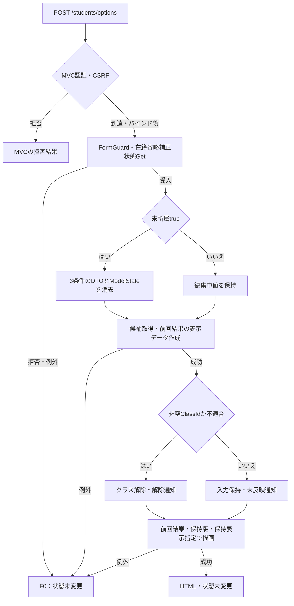

ブラウザー補助はこのPOSTを代替しない。DOM値消去にはDB・状態ストア呼出しがない。

#### SQL・テーブル関連（ER図）

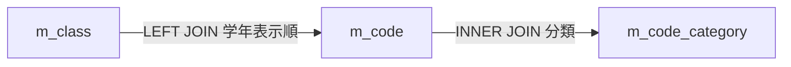

学生行はLastResult由来であり、m_studentの再検索・人数集計は行わない。

#### DB操作の詳細

全コード・全クラスを一つのSNAPSHOTで読みcommitする。上位条件は候補SQLのWHEREへ渡さず、取得後のビュー抽出と選択適合確認に用いる。学生・マスタ更新、履歴追記はない。根拠：`sources/Core/SqlServerStudentService.cs:197-216`、`sources/Web/Controllers/StudentsController.cs:22-22`。

#### 結果・例外時の扱い

OptionsにはModelState.IsValidによる遮断と局所catchがない。FormGuardを値型・存在・NULL排除の保証へ拡張しない。正常一覧は前回の未検索・0件・超過・通常結果を引き継ぎ、失敗はF0へ伝播する。

Searchの未所属矛盾拒否後は、Optionsと同じDTO・ModelState消去を行わない。ビューのdisabledは非活性化であり、消去ではない。描画後のJSがDOM値を空にしてもサーバー側入力消去とはならない。根拠：`sources/Web/Controllers/StudentsController.cs:13-16,22-22`、`sources/Core/SqlServerStudentService.cs:110-110`、`sources/Views/Students/Search.cshtml:5-5`、`sources/wwwroot/js/site.js:7-7`。

設計意図は、未所属ONの解除・即時非活性化、OFFで旧値を復元しないこと、クラス先行選択から年度・学年を補完すること、古い候補応答の破棄、W-STU-107による解除通知である。現行は明示POSTと解除通知を持つが、SRC上位変更の自動通信、クラスからの上位補完、要求世代照合、即時disabled切替、当該メッセージID付与は接続されていない。REG用の補完を検索の実装として扱わない。設計意図：`reference-designs/基本設計書/01_学生検索画面.md:248-254`。現行根拠：`sources/wwwroot/js/site.js:7-8`。

### EV-04 並び替え・表示件数変更・ページ移動

#### 処理概要

Appliedを使い最新DBから一覧を取得する。編集中の12条件を混ぜない。表示件数・ソート・方向の変更時は1ページ、変更なしは要求ページへ進む。件数減少で範囲外になった場合は条件側Pageを補正して再検索する。根拠：`sources/Infrastructure/WebStudentCoordinator.cs:11-13`。

#### 処理手順

1. サブフロー1：MVC検査・バインド後、FormGuardと最初の状態Getを行う。ModelState.IsValidの判定はない。
2. サブフロー1：局所try内で参照確認とUseを行う。Gate後再確認、期待版、版上限を検査し、Appliedなしは409「先に検索してください。」で拒否する。
3. サブフロー1：Appliedを複製し、件数・ソート・方向の変更時はPage=1、それ以外は要求Pageを設定する。新しい表示指定を移し、移送後Pageをサービスの正数検査対象とする。
4. サブフロー1：EV-02の検索DB契約で存在・組合せ・件数・ページを再取得し受入確認する。
5. サブフロー2：非超過で条件Pageが最終ページを超える場合、最低1の最終有効ページへ補正し2回目の検索・受入確認を行う。2回目後に補正を反復しない。
6. サブフロー2：補正なしは1回目、補正ありは補正条件と2回目結果をApplied・LastResultへ設定し、版加算・正常終了時の期限延長を行う。
7. サブフロー2：保持条件から入力欄を作り、候補取得後にHTMLを返す。局所WebFaultは、そのStatusとエラー、保持条件の入力欄、今回未検索・空一覧で再表示する。

根拠：`sources/Web/Controllers/StudentsController.cs:18-19,39-40`、`sources/Infrastructure/WebStudentCoordinator.cs:12-12`、`sources/Infrastructure/SearchContextStore.cs:14-14`。

#### 処理フロー

サブフロー1：保持条件から検索要求を作る。出口はサブフロー2、局所WebFault出口、F0。

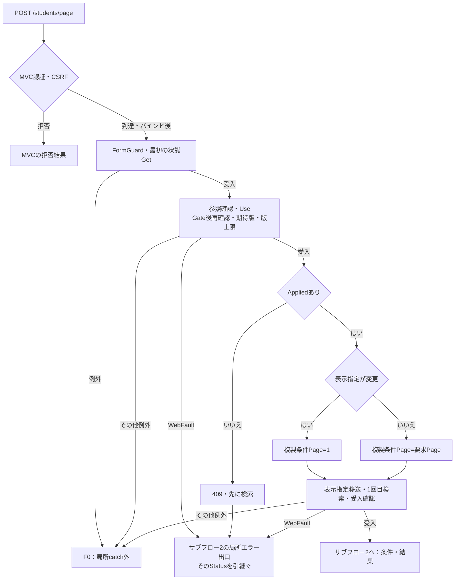

サブフロー2-1：補正と保持。合流では採用した条件・結果をそのまま渡す。

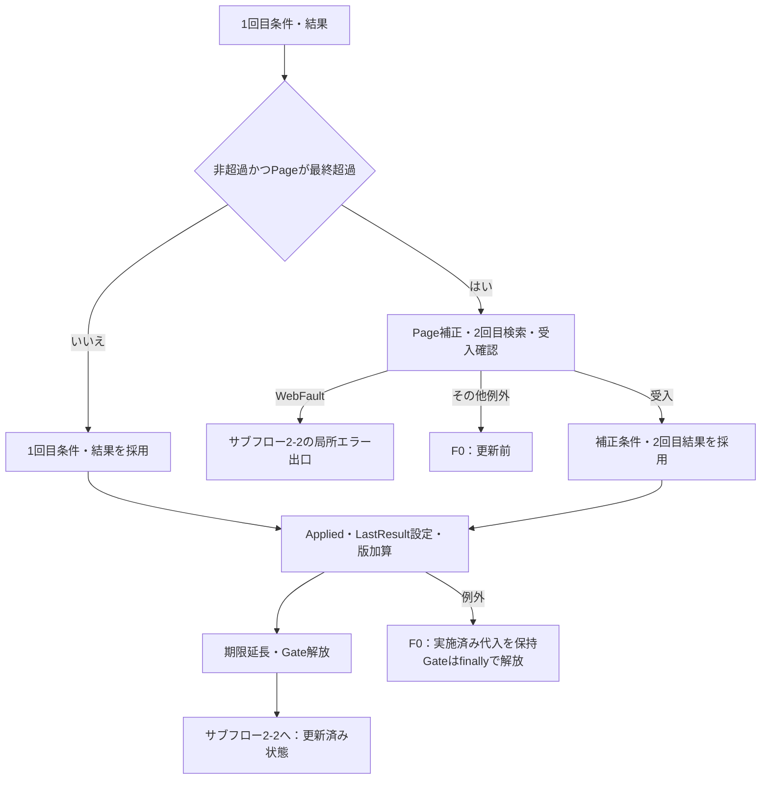

サブフロー2-2：表示と局所エラー再表示。成功後の候補取得でWebFaultが発生する場合は、状態更新済みであることを保持する。

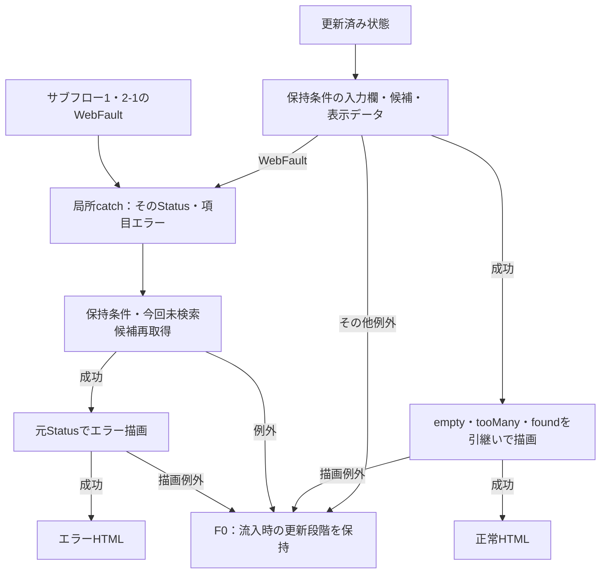

#### SQL・テーブル関連（ER図）

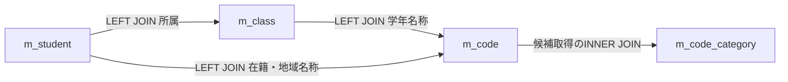

1回目・2回目検索と候補取得は、それぞれ別の読取単位である。

#### DB操作の詳細

EV-02と同じ全述語、存在確認、最大10001件確認、許可ソート、OFFSET/FETCHを使う。サービス単体も取得ページを最終ページに丸めるが、SearchResultへ取得ページ番号を返さない。Coordinatorは条件側Pageを補正して再検索する。根拠：`sources/Core/SqlServerStudentService.cs:123-168`、`sources/Core/Contracts.cs:57-58`、`sources/Infrastructure/WebStudentCoordinator.cs:12-12`。

#### 結果・例外時の扱い

正常結果は0件・上限超過・通常を引き継ぐ。局所WebFaultでは保持条件から入力欄を作り、今回一覧は未検索・空にする。Searchと異なり、不正要求表示指定をモデルへ直接上書きしない。

FormGuard・最初のGetは局所catch外、正常後のSearchModelはtry内である。SearchModelのWebFaultを捕捉した時点で状態更新済みの場合があり、入口拒否と同じ更新前へまとめない。catch内の候補再取得失敗、返したViewの後続描画例外、SQL・取消等はF0へ伝播する。メモリ代入をrollbackする処理はない。根拠：`sources/Web/Controllers/StudentsController.cs:19-19`。

参考設計には先頭・最後の操作と、保持なし・失効時の初期化通知がある。現行は反映・前へ・次へで、Appliedなし・期限切れ・旧版は409拒否となる。設計意図：`reference-designs/基本設計書/01_学生検索画面.md:135-138,293-308`。現行根拠：`sources/Views/Students/Search.cshtml:8-8`、`sources/Infrastructure/SearchContextStore.cs:13-14`。

### EV-05 クリア

#### 処理概要

同じ検索状態IDの実行済み条件と結果を消去し、初期条件・未検索へ戻す。学生DBの削除や状態IDの新規置換ではない。根拠：`sources/Infrastructure/WebStudentCoordinator.cs:15-15`。

#### 処理手順

1. MVC検査・バインド後、クリアフォームのFormGuardを行う。
2. 参照確認後、UseでGet、Gate待機、取得後再確認、期待版・版上限を検査する。
3. Applied・LastResultをNULLにして版を1加算し未検索データを返す。正常終了で期限を30分延長する。
4. ControllerでModelStateを全消去し、同じ状態を再Getする。
5. 初期StudentSearchInput、20件・学籍番号昇順、候補を使ってHTMLを返す。

根拠：`sources/Infrastructure/SearchContextStore.cs:14-14`、`sources/Web/Controllers/StudentsController.cs:21-21,39-39`。

#### 処理フロー

サブフロー1。入口はクリアPOST、出口は未検索HTMLまたはF0。消去前後の失敗を分ける。

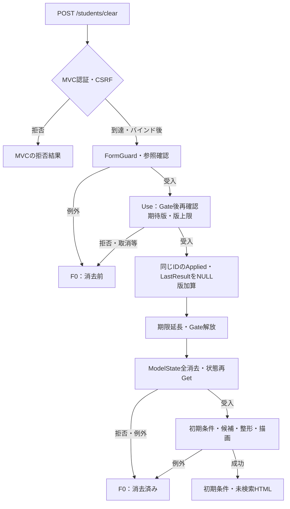

#### SQL・テーブル関連（ER図）

状態消去はSearchContextStoreのメモリ操作で、学生表のDELETEではない。再表示用候補は次の関連から読む。


#### DB操作の詳細

SearchAsyncは呼ばず、LookupAsync(false)で候補をSNAPSHOT読取してcommitする。学生・マスタ更新、履歴追記、t_runtime_state書込みはない。クリア全体をDB参照なしとは説明しない。根拠：`sources/Web/Controllers/StudentsController.cs:21-21,39-39`、`sources/Core/SqlServerStudentService.cs:197-216`。

#### 結果・例外時の扱い

状態・版拒否は消去前、再Get・候補取得・描画失敗は消去後になり得る。ClearにはSearch・Pageの局所WebFault再表示catchがなくF0へ伝播する。

参考設計は初期化と当該操作のDB非使用を説明する。現行のメモリ初期化と、再表示に伴う候補DB読取を分けて対応させる。設計意図：`reference-designs/基本設計書/01_学生検索画面.md:337-360`。

### EV-06 新規・編集・参照への遷移

#### 処理概要

<span id="registration-transition"></span>

新規リンクは検索状態IDを、行リンクは学生管理番号と検索状態IDを登録画面へ渡す。遷移先は詳細の有無を確定し、登録用候補取得後に登録入力を組み立てる。その後、復帰状態を再確認して読込時の復帰版をSnapshotへ保持する。根拠：`sources/Views/Students/Search.cshtml:6-8`、`sources/Infrastructure/WebStudentCoordinator.cs:17-17`、`sources/Web/Controllers/StudentsController.cs:23-25`。

#### 処理手順

1. 検索画面はViewerに新規リンクを表示せず、行リンクを「参照」とする。それ以外は「編集」とする。
2. サブフロー1：GET入口で参照情報を確認する。非空ReturnContextIdがあれば所有者・セッション・期限を確認する。Tabは渡さない。
3. サブフロー1：新規だけ作成権限を確認し、Detail=NULLとする。この段階ではStudentSaveInputをまだ組み立てない。学生詳細読取も行わない。
4. サブフロー1：既存はGetAsyncで学生管理番号と非削除条件による詳細を再取得する。IDが正数でない場合、不在、削除済みは詳細なしとなり404で拒否する。取得成功時はDetailを保持する。
5. サブフロー1：両枝ともLookupAsync(ct)で登録用コード・クラス候補と現在人数を取得する。取得が失敗した場合、登録入力組立て、復帰状態の再Get、Snapshot作成へ進まない。
6. サブフロー2：候補取得成功後、StudentSaveInput.From(detail, contextId, lookup)で登録入力を作る。既存はDetailの保存値を移し、所属クラスを候補から探して年度・学年を設定する。候補に該当クラスがない既存は年度・学年をNULLにする。新規はStudentDraftの初期値を使い、年度は表示時の学校年度、学年は未設定とする。検索条件は登録値へ転記しない。
7. サブフロー2：CoordinatorからDetail・Form・Lookupsが戻った後、Controllerが非空復帰状態IDを再Getして現在Revisionを取得する。最初の確認後にDB awaitを経て失効等になった場合は、ここで拒否する。
8. サブフロー2：Owner・Session・対象ID・枝ごとのDetail・Original入力複製・ReturnRevisionを30分のSnapshotへ保持する。新規だけDetail=NULL、既存は取得済みDetailを渡す。
9. サブフロー2：新規・編集・参照の登録HTMLを返す。検索のApplied・LastResult・Revisionは変更しない。

根拠：`sources/Infrastructure/WebStudentCoordinator.cs:6-6,17-17`、`sources/Core/SqlServerStudentService.cs:172-181,196-216`、`sources/Web/Inputs/StudentSaveInput.cs:44-54`、`sources/Infrastructure/WebPresentation.cs:5-6`、`sources/Web/Controllers/StudentsController.cs:25-25`、`sources/Infrastructure/EditorSnapshotStore.cs:7-11`。

#### 処理フロー

サブフロー1：詳細と登録候補の取得。入口は新規または既存IDのGET。正常出口はDetailと取得済みLookupsをサブフロー2へ渡す。登録入力はこの図では作らない。

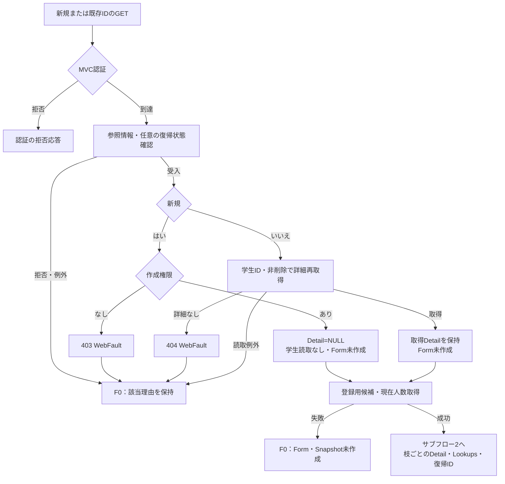

サブフロー2：候補を使った入力組立てとSnapshot作成。候補取得後にしか入らない。復帰IDなしのReturnRevision=NULLを、復帰IDありの取得済み版へ適用しない。

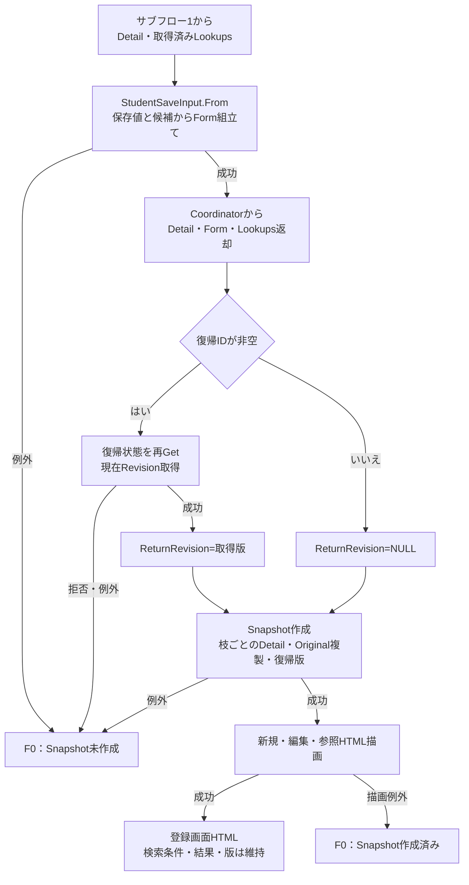

新規はDetailなし、既存は取得済みDetailという違いを、候補取得・入力組立て・Snapshot作成まで保持する。候補取得失敗時にはFormが完成した状態を引き継がない。

#### SQL・テーブル関連（ER図）

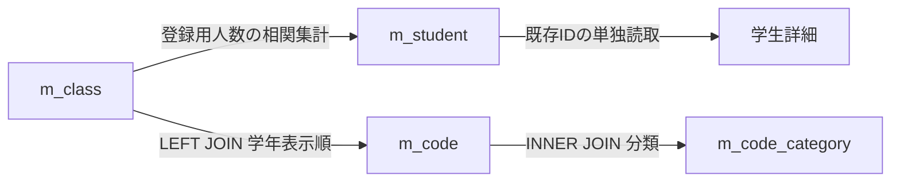

対象詳細の読取は学生単独表のため、対象読取自身のER結合は省略する。図には別処理の候補関連を併記している。現在人数は非削除かつ在籍01・02を数える。

#### DB操作の詳細

既存は`SELECT * FROM dbo.m_student WHERE student_id=@id AND is_deleted=0`で取得する。@idはBigInt、サイズ指定なし。正数でないIDは接続前に詳細なしを返し、新規はこのSQLを呼ばない。

登録用LookupAsync(ct)は人数集計ありの処理を選び、コード・全クラス・現在人数を一つのSNAPSHOTで読んでcommitする。その完了後にFromを呼ぶ。FromはDBアクセスをせず、取得したクラス候補から所属年度・学年を補う。表示人数は保存時の予約や定員確保ではない。このイベントで学生更新・履歴追記は行わない。根拠：`sources/Core/SqlServerStudentService.cs:172-181,196-216`、`sources/Web/Inputs/StudentSaveInput.cs:44-54`。

#### 結果・例外時の扱い

検索時に存在した学生でも、遷移時に不在・削除済みなら404となる。Viewerの新規直URL要求も403で拒否する。候補取得が失敗すれば入力組立てへ進まず、From内の表示変換等が失敗すれば復帰版再取得・Snapshot作成へ進まない。最初の復帰確認を通過していても、入力組立て後の再Getで失効等が判明すれば登録HTMLに到達しない。

Snapshot作成後の描画失敗ではSnapshotは作成済みで、削除する処理はない。登録側のSnapshot.GetはNULLを事前検査せず辞書へ渡すため、NULL引数のライブラリ境界を、空文字・キー不在の独自409と同一視しない。検索との接点は対象再取得、復帰ID、読込時復帰版、確定後通知である。根拠：`sources/Web/Controllers/StudentsController.cs:25-25,29-29,35-37`、`sources/Infrastructure/EditorSnapshotStore.cs:9-10`。

### EV-07 検索復帰・確定通知の取得

#### 処理概要

登録画面から戻る場合と、保存・論理削除の確定後に303で戻る場合に既存検索状態を確認する。未検索から進んだ場合は未検索へ、検索済みなら元条件で最新DBを再検索する。保存学生が条件外でも条件を変更しない。根拠：`sources/Web/Controllers/StudentsController.cs:8-11,31-38`、`sources/Infrastructure/WebStudentCoordinator.cs:14-14`。

#### 処理手順

1. 登録の「検索へ戻る」はReturnContextIdと読込時ReturnRevisionを渡す。未保存変更があれば共通JSで破棄確認し、取消なら遷移を止める。読込時入力へのresetと最新再読込GETは別操作である。
2. 保存・削除のSavedだけReturnAfterSaveへ進む。Flashに「保存しました。」または「論理削除しました。」を入れ、検索URLをLocationとして303を返す。復帰先なしなら新状態と版を作る。
3. サブフロー1：既存IDのGETで参照確認と最初のGetを行う。未設定contextRevisionは空文字としてResumeへ渡し、Tabは渡さない。
4. サブフロー1：UseのGate取得後再確認、期待版の厳密一致、版上限を検査する。失効・旧版・未設定版を新状態や最新版で補わない。
5. サブフロー2：Appliedなしは再検索せず未検索を返し、Revision・LastResultへ代入しない。Appliedありは元条件で再検索し、受入結果をLastResultへ設定、版を1加算する。Appliedは維持する。
6. サブフロー2：両正常枝で期限を30分延長しGateを解放する。未検索枝の版維持と再検索枝の版加算を区別したままサブフロー3へ渡す。
7. サブフロー3：保持条件または初期条件から入力欄を作り、Flash.Takeで通知を一度除去する。その後、候補取得・表示整形・描画を行う。Take後の失敗で通知を戻す処理はない。

根拠：`sources/Views/Students/Edit.cshtml:16-16`、`sources/wwwroot/js/site.js:3-5`、`sources/Web/Controllers/StudentsController.cs:8-11,35-40`、`sources/Infrastructure/SearchContextStore.cs:14-14`、`sources/Infrastructure/FlashMessageStore.cs:6-9`。

#### 処理フロー

サブフロー1：復帰確認。拒否時は該当StatusとFlash未取得をF0へ渡す。

```mermaid
flowchart TD
  A[既存ID付きGET<br/>要求復帰版] --> B{MVC認証}
  B -->|拒否| X[認証の拒否応答]
  B -->|到達| C[参照確認・最初の状態Get]
  C -->|拒否| Q[F0：該当Status<br/>Flash未取得]
  C -->|受入| D[未設定版は空文字<br/>Tab省略でResume]
  D --> E[UseのGet・Gate待機・Gate後Get]
  E -->|拒否・取消等| Q
  E -->|受入| F{期待版一致・版上限未満}
  F -->|いいえ| G[409・自動初期化なし]
  G --> Q
  F -->|はい| H[サブフロー2へ：確認済み状態]
```

サブフロー2：未検索と再検索。合流後も結果・版・保持条件を枝ごとに引き継ぐ。

```mermaid
flowchart TD
  A[サブフロー1から] --> B{Appliedあり}
  B -->|いいえ| C[未検索・版維持<br/>LastResult代入なし]
  B -->|はい| D[元条件で再検索・受入確認]
  D -->|例外・入力拒否| Q[F0：Flash未取得<br/>未実施の代入を補わない]
  D -->|受入| E[LastResult設定・版加算<br/>Applied維持]
  C --> F[期限延長・Gate解放]
  E --> F
  E -->|代入後等の例外| Q
  F --> G[サブフロー3へ<br/>各結果・版・保持条件]
```

サブフロー3：通知消費と描画。再検索結果をfoundへ固定しない。

```mermaid
flowchart TD
  A[未検索または再検索結果] --> B[保持条件または初期条件で入力欄作成]
  B --> C[Flash Take：一度除去<br/>期限内なら通知]
  C --> D[候補取得・表示整形]
  D -->|失敗| Q[F0：Take済み通知は戻さない]
  D -->|成功| E[ビュー描画]
  E -->|失敗| Q
  E -->|成功| F[各結果・版・通知を引継ぐHTML]
```

#### SQL・テーブル関連（ER図）

```mermaid
flowchart LR
  STUDENT[m_student] -->|Appliedありの再検索：LEFT JOIN| CLASS[m_class]
  CLASS -->|LEFT JOIN 学年名称| CODE[m_code]
  STUDENT -->|LEFT JOIN 在籍・地域名称| CODE
  CODE -->|候補取得：INNER JOIN| CATEGORY[m_code_category]
```

Appliedなしでは学生を再検索せず候補だけ読む。Flash・検索状態・Snapshotはメモリ情報であり、図のDB表へ保存・消費しない。

#### DB操作の詳細

AppliedありはEV-02の存在検査・件数・行取得・取消契約を使う。ResumeにはPageの条件側補正と2回目検索がない。サービスは取得ページを最終ページへ丸めるが、PresentはApplied.Pageを表示する。件数減少時は取得行が最終ページ相当でも、表示ページ番号が以前のままになり得る。根拠：`sources/Infrastructure/WebStudentCoordinator.cs:12-14,21-21`、`sources/Core/SqlServerStudentService.cs:159-168`、`sources/Core/Contracts.cs:57-58`。

#### 結果・例外時の扱い

状態NULL・キー不在・失効は409、所有者・別セッション不一致は403、旧版・未設定版・版上限は409となる。設計意図は期限切れの初期化だが、現行は既存IDの失効を拒否し、画面の開き直しを案内する。設計意図：`reference-designs/基本設計書/01_学生検索画面.md:372-376`。現行根拠：`sources/Infrastructure/SearchContextStore.cs:13-14`。

Resumeには検索アクションの局所再表示catchがない。再検索のValidationFailedは422 WebFaultとしてF0へ伝播する。受入後の候補・整形・描画失敗ではLastResult・版が更新済みである。Flash前の拒否は通知未取得、Take後の失敗は通知消費済みと区別する。

Savedは学生変更と履歴のcommit後に返る。NoChange、確認要求、入力不正、競合、SystemError、Unknownは成功通知・303へ進まない。確定後の通知・303・復帰失敗はDBをrollbackしない。登録読込後に検索版が進んでいれば、保存確定済みでも読込時ReturnRevisionでの復帰は409になり得る。根拠：`sources/Core/SqlServerStudentService.cs:306-315,409-416`、`sources/Web/Controllers/StudentsController.cs:25-25,31-38`。

## 補足説明

### 検索状態と一時情報の共通契約

SearchContextStoreはSingletonのConcurrentDictionaryである。状態IDは32バイト乱数の64桁小文字hex、Tab未指定・空のCreateでは別の乱数を発行する。Revisionはlongで初期1。学生row_version・編集ExpectedVersionとは別の版である。根拠：`sources/Infrastructure/WebHostSetup.cs:13-13`、`sources/Infrastructure/SearchContextStore.cs:9-12`、`sources/Web/Inputs/StudentSaveInput.cs:30-33`。

| 対象 | 確認・変更の順序と意味 |
| --- | --- |
| Get | IDがNULLなら辞書呼出し前に409。空文字は辞書検索を行い、不在なら409。存在・期限確認後にOwner・Session・非空Tabを比較し、不一致は403 |
| Use | Get、取消可能なGate待機、取得後Get、期待版厳密一致、版上限の順。正常終了だけ期限をUTC現在＋30分へ延長。取得後はfinallyでGate解放 |
| Applied | 最後に受け入れた入力側SearchCriteriaのJSON複製。Search・Pageで設定、Resumeは維持、ClearはNULL |
| LastResult | Search・Page・検索済みResumeで設定。Optionsは前回結果を読む。ClearはNULL |
| 期限 | 初期30分。Gate待機後に再確認するが、DB await後の追加期限・所有者再確認はない |
| Options | Getだけ。期待版・Gate・版加算・期限延長に参加しない |
| Snapshot | 登録読込時の詳細・原入力複製・対象・所有者・セッション・復帰版を30分保持。検索Gateとは別 |
| Flash | 主体・セッション・検索状態IDで10分保持。TakeはTryRemove後、期限内なら通知、不在・失効なら空文字 |

根拠：`sources/Infrastructure/SearchContextStore.cs:9-15`、`sources/Infrastructure/WebStudentCoordinator.cs:7-15`、`sources/Web/Controllers/StudentsController.cs:22-25`、`sources/Infrastructure/EditorSnapshotStore.cs:7-11`、`sources/Infrastructure/FlashMessageStore.cs:6-9`。

同じ期待版のSearch・Page・Clear・検索済みResumeが並行すると、先行操作が版を進めた後の後続操作は409となる。未検索Resumeは版を進めない。Optionsは直列化に参加せず、GET復帰・登録遷移はTabを渡さない。すべての入口がTab必須という契約ではない。参考設計の要求連番・Busy・古い非同期応答破棄は、現行のGate・Revision・aria-busyとは異なる責務である。設計意図：`reference-designs/詳細仕様書/CSharp_ASPNET/01_学生検索画面.md:143-147,575-584,604-610`。

DDLのt_runtime_state・t_confirmationを検索状態・Snapshot・Flashの保存先へ割り当てない。Web登録はwebTokens=trueを使い、確認情報もWebConfirmationsへ保持する。t_confirmationは非Web設定の確認分岐で、検索状態とは用途が異なる。t_runtime_stateへの検索状態保存・暗号化・消費は接続されていない。根拠：`sources/database/001_schema.sql:156-184`、`sources/Infrastructure/WebHostSetup.cs:13-19`、`sources/Core/SqlServerStudentService.cs:276-284,330-342`。

### 受信・正規化の契約

業務文字数はUnicodeスカラー値で数え、不正サロゲートはArgumentExceptionとなる。TextはNULLを空文字へ補い、Trim前raw上限、制御文字、Trim後の必須・保存上限の順に検査する。ブラウザーmaxlengthのコード単位、サービスのスカラー上限、nvarcharのUTF-16容量、LIKEパラメータサイズは別の制約である。根拠：`sources/Core/StudentNormalizer.cs:37-70`、`sources/Views/Students/Search.cshtml:5-5`、`sources/database/001_schema.sql:9-13,44-47`。

氏名保存は原表記と再生成name_keyを分け、カナ保存は正規化表記と半角空白除去kana_keyを分ける。検索で空白だけを入力した場合、氏名・電話は条件なし、学籍番号は拒否、カナは空キーのLIKE条件となる。原入力・照合値・保存表記を一つの値として扱わない。根拠：`sources/Core/StudentNormalizer.cs:47-94,124-145`、`sources/Core/SqlServerStudentService.cs:113-117,139-142`。

FormGuardは許可キー、同名複数値、__Invariant値を検査する。StatusCodes・UnassignedOnly・__Invariantの複数値を許すが、存在必須・値型・NULL排除は検査しない。MVC設定は非nullable参照型の暗黙requiredを抑止する。SearchだけModelStateを確認し、Page・Clear・Optionsに同じ遮断はない。言語注釈・ブラウザー部品を、すべてのHTTP受信形のNULL排除保証にしない。根拠：`sources/Web/Controllers/StudentsController.cs:13-22,41-41`、`sources/Infrastructure/WebHostSetup.cs:16-18`。

任意文字・コード・入学日両端はサービスでNULLを条件なしにできる。一方、在籍配列はNULL確認前にLengthを参照し、NULL配列が届けばNullReferenceExceptionとなる。NULL要素は許可4値外として入力不正となる。フォームキー省略の空配列補正は、他の受信形のバインド結果を代替する規則ではない。根拠：`sources/Core/SqlServerStudentService.cs:111-121,169-170`、`sources/Web/Controllers/StudentsController.cs:14-15,22-22`。

### 検索DB契約

SNAPSHOT開始後、学年・都道府県はm_codeの分類＋値でCOUNT_BIG=1を要求する。分類はVarChar(24)、値はVarChar(10)。年度はm_class.school_yearに1件以上存在すること、クラスはclass_idで年度・学年を取得して指定上位条件と一致することを確認する。停止・期間外の拒否述語はない。在籍01～04は固定値検査で個別CodeExistsを呼ばず、番号前方検索に完全番号の存在・一意検査を加えない。根拠：`sources/Core/SqlServerStudentService.cs:111-135,218-222`。

| 対象 | SQL条件 | パラメータ型・サイズ | 値と意味 |
| --- | --- | --- | --- |
| 論理削除 | `s.is_deleted=0` | なし | 常時適用 |
| 学籍番号 | `s.student_no LIKE @no ESCAPE '!'` | VarChar(31) | 正規化・エスケープ後に末尾% |
| 氏名 | `s.name_key LIKE @name ESCAPE '!'` | NVarChar(642) | 氏名照合キーの両端に% |
| 氏名カナ | `s.kana_key LIKE @kana ESCAPE '!'` | NVarChar(74) | 正規化・空白除去キーの両端に% |
| 年度 | `c.school_year=@year` | SmallInt、サイズ指定なし | 所属クラス年度 |
| 学年 | `c.grade_code=@grade` | VarChar(2) | 正規化済み学年コード |
| クラス | `s.class_id=@class` | BigInt、サイズ指定なし | クラス管理番号 |
| 未所属 | `s.class_id IS NULL` | なし | true時だけ追加 |
| 都道府県 | `s.prefecture_code=@prefecture` | VarChar(2) | 正規化済み地域コード |
| 電話 | `(s.phone_number=@phone OR s.emergency_phone_number=@phone)` | VarChar(16) | 正規化後完全一致。括弧全体が一条件 |
| 入学日開始 | `s.admission_date>=@from` | Date、サイズ指定なし | 開始を含む |
| 入学日終了 | `s.admission_date<=@to` | Date、サイズ指定なし | 終了を含む |
| 在籍区分 | `s.enrollment_status_code IN (@status0,…)` | 各VarChar(2) | 空配列ならIN述語なし |

全条件はANDで結ぶ。Where helperは値NULLだけを省略し、空文字を独自に省略しない。LIKEのエスケープ対象は`!`、`%`、`_`、`[`。DateOnlyは午前0時のDateTimeへ移す。根拠：`sources/Core/SqlServerStudentService.cs:67-72,137-155`、`sources/Core/StudentNormalizer.cs:161-161`。

件数SQLは学生・クラスのLEFT JOINによる一致ID集合にTOP (10001)を適用しCOUNT_BIGで数える。10000以下は一致総数、10001は超過検出値である。行SQLは名称用LEFT JOINを加え、studentNo→student_no、name→name_key、admissionDate→admission_date、updatedAt→updated_atの許可対応、asc・desc、末尾student_id ASCで全体を並べてページ化する。@offset・@sizeはInt、サイズ指定なし。根拠：`sources/Core/SqlServerStudentService.cs:108-108,156-168`。

存在検査・件数・行取得は同じSNAPSHOTである。HTML用候補は別SNAPSHOTの2結果集合なので検索結果と同じ読取時点にはならない。超過は件数確認後、通常は行読取後にcommitする。検索に明示rollback catchはなく、例外時はawait usingの破棄経路となる。コマンドは30秒設定で、接続・トランザクション開始・SQL実行・読取・commitに取消トークンを渡す。根拠：`sources/Core/SqlServerStudentService.cs:53-66,123-170,197-222`。

IStudentServiceはStudentDb構成名でSqlServerStudentServiceへ接続され、未設定なら503 WebFaultとなる。サービスは暗号化Mandatory・TrustServerCertificate=falseを設定し、接続後にsnapshot_isolation_state=1を確認する。これらは接続・読取方式の前提である。根拠：`sources/Infrastructure/WebHostSetup.cs:19-19`、`sources/Core/SqlServerStudentService.cs:39-64`。

### 実FKと表示名称の保存側

```mermaid
flowchart LR
  CODE[m_code：分類・値の複合PK] -->|実FK category_id| CATEGORY[m_code_category]
  CLASS[m_class：class_idがPK] -->|実FK 学年分類・値| CODE
  STUDENT[m_student：student_idがPK] -->|実FK class_id・NULL可| CLASS
  STUDENT -->|実FK 都道府県分類・値| CODE
  STUDENT -->|実FK 在籍分類・値| CODE
```

検索に関係する実FKを示す。学生には性別・続柄の分類付きFKもあるが、検索一覧の名称JOINでは使わない。検索JOIN、FK、削除連動は別の概念で、未宣言の多重度・所属履歴は追加しない。根拠：`sources/database/001_schema.sql:189-195`、`sources/Core/SqlServerStudentService.cs:82-90`。

クラス名称はClassChange.ClassNameをTextのraw18・保存18・必須で検査し、nvarchar(36) NOT NULL・18スカラーCHECKへNVarChar(36)で保存する。クラスコードはIdentifier上限9、varchar(9) NOT NULL、VarChar(9)。コード名称はCodeChange.CodeNameをraw12・保存12・必須で検査し、nvarchar(24) NOT NULL・12スカラーCHECKへNVarChar(24)で保存する。LEFT JOINのstring?から保存列のNULL属性や上限を推定しない。根拠：`sources/Core/MasterMaintenanceService.cs:33-35,73-76,81-83,113-120`、`sources/database/001_schema.sql:67-68,81-81,115-128`。

名称保守実装は検索画面からの保守入口ではなく、WebHostSetupに保守サービス登録もない。学生に名称コピーを保存せず、検索時JOINで現在名称を取得する。根拠：`sources/Infrastructure/WebHostSetup.cs:13-19`、`sources/Core/SqlServerStudentService.cs:82-90`。

### 日付・住所・表示形式

生年月日は固定元号境界で表示する。明治は1900-01-01～1912-07-29、大正は1912-07-30～1926-12-24、昭和は1926-12-25～1989-01-07、平成は1989-01-08～2019-04-30、令和は2019-05-01以降。1年は「元」、月日は2桁、日付に時差を加えない。範囲外ToInputはArgumentOutOfRangeExceptionとなる。根拠：`sources/Core/JapaneseDateService.cs:9-16,41-50`。

検索日時・更新日時は日本時間yyyy/MM/dd HH:mm:ss、入学日条件の解析値はyyyy-MM-ddである。type=dateのブラウザー表示形式とは区別する。ヘッダー業務日は表示時UTC現在、検索上限日はサービス開始時刻を基にする。新規登録の学校年度は日本時間業務日が1～3月なら前年、4～12月なら当年である。根拠：`sources/Infrastructure/WebPresentation.cs:5-7`、`sources/Core/SqlServerStudentService.cs:44-45,105-105`、`sources/Core/JapaneseDateService.cs:52-59`。

住所は都道府県名称＋住所1。住所2・郵便番号・メール・緊急連絡先・備考は一覧に出さない。名称欠損は住所の都道府県だけ[不整合]、本人電話NULLは「－」とする。年度・学年・クラス・在籍名称のNULLを同じ規則で補わない。根拠：`sources/Core/SqlServerStudentService.cs:77-90`、`sources/Views/Students/Search.cshtml:8-8`。

### F0 共通例外処理と確定境界

認証Cookieは30分・延長ありで、認証失効401、アクセス拒否403を設定する。MVC POSTは自動CSRF検査対象。/api用CSRF JSON変換を/studentsのフォーム応答へ適用しない。認証・CSRFフィルターの拒否結果は、アクションから伝播した例外とは別経路である。根拠：`sources/Infrastructure/WebHostSetup.cs:14-16`、`sources/Infrastructure/AntiforgeryResultFilter.cs:7-8`。

```mermaid
flowchart TD
  A[伝播例外・理由・処理済み状態] --> B{応答未開始}
  B -->|いいえ| X[このcatchの対象外<br/>最終応答はここで確定しない]
  B -->|はい| C{WebFault}
  C -->|はい| D[例外のStatus・Message]
  C -->|いいえ| E[503・共通失敗メッセージ]
  D --> F[students用エラーHTML<br/>検索画面を開くリンク]
  E --> F
  F --> G[通常レイアウトを再構成せず<br/>処理済み状態を戻さない]
```

Searchで422設定後にゼロ除算しても、応答未開始なら503となる。応答開始済みの場合の完了・中断をこのcatchから保証しない。根拠：`sources/Infrastructure/WebHostSetup.cs:22-25`。

| 失敗・拒否 | 到達先と結果 | 保持・確定の境界 |
| --- | --- | --- |
| FormGuardの未知キー・重複等 | WebFault 400。局所catch外ならF0 | 状態更新前 |
| RequestIdentityの認証不正 | WebFault 401。MVC拒否と区別 | 状態操作に進めない |
| 状態の所有者・セッション・指定Tab不一致 | WebFault 403 | Getは先に存在・期限を確認 |
| 状態不在・期限切れ・旧版・版上限 | WebFault 409 | 自動初期化・最新版補完なし |
| SearchのModelState不正 | 422設定後に候補・描画 | サービス未実行。再表示は後続処理 |
| 検索の入力検証・ArgumentException | ValidationFailed→422 WebFault | 正常0件にしない。受入状態更新なし |
| SearchのPageSize=0で計算到達 | DivideByZeroException→F0 | 拒否枝は状態未更新、再表示失敗 |
| SQL・取消・NULL配列等 | F0。応答未開始の一般例外は503 | 正常0件・保存Unknownに置換しない |
| 受入検索後の候補・表示失敗 | 局所catch範囲またはF0 | 状態更新済みの場合あり。メモリrollbackなし |
| 登録候補取得失敗 | F0 | Detailは枝ごとに保持。Form・Snapshot未作成 |
| 登録入力組立て・復帰再Get失敗 | F0 | 候補取得済み。Snapshot未作成 |
| Snapshot作成後の登録描画失敗 | F0 | Snapshot作成済み |
| Flash Take後の表示失敗 | F0 | 通知消費済み、再投入なし |
| Saved後の通知・303・復帰失敗 | 登録確定後の別段階 | 学生・履歴commitを取り消さない |

根拠：`sources/Web/Controllers/StudentsController.cs:8-25,31-41`、`sources/Infrastructure/SearchContextStore.cs:13-14`、`sources/Infrastructure/WebStudentCoordinator.cs:17-17`、`sources/Core/SqlServerStudentService.cs:105-112,169-170,306-323,413-416`。

保存側の結果不明は、入力検証、一意違反、DBConcurrencyExceptionの先行catchを通過し、最後のSqlException・InvalidOperationException・OperationCanceledException対象catchへ到達した場合に限る。そのcatchではwriteStartedがtrue、かつcommitAttemptedまたはrollback失敗ならUnknownとなる。削除もDBConcurrencyExceptionを先に捕捉する。先行catchの例外へUnknown判定を一般化せず、検索復帰はSavedだけを成功通知へ結び付ける。根拠：`sources/Core/SqlServerStudentService.cs:316-329,415-416`、`sources/Web/Controllers/StudentsController.cs:31-38`。

### 設計意図との対応と確認責務

| 主題 | 設計意図 | 現行との対応・確認する内容 |
| --- | --- | --- |
| 値の往復 | raw保持、正規化成功値だけを型付き命令へ移送 | HTTP→DTO→SearchCriteria→照合値→DB→再表示を追う。年度int?・未所属boolのバインド、ClassId手動変換、日付解析を分ける |
| 長さ | 業務スカラー長と物理ガードを区別 | raw・正規化後・maxlength・DB容量・SQLサイズを別々に確認。上限の算定理由は補わない |
| 初期候補 | 必須不足検出、既定値の勝手な代替禁止 | 取得失敗・0件・在籍既定値不在を区別。現行に不足時検索禁止なし |
| 条件連動 | 上位変更解除、クラスから補完、未所属即時非活性、旧応答破棄 | OptionsのDTO・ModelState消去、Searchの入力保持、DOM補助を個別確認。REG連動をSRCへ適用しない |
| 件数・ページ | 0・10000・10001、全体ソート後ページ化 | SNAPSHOT内の件数・行、超過抑止、20・50・100、補正を確認 |
| 表示 | 和暦・日時・範囲・欠損・停止注記 | 現行の保存表記・参照名称・住所算出・電話補完を確認。範囲・全名称補完・一覧注記は設計との差 |
| 競合・期限 | 旧版拒否、同一版の更新要求を重複成功させない | Gate後再確認、版加算、Options非参加、Tab省略、DB await後再検査の有無を確認 |
| 登録遷移 | 再取得値・候補を登録入力へ対応 | 詳細→登録候補→From→復帰再Get→Snapshotの依存順と、各失敗時に未到達の段階を確認 |
| 異常段階 | 入力不正と障害を区別 | サービス拒否、Status、候補・整形、ビュー、middlewareを分ける。PageSize=0を422表示成功で終えない |
| 復帰・通知 | 元条件再検索、期限切れ初期化、確定後通知 | 再検索は接続済み、現行失効は409。表示Pageと取得Page、確定後旧版拒否、Take前後を確認 |

設計意図：`reference-designs/基本設計書/01_学生検索画面.md:159-176,248-254,293-308,372-376,474-491`、`reference-designs/詳細仕様書/CSharp_ASPNET/01_学生検索画面.md:546-550,558-610`。現行根拠は各項目・イベント・共通契約に対応する。

IT担当者は入力、権限、候補、検索先、表示元、登録への移送、確定後復帰を確認する。実装担当者はUnicode最大長、全角・空白、日付境界、停止・期間外候補、NULL・変換失敗、期限・旧版、DB・整形・描画失敗を値の往復と拒否段階へ対応させる。これらは確認責務であり、顧客承認・試験合格の記録ではない。設計意図：`reference-designs/基本設計書/01_学生検索画面.md:474-491`、`reference-designs/詳細仕様書/CSharp_ASPNET/01_学生検索画面.md:546-550,586-602`。

### 関連文書の対応

本書は提示計画のCSHARP_ASPNET-BAS-STU-01に対応する。次の10件は関連文書の計画であり、本応答では未生成である。pathを生成済みリンクとして扱わず、本書の条件・結果を未生成文書だけへ委ねない。

| 文書ID | kind | 相対path | 本書との対応 |
| --- | --- | --- | --- |
| CSHARP_ASPNET-BAS-STU-02 | basic-design | 基本設計書/02_学生登録画面.md | 新規・編集・参照、保存・削除・取消、検索復帰 |
| CSHARP_ASPNET-BAS-STU-03 | table-index | 基本設計書/03_テーブル仕様書.md | 検索対象とマスタの関連、共通保存規則 |
| CSHARP_ASPNET-BAS-STU-04 | code-design | 基本設計書/04_コード設計書.md | 学年・在籍・都道府県の選択値、名称保守 |
| CSHARP_ASPNET-BAS-STU-03-M_STUDENT | table-definition | 基本設計書/テーブル/01_m_student.md | 検索・表示列、照合キー、非削除、所属 |
| CSHARP_ASPNET-BAS-STU-03-M_CLASS | table-definition | 基本設計書/テーブル/02_m_class.md | 年度・学年・クラス候補、所属名称 |
| CSHARP_ASPNET-BAS-STU-03-M_CODE_CATEGORY | table-definition | 基本設計書/テーブル/03_m_code_category.md | 候補分類と分類利用状態 |
| CSHARP_ASPNET-BAS-STU-03-M_CODE | table-definition | 基本設計書/テーブル/04_m_code.md | 分類付き値・名称・順序・期間・利用状態 |
| CSHARP_ASPNET-BAS-STU-03-T_OPERATION_LOG | table-definition | 基本設計書/テーブル/05_t_operation_log.md | 登録変更と一括確定する履歴。検索自身は追記なし |
| CSHARP_ASPNET-DET-CSharp_ASPNET-SCR-STU-001 | detailed-specification | 詳細仕様書/CSharp_ASPNET/01_学生検索画面.md | 実コントロール、受信型、状態版、SQL、例外経路 |
| CSHARP_ASPNET-DET-CSharp_ASPNET-SCR-STU-002 | detailed-specification | 詳細仕様書/CSharp_ASPNET/02_学生登録画面.md | Snapshot、保存確定、303・Flash、復帰接点 |
