<!-- spec-meta: {"schema":"spec-md/1.0","documentId":"CSHARP_ASPNET-BAS-STU-01","version":"1.3","path":"基本設計書/01_学生検索画面.md","sheets":[{"heading":"概要","kind":"GRID","sheet":"01_概要"},{"heading":"項目一覧","kind":"LIST","sheet":"02_項目一覧","key":["No"]},{"heading":"選択候補一覧","kind":"LIST","sheet":"03_選択候補一覧","key":["候補ID"]},{"heading":"イベント仕様","kind":"GRID","sheet":"04_イベント仕様"},{"heading":"補足説明","kind":"GRID","sheet":"05_補足説明"}]} -->
# 学生検索画面 基本設計書

| 属性 | 内容 |
| --- | --- |
| 文書ID | CSHARP_ASPNET-BAS-STU-01 |
| 文書種別 | basic-design |
| 版 | 1.3 |
| 正本path | 基本設計書/01_学生検索画面.md |
| 対象読者 | 業務システムのIT担当者、経験5年程度の実装者 |
| 記述基準 | 現行動作は接続されたソースから説明する。参考設計の要求は「設計意図」と明記する。 |

## 概要

### 業務の目的と対象

利用者は学生の識別情報、所属、在籍区分、地域、電話、入学日を指定して学生を探し、一覧から学生登録画面へ進む。Viewerは既存学生を参照し、Staff・Administratorは編集する。作成権限のある利用者は新規登録へ進める。検索画面自身は学生基本情報と操作履歴を更新せず、最後に受け入れた検索条件と検索結果をサーバーのメモリへ保持する。根拠：`sources/Views/Students/Search.cshtml:3-8`、`sources/Infrastructure/WebStudentCoordinator.cs:7-17`、`sources/Core/SqlServerStudentService.cs:137-168`。

年度・学年は、学生の現在または最終所属を示すクラスの属性である。学生の`class_id`からクラスを参照して検索・表示するため、学生自身の年度列や年度別所属履歴を扱う検索ではない。設計意図は単一校の学生基本情報を対象とし、成績、帳票、一覧直接編集、一括更新、削除済み照会を対象外とすることである。根拠：`sources/Core/Contracts.cs:31-53`、`sources/Core/SqlServerStudentService.cs:82-90,143-146`。設計意図：`reference-designs/基本設計書/01_学生検索画面.md:14-24`。

入力は検索条件と操作指定、出力は一覧とメッセージである。学生・クラス・コードはDB参照対象、検索状態・編集Snapshot・Flashは一時保持情報として区別する。CSV、帳票、取込ファイルを入出力とする接続は本機能にない。設計資料そのものや、設計資料が言及するマスタ保守用の承認入力ファイルを、この検索画面の業務ファイル入力には数えない。根拠：`sources/Web/Controllers/StudentsController.cs:8-25,38-40`。設計意図：`reference-designs/基本設計書/01_学生検索画面.md:75-100`。

### 操作入口と権限

| 操作 | 接続された入口 | 主な受渡し | 利用者・結果 |
| --- | --- | --- | --- |
| 初期表示 | GET `/students` | 検索状態未指定 | 認証済み利用者。新状態を作り未検索HTMLを返す |
| 検索復帰 | GET `/students` | `contextId`、`contextRevision` | 元状態を検査し、検索済みなら再検索する |
| 検索 | POST `/students/search` | `Criteria`接頭辞の12条件、状態ID・版・Tab、表示指定 | 新条件で検索しHTMLを返す |
| 候補更新 | POST `/students/options` | 編集中条件、状態制御値 | 全画面HTMLを返す。学生再検索は行わない |
| 並び替え・ページ移動 | POST `/students/page` | 状態ID・版・Tab、ページ・表示指定 | 保持済み条件で再検索する |
| クリア | POST `/students/clear` | 状態ID・版・Tab | 保持条件と結果を消去し初期表示へ戻す |
| 新規登録へ進む | GET `/students/new` | `returnContextId` | Viewerにはリンクを出さず、入口でも403で拒否する |
| 編集・参照へ進む | GET `/students/{id:long}` | 学生管理番号、`returnContextId` | Viewerは参照、定義された他のRoleは編集 |
| メニューから起動・メニューへ戻る | 現行の専用入口なし | 設計意図だけを保持 | 現行UIへ未実装のリンクやrouteを追加して説明しない |

`Program`がControllerを登録し、`WebHostSetup`が`IStudentService`を`SqlServerStudentService`へ接続する。検索・候補更新はフォームを受けるHTML画面である。`OptionsRequest`、Coordinatorの`Options`、`StrictJson`、表示用JSON helperの宣言だけから、公開学生JSON APIを補わない。ルート`/`は`/students`へのリダイレクトであり、共通メニュー画面を実装する入口ではない。根拠：`sources/Program.cs:3-7`、`sources/Infrastructure/WebHostSetup.cs:13-19`、`sources/Web/Controllers/StudentsController.cs:5-24`、`sources/Infrastructure/WebStudentCoordinator.cs:16-17`。

Roleの定義はViewer・Staff・Administratorである。検索条件はViewerも操作できる。Viewerの場合だけ新規登録リンクを隠し、行リンクの文言を「参照」にする。遷移先ではViewerの業務入力を非活性とし、削除は既存学生かつAdministratorの場合だけ表示する。表示差と入口での権限確認は別の検査である。根拠：`sources/Core/Contracts.cs:4-4`、`sources/Infrastructure/RequestIdentity.cs:7-16`、`sources/Views/Students/Search.cshtml:6-8`、`sources/Views/Students/Edit.cshtml:3-5,17-17`。

### 画面構成と静的投影

画面は共有ヘッダー、学生検索見出し、共通メッセージ、検索条件、クリア・新規登録、結果状態、表示指定、一覧、ページ操作の順に配置する。共有ヘッダーはシステム名、認証情報の利用者名、日本時間の業務日を表示する。条件欄は2列、幅760px以下では1列となる。一覧は横スクロール領域に置き、表の最小幅は1050pxである。根拠：`sources/Views/_ViewStart.cshtml:1-1`、`sources/Views/Shared/_Layout.cshtml:1-1`、`sources/Views/Students/Search.cshtml:3-8`、`sources/wwwroot/css/site.css:1-1`。

次のHTMLはStaff・Administratorの初期状態を示す非実行の配置投影である。在籍名称はseedの定義を例示しており、実DBの候補取得結果ではない。その他の動的候補と利用者・状態識別値は代入していない。送信先はdata属性へ移し、ボタンは`type=button`、登録リンクは文書内fragmentにしている。元の共有CSSを内包し、JavaScriptや実HTTP接続を付けていない。根拠：`sources/Views/Students/Search.cshtml:4-8`、`sources/Views/Shared/_Layout.cshtml:1-1`、`sources/wwwroot/css/site.css:1-1`、`sources/database/002_seed.sql:19-22`。

<!doctype html>
<html lang="ja">
<head>
<meta charset="utf-8">
<meta name="viewport" content="width=device-width,initial-scale=1">
<title>学生管理</title>
<style>
:root{font-family:Meiryo,'Yu Gothic UI',sans-serif;color:#243448;background:#f2f5f9;font-size:14px}*{box-sizing:border-box}body{margin:0}header{background:#153654;color:white;padding:16px 28px;display:flex;justify-content:space-between;gap:20px}main{background:white;max-width:1440px;margin:24px auto;padding:24px}h1{font-size:24px}fieldset{border:1px solid #c8d1dc;padding:18px;margin:12px 0}legend{font-weight:bold}.fields{display:grid;grid-template-columns:1fr 1fr;gap:14px 28px}label{display:flex;flex-direction:column;gap:5px}.full{grid-column:1/-1}input,select,textarea,button{font:inherit;padding:8px;border:1px solid #afbece;border-radius:3px}textarea{min-height:90px}input,select,textarea{max-width:100%;width:100%}.check{display:inline-flex;flex-direction:row;align-items:center;margin-right:12px}.check input{width:auto}.actions{display:flex;gap:10px;align-items:center;flex-wrap:wrap;margin:16px 0}button{background:white;cursor:pointer}.primary{background:#1c5985;color:white}.danger{color:#ae2534;border-color:#b44d59}button:disabled{cursor:default;color:#8a98a5;background:#f3f5f8}.message{padding:14px;border:1px solid #b6dccc;background:#edf7f3}.error{background:#fff1f1;border-color:#c66}.warning{background:#fff8eb;padding:12px}.grid{overflow-x:auto}table{border-collapse:collapse;min-width:1050px;width:100%;font-size:12px}th,td{padding:10px 8px;border:1px solid #d4dee8;vertical-align:top;overflow-wrap:anywhere}th{background:#e6eef6}tr:nth-child(even){background:#f8fafc}.pager{display:flex;gap:14px;align-items:center;justify-content:center;margin:18px}.wareki{display:flex;gap:6px;align-items:center;flex-wrap:wrap}.wareki input{width:65px}.wareki select{width:100px}.dialog{position:fixed;inset:10% 10%;overflow:auto;padding:28px;background:white;border:3px solid #153654;box-shadow:0 0 0 100vmax #0007;z-index:10}.dialog table{min-width:0}small{color:#5f7183}@media(max-width:760px){main{margin:0;padding:15px}.fields{grid-template-columns:1fr}header{flex-direction:column}.dialog{inset:5%}}
</style>
</head>
<body>
<header><strong>学生管理システム</strong><span>利用者［利用者名］　業務日［yyyy/MM/dd］</span></header>
<main>
<h1>学生検索</h1>
<form data-method="post" data-route="/students/search" data-search-form>
<input type="hidden" name="ContextId" value="［検索状態ID］">
<input type="hidden" name="ContextRevision" value="1">
<input type="hidden" name="TabId" value="［タブ識別］">
<input type="hidden" name="PageSize" value="20">
<input type="hidden" name="SortKey" value="studentNo">
<input type="hidden" name="SortDirection" value="asc">
<input type="hidden" name="__RequestVerificationToken" value="">
<fieldset><legend>検索条件</legend><div class="fields">
<label>学籍番号<input name="Criteria.StudentNo" id="SRC-001" maxlength="30" value=""></label>
<label>氏名<input name="Criteria.Name" id="SRC-002" maxlength="16" value=""></label>
<label>氏名カナ<input name="Criteria.Kana" id="SRC-003" maxlength="72" value=""></label>
<label>年度<select name="Criteria.SchoolYear" id="SRC-004"><option value="">すべて</option></select></label>
<label>学年<select name="Criteria.GradeCode" id="SRC-005"><option value="">すべて</option></select></label>
<label>クラス<select name="Criteria.ClassId" id="SRC-006"><option value="">すべて</option></select></label>
<label class="check"><input type="checkbox" name="Criteria.UnassignedOnly" id="SRC-007" value="true">未所属のみ</label>
<fieldset><legend>在籍区分</legend><label class="check"><input type="checkbox" name="Criteria.StatusCodes" value="01" checked>在学</label><label class="check"><input type="checkbox" name="Criteria.StatusCodes" value="02" checked>休学</label><label class="check"><input type="checkbox" name="Criteria.StatusCodes" value="03">卒業</label><label class="check"><input type="checkbox" name="Criteria.StatusCodes" value="04">退学</label><small>全解除はすべて</small></fieldset>
<label>都道府県<select name="Criteria.PrefectureCode" id="SRC-009"><option value="">すべて</option></select></label>
<label>電話番号<input name="Criteria.PhoneNumber" id="SRC-010" maxlength="40" value=""></label>
<label>入学日・開始<input name="Criteria.AdmissionFrom" id="SRC-011" type="date" value=""></label>
<label>入学日・終了<input name="Criteria.AdmissionTo" id="SRC-012" type="date" value=""></label>
</div><div class="actions"><button type="button" class="primary" data-method="post" data-route="/students/search">検索</button><button type="button" data-method="post" data-route="/students/options">候補を更新</button></div></fieldset>
</form>
<div class="actions"><form data-method="post" data-route="/students/clear"><input type="hidden" name="__RequestVerificationToken" value=""><input type="hidden" name="ContextId" value="［検索状態ID］"><input type="hidden" name="ContextRevision" value="1"><input type="hidden" name="TabId" value="［タブ識別］"><button type="button">クリア</button></form><a href="#registration-transition" data-route="/students/new?returnContextId={ContextId}">新規登録</a></div>
<p>未検索</p>
<form data-method="post" data-route="/students/page">
<input type="hidden" name="__RequestVerificationToken" value=""><input type="hidden" name="ContextId" value="［検索状態ID］"><input type="hidden" name="ContextRevision" value="1"><input type="hidden" name="TabId" value="［タブ識別］">
<div class="actions"><label>表示件数<select name="PageSize"><option value="20" selected>20</option><option value="50">50</option><option value="100">100</option></select></label><label>並び順<select name="SortKey"><option value="studentNo" selected>学籍番号</option><option value="name">氏名</option><option value="admissionDate">入学日</option><option value="updatedAt">更新日時</option></select></label><select name="SortDirection" aria-label="並び順方向"><option value="asc" selected>昇順</option><option value="desc">降順</option></select><button type="button" name="Page" value="1" disabled>並び順・件数を反映</button></div>
<div class="grid"><table><thead><tr><th>学籍番号</th><th>氏名</th><th>氏名カナ</th><th>生年月日</th><th>年度／学年</th><th>クラス</th><th>在籍区分</th><th>住所</th><th>本人電話</th><th>更新日時</th><th>操作</th></tr></thead><tbody></tbody></table></div>
<nav class="pager"><button type="button" name="Page" value="0" disabled>前へ</button><span>1 / 1</span><button type="button" name="Page" value="2" disabled>次へ</button></nav>
</form>
</main>
</body>
</html>

初期投影にはメッセージのDOMを置かない。ModelStateにエラーがある場合は見出し直後に`class="message error"`、情報がある場合はその後に`class="message info"`のdivを配置し、両者に`aria-live="polite"`を付ける。`info`専用CSSはなく、情報パネルには`.message`、エラーパネルには`.message`と`.error`が適用される。上限警告はメッセージパネルとは別の`p.warning`である。根拠：`sources/Views/Shared/_MessagePanel.cshtml:1-3`、`sources/Views/Students/Search.cshtml:3-7`、`sources/wwwroot/css/site.css:1-1`。

### 状態別の表示と設計意図

| 状態 | 現行表示・操作 | 設計意図との対応 |
| --- | --- | --- |
| 初回・クリア後 | 「未検索」。一覧行なし。反映・前へ・次へは非活性。ページは1 / 1 | 設計の初期案内は「条件を指定して検索してください」。在学・休学、20件、学籍番号昇順は一致する |
| 通常結果 | 1～10000件。件数、検索日時、取得ページの行を表示。先頭の前へ、最終の次へを非活性にする | 全体を並べてからページ化する。設計の開始・終了範囲欄は現行にない |
| 0件 | 「該当する学生はありません。」。一覧操作は非活性 | 内部結果は件数0と検索日時を持つが、現行は件数・日時の段落を出さない。設計の範囲は0～0 |
| 上限超過 | 絞込み要求。行なし。一致件数（totalCount）はNULL。表示件数（PageSize）は保持され、選択欄にも表示される。一覧操作は非活性 | 10001は超過検出値。一部だけの一覧や推定全件数を出さない |
| 検索入力不正 | 再表示に到達した場合は原入力とエラー、今回の未検索・空一覧 | 前回のApplied・LastResultは保持される。再表示後の候補取得・整形・描画は別の失敗段階 |
| 条件変更・未実行 | Options後は編集中条件、未反映通知、前回結果 | ページ操作はAppliedを使う。検索条件欄の変更だけでは自動通信・自動検索しない |
| 未所属ON | DTOがtrueなら年度・学年・クラスを非活性にする | Optionsのサーバー消去、Searchの矛盾拒否、JSのDOM値消去を区別する。詳細はEV-03 |
| Viewer | 新規リンクなし、行リンクは参照。検索条件は操作可 | 参照権限を理由に検索欄全体を非活性にはしない |
| 送信中 | 同じフォーム内の送信ボタン以外のbuttonを無効化し、フォームにaria-busyを付ける | 設計は入力保持、処理中表示、二重検索抑止を要求する。現行は送信ボタン自身を無効化せず、検索専用の処理中表示もない |
| 共通システムエラー | 応答未開始なら共通エラーHTMLと検索画面を開くリンク | 設計は原入力保持、旧一覧を最新結果として残さないこと、受付番号案内を要求する。現行の共通HTMLは検索条件・一覧・共有ヘッダーを再構成せず、受付番号も付けない |

現行表示の根拠：`sources/Views/Students/Search.cshtml:2-8`、`sources/Web/Controllers/StudentsController.cs:13-22`、`sources/Infrastructure/WebStudentCoordinator.cs:21-21`、`sources/wwwroot/js/site.js:4-7`、`sources/Infrastructure/WebHostSetup.cs:23-23`。設計意図：`reference-designs/基本設計書/01_学生検索画面.md:58-71,122-138`。

Viewerの投影では新規登録a要素を省略する。未所属ONのサーバー表示では3つのselectに`disabled`を付け、OFFでは属性自体を省略する。検索欄に`readonly`を付ける処理はない。検索済み状態では結果段落とtbodyを置き換え、有効なページ操作だけから`disabled`を除く。異なるモードを同時に成立する画面として投影しない。根拠：`sources/Views/Students/Search.cshtml:5-8`。

参考設計の画面見本は架空データによる検索済み状態である。設計は未所属の年度・学年・クラスを「－」、名称欠損を不整合、一覧クラスの停止・期間外を注記で示す。現行は本人電話NULLの「－」と、住所の都道府県名称欠損の「[不整合]」を実装するが、所属・在籍名称の統一補完や一覧クラスの注記を持たない。候補の停止注記と一覧の表示を混同しない。設計意図：`reference-designs/基本設計書/01_学生検索画面.md:28-71,125-134,472-472`。現行根拠：`sources/Core/SqlServerStudentService.cs:77-90`、`sources/Views/Students/Search.cshtml:5-8`。

### 入力・処理値・保存値・表示値

HTTPフォーム文字列、MVCバインド後のDTO、`SearchCriteria`、サービス内の照合値、DB保存値、表示値を分ける。年度はDTOで`int?`、未所属は`bool`へバインドされる。クラスは`string?`から手動で`long?`へ変換し、入学日両端は`string?`からサービス内で`DateOnly?`へ解析する。非nullable注釈やHTML属性を、欠落・変換失敗・NULLの排除保証とは扱わない。根拠：`sources/Web/Inputs/StudentSearchInput.cs:7-29`、`sources/Web/Inputs/StudentSaveInput.cs:57-60`、`sources/Infrastructure/WebHostSetup.cs:16-16`、`sources/Core/SqlServerStudentService.cs:107-122`。

氏名は入力から氏名照合キーを生成して検索し、一覧には保存された原表記を出す。カナは正規化して空白を除いたキーで検索し、一覧には保存されたカナ表記を出す。電話条件は本人・緊急の2列を検索するが、一覧は本人電話だけを出す。住所は都道府県名称と住所1の連結表示であり、住所2は含めない。根拠：`sources/Core/SqlServerStudentService.cs:77-90,113-153`、`sources/Infrastructure/WebPresentation.cs:20-20`。

業務文字数はUnicodeスカラー値で数える。HTMLのmaxlengthはコード単位、nvarcharの容量はUTF-16コード単位、SQLパラメータサイズは物理受渡し容量である。raw上限はTrim前、正規化後上限は変換後に適用する。不正サロゲートは`ArgumentException`となる。根拠：`sources/Core/StudentNormalizer.cs:37-85`。設計意図：`reference-designs/詳細仕様書/CSharp_ASPNET/01_学生検索画面.md:594-598`。

| 保持領域 | 内容 | 使用先 |
| --- | --- | --- |
| 検索フォーム | 編集中の12条件、制御値、hiddenの表示指定 | Searchは新条件を実行、Optionsは候補を再表示 |
| 一覧操作フォーム | 制御値、Page・PageSize・SortKey・SortDirection | 12条件を送らずAppliedで再検索 |
| 業務DB | 学生、所属クラス、分類付きコード、候補分類 | 存在検査、件数、行、候補を供給 |
| 検索状態メモリ | 所有者・セッション・Tab・期限・Revision・Applied・LastResult・Gate | 同一検索状態の更新・復帰を制御 |
| 編集Snapshotメモリ | 読込時Detail、Original入力の複製、対象、所有者、復帰版、期限 | 登録側の取消・再表示・復帰を制御 |
| Flashメモリ | 主体・セッション・検索状態IDに結び付く通知 | 検索表示で一度だけ取得 |

Appliedは最後に受け入れた入力側条件のJSON複製であり、サービス内で生成した氏名キー・カナキー・電話正規化値を書き戻した領域ではない。候補の取得結果、候補から選んだ値、検索実行済み条件も別の情報である。根拠：`sources/Infrastructure/SearchContextStore.cs:9-15`、`sources/Infrastructure/WebStudentCoordinator.cs:8-15`、`sources/Core/SqlServerStudentService.cs:113-121`。

項目一覧のSRC番号は論理項目を識別する。SRC-001～007・009～012は実ビューのidに対応するが、在籍checkboxに固定SRC-008のDOM idはない。操作・表示項目と参考設計だけの項目の番号を、現行DOMのidとして新設しない。N・CHK・EVの設計識別子との対応は補足説明にまとめる。

## 項目一覧

| No | グループ | 項目名 | 種類 | 入出力 | DB連携項目 | 候補取得元 | 必須 | 形式・桁 | 説明 |
| --- | --- | --- | --- | --- | --- | --- | --- | --- | --- |
| SRC-001 | 検索条件 | 学籍番号 | 文字入力 | I | `m_student.student_no` | なし | 任意 | maxlength30コード単位、raw15スカラー、正規化後15以内 | `Criteria.StudentNo:string`→内部`StudentNo:string?`。初期空。NULL・空文字は条件なし。非空はTrim・FormKC・大文字化後、先頭英数字、以降英数字・ハイフンを要求する。空白だけは拒否。前方一致。保存元`varchar(15) NOT NULL`、保存`VarChar(15)`、検索`@no VarChar(31)`。根拠：`sources/Core/StudentNormalizer.cs:59-64,124-124`、`sources/Core/SqlServerStudentService.cs:31-31,113-113,140-140`、`sources/database/001_schema.sql:9-9`。 |
| SRC-002 | 検索条件 | 氏名 | 文字入力 | I | 検索`name_key`、表示原表記`student_name` | なし | 任意 | maxlength16コード単位、raw8スカラー、キー160スカラー以内 | `Criteria.Name:string`→`StudentName:string?`。NULL・Trim後空は条件なし。制御文字を拒否し、FormKC・大文字化・Unicode空白除去のキーで部分一致。原表記`nvarchar(16) NOT NULL`、キー`nvarchar(320) NOT NULL`。保存サイズ16・320、検索`@name NVarChar(642)`。根拠：`sources/Core/StudentNormalizer.cs:47-70,125-145`、`sources/Core/SqlServerStudentService.cs:31-32,114-115,141-141`、`sources/database/001_schema.sql:10-13,44-47`。 |
| SRC-003 | 検索条件 | 氏名カナ | 文字入力 | I | 検索`kana_key`、表示`student_name_kana` | なし | 任意 | maxlength72コード単位、raw36スカラー、正規化後18スカラー | `Criteria.Kana:string`→`StudentNameKana:string?`。FormKC、空白整理、対象ひらがなのカタカナ化、許可文字検査後、半角空白を除いて部分一致。NULL・空文字は条件なし。空白だけの非空入力は空キーのLIKE条件となる。保存2列は各`nvarchar(36) NOT NULL`、保存サイズ36、検索`@kana NVarChar(74)`。根拠：`sources/Core/StudentNormalizer.cs:72-85,126-145`、`sources/Core/SqlServerStudentService.cs:116-116,142-142`、`sources/database/001_schema.sql:11-13,45-47`。 |
| SRC-004 | 検索条件 | 年度 | 選択 | I | 所属先`m_class.school_year` | OP-YEAR | 任意 | DTO・内部`int?`、1900～9998。設計raw4桁 | 初期未設定「すべて」。年度に属するクラスの存在を確認して完全一致。学生へ独立保存しない。保存元`smallint NOT NULL`、確認・検索`@year SmallInt`、サイズなし。現行は数値バインド後の範囲検査で、独立したraw4桁検査はない。根拠：`sources/Web/Inputs/StudentSearchInput.cs:10-22`、`sources/Core/SqlServerStudentService.cs:109-109,126-143`、`sources/database/001_schema.sql:64-64`。設計：`reference-designs/基本設計書/01_学生検索画面.md:109-109`。 |
| SRC-005 | 検索条件 | 学年 | 選択 | I | 所属先`m_class.grade_code` | OP-GRADE | 任意 | `string?`、raw2スカラー、正規化後数字2桁 | 初期「すべて」。Trim・FormKC後、GRADEの存在を確認。停止・期間外も検索可。00「学年なし」は実コードで、class_idがNULLの未所属と別。保存元`varchar(2) NOT NULL`、検索`@grade VarChar(2)`、存在確認の分類24・値10のVarChar。根拠：`sources/Core/StudentNormalizer.cs:113-117`、`sources/Core/SqlServerStudentService.cs:118-125,144-144,218-222`、`sources/database/001_schema.sql:65-66`、`sources/database/002_seed.sql:78-84`。 |
| SRC-006 | 検索条件 | クラス | 選択 | I | `m_student.class_id`→`m_class.class_id` | OP-CLASS | 任意 | DTO`string?`→`long?`、非空はASCII数字19文字以内、正の64bit整数 | 初期「すべて」。NULL・空文字は未選択。検索時にIdParserで変換し、実在と指定年度・学年の一致を確認。名称・クラスコードは送信値ではない。学生列`bigint NULL`、参照先`bigint IDENTITY NOT NULL`、検索`@class`・確認`@id`はBigInt、サイズなし。根拠：`sources/Web/Inputs/StudentSaveInput.cs:57-60`、`sources/Core/SqlServerStudentService.cs:131-145`、`sources/database/001_schema.sql:28-28,63-63`。 |
| SRC-007 | 検索条件 | 未所属のみ | チェック | I | `m_student.class_id IS NULL`、専用保存列なし | なし | 任意 | `Criteria.UnassignedOnly:bool`、初期false | true時は年度・学年・クラスの同時指定を正規化前に拒否する。非NULLの空学年文字列も同時指定検査では指定あり。SQLパラメータなし。値の解除と非活性化はEV-03で層別に示す。根拠：`sources/Core/SqlServerStudentService.cs:110-110,146-146`、`sources/Views/Students/Search.cshtml:5-5`。 |
| SRC-008 | 検索条件 | 在籍区分 | 複数チェック | I | `m_student.enrollment_status_code` | OP-STATUS | 任意 | `Criteria.StatusCodes:string[]`、01～04、最大4値、重複不可 | 初期01・02。固定DOM idなし。Search・Optionsはキー省略を空配列へ補正し、全解除は全区分検索。Trim・全角変換は行わない。INの各`@statusN VarChar(2)`、保存元`varchar(2) NOT NULL`。NULL配列が届く場合のLength参照は一般例外。根拠：`sources/Web/Controllers/StudentsController.cs:14-15,22-22`、`sources/Core/SqlServerStudentService.cs:111-112,151-154`、`sources/database/001_schema.sql:25-26`。 |
| SRC-009 | 検索条件 | 都道府県 | 選択 | I | `m_student.prefecture_code` | OP-PREFECTURE | 任意 | `string?`、raw2スカラー、正規化後数字2桁 | 初期「すべて」。Trim・FormKC後、PREFECTUREの存在を確認し完全一致。名称は送信しない。保存元`varchar(2) NOT NULL`、検索`@prefecture VarChar(2)`、存在確認は分類24・値10のVarChar。根拠：`sources/Core/StudentNormalizer.cs:113-117`、`sources/Core/SqlServerStudentService.cs:119-125,147-147`、`sources/database/001_schema.sql:18-19`。 |
| SRC-010 | 検索条件 | 電話番号 | 文字入力 | I | 本人`phone_number`、緊急`emergency_phone_number` | なし | 任意 | maxlength40コード単位、raw20スカラー、正規化値最大16文字 | `Criteria.PhoneNumber:string`→内部`string?`。NULL・Trim後空は条件なし。FormKC後、空白・対象ハイフン・括弧を除去。国内0始まり10～11桁、国際は+と非ゼロ始まり7～15桁。2列の完全一致OR。両列`varchar(16) NULL`、保存・検索VarChar(16)。根拠：`sources/Core/StudentNormalizer.cs:87-94,133-141`、`sources/Core/SqlServerStudentService.cs:34-37,117-117,148-148`、`sources/database/001_schema.sql:22-22,32-32`。 |
| SRC-011 | 検索条件 | 入学日・開始 | 日付入力 | I | `m_student.admission_date`下限 | なし | 任意 | `string?`→`DateOnly?`、FormKC後ISO10文字 | 初期未設定。NULL・空文字は下限なし。yyyy-MM-ddの実在日、1900-01-01～検索開始時の日本時間業務日。両端指定時は開始≦終了。開始を含む。保存元`date NOT NULL`、`@from Date`、サイズなし。ブラウザー表示と送信ISO値は別。根拠：`sources/Core/JapaneseDateService.cs:52-59`、`sources/Core/SqlServerStudentService.cs:105-105,120-122,149-149`、`sources/database/001_schema.sql:24-24`。 |
| SRC-012 | 検索条件 | 入学日・終了 | 日付入力 | I | `m_student.admission_date`上限 | なし | 任意 | `string?`→`DateOnly?`、FormKC後ISO10文字 | 初期未設定。NULL・空文字は上限なし。開始と同じ日付範囲。終了を含み片側指定も可。`@to Date`、サイズなし。設計表示形式はyyyy/MM/dd。根拠：`sources/Core/JapaneseDateService.cs:52-59`、`sources/Core/SqlServerStudentService.cs:120-122,150-150`。設計：`reference-designs/基本設計書/01_学生検索画面.md:116-117`。 |
| SRC-013 | 操作 | 検索 | ボタン | ‐ | 学生・クラス・コード読取 | なし | 非該当 | 新検索のPage=1 | 編集中条件を実行し、受入結果だけを保持する。表示指定はhiddenで送る。根拠：`sources/Views/Students/Search.cshtml:4-5`、`sources/Infrastructure/WebStudentCoordinator.cs:7-10`。 |
| SRC-014 | 操作 | クリア | ボタン | ‐ | 候補読取、業務更新なし | OP-YEAR～OP-PREFECTURE | 非該当 | 独立フォーム | 同じ状態IDのApplied・LastResultを消去し、初期条件へ戻す。根拠：`sources/Web/Controllers/StudentsController.cs:21-21,39-39`、`sources/Infrastructure/WebStudentCoordinator.cs:15-15`。 |
| SRC-015 | 操作 | 新規登録 | リンク | ‐ | 遷移先で候補読取 | 登録用候補 | 非該当 | returnContextIdを移送 | Viewerには非表示。入口でも作成権限を確認。検索条件を登録初期値へ転記しない。根拠：`sources/Views/Students/Search.cshtml:6-6`、`sources/Infrastructure/WebStudentCoordinator.cs:17-17`。 |
| SRC-016 | 設計上の操作 | メニューへ | 操作 | ‐ | 設計上は業務DB更新なし | なし | 非該当 | 現行DOM・routeなし | 共通メニューへ戻る設計意図。メニューからの起動も想定するが、現行に専用メニュー操作はない。根拠：`reference-designs/基本設計書/01_学生検索画面.md:20-20,121-121,337-360`、`sources/Program.cs:6-7`、`sources/Views/Students/Search.cshtml:3-8`。 |
| SRC-017 | 結果 | 一致件数 | 表示 | O | 最大10001件のCOUNT_BIG | なし | 検索受入時 | `totalCount:int?`、表示0～10000 | 未検索・超過はNULL、0件は内部0、通常は一致件数。設計内部名TotalCount・SRC-INT-001は非負整数5桁。10001は超過検出値。根拠：`sources/Core/SqlServerStudentService.cs:156-168`、`sources/Infrastructure/WebStudentCoordinator.cs:21-21`。設計：`reference-designs/詳細仕様書/CSharp_ASPNET/01_学生検索画面.md:135-135`。 |
| SRC-INT-002 | 設計上の結果 | 開始位置 | 算出表示 | O | 設計上の件数・取得範囲、保存列なし | なし | 設計では検索成功時 | RangeFrom、非負整数5桁、0～10000 | SRC-017の細分化。0件は0、未検索・上限超過は未設定。現行Presentとビューには属性・表示欄がない。未観測の算出式を補わない。根拠：`reference-designs/詳細仕様書/CSharp_ASPNET/01_学生検索画面.md:135-137`、`sources/Infrastructure/WebStudentCoordinator.cs:21-21`、`sources/Views/Students/Search.cshtml:7-8`。 |
| SRC-INT-003 | 設計上の結果 | 終了位置 | 算出表示 | O | 設計上の件数・取得範囲、保存列なし | なし | 設計では検索成功時 | RangeTo、非負整数5桁、0～10000 | SRC-017の細分化。0件は0、未検索・上限超過は未設定。現行に属性・表示欄がない。表示件数PageSizeと別。根拠：`reference-designs/詳細仕様書/CSharp_ASPNET/01_学生検索画面.md:135-137`、`sources/Infrastructure/WebStudentCoordinator.cs:21-21`、`sources/Views/Students/Search.cshtml:7-8`。 |
| SRC-018 | 結果 | 検索日時 | 表示 | O | DB列なし、検索開始時刻 | なし | 検索受入時 | `DateTimeOffset`→日本時間19文字 | yyyy/MM/dd HH:mm:ss。未検索はNULL。0件にも内部時刻があるがfoundの場合だけ段落表示。根拠：`sources/Core/SqlServerStudentService.cs:105-105,168-170`、`sources/Infrastructure/WebPresentation.cs:7-7`、`sources/Views/Students/Search.cshtml:7-7`。 |
| SRC-019 | 表示指定 | 表示件数 | 選択 | I | DB保存なし、取得範囲 | UI-SIZE | 有効値を要求 | 現行`PageSize:int`、20・50・100、既定20。設計raw3桁 | selectまたは検索hidden。SQL`@size Int`、サイズなし。変更時は1ページ。現行に独立したraw3桁検査はなく、Searchは不正要求0もモデルへ戻す。根拠：`sources/Web/Controllers/StudentsController.cs:13-16`、`sources/Core/SqlServerStudentService.cs:107-107,164-164`。設計：`reference-designs/基本設計書/01_学生検索画面.md:124-124`。 |
| SRC-020 | 一覧 | 学籍番号 | 表示 | O | `m_student.student_no` | なし | 行取得時 | `StudentRow.StudentNo:string`、上限15 | 保存番号を表示。検索用前方一致値と別。`varchar(15) NOT NULL`、保存VarChar(15)。根拠：`sources/Core/SqlServerStudentService.cs:31-31,77-85`、`sources/database/001_schema.sql:9-9`。 |
| SRC-021 | 一覧 | 氏名 | 表示 | O | `m_student.student_name` | なし | 行取得時 | `StudentName:string`、8スカラー | 原表記を表示し照合キーは出さない。`nvarchar(16) NOT NULL`・8スカラーCHECK、保存NVarChar(16)。根拠：`sources/Core/StudentNormalizer.cs:125-125`、`sources/Core/SqlServerStudentService.cs:31-31,77-85`、`sources/database/001_schema.sql:10-10,44-44`。 |
| SRC-022 | 一覧 | 氏名カナ | 表示 | O | `m_student.student_name_kana` | なし | 行取得時 | `StudentNameKana:string`、18スカラー | 正規化済み保存表記。`nvarchar(36) NOT NULL`・18スカラーCHECK、保存NVarChar(36)。根拠：`sources/Core/StudentNormalizer.cs:72-85,126-126`、`sources/Core/SqlServerStudentService.cs:31-31,77-85`、`sources/database/001_schema.sql:11-11,45-45`。 |
| SRC-023 | 一覧 | 生年月日 | 算出表示 | O | `m_student.birth_date` | なし | 行取得時 | `DateOnly`→固定境界の和暦 | `date NOT NULL`、保存Date。元年、2桁月日で表示し時差を加えない。変換範囲外はArgumentOutOfRangeException。根拠：`sources/Core/Contracts.cs:50-55`、`sources/Core/JapaneseDateService.cs:9-16,41-50`、`sources/database/001_schema.sql:14-14`。 |
| SRC-024 | 一覧 | 年度／学年 | 複合表示 | O | `m_class.school_year`、分類付き学年→`m_code.code_name` | なし | 所属が取得できた場合 | `SchoolYear:int?`、`GradeName:string?`、年度4桁・名称12スカラー | 保存元smallint NOT NULL、名称nvarchar(24) NOT NULL、名称保存NVarChar(24)。LEFT JOIN結果はNULL可。現行に統一「－」補完なし。根拠：`sources/Core/SqlServerStudentService.cs:77-90`、`sources/Core/MasterMaintenanceService.cs:82-82,115-115`、`sources/database/001_schema.sql:64-66,115-128`。 |
| SRC-025 | 一覧 | クラス | 複合表示 | O | `m_class.class_code`・`class_name` | なし | 所属が取得できた場合 | `ClassCode:string?`・`ClassName:string?`、コード9・名称18スカラー | 保存元varchar(9) NOT NULL、nvarchar(36) NOT NULL、保存サイズ9・36。未所属等の結合結果はNULL可。一覧に停止・期間外注記なし。根拠：`sources/Core/MasterMaintenanceService.cs:33-35,73-73`、`sources/Core/SqlServerStudentService.cs:77-90`、`sources/database/001_schema.sql:67-68,81-81`。 |
| SRC-026 | 一覧 | 在籍区分 | 名称表示 | O | 学生の分類・コード→`m_code.code_name` | なし | 行取得時 | `EnrollmentStatusName:string?`、名称12スカラー | 名称保存元nvarchar(24) NOT NULL、保存NVarChar(24)。名称取得不成立でも学生行を残す。保存列のNOT NULLと表示結果のNULLを区別する。根拠：`sources/Core/SqlServerStudentService.cs:84-90`、`sources/Core/MasterMaintenanceService.cs:82-82,115-115`、`sources/database/001_schema.sql:115-128`。 |
| SRC-027 | 一覧 | 住所 | 算出表示 | O | 都道府県名称＋`m_student.address_line1` | なし | 行取得時 | `Address:string`、表示元12＋45スカラー | 区切りなしで連結し、名称欠損は[不整合]。住所1はnvarchar(90) NOT NULL、保存NVarChar(90)。住所2は別のnvarchar(90) NULLで一覧に含めない。根拠：`sources/Core/SqlServerStudentService.cs:34-34,77-90`、`sources/Core/StudentNormalizer.cs:131-132`、`sources/database/001_schema.sql:20-21,48-49`。 |
| SRC-028 | 一覧 | 本人電話 | 表示 | O | `m_student.phone_number` | なし | 任意値の表示 | `PhoneNumber:string?`、正規化後最大16文字 | varchar(16) NULL、保存VarChar(16)。NULLは「－」。緊急電話に検索一致しても本人電話を表示する。根拠：`sources/Core/SqlServerStudentService.cs:34-34,77-85,148-148`、`sources/Views/Students/Search.cshtml:8-8`、`sources/database/001_schema.sql:22-22`。 |
| SRC-029 | 一覧 | 更新日時 | 表示 | O | `m_student.updated_at` | なし | 行取得時 | `DateTimeOffset`→日本時間19文字 | UTC保存値をyyyy/MM/dd HH:mm:ssへ変換。datetimeoffset(7) NOT NULL・UTC CHECK、保存DateTimeOffset。根拠：`sources/Infrastructure/WebPresentation.cs:7-7,20-20`、`sources/Core/SqlServerStudentService.cs:300-300`、`sources/database/001_schema.sql:40-40,57-57`。 |
| SRC-030 | 行操作 | 編集／参照 | リンク | ‐ | `m_student.student_id` | なし | 対象行がある場合 | `long`→10進文字列、正64bit | 行番号でなく管理番号で遷移し非削除対象を再取得。PK bigint IDENTITY NOT NULL、読込`@id BigInt`。検索row_versionはWeb行出力に含めない。根拠：`sources/Infrastructure/WebPresentation.cs:20-20`、`sources/Core/SqlServerStudentService.cs:172-181`、`sources/database/001_schema.sql:8-8,43-43`。 |
| SRC-031 | 一覧操作 | ページ移動 | ボタン・表示 | I／O | DB保存なし、取得範囲 | なし | 移送後Pageは正数 | `Page:int`、初期1 / 1 | 反映Page=1、前へ、次へ。設計にある先頭・最後専用ボタンは現行にない。表示指定変更時は要求Pageに代えて1。`@offset Int`、サイズなし。根拠：`sources/Views/Students/Search.cshtml:8-8`、`sources/Infrastructure/WebStudentCoordinator.cs:12-12`、`sources/Core/SqlServerStudentService.cs:159-164`。設計：`reference-designs/基本設計書/01_学生検索画面.md:136-136`。 |
| SRC-032 | 表示指定 | 並び順項目 | 選択 | I | 学籍番号・氏名キー・入学日・更新日時の取得順 | UI-SORT | 有効値を要求 | `SortKey:string`、許可4値、既定studentNo。設計raw13スカラー | nameは原表記でなくname_key順。現行は許可値検査で独立したraw長検査なし。自由なSQL列指定は受けず、学生ID ASCを副順序にする。根拠：`sources/Core/SqlServerStudentService.cs:108-108,162-162`。設計：`reference-designs/基本設計書/01_学生検索画面.md:137-137`。 |
| SRC-033 | 表示指定 | 並び順方向 | 選択 | I | DB保存なし、主ソート方向 | UI-DIRECTION | 有効値を要求 | `SortDirection:string`、asc・desc、既定asc。設計raw4スカラー | 変更時は1ページ。現行は許可値検査で独立したraw長検査なし。学生IDの副順序は常にASC。根拠：`sources/Core/SqlServerStudentService.cs:107-108,162-162`、`sources/Infrastructure/WebStudentCoordinator.cs:12-12`。設計：`reference-designs/基本設計書/01_学生検索画面.md:138-138`。 |
| 補助-01 | 操作 | 候補を更新 | ボタン | ‐ | コード・クラス候補読取 | OP-YEAR～OP-PREFECTURE | 非該当 | 検索フォームの別送信先 | 現行追加操作を識別する文書キー。DOM idではない。編集値を補正して前回結果と再表示し、Applied・版・期限を更新しない。根拠：`sources/Views/Students/Search.cshtml:5-5`、`sources/Web/Controllers/StudentsController.cs:22-22`。 |
| 制御-01 | 状態制御 | 検索状態ID | hidden | I／O | DB保存なし、メモリキー | サーバー発行 | 既存状態操作に必要 | 要求`string`、発行値64桁小文字hex | ContextId。NULLは辞書呼出し前に409。空文字・キー不在・失効も409。Getに形式・長さ検査なし。設計のSRC-INT-010へ対応。根拠：`sources/Infrastructure/SearchContextStore.cs:9-13`。 |
| 制御-02 | 状態制御 | 検索状態版 | hidden | I／O | DB保存なし、Entry.Revision | サーバー発行 | Search・Page・Clear・Resumeで一致必要 | 要求`string`、保持`long`、初期1 | ContextRevision。10進文字列を厳密照合し、省略・旧版を最新版で補完しない。Optionsは照合なし。学生row_versionと別。根拠：`sources/Infrastructure/SearchContextStore.cs:9-14`、`sources/Web/Controllers/StudentsController.cs:8-22`。 |
| 制御-03 | 状態制御 | タブ識別 | hidden | I／O | DB保存なし、Entry.Tab | サーバー発行等 | 非空で渡された場合に照合 | 要求`string`、未指定・空の発行時は64桁hex | TabId。GetはNULL・空なら照合を省略する。GET復帰と登録遷移は渡さない。全入口の必須タブ検査ではない。根拠：`sources/Infrastructure/SearchContextStore.cs:12-14`、`sources/Web/Controllers/StudentsController.cs:8-25`。 |
| 制御-04 | 要求制御 | CSRF情報 | hidden | I／O | 業務DB列なし | 認証基盤 | MVC POST検査対象 | 基盤の不透明値 | Html.AntiForgeryToken。設計SRC-INT-011。認可、状態版、二重送信制御の代替ではない。実値長は基盤定義。根拠：`sources/Views/Students/Search.cshtml:4-8`、`sources/Infrastructure/WebHostSetup.cs:15-16`。設計：`reference-designs/詳細仕様書/CSharp_ASPNET/01_学生検索画面.md:145-145`。 |
| SRC-INT-012 | 設計上の制御 | 処理中 | 内部値 | ‐ | DB保存なし | 処理開始・終了 | 自動 | IsBusy、真偽、初期false | 設計は処理開始・終了でUI再入を防ぐ値として定義する。DB排他とは別。現行モデルに同名値はなく、aria-busyと一部button無効化は役割が限定される。根拠：`reference-designs/詳細仕様書/CSharp_ASPNET/01_学生検索画面.md:146-146`、`sources/Web/Models/StudentSearchPageModel.cs:4-16`、`sources/wwwroot/js/site.js:4-4`。 |
| SRC-INT-013 | 設計上の制御 | 応答世代 | 内部値 | ‐ | DB保存なし | 画面内要求連番 | 設計では非同期要求時 | RequestSequence、非負整数、初期0 | 設計は旧応答の破棄に用い、桁あふれ時は採番を続けない。現行検索に同名値・世代照合はない。Gate・ContextRevisionで代替済みとはしない。根拠：`reference-designs/詳細仕様書/CSharp_ASPNET/01_学生検索画面.md:147-147`、`sources/Infrastructure/SearchContextStore.cs:9-14`、`sources/wwwroot/js/site.js:4-8`。 |
| 共有-01 | 共有表示 | システム名 | 固定表示 | O | DB連携なし | なし | 非該当 | 学生管理システム | 共有headerのstrong。根拠：`sources/Views/Shared/_Layout.cshtml:1-1`。 |
| 共有-02 | 共有表示 | 利用者名 | 表示 | O | 業務DB列なし、User.Identity.Name | 認証情報 | 非該当 | 表示名称、業務上限定義なし | 認証主体の識別値と別。ビューで非空を検査しない。根拠：`sources/Views/Shared/_Layout.cshtml:1-1`、`sources/Infrastructure/RequestIdentity.cs:7-10`。 |
| 共有-03 | 共有表示 | 業務日 | 算出表示 | O | DB列なし、表示時UTC現在 | WebPresentation.BusinessDate | 非該当 | 日本時間yyyy/MM/dd | 検索日付上限を決める検索開始時刻とは算出時点が異なる。根拠：`sources/Infrastructure/WebPresentation.cs:5-7`、`sources/Core/SqlServerStudentService.cs:44-45,105-105`。 |
| 共有-04 | メッセージ | 通知・入力エラー・上限警告 | パネル・段落 | O | ModelState、Flashメモリ | 呼出結果・Controller・Flash | 条件付き表示 | メッセージ文字列、業務長定義なし | 情報とエラーはaria-live付きdiv、上限はwarning段落。取得と描画成功は別段階。設計メッセージIDとの対応は補足説明。根拠：`sources/Views/Shared/_MessagePanel.cshtml:1-3`、`sources/Views/Students/Search.cshtml:7-7`、`sources/Infrastructure/FlashMessageStore.cs:6-9`。 |

## 選択候補一覧

| 候補ID | 使用先 | 取得元・抽出条件 | 順序 | キー・表示名 | 初期値 | 保持・解除・有効性 | 根拠 |
| --- | --- | --- | --- | --- | --- | --- | --- |
| OP-YEAR | 年度 | 全クラスのSchoolYearを重複除去。停止・過去年度を含む | 年度降順 | 年度を送信・表示。空はすべて | 未設定 | 未所属のOptionsで解除。年度変更だけでは自動検索しない | `sources/Views/Students/Search.cshtml:5-5`、`sources/Core/SqlServerStudentService.cs:206-214`、`sources/Web/Controllers/StudentsController.cs:22-22` |
| OP-GRADE | 学年 | 全コードからGRADEを抽出。停止・期間外も含む | display_order、code_value | CodeValueを送信、CodeNameを表示。空はすべて、00は学年なし | 未設定 | 未所属のOptionsで解除。検索ビューにコード停止・期間外注記なし。名称保存上限12スカラー | `sources/Core/SqlServerStudentService.cs:203-212`、`sources/Views/Students/Search.cshtml:5-5`、`sources/Core/MasterMaintenanceService.cs:82-82`、`sources/database/002_seed.sql:78-84` |
| OP-CLASS | クラス | 全m_classを取得後、ビューで編集中年度・学年により抽出 | 年度降順、学年表示順、クラス表示順、コード、ID | ClassIdを送信。現行表示は年度・コード・名称。設計表示は年度・学年・コード・名称 | 未設定「すべて」 | 停止は（停止）を付け選択可。期間外も除外せず注記なし。Optionsで不適合選択を解除。Occupied=0は集計省略値 | `sources/Core/SqlServerStudentService.cs:196-216`、`sources/Views/Students/Search.cshtml:5-5`、`sources/Web/Controllers/StudentsController.cs:22-22,39-39`、`reference-designs/基本設計書/01_学生検索画面.md:146-146` |
| OP-STATUS | 在籍区分 | 全コードからENROLLMENT_STATUSを抽出 | display_order、code_value | CodeValue・CodeName。seedは01在学、02休学、03卒業、04退学 | 01・02 | 全解除は全区分。停止・期間外も候補に含む。サービス受入値は01～04、名称保存上限12スカラー | `sources/Core/SqlServerStudentService.cs:111-112,203-212`、`sources/Views/Students/Search.cshtml:5-5`、`sources/database/002_seed.sql:19-22` |
| OP-PREFECTURE | 都道府県 | 全コードからPREFECTUREを抽出 | display_order、code_value | CodeValue・CodeName。空はすべて | 未設定 | 検索時に存在確認。Optionsには独立した都道府県解除・存在検査なし。名称保存上限12スカラー | `sources/Core/SqlServerStudentService.cs:119-125,203-212`、`sources/Web/Controllers/StudentsController.cs:22-22`、`sources/Core/MasterMaintenanceService.cs:82-82` |
| UI-SIZE | 表示件数 | ビュー・サービスの固定値、業務コードではない | 20、50、100 | 現行表示は数値 | 20 | 変更後のページ操作は1ページ | `sources/Views/Students/Search.cshtml:8-8`、`sources/Core/SqlServerStudentService.cs:107-107`、`sources/Infrastructure/WebStudentCoordinator.cs:12-12` |
| UI-SORT | 並び順項目 | 固定4値、自由なDB列指定ではない | 学籍番号、氏名、入学日、更新日時 | studentNo、name、admissionDate、updatedAt | studentNo | 変更時は1ページ。nameはname_key順 | `sources/Views/Students/Search.cshtml:8-8`、`sources/Core/SqlServerStudentService.cs:108-108` |
| UI-DIRECTION | 並び順方向 | 固定2値 | 昇順、降順 | asc、desc | asc | 変更時は1ページ。学生IDの副順序は常に昇順 | `sources/Views/Students/Search.cshtml:8-8`、`sources/Core/SqlServerStudentService.cs:107-108,162-162` |

## イベント仕様

### EV-01 初期表示

#### 処理概要

検索状態を指定しないGETで初期条件と候補を用意し、学生を検索せず未検索画面を返す。既存状態IDを指定したGETはEV-07へ進む。根拠：`sources/Web/Controllers/StudentsController.cs:8-11,39-39`。

#### 処理手順

1. MVCの認証を経て、RequestIdentityで認証主体・ログインセッション・Roleを確認する。
2. contextIdがNULL・空なら、所有者・セッションに結び付く新状態を作る。版1、期限UTC現在＋30分、Applied・LastResult未設定とする。
3. 在籍01・02、未所属false、その他未指定のDTOと、20件・学籍番号昇順・ページ1の表示指定を用意する。
4. Flash.Takeを通した後、LookupAsync(false)でコード・クラス候補を取得する。学生人数は集計しない。
5. 表示データを整形し、共有レイアウトを含むHTMLを描画する。

根拠：`sources/Infrastructure/RequestIdentity.cs:7-13`、`sources/Infrastructure/SearchContextStore.cs:9-12`、`sources/Web/Inputs/StudentSearchInput.cs:7-18`、`sources/Web/Controllers/StudentsController.cs:8-11,39-39`。

#### 処理フロー

入口はGET、出口は未検索HTML、EV-07、認証拒否またはF0である。F0は補足説明の共通例外処理を指し、各図から発生段階の状態を引き継ぐ。

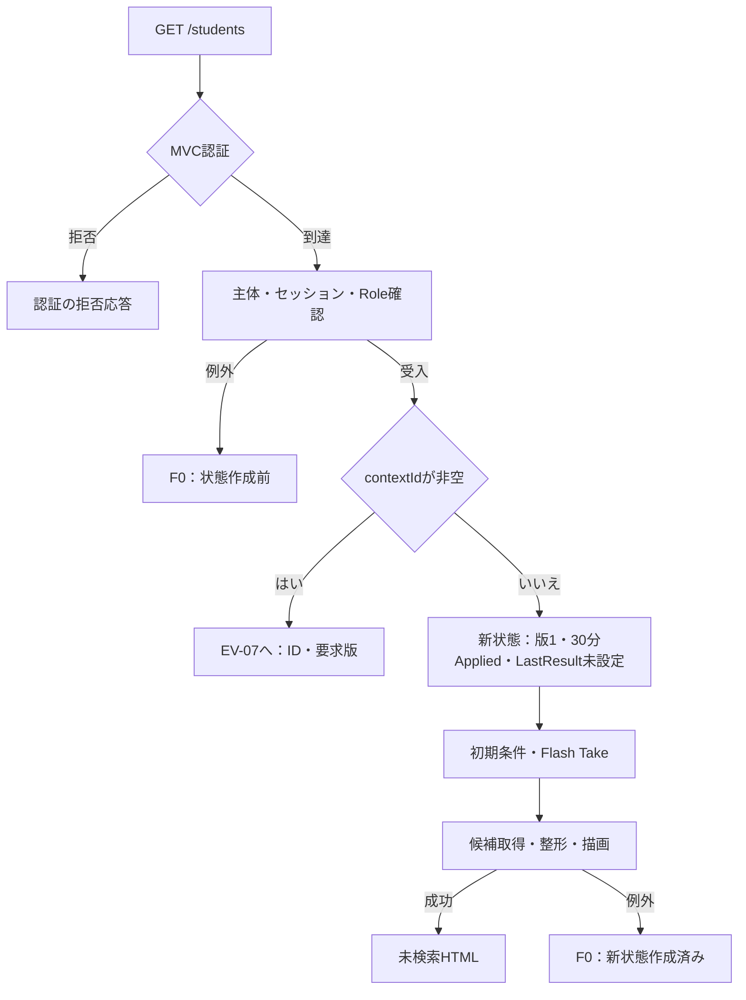

#### SQL・テーブル関連（ER図）

候補読取D0は次のJOINを使う。これは検索候補の取得関係であり、実FKの図とは区別する。

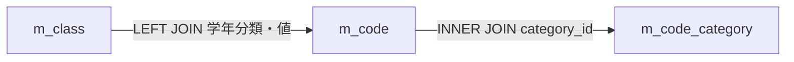

#### DB操作の詳細

D0としてコードとクラスの2結果集合を一つのSNAPSHOT読取トランザクションで取得し、commitして返す。停止・期間外を除外するWHEREはなく、取得属性から利用状態を計算する。検索用Occupiedは0を設定する。候補の使用先・順序は選択候補一覧、具体的SQL条件は補足説明D0に示す。根拠：`sources/Core/SqlServerStudentService.cs:197-216`。

#### 結果・例外時の扱い

正常時は未検索HTMLとなる。候補取得・整形・描画に失敗しても、作成済み状態を削除する処理はない。認証拒否、候補取得失敗、取得成功だが候補0件を分ける。

設計は必須マスタ不足を検出して検索不可とし、既定値を先頭候補で代替しないことを要求する。現行には不足による検索禁止判定がなく、候補中に初期在籍01・02がない場合でも検索ボタンを禁止しない。設計意図：`reference-designs/基本設計書/01_学生検索画面.md:159-176,415-435`。現行根拠：`sources/Views/Students/Search.cshtml:5-5`、`sources/Web/Controllers/StudentsController.cs:39-39`。

### EV-02 検索

#### 処理概要

編集中の条件で非削除学生を検索し、件数と1ページ目を取得する。正常0件と上限超過も受入結果として保持する。入力拒否時の今回表示は未検索・空一覧となるが、前回保持条件・結果を消去する処理ではない。根拠：`sources/Web/Controllers/StudentsController.cs:13-16`、`sources/Infrastructure/WebStudentCoordinator.cs:7-10,20-21`。

#### 処理手順

1. サブフロー1：MVCの認証・CSRF検査とバインド後、FormGuardで許可キー、書式メタ情報、許可されない同名複数値を検査する。
2. サブフロー1：在籍区分キー省略を空配列へ補正し、所有者・セッション・指定Tab・期限で最初のGetを行う。ここまではControllerの局所catch外である。
3. サブフロー1：ModelState不正ならサービスを呼ばず422を設定する。正常なら局所try内でCoordinatorを呼ぶ。
4. サブフロー2：Coordinatorは参照確認後、DTOをSearchCriteriaへ移し、ClassIdを正のlong?へ変換しPage=1とする。UseはGet、Gate待機、Gate取得後のGet、期待版、版上限の順で確認する。
5. サブフロー2：サービスはtry外でUserと検索開始時刻・日本時間業務日を取得する。try内で表示指定、年度・クラス、未所属の排他、在籍配列を検査し、文字・コード・日付を正規化する。
6. サブフロー2：接続とSNAPSHOT開始後、D1の存在・組合せを検査する。D2で最大10001件を確認し、超過なら行取得を省略する。10000以下なら同じSNAPSHOT内でD3のページ行を取得してcommitする。
7. サブフロー2：受入結果だけについて、入力側条件の複製をApplied、取得結果をLastResultへ設定し、版を1加算する。Use正常終了時に期限を延長し、Gateを解放する。
8. サブフロー3：SearchModelが別の読取単位で候補を取得し、表示データをJSONへ整形する。その後Controllerは要求PageSize・SortKey・SortDirectionをモデルへ代入する。
9. サブフロー3：流入枝のStatus・結果・原入力・ModelStateを引き継いで描画する。候補取得・整形・描画の失敗はF0へ伝播する。PageSize=0ではページ数計算に到達するとゼロ除算になる。

根拠：`sources/Web/Controllers/StudentsController.cs:13-16,39-41`、`sources/Web/Inputs/StudentSearchInput.cs:19-22`、`sources/Infrastructure/SearchContextStore.cs:13-15`、`sources/Core/SqlServerStudentService.cs:103-170`、`sources/Views/Students/Search.cshtml:8-8`。

#### 処理フロー

サブフロー1は入口検査である。422枝は原入力・ModelStateを保持し、検索状態を更新せずサブフロー3へ渡す。

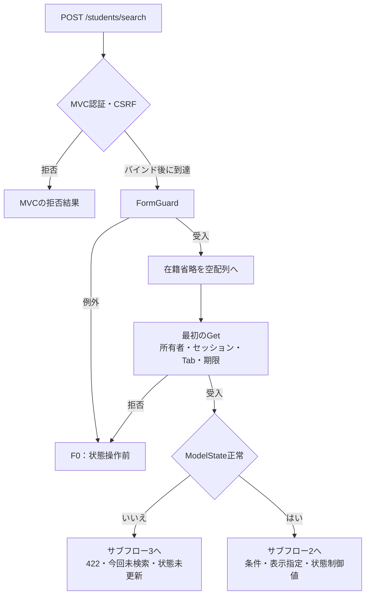

サブフロー2-1は検索の実行である。U1は補足説明の状態操作共通フローを指す。サービス内の拒否と捕捉外例外はサブフロー2-2で分類する。

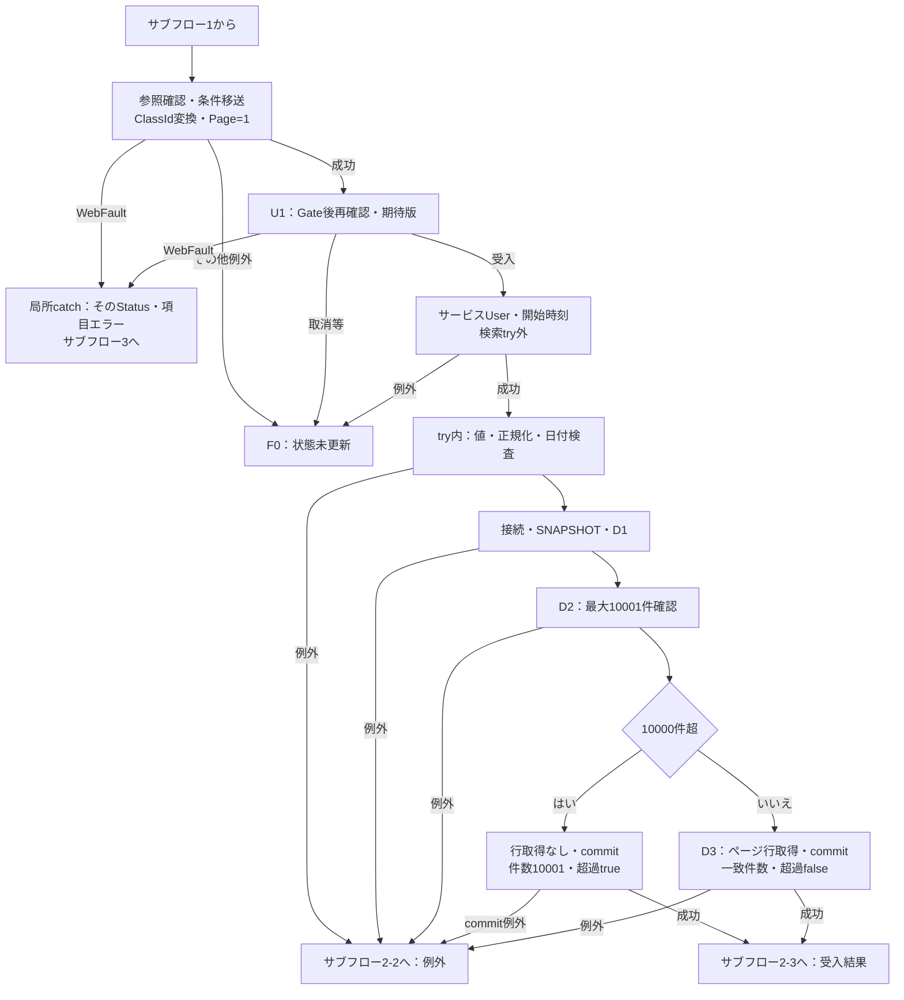

サブフロー2-2はサービスcatchの順序である。入力拒否結果の件数0を正常0件と扱わない。Gate取得後の失敗はUseのfinallyで解放する。

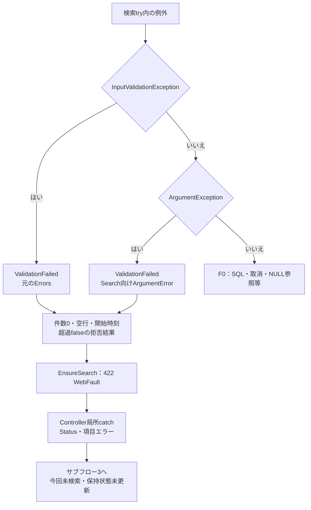

サブフロー2-3は受入結果の保持である。0件・超過・通常の結果をそのままサブフロー3へ渡す。

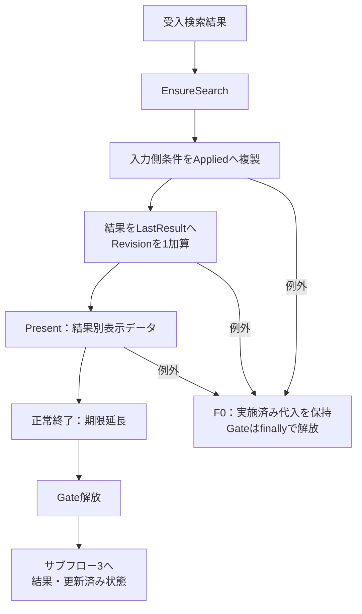

サブフロー3は応答作成である。流入枝のStatusと状態更新段階を固定値へ置き換えない。

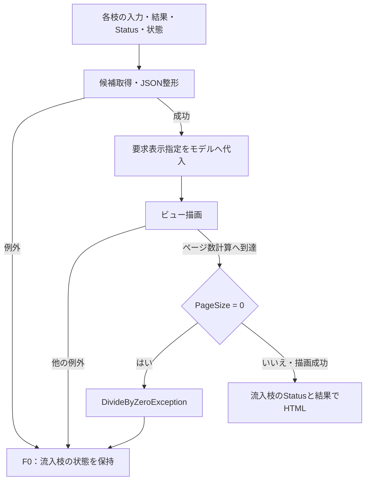

#### SQL・テーブル関連（ER図）

件数は学生・クラス、行取得は名称用コードも参照する。次の図はLEFT JOINの取得関連である。

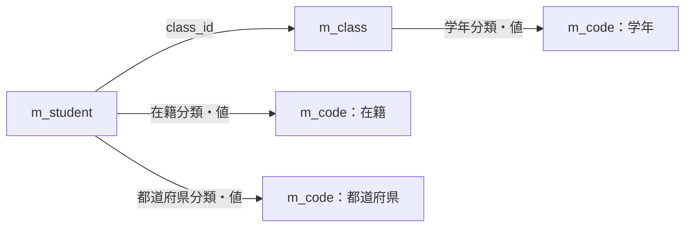

実FKと検索JOINの違いは補足説明に示す。根拠：`sources/Core/SqlServerStudentService.cs:82-90,156-168`。

#### DB操作の詳細

D1の存在検査、D2の件数確認、D3の行取得は同じSNAPSHOTで行う。非削除と指定条件をANDで結び、在籍のIN内部、本人・緊急電話のOR内部は、いずれか一致とする。学籍番号は前方一致、氏名・カナはキーの部分一致、所属・地域・電話は完全一致、入学日は両端包含である。全述語・JOIN・パラメータ・ORDER BYは補足説明D1～D3に示す。

10001検出時は行SQLを実行せずcommitし、NoChange・件数10001・空行・LimitExceeded=trueを返す。通常はNoChange・一致件数・取得行・LimitExceeded=falseを返す。検索のNoChangeは業務更新なしの受入結果であり、登録側の変更なし通知とは役割が異なる。根拠：`sources/Core/SqlServerStudentService.cs:137-168`。

#### 結果・例外時の扱い

サービスのcatchはInputValidationException、ArgumentExceptionの順である。Coordinatorは拒否結果の先頭エラーから422 WebFaultを作り、Controllerの局所catchがField・MessageをModelStateへ追加してStatusを設定する。FormGuardと最初のGetは局所catch外である。SQL、取消、NULL在籍配列のNullReferenceException等はサービスの二つのcatchでは処理しない。根拠：`sources/Core/SqlServerStudentService.cs:105-112,169-170`、`sources/Infrastructure/WebStudentCoordinator.cs:20-20`、`sources/Web/Controllers/StudentsController.cs:14-16`。

PageSize=0がサービスへ到達した枝は入力拒否となり、検索状態を更新しない。ModelState不正でサービスを呼ばない枝も422となる。しかし両枝で要求0を再表示モデルへ代入する。候補取得・整形が成功してビューの割算に到達すると、未検索・空一覧でもゼロ除算となる。応答未開始ならF0が503の共通HTMLを返し、開始済みならF0のcatch対象外である。入力拒否と422 HTMLの表示成功を同じ結果として扱わない。根拠：`sources/Web/Controllers/StudentsController.cs:13-16`、`sources/Views/Students/Search.cshtml:8-8`、`sources/Infrastructure/WebHostSetup.cs:23-23`。

設計は原入力保持、項目エラー、今回一覧消去を要求する。現行で保持された前回LastResultを、その検索失敗の最新結果として表示する説明にはしない。一般障害時の原入力再表示・受付番号案内は、現行の共通HTMLとは異なる設計上の責務である。設計意図：`reference-designs/基本設計書/01_学生検索画面.md:64-69,203-208`。

### EV-03 候補更新・未所属連動

#### 処理概要

「候補を更新」で編集中の年度・学年に合うクラスを再表示し、不適合選択を解除する。学生を再検索せず前回LastResultを表示する。ブラウザーのDOM補助、サーバーOptions、Searchの矛盾拒否は別処理である。根拠：`sources/Web/Controllers/StudentsController.cs:22-22`、`sources/wwwroot/js/site.js:7-8`。

#### 処理手順

1. MVC検査・バインド後、FormGuard、在籍キー省略の空配列補正、状態Getの順で進む。
2. Getは所有者・セッション・非空Tab・期限を検査する。受信ContextRevisionは照合せず、Gate取得・版加算・期限延長を行わない。
3. 未所属trueならDTOの年度・学年・クラスをNULLにし、対応するModelStateの3項目も除去する。
4. LastResultと編集中入力をSearchModelへ渡し、LookupAsync(false)で全候補を取得する。年度・学年のクラス抽出は取得後のビューで行う。
5. 非空ClassIdが候補IDの10進文字列と一致し、指定年度・学年にも適合するか確認する。検索のIdParserやコード正規化は呼ばない。
6. 不適合ならClassIdとModelStateを解除し、解除通知にする。その他は条件未反映通知を出す。表示指定には保持済み値または既定値を使い、受信表示指定で上書きしない。
7. ブラウザーのclearAssignedは初期実行と未所属チェック変更時に、ONなら3つのDOM値だけを空にする。その場のdisabled切替、DTO変更、ModelState消去は行わない。

根拠：`sources/Web/Controllers/StudentsController.cs:22-22,39-39`、`sources/Views/Students/Search.cshtml:5-5`、`sources/wwwroot/js/site.js:7-8`。

#### 処理フロー

サブフロー1はOptionsのPOSTである。出口では前回の未検索・0件・超過・通常結果を引き継ぎ、検索状態の版・期限を変更しない。

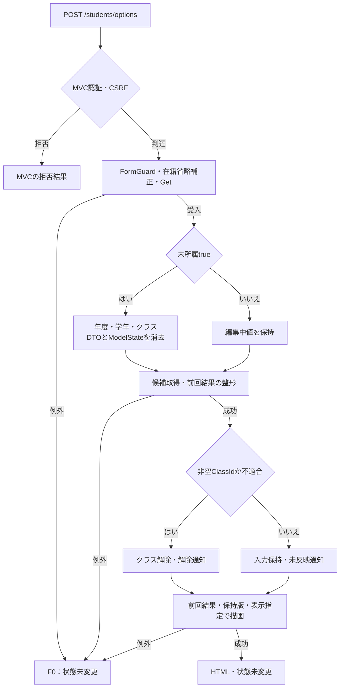

サブフロー2はブラウザー補助であり、POSTを代替しない。

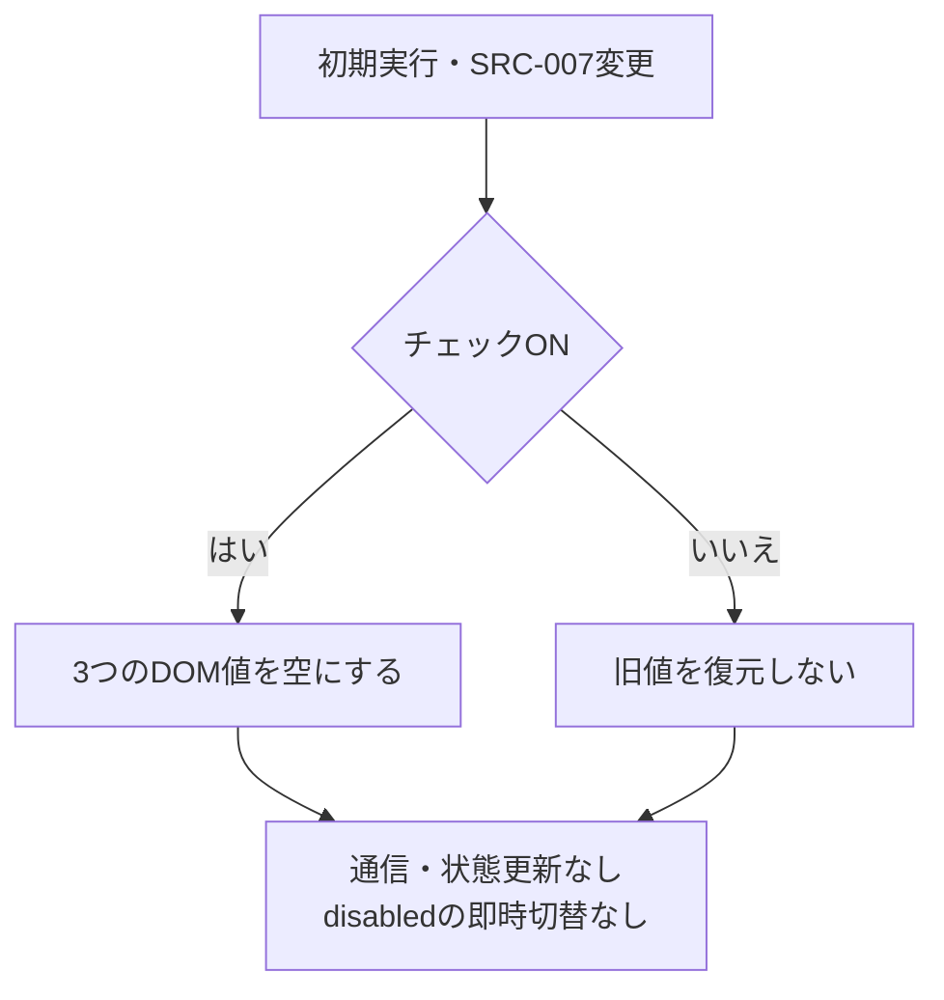

#### SQL・テーブル関連（ER図）

D0の候補関連を使用する。学生行はLastResult由来であり、m_studentの再検索・人数集計を行わない。

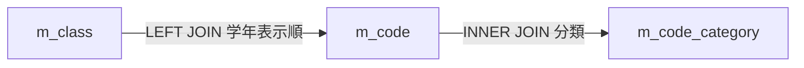

#### DB操作の詳細

全コード・全クラスを一つのSNAPSHOTで読みcommitする。年度・学年は候補SQLのWHEREへ渡さず、取得後の抽出と適合確認に用いる。学生・マスタ更新、履歴追記はない。根拠：`sources/Core/SqlServerStudentService.cs:197-216`、`sources/Web/Controllers/StudentsController.cs:22-22`。

#### 結果・例外時の扱い

OptionsにはModelState.IsValidによる遮断と局所catchがない。FormGuardを値型・存在・NULL排除の保証へ拡張しない。ClassIdの適合確認は文字列比較であり、検索時に数値変換できる表記がOptionsでも同じ扱いになるとは限らない。失敗はF0へ伝播する。

Searchは未所属と所属条件の矛盾を拒否するが、Optionsと同じDTO・ModelState消去を行わない。ビューのdisabledは非活性化であり値の消去ではない。描画後のJSがDOM値を空にしても、サーバー側の原入力が消去されたことにはならない。根拠：`sources/Web/Controllers/StudentsController.cs:13-16,22-22`、`sources/Core/SqlServerStudentService.cs:110-110`、`sources/Views/Students/Search.cshtml:5-5`、`sources/wwwroot/js/site.js:7-7`。

設計は未所属ONの解除・即時非活性化、OFFで旧値を戻さないこと、クラス先行選択から年度・学年を補完すること、古い候補応答の破棄、W-STU-107による解除通知を要求する。現行は明示POSTと解除通知を持つが、SRC上位変更の自動通信、クラスからの上位補完、要求世代照合、即時disabled切替、当該メッセージIDの付与を持たない。REG用の補完は検索SRCへ接続されていない。設計意図：`reference-designs/基本設計書/01_学生検索画面.md:248-254`。現行根拠：`sources/wwwroot/js/site.js:7-8`。

### EV-04 並び替え・表示件数変更・ページ移動

#### 処理概要

最後に受け入れたAppliedを使い、最新DBから一覧を取得する。編集中の12条件は送信・適用しない。表示指定変更時は1ページ、変更なしは要求ページを使い、件数減少で範囲外となった場合は条件のPageを補正して再検索する。根拠：`sources/Views/Students/Search.cshtml:8-8`、`sources/Infrastructure/WebStudentCoordinator.cs:11-13`。

#### 処理手順

1. MVC検査・バインド後、FormGuardと最初のGetを行う。ModelState.IsValidの判定はない。
2. 局所try内で参照確認とUseを行う。U1のGate後再確認・期待版・版上限を通り、Appliedなしは409「先に検索してください。」で拒否する。
3. Appliedを複製し、件数・ソート項目・方向が変わればPage=1、同じなら要求Pageとする。表示指定を移してサービス検査へ渡す。
4. D1～D3で1回目の検索を行い、受入確認する。
5. 非超過かつ条件Pageが取得件数の最終ページを超える場合、最低1の最終有効ページへ補正し、2回目の検索・受入確認を行う。2回目後の補正を反復しない。
6. 補正なしは1回目の条件・結果、補正ありは補正条件・2回目結果をApplied・LastResultへ設定する。版加算、正常終了時の期限延長、Gate解放を行う。
7. 保持条件から入力欄を作り、候補を取得してHTMLを返す。局所WebFaultはそのStatus・項目エラー、保持条件の入力欄、今回未検索・空一覧で再表示する。

根拠：`sources/Web/Controllers/StudentsController.cs:18-19,39-40`、`sources/Infrastructure/WebStudentCoordinator.cs:12-12`、`sources/Infrastructure/SearchContextStore.cs:14-14`。

#### 処理フロー

サブフロー1は保持条件の検索と補正である。例外出口は、その発生時点の状態と理由をサブフロー2またはF0へ渡す。

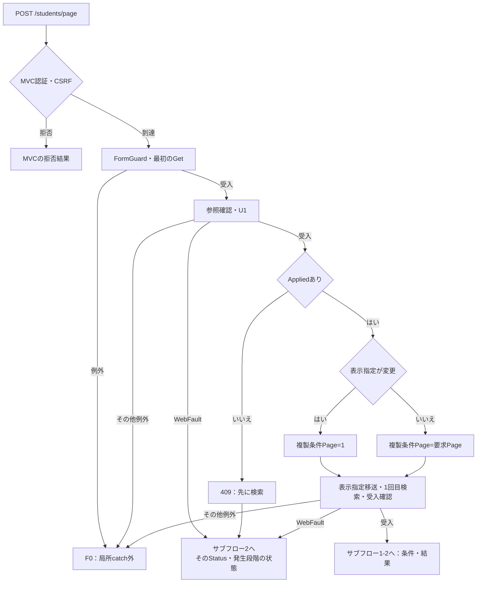

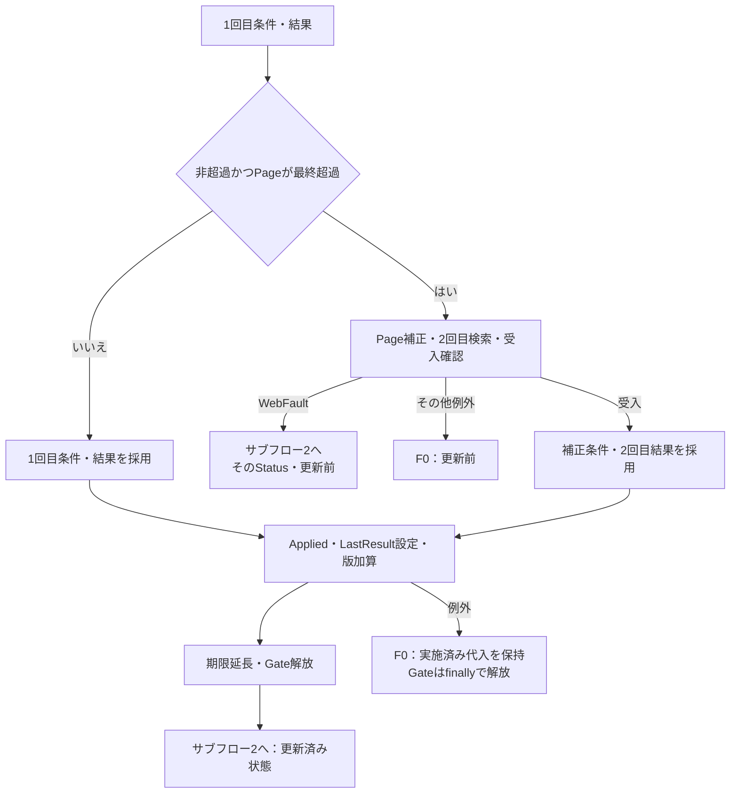

サブフロー2は応答作成である。成功後の候補取得も局所try内にあり、そのWebFaultでcatchへ入った場合は既に更新済みの状態を消去しない。

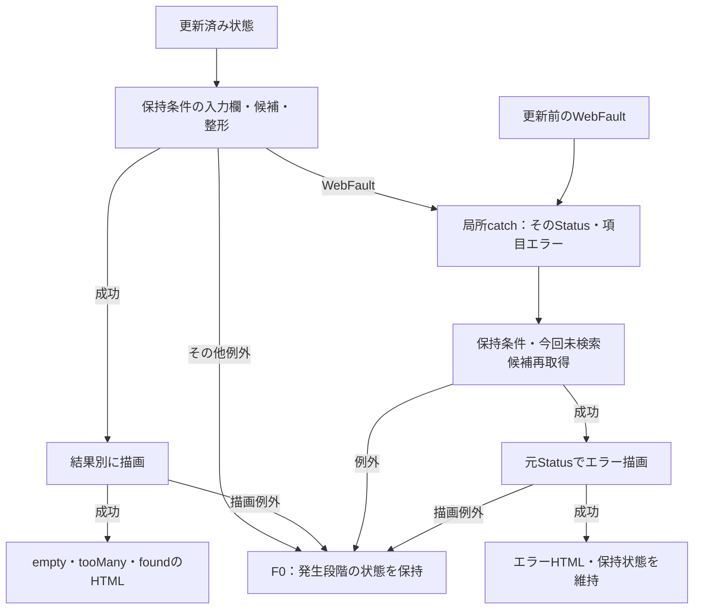

#### SQL・テーブル関連（ER図）

D1～D3を使う。取得関連は学生からクラス、分類付き学年・在籍・都道府県名称へのLEFT JOINであり、候補再表示にはD0を使う。

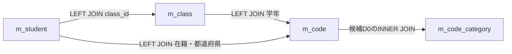

#### DB操作の詳細

1回目、必要時の2回目、HTML用候補読取は別の読取トランザクションである。各検索内部の存在・件数・行は同じSNAPSHOTで読むが、全処理を一つのDB時点に固定しない。サービス自身も取得ページを最終ページへ丸めるが、Coordinatorの2回目検索は保持条件のPageを補正するために行う。根拠：`sources/Core/SqlServerStudentService.cs:123-168,197-216`、`sources/Infrastructure/WebStudentCoordinator.cs:12-12`。

#### 結果・例外時の扱い

未検索、旧版、失効、不正表示指定、検索拒否を同じ理由へまとめない。FormGuardと最初のGetは局所catch外、Coordinator内WebFaultと成功後SearchModelのWebFaultは局所catch対象である。catch内の候補再取得失敗、SQL・取消等、View返却後の描画例外はF0の境界となる。正常結果も0件・超過・通常を引き継ぎ、foundへ固定しない。根拠：`sources/Web/Controllers/StudentsController.cs:18-19,39-40`、`sources/Infrastructure/WebStudentCoordinator.cs:12-12,21-21`。

設計の文章は未検索操作を不可、期限切れをW-SRC-002とし、保持なし・失効の図には初期化・通知を置く。現行は未検索・失効を409で拒否し、自動初期化しない。設計意図と現行の拒否を別の結果として説明する。設計意図：`reference-designs/基本設計書/01_学生検索画面.md:293-308`。

### EV-05 クリア

#### 処理概要

同じ検索状態IDの保持条件と結果を消去し、初期条件・未検索へ戻す。学生の削除や業務DB更新ではない。画面再表示では候補DBを読む。根拠：`sources/Web/Controllers/StudentsController.cs:21-21,39-39`、`sources/Infrastructure/WebStudentCoordinator.cs:15-15`。

#### 処理手順

1. MVC検査・バインド後、FormGuardと参照確認を行う。
2. UseのU1で所有者・セッション・指定Tab・期限をGate待機後にも確認し、期待版と版上限を検査する。
3. AppliedとLastResultをNULLにし、Revisionを1加算する。正常終了時に期限を30分延長しGateを解放する。
4. ControllerがModelStateを全消去し、状態を再Getする。
5. 新しい初期DTOとD0候補を用意し、未検索HTMLを描画する。

根拠：`sources/Infrastructure/SearchContextStore.cs:14-14`、`sources/Infrastructure/WebStudentCoordinator.cs:15-15`、`sources/Web/Controllers/StudentsController.cs:21-21,39-39`。

#### 処理フロー

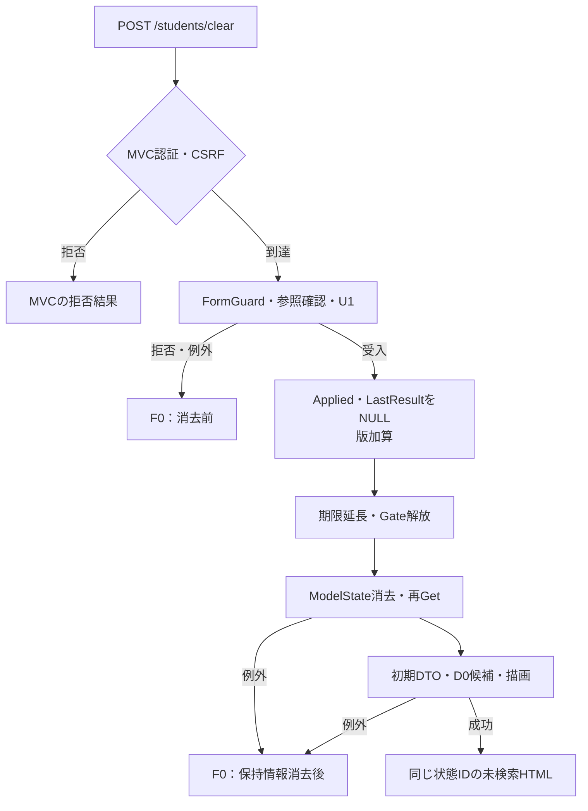

#### SQL・テーブル関連（ER図）

保持情報消去はメモリ操作でDBを使用しない。再表示候補だけがD0の関連を使う。

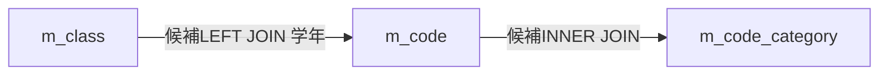

#### DB操作の詳細

学生SearchAsync、業務表UPDATE・DELETE、履歴INSERTは呼ばない。D0のコード・クラス候補は別のSNAPSHOTで取得してcommitする。設計の純粋なクリア操作における「DB参照なし」と、現行の画面再表示まで含む候補読取を分ける。根拠：`sources/Web/Controllers/StudentsController.cs:21-21,39-39`、`sources/Core/SqlServerStudentService.cs:197-216`。設計意図：`reference-designs/基本設計書/01_学生検索画面.md:337-360`。

#### 結果・例外時の扱い

状態・版拒否は消去前、再Get・候補取得・描画失敗は消去後になり得る。Search・Pageと同じ局所WebFault再表示catchはなくF0へ伝播する。失敗を理由に消去済みのApplied・LastResultを復元する処理はない。根拠：`sources/Web/Controllers/StudentsController.cs:21-21`、`sources/Infrastructure/WebStudentCoordinator.cs:15-15`。

### EV-06 新規・編集・参照への遷移

#### 処理概要

検索状態IDを復帰先として登録画面へ渡す。既存行は学生管理番号で最新非削除対象を読み、新規は検索条件を転記せず登録初期値を作る。登録読込後に復帰状態の版を取得し、編集Snapshotへ保存する。根拠：`sources/Views/Students/Search.cshtml:6-8`、`sources/Web/Controllers/StudentsController.cs:23-25`。

#### 処理手順

1. MVC認証後、Coordinatorが参照確認を行い、非空returnContextIdの所有者・セッション・期限を確認する。この入口はTabと検索期待版を渡さない。
2. 新規枝だけ作成権限を追加確認する。学生読取は行わずDetailをNULLとする。
3. 既存枝はGetAsyncでstudent_idと非削除条件を再取得する。Detailなしなら404とし、取得したDetailを後続へ引き継ぐ。
4. 両枝で登録用LookupAsyncを呼び、人数を含む候補を取得する。その後Detailと候補から登録入力を作る。
5. ControllerはDB読取後に復帰状態を再Getする。復帰先ありなら現在Revision、なしならNULLをReturnRevisionとする。
6. 所有者・セッション・対象ID・Detail・Original入力の複製・ReturnRevisionを30分の編集Snapshotへ保存する。新規だけDetailがNULLであり、既存Detailを合流点で失わせない。
7. Roleに応じた新規・編集・参照HTMLを返す。

根拠：`sources/Infrastructure/WebStudentCoordinator.cs:6-6,17-17`、`sources/Core/SqlServerStudentService.cs:172-181,196-216`、`sources/Web/Inputs/StudentSaveInput.cs:44-54`、`sources/Web/Controllers/StudentsController.cs:25-25`、`sources/Infrastructure/EditorSnapshotStore.cs:7-11`。

#### 処理フロー

サブフロー1は対象読込である。合流後も枝ごとのDetailを保持する。

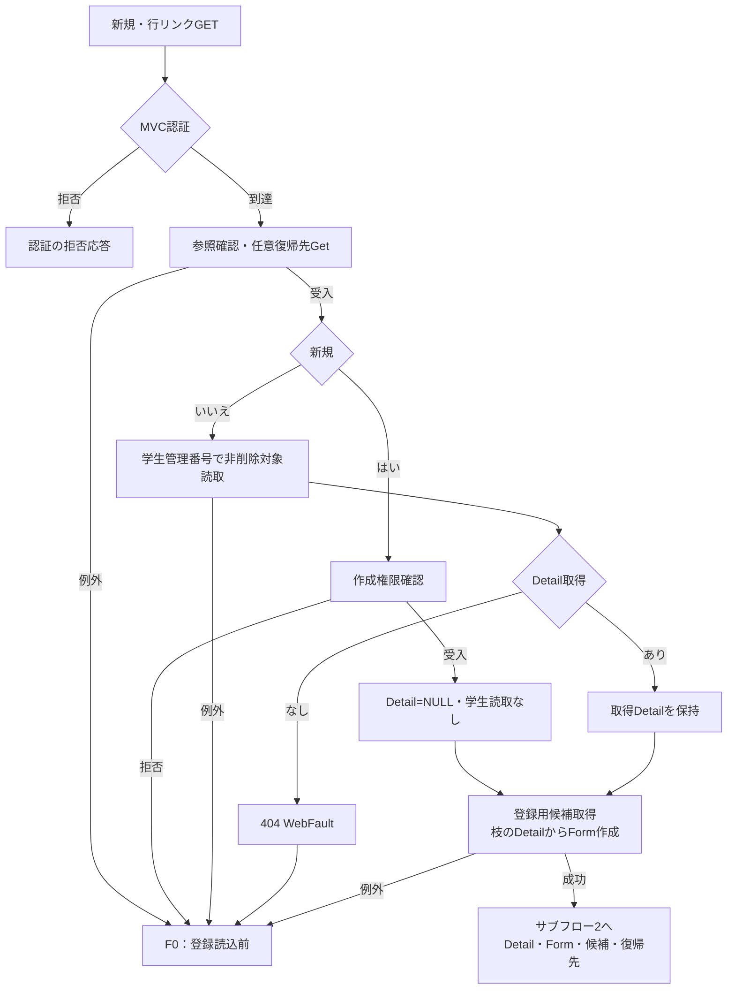

サブフロー2は復帰版とSnapshotの作成である。

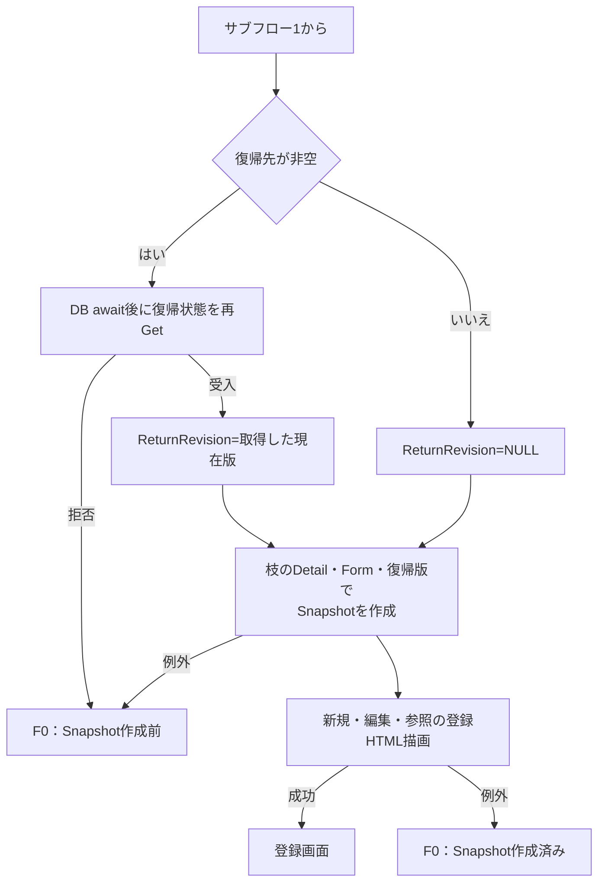

#### SQL・テーブル関連（ER図）

対象Detailはm_student単独の非削除読取であり、所属年度・学年を入力へ対応させるため登録候補を別途読む。登録候補の人数集計は学生を参照する。

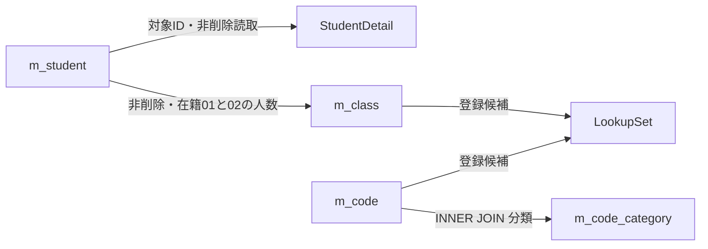

図の人数参照は集計関係であり、定員予約や追加FKを意味しない。

#### DB操作の詳細

既存読取のWHEREは`student_id=@id AND is_deleted=0`、`@id BigInt`である。サービスへ0以下のIDが届けばDetailなしとなる。学生読取と候補読取は別の単位で、候補はSNAPSHOT内のコード・クラス取得と人数集計を行う。新規枝も候補を読むが学生対象読取は行わない。根拠：`sources/Core/SqlServerStudentService.cs:172-181,196-216`。

#### 結果・例外時の扱い

最初の復帰先検査が成功しても、学生・候補のawait後に復帰状態が失効すれば、再Getで拒否され登録HTMLに到達しない。対象不在・削除済みは404、Viewerの新規操作は403、失効復帰先は409、他所有者等は403とする。DB例外、候補失敗、入力整形、Snapshot作成、描画の失敗を一つの成功境界へまとめない。根拠：`sources/Infrastructure/WebStudentCoordinator.cs:17-17`、`sources/Web/Controllers/StudentsController.cs:25-25`、`sources/Infrastructure/SearchContextStore.cs:13-13`。

登録側の取消はOriginalの複製へ戻す処理、最新再読込はDBからDetailと版を取得し直す処理、検索へ戻る操作は復帰状態を使う処理である。検索条件を登録業務値へ移送せず、この三つを検索画面のクリアとも区別する。根拠：`sources/Web/Controllers/StudentsController.cs:25-25,35-38`、`sources/Views/Students/Edit.cshtml:16-16`。設計意図：`reference-designs/基本設計書/02_学生登録画面.md:453-457`。

### EV-07 登録画面からの検索復帰

#### 処理概要

登録側が渡す検索状態IDと読込時復帰版を検査する。未検索なら未検索へ戻り、検索済みなら元条件で最新DBを再検索する。保存した学生が条件外でも条件を変更しない。成功通知は確定した保存・論理削除だけから発生する。根拠：`sources/Views/Students/Edit.cshtml:16-16`、`sources/Web/Controllers/StudentsController.cs:8-11,31-38`、`sources/Infrastructure/WebStudentCoordinator.cs:14-14`。

#### 処理手順

1. 登録側は検索へ戻るリンクにReturnContextId・読込時ReturnRevisionを付ける。未保存変更がある場合はJSの破棄確認で遷移を取り消せる。
2. 保存・論理削除がOutcome.Savedの場合だけ、Flashへ確定通知をPutし、検索URLへの303を返す。復帰先なしなら新状態と版を作る。NoChange・確認要求・不正・競合・SystemError・Unknownはこの経路へ進まない。
3. Indexは参照確認、最初のGetの後、Resumeを呼ぶ。contextRevision未指定は空文字として渡し、最新版で補完しない。
4. ResumeはU1のGate後再確認、期待版、版上限を検査する。Appliedなしなら再検索せず未検索データを返し、RevisionとLastResultを代入しない。
5. Appliedありなら元条件でD1～D3を再実行し受入確認する。LastResultを取得結果へ置き換え、版を1加算し、Appliedは保持する。
6. 両正常枝は期限を30分延長してGateを解放する。条件欄をAppliedまたは初期DTOから作る。
7. Flash.Takeで通知を一度取り除き、その後候補取得、表示整形、描画を行う。

根拠：`sources/wwwroot/js/site.js:2-5`、`sources/Web/Controllers/StudentsController.cs:8-11,31-39`、`sources/Infrastructure/WebStudentCoordinator.cs:14-14`、`sources/Infrastructure/SearchContextStore.cs:14-14`、`sources/Infrastructure/FlashMessageStore.cs:6-9`。

#### 処理フロー

サブフロー1は復帰検査と検索である。未検索枝と検索済み枝の版・LastResult代入を区別する。

```mermaid
flowchart TD
  A[GET /students：既存状態ID] --> B{MVC認証}
  B -->|拒否| X[認証の拒否応答]
  B -->|到達| C[参照確認・最初のGet・U1]
  C -->|拒否・例外| Q[F0：Flash未取得]
  C -->|受入| D{Appliedあり}
  D -->|いいえ| E[未検索データ<br/>版維持・LastResult代入なし]
  D -->|はい| F[元条件で再検索・受入確認]
  F -->|拒否・例外| Q
  F -->|受入| G[LastResult設定・版加算<br/>Applied維持]
  E --> H[各枝の値で期限延長・Gate解放]
  G --> H
  H --> I[サブフロー2へ<br/>結果別データ・枝の状態]
```

サブフロー2は通知と表示である。Flash取得前と取得後の失敗を分ける。

```mermaid
flowchart TD
  A[サブフロー1から] --> B[Appliedまたは初期DTOで条件欄作成]
  B -->|例外| Q[F0：Flash未取得]
  B -->|成功| C[Flash Take：一度除去]
  C --> D[候補取得・JSON整形・描画]
  D -->|成功| E[unsearched・empty・tooMany・found<br/>該当結果と通知のHTML]
  D -->|例外| P[F0：Take済み<br/>通知を戻さない]
```

#### SQL・テーブル関連（ER図）

検索済み枝だけがD1～D3を使う。未検索枝は学生再検索を行わず、両枝の再表示候補はD0を使う。

```mermaid
flowchart LR
  S[m_student] -->|検索済み枝のLEFT JOIN| C[m_class]
  C -->|学年名称| K[m_code]
  S -->|在籍・都道府県名称| K
  K -->|候補D0のINNER JOIN| G[m_code_category]
```

#### DB操作の詳細

復帰の再検索は読取だけであり、保存・削除を再実行しない。学生と履歴の保存commitは登録側で既に完了している。検索再読取、Flash、303、候補取得の後続失敗で、その保存トランザクションをrollbackする処理はない。根拠：`sources/Core/SqlServerStudentService.cs:306-315,409-414`、`sources/Web/Controllers/StudentsController.cs:31-39`。

ResumeはPageと違い、保持Pageの補正と2回目検索を行わない。サービスはSQL取得ページを最終ページへ丸めるが、SearchResultにそのページ番号を返さない。PresentはApplied.Pageを表示に使うため、件数減少時は取得行が最終ページ相当でも表示ページ番号が以前のままになり得る。根拠：`sources/Core/SqlServerStudentService.cs:159-168`、`sources/Core/Contracts.cs:57-58`、`sources/Infrastructure/WebStudentCoordinator.cs:12-14,21-21`。

#### 結果・例外時の扱い

失効・キー不在・旧版は409、他所有者・別セッションは403とし、自動初期化しない。Resumeには局所入力エラー再表示catchがなく、再検索拒否はF0へ伝播する。検索済み復帰の結果をfoundへ固定せず、0件・超過も保持する。設計の期限切れ初期化とは差がある。根拠：`sources/Web/Controllers/StudentsController.cs:8-11`、`sources/Infrastructure/SearchContextStore.cs:13-14`。設計意図：`reference-designs/基本設計書/01_学生検索画面.md:372-376`。

Flashは主体・セッション・検索状態IDの組合せで10分保持する。Takeは不在・失効なら空文字、期限内なら通知を返すが、いずれもTryRemoveを先に行う。復帰拒否なら通知未取得、Take後の候補・整形・描画失敗なら通知消費済みである。登録読込後に検索版が進んでいれば、保存確定済みでも古いReturnRevisionによる復帰が拒否され得る。根拠：`sources/Infrastructure/FlashMessageStore.cs:6-9`、`sources/Web/Controllers/StudentsController.cs:8-11,25-25,38-39`。

Unknownは確定通知の対象ではない。設計は自動再送せず検索確認を案内し、現行の保存メッセージも再送を避ける案内を持つ。保存のUnknown判定は最後の対象例外catchへ到達した場合に限られ、先行する入力検証、一意違反、DBConcurrencyExceptionのcatchへ一般化しない。削除もDBConcurrencyExceptionを先に処理する。根拠：`sources/Core/SqlServerStudentService.cs:316-323,415-416`、`sources/Infrastructure/WebPresentation.cs:25-29`。設計意図：`reference-designs/基本設計書/02_学生登録画面.md:354-356,453-457`。

### EV-08 メニューからの起動・メニューへ戻る設計意図

#### 処理概要

参考設計は共通メニューから検索機能を起動し、SRC-016で共通メニューへ戻る操作を定義する。現行には専用メニュー画面・操作が接続されていないため、本イベントは意図として記載する。根拠：`reference-designs/基本設計書/01_学生検索画面.md:20-20,121-121,331-360`、`sources/Program.cs:6-7`、`sources/Views/Students/Search.cshtml:3-8`。

#### 処理手順

1. 設計上はメニューから検索画面へ進み、状態未発行なら初期表示、復帰識別ありなら検索復帰として扱う。
2. 「メニューへ」は共通メニューへ戻る操作で、学生の保存・削除を行わない。
3. 現行では専用DOM・route・状態破棄処理が確認できないため、遷移先URL、保持情報消費、破棄確認を補わない。ルート`/`からの検索リダイレクトはEV-01への接続として扱う。

根拠：`reference-designs/基本設計書/01_学生検索画面.md:159-165,337-341`、`sources/Program.cs:7-7`。

#### 処理フロー

図は設計意図の分岐であり、稼働フローではない。

```mermaid
flowchart TD
  A[設計：メニュー操作] --> B{操作方向}
  B -->|検索へ起動| C{復帰識別あり}
  C -->|なし| D[初期表示の意図]
  C -->|あり| E[検索復帰の意図]
  B -->|メニューへ戻る| F[共通メニューへ戻る意図]
  D --> G[専用メニュー接続は現行未確認]
  E --> G
  F --> G
```

#### SQL・テーブル関連（ER図）

メニュー操作自体は業務DBを使用しないためER図は対象外である。検索へ進んだ後の候補・検索DB操作はEV-01・EV-07の責務である。

#### DB操作の詳細

設計のメニュー復帰はDB更新なしである。現行に専用入口がないため、状態メモリの削除や一時表消費も定義しない。根拠：`reference-designs/基本設計書/01_学生検索画面.md:341-360`。

#### 結果・例外時の扱い

現行の応答コードや成功結果は割り当てない。メニューを実装する場合の具体的な遷移先・拒否表示・状態保持方針は、この材料で確認できる意図を超えて確定しない。

## 補足説明

### 検索状態の契約とU1

検索状態はSingleton SearchContextStoreのConcurrentDictionaryに保持する。ソースコメントは「Single-node」「条件をサーバー保持」「cookie・URLに個人情報を置かない」という意図を記す。観測できる実装はプロセス内の辞書であり、分散共有・永続復旧・実際のノード構成はこの宣言から確定しない。検索条件はPOSTとメモリで受け渡し、URLには状態ID・復帰版・学生IDを使う。根拠：`sources/Infrastructure/SearchContextStore.cs:6-15`、`sources/Infrastructure/WebHostSetup.cs:13-13`、`sources/Views/Students/Search.cshtml:4-8`。

| 状態項目 | 意味・初期値 | 更新・確認 |
| --- | --- | --- |
| Id | 32バイト乱数の64桁小文字hex | 発行後は同じ検索状態を識別 |
| Owner・Session | 認証主体・ログインセッション | Getで一致確認。画面表示名と別 |
| Tab | 未指定・空なら別の乱数、指定ありならその値 | Getに非空Tabが渡された場合だけ比較 |
| Expires | UTC現在＋30分 | Use正常終了時に30分延長。Optionsは延長しない |
| Revision | long、初期1 | Search・Page・Clear・検索済みResumeで1加算 |
| Applied | 最後に受け入れた入力側SearchCriteriaの複製、初期NULL | 新検索・ページで置換。Resumeでは維持。ClearでNULL |
| LastResult | 最後の取得結果、初期NULL | 受入検索・ページ・検索済み復帰で置換。ClearでNULL |
| Gate | SemaphoreSlim(1,1) | 同一状態操作を直列化。DBの書込排他とは別 |

根拠：`sources/Infrastructure/SearchContextStore.cs:9-15`、`sources/Infrastructure/WebStudentCoordinator.cs:7-15`。

U1はSearch・Page・Clear・Resumeで使う共通状態操作である。最初のGetはNULL IDを辞書呼出し前に拒否する。空文字・キー不在はTryGetValueを経て失効と同じ409となる。存在・期限を確認した後、所有者・セッション・非空Tabを確認し不一致を403とする。期限判定はExpiresがUTC現在より前であること、版照合はInvariantCultureの10進文字列との厳密一致である。IDの形式・長さ検査はGetにない。根拠：`sources/Infrastructure/SearchContextStore.cs:13-14`。

```mermaid
flowchart TD
  A[U1：状態ID・期待版・任意Tab] --> B[Get：存在・期限・所有者等]
  B -->|拒否| X[そのWebFaultを呼出元へ]
  B -->|受入| C[Gate待機]
  C -->|取消等| Q[例外を呼出元へ]
  C -->|取得| D[Gate後にGetで再確認]
  D -->|拒否| F[finallyでGate解放]
  D -->|受入| E{期待版の文字列が一致}
  E -->|いいえ| R[409：版不一致]
  E -->|はい| G{Revisionが上限未満}
  G -->|いいえ| S[409：版上限]
  G -->|はい| H[イベント固有処理をawait]
  H -->|成功| I[期限をUTC現在＋30分へ]
  H -->|例外| F
  I --> F
  R --> F
  S --> F
  F --> J[結果または元の例外を呼出元へ]
```

Gate待機後の所有者・期限再確認はあるが、固有処理のDB await後に同じ確認を追加する処理はない。正常完了時だけ期限を延長する。Gate取得後の例外はfinallyで解放する。候補再取得とView描画は状態固有処理の後であり、HTML応答全体をGateで保護する契約ではない。根拠：`sources/Infrastructure/SearchContextStore.cs:14-14`、`sources/Web/Controllers/StudentsController.cs:13-22,39-39`。

同じ期待版の並行要求では先行更新が版を進め、後続はGate取得後の照合で409になる。Optionsはこの排他・版照合へ参加しない。GET復帰・登録遷移はTabを渡さない。設計の「全該当経路で所有者・認証・タブ・期限と期待版を確認する」という意図と、現行の入口別確認範囲を分ける。設計意図：`reference-designs/詳細仕様書/CSharp_ASPNET/01_学生検索画面.md:604-610`。

Snapshot.Getは検索状態Getと異なり、NULLを事前検査せず辞書へ渡す。空文字・キー不在・期限切れの独自409と、NULL引数に対するライブラリ境界を同一視しない。Snapshotの対象・所有者・セッション検査は登録側の保持情報検査であり、検索状態版や学生比較版とは別の責務である。根拠：`sources/Infrastructure/EditorSnapshotStore.cs:7-11`。

### フォーム受信とF0

StudentsControllerは認証を要求する。認証Cookieは30分・延長ありで、認証失効401、アクセス拒否403を設定する。全MVC POSTには自動CSRF検査を登録する。非nullable参照型の暗黙requiredは抑止されている。根拠：`sources/Web/Controllers/StudentsController.cs:5-5`、`sources/Infrastructure/WebHostSetup.cs:14-16`。

FormGuardはDTOプロパティと接頭辞から許可キーを作る。未知キー、不正な__Invariant、許可されない同名複数値を400で拒否する。StatusCodes・UnassignedOnly・__Invariantの複数値は許可するが、必須キーの存在、値型、NULL排除までは検査しない。SearchだけがModelState.IsValidを判定し、Page・Clear・Optionsには同じ遮断がない。根拠：`sources/Web/Controllers/StudentsController.cs:13-22,41-41`。

在籍配列はサービスでNULL確認前にLengthへアクセスする。NULL要素は許可値外として入力不正となるが、NULL配列はNullReferenceExceptionとなる。ビューも入力配列のContainsを呼ぶため、NULLが再表示DTOに残る場合は描画側の失敗も分けて考える。キー省略時の空配列補正を、全受信形のNULL排除保証へ広げない。根拠：`sources/Core/SqlServerStudentService.cs:111-112,169-170`、`sources/Views/Students/Search.cshtml:5-5`。

F0は伝播例外の共通境界である。Response.HasStarted=falseの場合だけcatchし、WebFaultはそのStatus、その他は503を設定する。学生画面には共通エラーHTMLと検索画面を開くリンクを返す。WebFaultはそのMessage、その他は検索確認の一般案内をHTMLエンコードして表示する。応答開始後は同catchの対象外である。根拠：`sources/Infrastructure/WebHostSetup.cs:22-25`。

```mermaid
flowchart TD
  A[F0：元の例外・実施済み状態] --> B{Response.HasStarted}
  B -->|true| X[同middlewareのcatch対象外<br/>元の例外が伝播]
  B -->|false| C{WebFault}
  C -->|はい| D[そのStatus・Message]
  C -->|いいえ| E[503・検索確認の一般案内]
  D --> F[共通エラーHTML<br/>検索画面を開くリンク]
  E --> F
  F --> G[既実施の状態変更を戻す処理なし]
```

/api向けError helperのcorrelationIdやCSRF拒否JSONの宣言を、/studentsの受付番号表示として使わない。AntiforgeryResultFilterのJSON置換は/apiの場合だけであり、本画面のMVC拒否を一律にそのJSON応答へ変更する処理ではない。根拠：`sources/Infrastructure/WebPresentation.cs:22-23`、`sources/Infrastructure/AntiforgeryResultFilter.cs:7-8`、`sources/Infrastructure/WebHostSetup.cs:23-23`。

### DB読取契約

Web登録はStudentDbという接続設定名を使い、設定未指定を503で拒否する。サービスは暗号化Mandatory・TrustServerCertificate=falseを設定し、接続後にsnapshot_isolation_state=1を確認する。これは接続前提の宣言である。Command helperで作る業務SQLは30秒設定だが、Open内の接続診断は直接CreateCommandで作っており、同じ明示設定を適用したものではない。接続、トランザクション開始、SQL実行、読取、commitへCancellationTokenを渡す。根拠：`sources/Infrastructure/WebHostSetup.cs:19-19`、`sources/Core/SqlServerStudentService.cs:39-72,123-168,197-216`。

#### D0 候補取得

コードSQLはm_codeとm_code_categoryをcategory_idでINNER JOINする。分類・値・名称・表示順・有効期間・保護状態を取得し、利用状態はコードと分類の両方が有効な場合だけtrueとする。停止・期間外除外のWHEREはない。順序はcategory_id、display_order、code_valueである。

クラスSQLは全m_classを読み、学年分類・値でm_codeをLEFT JOINする。年度降順、学年表示順、クラス表示順、クラスコード、クラスIDで並べる。検索のincludeOccupancy=falseはCONVERT(int,0)を返す。登録用trueはclass_idが一致し、非削除かつ在籍01・02の学生数を集計する。候補2結果集合は同じSNAPSHOTで読みcommitする。上位条件はSQL引数ではなく取得後に適用する。根拠：`sources/Core/SqlServerStudentService.cs:196-216`。

#### D1 存在・組合せ確認

| 検査対象 | SQL条件・取得 | パラメータ | 拒否・受入 |
| --- | --- | --- | --- |
| 学年・都道府県 | m_codeのcategory_idとcode_valueによるCOUNT_BIG | 分類`VarChar(24)`、値`VarChar(10)` | 件数1を要求。利用状態・期間の拒否条件なし |
| 年度 | m_classのschool_yearによるCOUNT_BIG | `@year SmallInt` | 0件を拒否。停止クラスも存在に数える |
| クラス | m_classのclass_idでschool_year・grade_codeを取得 | `@id BigInt` | 不在、指定年度不一致、正規化学年不一致を拒否 |
| 在籍区分 | SQL存在確認を呼ばず固定4値を配列検査 | なし | 最大4、重複なし、厳密な01～04 |
| 学籍番号条件 | 完全番号の存在・一意検査をしない | D2・D3の前方一致値 | 一致学生が0件でも条件入力拒否にはしない |

D1は検索SNAPSHOT開始後に行う。検索用の指定コード存在はm_codeへの検査であり、候補取得の分類INNER JOINと同じSQLではない。根拠：`sources/Core/SqlServerStudentService.cs:111-135,218-222`。

#### D2 件数確認とD3 ページ行取得

Where helperは値がNULLの条件だけを省略する。空文字とNULLを同じ省略条件に一般化しない。必須の非削除条件に次の述語をANDで加える。

| 条件 | 述語 | パラメータ型・サイズ |
| --- | --- | --- |
| 非削除 | `s.is_deleted=0` | なし |
| 学籍番号 | `s.student_no LIKE @no ESCAPE '!'`、エスケープ済み値の末尾に% | `@no VarChar(31)` |
| 氏名 | `s.name_key LIKE @name ESCAPE '!'`、キーの前後に% | `@name NVarChar(642)` |
| カナ | `s.kana_key LIKE @kana ESCAPE '!'`、キーの前後に% | `@kana NVarChar(74)` |
| 年度 | `c.school_year=@year` | `@year SmallInt` |
| 学年 | `c.grade_code=@grade` | `@grade VarChar(2)` |
| クラス | `s.class_id=@class` | `@class BigInt` |
| 未所属 | `s.class_id IS NULL` | なし |
| 都道府県 | `s.prefecture_code=@prefecture` | `@prefecture VarChar(2)` |
| 電話 | `(s.phone_number=@phone OR s.emergency_phone_number=@phone)` | `@phone VarChar(16)` |
| 入学日開始 | `s.admission_date>=@from` | `@from Date` |
| 入学日終了 | `s.admission_date<=@to` | `@to Date` |
| 在籍 | `s.enrollment_status_code IN (@status0,...)`、空配列なら省略 | 各`@statusN VarChar(2)` |

LIKEは!、%、_、[をエスケープする。利用者がこれらを入力しても、その文字自体を検索する条件とする。数字・日付パラメータはサイズを明示せず、DateOnlyは午前0時のDateTimeへ移してDate型へ渡す。根拠：`sources/Core/SqlServerStudentService.cs:67-72,137-155`、`sources/Core/StudentNormalizer.cs:161-161`。

D2は学生とクラスをLEFT JOINし、全条件一致student_idにTOP (10001)を適用した集合をCOUNT_BIGで数える。10000以下は一致総数、10001は上限超過の検出値である。超過時はD3を実行せずcommitする。

D3はRowSelectのLEFT JOINでクラス・学年・在籍・都道府県名称を取得する。主ソートはstudentNo→student_no、name→name_key、admissionDate→admission_date、updatedAt→updated_atの許可対応だけを使い、方向はasc・descのみ、学生ID ASCを必ず副順序に加える。全一致集合をソートしてからOFFSET/FETCHする。最終ページは最低1、SQL取得ページは要求と最終ページの小さい方、offsetはchecked計算のInt、sizeはIntである。根拠：`sources/Core/SqlServerStudentService.cs:82-90,156-168`。

StudentRowは一覧表示の元値に加え入学日・row_versionを取得するが、WebPresentation.Rowは検索一覧に不要な入学日・row_versionを出力しない。郵便番号、住所2、メール、緊急連絡先、備考も一覧へ出さない。検索時row_versionを登録の期待版として使わず、登録入口でDetailを再取得する。根拠：`sources/Core/Contracts.cs:50-58`、`sources/Infrastructure/WebPresentation.cs:20-20`、`sources/Infrastructure/WebStudentCoordinator.cs:17-17`。

D1・D2・D3は同じSNAPSHOT、HTML用候補D0は別のSNAPSHOTである。検索には明示rollback catchがなく、例外時はawait usingの破棄経路へ進む。検索障害を正常0件や保存Unknownへ置き換えない。根拠：`sources/Core/SqlServerStudentService.cs:123-170,197-216`。

### 表の意味・FK・表示名称の保存側

| 表・保持領域 | 検索業務での意味 | 入力・表示・保存の対応 |
| --- | --- | --- |
| dbo.m_student | 学生1人の基本情報 | 番号・照合キー・地域・電話・入学日・在籍・class_idを検索し、原表記と表示用元値を読む。検索では更新しない |
| dbo.m_class | 年度内のクラス1件 | 年度・学年・管理番号で条件を絞り、コード・名称を表示する。学生の現在・最終所属の参照先 |
| dbo.m_code_category | コード分類1件 | 候補コードの分類と利用状態を供給する。選択肢の名称そのものはm_codeにある |
| dbo.m_code | 分類内コード1件 | 学年・在籍・都道府県の値、名称、順序、期間、利用状態を供給する。学生へ名称を複写保存しない |
| dbo.t_operation_log | 業務変更の操作記録 | 登録側の保存・削除と一括確定する。検索自身は追記しない |
| SearchContextStore等 | 一時的な画面状態 | 条件・結果・Snapshot・Flashをメモリで保持。業務表と別 |

根拠：`sources/database/001_schema.sql:7-154`、`sources/Core/Contracts.cs:50-70`、`sources/Core/SqlServerStudentService.cs:77-90,306-315,385-390`。

DDLの実FKを次に示す。各辺は列参照を示し、設計資料から未実装の多重度や削除連動を追加しない。

```mermaid
flowchart LR
  K[m_code_category] -->|category_idの参照先| C[m_code]
  C -->|grade_category・grade_codeの参照先| L[m_class]
  L -->|class_idの参照先| S[m_student]
  C -->|gender・prefecture・enrollment・relationship<br/>各分類と値の参照先| S
```

根拠：`sources/database/001_schema.sql:189-195`。検索LEFT JOINは行を残す取得方法、FKは保存データの参照制約である。元列NOT NULLでも、外部結合の表示結果はNULLを持ち得る。履歴の対象キーへ業務表FKを付けた関係としては説明しない。

クラス名称はClassChange.ClassNameをraw18・保存18・必須で検査し、class_nameのnvarchar(36) NOT NULL・18スカラーCHECKへNVarChar(36)で保存する。クラスコードはIdentifier上限9、varchar(9) NOT NULL、VarChar(9)である。学年・在籍・都道府県名称はCodeChange.CodeNameをraw12・保存12・必須で検査し、code_nameのnvarchar(24) NOT NULL・12スカラーCHECKへNVarChar(24)で保存する。表示DTOだけで名称上限を確定しない。根拠：`sources/Core/MasterMaintenanceService.cs:33-35,73-76,81-83,113-120`、`sources/database/001_schema.sql:67-81,115-128`。

保守サービスには保存実装があるが、検索画面のイベントやWebの依存登録からその保守入口は確認できない。コメントにCLIの意図があっても、稼働CLIや公開保守画面を補わない。根拠：`sources/Core/MasterMaintenanceService.cs:13-30`、`sources/Infrastructure/WebHostSetup.cs:13-19`。

DDLにはt_runtime_stateとt_confirmationがある。現行の検索状態・Snapshot・Flashはメモリ実装であり、t_runtime_stateへ保存・暗号化・消費する接続はない。Web登録はwebTokens=trueなので保存確認情報もWebConfirmationsを使う。t_confirmationのSQLは非Web設定分岐であり、検索状態表として扱わない。根拠：`sources/database/001_schema.sql:156-184`、`sources/Infrastructure/WebHostSetup.cs:13-19`、`sources/Core/SqlServerStudentService.cs:330-342`。

### 日付・日時の扱い

生年月日の和暦は固定元号境界を使う。明治は1900-01-01、大正1912-07-30、昭和1926-12-25、平成1989-01-08、令和2019-05-01からで、各前元号は次元号開始の前日までである。元年を「元」、月日を2桁として表示し、DateOnlyへ時差を加えない。範囲外の表示変換はArgumentOutOfRangeExceptionとなる。検索日時・更新日時はDateTimeOffsetを日本時間へ変換して19文字で出す。根拠：`sources/Core/JapaneseDateService.cs:9-16,41-50`、`sources/Infrastructure/WebPresentation.cs:5-7,20-20`。

入学日検索はFormKC後のISO日付を解析し、1900-01-01～検索開始時の日本時間業務日で検査する。画面ヘッダーの業務日は表示時に算出するため、検索開始時の上限日と同一の算出時点ではない。設計では生年月日以外の日付・日時・年度は西暦とし、日付表示をyyyy/MM/dd、送信・解析をyyyy-MM-ddで区別する。根拠：`sources/Core/JapaneseDateService.cs:52-59`、`sources/Core/SqlServerStudentService.cs:44-45,105-122`。設計意図：`reference-designs/基本設計書/01_学生検索画面.md:71-71,116-117`。

### 設計識別子と現行イベントの対応

以下のN・CHK・DATE・EV番号は参考設計の契約識別子であり、同名関数が現行に存在するという意味ではない。項目の意味を保ち、実装の正規化・検査位置へ対応させる。

| 対象 | 正規化ID | 検査ID | 関連設計イベント | 本書での具体化 |
| --- | --- | --- | --- | --- |
| SRC-001 | N-06 | CHK-002・CHK-003 | EV-SRC-002 | Identifierと前方一致。番号形式だけで、保存時の重複・不変検査を検索へ追加しない |
| SRC-002 | N-03 | CHK-002 | EV-SRC-002 | raw氏名とname_keyを分離 |
| SRC-003 | N-04・N-05 | CHK-002・CHK-006 | EV-SRC-002 | カナ正規化と空白除去キーを分離 |
| SRC-004 | N-11 | CHK-010・CHK-014・CHK-034、DATE-R04 | EV-SRC-002 | 設計raw4桁、現行int?の範囲・年度存在検査を区別 |
| SRC-005 | N-07 | CHK-010・CHK-014 | EV-SRC-002 | CodeとGRADE存在、所属上位条件の照合 |
| SRC-006 | 非適用 | CHK-010・CHK-014 | EV-SRC-002 | IdParser、クラス存在、年度・学年整合 |
| SRC-007 | 非適用 | CHK-029 | EV-SRC-002 | 未所属と所属条件の排他 |
| SRC-008 | N-07 | CHK-010・CHK-024 | EV-SRC-002 | 設計IDは保持する。現行はTrim・FormKCをせず固定4値を検査 |
| SRC-009 | N-07 | CHK-010 | EV-SRC-002 | CodeとPREFECTURE存在 |
| SRC-010 | N-09 | CHK-002・CHK-017 | EV-SRC-002 | 電話正規化と本人・緊急のOR検索 |
| SRC-011・012 | N-11 | CHK-007・CHK-033、DATE-R02・DATE-R03 | EV-SRC-002 | ISO解析、日付上限、開始終了順、両端包含 |
| SRC-019・032・033 | 非適用 | CHK-024 | EV-SRC-004 | 設計raw長と現行許可値検査を区別 |
| SRC-013 | 非適用 | 非適用 | EV-SRC-002 | 本書EV-02 |
| SRC-014・015・016・030 | 非適用 | 非適用 | EV-SRC-005 | 本書EV-05・06・08へ責務別に分割 |
| SRC-031 | 非適用 | 非適用 | EV-SRC-004 | 本書EV-04。現行は前へ・次へと反映操作 |
| SRC-017・018・020～029 | 非適用 | 非適用 | EV-SRC-002・004・006 | 件数・表示値・復帰結果。範囲の細分化はSRC-INT-002・003 |
| 初期表示・候補連動・復帰 | 非適用 | イベント内検査 | EV-SRC-001・003・006 | 本書EV-01・03・07 |

根拠：`reference-designs/基本設計書/01_学生検索画面.md:106-138,155-409`、`reference-designs/詳細仕様書/CSharp_ASPNET/01_学生検索画面.md:84-147`。

| 設計メッセージID | 発生条件・意図 | 現行との対応 |
| --- | --- | --- |
| I-SRC-001 | 正常0件 | 現行ビューに該当なし文言があるが、このIDを付けて表示しない |
| W-SRC-001 | 10000件超過 | 現行warning段落に絞込み文言があるが、このIDを付けて表示しない |
| W-SRC-002 | 検索状態期限切れ | 現行GetのWebFault内部ID。HTMLはMessageを表示し、ID自体を出さない |
| W-STU-107 | 上位条件変更で不適合クラスを解除 | 現行Optionsに解除通知があるが、このIDを付けない |
| E-COM-004 | システム障害・結果確認案内 | 検索伝播例外と登録保存結果不明を別の結果として扱う |

根拠：`reference-designs/基本設計書/01_学生検索画面.md:239-239,250-254,295-329`、`sources/Views/Students/Search.cshtml:7-7`、`sources/Infrastructure/SearchContextStore.cs:13-13`、`sources/Web/Controllers/StudentsController.cs:22-22`、`sources/Infrastructure/WebHostSetup.cs:23-23`。

### 実装・確認工程で扱う責務

IT担当者は条件の業務上の意味、権限、入力とDB・表示の対応、競合・障害時の結果を確認する。実装者は入力→処理値→DB→再表示の往復を確認し、raw保持、型変換失敗、照合キーの保存側再生成、日付と日時、スカラー上限と物理容量、型付きパラメータ、SNAPSHOT読取を対応させる。共通呼出し成功を学生保存成功と混同しないことも設計上の責務である。設計意図：`reference-designs/基本設計書/01_学生検索画面.md:474-491`、`reference-designs/詳細仕様書/CSharp_ASPNET/01_学生検索画面.md:546-550,586-602`。

| 確認対象 | 入出力の往復・異常段階で確認する内容 |
| --- | --- |
| 文字 | raw上限、補助文字、不正サロゲート、FormKC後のキー、LIKE記号、保存原表記と再表示 |
| 日付 | ISO送信、実在日、1900年・業務日・開始終了の境界、DateOnlyの和暦とDateTimeOffsetの日本時間 |
| 選択 | 停止・期間外候補、学年00、未所属、上位条件変更、文字列ClassIdと数値変換の違い |
| 検索結果 | 0件・10000件・10001件、件数と表示件数、行抑止、範囲の設計項目と現行不在 |
| 保持情報 | Draft相当入力とApplied、旧版・同版並行要求、所有者・セッション・Tab・期限、Gate後再確認 |
| 再表示 | 入力拒否後の候補・整形・描画、PageSize=0、NULL配列、応答開始前後のF0境界 |
| 復帰 | 未検索と検索済み、件数減少、旧ReturnRevision、Flash取得前後、確定後の後続障害 |
| 登録との境界 | 保存・履歴確定、NoChange・確認要求・競合・Unknown、確定通知へ進む条件 |

これらは確認責務・受入観点であり、試験結果や顧客承認を表す記録ではない。

### 計画内の関連文書

本書が検索業務、論理項目、操作、状態保持、復帰を担当する。以下は提示計画との対応先であり、この応答では未生成である。リンク先の存在や生成済み状態を前提にせず、本書の条件・例外説明を参照先だけへ委ねない。

| 文書ID | kind | 契約path・相対参照 | 対応責務・生成状態 |
| --- | --- | --- | --- |
| CSHARP_ASPNET-BAS-STU-02 | basic-design | [基本設計書/02_学生登録画面.md](02_学生登録画面.md) | 新規・編集・参照、取消、保存・削除、検索復帰。未生成 |
| CSHARP_ASPNET-BAS-STU-03 | table-index | [基本設計書/03_テーブル仕様書.md](03_テーブル仕様書.md) | データ関連・共通保存規則。未生成 |
| CSHARP_ASPNET-BAS-STU-04 | code-design | [基本設計書/04_コード設計書.md](04_コード設計書.md) | 分類・選択値・名称・初期投入・保守。未生成 |
| CSHARP_ASPNET-BAS-STU-03-M_STUDENT | table-definition | [基本設計書/テーブル/01_m_student.md](テーブル/01_m_student.md) | 学生の検索・表示・保存列。未生成 |
| CSHARP_ASPNET-BAS-STU-03-M_CLASS | table-definition | [基本設計書/テーブル/02_m_class.md](テーブル/02_m_class.md) | 所属・候補・年度・学年・名称。未生成 |
| CSHARP_ASPNET-BAS-STU-03-M_CODE_CATEGORY | table-definition | [基本設計書/テーブル/03_m_code_category.md](テーブル/03_m_code_category.md) | 候補分類と分類利用状態。未生成 |
| CSHARP_ASPNET-BAS-STU-03-M_CODE | table-definition | [基本設計書/テーブル/04_m_code.md](テーブル/04_m_code.md) | 分類付き値・名称・順序・期間。未生成 |
| CSHARP_ASPNET-BAS-STU-03-T_OPERATION_LOG | table-definition | [基本設計書/テーブル/05_t_operation_log.md](テーブル/05_t_operation_log.md) | 登録側の業務変更と一括確定する履歴。未生成 |
| CSHARP_ASPNET-DET-CSharp_ASPNET-SCR-STU-001 | detailed-specification | [詳細仕様書/CSharp_ASPNET/01_学生検索画面.md](../詳細仕様書/CSharp_ASPNET/01_学生検索画面.md) | 実コントロール、バインド、型、SQL、状態・例外の実装対応。未生成 |
| CSHARP_ASPNET-DET-CSharp_ASPNET-SCR-STU-002 | detailed-specification | [詳細仕様書/CSharp_ASPNET/02_学生登録画面.md](../詳細仕様書/CSharp_ASPNET/02_学生登録画面.md) | Snapshot、保存確定、303、Flash、復帰の実装対応。未生成 |

### 参考設計が参照する共通契約

次の表は参考設計に記載された識別番号と参照先の記録であり、追加文書の生成計画ではない。原文で番号だけを指定する契約へ、未確認の文書ID・ファイル名を創作しない。相対pathは参照元文書からの表記を保持する。

| 原文の識別・参照名 | 原文の相対path | 本機能との対応 | 記載根拠 |
| --- | --- | --- | --- |
| 共通01・02・03 | 番号指定のみ | 認証・参照権限・業務日時 | 基本検索:163-163、詳細検索:74-74 |
| 共通04・05・17 | 番号指定。共通05の文書参照は`../共通/05_チェック・メッセージ設計.md` | 入力正規化、桁・日付・選択・未所属検査 | 基本検索:205-205,485-489 |
| 共通12 | 番号指定のみ | 所有者・認証・画面・期限、検索保持と復帰 | 基本検索:165-165,295-295,374-374 |
| 共通13 | 番号指定のみ | DB排他。UIのIsBusyと区別 | 詳細検索:146-146 |
| 共通16 | 番号指定のみ | DateOnlyから和暦表示へ変換 | 詳細検索:142-142,582-582 |
| 共通UI・共通04の文書 | `../共通/04_共通UI部品設計.md`、詳細からは`../../共通/04_共通UI部品設計.md` | 初期・処理中・エラー・結果状態、再入防止 | 基本検索:485-485、詳細検索:45-45 |
| 共通05の文書 | `../共通/05_チェック・メッセージ設計.md` | N・CHK・メッセージの共通契約 | 基本検索:485-489 |
| 共通06・適合試験一覧 | `../共通/06_要件対応・設計判断.md`、詳細からは`../../共通/06_要件対応・設計判断.md` | 共通T-01～28、受入・レビュー観点 | 基本検索:491-491、詳細検索:548-550 |
| 共通07・共通日付仕様 | `../共通/07_日付・和暦仕様.md`、詳細からは`../../共通/07_日付・和暦仕様.md` | DATE-R02・03・04、DATE-T01～20、日付と和暦 | 基本検索:71-71,489-489、詳細検索:548-548 |
| 共通08・共通データアクセス | `../共通/08_データアクセス仕様.md`、詳細からは`../../共通/08_データアクセス仕様.md` | OP-CODE・CLASS・EXISTS・COUNT・PAGEの業務契約 | 基本検索:413-468、詳細検索:433-433 |
| 共通09・共通項目制約 | `../../共通/09_項目制約定義.md` | 必須・長さ・初期値との整合 | 詳細検索:588-588 |
| 方式別共通仕様 | `../../共通/方式別/CSharp_ASPNET/01_共通実装仕様.md` | 共用実装、接続・状態・結果処理 | 詳細検索:24-25,78-78,588-602 |
| SQL Server DB定義 | `../../DB定義/SQLServer/01_DB定義書.md` | 物理型・NULL・制約、SNAPSHOTと保存確定 | 詳細検索:78-78,588-602 |
| 方式別開発規約・共通開発規約 | `../../規約/CSharp_ASPNET.md`、`../../規約/開発規約.md` | 命名・配備・実装工程の責務 | 詳細検索:78-78,588-588 |

表の「基本検索」は`reference-designs/基本設計書/01_学生検索画面.md`、「詳細検索」は`reference-designs/詳細仕様書/CSharp_ASPNET/01_学生検索画面.md`を指す。検索条件や個人情報をURL・永続保存へ残さないこと、古い応答の破棄、原入力と型付き値の分離は参考設計の要求である。本書はその要求を、現行のPOST、メモリ保持、入口別検査、未接続の制御項目と対応させて説明する。設計意図：`reference-designs/基本設計書/01_学生検索画面.md:472-472`、`reference-designs/詳細仕様書/CSharp_ASPNET/01_学生検索画面.md:573-584,588-610`。
