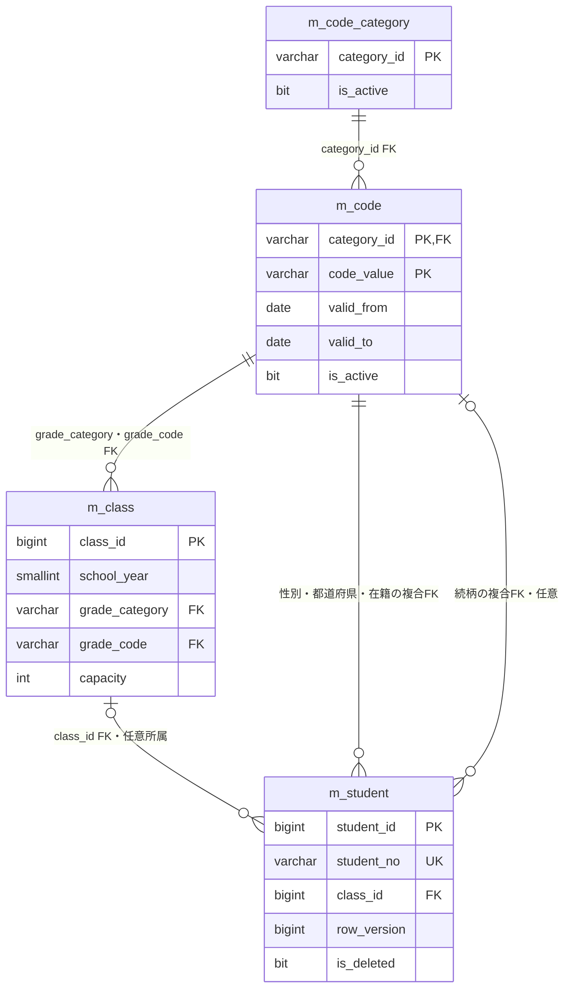
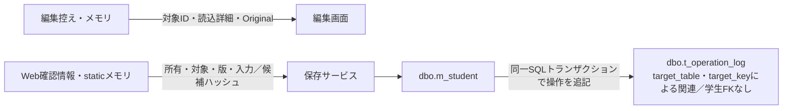
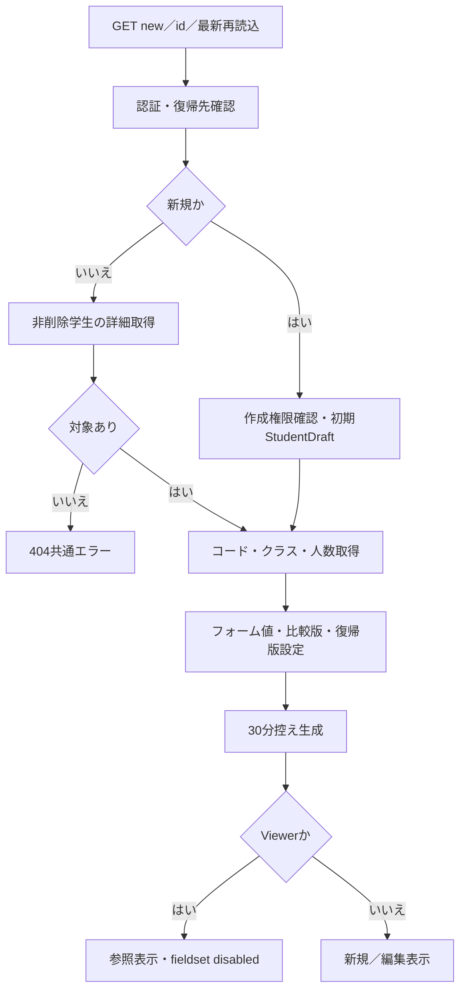
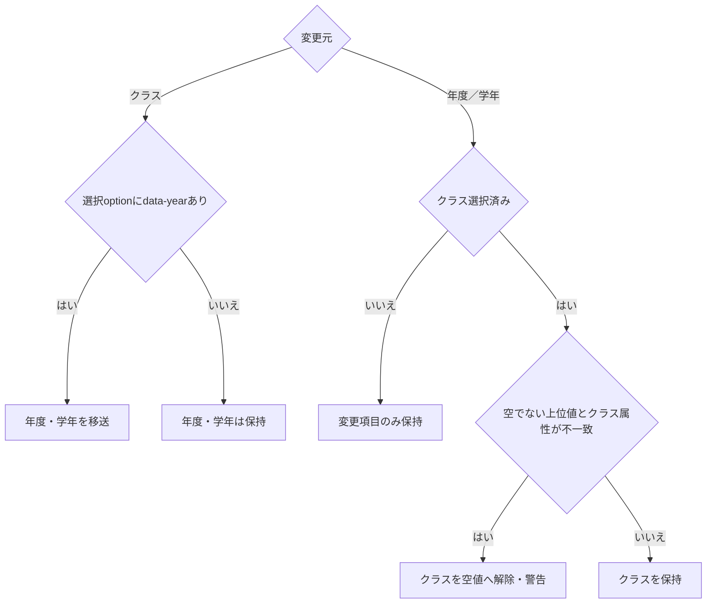
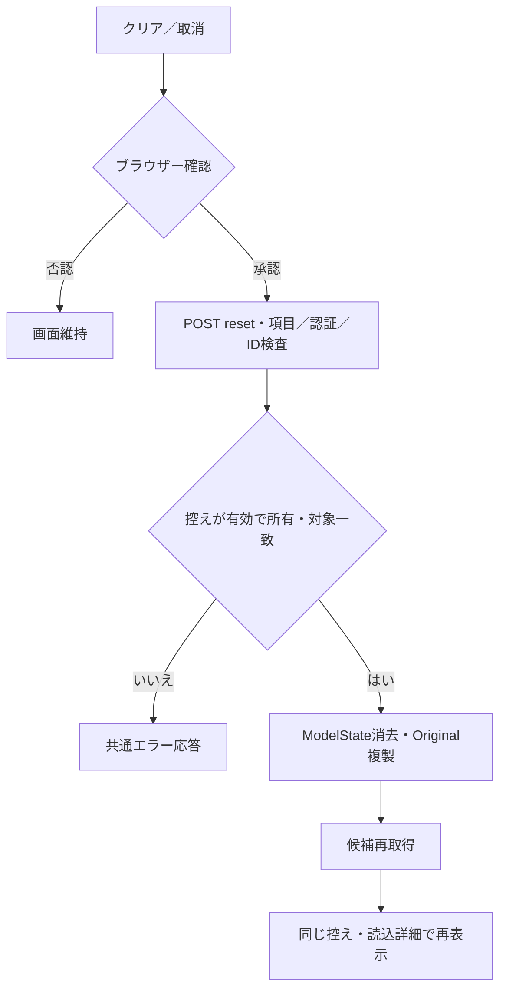
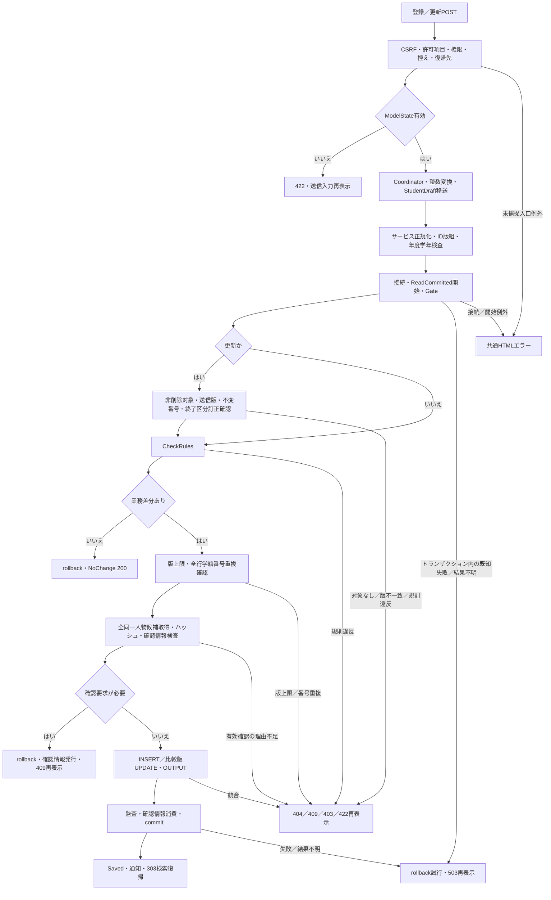
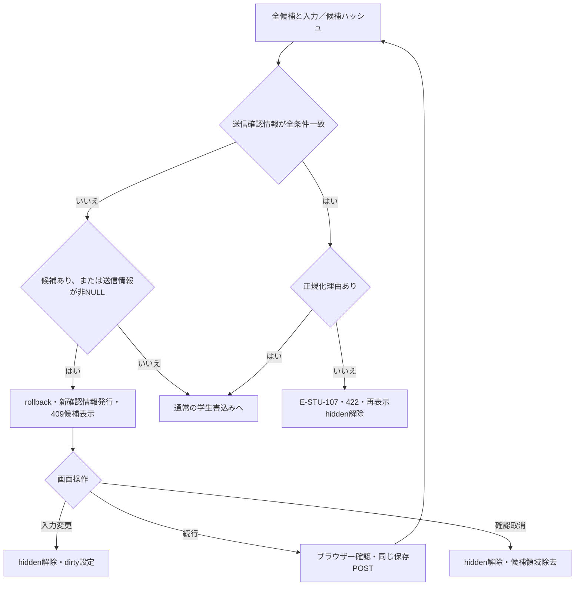
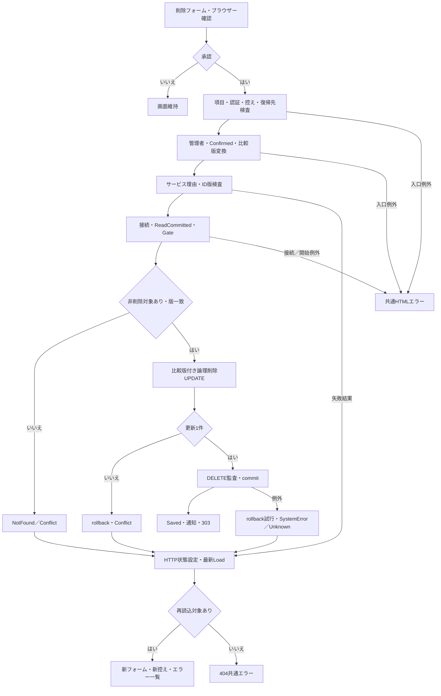
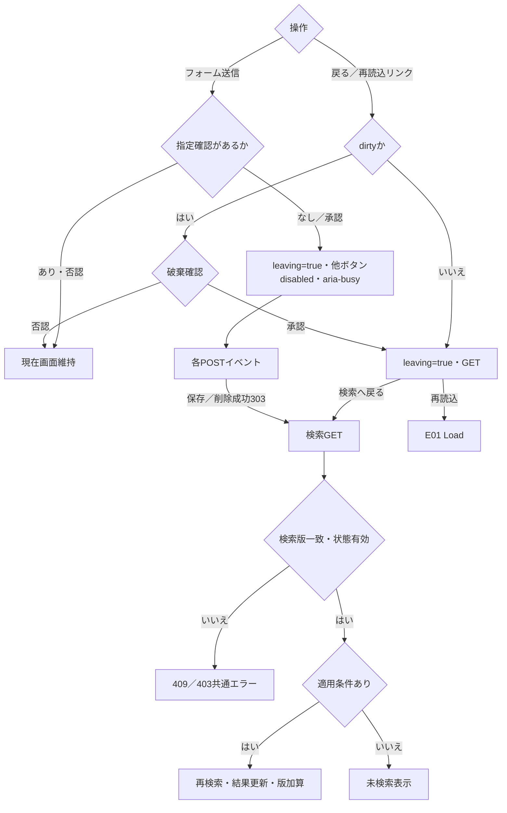

<!-- spec-meta
{"schema":"spec-md/1.0","documentId":"STUDENT-EDITOR-DETAIL","version":"1.0","path":"spec/detail/student-editor.md","sheets":[{"id":"overview","title":"概要","type":"GRID"},{"id":"items","title":"項目一覧","type":"LIST"},{"id":"lookups","title":"候補一覧","type":"LIST"},{"id":"events","title":"イベント仕様","type":"GRID"},{"id":"supplement","title":"補足説明","type":"GRID"}]}
-->
# 学生登録・参照・更新・論理削除 詳細仕様書

文書ID：STUDENT-EDITOR-DETAIL　文書種別：詳細仕様書　版：1.0　正本パス：spec/detail/student-editor.md

## 1. 概要

### 1.1 対象と処理責務

本画面は、学生の基本情報、住所・連絡先、在籍期間、所属クラス、緊急連絡先を新規登録し、既存学生を参照・更新する。論理削除は独立したフォームで受け付ける。登録・更新時に同一人物と考えられる学生が存在すると、候補を表示して別人として保存する理由を求める。学籍番号の重複は、この確認で続行できる対象に含めない。［sources/Views/Students/Edit.cshtml:3-17、sources/Core/SqlServerStudentService.cs:264-290］

画面は `StudentEditPageModel` を受け取るRazor Viewである。業務入力は `StudentSaveInput` から `StudentDraft` に移送し、サービスが正規化した辞書をSQLパラメータへ変換する。画面モデルの対象ID、読込詳細、候補、保存結果、通知、編集控え、検索復帰版は、それぞれ業務入力と別の責務を持つ。［sources/Web/Models/StudentEditPageModel.cs:5-14、sources/Web/Inputs/StudentSaveInput.cs:34-54、sources/Core/Contracts.cs:59-70］

到達可能な入口は、新規表示 `GET /students/new`、既存表示 `GET /students/{id:long}`、新規保存 `POST /students/create`、更新保存 `POST /students/{id:long}/update`、取消 `POST /students/reset`、論理削除 `POST /students/{id:long}/delete` である。Controllerは認証を要求し、Programの `MapControllers` で接続される。`IStudentService` には `SqlServerStudentService` が登録され、Web経路では `webTokens:true` を指定する。［sources/Program.cs:2-8、sources/Web/Controllers/StudentsController.cs:5-6、sources/Web/Controllers/StudentsController.cs:23-37、sources/Infrastructure/WebHostSetup.cs:19-19］

### 1.2 表示モードと権限

新規はStaff・Administratorが利用できる。既存表示は認証済み利用者が利用でき、Viewerでは業務入力と保存ボタンを含むfieldsetをdisabledにする。Staff・Administratorでは編集可能だが、既存の学籍番号はreadonlyとなり、サーバーでも変更を拒否する。取消、最新情報の再読込、検索への戻りは編集fieldsetの外に置く。［sources/Infrastructure/RequestIdentity.cs:13-16、sources/Web/Models/StudentEditPageModel.cs:14-14、sources/Views/Students/Edit.cshtml:5-16、sources/Core/SqlServerStudentService.cs:254-254］

削除フォームは既存学生をAdministratorが表示した場合だけ配置する。Controllerからサービスまでの経路でも管理者権限を確認する。既存在籍区分が卒業・退学で、その区分を別の区分へ訂正する更新もAdministratorと訂正理由を必要とする。区分を変えずに終了日だけを変更する場合には、この訂正条件を適用しない。［sources/Views/Students/Edit.cshtml:17-17、sources/Infrastructure/WebStudentCoordinator.cs:19-19、sources/Core/SqlServerStudentService.cs:255-258、sources/Core/SqlServerStudentService.cs:394-395］

### 1.3 画面配置

以下は原本のコントロール順、二列配置、全幅の備考・理由、独立した取消・削除領域を表現する静的HTML/CSSである。実画面の撮影ではない。新規編集可能モードを示し、動的候補と当年度は記号で表現する。既存編集では見出しを「／編集」に変え、学籍番号をreadonlyにする。Viewerでは「／参照」とし、学生基本情報fieldset全体をdisabledにする。重複確認領域は確認要求時のみ、削除領域は既存かつAdministratorの場合のみ表示する。［sources/Views/Students/Edit.cshtml:3-17、sources/wwwroot/css/site.css:1-1］

<section class="student-design">
<h1>学生登録 ／新規</h1>

通知・入力エラー表示領域

学生管理番号 新規　更新日時 －　更新者 －

<form data-editor-form>
<input type="hidden" name="SnapshotId"><input type="hidden" name="Input.ExpectedVersion"><input type="hidden" name="Input.ReturnContextId"><input type="hidden" name="Input.DuplicateToken">
<fieldset><legend>学生基本情報</legend>

<label>学籍番号 ※必須<input id="REG-002" name="Input.StudentNo" maxlength="30" required></label>
<label>氏名 ※必須<input id="REG-003" name="Input.StudentName" maxlength="16" required><small>8文字以内</small></label>
<label>氏名カナ ※必須<input id="REG-004" name="Input.StudentNameKana" maxlength="72" required><small>原入力36、正規化後18文字</small></label>
<fieldset class="wareki" id="REG-005"><legend>生年月日 ※必須</legend><select name="Input.BirthDateInput.Era" aria-label="元号" required><option value="">元号</option><option value="REIWA">令和</option><option value="HEISEI">平成</option><option value="SHOWA">昭和</option><option value="TAISHO">大正</option><option value="MEIJI">明治</option></select><input name="Input.BirthDateInput.Year" aria-label="元号年" maxlength="4" required>年<input name="Input.BirthDateInput.Month" aria-label="月" maxlength="2" required>月<input name="Input.BirthDateInput.Day" aria-label="日" maxlength="2" required>日</fieldset>
<label>性別 ※必須<select id="REG-006" name="Input.GenderCode" required><option value="0">未回答</option></select></label>
<label>郵便番号 ※必須<input id="REG-007" name="Input.PostalCode" maxlength="20" required></label>
<label>都道府県 ※必須<select id="REG-008" name="Input.PrefectureCode" required><option value="">未選択</option></select></label>
<label>住所1 ※必須<input id="REG-009" name="Input.AddressLine1" maxlength="90" required><small>45文字以内</small></label>
<label>住所2<input id="REG-010" name="Input.AddressLine2" maxlength="90"></label>
<label>本人電話<input id="REG-011" name="Input.PhoneNumber" maxlength="40"><small>原入力20、正規化後16文字</small></label>
<label>本人メール<input id="REG-012" name="Input.EmailAddress" maxlength="120"></label>
<label>入学日 ※必須<input id="REG-013" name="Input.AdmissionDate" type="date" required></label>
<label>在籍区分 ※必須<select id="REG-014" name="Input.EnrollmentStatusCode" required><option value="01">在学</option></select></label>
<label>卒業・退学日<input id="REG-015" name="Input.EnrollmentEndDate" type="date"></label>
<label>年度<select id="REG-016" name="Input.SchoolYear"><option value="">未指定</option><option selected>〈当年度〉</option></select></label>
<label>学年<select id="REG-017" name="Input.GradeCode"><option value="">すべて</option></select></label>
<label>クラス<select id="REG-018" name="Input.ClassId"><option value="">未所属</option></select><small>人数 －／定員 制限なし（参考）</small></label>
<label>緊急連絡先氏名<input id="REG-020" name="Input.EmergencyContactName" maxlength="16"></label>
<label>緊急連絡先続柄<select id="REG-021" name="Input.RelationshipCode"><option value="">未選択</option></select></label>
<label>緊急連絡先電話<input id="REG-022" name="Input.EmergencyPhoneNumber" maxlength="40"></label>
<label class="full">備考<textarea id="REG-023" name="Input.Remarks" maxlength="240"></textarea></label>
<label class="full">確認・変更理由<textarea id="REG-024" name="Input.OperationReason" maxlength="120"></textarea></label>

本人電話・メール・緊急電話のいずれか1つ以上。緊急連絡先は3項目すべて入力してください。

<section class="warning" role="dialog" aria-labelledby="duplicate-design-title"><h2 id="duplicate-design-title">同一人物候補の確認〈確認要求時のみ〉</h2>
全候補数／最大20件の学籍番号・氏名・和暦生年月日・クラス
<button type="button">確認取消</button><button type="button">別人と確認して続行</button></section>

<button type="button">登録〈既存時は更新〉</button>
</fieldset></form>

<button type="button">入力クリア〈既存時は編集取消〉</button>最新情報を再読込〈既存時のみ〉検索へ戻る

<form>
〈既存かつAdministratorの場合のみ〉
<label>削除理由 ※必須<textarea id="REG-026" name="Reason" maxlength="120" required></textarea></label><button type="button">対象を確認して論理削除</button>
編集中の業務値は保存されません。
</form>
</section>

### 1.4 データの境界

`m_student` は学生業務値と作成・更新・削除情報を保持し、`t_operation_log` は操作結果を追記する。クラス、コード、コード分類は候補表示と保存規則の参照元である。年度・学年は学生列ではなく、所属クラスとの整合確認に使う。［sources/database/001_schema.sql:7-43、sources/database/001_schema.sql:62-153、sources/Web/Inputs/StudentSaveInput.cs:34-42］

読込時の編集控え、検索条件・検索結果・検索版、成功通知、Web重複確認情報はサーバーメモリに保持する。画面から受ける識別子はこれらを参照する情報であり、学生の業務列へ保存しない。HTTPのログインセッションと、SQLトランザクションおよび編集控えの寿命を区別する。［sources/Infrastructure/EditorSnapshotStore.cs:7-11、sources/Infrastructure/SearchContextStore.cs:9-15、sources/Infrastructure/FlashMessageStore.cs:6-9、sources/Core/SqlServerStudentService.cs:19-29］

## 2. 項目一覧

| キー | 論理項目・実コントロール | Web型・サービスへの移送 | 必須・正規化・保存上限 | DB列・実SQL型・NULL・既定値 | HTML上限・根拠 |
| --- | --- | --- | --- | --- | --- |
| REG-002 | 学籍番号／input `Input.StudentNo` | string → `StudentDraft.StudentNo` →正規化辞書 | 必須。raw15スカラー値以内、trim・NFKC・大文字化後15以内。先頭英数字、以後英数字・ハイフン。更新不可 | `m_student.student_no` varchar(15)、NOT NULL、DEFAULTなし、全行一意 | maxlength30。既存readonly。［sources/Views/Students/Edit.cshtml:6-6、sources/Core/StudentNormalizer.cs:59-64、sources/database/001_schema.sql:9-9、sources/database/001_schema.sql:187-187］ |
| REG-003 | 氏名／input `Input.StudentName` | string → `StudentDraft.StudentName` | 必須。raw・trim後各8スカラー値以内。表示保存値にNFKCを適用しない | `student_name` nvarchar(16)、NOT NULL、DEFAULTなし | maxlength16。［sources/Views/Students/Edit.cshtml:6-6、sources/Core/StudentNormalizer.cs:125-125、sources/database/001_schema.sql:10-10、sources/database/001_schema.sql:44-44］ |
| REG-004 | 氏名カナ／input `Input.StudentNameKana` | string → `StudentDraft.StudentNameKana` | 必須。raw36以内。NFKC、対象ひらがなをカタカナ化、内部空白を半角1個へ集約。結果18スカラー値以内 | `student_name_kana` nvarchar(36)、NOT NULL、DEFAULTなし | maxlength72。［sources/Views/Students/Edit.cshtml:6-6、sources/Core/StudentNormalizer.cs:72-85、sources/database/001_schema.sql:11-11、sources/database/001_schema.sql:45-45］ |
| REG-005 | 生年月日／fieldset、元号select・年/月/日input | `BirthDateInput`。Era/Year/Month/Dayはstring → `StudentDraft.BirthDateInput` → DateOnly | 必須。元号ID一致、年の「元」＝1、正の整数、実在日、元号境界、業務日以前を確認 | `birth_date` date、NOT NULL、DEFAULTなし。元号構成は保存しない | 年maxlength4、月・日2。［sources/Views/Students/Edit.cshtml:7-7、sources/Core/JapaneseDateService.cs:10-45、sources/database/001_schema.sql:14-14］ |
| REG-006 | 性別／select `Input.GenderCode` | string → `StudentDraft.GenderCode` | 必須。raw1以内、trim・NFKC後ASCII数字1桁。候補存在と利用可否を別途検査 | `gender_code` varchar(1)、NOT NULL、DEFAULTなし | 空optionなし。新規0。［sources/Views/Students/Edit.cshtml:8-8、sources/Core/StudentNormalizer.cs:113-117、sources/Core/Contracts.cs:15-15、sources/database/001_schema.sql:16-16］ |
| REG-007 | 郵便番号／input `Input.PostalCode` | string → `StudentDraft.PostalCode` | 必須。raw10以内。trim・NFKC後、空白と指定ハイフン類を除去しASCII数字7桁 | `postal_code` varchar(7)、NOT NULL、DEFAULTなし | maxlength20。［sources/Views/Students/Edit.cshtml:9-9、sources/Core/StudentNormalizer.cs:95-100、sources/database/001_schema.sql:17-17］ |
| REG-008 | 都道府県／select `Input.PrefectureCode` | string → `StudentDraft.PrefectureCode` | 必須。raw2以内、trim・NFKC後ASCII数字2桁。候補存在と利用可否を検査 | `prefecture_code` varchar(2)、NOT NULL、DEFAULTなし | 空値「未選択」。［sources/Views/Students/Edit.cshtml:9-9、sources/Core/StudentNormalizer.cs:113-117、sources/Core/StudentNormalizer.cs:130-130、sources/database/001_schema.sql:19-19］ |
| REG-009 | 住所1／input `Input.AddressLine1` | string → `StudentDraft.AddressLine1` | 必須。raw・trim後各45スカラー値以内。NFKCなし | `address_line1` nvarchar(90)、NOT NULL、DEFAULTなし | maxlength90。［sources/Views/Students/Edit.cshtml:10-10、sources/Core/StudentNormalizer.cs:47-57、sources/Core/StudentNormalizer.cs:131-131、sources/database/001_schema.sql:20-20］ |
| REG-010 | 住所2／input `Input.AddressLine2` | string? → `StudentDraft.AddressLine2` | 任意。raw・trim後各45以内。空値はNULL。NFKCなし | `address_line2` nvarchar(90)、NULL可、DEFAULTなし | maxlength90。［sources/Views/Students/Edit.cshtml:10-10、sources/Core/StudentNormalizer.cs:132-132、sources/database/001_schema.sql:21-21］ |
| REG-011 | 本人電話／input `Input.PhoneNumber` | string? → `StudentDraft.PhoneNumber` | 任意。raw20以内。NFKC後に指定区切りを除去。国内形式10～11桁、国際形式は記号込み最大16。空値NULL | `phone_number` varchar(16)、NULL可、DEFAULTなし | maxlength40。［sources/Views/Students/Edit.cshtml:10-10、sources/Core/StudentNormalizer.cs:87-94、sources/database/001_schema.sql:22-22］ |
| REG-012 | 本人メール／input `Input.EmailAddress` | string? → `StudentDraft.EmailAddress` | 任意。raw・trim後各60以内。ASCII形式を検査。ローカル部を保持しドメインのみ小文字化。空値NULL | `email_address` varchar(60)、NULL可、DEFAULTなし | maxlength120。［sources/Views/Students/Edit.cshtml:10-10、sources/Core/StudentNormalizer.cs:102-111、sources/database/001_schema.sql:23-23］ |
| REG-013 | 入学日／date input `Input.AdmissionDate` | string → `StudentDraft.AdmissionDate` → DateOnly | 必須。NFKC後10コード単位、yyyy-MM-dd厳密形式。1900-01-01～業務日 | `admission_date` date、NOT NULL、DEFAULTなし | type=date。［sources/Views/Students/Edit.cshtml:11-11、sources/Core/JapaneseDateService.cs:52-59、sources/database/001_schema.sql:24-24］ |
| REG-014 | 在籍区分／select `Input.EnrollmentStatusCode` | string → `StudentDraft.EnrollmentStatusCode` | 必須。raw2以内、正規化後ASCII数字2桁。01在学・02休学・03卒業・04退学に限定 | `enrollment_status_code` varchar(2)、NOT NULL、DEFAULTなし | 空optionなし。新規01。［sources/Views/Students/Edit.cshtml:11-11、sources/Core/StudentNormalizer.cs:136-154、sources/database/001_schema.sql:26-26、sources/database/002_seed.sql:19-22］ |
| REG-015 | 卒業・退学日／date input `Input.EnrollmentEndDate` | string? → `StudentDraft.EnrollmentEndDate` → DateOnly? | NULL・空文字はNULL。指定時は入学日と同じ日付解析。01・02はNULL、03・04は入学日以後の値が必須 | `enrollment_end_date` date、NULL可、DEFAULTなし | type=date。空白だけの文字列は日付不正。［sources/Views/Students/Edit.cshtml:11-11、sources/Core/StudentNormalizer.cs:137-153、sources/database/001_schema.sql:27-27］ |
| REG-016 | 年度／select `Input.SchoolYear` | int? → `SaveRequest.SchoolYear`。StudentDraftへ移送しない | 任意。指定時1900～9998。クラス設定時に年度一致を確認 | 学生の保存列なし。照合先 `m_class.school_year` smallint、NOT NULL、DEFAULTなし | 新規は4月開始の当年度。［sources/Views/Students/Edit.cshtml:12-12、sources/Web/Inputs/StudentSaveInput.cs:28-54、sources/Core/SqlServerStudentService.cs:236-236、sources/Core/SqlServerStudentService.cs:371-371、sources/database/001_schema.sql:64-64］ |
| REG-017 | 学年／select `Input.GradeCode` | string? → `SaveRequest.GradeCode`。StudentDraftへ移送しない | 任意。raw2以内、trim・NFKC後ASCII数字2桁。クラス設定時に一致を確認 | 学生の保存列なし。照合先 `m_class.grade_code` varchar(2)、NOT NULL、DEFAULTなし | 空値「すべて」。［sources/Views/Students/Edit.cshtml:12-12、sources/Web/Inputs/StudentSaveInput.cs:29-42、sources/Core/SqlServerStudentService.cs:237-237、sources/Core/SqlServerStudentService.cs:371-371、sources/database/001_schema.sql:66-66］ |
| REG-018 | クラス／select `Input.ClassId` | string? → `IdParser.Optional` → `StudentDraft.ClassId` long? | 空値NULL、0不可。指定値は正のInt64。在学・休学では必須。所属・期間・定員を検査 | `class_id` bigint、NULL可、DEFAULTなし、クラスFK | 空値「未所属」。optionにdata-year/data-grade。［sources/Views/Students/Edit.cshtml:12-12、sources/Web/Inputs/StudentSaveInput.cs:40-40、sources/Web/Inputs/StudentSaveInput.cs:59-60、sources/database/001_schema.sql:28-28、sources/database/001_schema.sql:191-191］ |
| REG-020 | 緊急連絡先氏名／input `Input.EmergencyContactName` | string? → `StudentDraft.EmergencyContactName` | 任意。raw・trim後各8以内。空値NULL。続柄・電話との全項目整合を検査 | `emergency_contact_name` nvarchar(16)、NULL可、DEFAULTなし | maxlength16。［sources/Views/Students/Edit.cshtml:13-13、sources/Core/StudentNormalizer.cs:139-157、sources/database/001_schema.sql:29-29］ |
| REG-021 | 緊急連絡先続柄／select `Input.RelationshipCode` | string? → `StudentDraft.RelationshipCode` | 任意。raw2以内、trim・NFKC後ASCII数字2桁。空値NULL | `relationship_code` varchar(2)、NULL可、DEFAULTなし | 空値「未選択」。［sources/Views/Students/Edit.cshtml:13-13、sources/Core/StudentNormalizer.cs:140-147、sources/database/001_schema.sql:31-31］ |
| REG-022 | 緊急連絡先電話／input `Input.EmergencyPhoneNumber` | string? → `StudentDraft.EmergencyPhoneNumber` | 本人電話と同じ正規化。空値NULL。緊急連絡先3項目を一組として検査 | `emergency_phone_number` varchar(16)、NULL可、DEFAULTなし | maxlength40。［sources/Views/Students/Edit.cshtml:13-13、sources/Core/StudentNormalizer.cs:141-157、sources/database/001_schema.sql:32-32］ |
| REG-023 | 備考／textarea `Input.Remarks` | string? → `StudentDraft.Remarks` | 任意。raw・改行変換/trim後各120以内。CRLF・CRをLFへ統一。空値NULL | `remarks` nvarchar(240)、NULL可、DEFAULTなし | maxlength240、全幅。［sources/Views/Students/Edit.cshtml:13-13、sources/Core/StudentNormalizer.cs:47-57、sources/Core/StudentNormalizer.cs:142-142、sources/database/001_schema.sql:33-33］ |
| REG-024 | 確認・変更理由／textarea `Input.OperationReason` | string? → `SaveRequest.Reason`。StudentDraftへ移送しない | raw・改行変換/trim後各60以内。通常任意、終了区分訂正と有効重複確認による続行では必須 | `t_operation_log.operation_reason` nvarchar(120)、NULL可、DEFAULTなし。学生業務列ではない | maxlength120、全幅。［sources/Views/Students/Edit.cshtml:13-13、sources/Web/Inputs/StudentSaveInput.cs:42-42、sources/Core/SqlServerStudentService.cs:234-257、sources/Core/SqlServerStudentService.cs:286-286、sources/database/001_schema.sql:148-153］ |
| REG-026 | 削除理由／別フォームtextarea `Reason` | `StudentDeleteInput.Reason` string → `DeleteAsync`引数 | 必須。raw・改行変換/trim後各60以内 | `m_student.delete_reason` と `t_operation_log.operation_reason`、ともにnvarchar(120)、NULL可、DEFAULTなし。削除時は非NULL | required、maxlength120。［sources/Views/Students/Edit.cshtml:17-17、sources/Web/Inputs/StudentDeleteInput.cs:4-4、sources/Core/SqlServerStudentService.cs:396-413、sources/database/001_schema.sql:37-37、sources/database/001_schema.sql:148-148］ |
| DISPLAY-ID | 学生管理番号／p内表示。DOM IDなし | `StudentEditPageModel.StudentId` long?。保存対象はURLのid | 新規は「新規」。業務入力ではない | `student_id` bigint IDENTITY(1,1)、NOT NULL、PK。SQL OUTPUTで取得 | ［sources/Views/Students/Edit.cshtml:4-5、sources/Web/Controllers/StudentsController.cs:26-29、sources/database/001_schema.sql:8-8、sources/database/001_schema.sql:43-43］ |
| DISPLAY-UPDATED | 更新日時・更新者／p内表示。DOM IDなし | `Detail.UpdatedAt` DateTimeOffset、`Detail.UpdatedBy` string | UTC+9のyyyy/MM/dd HH:mm:ss。新規は両方「－」 | `updated_at` datetimeoffset(7)、`updated_by` nvarchar(128)、ともにNOT NULL、DEFAULTなし | ［sources/Views/Students/Edit.cshtml:4-4、sources/Infrastructure/WebPresentation.cs:7-7、sources/database/001_schema.sql:40-41］ |
| DISPLAY-CAPACITY | 人数・定員／クラスselect直後のsmall | `SchoolClass.Occupied` int、`Capacity` int? | 描画時の選択クラスの参考値。人数0を表示。対象なし人数「－」、定員NULLまたは対象なし「制限なし」 | 人数は非削除の在学・休学COUNT(*)。定員は `m_class.capacity` int、NULL可、DEFAULTなし | クラス変更時の即時更新なし。［sources/Views/Students/Edit.cshtml:2-2、sources/Views/Students/Edit.cshtml:12-12、sources/Core/SqlServerStudentService.cs:201-214、sources/wwwroot/js/site.js:8-8］ |
| H-SNAPSHOT | 編集控え／hidden `SnapshotId` | Controller別引数string → `EditorSnapshotStore.Get` | 所有者・ログインセッション・対象IDと期限を検査。SaveRequestには入らない | DB列なし。メモリ辞書の識別子 | 保存・取消・削除フォームに存在。［sources/Views/Students/Edit.cshtml:5-17、sources/Infrastructure/EditorSnapshotStore.cs:7-11］ |
| H-VERSION | 比較版／保存hidden `Input.ExpectedVersion`、削除hidden `ExpectedVersion` | string?／string →正のlong → `SaveRequest.ExpectedVersion`／削除引数 | 新規はNULL・空文字のみ。更新・削除は必須。控えの版との照合は行わずDB現在版と比較 | 比較先 `row_version` bigint、NOT NULL、DEFAULT(1)、正数CHECK。SQL Serverのrowversion型ではない | ［sources/Views/Students/Edit.cshtml:5-5、sources/Views/Students/Edit.cshtml:17-17、sources/Web/Inputs/StudentSaveInput.cs:42-43、sources/Core/SqlServerStudentService.cs:251-252、sources/database/001_schema.sql:42-59］ |
| H-RETURN | 検索復帰先／保存hidden `Input.ReturnContextId`、削除hidden `ReturnContextId` | string?。学生保存DTOへ移送しない | 所有・期限を確認し、送信値と控えOriginalの文字列一致を要求 | DB列なし。検索コンテキスト識別子 | ［sources/Views/Students/Edit.cshtml:5-17、sources/Web/Controllers/StudentsController.cs:29-29、sources/Web/Controllers/StudentsController.cs:37-38］ |
| H-DUPLICATE | 重複確認情報／hidden `Input.DuplicateToken` | string? → `SaveRequest.ConfirmationToken` | 所有、対象、送信版、期限、入力ハッシュ、全候補ハッシュ、Busyを検査 | Web経路はstaticメモリ辞書。学生業務列ではない | input変更・確認取消で空にする。［sources/Views/Students/Edit.cshtml:5-5、sources/wwwroot/js/site.js:3-6、sources/Core/SqlServerStudentService.cs:276-290］ |
| H-RESET-ID | 取消対象／取消hidden `StudentId` | string? → `IdParser.Optional` → long? | 新規は未設定、既存は正数。控え対象との一致を要求 | DB更新なし | ［sources/Views/Students/Edit.cshtml:16-16、sources/Web/Controllers/StudentsController.cs:35-35］ |
| H-CONFIRMED | 削除確認済み／削除hidden `Confirmed` | `StudentDeleteInput.Confirmed` bool | フォーム値true。falseは422。ブラウザー確認と別の検査 | DB列なし | ［sources/Views/Students/Edit.cshtml:17-17、sources/Web/Inputs/StudentDeleteInput.cs:4-4、sources/Infrastructure/WebStudentCoordinator.cs:19-19］ |
| H-CSRF | CSRF情報／各POSTフォームのhidden | `__RequestVerificationToken`。MVCフィルターで検証 | フォーム許可項目に含む。業務入力ではない | DB列なし | ［sources/Views/Students/Edit.cshtml:5-17、sources/Infrastructure/WebHostSetup.cs:15-16、sources/Web/Controllers/StudentsController.cs:41-41］ |
| SERVER-NAME-KEY | 氏名照合キー／画面コントロールなし | 正規化済み氏名から導出 | NFKC・大文字化・Unicode空白除去。160スカラー値以内 | `name_key` nvarchar(320)、NOT NULL、DEFAULTなし | ［sources/Core/StudentNormalizer.cs:66-70、sources/Core/StudentNormalizer.cs:144-144、sources/database/001_schema.sql:12-12、sources/database/001_schema.sql:46-46］ |
| SERVER-KANA-KEY | カナ照合キー／画面コントロールなし | 正規化済みカナから導出 | 保存カナの半角空白を除去。保存カナ上限18以内 | `kana_key` nvarchar(36)、NOT NULL、DEFAULTなし | ［sources/Core/StudentNormalizer.cs:145-145、sources/database/001_schema.sql:13-13、sources/database/001_schema.sql:47-47］ |
| SERVER-GENDER-CATEGORY | 性別分類／画面コントロールなし | INSERT固定値GENDER | クライアントから受け取らない。UPDATE対象外 | `gender_category` varchar(24)、NOT NULL、DEFAULTなし、固定分類CHECK・複合FK | ［sources/Core/SqlServerStudentService.cs:296-297、sources/database/001_schema.sql:15-15、sources/database/001_schema.sql:192-196］ |
| SERVER-PREFECTURE-CATEGORY | 都道府県分類／画面コントロールなし | INSERT固定値PREFECTURE | クライアントから受け取らない。UPDATE対象外 | `prefecture_category` varchar(24)、NOT NULL、DEFAULTなし、固定分類CHECK・複合FK | ［sources/Core/SqlServerStudentService.cs:296-297、sources/database/001_schema.sql:18-18、sources/database/001_schema.sql:193-196］ |
| SERVER-ENROLLMENT-CATEGORY | 在籍分類／画面コントロールなし | INSERT固定値ENROLLMENT_STATUS | クライアントから受け取らない。UPDATE対象外 | `enrollment_category` varchar(24)、NOT NULL、DEFAULTなし、固定分類CHECK・複合FK | ［sources/Core/SqlServerStudentService.cs:296-297、sources/database/001_schema.sql:25-25、sources/database/001_schema.sql:194-196］ |
| SERVER-RELATIONSHIP-CATEGORY | 続柄分類／画面コントロールなし | 正規化辞書で導出 | 続柄NULLならNULL、設定時RELATIONSHIP | `relationship_category` varchar(24)、NULL可、DEFAULTなし、続柄との複合FK・連絡先CHECK | ［sources/Core/StudentNormalizer.cs:147-147、sources/database/001_schema.sql:30-31、sources/database/001_schema.sql:195-199］ |
| SERVER-CREATED | 作成日時・作成者／画面コントロールなし | サービス開始UTC時刻now・CurrentUser.Principal | 新規のみ設定。更新では保持 | `created_at` datetimeoffset(7)、`created_by` nvarchar(128)、ともにNOT NULL、DEFAULTなし。日時UTC・主体64スカラー値CHECK | ［sources/Core/SqlServerStudentService.cs:229-229、sources/Core/SqlServerStudentService.cs:296-300、sources/database/001_schema.sql:38-39、sources/database/001_schema.sql:55-56］ |
| SERVER-DELETED | 論理削除フラグ／画面コントロールなし | 新規0、削除1 | 非削除は削除情報3列NULL、削除済みは3列非NULL | `is_deleted` bit、NOT NULL、DEFAULT(0)、削除情報整合CHECK | ［sources/Core/SqlServerStudentService.cs:296-296、sources/Core/SqlServerStudentService.cs:409-409、sources/database/001_schema.sql:34-37、sources/database/001_schema.sql:200-200］ |
| SERVER-DELETED-ACTOR | 削除日時・削除者／画面コントロールなし | 削除開始UTC時刻now・CurrentUser.Principal | 論理削除時に設定。新規・通常更新では設定しない | `deleted_at` datetimeoffset(7)、`deleted_by` nvarchar(128)、ともにNULL可、DEFAULTなし。日時UTC・主体64スカラー値CHECK | ［sources/Core/SqlServerStudentService.cs:394-394、sources/Core/SqlServerStudentService.cs:409-410、sources/database/001_schema.sql:35-36、sources/database/001_schema.sql:52-53］ |

## 3. 候補一覧

| キー | 対象・取得元 | 抽出・順序 | optionキーと表示 | 初期値・利用可否・連動 | 根拠 |
| --- | --- | --- | --- | --- | --- |
| LK-ERA | 生年月日の元号／View固定候補 | REIWA、HEISEI、SHOWA、TAISHO、MEIJIの順 | 元号ID／令和、平成、昭和、大正、明治 | 新規は空値「元号」。既存は生年月日を逆変換 | ［sources/Views/Students/Edit.cshtml:7-7、sources/Web/Inputs/StudentSaveInput.cs:48-48、sources/Core/JapaneseDateService.cs:41-45］ |
| LK-GENDER | 性別／LookupSet.Codes | CategoryId=GENDER。SQLのcategory_id、display_order、code_value順を継承 | CodeValue／CodeName | 新規0。空optionなし。現在使用可または読込時と同じ値を選択可能 | ［sources/Views/Students/Edit.cshtml:8-8、sources/Core/SqlServerStudentService.cs:203-212］ |
| LK-PREFECTURE | 都道府県／LookupSet.Codes | CategoryId=PREFECTURE。同分類内display_order、code_value順 | CodeValue／CodeName | 新規空値「未選択」。現在使用可または読込時と同じ値を選択可能 | ［sources/Views/Students/Edit.cshtml:9-9、sources/Core/SqlServerStudentService.cs:203-212］ |
| LK-ENROLLMENT | 在籍区分／LookupSet.Codes | CategoryId=ENROLLMENT_STATUS。同分類内display_order、code_value順 | CodeValue／CodeName | 新規01。空optionなし。現在使用可または読込時と同じ値を選択可能 | ［sources/Views/Students/Edit.cshtml:11-11、sources/Core/Contracts.cs:23-23、sources/Core/SqlServerStudentService.cs:203-212］ |
| LK-RELATIONSHIP | 緊急連絡先続柄／LookupSet.Codes | CategoryId=RELATIONSHIP。同分類内display_order、code_value順 | CodeValue／CodeName | 空値「未選択」。現在使用可または読込時と同じ値を選択可能 | ［sources/Views/Students/Edit.cshtml:13-13、sources/Core/SqlServerStudentService.cs:203-212］ |
| LK-YEAR | 年度／全クラス年度＋Input.SchoolYear | 重複除去、降順。クラス停止・期間で除外しない | 年度整数／年度 | 空値「未指定」。新規は当年度、既存所属ありはクラス年度、未所属はNULL | ［sources/Views/Students/Edit.cshtml:12-12、sources/Web/Inputs/StudentSaveInput.cs:46-54、sources/Infrastructure/WebPresentation.cs:5-6］ |
| LK-GRADE | 学年／LookupSet.Codes | CategoryId=GRADE全件。同分類内display_order、code_value順 | CodeValue／CodeName | 空値「すべて」。既存所属クラスの学年。停止・期間によるdisabledなし | ［sources/Views/Students/Edit.cshtml:12-12、sources/Web/Inputs/StudentSaveInput.cs:53-53、sources/Core/SqlServerStudentService.cs:203-212］ |
| LK-CLASS | クラス／LookupSet.Classes | 全件。年度降順、学年display_order、クラスdisplay_order、class_code、class_id順。年度・学年で候補を絞らない | ClassId／年度・学年コード・クラスコード・クラス名。data-year/data-grade付与 | 空値「未所属」。読込時同一クラスは保持可。その他は在籍区分別に現在利用可または期間重複を判定。選択時に年度・学年へ値移送 | ［sources/Views/Students/Edit.cshtml:12-12、sources/Core/SqlServerStudentService.cs:206-214、sources/wwwroot/js/site.js:8-8］ |

## 4. イベント仕様

### 4.1 関連テーブルと保持領域

次のER図はDDLの主キー・外部キーに基づく。学生のクラス参照は任意で、同じクラスを複数学生が参照できる。性別・都道府県・在籍・続柄は分類とコードの複合参照であり、続柄だけは未設定を許す。候補表示SQLのLEFT JOINは名称取得の処理で、外部キー定義と区別する。［sources/database/001_schema.sql:28-43、sources/database/001_schema.sql:80-80、sources/database/001_schema.sql:102-127、sources/database/001_schema.sql:189-199、sources/Core/SqlServerStudentService.cs:82-90］

学生書込みと監査追記の関係は、同一トランザクションの処理上の関連である。`t_operation_log.target_key` は学生IDの10進文字列だが、学生へのFKは定義されていない。Web確認情報と編集控えも学生FKを持つDB行ではない。［sources/Core/SqlServerStudentService.cs:306-315、sources/Core/SqlServerStudentService.cs:385-390、sources/database/001_schema.sql:137-168］

以降のDBを伴うイベントは、この関連を使用する。クラス・コードの候補取得では複数表を参照し、保存・削除では学生と監査を同じトランザクションで扱う。ブラウザーだけのイベントではDB操作を行わない。

### 4.2 E01 新規表示・既存表示・最新情報の再読込

#### 処理概要

検索画面の新規登録または参照・編集リンクから表示する。既存の「最新情報を再読込」も同じLoad経路を通る。認証と検索復帰先を確認し、既存詳細または新規初期値に候補を組み合わせ、取消用の控えを作る。［sources/Views/Students/Search.cshtml:6-8、sources/Views/Students/Edit.cshtml:16-16、sources/Web/Controllers/StudentsController.cs:23-25］

#### 処理手順

1. `coordinator.Edit` が認証済み利用者を確認する。ReturnContextIdが空でなければ検索コンテキストの存在、期限、所有者、ログインセッションを確認する。この編集側確認ではtabを指定しない。新規だけは作成・更新権限も要求する。［sources/Infrastructure/WebStudentCoordinator.cs:6-6、sources/Infrastructure/WebStudentCoordinator.cs:17-17、sources/Infrastructure/SearchContextStore.cs:13-13］
2. 既存では `GetAsync(id)` で非削除学生を取得する。対象なしはE-STU-103を伴う404のWebFaultにする。新規では詳細取得を行わず、StudentDraftの初期値を使う。［sources/Infrastructure/WebStudentCoordinator.cs:17-17、sources/Core/SqlServerStudentService.cs:172-194］
3. `LookupAsync(ct)` でコード・クラス・人数を取得し、`StudentSaveInput.From` へ渡す。新規の学籍番号・氏名・住所・日付構成は空、性別0、在籍区分01、任意値とクラスは未設定とする。年度はUTC+9業務日の4月開始年度とする。［sources/Core/Contracts.cs:11-29、sources/Core/SqlServerStudentService.cs:196-216、sources/Web/Inputs/StudentSaveInput.cs:44-54、sources/Infrastructure/WebPresentation.cs:5-6］
4. 既存では保存業務値をフォームへ移し、生年月日を和暦構成へ戻す。候補中に所属クラスがあれば年度・学年を設定し、未所属では両方NULLとする。ExpectedVersionへ詳細RowVersionの10進文字列、ReturnContextIdへ入口の値を設定する。［sources/Web/Inputs/StudentSaveInput.cs:46-54］
5. Controllerは検索復帰版を取得し、`EditorSnapshotStore.Create` でOwner、Session、StudentId、Detail、Original、Expires、ReturnRevisionを保持する。OriginalはJSON往復で複製する。識別子は32バイト乱数由来の小文字16進文字列、期限は作成から30分である。生成時に期限切れ控えを除去する。［sources/Web/Controllers/StudentsController.cs:25-25、sources/Infrastructure/EditorSnapshotStore.cs:7-11、sources/Infrastructure/SearchContextStore.cs:11-11］
6. StudentEditPageModelを作って新規・編集・参照モードを描画する。最新再読込ではこの一連の処理を再実施するため、詳細、フォーム、控えが新しくなる。［sources/Web/Controllers/StudentsController.cs:23-25、sources/Views/Students/Edit.cshtml:3-5］

#### 条件付き処理フロー

#### SQL・テーブル関連とDB操作の詳細

学生詳細SQLは `SELECT * FROM dbo.m_student WHERE student_id=@id AND is_deleted=0` で、@idはBigIntである。JOIN、ORDER BY、ページングはなく、主キー対象の最初の1行を読み取る。DB NULLをC# nullへ変換し、業務辞書、版、生年月日、更新日時・更新者からStudentDetailを組み立てる。idが0以下なら接続前にNULLを返す。［sources/Core/SqlServerStudentService.cs:172-194］

候補取得はSnapshot分離レベルの読取トランザクションを開始し、2結果セットを読む。コードSQLは `m_code c JOIN m_code_category k ON k.category_id=c.category_id` で分類、値、名称、順序、有効状態、期間、保護状態を取得する。WHEREによる停止・期間の除外はなく、有効状態だけを「コードと分類の両方が有効」で導出する。順序は `c.category_id,c.display_order,c.code_value` である。［sources/Core/SqlServerStudentService.cs:199-212］

クラスSQLは `m_class c LEFT JOIN m_code g ON g.category_id=c.grade_category AND g.code_value=c.grade_code` で全クラスを取得する。順序は `c.school_year DESC,g.display_order,c.display_order,c.class_code,c.class_id` である。各Occupiedは学生の `s.class_id=c.class_id AND s.is_deleted=0 AND s.enrollment_status_code IN ('01','02')` に対するCOUNT(*)、Capacityはクラス列でNULLを許す。2結果セットを全件読取後にcommitし、LookupSetを返す。件数制限・ページングはない。テーブル関係は4.1のER図を参照する。［sources/Core/SqlServerStudentService.cs:201-216、sources/Core/Contracts.cs:61-65］

#### 結果・例外時の扱い

通常はEdit Viewを返す。対象なしは404、権限違反は403、認証失効は401、復帰先期限切れは409の経路となる。接続、Snapshot開始、候補取得等で未捕捉例外が発生し応答開始前なら、共通ミドルウェアが503のHTMLエラーを返す。［sources/Infrastructure/RequestIdentity.cs:8-15、sources/Infrastructure/SearchContextStore.cs:13-13、sources/Infrastructure/WebStudentCoordinator.cs:17-17、sources/Infrastructure/WebHostSetup.cs:23-25］

### 4.3 E02 クラス選択・年度学年変更

#### 処理概要

所属クラスを選択すると、そのクラスの年度・学年を上位項目へ移す。年度または学年を変更して選択済みクラスと不一致になった場合は、クラスだけを解除する。候補の選択可否はサーバー描画時に決め、JavaScriptでは再計算しない。［sources/Views/Students/Edit.cshtml:12-12、sources/wwwroot/js/site.js:8-8］

#### 処理手順

1. クラスchange時に選択optionを取得する。data-yearがあれば、その値をREG-016、data-gradeをREG-017へ設定する。未所属の空optionには属性がないため、年度・学年をクリアしない。［sources/wwwroot/js/site.js:8-8］
2. 年度または学年change時は、クラスが選択済みの場合だけ比較する。空でない年度がdata-yearと異なる、または空でない学年がdata-gradeと異なる場合、REG-018を空値へ変更し、解除した旨をalert表示する。上位項目を空値にしたことだけでは解除しない。［sources/wwwroot/js/site.js:8-8］
3. クラス候補を年度・学年で絞り直す処理、初回表示で選択を解除する処理、在籍区分・日付変更でdisabledを変更する処理、人数・定員参考値を更新する処理はこのイベントに接続されていない。［sources/Views/Students/Edit.cshtml:2-12、sources/wwwroot/js/site.js:2-9］

#### 条件付き処理フロー

#### SQL・テーブル関連とDB操作の詳細

このイベントはDOMのselect値とoption属性だけを操作し、API・SQL・DB更新・トランザクションを使用しない。属性と参考人数の取得元はE01のLookupSetであり、元データの関係は4.1に示す。保存時はE04のCheckRulesで別途確認する。［sources/Views/Students/Edit.cshtml:12-12、sources/wwwroot/js/site.js:8-8、sources/Core/SqlServerStudentService.cs:357-383］

#### 結果・例外時の扱い

不一致時はクラスが未所属となる。在学・休学でそのまま保存するとクラス必須規則に違反する。人数表示は最後のサーバー描画値のままであるため、変更後クラスの人数を表すとは限らない。［sources/Core/StudentNormalizer.cs:154-154、sources/Views/Students/Edit.cshtml:12-12、sources/wwwroot/js/site.js:8-8］

### 4.4 E03 入力クリア・編集取消

#### 処理概要

独立した取消フォームからPOST /students/resetへSnapshotIdとStudentIdを送信し、読込時のフォーム値を復元する。新規の入力クリアも、空欄化だけでなく性別・在籍区分・年度を含む初期値の復元である。最新DB値の取得はE01の再読込を使う。［sources/Views/Students/Edit.cshtml:16-16、sources/Web/Controllers/StudentsController.cs:35-35］

#### 処理手順

1. submit時に「編集内容を読込時の値へ戻しますか。」を確認する。否認では送信しない。［sources/Views/Students/Edit.cshtml:16-16、sources/wwwroot/js/site.js:4-4］
2. FormGuardがSnapshotId、StudentId、CSRF・フォーム書式メタ情報以外を拒否し、認証を確認する。StudentIdを任意の正のInt64へ変換する。［sources/Web/Controllers/StudentsController.cs:35-41、sources/Web/Inputs/StudentSaveInput.cs:59-60］
3. 控えの存在・期限・所有者・ログインセッション・対象IDを確認する。期限切れまたは未登録は409、所有や対象の不一致は403とする。［sources/Infrastructure/EditorSnapshotStore.cs:10-10］
4. ModelStateをクリアする。Originalを複製してInputへ戻し、Detail、SnapshotId、ReturnRevisionは元の控えを使用する。候補だけを再取得し、「入力を読込時の値へ戻しました。」を表示する。［sources/Web/Controllers/StudentsController.cs:35-35、sources/Infrastructure/EditorSnapshotStore.cs:11-11］

#### 条件付き処理フロー

#### SQL・テーブル関連とDB操作の詳細

復元元はメモリのEditorSnapshotStoreであり、学生業務値のDB再取得・更新はない。候補の再取得だけがE01の複数表読取SQLとSnapshotトランザクションを使用する。控えの期限はGetで延長せず、取消成功による消費・削除も行わない。［sources/Web/Controllers/StudentsController.cs:35-35、sources/Infrastructure/EditorSnapshotStore.cs:9-11、sources/Core/SqlServerStudentService.cs:196-216］

#### 結果・例外時の扱い

読込時値が復元されるため、他利用者がDBを更新していてもフォームとExpectedVersionは読込時のままである。候補は現在取得した値になる。入口例外または候補再取得失敗は通常の復元表示を完了せず、共通エラー経路へ進む。［sources/Web/Controllers/StudentsController.cs:35-35、sources/Infrastructure/WebHostSetup.cs:23-23］

### 4.5 E04 新規登録・更新保存

#### 処理概要

フォームの対象ID有無で登録・更新の送信先を切り替える。許可項目、権限、控え、復帰先、型変換、正規化を確認した後、共通書込排他下で対象・版・業務規則・重複を確認する。成立時は学生書込みと監査をcommitし、検索画面へ303で戻る。［sources/Views/Students/Edit.cshtml:5-15、sources/Web/Controllers/StudentsController.cs:26-33、sources/Core/SqlServerStudentService.cs:227-315］

#### 処理手順

1. MVCのCSRF検証を適用する。ControllerのFormGuardはStudentSaveInputの公開プロパティへInput.を付けた項目名を許可し、BirthDateInputだけはEra・Year・Month・Dayに展開する。追加許可はSnapshotId、__RequestVerificationToken、__Invariantである。未知項目と例外対象以外の同名多値は400、__Invariantに許可項目名以外が入る場合も400とする。StudentId、分類・監査・削除列の追加送信は許可しない。［sources/Infrastructure/WebHostSetup.cs:15-18、sources/Web/Controllers/StudentsController.cs:29-29、sources/Web/Controllers/StudentsController.cs:41-41］
2. 作成・更新権限、控えの期限・所有・対象、検索復帰先の所有・期限を確認する。送信ReturnContextIdが控えOriginal.ReturnContextIdと異なる場合は403とする。この段階では送信ExpectedVersionと控えOriginal.ExpectedVersionまたはDetail.RowVersionを照合しない。［sources/Web/Controllers/StudentsController.cs:29-29、sources/Infrastructure/EditorSnapshotStore.cs:7-10、sources/Infrastructure/WebStudentCoordinator.cs:6-6］
3. ModelState不正はサービスを呼ばず422で再表示する。有効ならCoordinatorが権限と復帰先を再確認し、`input.ToRequest(id)` を実行する。対象IDはURLまたは新規入口から渡し、フォーム業務値をStudentDraftへ移す。［sources/Web/Controllers/StudentsController.cs:26-30、sources/Infrastructure/WebStudentCoordinator.cs:18-18、sources/Web/Inputs/StudentSaveInput.cs:34-42］
4. ClassIdはOptional、更新ExpectedVersionはRequiredで正のlongへ変換する。NULL・空文字はOptionalで未設定となるが、空白、符号、0、ASCII数字以外、19コード単位超、Int64範囲外は422である。先頭ゼロを禁止する条件はない。新規ExpectedVersionはNULL・空文字だけを許し、それ以外は400とする。SchoolYearのint?変換エラーはModelState側で扱う。［sources/Web/Inputs/StudentSaveInput.cs:42-43、sources/Web/Inputs/StudentSaveInput.cs:59-60、sources/Web/Controllers/StudentsController.cs:30-30］
5. サービスは受付番号Guid、利用者、開始UTC時刻now、UTC+9業務日dayを確定する。ViewerはForbiddenで返す。接続前にStudentDraft全体、操作理由、対象IDと比較版の組、年度、学年を検査する。IDと版はともにNULLまたはともに正数でなければならない。年度は1900～9998、学年は任意のASCII数字2桁に正規化する。InputValidationExceptionまたはArgumentExceptionはValidationFailedへ変換し、DB接続を開始しない。［sources/Core/SqlServerStudentService.cs:44-51、sources/Core/SqlServerStudentService.cs:229-239］
6. 接続を開き、Snapshot分離の利用状態を確認してからReadCommittedトランザクションを開始する。トランザクション内の最初に共通Gateを取得する。GateはXACT_ABORT ON、Transaction所有のExclusiveアプリケーションロック、待機5000msを指定し、負の取得結果をSQL例外にする。［sources/Core/SqlServerStudentService.cs:53-63、sources/Core/SqlServerStudentService.cs:92-101、sources/Core/SqlServerStudentService.cs:240-244］
7. 更新の場合、非削除学生を再取得する。対象なしはNotFound/E-STU-103、現在版と送信ExpectedVersion不一致はConflict/E-STU-105とする。正規化学籍番号が現在値と異なる場合はE-STU-104、既存区分03・04を別区分へ訂正する場合は管理者と理由を要求する。03と04の相互変更も訂正に含む。［sources/Core/SqlServerStudentService.cs:245-258］
8. CheckRulesでコード存在・利用可否、クラス存在、年度・学年一致、所属期間、定員を確認する。画面の控えではなく、排他後の現在DB値を旧値として判断する。複数違反はFieldError一覧に蓄積し、最後にInputValidationExceptionとする。［sources/Core/SqlServerStudentService.cs:260-260、sources/Core/SqlServerStudentService.cs:344-383］
9. 正規化辞書全列と旧値を比較して差分を作る。DateOnlyとDB DateTimeは日付部分で比較し、その他はEqualsで比較する。差分0件なら明示rollbackし、対象ID・現在版付きNoChangeを返す。理由・年度・学年・確認情報・復帰先だけの変更は業務差分に含まれない。差分がある場合に限り現在版long.MaxValueをConflictとして拒否する。［sources/Core/SqlServerStudentService.cs:261-263、sources/Core/SqlServerStudentService.cs:325-327］
10. 論理削除済みを含む学籍番号全行重複を検査する。対象自身だけを除外し、1件以上ならE-STU-101で拒否する。［sources/Core/SqlServerStudentService.cs:264-266］
11. 非削除・対象自身以外・生年月日一致・氏名キーまたはカナキー一致の学生をID順で全件取得する。正規化入力と全候補のハッシュを作り、送信確認情報を検査する。候補あり、またはNULLでない確認情報が送られ、確認が無効なら明示rollback後に新しい確認情報を発行し、ConfirmationRequiredを返す。有効確認情報で理由がNULLならE-STU-107を返す。詳細はE05に示す。［sources/Core/SqlServerStudentService.cs:268-290］
12. 新規は正規化辞書全列とサーバー固定列をINSERTする。更新はstudent_noを除く正規化辞書全列をSETし、更新情報と版を更新する。OUTPUTで対象IDを取得し、結果なしをDBConcurrencyExceptionとする。［sources/Core/SqlServerStudentService.cs:292-305］
13. 同じトランザクションでCREATEまたはUPDATEの監査を追記する。DB保持確認分岐では確認情報も同じトランザクションで消費するが、Web経路ではメモリ確認情報のBusyをcommitまで保持する。［sources/Core/SqlServerStudentService.cs:306-312、sources/Core/SqlServerStudentService.cs:385-390］
14. commitAttemptedを立ててCommitAsyncを呼ぶ。成功後にcompletedを立て、送信確認情報をWeb辞書から除去し、Saved、対象ID、返却版、受付番号を返す。［sources/Core/SqlServerStudentService.cs:313-315］
15. ControllerはSavedだけを成功遷移させる。成功通知を設定し、検索復帰先と控えの検索版をLocationへ組み込んで303を返す。それ以外は結果別のHTTP状態で送信Inputと元の控えDetailを再表示し、候補は再取得する。［sources/Web/Controllers/StudentsController.cs:31-38］

#### 条件付き処理フロー

#### 正規化と項目間規則

文字列共通処理は、NULLを空文字へ置き換えてraw上限を先に確認する。サロゲートペアを1スカラー値として数え、不正なサロゲートはArgumentExceptionとする。複数行だけCRLF・CRをLFへ変換し、複数行のLF以外の制御文字を拒否する。trim後に必須空値を拒否し、任意空値をNULLへ変換して保存上限を再確認する。HTML maxlengthはUTF-16コード単位による入力側制限、サーバー上限はUnicodeスカラー値による制限であり、nvarcharの宣言長とも区別する。［sources/Core/StudentNormalizer.cs:37-57、sources/Core/StudentNormalizer.cs:119-143、sources/Views/Students/Edit.cshtml:6-13］

カナはNFKC後、U+3041～U+3096とU+309D・U+309Eを対応するカタカナへ移す。許可範囲はU+30A1～U+30FA、長音U+30FC、中点U+30FB、繰返しU+30FD・U+30FEである。内部のUnicode空白を半角1個にまとめ、末尾空白を残さない。［sources/Core/StudentNormalizer.cs:72-85］

郵便番号は空白、半角ハイフン、U+2010、U+2011、U+2212を除去する。電話はこれらに半角括弧の除去を加え、`0`始まりの10～11桁、または`+`と非ゼロ始まりの7～15桁を認める。メールは@で2部分、空でないローカル部、先頭末尾・連続ドット禁止、指定ASCII文字を要求する。ドメインは2ラベル以上、各1～63文字、英数字と内部ハイフンの形式で、ドメインだけ小文字化する。［sources/Core/StudentNormalizer.cs:87-111］

和暦生年月日は元号IDを厳密に選ぶ。年・月・日はNFKC後に解析し、年の「元」を1とする。数字部は正のASCII整数で、年4桁・月日2桁以内を確認する。入力全体をtrimする処理ではない。許容期間は令和2019-05-01以降、平成1989-01-08～2019-04-30、昭和1926-12-25～1989-01-07、大正1912-07-30～1926-12-24、明治1900-01-01～1912-07-29である。実在日、業務日以前、逆変換した元号と年の一致を確認してdate値へ変換する。［sources/Core/JapaneseDateService.cs:10-45］

基本解析が成功した後、生年月日≦入学日を要求する。在籍区分01・02では終了日NULLとクラス設定を要求し、03・04では終了日必須かつ終了日≧入学日を要求する。本人電話・本人メール・緊急電話のいずれか1つ以上を必要とする。緊急氏名・続柄・緊急電話は全てNULLまたは全て設定済みでなければならない。これらは正規化後のNULLと日付で判定する。［sources/Core/StudentNormalizer.cs:148-158］

#### SQL・テーブル関連とDB操作の詳細

**共通排他と取消境界。** 接続設定は暗号化必須、TrustServerCertificate=falseである。Openは `sys.databases WHERE database_id=DB_ID()` のsnapshot_isolation_stateが1であることを要求する。Gateの資源名は `test-project1:student-write`、DbPrincipalはpublicで、保存・論理削除・クラス/コード保守が同じ資源を使う。この直列化はそのGateを取得する処理間の共通排他である。共通Commandのタイムアウトは30秒。通常のSQL実行、読取、commit、明示rollbackには要求CancellationTokenを渡し、例外後のRollback helperはCancellationToken.Noneでrollbackを試みる。［sources/Core/SqlServerStudentService.cs:39-72、sources/Core/SqlServerStudentService.cs:92-101、sources/Core/SqlServerStudentService.cs:329-329、sources/Core/MasterMaintenanceService.cs:42-42、sources/Core/MasterMaintenanceService.cs:90-90］

**コード規則SQL。** 性別・都道府県・在籍・設定済み続柄について、`m_code c JOIN m_code_category k ON k.category_id=c.category_id WHERE c.category_id=@category AND c.code_value=@value` を読む。@categoryはVarChar(24)、@valueはVarChar(10)。存在なしはE-STU-009である。新規または旧値と異なる場合だけ、コード・分類のis_activeとコードのvalid_from≦day、valid_toがNULLまたはday≦valid_toを検査し、違反をE-STU-011とする。旧値と同じ停止・期間外コードは保持できるが、存在確認は省略しない。続柄NULLは検索しない。［sources/Core/SqlServerStudentService.cs:347-356］

**クラス規則SQL。** class_idが非NULLなら `SELECT school_year,grade_code,valid_from,valid_to,is_active,capacity FROM dbo.m_class WHERE class_id=@id` を実行する。@idはBigInt。対象なしはE-STU-010、指定年度または正規化学年との不一致はE-STU-014である。class_idがNULLならこの整合確認を行わない。旧席・新席は「クラス設定済みかつ在籍区分01・02」で定義する。新席で旧席がない、またはクラスが変わる場合だけ、クラス有効かつdayが期間内であることを要求し、違反をE-STU-013とする。同じクラスの既存席保持と01・02相互変更では新規所属条件を再適用しない。［sources/Core/SqlServerStudentService.cs:357-373］

区分03・04では、新規、クラス・区分・入学日・終了日のいずれかの変更があると、入学日がクラス終了後でないこと、終了日がクラス開始前でないことを確認する。非重複はE-STU-108である。この期間重複判定にクラス有効フラグの条件はない。［sources/Core/SqlServerStudentService.cs:372-374］

**定員SQL。** 新席で旧席がない、またはクラスが変わり、Capacityが非NULLの場合、`COUNT_BIG(*) FROM dbo.m_student WHERE class_id=@class AND is_deleted=0 AND enrollment_status_code IN ('01','02') AND (@id IS NULL OR student_id<>@id)` を実行する。@classと@idはBigIntである。対象自身を除く人数に1を加え、定員超過をE-STU-102とする。Capacity=NULLでは検査せず、同じクラスの既存席保持でも再検査しない。［sources/Core/SqlServerStudentService.cs:377-383］

**学籍番号重複SQL。** `COUNT_BIG(*) FROM dbo.m_student WHERE student_no=@no AND (@id IS NULL OR student_id<>@id)` を実行する。@noは正規化番号VarChar(15)、@idは新規NULL・更新対象BigIntである。is_deleted述語がなく、論理削除済みも再利用不可である。全行UNIQUE制約もあり、SQL番号2601・2627はE-STU-101へ変換する。［sources/Core/SqlServerStudentService.cs:264-266、sources/Core/SqlServerStudentService.cs:317-317、sources/database/001_schema.sql:187-187］

**INSERT設定列。** 新規は `student_no,student_name,student_name_kana,birth_date,gender_code,postal_code,prefecture_code,address_line1,address_line2,phone_number,email_address,admission_date,enrollment_status_code,enrollment_end_date,class_id,emergency_contact_name,relationship_code,emergency_phone_number,remarks,name_key,kana_key,relationship_category` の全正規化値を設定する。さらにgender_category=GENDER、prefecture_category=PREFECTURE、enrollment_category=ENROLLMENT_STATUS、is_deleted=0、created_at/updated_at=now、created_by/updated_by=Principal、row_version=1を設定する。student_idはIDENTITYで採番する。deleted_at・deleted_by・delete_reasonはINSERT指定しない。［sources/Core/StudentNormalizer.cs:124-147、sources/Core/SqlServerStudentService.cs:292-300、sources/database/001_schema.sql:8-42］

**UPDATE設定列と再確認。** 更新は上記正規化列からstudent_noだけを除いた全21列をSETする。実差分列だけのUPDATEではない。追加SETはupdated_at=now、updated_by=Principal、row_version=row_version+1である。WHEREは `student_id=@id AND row_version=@version AND is_deleted=0`、@id・@versionはBigIntで、@versionは送信ExpectedVersionである。作成情報、固定3分類、削除情報は更新しない。［sources/Core/SqlServerStudentService.cs:294-301］

新規・更新とも `OUTPUT INSERTED.student_id INTO @changed` の結果をSELECTしてExecuteScalarAsyncで取得する。結果がNULL・DBNullなら競合とする。新規返却版は1、更新返却版は排他後のpreviousVersion+1である。書込パラメータは2章に記したColumnsのSqlDbTypeとSizeを使用し、DateOnlyは午前0時のDateTime、nullはDBNull.Valueへ変換する。@nowはDateTimeOffset、@actorはNVarChar(128)である。［sources/Core/SqlServerStudentService.cs:30-37、sources/Core/SqlServerStudentService.cs:67-72、sources/Core/SqlServerStudentService.cs:292-305］

**監査SQL。** 書込み後、`t_operation_log` にtarget_table=m_student、target_key=対象IDの10進文字列、operation_type=CREATE/UPDATE、before_version、after_version、changed_columnsのJSON配列、executed_by、executed_at、correlation_id、operation_reason、duplicate_confirmedをINSERTする。@idはVarChar(35)、@opはVarChar(11)、前後版はBigInt、変更列はNVarChar(max)、主体はNVarChar(128)、時刻はDateTimeOffset、受付番号はUniqueIdentifier、理由はNVarChar(120)、確認有無はBitである。［sources/Core/SqlServerStudentService.cs:385-390］

新規監査のbefore_versionはNULLで、変更列は全正規化書込列と固定分類・削除フラグ・作成更新情報・版である。更新監査は実差分にupdated_at・updated_by・row_versionを加えるため、SQLの全SET列と監査差分は一致しない。duplicate_confirmedは現在候補数>0で決め、有効確認情報があるだけではtrueにしない。テーブル関係は4.1のER図と操作関連図を参照する。［sources/Core/SqlServerStudentService.cs:306-307、sources/database/001_schema.sql:137-153、sources/database/001_schema.sql:204-205］

#### 結果・例外時の扱い

Savedでは「保存しました。」をFlashMessageStoreに設定して303、Locationは `/students?contextId=...&contextRevision=...` とし、本文はEmptyResultである。復帰先が空なら新しい検索コンテキストを生成し、既存復帰先なら控えReturnRevisionを使う。通知キーはPrincipal・SessionId・contextで、期限10分、検索IndexがTakeで一度取り出す。［sources/Web/Controllers/StudentsController.cs:8-11、sources/Web/Controllers/StudentsController.cs:31-38、sources/Infrastructure/FlashMessageStore.cs:6-9］

Saved以外は、NoChange=200、ValidationFailed=422、Forbidden=403、NotFound=404、Conflict/ConfirmationRequired=409、SystemError/Unknown=503とする。結果ErrorsのFieldをそのままModelStateキーへ追加し、送信Inputと元のsnapshot.Detail・SnapshotId・ReturnRevisionを使う。NoChangeは「変更はありません。」を表示する。結果がある場合、DuplicateTokenをresult.ConfirmationTokenへ置き換え、該当ModelStateを除去する。［sources/Web/Controllers/StudentsController.cs:30-33、sources/Infrastructure/WebPresentation.cs:23-23、sources/Views/Shared/_MessagePanel.cshtml:1-3］

InputValidationException、SQL2601・2627、DBConcurrencyExceptionはrollbackを試みて、それぞれValidationFailed、学籍番号使用済み、Conflictへ変換する。SQL例外・InvalidOperationException・OperationCanceledExceptionでは `writeStarted && (commitAttempted || !rolledBack)` をUnknownとし、それ以外はSystemErrorとする。writeStartedは書込実行直前、commitAttemptedはcommit呼出直前に立つため、実際の確定を確認した印ではない。Unknownでは確認情報を除去し、再保存前に検索確認を求める。［sources/Core/SqlServerStudentService.cs:302-323］

NoChangeと確認要求には明示rollbackがある。一方、対象なし、比較版不一致、学籍番号変更、終了区分訂正拒否、版上限、番号重複、確認理由不足の早期returnには明示rollback呼出がなく、未commitトランザクションのawait using破棄経路へ進む。これをcommit済みと扱わない。［sources/Core/SqlServerStudentService.cs:240-290］

OpenとBeginTransactionAsyncは結果変換用tryの外であり、その例外はSaveResultではなく共通HTMLエラー経路へ進む。FormGuard、控え、最初の復帰先確認の例外も通常の入力保持再表示のcatch外にある。結果返却後の候補再取得が失敗した場合も、再表示を完了せず共通例外応答へ進む。［sources/Core/SqlServerStudentService.cs:241-243、sources/Web/Controllers/StudentsController.cs:29-33、sources/Infrastructure/WebHostSetup.cs:23-23］

### 4.6 E05 同一人物候補の確認・続行・取消・入力変更

#### 処理概要

同一人物候補は学籍番号重複と別に確認する。ConfirmationRequiredの再表示には候補総数と最大20件の表示候補を含める。別人として続行する操作は同じ保存フォームの再送であり、専用の続行フラグは送らない。［sources/Core/SqlServerStudentService.cs:264-290、sources/Views/Students/Edit.cshtml:14-15］

#### 処理手順

1. E04の候補SQLで全候補を取得する。候補総数をCandidateCountへ設定し、Candidatesだけ先頭20件へ切る。画面もTake(20)で学籍番号、氏名、和暦生年月日、クラス名を表示する。［sources/Core/SqlServerStudentService.cs:269-290、sources/Views/Students/Edit.cshtml:14-14］
2. 入力ハッシュはColumnsの順に保存値をKeyValuePair配列としてJSON化し、UTF-8のSHA-256を計算する。導出列name_key、kana_key、relationship_categoryを除く。対象ID・ExpectedVersionは確認情報の別属性で照合し、年度・学年・理由・復帰先は入力ハッシュに含めない。［sources/Core/SqlServerStudentService.cs:224-225、sources/Core/SqlServerStudentService.cs:278-278］
3. 候補ハッシュは全候補のStudentIdとRowVersionの組をJSON化してSHA-256を計算する。21件目以降の候補追加・削除・版変更も確認一致に影響する。［sources/Core/SqlServerStudentService.cs:225-225、sources/Core/SqlServerStudentService.cs:272-278］
4. Web確認情報は、辞書存在、Principal・SessionId一致、対象ID一致、送信ExpectedVersion一致、Expires>開始now、入力・全候補ハッシュ一致、Busyの0→1取得をすべて満たす場合だけ有効とする。ハッシュはFixedTimeEquals、BusyはInterlocked.CompareExchangeで検査する。［sources/Core/SqlServerStudentService.cs:276-278］
5. 未確認候補または無効な送信確認情報があれば保存トランザクションをrollbackし、期限切れ情報を掃除した後、32バイト乱数由来の確認識別子を発行する。所有者、対象、比較版、両ハッシュ、開始nowから10分の期限をメモリへ保持する。新発行時に古い情報を個別削除する処理はない。［sources/Core/SqlServerStudentService.cs:287-290、sources/Core/SqlServerStudentService.cs:330-335］
6. 利用者が「別人と確認して続行」を押すとブラウザーで再確認し、同じフォームを送る。サービスは再度E04全体と確認情報検査を実施し、有効確認情報には正規化理由を必須とする。［sources/Views/Students/Edit.cshtml:14-14、sources/wwwroot/js/site.js:4-4、sources/Core/SqlServerStudentService.cs:286-290］
7. 「確認取消」はhiddenのDuplicateTokenを空にし、確認sectionをDOMから除く。編集フォーム内のinputイベントも、理由を含めてDuplicateTokenを空にする。サーバーへの取消要求・メモリ確認情報削除は行わない。［sources/wwwroot/js/site.js:3-6］
8. 成功commit後は送信確認情報を辞書から削除する。取得したBusyは、完了せずUnknownでもない場合にfinallyで0へ戻す。Unknownでは送信確認情報を除去する。［sources/Core/SqlServerStudentService.cs:313-323］

#### 条件付き処理フロー

#### SQL・テーブル関連とDB操作の詳細

候補SQLはRowSelectへ `WHERE s.is_deleted=0 AND (@id IS NULL OR s.student_id<>@id) AND s.birth_date=@birth AND (s.name_key=@name OR s.kana_key=@kana) ORDER BY s.student_id` を付加する。@idはBigInt、@birthはDate、@nameはNVarChar(320)、@kanaはNVarChar(36)。TOP・OFFSETはなく、全件をメモリへ読む。［sources/Core/SqlServerStudentService.cs:269-272］

RowSelectは学生からクラスをclass_idでLEFT JOINし、学年名をクラスのgrade_category/grade_code、在籍名を学生のenrollment_category/enrollment_status_code、都道府県名をprefecture_category/prefecture_codeでm_codeへLEFT JOINする。JOIN先の停止・期間による除外はない。StudentRowにはID、番号、氏名・カナ、生年月日、年度・学年名・クラスコード名、在籍名、住所表示、本人電話、入学日、更新日時、版を返す。住所表示は都道府県名称と住所1の連結で、都道府県名称がNULLなら「[不整合]」を用いる。画面候補表が表示するのはこのうち4項目である。［sources/Core/SqlServerStudentService.cs:77-90、sources/Core/Contracts.cs:50-55、sources/Views/Students/Edit.cshtml:14-14］

このイベントの表参照は4.1のER図に対応する。Web確認情報はDBではなくstatic ConcurrentDictionaryに置く。したがって候補確認要求の発行では、rollback後に学生・監査の更新を伴わないメモリ状態を作る。［sources/Core/SqlServerStudentService.cs:29-29、sources/Core/SqlServerStudentService.cs:287-290、sources/Core/SqlServerStudentService.cs:332-335］

`webTokens:false` の別分岐には、t_confirmationをUPDLOCKで取得し、token・principal・session_id・NULL同士を含むtarget_id/expected_version・期限・consumed=0とハッシュを検査する実装がある。発行は保存rollback後の別ReadCommittedトランザクションで、UniqueIdentifier、所有者、対象版、binary(32)の2ハッシュ、期限、consumed=0をINSERTする。消費はtoken一致かつconsumed=0を1へ更新し、1件を要求する。現在のWeb DIはtrueのため、このDB分岐は学生フォームの保持先ではない。［sources/Core/SqlServerStudentService.cs:279-283、sources/Core/SqlServerStudentService.cs:308-311、sources/Core/SqlServerStudentService.cs:337-342、sources/Infrastructure/WebHostSetup.cs:19-19］

#### 結果・例外時の扱い

確認要求は409であり、まだ学生を保存していない。古い情報が非NULLで送られた場合、現在候補0件でも無効確認として再発行する経路がある。通常の登録・更新ボタンも確認領域と同じフォーム内に残り、確認の有効性は押したボタン名ではなくサービス検査で決まる。［sources/Core/SqlServerStudentService.cs:287-290、sources/Views/Students/Edit.cshtml:14-15］

理由入力もinputイベントで確認情報を解除する。理由なしの確認表示で理由を入力して再送すると、候補があれば新しい確認情報を発行する。再表示には入力理由が保持されるので、その後の入力変更を伴わない再送で有効確認と理由の条件を満たす経路がある。有効確認で理由不足のValidationFailedには確認情報が返らず、Controllerがhiddenを解除するため、次回は候補に応じて再発行となる。［sources/wwwroot/js/site.js:3-3、sources/Core/SqlServerStudentService.cs:286-290、sources/Web/Controllers/StudentsController.cs:32-33］

確認領域は `section role=dialog class=warning` で、HTMLのdialog要素を開く処理やモーダル化処理ではない。確認取消はブラウザー内の表示と送信値を解除する操作である。［sources/Views/Students/Edit.cshtml:14-14、sources/wwwroot/js/site.js:6-6］

### 4.7 E06 論理削除

#### 処理概要

管理者が独立フォームで対象と理由を確認し、非削除学生を比較版付きUPDATEで論理削除する。編集中のStudentSaveInput業務値はこのフォームで送信・保存しない。［sources/Views/Students/Edit.cshtml:17-17、sources/Core/SqlServerStudentService.cs:392-414］

#### 処理手順

1. フォームはSnapshotId、ExpectedVersion、ReturnContextId、Confirmed=true、Reason、CSRF情報をPOST /students/{id}/deleteへ送る。ブラウザー確認で否認なら送信しない。［sources/Views/Students/Edit.cshtml:17-17、sources/wwwroot/js/site.js:4-4］
2. ControllerのFormGuardはStudentDeleteInputの無接頭辞項目とSnapshotId等だけを許可する。認証、控え所有・セッション・対象、送信ReturnContextIdと控えOriginalの一致を確認する。［sources/Web/Inputs/StudentDeleteInput.cs:4-4、sources/Web/Controllers/StudentsController.cs:37-41］
3. CoordinatorがAdministrator、復帰先所有・期限、Confirmed=trueを要求する。falseはREG-026に対応する422のWebFaultとする。ExpectedVersionをRequiredで正のlongへ変換し、サービスへURL対象ID、版、理由だけを渡す。ControllerにはModelState.IsValidによる分岐がない。［sources/Infrastructure/WebStudentCoordinator.cs:19-19、sources/Web/Inputs/StudentSaveInput.cs:59-60、sources/Web/Controllers/StudentsController.cs:37-37］
4. DeleteAsyncが受付番号、利用者、開始UTC時刻を作る。管理者以外はForbidden/E-COM-002とする。理由を必須・複数行、raw/保存各60スカラー値以内で正規化する。id・versionの非正数、version=long.MaxValueはValidationFailed/E-COM-003とする。［sources/Core/SqlServerStudentService.cs:394-398］
5. OpenとReadCommitted開始後、共通Gateを取得する。非削除対象のrow_versionを取得し、対象なしをNotFound/E-STU-103、送信版不一致をConflict/E-STU-105とする。［sources/Core/SqlServerStudentService.cs:399-407］
6. 対象ID・比較版・非削除をWHEREで再確認して7列を更新する。writeStartedを実行直前に設定し、ExecuteNonQueryAsyncの更新件数が1でなければ競合例外とする。［sources/Core/SqlServerStudentService.cs:409-411］
7. 同じトランザクションでDELETE監査を追記する。前版は送信版、後版は送信版+1、変更列は削除・更新の7列、理由は削除理由、duplicate_confirmed=falseとする。［sources/Core/SqlServerStudentService.cs:413-413、sources/Core/SqlServerStudentService.cs:385-390］
8. commitAttemptedを立ててcommitする。成功ならSaved、対象ID、版+1、受付番号を返し、Controllerは「論理削除しました。」の通知を設定して303で検索へ戻す。［sources/Core/SqlServerStudentService.cs:414-414、sources/Web/Controllers/StudentsController.cs:37-38］

#### 条件付き処理フロー

#### SQL・テーブル関連とDB操作の詳細

対象確認SQLは `SELECT row_version FROM dbo.m_student WHERE student_id=@id AND is_deleted=0`、@idはBigIntである。主キー対象の1値を取得し、NULL結果を対象なしとする。JOIN、ORDER BY、ページングはない。［sources/Core/SqlServerStudentService.cs:404-407］

削除SQLは `UPDATE dbo.m_student SET is_deleted=1,deleted_at=@now,deleted_by=@actor,delete_reason=@reason,updated_at=@now,updated_by=@actor,row_version=row_version+1 WHERE student_id=@id AND row_version=@version AND is_deleted=0` である。@idと@versionはBigInt、@nowはDateTimeOffset、@actorはNVarChar(128)、@reasonはNVarChar(120)。学生業務値、学籍番号、作成情報、所属は変更しない。物理DELETEは実行しない。［sources/Core/SqlServerStudentService.cs:409-410］

監査はE04と同じINSERTで、operation_type=DELETE、変更列はis_deleted、deleted_at、deleted_by、delete_reason、updated_at、updated_by、row_versionの7列を記録する。対象学生と監査の操作上の関連は4.1に示す。削除対象の所属・コードFKは残り、削除時にマスターや関連学生を更新する処理はない。［sources/Core/SqlServerStudentService.cs:385-390、sources/Core/SqlServerStudentService.cs:409-414、sources/database/001_schema.sql:191-200］

#### 結果・例外時の扱い

サービスのDBConcurrencyExceptionはrollback後Conflictへ変換する。SQL例外・InvalidOperationException・OperationCanceledExceptionはrollbackを試み、`writeStarted && (commitAttempted || !rolledBack)` ならUnknown、それ以外はSystemErrorとする。Unknownは削除結果を検索で確認する文言を返す。対象なし・版不一致の早期returnは明示rollbackを呼ばず、await usingの未commit破棄経路に入る。OpenとBeginTransactionAsyncの例外はこの結果変換catch外である。［sources/Core/SqlServerStudentService.cs:399-416、sources/Core/SqlServerStudentService.cs:329-329］

削除理由のInputValidationExceptionはValidationFailedになるが、不正Unicode等のArgumentExceptionをこの理由検査で結果変換するcatchはない。入口のFormGuard、控え、Confirmed、整数変換のWebFaultもDelete内ではcatchしないため、共通エラー応答へ進む。［sources/Core/SqlServerStudentService.cs:396-397、sources/Core/StudentNormalizer.cs:37-57、sources/Web/Controllers/StudentsController.cs:37-37、sources/Infrastructure/WebStudentCoordinator.cs:19-19］

サービスがSaved以外を返した場合、ControllerはErrorsをModelStateへ追加してHTTP状態を設定し、Loadを呼び直す。保存失敗の入力保持再表示と異なり、学生詳細、フォーム、候補、控えを新しくする。編集途中の業務入力や削除理由は保持するモデルへ移送しない。SaveResult自体も再読込モデルのResultへ渡さない。［sources/Web/Controllers/StudentsController.cs:25-25、sources/Web/Controllers/StudentsController.cs:37-37、sources/Views/Students/Edit.cshtml:17-17］

削除結果がUnknownでも実際には削除済みとなった場合や、競合相手が削除した場合、再読込GetAsyncは対象を取得できず、元のサービス結果の画面表示より先に404 WebFaultへ進む。［sources/Web/Controllers/StudentsController.cs:37-37、sources/Infrastructure/WebStudentCoordinator.cs:17-17、sources/Core/SqlServerStudentService.cs:176-179］

### 4.8 E07 検索への復帰・未保存変更の離脱確認・送信中表示

#### 処理概要

検索へ戻るリンクと最新再読込リンクは、編集フォームの未保存変更がある場合に破棄確認を行う。各フォームの送信時には必要な確認と送信中表示を設定する。保存・削除成功後の303も検索復帰処理へ接続する。［sources/Views/Students/Edit.cshtml:16-17、sources/wwwroot/js/site.js:2-6、sources/Web/Controllers/StudentsController.cs:38-38］

#### 処理手順

1. ページ開始時はdirty=false、leaving=falseとする。編集フォーム内のinputでdirty=trueとし、確認情報を解除する。削除理由は別フォームにあるため、このdirty対象に含まれない。サーバー再表示時の保持入力に対してdirtyを自動復元しない。［sources/wwwroot/js/site.js:2-3、sources/Views/Students/Edit.cshtml:5-17］
2. dirtyかつleaving=falseのbeforeunloadでブラウザー離脱確認を要求する。data-dirty-linkクリックではdirty時だけ確認し、最新再読込は専用文言、検索へ戻るは未保存変更破棄の文言を使う。否認は遷移を止め、承認またはdirtyなしではleaving=trueとする。［sources/wwwroot/js/site.js:3-5、sources/Views/Students/Edit.cshtml:16-16］
3. フォーム送信時は、送信ボタンのdata-confirmをフォームのdata-confirmより優先する。否認は送信を止める。承認後はleaving=true、同じフォーム内の送信ボタン以外のbuttonをdisabledにし、aria-busy=trueとする。送信ボタン自身はdisabledにしない。［sources/wwwroot/js/site.js:4-4］
4. 成功後復帰先が空なら新検索コンテキストを作り、既存復帰先なら控え検索版を使う。通知を設定して303を返す。検索Indexは既存contextIdがある場合Resumeを呼び、送信contextRevisionを現在版と照合する。［sources/Web/Controllers/StudentsController.cs:8-11、sources/Web/Controllers/StudentsController.cs:38-38、sources/Infrastructure/SearchContextStore.cs:14-14］
5. 適用済み条件があればSearchAsyncを再実行し、LastResultを更新してRevisionを加算する。適用条件がなければ未検索表示とする。Use成功時は検索期限を30分延長する。Flash通知は同じ所有者・セッション・contextキーで一度取得する。［sources/Infrastructure/WebStudentCoordinator.cs:14-14、sources/Infrastructure/SearchContextStore.cs:14-14、sources/Infrastructure/FlashMessageStore.cs:7-9、sources/Web/Controllers/StudentsController.cs:11-11］

#### 条件付き処理フロー

#### SQL・テーブル関連とDB操作の詳細

ブラウザーのdirty、leaving、ボタンdisabled、aria-busyはDOM・メモリの一時状態であり、DB操作を行わない。検索復帰先、適用条件、版、LastResultはSearchContextStoreのメモリEntryに保持し、UseのSemaphoreSlimでそのEntryの操作を直列化する。適用条件がある場合の学生再検索はIStudentService.SearchAsyncへ渡す。これは編集業務値の保存・取消とは別の検索責務である。［sources/wwwroot/js/site.js:2-6、sources/Infrastructure/SearchContextStore.cs:9-15、sources/Infrastructure/WebStudentCoordinator.cs:14-14］

成功通知はFlashMessageStoreのメモリ辞書であり、DB監査の代替ではない。Takeは取得時に削除し、期限切れなら空文字を返す。［sources/Infrastructure/FlashMessageStore.cs:6-9］

#### 結果・例外時の扱い

編集側CheckReturnは検索版を比較せず、検索期限も延長しない。学生保存・削除が成功していても、別操作で検索版が変われば、控えReturnRevisionを使った復帰GETは409になり得る。復帰失敗から学生保存不成立を推定しない。［sources/Infrastructure/WebStudentCoordinator.cs:6-6、sources/Infrastructure/SearchContextStore.cs:13-14、sources/Web/Controllers/StudentsController.cs:25-38］

送信中表示は送信ボタン自身や他フォームのボタンを全面的に無効化する実装ではなく、全保存要求の二重送信禁止を保証しない。Unknownの再表示後も保存ボタンを禁止する処理はない。確認情報Busyは、その確認情報の同時使用を防ぐ別の仕組みである。［sources/wwwroot/js/site.js:4-4、sources/Views/Students/Edit.cshtml:15-15、sources/Core/SqlServerStudentService.cs:278-278］

## 5. 補足説明

### 5.1 UI候補と保存判断の対応

コードのUI選択可能条件は「分類を含めて有効、かつ現在が有効期間内」または「読込時Detailの保存値と同じ」である。その他はdisabledとする。性別・都道府県の停止・期間外注記は選択不可の場合だけ付くため、保持を許した既存停止値には注記が付かない。在籍・続柄にはこの注記を付ける表示式がない。保存側は現在DB値と同じ場合だけ利用可否検査を省略するため、UIの控え基準とサーバーの現在値基準は同じ時点の情報とは限らない。［sources/Views/Students/Edit.cshtml:8-13、sources/Core/SqlServerStudentService.cs:247-253、sources/Core/SqlServerStudentService.cs:347-355］

クラスUIは、読込時同一クラスなら保持可能とする。それ以外は、区分03・04で入力在籍期間とクラス期間が重なる場合、または通常区分でクラス有効かつ現在期間内の場合に選択可能とする。03・04では有効フラグを必須にしない。停止なら「停止」、有効だが現在期間外なら「期間外」を表示する。保存側は既存クラス保持でも、03・04の区分や期間が変更されれば期間重複を検査する。したがって選択可能な既存値であることだけでは、変更後の保存許可を意味しない。［sources/Views/Students/Edit.cshtml:12-12、sources/Core/SqlServerStudentService.cs:372-374］

候補0件でも、都道府県・続柄・年度・学年・クラスの空optionはそれぞれのViewに残る。性別・在籍には空optionがない。新規で必要コードやクラスが供給されない場合に、架空候補を補う処理はない。画面入力に現れた値も保存側の存在・必須検査を通過する必要がある。［sources/Views/Students/Edit.cshtml:8-13、sources/Core/StudentNormalizer.cs:128-154、sources/Core/SqlServerStudentService.cs:347-367］

### 5.2 控え、比較版、検索版の独立性

編集控えは画面の読込時情報を復元するための状態であり、DB比較版を強制的に固定する処理ではない。更新は送信ExpectedVersionを変換してDB現在版と比較する。保存再表示の更新日時・更新者はsnapshot.Detailに由来し、サービスが排他後に読んだ現在値へ自動更新しない。競合後に最新値を得る操作はE01の再読込である。［sources/Web/Controllers/StudentsController.cs:29-33、sources/Web/Inputs/StudentSaveInput.cs:42-42、sources/Core/SqlServerStudentService.cs:251-253、sources/Views/Students/Edit.cshtml:4-4］

控えは生成から30分で、Getによる期限延長、保存・取消成功による消費・削除はない。検索状態はUse成功時に30分延長し、編集側Getだけでは延長しない。Web重複確認情報は開始nowから10分、通知はPutから10分という別の寿命を持つ。［sources/Infrastructure/EditorSnapshotStore.cs:9-11、sources/Infrastructure/SearchContextStore.cs:13-14、sources/Core/SqlServerStudentService.cs:335-335、sources/Infrastructure/FlashMessageStore.cs:8-9］

### 5.3 DBの保全条件

学生DDLは、student_idの主キー、学籍番号の全体一意性、固定分類、分類とコードの複合FK、任意クラスFK、正のbigint版を定義する。nvarchar(n)のnは2バイト単位の宣言長であり、例えばnvarchar(16)を16スカラー値の業務上限とは扱わない。学生氏名8、カナ18、照合氏名160、住所45、緊急氏名8、備考120、理由60、操作主体64について、別のスカラー長CHECKが定義される。［sources/database/001_schema.sql:8-59、sources/database/001_schema.sql:187-199］

日付整合、在学・休学のクラス必須、最低1連絡先、緊急連絡先の全項目整合、削除情報のNULL整合をDB制約でも確認する。削除済みはdeleted_at・deleted_by・delete_reasonが全て非NULL、非削除は全てNULLである。クラス定員はNULLまたは1～9999、年度・期間もクラスCHECKで制限する。現在業務日以前の判定、定員人数、停止値の保持許可はサービスの責務として実装される。［sources/database/001_schema.sql:198-203、sources/Core/JapaneseDateService.cs:28-29、sources/Core/JapaneseDateService.cs:57-58、sources/Core/SqlServerStudentService.cs:344-383］

非削除学生に限定する生年月日、所属・在籍、入学日、更新日時、本人電話、緊急電話の索引がある。監査は変更列JSON配列と操作種別をCHECKする。Web権限SQLはstudent_staffへ学生INSERT・UPDATEと監査INSERTを許し、学生物理DELETEと監査UPDATE・DELETEを拒否する。HTTP利用者Roleによる管理者判定と、このDBロールの権限定義は別の境界である。［sources/database/001_schema.sql:204-212、sources/database/003_web_permissions.sql:8-22、sources/Infrastructure/RequestIdentity.cs:14-16］

### 5.4 共通応答と外部境界

認証済みClaimsからPrincipal、login_session、Roleを読み、主体の空値・長さ、セッションの空値・長さ、RoleのEnum.TryParse成立を確認する。認証Cookieのログイン遷移は401、アクセス拒否は403を設定する。編集経路で扱うAPIはHTMLフォームのルートであり、保存結果をJSON化するhelperの対応表をHTML成功応答の303へ置き換えて説明しない。［sources/Infrastructure/RequestIdentity.cs:7-16、sources/Infrastructure/WebHostSetup.cs:14-14、sources/Web/Controllers/StudentsController.cs:31-38］

共通ミドルウェアは応答開始前の未捕捉例外を捕捉する。WebFaultは指定状態・文言、それ以外は503と「処理結果を確認できません。検索で確認してください。」のHTMLエラーを返す。ページにはno-store等のヘッダーを設定する。応答開始後はこのcatch条件の対象外である。要求取消、commit試行、HTTP復帰失敗は、学生保存・削除の確定結果とそれぞれ区別する。［sources/Infrastructure/WebHostSetup.cs:22-25、sources/Core/SqlServerStudentService.cs:319-322、sources/Core/SqlServerStudentService.cs:416-416］

### 5.5 宣言と接続された実装の区別

`WebStudentCoordinator.Options`、`WebPresentation.Lookups`、`WebPresentation.Save`、`StrictJson.Read` には宣言があるが、学生編集のController・JavaScript・DIから登録用JSON APIとして公開・呼出する接続はない。POST /students/optionsは検索入力Criteriaを受ける検索画面の処理である。学生保存の未知項目・同名多値検査はFormGuardであり、StrictJsonの検査をフォーム保存の検査として扱わない。［sources/Infrastructure/WebStudentCoordinator.cs:16-19、sources/Infrastructure/WebPresentation.cs:8-19、sources/Infrastructure/WebPresentation.cs:30-30、sources/Infrastructure/StrictJson.cs:4-14、sources/Web/Controllers/StudentsController.cs:22-41、sources/wwwroot/js/site.js:2-9］

`t_runtime_state` に暗号化payload・期限・版等のDDLはあるが、編集控え、検索状態、通知、Web確認情報の保持処理はメモリ辞書である。t_confirmationのDB保持分岐も現在Web登録では選ばれない。テーブルの宣言から、これらのWeb状態の永続化・復元機能を導かない。［sources/database/001_schema.sql:156-184、sources/Infrastructure/WebHostSetup.cs:13-19、sources/Infrastructure/EditorSnapshotStore.cs:8-11、sources/Infrastructure/SearchContextStore.cs:9-15、sources/Infrastructure/FlashMessageStore.cs:6-9、sources/Core/SqlServerStudentService.cs:29-29、sources/Core/SqlServerStudentService.cs:332-342］