```spec-meta
schema: spec-md/1.0
documentId: STUDENT-SEARCH-DETAIL
version: '1.0'
path: spec/detail/student-search.md
sheets:
  - id: overview
    title: 概要
    layout: GRID
  - id: fields
    title: 項目一覧
    layout: LIST
  - id: events
    title: イベント仕様
    layout: GRID
  - id: transfer
    title: 項目移送
    layout: LIST
  - id: candidates
    title: 候補一覧
    layout: LIST
  - id: results
    title: 一覧項目の編集
    layout: LIST
  - id: predicates
    title: SQL条件・パラメータ一覧
    layout: LIST
  - id: supplement
    title: 補足説明
    layout: GRID
```

# 学生検索 詳細仕様書

文書ID：STUDENT-SEARCH-DETAIL　版：1.0　種別：詳細仕様書  
配置先：spec/detail/student-search.md　対象：ASP.NET学生検索画面、検索状態管理、SQL Server検索処理

## 1. 概要

### 1.1 対象機能と入口

学生検索は、認証された利用者が学生の属性と所属を指定して一覧を取得する画面である。検索条件の入力欄と、最後に検索へ適用した条件は別に扱う。「候補を更新」は入力欄と所属候補を更新して前回一覧を残し、「検索」は入力条件を確定して1ページ目を取得する。「前へ」「次へ」と並び順・件数の反映は、最後に確定した条件で再検索する。根拠：`sources/Views/Students/Search.cshtml:4-8`、`sources/Web/Controllers/StudentsController.cs:13-22`、`sources/Infrastructure/WebStudentCoordinator.cs:7-15`。

初期表示と編集からの復帰はGET `/students`、検索はPOST `/students/search`、ページ操作はPOST `/students/page`、クリアはPOST `/students/clear`、候補更新はPOST `/students/options`で受け付ける。各入口はHTMLフォームとRazor Viewの経路であり、画面モデル内のJsonElementをHTTPの学生検索JSON APIとして公開する経路ではない。ルート `/` は `/students`へ転送する。根拠：`sources/Program.cs:3-7`、`sources/Web/Controllers/StudentsController.cs:5-22,39-40`、`sources/Web/Models/StudentSearchPageModel.cs:10-15`。

Viewer、Staff、Administratorは検索を利用できる。Viewerには新規登録リンクを表示せず、結果行の操作を「参照」とする。StaffとAdministratorには新規登録リンクを表示し、結果行の操作を「編集」とする。Viewerが新規登録入口へ直接アクセスした場合も、作成権限の確認によって403となる。根拠：`sources/Views/Students/Search.cshtml:6-8`、`sources/Infrastructure/RequestIdentity.cs:7-16`、`sources/Infrastructure/WebStudentCoordinator.cs:17-18`。

### 1.2 実装の責務と接続

Controllerはフォームの許可項目、モデルバインド結果、HTTP状態、画面モデルを扱う。WebStudentCoordinatorは認証確認、検索条件の作成、検索状態の排他利用、結果の受理を扱う。SqlServerStudentServiceはCore入力検証、照合値の正規化、DB存在確認、件数取得と一覧取得を扱う。SearchContextStoreは最後に適用した条件と結果をプロセス内メモリに保持する。根拠：`sources/Web/Controllers/StudentsController.cs:13-22,39-41`、`sources/Infrastructure/WebStudentCoordinator.cs:7-21`、`sources/Infrastructure/SearchContextStore.cs:7-15`、`sources/Core/SqlServerStudentService.cs:103-171`。

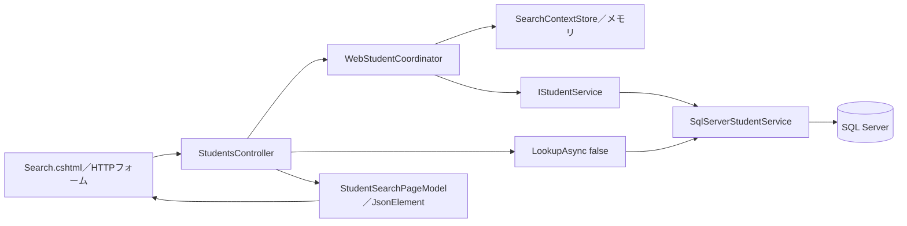

WebStudentCoordinatorとIStudentServiceはScoped、SearchContextStoreはSingletonとして登録される。IStudentServiceにはSqlServerStudentServiceが登録され、ProgramのMapControllersから上図の経路へ到達する。根拠：`sources/Infrastructure/WebHostSetup.cs:12-19`、`sources/Program.cs:3-6`。

### 1.3 画面配置と静的画面設計

検索条件は原本の順序で2列に配置し、幅760px以下では1列とする。条件欄の下に検索・候補更新、その下にクリア・新規登録を配置する。結果の上に表示件数と並び順、結果の下にページ操作を置く。一覧は11列で、横幅が不足する場合は横スクロールする。根拠：`sources/Views/Students/Search.cshtml:3-8`、`sources/wwwroot/css/site.css:1-1`。

以下はStaffの初期表示を示す静的HTML/CSSであり、実画面の撮影ではない。在籍区分の名称は初期投入SQLの定義を用いている。稼働画面では取得したCodeNameを表示する。年度・学年・クラス・都道府県の実候補と学生行は、この静的図には補っていない。根拠：`sources/database/002_seed.sql:19-22`、`sources/Views/Students/Search.cshtml:5-8`。

<style>
.student-search-design{font-family:Meiryo,'Yu Gothic UI',sans-serif;color:#243448;background:#fff;max-width:1440px;padding:24px;border:1px solid #c8d1dc}.student-search-design h2{font-size:24px}.student-search-design fieldset{border:1px solid #c8d1dc;padding:18px;margin:12px 0}.student-search-design legend{font-weight:bold}.student-search-design .fields{display:grid;grid-template-columns:1fr 1fr;gap:14px 28px}.student-search-design label{display:flex;flex-direction:column;gap:5px}.student-search-design input,.student-search-design select,.student-search-design button{font:inherit;padding:8px;border:1px solid #afbece;border-radius:3px}.student-search-design input,.student-search-design select{width:100%;max-width:100%}.student-search-design .check{display:inline-flex;flex-direction:row;align-items:center;margin-right:12px}.student-search-design .check input{width:auto}.student-search-design .actions{display:flex;gap:10px;align-items:center;flex-wrap:wrap;margin:16px 0}.student-search-design .primary{background:#1c5985;color:#fff}.student-search-design button:disabled{color:#8a98a5;background:#f3f5f8}.student-search-design .grid{overflow-x:auto}.student-search-design table{border-collapse:collapse;min-width:1050px;width:100%;font-size:12px}.student-search-design th,.student-search-design td{padding:10px 8px;border:1px solid #d4dee8}.student-search-design th{background:#e6eef6}.student-search-design .pager{display:flex;gap:14px;align-items:center;justify-content:center;margin:18px}.student-search-design small{color:#5f7183}@media(max-width:760px){.student-search-design{padding:15px}.student-search-design .fields{grid-template-columns:1fr}}
</style>
<section class='student-search-design' aria-label='学生検索の静的画面設計'>
<h2>学生検索</h2>
<form method='post' action='/students/search'>
<input type='hidden' name='ContextId' value=''><input type='hidden' name='ContextRevision' value=''><input type='hidden' name='TabId' value=''><input type='hidden' name='PageSize' value='20'><input type='hidden' name='SortKey' value='studentNo'><input type='hidden' name='SortDirection' value='asc'><input type='hidden' name='__RequestVerificationToken' value=''>
<fieldset><legend>検索条件</legend><div class='fields'>
<label>学籍番号<input id='SRC-001' name='Criteria.StudentNo' maxlength='30'></label>
<label>氏名<input id='SRC-002' name='Criteria.Name' maxlength='16'></label>
<label>氏名カナ<input id='SRC-003' name='Criteria.Kana' maxlength='72'></label>
<label>年度<select id='SRC-004' name='Criteria.SchoolYear'><option value=''>すべて</option></select></label>
<label>学年<select id='SRC-005' name='Criteria.GradeCode'><option value=''>すべて</option></select></label>
<label>クラス<select id='SRC-006' name='Criteria.ClassId'><option value=''>すべて</option></select></label>
<label class='check'><input id='SRC-007' name='Criteria.UnassignedOnly' type='checkbox' value='true'>未所属のみ</label>
<fieldset><legend>在籍区分</legend><label class='check'><input name='Criteria.StatusCodes' type='checkbox' value='01' checked>在学</label><label class='check'><input name='Criteria.StatusCodes' type='checkbox' value='02' checked>休学</label><label class='check'><input name='Criteria.StatusCodes' type='checkbox' value='03'>卒業</label><label class='check'><input name='Criteria.StatusCodes' type='checkbox' value='04'>退学</label><small>全解除はすべて</small></fieldset>
<label>都道府県<select id='SRC-009' name='Criteria.PrefectureCode'><option value=''>すべて</option></select></label>
<label>電話番号<input id='SRC-010' name='Criteria.PhoneNumber' maxlength='40'></label>
<label>入学日・開始<input id='SRC-011' name='Criteria.AdmissionFrom' type='date'></label>
<label>入学日・終了<input id='SRC-012' name='Criteria.AdmissionTo' type='date'></label>
</div><div class='actions'><button type='submit' class='primary'>検索</button><button type='submit' formaction='/students/options'>候補を更新</button></div></fieldset>
</form>
<div class='actions'><form method='post' action='/students/clear'><input type='hidden' name='ContextId' value=''><input type='hidden' name='ContextRevision' value=''><input type='hidden' name='TabId' value=''><input type='hidden' name='__RequestVerificationToken' value=''><button type='submit'>クリア</button></form><a href='/students/new'>新規登録</a></div>
<p>未検索</p>
<form method='post' action='/students/page'><input type='hidden' name='ContextId' value=''><input type='hidden' name='ContextRevision' value=''><input type='hidden' name='TabId' value=''><input type='hidden' name='__RequestVerificationToken' value=''>
<div class='actions'><label>表示件数<select name='PageSize'><option selected>20</option><option>50</option><option>100</option></select></label><label>並び順<select name='SortKey'><option value='studentNo' selected>学籍番号</option><option value='name'>氏名</option><option value='admissionDate'>入学日</option><option value='updatedAt'>更新日時</option></select></label><select name='SortDirection' aria-label='並び順方向'><option value='asc' selected>昇順</option><option value='desc'>降順</option></select><button name='Page' value='1' disabled>並び順・件数を反映</button></div>
<div class='grid'><table><thead><tr><th>学籍番号</th><th>氏名</th><th>氏名カナ</th><th>生年月日</th><th>年度／学年</th><th>クラス</th><th>在籍区分</th><th>住所</th><th>本人電話</th><th>更新日時</th><th>操作</th></tr></thead><tbody></tbody></table></div>
<nav class='pager'><button name='Page' value='0' disabled>前へ</button><span>1 / 1</span><button name='Page' value='2' disabled>次へ</button></nav>
</form></section>

この図の識別子とCSRF hidden値は空の表示用値である。実画面ではサーバーが検索状態値とCSRF情報を出力する。未所属のみがtrueの再表示では所属3selectをdisabledとし、Viewer表示では新規登録リンクを出力しない。根拠：`sources/Views/Students/Search.cshtml:4-8`。

## 2. 項目一覧

| 項目キー | 論理項目・役割 | 実コントロール／送信名 | Web型・初期値 | 入力・状態の扱い | 根拠 |
| --- | --- | --- | --- | --- | --- |
| SRC-001 | 学籍番号で絞り込む | input、id=SRC-001、Criteria.StudentNo | string、空文字 | HTML maxlength=30 UTF-16コード単位。Coreは原入力15スカラー以内 | sources/Views/Students/Search.cshtml:5-5、sources/Web/Inputs/StudentSearchInput.cs:7-7、sources/Core/SqlServerStudentService.cs:113-113 |
| SRC-002 | 氏名の照合キーで絞り込む | input、id=SRC-002、Criteria.Name | string、空文字 | HTML maxlength=16コード単位。Coreは原入力8スカラー以内 | sources/Views/Students/Search.cshtml:5-5、sources/Web/Inputs/StudentSearchInput.cs:8-8、sources/Core/SqlServerStudentService.cs:114-115 |
| SRC-003 | 氏名カナの照合キーで絞り込む | input、id=SRC-003、Criteria.Kana | string、空文字 | HTML maxlength=72コード単位。Coreは原入力36、正規化後18スカラー以内 | sources/Views/Students/Search.cshtml:5-5、sources/Web/Inputs/StudentSearchInput.cs:9-9、sources/Core/StudentNormalizer.cs:72-85 |
| SRC-004 | 所属クラスの年度で絞り込む | select、id=SRC-004、Criteria.SchoolYear | int?、NULL | 空選択はすべて。未所属のみの再表示時はdisabled | sources/Views/Students/Search.cshtml:5-5、sources/Web/Inputs/StudentSearchInput.cs:10-10 |
| SRC-005 | 所属クラスの学年で絞り込む | select、id=SRC-005、Criteria.GradeCode | string?、NULL | 空選択はすべて。未所属のみの再表示時はdisabled | sources/Views/Students/Search.cshtml:5-5、sources/Web/Inputs/StudentSearchInput.cs:11-11 |
| SRC-006 | 選択クラスで絞り込む | select、id=SRC-006、Criteria.ClassId | string?、NULL | 空選択はすべて。Core移送時に正のInt64へ変換。未所属のみの再表示時はdisabled | sources/Views/Students/Search.cshtml:5-5、sources/Web/Inputs/StudentSearchInput.cs:12-20、sources/Web/Inputs/StudentSaveInput.cs:57-60 |
| SRC-007 | クラス未所属だけを対象とする | checkbox、id=SRC-007、Criteria.UnassignedOnly | bool、false | チェック時にJavaScriptが所属3項目の値を空へ変更 | sources/Views/Students/Search.cshtml:5-5、sources/Web/Inputs/StudentSearchInput.cs:13-13、sources/wwwroot/js/site.js:7-7 |
| STATUS-CODES | 在籍区分の選択済み集合 | 同名checkbox群、Criteria.StatusCodes。明示的なSRC-008 idなし | string[]、01・02 | CodeValueを送信しCodeNameを表示。全解除は空配列に補正し、区分の絞り込みをしない | sources/Views/Students/Search.cshtml:5-5、sources/Web/Inputs/StudentSearchInput.cs:14-14、sources/Web/Controllers/StudentsController.cs:14-14,22-22 |
| SRC-009 | 都道府県で絞り込む | select、id=SRC-009、Criteria.PrefectureCode | string?、NULL | 空選択はすべて | sources/Views/Students/Search.cshtml:5-5、sources/Web/Inputs/StudentSearchInput.cs:15-15 |
| SRC-010 | 本人電話または緊急電話で絞り込む | input、id=SRC-010、Criteria.PhoneNumber | string、空文字 | HTML maxlength=40コード単位。Coreは原入力20スカラー以内 | sources/Views/Students/Search.cshtml:5-5、sources/Web/Inputs/StudentSearchInput.cs:16-16、sources/Core/StudentNormalizer.cs:87-93 |
| SRC-011 | 入学日の下限 | input type=date、id=SRC-011、Criteria.AdmissionFrom | string?、NULL | DTOでは文字列。CoreでDateOnlyへ解釈し、指定日を含む | sources/Views/Students/Search.cshtml:5-5、sources/Web/Inputs/StudentSearchInput.cs:17-17、sources/Core/SqlServerStudentService.cs:120-122,149-149 |
| SRC-012 | 入学日の上限 | input type=date、id=SRC-012、Criteria.AdmissionTo | string?、NULL | DTOでは文字列。CoreでDateOnlyへ解釈し、指定日を含む | sources/Views/Students/Search.cshtml:5-5、sources/Web/Inputs/StudentSearchInput.cs:18-18、sources/Core/SqlServerStudentService.cs:120-122,150-150 |
| CTX-ID | 保持検索状態を指定する | hidden、ContextId | ContextRequestではstring、空文字 | 各フォームが現在Entry.Idを送る | sources/Views/Students/Search.cshtml:4-8、sources/Web/Inputs/StudentSearchInput.cs:25-25 |
| CTX-REVISION | 検索状態の比較版 | hidden、ContextRevision | ContextRequestではstring、空文字 | Useで保持Revisionの10進文字列と完全一致比較。Optionsは比較しない | sources/Views/Students/Search.cshtml:4-8、sources/Infrastructure/SearchContextStore.cs:14-14、sources/Web/Controllers/StudentsController.cs:22-22 |
| CTX-TAB | 画面単位の照合値 | hidden、TabId | Controllerの別string引数 | ContextRequestには含まれない。非空の場合だけ保持Tabと照合 | sources/Views/Students/Search.cshtml:4-8、sources/Web/Controllers/StudentsController.cs:13-22、sources/Infrastructure/SearchContextStore.cs:13-14 |
| PAGE-SIZE | 1ページの表示件数 | 検索フォームではhidden、ページフォームではselect、PageSize | int、20 | 選択肢20・50・100。ページフォームの変更を検索hiddenへ同期するJavaScriptなし | sources/Views/Students/Search.cshtml:4-4,8-8、sources/Web/Inputs/StudentSearchInput.cs:27-29、sources/wwwroot/js/site.js:2-9 |
| SORT-KEY | 主ソート項目 | 検索フォームではhidden、ページフォームではselect、SortKey | string、studentNo | studentNo・name・admissionDate・updatedAtだけを許可 | sources/Views/Students/Search.cshtml:4-4,8-8、sources/Core/SqlServerStudentService.cs:108-108 |
| SORT-DIRECTION | 主ソート方向 | 検索フォームではhidden、ページフォームではselect、SortDirection | string、asc | 小文字asc・descだけを許可 | sources/Views/Students/Search.cshtml:4-4,8-8、sources/Core/SqlServerStudentService.cs:107-107 |
| PAGE-NUMBER | 要求ページ | ページフォームの押下button、Page | PageRequestではint、1 | 件数・ソート変更時は1、通常の前後移動は要求値 | sources/Views/Students/Search.cshtml:8-8、sources/Web/Inputs/StudentSearchInput.cs:29-29、sources/Infrastructure/WebStudentCoordinator.cs:12-12 |
| ACTION-SEARCH | 入力条件を確定して検索 | submit、/students/search | 該当なし | 条件をSearchCriteriaへ移送し、Page=1で検索 | sources/Views/Students/Search.cshtml:5-5、sources/Web/Inputs/StudentSearchInput.cs:19-22 |
| ACTION-OPTIONS | 現在条件で候補を再表示 | submit、formaction=/students/options | 該当なし | 前回一覧を保持。条件変更は検索まで一覧へ適用しない | sources/Views/Students/Search.cshtml:5-5、sources/Web/Controllers/StudentsController.cs:22-22 |
| ACTION-CLEAR | 保持条件と結果を解除 | 独立POSTフォーム、/students/clear | 該当なし | 同じContextIdを継続して初期条件へ戻す | sources/Views/Students/Search.cshtml:6-6、sources/Infrastructure/WebStudentCoordinator.cs:15-15 |
| ACTION-PAGE | 並び順・件数の反映と前後移動 | /students/page内のbutton群 | 該当なし | found時だけ反映可能。前後ボタンは保持ページと件数で有効判定 | sources/Views/Students/Search.cshtml:8-8 |
| ACTION-NEW | 新規登録へ遷移 | /students/new?returnContextId=現在ID | 該当なし | Viewerには表示しない | sources/Views/Students/Search.cshtml:6-6 |
| ACTION-ROW | 学生の参照・編集へ遷移 | /students/{studentId}?returnContextId=現在ID | studentIdは10進文字列 | Viewerは参照、その他は編集と表示 | sources/Views/Students/Search.cshtml:8-8、sources/Infrastructure/WebPresentation.cs:20-20 |

## 3. イベント仕様

### 3.1 初期表示：GET /students、contextId未指定

**処理概要**  
認証利用者の新しい検索状態を作成し、未検索の画面と選択候補を表示する。学生の件数・一覧検索は行わない。

**処理手順**

1. ControllerのIndexがidentity.Readで認証情報を確認する。
2. contextIdがNULLまたは空文字ならNewContextを呼び、Owner・Session・Tab、版1、30分の期限を持つEntryを作成する。
3. Present(entry, null)で未検索データを作る。
4. 新しいStudentSearchInputを入力条件とする。在籍区分は01・02、未所属のみはfalse、その他の条件は空またはNULLとする。
5. SearchModelがLookupAsync(false, ct)でコード・クラス候補を取得する。
6. PageSize=20、SortKey=studentNo、SortDirection=asc、Page=1のSearch Viewを返す。

根拠：`sources/Web/Controllers/StudentsController.cs:8-11,39-39`、`sources/Infrastructure/WebStudentCoordinator.cs:5-5,21-21`、`sources/Infrastructure/SearchContextStore.cs:9-12`、`sources/Web/Inputs/StudentSearchInput.cs:7-18`、`sources/Core/Contracts.cs:45-48`。

**条件付き処理フロー**

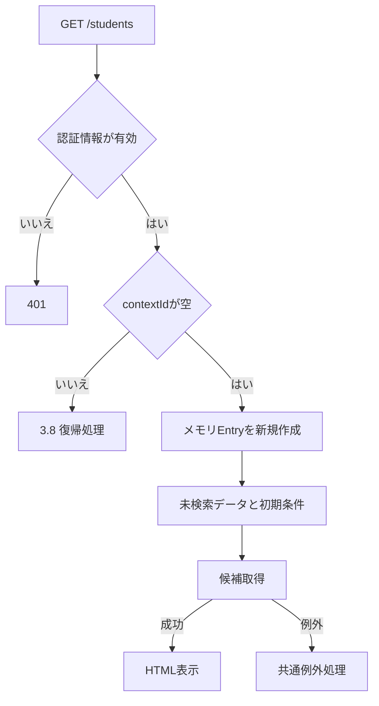

**SQL・テーブル関連／DB操作の詳細**  
候補取得だけがDBを参照する。m_codeとm_code_categoryのINNER JOIN、およびm_classと学年コードのLEFT JOINを同じSnapshotトランザクションで実行する。SQL、順序、取得結果形は5章・8.3に示す。テーブルのFKと検索JOINの区別は8.4のER図・関連図による。検索状態の作成先はConcurrentDictionaryであり、DBのINSERTは行わない。根拠：`sources/Core/SqlServerStudentService.cs:197-216`、`sources/Infrastructure/SearchContextStore.cs:10-12`。

**結果・例外時の扱い**  
outcomeはunsearched、totalCountはNULL、itemsは空配列となる。画面は「未検索」と表示し、ページ操作を無効にする。検索年度を当年度へ設定する処理はない。候補取得が失敗した場合は共通例外処理へ進む。根拠：`sources/Infrastructure/WebStudentCoordinator.cs:21-21`、`sources/Views/Students/Search.cshtml:7-8`、`sources/Infrastructure/WebHostSetup.cs:23-24`。

### 3.2 検索：POST /students/search

**処理概要**  
現在の入力を検証して1ページ目を検索し、受理できた結果を最後に適用した条件・結果として保持する。10,000件超過も、条件を保持して絞り込みを促す受理結果に含まれる。

**処理手順**

1. CSRF検証を経てController.Searchへ進む。FormGuardでCriteriaの各プロパティと追加の状態・件数・ソート項目だけを許可する。
2. Criteria.StatusCodesがフォームに存在しなければ、初期値01・02を空配列へ置き換える。
3. contexts.GetでContextIdの存在・期限・所有者・ログインセッション・非空TabIdを確認する。この処理は入口のローカルcatchより前にある。
4. 失敗時再表示用としてPresent(entry, null)を作る。ModelStateが不正なら422とし、検索サービスを呼ばない。
5. ModelStateが有効ならCoordinator.Searchへ進み、認証を確認してToCriteriaを呼ぶ。ClassIdを正のInt64へ変換し、Pageを1に設定する。
6. contexts.UseがEntry.Gateを待ち、取得後に状態を再確認してContextRevisionを比較する。
7. Coreがページ・所属の組合せ・在籍区分・文字列・日付を検証する。詳細は8.1による。
8. 接続後にSnapshotを開始し、指定コード・年度・クラスの存在と整合を確認する。
9. 7章の全述語をANDで組み立て、TOP(10001)を用いた件数SQLを実行する。
10. 10,000件超過なら一覧取得を省略する。それ以外は許可ソートと補助順序を付け、補正した取得ページでOFFSET/FETCHを実行する。
11. CoreのCommitAsync成功後に返された結果をEnsureSearchで受理する。AppliedをSearchCriteriaの深いコピー、LastResultを新結果へ置き換え、Revisionを1増やす。
12. Useが期限を現在UTC時刻から30分へ延長してGateを解放する。Controllerは候補を別途取得し、入力条件と結果をSearch Viewへ返す。

根拠：`sources/Infrastructure/WebHostSetup.cs:15-18`、`sources/Web/Controllers/StudentsController.cs:13-16,39-41`、`sources/Web/Inputs/StudentSearchInput.cs:19-22`、`sources/Infrastructure/WebStudentCoordinator.cs:7-10,20-21`、`sources/Infrastructure/SearchContextStore.cs:13-15`、`sources/Core/SqlServerStudentService.cs:103-170`。

**条件付き処理フロー**

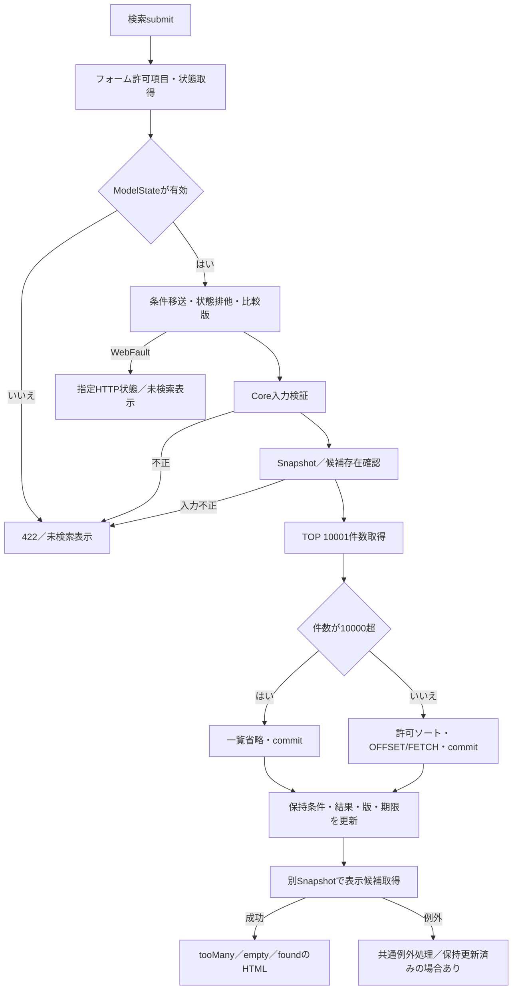

SQL例外や取消等はCoreの入力不正結果へ変換されず、共通例外処理へ伝播する。上図の入力不正とSQL失敗は別経路である。根拠：`sources/Core/SqlServerStudentService.cs:169-170`、`sources/Infrastructure/WebHostSetup.cs:23-24`。

**SQL・テーブル関連／DB操作の詳細**  
事前確認・件数・一覧取得は、同じ接続とSnapshotトランザクションで行う。参照対象はm_student、m_class、m_codeである。表示候補の取得はこの検索トランザクションの後に別途行い、m_code_categoryも参照する。全条件とパラメータは7章、SQLの結果形とトランザクション境界は8.2・8.3、FKとJOINは8.4に示す。検索ではINSERT・UPDATE・DELETE、監査INSERT、保存用sp_getapplockを実行しない。根拠：`sources/Core/SqlServerStudentService.cs:123-168,197-216`。

**結果・例外時の扱い**  
正常0件はemptyと数値0を返す。通常結果はfoundと実件数を返す。10,000件超過はtooMany、totalCount=NULL、items空となるが、Applied・LastResult・Revision・Expiresは更新する。Coreの入力不正はEnsureSearchが422のWebFaultへ変換し、正常0件として保持しない。根拠：`sources/Core/SqlServerStudentService.cs:159-170`、`sources/Infrastructure/WebStudentCoordinator.cs:9-9,20-21`。

ローカルcatchで扱うWebFaultはModelStateへ追加し、そのHTTP状態で再表示する。入力欄には送信条件と要求した件数・ソートを渡すが、一覧データはPresent(entry, null)である。通常の入力不正や比較版競合では前回のサーバー保持値を残す一方、画面の前回一覧は表示しない。最初のGet、FormGuard、画面作成中の候補取得等の失敗は、この検索catchの外側で扱う。根拠：`sources/Web/Controllers/StudentsController.cs:14-16`、`sources/Infrastructure/SearchContextStore.cs:14-14`。

### 3.3 未所属のみの変更：SRC-007 change／初期読込み

**処理概要**  
クライアント側では、未所属のみがチェックされているときに所属3項目の選択値を空へ変更する。サーバー側の候補更新とCoreの同時指定検証は別に動作する。

**処理手順**

1. site.jsの読込み時にSRC-007を取得し、changeイベントへclearAssignedを登録する。
2. 初期読込み時にもclearAssignedを1回呼ぶ。
3. チェックされていればSRC-004・SRC-005・SRC-006のvalueを空文字へ変更する。未チェックなら変更しない。
4. このJavaScriptではselectのdisabledを切り替えず、候補取得や検索送信も行わない。

根拠：`sources/wwwroot/js/site.js:7-7`。

**条件付き処理フロー**

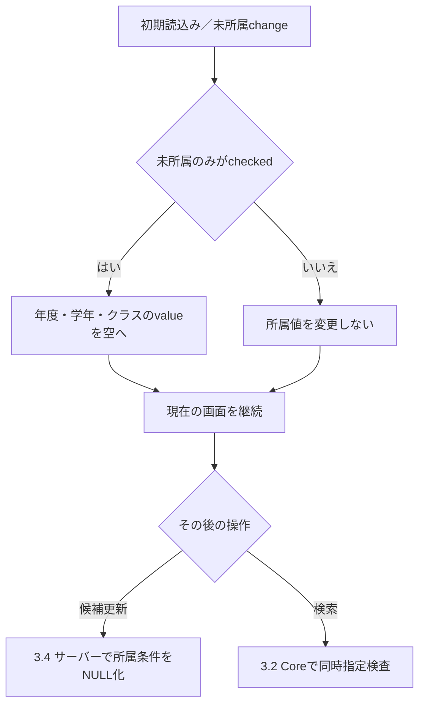

**SQL・テーブル関連／DB操作の詳細**  
このイベント自体はDBを操作しない。保持領域はブラウザのselect値であり、SearchContextStoreのAppliedにも反映しない。検索へ進んだ場合の参照関係は8.4に従い、未所属条件はm_student.class_id IS NULLとなる。根拠：`sources/wwwroot/js/site.js:7-7`、`sources/Core/SqlServerStudentService.cs:146-146`。

**結果・例外時の扱い**  
サーバー再表示ではUnassignedOnly=trueのとき所属3selectをdisabledにする。JavaScriptによるチェック解除だけでdisabledを解除する実装はないため、disabled状態の変更は再表示の状態に依存する。根拠：`sources/Views/Students/Search.cshtml:5-5`、`sources/wwwroot/js/site.js:7-7`。

Coreは未所属と所属条件を自動的に相殺しない。SearchCriteriaのSchoolYear・GradeCode・ClassIdのいずれかが非NULLならE-SRC-001で拒否する。これはコード正規化より前の判定なので、GradeCodeが空文字のままCoreへ渡された場合も同時指定に該当する。根拠：`sources/Core/SqlServerStudentService.cs:110-119`。

### 3.4 候補更新：POST /students/options

**処理概要**  
入力中の条件で候補と条件欄を再表示し、前回の検索結果を残す。入力の確定、検索状態版の比較、学生再検索は行わない。

**処理手順**

1. FormGuardで検索フォームの許可項目を確認する。StatusCodes項目がなければ空配列とする。
2. contexts.Getで状態の存在・期限・所有者・セッション・非空TabIdを確認する。ContextRevision引数はこの入口で照合しない。
3. UnassignedOnly=trueならSchoolYear・GradeCode・ClassIdをNULLにし、対応するCriteriaのModelStateを削除する。
4. Present(entry, entry.LastResult)を一覧データとし、送信inputを表示条件としてSearchModelを作る。候補はLookupAsync(false, ct)で再取得する。
5. ClassIdが非空なら、ID文字列が一致し、指定年度・指定学年にも一致するクラスが候補集合にあるか確認する。
6. 一致するクラスがあれば選択を保持する。一致しなければClassIdをNULLにし、Criteria.ClassIdのModelStateを削除する。
7. 通常は「条件を変更しました。検索を押すと一覧に反映します。」、クラスを解除した場合は「上位条件に合わないクラスを解除しました。」を表示する。

根拠：`sources/Web/Controllers/StudentsController.cs:22-22,39-39`、`sources/Infrastructure/WebStudentCoordinator.cs:21-21`。

**条件付き処理フロー**

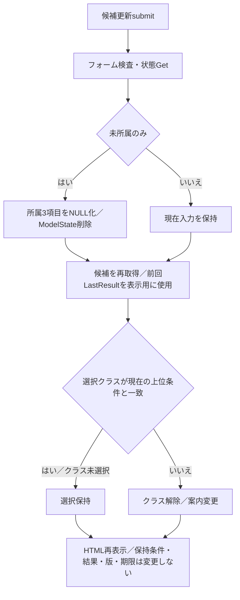

**SQL・テーブル関連／DB操作の詳細**  
実行するDB処理は候補取得だけである。m_code・m_code_category・m_classの関連は8.4、候補SQLは8.3による。SearchAsyncとcontexts.Useは呼ばず、Applied・LastResult・Revision・Expiresを更新しない。年度や学年のchangeから検索候補を自動取得するfetch処理もない。根拠：`sources/Web/Controllers/StudentsController.cs:22-22`、`sources/Core/SqlServerStudentService.cs:197-216`、`sources/wwwroot/js/site.js:2-9`。

**結果・例外時の扱い**  
前回が未検索・0件・上限超過ならその結果状態を残す。前回がfoundなら以前の学生行を表示するため、表示条件と一覧が一致しない期間がある。PageSize・SortKey・SortDirectionはSearchModelがAppliedまたは既定値から復元し、この入口の同名引数で置き換えない。根拠：`sources/Web/Controllers/StudentsController.cs:22-22,39-39`、`sources/Infrastructure/WebStudentCoordinator.cs:21-21`。

この入口にはModelState.IsValidで処理を止める分岐がなく、Coreの文字列・日付・在籍区分検証も行わない。バインドエラーがある場合を検索入口と同じ422停止として扱わない。状態Getや候補SQLの失敗は共通例外処理へ伝播する。根拠：`sources/Web/Controllers/StudentsController.cs:22-22`、`sources/Infrastructure/WebHostSetup.cs:23-24`。

### 3.5 ページ・表示件数・並び順変更：POST /students/page

**処理概要**  
最後に適用した検索条件をコピーし、ページ・件数・ソートだけを変更して検索する。検索条件フォーム内の未確定入力は送信対象でも適用対象でもない。

**処理手順**

1. FormGuardでPageRequestの項目とTabIdを確認し、contexts.Getで状態を取得する。
2. Coordinator.Pageが認証を確認し、Useで排他と比較版の確認を行う。
3. AppliedがNULLなら409「先に検索してください。」とする。
4. Appliedを深いコピーする。PageSize・SortKey・SortDirectionのいずれかが保持値と違えばPage=1、すべて同じなら要求Pageを設定する。
5. 要求されたPageSize・SortKey・SortDirectionをコピー先へ設定し、SearchAsyncを呼ぶ。
6. 結果が上限超過でなく、保持予定Pageが結果件数から求めた末尾ページを超える場合は、Pageを末尾へ変更してSearchAsyncをもう一度呼ぶ。
7. 各結果をEnsureSearchで確認してから、Applied・LastResultを置き換え、Revisionを1増やす。Use成功時に期限を延長する。
8. Controllerは保持条件から条件欄を復元し、候補と新しい一覧を表示する。

根拠：`sources/Web/Controllers/StudentsController.cs:18-19,39-40`、`sources/Infrastructure/WebStudentCoordinator.cs:11-13`、`sources/Infrastructure/SearchContextStore.cs:14-15`。

**条件付き処理フロー**

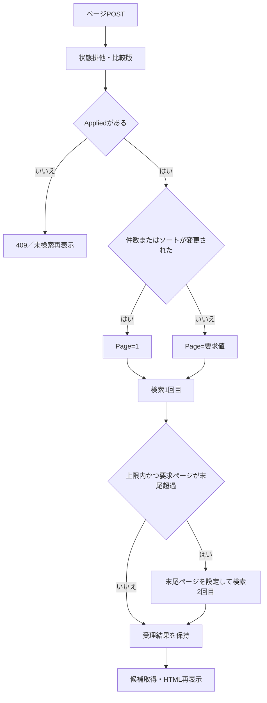

**SQL・テーブル関連／DB操作の詳細**  
1回のSearchAsyncは3.2と同じ全述語・JOIN・Snapshot境界を使用する。再補正の2回目は別のSnapshotトランザクションである。2回を通して同じEntry.Gateは保持するが、DBの同一スナップショットを保持する処理ではない。参照関係は8.4に示す。根拠：`sources/Infrastructure/WebStudentCoordinator.cs:12-12`、`sources/Core/SqlServerStudentService.cs:123-168`。

Coreはローカルの取得pageだけを末尾へ補正する。SearchCriteria.Pageを書き換えず、SearchResultにも取得pageを含めない。Coordinatorが2回目の検索前に変更したPageをAppliedへ保存することで、ページ操作では表示ページ値も補正する。ただし、2回目の間に件数がさらに減っても追加の補正ループはない。根拠：`sources/Core/SqlServerStudentService.cs:160-168`、`sources/Core/Contracts.cs:57-58`、`sources/Infrastructure/WebStudentCoordinator.cs:12-12,21-21`。

**結果・例外時の扱い**  
「並び順・件数を反映」はPage=1、「前へ」「次へ」は表示pageからそれぞれ1を減算・加算して送る。反映ボタンはfound時だけ有効で、前へはpage>1、次へはpage×PageSize<countも必要となる。根拠：`sources/Views/Students/Search.cshtml:8-8`。

この入口はModelState.IsValidを検査せず、バインド後の値でCoreへ進む。WebFaultはその状態コードで、Present(entry, null)と保持条件を使ったSearch画面へ再表示する。Pageのtryには成功後のSearchModelも含まれるため、候補取得等がWebFaultを送出した場合にもローカルcatchへ入る。最初のFormGuardとGet、およびSQL例外等の非WebFaultはこのcatchで扱わない。根拠：`sources/Web/Controllers/StudentsController.cs:19-19`。

### 3.6 クリア：POST /students/clear

**処理概要**  
同じ検索状態の条件と結果を解除し、入力と件数・並び順を初期状態へ戻す。

**処理手順**

1. FormGuardでContextRequestとTabIdの許可項目を確認する。
2. Coordinator.Clearが認証を確認し、Useで状態・比較版・排他を確認する。
3. AppliedとLastResultをNULLにし、Revisionを1増やしてPresent(entry, null)を返す。
4. Useが期限を延長する。ContextId・Owner・Session・Tabは継続する。
5. ControllerがModelState.Clearを呼び、新しいStudentSearchInputを渡す。
6. LookupAsync(false, ct)で候補を再取得し、初期入力と未検索一覧を表示する。

根拠：`sources/Web/Controllers/StudentsController.cs:21-21,39-39`、`sources/Infrastructure/WebStudentCoordinator.cs:15-15`、`sources/Infrastructure/SearchContextStore.cs:14-14`。

**条件付き処理フロー**

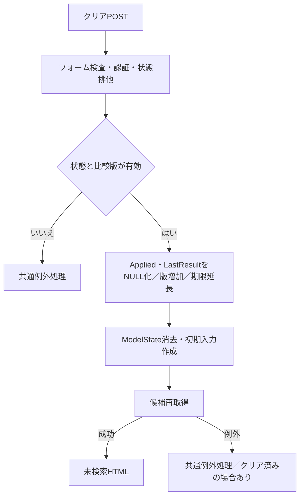

**SQL・テーブル関連／DB操作の詳細**  
条件解除はサーバーメモリ内で行い、学生検索SQLやDB更新は実行しない。候補再取得だけが8.3・8.4のマスタ関連を参照する。メモリ変更をDBトランザクションへ含める処理はない。根拠：`sources/Infrastructure/WebStudentCoordinator.cs:15-15`、`sources/Web/Controllers/StudentsController.cs:21-21,39-39`。

**結果・例外時の扱い**  
在籍区分01・02、未所属のみfalse、その他の条件空またはNULL、Page=1、20件、学籍番号昇順へ戻る。状態競合等を画面内で捕捉するローカルcatchはない。候補取得失敗時にも、先行したメモリのクリアを戻す処理はない。根拠：`sources/Web/Inputs/StudentSearchInput.cs:7-18`、`sources/Infrastructure/WebStudentCoordinator.cs:15-15,21-21`、`sources/Web/Controllers/StudentsController.cs:21-21`。

### 3.7 結果行・新規登録への遷移と復帰情報の作成

**処理概要**  
学生の編集・参照入口へ検索状態IDを渡し、編集読込み時点の検索状態版を復帰用に保持する。学生行の比較RowVersionと検索状態のContextRevisionは別の版である。

**処理手順**

1. 結果行リンクは`/students/{studentId}?returnContextId={ContextId}`へ遷移する。新規登録リンクは`/students/new?returnContextId={ContextId}`へ遷移する。
2. LoadからCoordinator.Editへ進み、認証と復帰先状態の存在・期限・所有者・セッションを確認する。ここではTabを渡さない。
3. 新規の場合はCreateOrUpdateで権限を確認する。既存の場合はGetAsyncで正の学生IDかつis_deleted=0の対象を取得する。
4. 編集用候補を取得し、Controllerがその時点の検索RevisionをReturnRevisionの10進文字列として読む。
5. ReturnRevisionを編集モデルとEditorSnapshotStoreへ保存する。
6. 「検索へ戻る」はcontextIdとReturnRevisionを付けたGETへ進み、3.8のResumeを行う。未保存入力がある場合、site.jsの破棄確認対象となる。
7. 保存・削除でOutcome.Savedとなった場合だけ、Controllerが同じ復帰先IDとスナップショットのReturnRevisionをLocationへ設定して303を返す。復帰先がない場合は新しい検索状態を作る。

根拠：`sources/Views/Students/Search.cshtml:6-8`、`sources/Web/Controllers/StudentsController.cs:23-25,29-38`、`sources/Infrastructure/WebStudentCoordinator.cs:6-6,17-19`、`sources/Infrastructure/EditorSnapshotStore.cs:7-10`、`sources/Views/Students/Edit.cshtml:16-16`、`sources/wwwroot/js/site.js:2-5`。

**条件付き処理フロー**

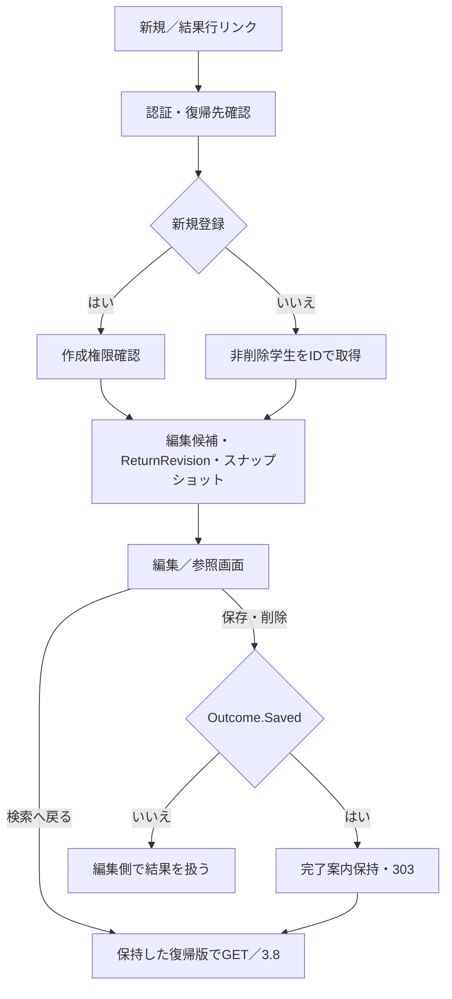

**SQL・テーブル関連／DB操作の詳細**  
編集読込みのGetAsyncはm_studentを`student_id=@id AND is_deleted=0`で取得し、@idはBigIntである。候補取得の既定呼出しは在籍人数を含む編集用であり、検索画面のincludeOccupancy=falseとは異なる。検索との関係図は8.4、保存・削除の確定と検索復帰の境界は8.8による。編集スナップショットと一度限りの完了案内は、それぞれ独立したメモリストアに置く。根拠：`sources/Core/SqlServerStudentService.cs:172-179,196-201`、`sources/Infrastructure/WebStudentCoordinator.cs:17-17`、`sources/Infrastructure/EditorSnapshotStore.cs:7-11`、`sources/Infrastructure/FlashMessageStore.cs:6-9`。

**結果・例外時の扱い**  
編集中に検索状態版が変わった場合、読込み時のReturnRevisionでの復帰は409となり得る。「編集取消」はPOST `/students/reset`で読込み時の編集値へ戻す操作であり、検索復帰ではない。NoChangeは編集側に「変更はありません。」を表示し、303には進まない。根拠：`sources/Infrastructure/SearchContextStore.cs:14-14`、`sources/Web/Controllers/StudentsController.cs:31-38`、`sources/Views/Students/Edit.cshtml:16-16`。

完了案内は認証主体・ログインセッション・ContextIdの組合せで10分保持し、復帰GETで一度取り出す。検索結果と一緒にDBへ保存する案内ではない。根拠：`sources/Infrastructure/FlashMessageStore.cs:6-9`、`sources/Web/Controllers/StudentsController.cs:11-11,38-38`。

### 3.8 編集等からの復帰：GET /students、contextId指定

**処理概要**  
保持している比較版で検索状態を再利用し、最後に適用した条件で学生を再取得する。前回結果をそのまま再表示する操作ではない。

**処理手順**

1. Indexが認証を確認し、contextIdで状態をGetする。GETではTabを渡さない。
2. contextRevisionが省略されていれば空文字をContextRequestへ設定し、Coordinator.Resumeへ渡す。
3. UseがGate取得後に状態を再確認し、比較版を確認する。
4. AppliedがNULLなら学生検索を行わず、未検索データを返す。この分岐ではRevisionを増やさない。
5. Appliedがあれば、その保持条件をSearchAsyncへ渡す。受理結果でLastResultを置き換え、Revisionを1増やす。Applied自体は変更しない。
6. Use成功時に期限を延長する。ControllerはAppliedから条件欄を復元し、完了案内を取り出して候補を再取得する。
7. Search Viewを返す。

根拠：`sources/Web/Controllers/StudentsController.cs:8-11,39-40`、`sources/Infrastructure/WebStudentCoordinator.cs:14-14`、`sources/Infrastructure/SearchContextStore.cs:13-14`。

**条件付き処理フロー**

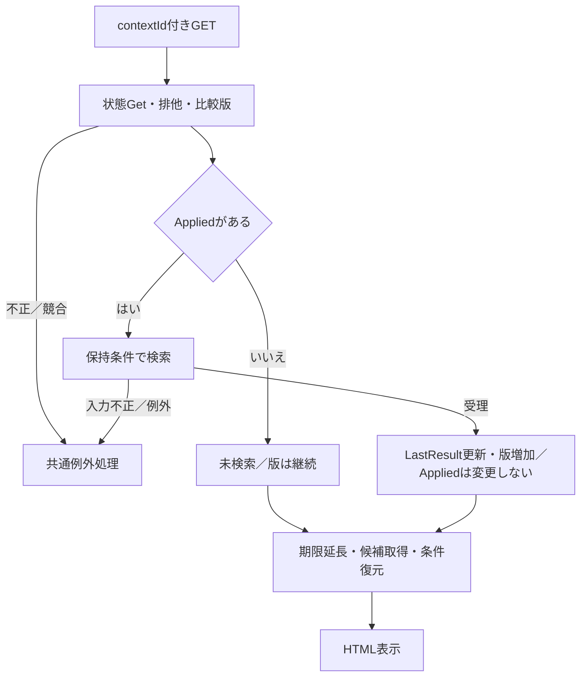

**SQL・テーブル関連／DB操作の詳細**  
Appliedがあるときは、3.2と同じ事前存在確認・全述語・件数・一覧SQLを新しいSnapshotで実行する。DB参照関係は8.4による。保存で条件外となった学生や論理削除された学生は、再検索の結果に含まれない場合がある。根拠：`sources/Infrastructure/WebStudentCoordinator.cs:14-14`、`sources/Core/SqlServerStudentService.cs:123-168`。

**結果・例外時の扱い**  
Coreが末尾ページへ取得位置を補正しても、ResumeはApplied.Pageを書き換えない。表示pageはApplied.Pageから作るため、編集等により末尾が減った場合、取得行のページと表示ページがずれる。0件でも保持Pageが1へ戻るとは限らない。3.5のPageにある2回目の検索による保持ページ補正は、この入口にはない。根拠：`sources/Core/SqlServerStudentService.cs:160-168`、`sources/Infrastructure/WebStudentCoordinator.cs:12-14,21-21`。

contextIdがあるのにcontextRevisionが省略された場合、空文字と保持版の比較が不一致となる。Indexにはローカルcatchがないため、入力不正・状態版競合・SQL失敗は共通例外処理へ進む。根拠：`sources/Web/Controllers/StudentsController.cs:8-11`、`sources/Infrastructure/SearchContextStore.cs:14-14`、`sources/Infrastructure/WebHostSetup.cs:23-24`。

## 4. 項目移送

| 移送キー | 入力・保持元 | 移送先とCore型 | 移送・復元の内容 | SQL・表示での用途 | 根拠 |
| --- | --- | --- | --- | --- | --- |
| T-STUDENT-NO | StudentSearchInput.StudentNo | SearchCriteria.StudentNo：string? | ToCriteriaでそのまま設定。FromではNULLを空文字へ | 正規化後s.student_no前方一致 | sources/Web/Inputs/StudentSearchInput.cs:19-19、sources/Web/Controllers/StudentsController.cs:40-40、sources/Core/SqlServerStudentService.cs:113-113,140-140 |
| T-NAME | StudentSearchInput.Name | SearchCriteria.StudentName：string? | プロパティ名を変更して設定。FromではNameへ復元 | Text・NameKeyを経てs.name_key部分一致 | sources/Web/Inputs/StudentSearchInput.cs:19-19、sources/Web/Controllers/StudentsController.cs:40-40、sources/Core/SqlServerStudentService.cs:114-115,141-141 |
| T-KANA | StudentSearchInput.Kana | SearchCriteria.StudentNameKana：string? | プロパティ名を変更して設定。FromではKanaへ復元 | Kana正規化・ASCII空白除去後s.kana_key部分一致 | sources/Web/Inputs/StudentSearchInput.cs:19-19、sources/Web/Controllers/StudentsController.cs:40-40、sources/Core/SqlServerStudentService.cs:116-116,142-142 |
| T-YEAR | StudentSearchInput.SchoolYear | SearchCriteria.SchoolYear：int? | そのまま設定・復元 | m_class.school_yearの存在確認と一致条件 | sources/Web/Inputs/StudentSearchInput.cs:20-20、sources/Core/SqlServerStudentService.cs:126-129,143-143 |
| T-GRADE | StudentSearchInput.GradeCode | SearchCriteria.GradeCode：string? | そのまま設定・復元 | Codeで正規化後、GRADE存在確認とc.grade_code一致 | sources/Web/Inputs/StudentSearchInput.cs:20-20、sources/Core/SqlServerStudentService.cs:118-118,125-125,144-144 |
| T-CLASS | StudentSearchInput.ClassId | SearchCriteria.ClassId：long? | IdParser.Optionalで変換。FromはInvariantCultureの10進文字列、NULLはNULL | m_classの所属整合確認とs.class_id一致 | sources/Web/Inputs/StudentSearchInput.cs:20-20、sources/Web/Inputs/StudentSaveInput.cs:60-60、sources/Web/Controllers/StudentsController.cs:40-40、sources/Core/SqlServerStudentService.cs:131-135,145-145 |
| T-UNASSIGNED | StudentSearchInput.UnassignedOnly | SearchCriteria.UnassignedOnly：bool | そのまま設定・復元 | trueならs.class_id IS NULL | sources/Web/Inputs/StudentSearchInput.cs:20-20、sources/Core/SqlServerStudentService.cs:146-146 |
| T-STATUS | StudentSearchInput.StatusCodes | SearchCriteria.EnrollmentStatusCodes：string[] | 配列を設定。Search・Optionsはフォーム未送信時に空配列へ補正 | 要素ありなら在籍区分IN、空配列なら条件なし | sources/Web/Inputs/StudentSearchInput.cs:21-21、sources/Web/Controllers/StudentsController.cs:14-14,22-22、sources/Core/SqlServerStudentService.cs:151-154 |
| T-PREFECTURE | StudentSearchInput.PrefectureCode | SearchCriteria.PrefectureCode：string? | そのまま設定・復元 | Codeで正規化後、PREFECTURE存在確認と列一致 | sources/Web/Inputs/StudentSearchInput.cs:21-21、sources/Core/SqlServerStudentService.cs:119-119,125-125,147-147 |
| T-PHONE | StudentSearchInput.PhoneNumber | SearchCriteria.PhoneNumber：string? | そのまま設定。FromではNULLを空文字へ | 本人または緊急電話へ正規化値の完全一致 | sources/Web/Inputs/StudentSearchInput.cs:21-21、sources/Web/Controllers/StudentsController.cs:40-40、sources/Core/SqlServerStudentService.cs:117-117,148-148 |
| T-FROM | StudentSearchInput.AdmissionFrom | SearchCriteria.AdmissionFrom：string? | 文字列のまま設定・復元 | ParseIso結果を入学日の下限へ | sources/Web/Inputs/StudentSearchInput.cs:21-21、sources/Core/SqlServerStudentService.cs:120-120,149-149 |
| T-TO | StudentSearchInput.AdmissionTo | SearchCriteria.AdmissionTo：string? | 文字列のまま設定・復元 | ParseIso結果を入学日の上限へ | sources/Web/Inputs/StudentSearchInput.cs:21-21、sources/Core/SqlServerStudentService.cs:121-122,150-150 |
| T-NEW-PAGE | 新規検索操作 | SearchCriteria.Page：int | ToCriteriaが必ず1にする | 検索条件変更後は先頭ページから取得 | sources/Web/Inputs/StudentSearchInput.cs:22-22 |
| T-PAGE-REQUEST | PageRequest.Page | コピーしたSearchCriteria.Page：int | 件数・ソート変更時は1、それ以外は要求値。必要なら2回目検索前に末尾へ変更 | OFFSET計算と保持表示ページ | sources/Infrastructure/WebStudentCoordinator.cs:12-12 |
| T-PAGE-SIZE | Search入口引数／PageRequest.PageSize | SearchCriteria.PageSize：int | 新規検索ではToCriteria、ページ操作ではコピー先へ設定 | 20・50・100件の取得 | sources/Web/Inputs/StudentSearchInput.cs:22-22、sources/Infrastructure/WebStudentCoordinator.cs:12-12 |
| T-SORT-KEY | Search入口引数／PageRequest.SortKey | SearchCriteria.SortKey：string | 新規検索ではToCriteria、ページ操作ではコピー先へ設定 | 許可列への変換 | sources/Web/Inputs/StudentSearchInput.cs:22-22、sources/Core/SqlServerStudentService.cs:108-108 |
| T-SORT-DIRECTION | Search入口引数／PageRequest.SortDirection | SearchCriteria.SortDirection：string | 新規検索ではToCriteria、ページ操作ではコピー先へ設定 | asc・descの検証後ORDER BYへ | sources/Web/Inputs/StudentSearchInput.cs:22-22、sources/Core/SqlServerStudentService.cs:107-107,162-162 |
| T-CONTEXT | hidden状態ID・比較版 | ContextRequest.ContextId／ContextRevision：string | ControllerがRequestを作成。検索条件DTOには含めない | メモリ状態取得・比較版確認 | sources/Web/Controllers/StudentsController.cs:15-15、sources/Web/Inputs/StudentSearchInput.cs:25-29、sources/Infrastructure/SearchContextStore.cs:14-14 |
| T-TAB | hidden TabId | ControllerとCoordinatorの別引数：string? | POSTでUseまたはGetへ渡す。復帰GETはNULL | 非空の場合だけEntry.Tabを照合 | sources/Web/Controllers/StudentsController.cs:10-22、sources/Infrastructure/SearchContextStore.cs:13-14 |
| T-APPLIED | 受理したSearchCriteria | Entry.Applied：SearchCriteria? | JSONによる深いコピー。Coreの正規化ローカル値は書き戻さない | ページ操作・復帰・表示条件の復元 | sources/Infrastructure/SearchContextStore.cs:15-15、sources/Infrastructure/WebStudentCoordinator.cs:9-14、sources/Core/SqlServerStudentService.cs:113-122 |

## 5. 候補一覧

| 候補キー | 取得元・抽出条件 | 候補キー／表示名 | 順序 | 初期値・連動・選択保持 | 停止・期間・0件時 | 根拠 |
| --- | --- | --- | --- | --- | --- | --- |
| OPT-YEAR | LookupSet.ClassesのSchoolYearを重複除去。クラスSQLは年度等で事前絞り込みしない | SchoolYear／同じ年度数値 | 年度降順。先頭は空値「すべて」 | 初期未指定。候補更新で選択クラスの年度整合を確認。未所属なら解除 | 停止・期間外クラスの年度も候補に含む。Classesが0件なら「すべて」だけ | sources/Views/Students/Search.cshtml:5-5、sources/Web/Controllers/StudentsController.cs:22-22、sources/Core/SqlServerStudentService.cs:206-214 |
| OPT-GRADE | LookupSet.CodesのCategoryId=GRADE | CodeValue／CodeName | SQLのcategory_id、display_order、code_value順を保持。先頭は空値「すべて」 | 初期未指定。クラス候補をGradeCode一致で絞る。未所属なら解除 | 有効フラグ・期間による選択禁止なし。0件なら「すべて」だけ | sources/Views/Students/Search.cshtml:5-5、sources/Core/SqlServerStudentService.cs:203-212 |
| OPT-CLASS | Classesのうち指定年度一致、非空学年指定時はGradeCode一致 | ClassId／年度・ClassCode・ClassName。IsActive=false時だけ「（停止）」追加 | school_year DESC、学年コードdisplay_order、クラスdisplay_order、class_code、class_id順を絞込み後も保持 | 初期未指定。候補更新でID・年度・学年が一致すれば保持、不一致なら解除。未所属なら解除 | 停止・期間外でも選択禁止なし。該当0件なら「すべて」だけ。検索候補のOccupied=0は集計人数ではない | sources/Views/Students/Search.cshtml:5-5、sources/Web/Controllers/StudentsController.cs:22-22、sources/Core/SqlServerStudentService.cs:201-214 |
| OPT-STATUS | CodesのCategoryId=ENROLLMENT_STATUS | CodeValue／CodeName | SQLのcategory_id、display_order、code_value順を保持 | 初期選択01・02。checkboxのContainsで選択判定。全解除は空配列。未所属指定でも自動変更しない | 停止・期間外で選択禁止なし。候補0件ならcheckboxを生成しない。実際の検索受付値は固定01～04 | sources/Views/Students/Search.cshtml:5-5、sources/Web/Inputs/StudentSearchInput.cs:14-14、sources/Web/Controllers/StudentsController.cs:14-14,22-22、sources/Core/SqlServerStudentService.cs:112-112 |
| OPT-PREFECTURE | CodesのCategoryId=PREFECTURE | CodeValue／CodeName | SQLのcategory_id、display_order、code_value順を保持。先頭は空値「すべて」 | 初期未指定。他条件からの連動変更なし | 停止・期間外で選択禁止なし。0件なら「すべて」だけ | sources/Views/Students/Search.cshtml:5-5、sources/Core/SqlServerStudentService.cs:203-212 |

## 6. 一覧項目の編集

| 結果キー | 論理項目 | SQL取得列→StudentRow | Core型 | 画面データ・表示 | NULL・非表示の扱い | 根拠 |
| --- | --- | --- | --- | --- | --- | --- |
| ROW-ID | 操作対象の学生ID | s.student_id→StudentId | long | studentIdをInvariantCultureの10進文字列とし、参照・編集リンクへ使用 | 独立した一覧列としては表示しない | sources/Core/SqlServerStudentService.cs:77-78,83-83、sources/Infrastructure/WebPresentation.cs:20-20、sources/Views/Students/Search.cshtml:8-8 |
| ROW-NO | 学籍番号 | s.student_no→StudentNo | string | studentNoをそのまま表示 | DDLではNOT NULL、varchar(15) | sources/Core/SqlServerStudentService.cs:78-78,83-83、sources/database/001_schema.sql:9-9、sources/Views/Students/Search.cshtml:8-8 |
| ROW-NAME | 表示氏名 | s.student_name→StudentName | string | studentNameを表示。name_keyの表示ではない | DDLではNOT NULL、nvarchar(16)、8スカラーCHECK | sources/Core/SqlServerStudentService.cs:78-78,83-83、sources/database/001_schema.sql:10-10,44-44、sources/Views/Students/Search.cshtml:8-8 |
| ROW-KANA | 表示氏名カナ | s.student_name_kana→StudentNameKana | string | studentNameKanaを表示。kana_keyの表示ではない | DDLではNOT NULL、nvarchar(36)、18スカラーCHECK | sources/Core/SqlServerStudentService.cs:78-78,83-83、sources/database/001_schema.sql:11-11,45-45、sources/Views/Students/Search.cshtml:8-8 |
| ROW-BIRTH | 和暦生年月日 | s.birth_date→BirthDate→BirthDateWareki | DateOnly→string | birthDateWareki。元号名、元年は「元」、月日2桁 | 1900年以降の明示元号境界によって変換 | sources/Core/Contracts.cs:50-55、sources/Core/JapaneseDateService.cs:10-16,41-50、sources/Views/Students/Search.cshtml:8-8 |
| ROW-YEAR | 所属年度 | c.school_year→SchoolYear | int? | schoolYearを学年名と同じセルへ表示 | クラス未所属等ではNULL。特別な代替文字の指定なし | sources/Core/SqlServerStudentService.cs:79-79,84-84、sources/Views/Students/Search.cshtml:8-8 |
| ROW-GRADE | 所属学年名 | g.code_name AS grade_name→GradeName | string? | gradeNameを年度と同じセルへ表示 | LEFT JOIN結果NULLを許す | sources/Core/SqlServerStudentService.cs:79-79,84-88、sources/Views/Students/Search.cshtml:8-8 |
| ROW-CLASS-CODE | クラスコード | c.class_code→ClassCode | string? | classCodeをクラス名と同じセルへ表示 | LEFT JOIN結果NULLを許す | sources/Core/SqlServerStudentService.cs:79-79,84-87、sources/Views/Students/Search.cshtml:8-8 |
| ROW-CLASS-NAME | クラス名 | c.class_name→ClassName | string? | classNameをクラスコードと同じセルへ表示 | LEFT JOIN結果NULLを許す | sources/Core/SqlServerStudentService.cs:79-79,84-87、sources/Views/Students/Search.cshtml:8-8 |
| ROW-STATUS | 在籍区分名 | e.code_name AS status_name→EnrollmentStatusName | string? | enrollmentNameとして表示 | LEFT JOIN結果NULLを許す | sources/Core/SqlServerStudentService.cs:80-80,84-89、sources/Infrastructure/WebPresentation.cs:20-20 |
| ROW-ADDRESS | 表示住所 | p.code_name AS prefecture_nameとs.address_line1→Address | string | addressDisplayは都道府県名と住所1の直接連結 | 都道府県名NULL時は「[不整合]」。住所2・郵便番号は取得・連結しない | sources/Core/SqlServerStudentService.cs:80-80,85-90、sources/Infrastructure/WebPresentation.cs:20-20 |
| ROW-PHONE | 本人電話 | s.phone_number→PhoneNumber | string? | phoneNumberを表示 | NULLなら画面で「－」。緊急電話は照合には使うが一覧取得しない | sources/Core/SqlServerStudentService.cs:80-80,85-85,148-148、sources/Views/Students/Search.cshtml:8-8 |
| ROW-UPDATED | 更新日時 | s.updated_at→UpdatedAt | DateTimeOffset | +09:00へ変換したyyyy/MM/dd HH:mm:ssをupdatedAtとして表示 | DDLはdatetimeoffset(7)、NOT NULL、UTCオフセットCHECK | sources/Core/SqlServerStudentService.cs:81-81、sources/Infrastructure/WebPresentation.cs:7-7,20-20、sources/database/001_schema.sql:40-40,57-57 |
| ROW-ADMISSION | 内部取得の入学日 | s.admission_date→AdmissionDate | DateOnly | 行DTOへ出力しない。一覧列なし | 検索・ソート対象であることと表示対象であることを分ける | sources/Core/SqlServerStudentService.cs:80-80,85-85,108-108、sources/Infrastructure/WebPresentation.cs:20-20 |
| ROW-VERSION | 内部取得の学生比較版 | s.row_version→RowVersion | long | 行DTOへ出力しない。一覧列なし | DDLはbigint、NOT NULL、既定1、正値CHECK。SQL Serverのrowversion型ではない | sources/Core/SqlServerStudentService.cs:81-81,85-85、sources/database/001_schema.sql:42-43,59-59、sources/Infrastructure/WebPresentation.cs:20-20 |

## 7. SQL条件・パラメータ一覧

| SQLキー | 対象処理・全述語 | 追加条件／パラメータ値 | SQL型 | Size・NULLの扱い | 根拠 |
| --- | --- | --- | --- | --- | --- |
| Q-NOT-DELETED | 件数・一覧：s.is_deleted=0 | 常に付加。パラメータなし | 該当なし | 論理削除行を除外 | sources/Core/SqlServerStudentService.cs:137-137 |
| Q-NO | 件数・一覧：s.student_no LIKE @no ESCAPE '!' | noが非NULLならEscapeLike(no)の末尾へ%を付加 | VarChar | Size=31。未指定なら述語・パラメータとも省略 | sources/Core/SqlServerStudentService.cs:139-140 |
| Q-NAME | 件数・一覧：s.name_key LIKE @name ESCAPE '!' | nameが非NULLならEscapeLike(name)の前後へ%を付加 | NVarChar | Size=642。未指定なら省略 | sources/Core/SqlServerStudentService.cs:139-141 |
| Q-KANA | 件数・一覧：s.kana_key LIKE @kana ESCAPE '!' | kanaが非NULLならEscapeLike(kana)の前後へ%を付加 | NVarChar | Size=74。空白だけの非空入力から作った空キーは%%となり、省略しない | sources/Core/SqlServerStudentService.cs:116-116,139-142、sources/Core/StudentNormalizer.cs:72-85 |
| Q-YEAR | 件数・一覧：c.school_year=@year | SchoolYear指定時にその値 | SmallInt | Size指定なし。NULLなら省略 | sources/Core/SqlServerStudentService.cs:143-143 |
| Q-GRADE | 件数・一覧：c.grade_code=@grade | Code正規化後のgradeが非NULLならその値 | VarChar | Size=2。NULLなら省略 | sources/Core/SqlServerStudentService.cs:118-118,144-144 |
| Q-CLASS | 件数・一覧：s.class_id=@class | ClassId指定時にその正のInt64 | BigInt | Size指定なし。NULLなら省略 | sources/Core/SqlServerStudentService.cs:145-145 |
| Q-UNASSIGNED | 件数・一覧：s.class_id IS NULL | UnassignedOnly=trueなら付加。パラメータなし | 該当なし | 所属値のNULLを検索。ゼロIDとの比較ではない | sources/Core/SqlServerStudentService.cs:146-146 |
| Q-PREFECTURE | 件数・一覧：s.prefecture_code=@prefecture | Code正規化後のprefectureが非NULLならその値 | VarChar | Size=2。NULLなら省略 | sources/Core/SqlServerStudentService.cs:119-119,147-147 |
| Q-PHONE | 件数・一覧：(s.phone_number=@phone OR s.emergency_phone_number=@phone) | Phone正規化後のphoneが非NULLなら同じ値を両列に比較 | VarChar | Size=16。NULLなら括弧付き条件全体を省略 | sources/Core/SqlServerStudentService.cs:117-117,148-148 |
| Q-FROM | 件数・一覧：s.admission_date>=@from | ParseIso結果の下限日 | Date | Size指定なし。NULLなら省略。DateOnlyを当日00:00のDateTimeに変換して設定 | sources/Core/SqlServerStudentService.cs:67-72,120-120,149-149 |
| Q-TO | 件数・一覧：s.admission_date<=@to | ParseIso結果の上限日 | Date | Size指定なし。NULLなら省略。DateOnlyの変換は下限と同じ | sources/Core/SqlServerStudentService.cs:67-72,121-121,150-150 |
| Q-STATUS | 件数・一覧：s.enrollment_status_code IN (@status0,...) | statuses.Length>0のときだけ要素数分のパラメータを生成 | 各VarChar | 各Size=2。空配列ならIN条件自体を省略 | sources/Core/SqlServerStudentService.cs:151-154 |
| Q-OFFSET | 一覧：OFFSET @offset ROWS | checked((取得page−1)×PageSize) | Int | Size指定なし。取得pageはCoreローカル補正後 | sources/Core/SqlServerStudentService.cs:160-164 |
| Q-FETCH | 一覧：FETCH NEXT @size ROWS ONLY | PageSize、20・50・100 | Int | Size指定なし。最大取得行数を指定 | sources/Core/SqlServerStudentService.cs:107-107,162-164 |
| Q-CODE-EXISTS | 事前確認：m_codeのcategory_id=@category AND code_value=@value | 学年はGRADE、都道府県はPREFECTURE。COUNT_BIG(*)=1を要求 | @category：VarChar、@value：VarChar | Size=24と10。停止・期間条件なし | sources/Core/SqlServerStudentService.cs:125-125,218-222 |
| Q-YEAR-EXISTS | 事前確認：m_classのschool_year=@year | 年度指定時にCOUNT_BIG(*)>0を要求 | SmallInt | Size指定なし。停止・期間条件なし | sources/Core/SqlServerStudentService.cs:126-129 |
| Q-CLASS-EXISTS | 事前確認：m_classのclass_id=@id | クラス指定時にschool_year・grade_codeを読む。存在と指定上位条件の一致を要求 | BigInt | Size指定なし。停止・期間条件なし | sources/Core/SqlServerStudentService.cs:131-135 |

## 8. 補足説明

### 8.1 入力検証と照合値の作成

#### 検証の順序とページ指定

Coreは最初に利用者を確認し、その後、Page>=1、PageSizeが20・50・100、SortDirectionが小文字asc・desc、SortKeyが許可値であることを確認する。年度は1900～9998、指定クラスIDは正値とする。未所属と所属3条件の同時指定は、文字列正規化より先に拒否する。根拠：`sources/Core/SqlServerStudentService.cs:105-110`。

在籍区分は最大4要素で、Ordinal比較による重複がなく、各要素が01・02・03・04のいずれかであることを要求する。在籍区分にはCode正規化を適用しないので、全角数字等を01～04へ変換して受け付ける処理はない。固定値検証の後に在籍区分のコードマスタ存在確認を追加する処理もない。根拠：`sources/Core/SqlServerStudentService.cs:111-112,125-135`。

#### 文字数と共通Text

HTML maxlengthはUTF-16コード単位の上限である。CoreのScalarCountは正しいサロゲートペアを1スカラーと数え、不対サロゲートを拒否する。TextはNULLを空文字に置き換え、原入力スカラー上限を確認してから制御文字検査、Trim、空値判定、Trim後上限確認を行う。先にTrimして原入力の超過を救済する処理ではない。任意入力がTrim後に空ならNULLとなる。根拠：`sources/Views/Students/Search.cshtml:5-5`、`sources/Core/StudentNormalizer.cs:37-57`。

SQLパラメータSize、DB列長、Coreのスカラー上限はそれぞれ異なる。たとえば氏名は原入力8スカラー、DBの表示列はnvarchar(16)、照合キー列はnvarchar(320)、検索パラメータはNVarChar(642)である。nvarcharのnはUTF-16の2バイトコード単位数、varcharのnは最大バイト数として区別する。これらの値から業務上の長さの算定理由を追加しない。根拠：`sources/Core/SqlServerStudentService.cs:114-115,141-141`、`sources/database/001_schema.sql:10-12,44-46`。

#### 学籍番号

NULL・空文字は未指定とする。非空入力はIdentifierで原入力15スカラーとTrim後15スカラーを確認し、FormKC正規化と大文字化を行う。変換後も15スカラー以内で、先頭は英大文字または数字、後続は英大文字・数字・ハイフンに限定する。空白だけの非空入力は必須検証で拒否する。HTMLの30コード単位以内でも、Coreの原入力15スカラーを超えれば受理しない。根拠：`sources/Core/SqlServerStudentService.cs:113-113`、`sources/Core/StudentNormalizer.cs:47-64`。

#### 氏名

Textで原入力とTrim後を各8スカラー以内に制限する。任意空値は未指定とする。非空値はNameKeyでFormKC正規化・大文字化し、Rune.IsWhiteSpaceの空白をすべて除去して最大160スカラーのキーを作る。検索は表示氏名列ではなくname_keyへの部分一致である。保存側も同じNameKeyでキーを作る。根拠：`sources/Core/SqlServerStudentService.cs:114-115,141-141`、`sources/Core/StudentNormalizer.cs:66-70,144-145`。

#### 氏名カナ

NULL・空文字は未指定とする。非空入力は原入力36スカラー、TextによるTrim後36スカラーを確認した後、FormKC正規化を行う。U+3041～U+3096とU+309D・U+309Eのひらがなを対応するカタカナへ変換する。許可文字はU+30A1～U+30FA、長音U+30FC、中点U+30FB、反復記号U+30FD・U+30FEである。文字間の連続空白は単一ASCIIスペースとなり、結果は空白込みで18スカラー以内とする。その後ASCIIスペースを除去して検索キーにする。根拠：`sources/Core/StudentNormalizer.cs:72-85`、`sources/Core/SqlServerStudentService.cs:116-116`。

空白だけの非空原入力はKanaから空文字が返り、検索キーも空文字となる。SearchAsyncはこの空キーをNULLへ置き換えないため、LIKEのパラメータは%%となる。完全な未指定と同じ条件省略ではない。根拠：`sources/Core/StudentNormalizer.cs:74-85`、`sources/Core/SqlServerStudentService.cs:116-116,142-142`。

#### 電話番号

原入力とTrim後を各20スカラー以内に制限し、空値はNULLとする。FormKC正規化後に空白、ASCIIハイフン、U+2010・U+2011・U+2212、丸括弧を除去する。残った値は、0で始まる10桁または11桁、あるいは+の後に1～9で始まる7～15桁の数字に限定する。正規化後の同じ値で本人電話と緊急電話を完全一致比較し、部分一致・末尾一致は行わない。根拠：`sources/Core/StudentNormalizer.cs:87-93`、`sources/Core/SqlServerStudentService.cs:117-117,148-148`。

#### 学年・都道府県コードとクラスID

学年と都道府県はCode(width=2, required=false)で原入力・Trim後を各2スカラー以内に制限する。空値はNULLとなり、非空値はFormKC後にちょうど2コード単位のASCII数字を要求する。形が正しくても、GRADEまたはPREFECTUREにコードが存在しなければE-STU-009となる。根拠：`sources/Core/StudentNormalizer.cs:113-117`、`sources/Core/SqlServerStudentService.cs:118-125`。

クラスIDはWeb DTOでは文字列、Coreではlong?である。IdParser.OptionalはNULL・空文字を未指定とし、非空値について19コード単位以内のASCII数字だけから成る正のInt64を要求する。ゼロ、負値、空白、符号、Int64の桁あふれはSRC-006を対象とする422のWebFaultとなる。ここでは数値への全角正規化やTrimを行わない。根拠：`sources/Web/Inputs/StudentSearchInput.cs:12-20`、`sources/Web/Inputs/StudentSaveInput.cs:57-60`。

#### 入学日範囲

NULL・空文字は未指定とする。非空入力はParseIsoでFormKC正規化後の長さ10コード単位を要求し、yyyy-MM-ddとしてDateOnlyへ変換する。日付処理はTextを通さず、原入力の10スカラー上限やTrimを行う実装ではない。許容範囲は1900年1月1日以降かつ業務日以前で、業務日はCoreが採取したUTC時刻を+09:00へ変換して求める。開始・終了の両方が指定され、開始が終了を超えればE-STU-006となる。根拠：`sources/Core/JapaneseDateService.cs:52-59`、`sources/Core/SqlServerStudentService.cs:44-45,105-105,120-122`。

### 8.2 学生検索SQLの構成と結果形

#### 事前存在確認

コード確認はm_codeのcategory_id・code_valueでCOUNT_BIGを取得し、1件だけを存在ありとする。年度指定ではm_class.school_year一致が1件以上必要となる。クラス指定ではclass_idでschool_year・grade_codeを読み、未存在または指定上位条件との不一致をE-STU-014とする。これらにis_active・valid_from・valid_toの述語はないため、停止済み・期間外の値も検索に使用できる。根拠：`sources/Core/SqlServerStudentService.cs:125-135,218-222`。

#### WHEREとLIKE

WHEREはs.is_deleted=0から始め、7章の任意述語をANDで連結する。電話条件だけは、本人電話と緊急電話を括弧内でOR接続する。在籍区分は選択集合のIN条件となる。任意条件の値がNULLなら、述語もパラメータも追加しない。未指定を列=@NULLとして検索する構造ではない。根拠：`sources/Core/SqlServerStudentService.cs:137-155`。

EscapeLikeは!→!!、%→!%、_→!_、[→![の順に変換し、SQLではESCAPE '!'を指定する。前方一致・部分一致に必要な%だけを変換後に付加するため、入力由来のLIKE特殊文字を追加のワイルドカードとして扱わない。根拠：`sources/Core/StudentNormalizer.cs:161-161`、`sources/Core/SqlServerStudentService.cs:140-142`。

#### 件数取得と上限

件数SQLの構造は次のとおりである。`<WHERE>`は7章の規則で生成する説明用の可変部分を表す。

```sql
SELECT COUNT_BIG(*)
FROM (
    SELECT TOP (10001) s.student_id
    FROM dbo.m_student s
    LEFT JOIN dbo.m_class c ON c.class_id=s.class_id
    <WHERE>
) limited
```

このcountは最大10,001であり、上限超過後の全件数ではない。10,001になった場合は一覧SQLを実行せず、commit後にOutcome.NoChange、空Items、LimitExceeded=trueを返す。画面ではtotalCountをNULLとして「10,000件を超えました。条件を追加してください。」を表示する。根拠：`sources/Core/SqlServerStudentService.cs:156-159`、`sources/Infrastructure/WebStudentCoordinator.cs:21-21`、`sources/Views/Students/Search.cshtml:7-7`。

#### 一覧取得とソート

上限内の場合は次のRowSelectへ同じWHEREとORDER BY・OFFSET/FETCHを付加する。`<許可列>`と`<方向>`は検証・対応変換後の値である。

```sql
SELECT s.student_id,s.student_no,s.student_name,s.student_name_kana,s.birth_date,
       c.school_year,c.class_code,c.class_name,g.code_name grade_name,
       e.code_name status_name,p.code_name prefecture_name,s.address_line1,
       s.phone_number,s.admission_date,s.updated_at,s.row_version
FROM dbo.m_student s
LEFT JOIN dbo.m_class c ON c.class_id=s.class_id
LEFT JOIN dbo.m_code g ON g.category_id=c.grade_category AND g.code_value=c.grade_code
LEFT JOIN dbo.m_code e ON e.category_id=s.enrollment_category AND e.code_value=s.enrollment_status_code
LEFT JOIN dbo.m_code p ON p.category_id=s.prefecture_category AND p.code_value=s.prefecture_code
<WHERE>
ORDER BY <許可列> <方向>,s.student_id ASC
OFFSET @offset ROWS FETCH NEXT @size ROWS ONLY
```

許可列はstudentNo→s.student_no、name→s.name_key、admissionDate→s.admission_date、updatedAt→s.updated_atである。主順序はascまたはdesc、同値時は常にstudent_id ASCとなる。氏名順は表示氏名そのものの順序ではなく照合キー順である。任意列名・方向を直接SQLへ採用する処理ではない。根拠：`sources/Core/SqlServerStudentService.cs:82-91,107-108,162-164`。

Coreは末尾ページをmax(1, ceil(count/PageSize))、取得pageをmin(criteria.Page, 末尾ページ)とし、checked((page−1)×PageSize)を@offsetに設定する。count=0でも末尾ページを1とし、一覧SQLを実行して空行集合を取得する。返却SearchResultはOutcome・Count・Items・SearchedAt・LimitExceeded・Errorsを持ち、取得pageは持たない。SearchedAtはCore入口で採取したnowであり、SQL終了時刻ではない。根拠：`sources/Core/SqlServerStudentService.cs:105-105,160-168`、`sources/Core/Contracts.cs:57-58`。

### 8.3 候補取得SQLとトランザクション

LookupAsync(false, ct)はSnapshotトランザクション内の1コマンドから2結果集合を読む。第1結果はm_code cとm_code_category kをcategory_idでINNER JOINし、category_id・display_order・code_value順に取得する。返却IsActiveはコードとカテゴリの双方が有効な場合だけtrueだが、WHEREによる停止値・期間外値の除外はない。第2結果はm_class cから学年コードgへLEFT JOINし、年度降順、g.display_order、c.display_order、class_code、class_id順で取得する。根拠：`sources/Core/SqlServerStudentService.cs:197-214`。

検索画面ではincludeOccupancy=falseなのでoccupied列はCONVERT(int,0)となる。この0は検索用取得形に合わせた値であり、クラスに学生が0人である証拠ではない。CodesとClassesをそれぞれCodeEntry・SchoolClassのリストへ変換し、NextResultAsyncで切り替え、全読込み後のCommitAsync成功を経てLookupSetを返す。候補件数の上限やページングは付けていない。根拠：`sources/Core/SqlServerStudentService.cs:201-216`、`sources/Core/Contracts.cs:61-65`。

接続Openは、sys.databasesの現在DBに対してsnapshot_isolation_stateを調べ、1でなければInvalidOperationExceptionを送出する。DDLにはALLOW_SNAPSHOT_ISOLATION ONの宣言がある。通常の検索・候補SQLを作るCommand helperのCommandTimeoutは30秒である。根拠：`sources/Core/SqlServerStudentService.cs:53-66`、`sources/database/001_schema.sql:3-6`。

検索と候補取得にはCancellationTokenが接続、診断、トランザクション開始、SQL実行、結果読込み、commitへ渡される。状態Gateの待機にも同じ要求tokenを渡す。FormGuardのRequest.ReadFormAsyncには、このController引数のtokenを明示的には渡していない。根拠：`sources/Core/SqlServerStudentService.cs:53-64,123-168,197-216`、`sources/Infrastructure/SearchContextStore.cs:14-14`、`sources/Web/Controllers/StudentsController.cs:41-41`。

SearchAsyncが結果に変換する例外はInputValidationExceptionとArgumentExceptionである。SQL例外、Snapshot未設定、取消は上位へ伝播する。検索とLookupAsyncには明示RollbackAsyncの分岐がなく、接続・未commitトランザクションはawait usingの破棄対象となる。検索の失敗を正常0件や上限超過へ読み替えない。根拠：`sources/Core/SqlServerStudentService.cs:123-171,197-216`。

### 8.4 テーブル関連：FKと検索JOIN

次のER図はDDLの参照制約のうち、検索と候補取得に関係するものを示す。論理名は学生、クラス、コード、コード区分、物理名はそれぞれdbo.m_student、dbo.m_class、dbo.m_code、dbo.m_code_categoryである。

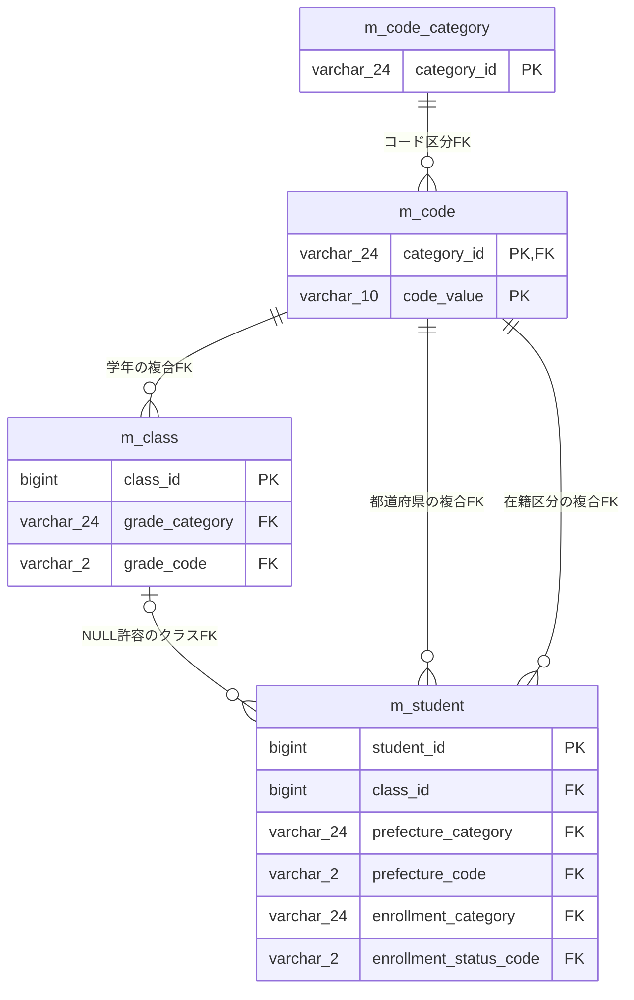

m_student.class_idはNULL可で、参照先class_idは主キーのため学生からクラスは0または1件を参照する。学生側class_idに一意制約はなく、クラスを複数学生が参照できる。m_codeはcategory_id・code_valueの複合主キーであり、学年・都道府県・在籍区分のFKはこの2列を参照する。性別・続柄のFKも存在するが、検索RowSelectはこれらへJOINしない。根拠：`sources/database/001_schema.sql:28-43,62-80,112-127,189-197`。

検索JOINは名称と所属情報を取得するための関連であり、FKそのものではない。物理m_codeをg・e・pの3別名で参照する。件数SQLは名称を取得せず、m_studentとm_classだけを結合する。候補SQLにはm_code_categoryとのINNER JOINが別にある。根拠：`sources/Core/SqlServerStudentService.cs:82-91,156-156,203-208`。

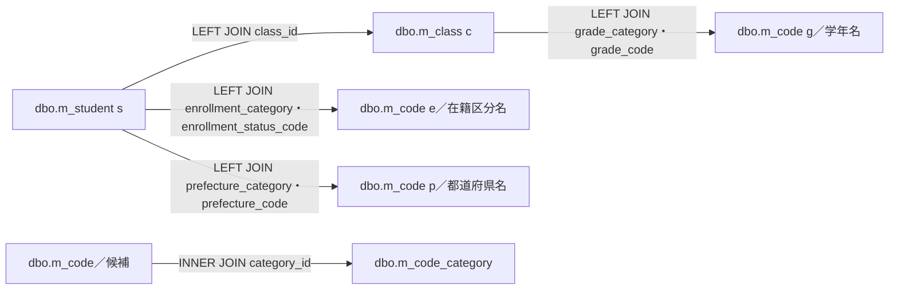

LEFT JOINに有効フラグや期間の条件はない。クラス未所属でも所属絞り込みがなければ学生行を取得できるが、年度・学年のWHEREを追加するとNULLの結合先は一致しない。表示住所は都道府県名と住所1の直接連結であり、住所2や郵便番号を加えない。根拠：`sources/Core/SqlServerStudentService.cs:80-90,143-146`。

DDLのck_student_datesは、在籍区分01・02の学生にclass_id IS NOT NULLを要求する。したがって、この制約を遵守し、所属の同時指定検証を通ったDB検索では、初期選択01・02のまま「未所属のみ」を指定すると一致行は存在しない。未所属指定時に在籍区分を03・04へ自動変更する処理はない。これは検索述語とDDL制約から導かれる状態である。根拠：`sources/database/001_schema.sql:198-198`、`sources/Core/SqlServerStudentService.cs:146-153`、`sources/Web/Inputs/StudentSearchInput.cs:14-14`、`sources/Web/Controllers/StudentsController.cs:22-22`、`sources/wwwroot/js/site.js:7-7`。

### 8.5 検索状態、セッション、排他

SearchContextStoreはConcurrentDictionaryにEntryを保持する。EntryはId、Owner、Session、Tab、Expires、Revision、Applied、LastResult、SemaphoreSlimのGateを持つ。Idと既定Tabは32バイト乱数を64桁の小文字16進文字列へ変換して生成する。新規Revisionは1、期限は現在UTC時刻から30分で、Create時に期限を過ぎたEntryを辞書から除去する。根拠：`sources/Infrastructure/SearchContextStore.cs:9-12`。

GetはID未設定・未存在・期限切れを409、OwnerまたはログインSessionの不一致を403とする。Tabは受渡し値が非空の場合だけ比較する。通常の画面POSTにはhidden TabIdがあるが、空値または省略値での照合は実装上省略される。復帰GETと編集復帰先の確認はTabを渡さない。根拠：`sources/Infrastructure/SearchContextStore.cs:13-14`、`sources/Web/Controllers/StudentsController.cs:8-22,25-25`、`sources/Infrastructure/WebStudentCoordinator.cs:6-6`。

UseはGetの後にGateを待ち、取得後にGetを再実行して期限・所有者・セッション・Tabを再確認する。比較版は保持RevisionをInvariantCultureで10進文字列化したものと完全一致を要求する。比較版不一致とlong.MaxValueの版上限は409となる。操作が正常に返った場合だけ期限を30分延長し、finallyでGateを解放する。根拠：`sources/Infrastructure/SearchContextStore.cs:14-14`。

検索・ページ・検索済み復帰・クリアは各操作内でRevisionを増やす。未検索復帰は版を増やさないがUse成功で期限を延長する。候補更新はUseを通さず、版と期限を更新しない。検索状態Revisionは学生行row_versionと別管理である。根拠：`sources/Infrastructure/WebStudentCoordinator.cs:9-15`、`sources/Web/Controllers/StudentsController.cs:22-22`、`sources/Core/Contracts.cs:50-53`。

Appliedは条件DTOのコピーであり、SQLに使用した正規化値は保持しない。Coreのno・name・kana・phone・grade・prefectureはローカル変数で、SearchCriteriaへ書き戻さない。このため再表示の文字列が照合パラメータの値と同一になるとは限らない。候補更新ではさらに、表示中CriteriaとAppliedを別に持つ。根拠：`sources/Core/SqlServerStudentService.cs:113-122`、`sources/Infrastructure/WebStudentCoordinator.cs:9-9,21-21`、`sources/Web/Controllers/StudentsController.cs:22-22,39-40`。

検索条件・結果はCookieやDBへ保存せず、このSingletonのメモリに置く。DDLのt_runtime_stateには暗号化payload・所有者・ログインセッション・期限・版の列があるが、SearchContextStoreから同表を参照・更新する接続はない。プロセス再起動後の復旧や複数ノード共有は、この保持実装の動作に含まれない。根拠：`sources/Infrastructure/SearchContextStore.cs:7-15`、`sources/Infrastructure/WebHostSetup.cs:13-13`、`sources/database/001_schema.sql:171-184`。

### 8.6 結果状態と画面応答

Presentはresult=NULLをunsearched、LimitExceeded=trueをtooMany、上限内Count=0をempty、それ以外をfoundとする。未検索と上限超過のtotalCountはNULL、正常0件は数値0である。画面ではページ計算用にNULL件数を0として読むが、検索データのNULLと正常0件は区別する。ページ総数の表示は最低1とする。根拠：`sources/Infrastructure/WebStudentCoordinator.cs:21-21`、`sources/Views/Students/Search.cshtml:2-2,7-8`。

Presentのpage・pageSize・sortKey・sortDirection・criteriaはApplied、または既定SearchCriteriaから作る。itemsはStudentRowをWebPresentation.Rowで変換し、検索時刻と更新日時は+09:00のyyyy/MM/dd HH:mm:ssへ変換する。contextRevisionとclassIdは10進文字列、未指定classIdはNULLとする。これをStudentSearchPageModel.JsonがWeb形式のJsonElementへ変換し、Razorが一覧を読む。HTTP応答本体はHTMLである。根拠：`sources/Infrastructure/WebStudentCoordinator.cs:21-21`、`sources/Infrastructure/WebPresentation.cs:7-7,20-20`、`sources/Web/Models/StudentSearchPageModel.cs:10-15`、`sources/Web/Controllers/StudentsController.cs:39-40`。

InputValidationExceptionはCoreのFieldError集合、ArgumentExceptionはArgumentErrorでField=Searchの1件のエラーとなる。Core内部では失敗時Count=0を返すが、EnsureSearchが422のWebFaultを送出するため正常0件として採用しない。EnsureSearchは最初のエラーだけをWebFaultへ移す。StudentName等のCoreフィールド名をCriteria.Name等へ変換する処理はなく、画面のAll検証サマリーが表示する。根拠：`sources/Core/SqlServerStudentService.cs:169-170`、`sources/Core/StudentNormalizer.cs:162-168`、`sources/Infrastructure/WebStudentCoordinator.cs:20-20`、`sources/Web/Controllers/StudentsController.cs:15-15`、`sources/Views/Shared/_MessagePanel.cshtml:1-3`。

検索・ページのローカルcatchで扱うWebFaultは、422の入力不正や409の版競合等をSearch画面内に表示する。これに対し、フォーム許可外項目の400、入口冒頭の状態期限切れ409・所有者等不一致403、Index・Clear・OptionsのWebFaultは共通処理へ伝播する。共通処理は応答開始前ならWebFaultの状態コード、それ以外の例外なら503とし、検索画面へ戻るリンクを持つHTMLエラーを返す。応答開始後の例外はこのcatchの対象外である。根拠：`sources/Web/Controllers/StudentsController.cs:8-22,41-41`、`sources/Infrastructure/WebHostSetup.cs:22-24`。

状態更新と期限延長は、Controllerによる候補取得・JsonElement作成より先に完了する。したがって、検索が受理されても後続の画面作成で失敗すると、HTML応答は失敗しながらApplied・LastResult・Revision・Expiresが更新済みとなり得る。メモリ変更を以前の値へ戻すrollbackはない。また、検索結果と表示候補は別Snapshotである。根拠：`sources/Infrastructure/WebStudentCoordinator.cs:9-15`、`sources/Infrastructure/SearchContextStore.cs:14-14`、`sources/Web/Controllers/StudentsController.cs:15-21,39-39`、`sources/Core/SqlServerStudentService.cs:124-124,200-200`。

### 8.7 フォーム境界とJavaScript

FormGuardは入口DTOのプロパティ、入口追加項目、__RequestVerificationToken、__Invariantから許可集合を作る。許可されないキーは400とし、__Invariantの値も許可項目名に限定する。同名項目の複数値は、__InvariantおよびStatusCodes・UnassignedOnlyで終わる項目を除いて400とする。UnassignedOnly等の複数値を、任意項目の重複許可と混同しない。根拠：`sources/Web/Controllers/StudentsController.cs:41-41`。

全POSTフォームにAntiForgeryTokenがあり、MVCにはAutoValidateAntiforgeryTokenが登録される。KestrelのHTTP本文上限は65,536バイト、FormOptionsのMultipartBodyLengthLimitは65,536、ValueLengthLimitは65,536、ValueCountLimitは128である。これらの受付限界とCoreの項目別スカラー上限は別である。検索経路に対して、/api専用のCSRF JSON応答分岐を適用したとは説明しない。根拠：`sources/Views/Students/Search.cshtml:4-8`、`sources/Infrastructure/WebHostSetup.cs:15-18`、`sources/Infrastructure/AntiforgeryResultFilter.cs:7-8`。

site.jsはform送信時に必要な確認ダイアログを出し、送信を許可した場合は押したbutton以外のbuttonをdisabledにしてaria-busy=trueとする。検索の通常フォーム送信をfetchに置き換えたり、自動再送する処理はない。dirty判定は編集フォームのinputを対象とし、検索条件の変更には適用しない。根拠：`sources/wwwroot/js/site.js:2-5`。

OptionsRequest、Coordinator.Options、WebPresentation.Lookupsには候補JSONを作る処理があるが、実際のController.OptionsはStudentSearchInputとSearchModelを使うHTML再表示経路である。StrictJson.ReadとRequestIdentity.TabIdも検索Controllerから使用されない。宣言されたhelperを、稼働する検索JSON APIや自動候補APIとして扱わない。根拠：`sources/Web/Inputs/StudentSearchInput.cs:24-31`、`sources/Infrastructure/WebStudentCoordinator.cs:16-16`、`sources/Infrastructure/WebPresentation.cs:8-18`、`sources/Infrastructure/StrictJson.cs:4-14`、`sources/Infrastructure/RequestIdentity.cs:12-12`、`sources/Web/Controllers/StudentsController.cs:5-42`。

### 8.8 保存・削除と検索復帰の確定境界

検索画面には保存・削除フォームを置かない。編集側ではスナップショットの所有者・セッション・対象学生と復帰先一致を確認してから保存・削除へ進む。保存権限はViewerを除外し、削除権限はAdministratorに限定する。検索への303復帰はOutcome.Savedだけを条件とする。根拠：`sources/Web/Controllers/StudentsController.cs:29-38`、`sources/Infrastructure/WebStudentCoordinator.cs:18-19`、`sources/Infrastructure/EditorSnapshotStore.cs:10-10`。

保存はReadCommittedと保存用アプリケーションロックを使用する。更新時はstudent_idとis_deleted=0で現行行を読み、ExpectedVersionとrow_versionを比較し、学籍番号変更も拒否する。業務検証後に変更がなければ明示RollbackAsyncを行ってNoChangeを返す。更新SQLは正規化Valuesのうちstudent_noを除く項目を設定し、name_key・kana_key・relationship_categoryも対象とする。更新日時・更新者を設定し、row_versionを1増やす。WHEREはstudent_id=@id AND row_version=@version AND is_deleted=0である。新規INSERTは正規化Valuesにカテゴリ固定値、is_deleted=0、作成・更新情報、row_version=1を加える。根拠：`sources/Core/SqlServerStudentService.cs:240-263,292-305`、`sources/Core/StudentNormalizer.cs:119-147`。

保存は監査INSERTと必要な確認情報の消費を経て、CommitAsync成功後だけSavedを返す。Webで登録されるwebTokens=trueの経路では確認情報をメモリから消費し、非Webのt_confirmation消費分岐とは異なる。DBConcurrencyExceptionではrollbackを試みConflictを返す。SQL・InvalidOperation・取消の対象catchでは、書込み開始後かつcommit試行済み、またはrollback成功を確認できない場合をUnknown、それ以外をSystemErrorとする。接続Openとトランザクション開始はこのtryの前にあるため、その失敗を同じSaveResult分類へ必ず変換する処理ではない。根拠：`sources/Infrastructure/WebHostSetup.cs:19-19`、`sources/Core/SqlServerStudentService.cs:241-244,307-323,329-329`。

削除は確認済みフラグ、正の学生ID・比較版、必須削除理由を確認する。ReadCommittedと保存用ロック取得後に非削除行の現在row_versionを確認し、`student_id=@id AND row_version=@version AND is_deleted=0`で論理削除する。設定項目はis_deleted=1、deleted_at・deleted_by・delete_reason、updated_at・updated_by、row_version+1である。1行更新と監査INSERTを経てCommitAsyncが成功した場合だけSavedを返す。物理DELETEは行わない。根拠：`sources/Infrastructure/WebStudentCoordinator.cs:19-19`、`sources/Core/SqlServerStudentService.cs:392-414`。

保存・削除の現行版不一致を事前読込みで発見した場合は、try内からConflictを早期returnし、明示Rollback helperを呼ばずawait usingのトランザクション破棄へ進む。一方、書込み時のDBConcurrencyExceptionは明示的なrollback試行後にConflictを返す。Unknown・SystemErrorは503、Conflictは409となり、Unknownは検索で確定状況を確認する案内となる。Unknownを保存成功として検索へ自動復帰させない。根拠：`sources/Core/SqlServerStudentService.cs:247-252,318-329,404-416`、`sources/Infrastructure/WebPresentation.cs:23-29`、`sources/Web/Controllers/StudentsController.cs:31-38`。

保存・削除成功後の復帰GETは元のAppliedで再検索する。更新によって条件外となった学生、またはis_deleted=1となった学生が旧一覧に残ることを前提にしない。検索側は必ずs.is_deleted=0で取得する。根拠：`sources/Web/Controllers/StudentsController.cs:38-38`、`sources/Infrastructure/WebStudentCoordinator.cs:14-14`、`sources/Core/SqlServerStudentService.cs:137-155`。
