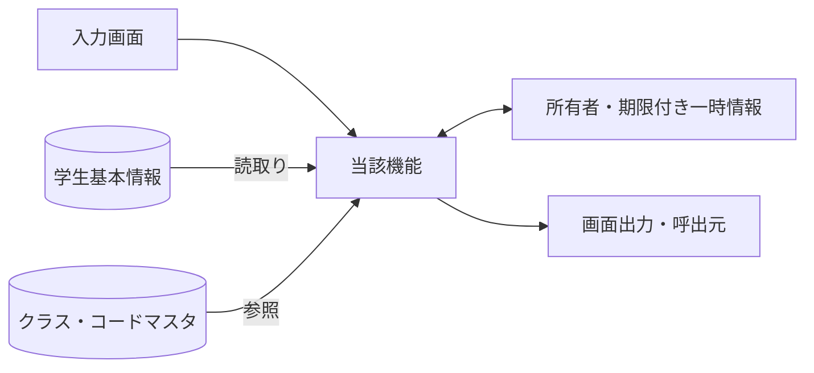
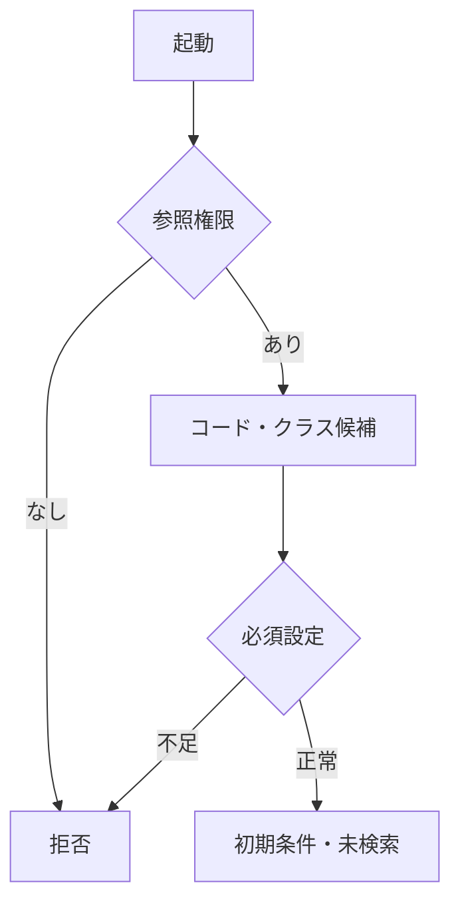
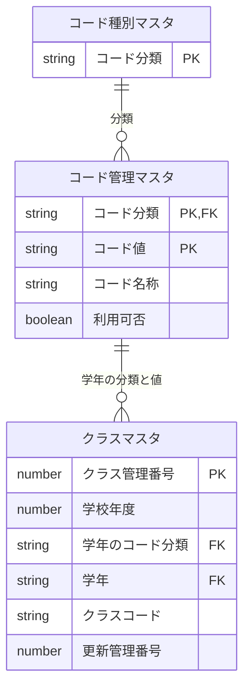
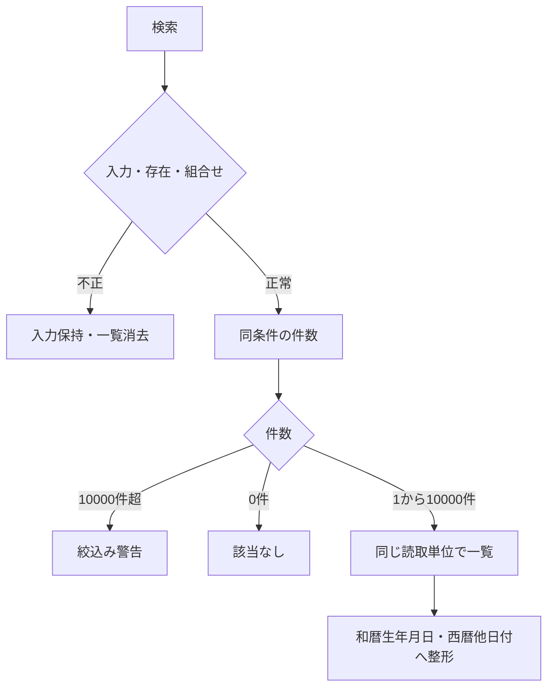
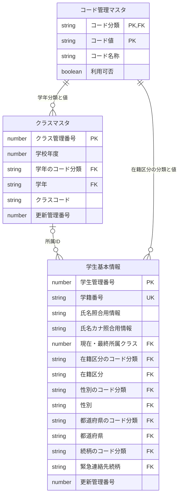
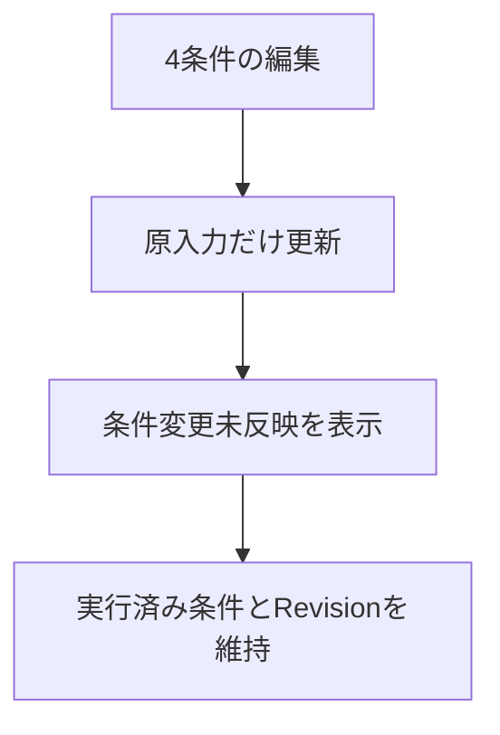
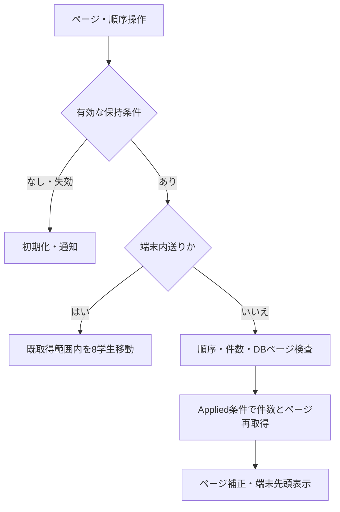
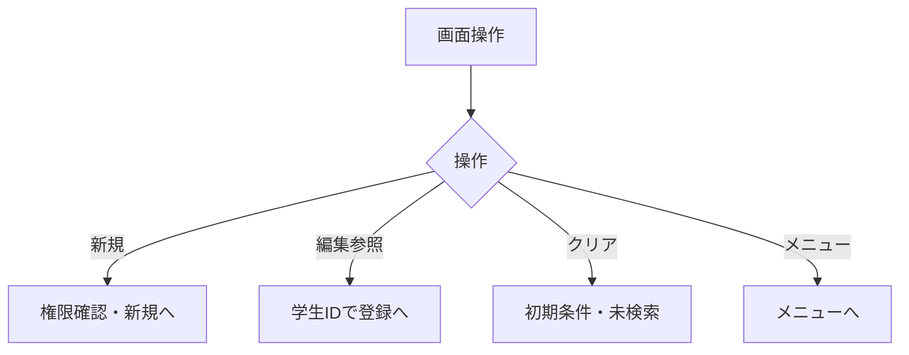
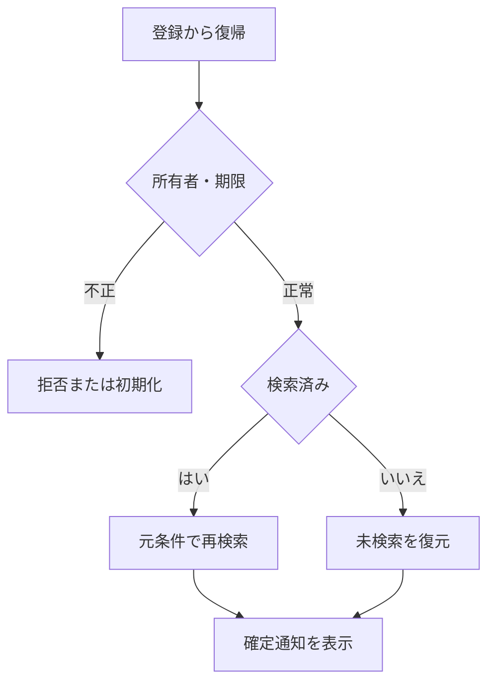

<!-- spec-meta: {"schema":"spec-md/1.0","documentId":"AS400_RPG-BAS-STU-01","version":"8.6","path":"sample-project1/spec/AS400_RPG/基本設計書/01_学生検索画面.md","sheets":[{"heading":"概要","kind":"GRID","sheet":"01_概要"},{"heading":"項目一覧","kind":"LIST","sheet":"02_項目一覧","key":["項目ID"]},{"heading":"選択候補一覧","kind":"LIST","sheet":"03_選択候補一覧","key":["候補ID"]},{"heading":"イベント仕様","kind":"GRID","sheet":"04_イベント仕様"},{"heading":"補足説明","kind":"GRID","sheet":"05_補足説明"}],"isolationProfile":"AS400_RPG"} -->
# 学生検索画面 基本設計書

| 項目 | 内容 |
| --- | --- |
| システム名 | 学生管理システム |
| 機能ID | SCR-STU-001 |
| 版数・改訂日 | 8.6／2026-10-28 |
| 対象読者 | 顧客（所在団体のIT部門） |
| 状態 | 実装前の設計仕様。実装・コンパイル・実機試験は未実施 |

## 概要

### 概要説明

学生の基本情報を条件指定して検索し、学生登録画面の新規・編集・参照へ進む。検索画面では学生情報を変更しない。成績を検索・表示しない。単一校を対象とし、年度・学年は現在または最終所属クラスの属性を示す。過去の年度別所属履歴を検索するものではない。

| 情報 | 内容 |
| --- | --- |
| 開始契機 | 共通メニューからの起動、学生登録画面からの復帰 |
| 利用者 | 閲覧者、担当者、管理者 |
| 参照情報 | 学生基本情報、クラスマスタ、コード種別マスタ、コード管理マスタ |
| 呼出先 | 学生登録画面 |
| 対象外 | 成績、帳票、一覧の直接編集、一括更新、削除済み学生の照会 |

### 画面設計

#### 画面レイアウト（詳細と共通の埋め込みHTML）

以下は詳細仕様と同一の埋め込みHTMLによる配置定義である。論理項目と状態の説明は本文で補い、別配置の簡略図やPNGを重ねて置かない。架空値の仕様モックであり実機画面ではない。CSSと等幅文字を保持するHTML表示で確認する。

<!-- screen-html-start: SRC -->

<section class="text-panel active" data-panel="COND_SFLCTL" data-record="SFLCTL" data-state="normal">
学生検索 ／ 27行×132桁・架空値

<pre class="term-row" data-row="1"> 学生管理  学生検索                                                                                TEXT / 5250</pre>
<pre class="term-row" data-row="2"> 学籍番号                      氏名  見本                      前方一致 / 氏名部分一致</pre>
<pre class="term-row" data-row="3"> クラス                          すべて（全年度・停止・期間外を含む） F4候補</pre>
<pre class="term-row" data-row="4"> 在籍      1  在学   1  休学   0  卒業   0  退学   1=選択 0=解除 / 全0=全区分</pre>
<pre class="term-row" data-row="5"> 20件  1-20件              取得  20    順序  学籍番号          昇順    DB頁1/1</pre>
<pre class="term-row" data-row="6"> [情報] 検索完了。条件編集だけでは一覧を変更しません。</pre>
<pre class="term-row" data-row="7"> 選  学籍番号          氏名                カナ                                    生年月日（和暦）</pre>
<pre class="term-row" data-row="8">     S2026-0001        見本 太郎           ミホン タロウ                           平成20年05月15日        </pre>
<pre class="term-row" data-row="9">     2026   学年なし                 C-A               Aクラス                                             在学          </pre>
<pre class="term-row" data-row="10">     S2026-0002        見本 太郎           ミホン タロウ                           平成20年05月15日        </pre>
<pre class="term-row" data-row="11">     2026   学年なし                 C-A               Aクラス                                             在学          </pre>
<pre class="term-row" data-row="12">     S2026-0003        見本 太郎           ミホン タロウ                           平成20年05月15日        </pre>
<pre class="term-row" data-row="13">     2026   学年なし                 C-A               Aクラス                                             在学          </pre>
<pre class="term-row" data-row="14">     S2026-0004        見本 太郎           ミホン タロウ                           平成20年05月15日        </pre>
<pre class="term-row" data-row="15">     2026   学年なし                 C-A               Aクラス                                             在学          </pre>
<pre class="term-row" data-row="16">     S2026-0005        見本 太郎           ミホン タロウ                           平成20年05月15日        </pre>
<pre class="term-row" data-row="17">     2026   学年なし                 C-A               Aクラス                                             在学          </pre>
<pre class="term-row" data-row="18">     S2026-0006        見本 太郎           ミホン タロウ                           平成20年05月15日        </pre>
<pre class="term-row" data-row="19">     2026   学年なし                 C-A               Aクラス                                             在学          </pre>
<pre class="term-row" data-row="20">     S2026-0007        見本 太郎           ミホン タロウ                           平成20年05月15日        </pre>
<pre class="term-row" data-row="21">     2026   学年なし                 C-A               Aクラス                                             在学          </pre>
<pre class="term-row" data-row="22">     S2026-0008        見本 太郎           ミホン タロウ                           平成20年05月15日        </pre>
<pre class="term-row" data-row="23">     2026   学年なし                 C-A               Aクラス                                             在学          </pre>
<pre class="term-row" data-row="24"> 端末1/3  PageUp/Down=取得頁内8件  F7前DB頁 F10次DB頁 F15先頭 F16最後                                </pre>
<pre class="term-row" data-row="25"> 検索日時:2026/10/25 10:00:00  実行条件:氏名見本、在学/休学                                                    </pre>
<pre class="term-row" data-row="26"> Enter検索     F5クリア      F6新規      F12メニュー     F4候補 F8全文 F9順序 F11件数</pre>
<pre class="term-row" data-row="27"> 選択欄2=編集 / 5=参照を入力しEnter。選択がないEnterだけが検索。Tab=次入力欄。</pre>

</section>
<section class="text-panel" data-panel="PICK" data-record="PICK" data-state="normal">
候補選択 ／ 27行×132桁・架空値

<pre class="term-row" data-row="1"> 学生管理  候補選択（カーソル項目）</pre>
<pre class="term-row" data-row="2"> 対象:クラス / 全年度・年度・学年・コード・名称で識別 / 停止・期間外は用途別に可否表示</pre>
<pre class="term-row" data-row="3"> 選  ID                     年度 / 学年 / コード / 名称 / 選択可否</pre>
<pre class="term-row" data-row="4"></pre>
<pre class="term-row" data-row="5">     101                    2026 / 学年なし / C-A / Aクラス / 選択可</pre>
<pre class="term-row" data-row="6">                            停止・期間外の既存値は名称を残し、無断で先頭候補に置換しません。</pre>
<pre class="term-row" data-row="7"></pre>
<pre class="term-row" data-row="8"></pre>
<pre class="term-row" data-row="9"></pre>
<pre class="term-row" data-row="10"></pre>
<pre class="term-row" data-row="11"></pre>
<pre class="term-row" data-row="12"></pre>
<pre class="term-row" data-row="13"></pre>
<pre class="term-row" data-row="14"></pre>
<pre class="term-row" data-row="15"></pre>
<pre class="term-row" data-row="16"></pre>
<pre class="term-row" data-row="17"></pre>
<pre class="term-row" data-row="18"></pre>
<pre class="term-row" data-row="19"></pre>
<pre class="term-row" data-row="20"></pre>
<pre class="term-row" data-row="21"> 全1件 / 表示1-1件 / 入力欄に1を入れてEnterで選択。複数選択はエラー。</pre>
<pre class="term-row" data-row="22"></pre>
<pre class="term-row" data-row="23"></pre>
<pre class="term-row" data-row="24"> PageUp/Down=候補画面内移動（8候補/面） / 到達端点では移動しない</pre>
<pre class="term-row" data-row="25"> Enter選択  F8候補の全文参照</pre>
<pre class="term-row" data-row="26"> F12候補取消（既定）</pre>
<pre class="term-row" data-row="27"> 選択は元の原入力欄に返すだけ。検索・学生保存・DB更新は実行しません。</pre>

</section>
<section class="text-panel" data-panel="LONGTXT" data-record="LONGTXT" data-state="normal">
全文・Unicode補助 ／ 27行×132桁・架空値

<pre class="term-row" data-row="1"> 学生管理  全文・Unicode補助（通常画面からF8）</pre>
<pre class="term-row" data-row="2"> 対象:SRC-021 / 氏名8文字 / 参照専用 / 原Unicodeを保持</pre>
<pre class="term-row" data-row="3"> 通常文字 / 明示UnicodeモードをF6で切替。以下はASCIIエスケープの例。</pre>
<pre class="term-row" data-row="4"></pre>
<pre class="term-row" data-row="5"> \u{20BB7}野 太郎                                                                                                                </pre>
<pre class="term-row" data-row="6"></pre>
<pre class="term-row" data-row="7"> Unicodeモードでは\u{HEX}=1スカラー、\n=LF、\\=バックスラッシュ。</pre>
<pre class="term-row" data-row="8"> 通常モードの同じ綴りは文字列として保持。モード変更だけで原値を上書きしません。</pre>
<pre class="term-row" data-row="9"></pre>
<pre class="term-row" data-row="10"></pre>
<pre class="term-row" data-row="11"></pre>
<pre class="term-row" data-row="12"></pre>
<pre class="term-row" data-row="13"></pre>
<pre class="term-row" data-row="14"></pre>
<pre class="term-row" data-row="15"></pre>
<pre class="term-row" data-row="16"></pre>
<pre class="term-row" data-row="17"></pre>
<pre class="term-row" data-row="18"></pre>
<pre class="term-row" data-row="19"></pre>
<pre class="term-row" data-row="20"> 表示位置と原Unicode位置の対応を保持。変換不能/行末/原改行を切捨てません。</pre>
<pre class="term-row" data-row="21"> [エラー] 未完のエスケープ・不正スカラー・上限超過なら現在欄に保持して戻さない。</pre>
<pre class="term-row" data-row="22"></pre>
<pre class="term-row" data-row="23"></pre>
<pre class="term-row" data-row="24"> PageUp/Down=前後の文字範囲（保存ではない） / 範囲内に切れたエスケープを作らない</pre>
<pre class="term-row" data-row="25"> F6表示形式切替 / 参照専用のためF10反映は無効</pre>
<pre class="term-row" data-row="26"> F12補助編集取消（既定・原項目を保持）</pre>
<pre class="term-row" data-row="27"> 参照/一覧から開いたときは全欄保護・F10反映無効。Tab順と復帰カーソルを保持。</pre>

</section>

Text系の仕様図。下線=入力可能、無下線=保護表示。DB・DDS・5250実機は未実行。

<!-- screen-html-end: SRC -->

4条件をAND、在籍集合内をORで結ぶ。未指定は条件なし、初期在学・休学、クリアは初期条件と未検索へ戻す。非削除と参照権限は固定。初回は未検索、入力不備・障害では旧一覧を消去、0件・10,000件超を区別し、上限超過で一部結果を表示しない。条件変更は未反映表示だけで候補連動・自動検索なし。ページと並び替えは実行済み条件を使用する。クラスは年度・学年・コード・名称を一体識別し、独立の年度・学年条件を設けない。

SRC-003／004／005／007／009／010／011／012は廃止しID再利用禁止。SRC-027～029も一覧投影から外し、住所・電話・更新情報は編集／参照で確認する。更新日時の並び替えは維持する。検索状態は形式版2・所有者・認証・画面・期限・Revisionを照合し、旧形式や廃止条件を初期化する。未知の条件を黙って無視しない。

端末は27行132桁を維持する。検索条件・状態・操作を同一画面に置き、一覧の1学生を2物理行にして8学生を表示する。取得20／50／100件のうち同じ取得ページ内は8学生送り、DB取得ページ前後と先頭・最後はそれぞれ専用キーで区別し、未検索・0件・上限超過・到達端点では無効とする。全角2・半角1セルとして幅を確保し、長文と変換不能値は補助参照で全文へ到達する。

[詳細設計](../詳細仕様書/01_学生検索画面.md)。架空値の仕様モックであり実機画面ではない。

#### Text系・5250の行桁と取得ページ

画面種別はText系とし、DSPSIZ(27 132)を維持する。固定の等幅文字セルを採用し、マウスやWeb部品へ依存しない。1～7行に4検索条件、件数・並び順・状態・一覧見出し、8～23行に1学生2物理行×8学生、24～27行に端末位置・検索日時・固定キーを配置する。入力欄は下線、保護表示は無下線。条件の短いコード・学籍番号・氏名に必要な桁だけを割り当てる。

SFLPAG(8)、SFLSIZ(101)。RRNはDB取得ページ内の1～pageSizeで、resultRowsのstudentIdへ解決する。選択欄へ2=編集または5=参照を1件だけ入力してEnterを押す。選択があるEnterは行呼出しを優先し、条件を再検索しない。複数選択・不正選択値はメッセージを出して保持し、権限を再検査する。選択なしのEnterだけが検索で、編集中条件を検査して適用する。Tab/Shift+Tabは条件と選択欄を行桁順に移動する。

PageUp/Downは同じ取得ページ内を8学生送りし、20件は8/8/4、50件は8×6/2、100件は8×12/4とする。F7/F10は前/次DB頁、F15/F16は先頭/最後DB頁で、取得後は端末先頭へ戻す。端末内の境界でDB頁を勝手に跨がない。未検索・0件・上限超過・到達端点では無効とする。頁・ソート操作はAppliedCriteriaだけを使う。F9の並び順とF11の20/50/100件はPICKで選び、取消は未変更、確定時はDB1頁・端末先頭へ戻す。

F4はカーソル項目候補、F8はカーソルがある一覧学生の全文参照LONGTXT、F5は初期条件と未検索へ戻す、F6は新規（作成権限）、F12はメニュー。PICKは1選択=Enter確定・F12取消、PageUp/Downで8候補送り。全文参照は保護表示でF10反映を無効とする。結果外の表示RRNや空行をIDにせず、行呼出し前に対象と認可を再確認する。

全角2・半角1セルは設計図の計測である。DDSのDBCS属性・SI/SO制御の符号化長とCCSID往復は別途検証し、変換不能値を代替文字で保存しない。長いクラス名・更新者などは末尾に「… F8」と表示し、元Unicode値をDSに保持して全文へ到達する。実機DDSコンパイル、5250エミュレーター、CCSID往復は未実施である。

### ファイル・DB入出力関係

#### 入出力一覧

方向は当該機能から見たもの。画面入力、DB読取り、DB書込みを区別する。

| IO-ID | 分類 | 対象 | 入出力 | 主な項目 | 保存単位・備考 |
| --- | --- | --- | --- | --- | --- |
| 01 | 画面 | 入力条件・操作 | 入力 | 当該機能の項目一覧 | 要求開始時の値を複製 |
| 02 | 永続DB | 学生基本情報 | 入力（参照） | 学生基本情報・版 | 更新なし |
| 03 | 永続DB | クラスマスタ | 入力（参照） | 年度・学年・名称・期間・定員 | 学生機能からマスタを更新しない |
| 04 | 永続DB | コード種別マスタ／コード管理マスタ | 入力（参照） | 分類・値・名称・有効性 | 学生機能からマスタを更新しない |
| 05 | 一時情報 | 検索状態・確認情報（共通管理） | 入出力 | 確定検索条件・ページ・原入力・確認対象 | 業務表と別。所有者・期限を検査 |
| 06 | 外部ファイル | なし | なし | CSV・帳票・取込は本機能の対象外 | 仕様書MDを業務IOに数えない |
| 07 | 画面 | 一覧・メッセージ | 出力 | 個人情報は必要項目のみ | DB保存とは別の出力 |

#### データ操作関連図

認証情報・業務日時は共通01～03から取得。マスタ保守の承認入力ファイルは画面機能のIOに含めず、方式別共通仕様に定義する。

## 項目一覧

| 項目ID | 項目グループ | 項目名 | コントロール | 必須 | 入力制限 | フォーマット | 初期値 | DBテーブル名 | DB項目名 | 備考 |
| --- | --- | --- | --- | --- | --- | --- | --- | --- | --- | --- |
| SRC-001 | 検索条件 | 学籍番号 | 端末入力域 |  | 入力・正規化後15字 | 先頭ゼロ保持 |  | 学生基本情報 | 学籍番号 | 未指定は条件なし。CHK-003は番号形式だけ、重複・変更不可は非適用。前方一致、N-06。保存なし N-06／CHK-002・CHK-003／EV-SRC-002 |
| SRC-002 | 検索条件 | 氏名 | 端末入力域 |  | 入力8字／正規化後160字 | - |  | 学生基本情報 | 氏名照合用情報 | 表示氏名ではなく照合キーに部分一致。N-03後の部分一致。氏名の原表記と区別 N-03／CHK-002／EV-SRC-002 |
| SRC-006 | 検索条件 | クラス | 端末選択入力域（F4候補） |  | 正の整数・方式別DB型の範囲 | 年度・学年・コード・名称 |  | 学生基本情報 クラスマスタ コード管理マスタ | 学生基本情報：現在・最終所属クラス クラスマスタ：クラス管理番号・学校年度・学年のコード分類・学年・クラスコード・クラス名・表示順 コード管理マスタ：コード分類・コード値・コード名称・表示順 | 全年度の実在クラス。停止・期間外も許容。クラスID完全一致。年度・学年は表示識別だけ 候補:クラス／CHK-010／EV-SRC-002 未指定表示は「すべて」。 |
| SRC-008 | 検索条件 | 在籍区分 | 端末複数選択欄 |  | 入力2字×最大4件／正規化後数字2桁 | 在学・休学・卒業・退学 | 01,02 | 学生基本情報 コード管理マスタ | 学生基本情報：在籍区分・在籍区分のコード分類 コード管理マスタ：コード分類・コード値・コード名称 | 空配列は全区分。重複値・未定義値は拒否。複数値はいずれか一致、全解除は全区分 候補:在籍区分／N-07／CHK-010・CHK-024／EV-SRC-002 |
| SRC-013 | 操作 | 検索 | 機能キー（Enter） | - | - | - | - | - | - | 入力検査後、最初のページを取得。条件を検査して1ページ目を表示 EV-SRC-002 |
| SRC-014 | 操作 | クリア | 機能キー（F5） | - | - | - | - | - | - | 初期条件・未検索へ、保持条件を消去。初期条件・未検索へ戻す EV-SRC-005 |
| SRC-015 | 操作 | 新規登録 | 機能キー（F6） | - | - | - | - | - | - | 権限を確認し学生登録へ遷移。担当者・管理者だけ表示 EV-SRC-005 |
| SRC-016 | 操作 | メニューへ | 機能キー（F12） | - | - | - | - | - | - | 共通メニューへ。共通メニューへ戻る EV-SRC-005 |
| SRC-017 | 結果・一覧 | 検索件数・表示範囲 | 端末保護出力域 | - | - | 件数・表示範囲0～10000 | 未検索 | 学生基本情報 | 学生管理番号 | 未検索／0件／上限超過を区別 EV-SRC-002。学生管理番号の条件一致件数を算出 |
| SRC-018 | 結果・一覧 | 検索日時 | 端末保護出力域 | - | - | 西暦日時19字・JST | 未検索 | - | - | 西暦日時、日本時間。DB保存なし。処理時点から取得 EV-SRC-002 |
| SRC-019 | 結果・一覧 | 表示件数 | 端末選択入力域（F4候補） | 〇 | 3桁・20/50/100 | 20/50/100 | 20 | - | - | 20・50・100のみ。20／50／100、既定20。DB保存なし 候補:表示件数／CHK-024／EV-SRC-004 |
| SRC-020 | 結果・一覧 | 学籍番号 | 端末保護出力域 | - | - | 15字・先頭ゼロ保持 |  | 学生基本情報 | 学籍番号 | 保存済み文字列、文字順 EV-SRC-002・EV-SRC-004・EV-SRC-006 |
| SRC-021 | 結果・一覧 | 氏名 | 端末保護出力域 | - | - | 氏名8字 |  | 学生基本情報 | 学生氏名 | 登録表記のまま文字列表示 EV-SRC-002・EV-SRC-004・EV-SRC-006 |
| SRC-022 | 結果・一覧 | 氏名カナ | 端末保護出力域 | - | - | カナ18字 |  | 学生基本情報 | 学生氏名カナ | 保存済みカナ表記 EV-SRC-002・EV-SRC-004・EV-SRC-006 |
| SRC-023 | 結果・一覧 | 生年月日 | 端末保護出力域 | - | - | 共通和暦書式 |  | 学生基本情報 | 生年月日 | 和暦表示。共通16で日付から変換 EV-SRC-002・EV-SRC-004・EV-SRC-006 |
| SRC-024 | 結果・一覧 | 年度・学年 | 端末保護出力域 | - | - | 年度4桁＋学年名称12字 |  | クラスマスタ コード管理マスタ | クラスマスタ：学校年度・学年のコード分類・学年 コード管理マスタ：コード分類・コード値・コード名称 | 年度は西暦、学年は名称。未所属は－ EV-SRC-002・EV-SRC-004・EV-SRC-006 |
| SRC-025 | 結果・一覧 | クラス | 端末保護出力域 | - | - | コード9字＋名称18字＋注記 |  | 学生基本情報 クラスマスタ | 学生基本情報：現在・最終所属クラス クラスマスタ：クラス管理番号・クラスコード・クラス名 | 未所属／停止／期間外を区別 EV-SRC-002・EV-SRC-004・EV-SRC-006 |
| SRC-026 | 結果・一覧 | 在籍区分 | 端末保護出力域 | - | - | 名称12字 |  | 学生基本情報 コード管理マスタ | 学生基本情報：在籍区分のコード分類・在籍区分 コード管理マスタ：コード分類・コード値・コード名称 | 種別と値で結合、名称未取得でも学生行を落とさない EV-SRC-002・EV-SRC-004・EV-SRC-006 |
| SRC-030 | 結果・一覧 | 編集／参照 | 端末行選択欄 | - | - | - | - | 学生基本情報 | 学生管理番号 | 行番号ではなく対象IDで遷移、遷移先で再取得 EV-SRC-005 |
| SRC-031 | 結果・一覧 | ページ操作 | 機能キー（PageUp/Down・F7/F10/F15/F16） | - | - | - | - | - | - | 端末内8学生の前後移動とDB前後・先頭最後の取得ページを分離。有効範囲へ再補正 EV-SRC-004 |
| SRC-032 | 結果操作 | 並び順項目 | 端末選択入力域（F4候補） | 〇 | 13字・許可4値 | 固定4候補 | studentNo | 学生基本情報 | 学籍番号・氏名照合用情報・入学日・更新日時・学生管理番号 | studentNo・name・admissionDate・updatedAtのみ。許可4項目。最後に学生ID昇順を加える。DB保存なし 候補:並び順／CHK-024／EV-SRC-004 |
| SRC-033 | 結果操作 | 並び順方向 | 端末選択入力域（F4候補） | 〇 | 4字・asc/desc | 昇順／降順 | asc | - | - | asc・descのみ。昇順／降順。初期は昇順。DB保存なし 候補:昇降順／CHK-024／EV-SRC-004 |

## 選択候補一覧

| 候補ID | 参照元・分類 | 選択値 | 表示値 | 抽出条件 | 表示順 | 初期値・連動 |
| --- | --- | --- | --- | --- | --- | --- |
| クラス | クラスマスタ・コード管理マスタ（学年） | クラス管理番号 | 年度・学年・クラスコード・クラス名 | 全年度・停止・期間外を含む全クラス。検索用途では年度学年で候補を絞らない | 年度降順→学年表示順→クラス表示順→コード→ID | すべて。上位条件・連動なし。年度・学年・コード・名称を一体表示 |
| 在籍区分 | コード管理マスタ（在籍区分） | 在籍区分コード値 | コード名称 | 在籍分類01～04。停止も表示し検索可、保護値を維持 | 表示順→コード値 | 検索01・02／新規登録01、全解除検索は全区分 |
| 表示件数 | 共通UI固定定義 | 20 / 50 / 100 | 20件／50件／100件 | 固定3候補。業務コードではない | 20→50→100 | 20、変更で1ページへ |
| 並び順 | 共通UI固定定義 | 学籍番号／氏名／入学日／更新日時 | 学籍番号／氏名／入学日／更新日時 | 固定4候補。自由文字でDB列を指定しない | 左記順 | 学籍番号 |
| 昇降順 | 共通UI固定定義 | 昇順／降順 | 昇順／降順 | 固定2候補 | 昇順→降順 | 昇順 |

## イベント仕様

### EV-SRC-001 初期表示

#### 処理概要

認証済み利用者がメニューから起動。学生一覧は取得しない。

#### 処理手順

1. 共通01・02で参照権限を確認し、共通03で業務日時を確定する。
2. OP-CODE・OP-CLASSで候補取得。在学・休学、20件、学籍番号昇順、未検索を設定する。必須マスタ不足なら検索を不可とする。
3. 共通12の画面別状態を作成する。復帰識別がある場合はEV-SRC-006へ進む。

#### 処理フロー

#### SQL・テーブル関連（ER図）

名称参照は未所属・停止値を残す外部結合相当。コードは用途ごとの別名で**分類と値**を結合する。図は読取りの関連であり、履歴への書込みや削除連動を意味しない。単独の存在確認・採番・書込みの表関連は下記操作IDで特定する。

#### DB操作の詳細

`OP-CODE` → `OP-CLASS`。下記「DB操作定義」の同名操作を実行する。

本イベントから学生・クラス・コード・操作履歴の追加/更新/削除はいずれも0件。検索の条件結合・分類キー・件数/並び順は同文書の各OP定義を適用し、画面状態の更新と業務DBの更新を区別する。

#### 結果・例外時の扱い

入力不備は項目エラーと原入力を保持。検索要求の失敗は一覧消去、0件はI-SRC-001、上限超過はW-SRC-001。権限不備・他者の保持情報は拒否する。条件変更だけでは既存一覧を再検索しない。 各イベントで実行していない処理の結果状態は発生対象外。

##### 判定・メッセージと復帰

| 判定ID | 判定・分岐 | メッセージ・復帰 | DB結果 |
| --- | --- | --- | --- |
| CHK-023 | 参照操作を実行できる主体か | 認証不成立E-COM-001、認可拒否E-COM-002。業務データを返さない | 書込み0件 |
| CHK-010 | 初期在籍値と候補マスタが取得可能か | 必須初期値不足はE-MST-001「マスタの初期設定が不足しています。管理者に連絡してください。」。先頭候補で補完しない | 候補参照のみ |
| CHK-024 | 本画面の状態か、復帰識別が有効か | 新規状態又はEV-SRC-006へ。所有者/画面違反はE-COM-003、失効/旧形式はW-SRC-002で初期化 | 学生検索の自動実行なし |

### EV-SRC-002 検索実行

#### 処理概要

入力した検索条件で、非削除学生を検索する。

#### 処理手順

1. **入力条件・参照の検査**
   1. 入力を複製し共通04・05で4条件の正規化、桁、クラスID、在籍集合を検査する。未知・廃止条件を含む入力は値が空でもE-SRC-001として拒否する。項目エラーは入力保持・一覧消去、DB検索なし。
   2. OP-EXISTSで在籍の分類付き存在とクラスIDの存在を検査する。検索では停止・期間外の既存値を許容する。

2. **読取り・表示状態の確定**
   1. OP-COUNT・OP-PAGEへ同じ確定条件を渡す。10001件で上限、0件は該当なし、それ以外は最初のページを表示する。件数と一覧の読取りを揃える。
   2. 正常時に実行済み条件を共通12へ保持。生年月日は共通16で和暦表示。他の日付・日時は西暦。

#### 処理フロー

#### SQL・テーブル関連（ER図）

名称参照は未所属・停止値を残す外部結合相当。コードは用途ごとの別名で**分類と値**を結合する。図は読取りの関連であり、履歴への書込みや削除連動を意味しない。単独の存在確認・採番・書込みの表関連は下記操作IDで特定する。

#### DB操作の詳細

`OP-EXISTS` → `OP-COUNT` → `OP-PAGE`。下記「DB操作定義」の同名操作を実行する。

本イベントから学生・クラス・コード・操作履歴の追加/更新/削除はいずれも0件。検索の条件結合・分類キー・件数/並び順は同文書の各OP定義を適用し、画面状態の更新と業務DBの更新を区別する。

#### 結果・例外時の扱い

入力不備は項目エラーと原入力を保持。検索要求の失敗は一覧消去、0件はI-SRC-001、上限超過はW-SRC-001。権限不備・他者の保持情報は拒否する。条件変更だけでは既存一覧を再検索しない。 各イベントで実行していない処理の結果状態は発生対象外。

##### 判定・メッセージと復帰

| 判定ID | 判定・分岐 | メッセージ・復帰 | DB結果 |
| --- | --- | --- | --- |
| CHK-002・CHK-003・CHK-029 | 4条件の原入力/正規化後上限、番号形式、既知キー・在籍集合が正しいか | 長さE-STU-002、番号E-STU-003、検索条件形式E-SRC-001。入力保持し一覧消去 | 不成立ならDB検索なし |
| CHK-010 | 指定在籍の分類付き存在とクラスIDの実在。未指定は条件なし、停止/期間外を許容 | コード不在E-STU-009、クラス不在E-STU-010。検索で学籍番号の重複検査をしない | 存在参照のみ |
| CHK-028 | 同じ条件集合の件数が0/1～10000/10001のどれか | 0件I-SRC-001「該当する学生がありません。」、10001件W-SRC-001。上限時は部分一覧なし | 件数と一覧の同一読取、更新0件 |
| CHK-024 | 画面状態の期待Revisionで結果を適用できるか | 古い要求・他画面はE-COM-003。実行済み条件と一覧を古い応答で上書きしない | 業務/履歴更新0件 |

### EV-SRC-003 条件変更の未反映表示

#### 処理概要

4条件の編集を受け付け、現在の一覧が最後に実行した条件によることを知らせる。

#### 処理手順

1. 原入力だけを更新し、実行済み条件・選択行・検索状態のRevisionを変更しない。
2. 「条件変更未反映。検索を実行してください」を表示する。クラス候補の再取得・上位条件の連動・自動検索は行わない。
3. ページ・並び替えは実行済み条件で行う。検索実行またはクリアで未反映表示を解除する。

#### 処理フロー

#### SQL・テーブル関連（ER図）

DBアクセスなし。原入力と表示状態だけを更新するためER図は対象外。

#### DB操作の詳細

なし。OP-CLASS・OP-COUNT・OP-PAGEを呼び出さない。

本イベントから学生・クラス・コード・操作履歴の追加/更新/削除はいずれも0件。検索の条件結合・分類キー・件数/並び順は同文書の各OP定義を適用し、画面状態の更新と業務DBの更新を区別する。

#### 結果・例外時の扱い

原入力を保持する。条件編集中のエラーや既存一覧を、検索成功・0件・上限超過へ置き換えない。再入中の操作は受け付けない。

##### 判定・メッセージと復帰

| 判定ID | 判定・分岐 | メッセージ・復帰 | DB結果 |
| --- | --- | --- | --- |
| CHK-024 | 処理中の再入でなく、現在画面への条件変更か | 再入は受け付けず原入力を保持。状態不正はE-COM-003 | DB呼出し0件 |
| CHK-024 | 原入力と実行済み条件を分けて保持しているか | 差があれば既存の未反映表示。条件変更だけで件数・選択・一覧を検索成功へ変えない | DB検索/状態Revision更新なし |

### EV-SRC-004 並び替え・ページ移動

#### 処理概要

実行済み条件の結果を別の順序・ページで取得する。

#### 処理手順

1. **保持状態・表示操作の検査**
   1. 共通12から保持条件を取得し、所有者・期限・形式版2・期待Revisionを確認する。未検索は不可、失効・旧形式はW-SRC-002。入力途中の条件を混ぜない。
   2. PageUp/PageDownは既取得resultRowsの範囲内で端末表示位置を8学生ずつ移動する。先頭・末尾なら移動せず案内し、DBを再検索しない。

2. **読取り・一覧状態の確定**
   1. F9は許可4ソート・方向、F11は取得20/50/100を検査し、DB1ページ目・端末先頭へ戻す。F7/F10は前/次、F15/F16は先頭/最後のDB取得ページとして有効範囲を検査する。未検索・0件・上限超過では不可、現在が該当端点なら状態を案内しDB取得しない。
   2. DB取得操作に限り、AppliedCriteriaを使ってOP-COUNT・OP-PAGEを同じ読取単位で実行する。件数減少は最終有効DBページへ補正し端末先頭へ。0件は一覧なし・ページ操作不可。実行済み条件は変更しない。

#### 処理フロー

#### SQL・テーブル関連（ER図）

端末内の8学生送りはDB参照なし。以下はDB取得操作だけの関連。

名称参照は未所属・停止値を残す外部結合相当。コードは用途ごとの別名で**分類と値**を結合する。図は読取りの関連であり、履歴への書込みや削除連動を意味しない。単独の存在確認・採番・書込みの表関連は下記操作IDで特定する。

#### DB操作の詳細

PageUp/PageDownはDB操作なし。F7/F10/F15/F16・F9/F11によるDB取得時だけ`OP-COUNT` → `OP-PAGE`。下記「DB操作定義」の同名操作を実行する。

本イベントから学生・クラス・コード・操作履歴の追加/更新/削除はいずれも0件。検索の条件結合・分類キー・件数/並び順は同文書の各OP定義を適用し、画面状態の更新と業務DBの更新を区別する。

#### 結果・例外時の扱い

入力不備は項目エラーと原入力を保持。検索要求の失敗は一覧消去、0件はI-SRC-001、上限超過はW-SRC-001。権限不備・他者の保持情報は拒否する。条件変更だけでは既存一覧を再検索しない。 各イベントで実行していない処理の結果状態は発生対象外。

##### 判定・メッセージと復帰

| 判定ID | 判定・分岐 | メッセージ・復帰 | DB結果 |
| --- | --- | --- | --- |
| CHK-024 | 保持状態の所有者・画面・期限・形式・期待Revisionが一致するか | 失効/旧形式W-SRC-002、他者/旧Revision E-COM-003。未検索時は当イベントの既定動作を維持 | 不成立なら学生読取なし |
| CHK-024 | 本方式で許可された並び順/方向と表示操作か | 不正値E-SRC-002。廃止キー・未知キーの扱いは本方式の処理手順と共通05を適用 | 不成立なら再検索なし |
| CHK-028 | 適用済み4条件で件数と一覧が整合するか | 0件I-SRC-001、10001件W-SRC-001。取得失敗はE-COM-004、旧一覧を最新扱いしない | 業務/履歴更新0件 |

### EV-SRC-005 新規・編集・参照・クリア

#### 処理概要

選択欄の2/5とEnter、またはFキーを受け付ける。

#### 処理手順

1. 新規は作成権限を確認し学生登録へ。検索条件を登録値へ流用しない。
2. 編集・参照は選択行の学生管理番号で登録機能を起動する。行番号・表示名を識別子にしない。読込みは登録側の責務。
3. クリアは初期条件・未検索へ戻し共通12も初期化。メニューへ戻る処理はDB更新なし。

#### 処理フロー

#### SQL・テーブル関連（ER図）

DB参照なし。ER図は対象外。

#### DB操作の詳細

このイベントで業務DBを読み書きしない。遷移先の読込みと混同しない。

本イベントから学生・クラス・コード・操作履歴の追加/更新/削除はいずれも0件。検索の条件結合・分類キー・件数/並び順は同文書の各OP定義を適用し、画面状態の更新と業務DBの更新を区別する。

#### 結果・例外時の扱い

入力不備は項目エラーと原入力を保持。検索要求の失敗は一覧消去、0件はI-SRC-001、上限超過はW-SRC-001。権限不備・他者の保持情報は拒否する。条件変更だけでは既存一覧を再検索しない。 各イベントで実行していない処理の結果状態は発生対象外。

##### 判定・メッセージと復帰

| 判定ID | 判定・分岐 | メッセージ・復帰 | DB結果 |
| --- | --- | --- | --- |
| CHK-023 | 新規/編集/参照の役割条件を満たすか | 権限不足E-COM-002。閲覧者へ更新入口を渡さない | 当イベントの業務DB参照/更新0件 |
| CHK-024 | 選択対象の学生管理番号と復帰先状態が本画面に属するか | 行番号/表示名を対象IDへ代用しない。画面情報不正E-COM-003。対象再読取は登録側 | クリア/メニューもDB更新0件 |

### EV-SRC-006 学生登録からの復帰

#### 処理概要

保存・削除・取消・戻るから検索状態を復元する。

#### 処理手順

1. 共通12で所有者・認証・画面・期限・CriteriaFormatVersion=2・Revisionを確認。他者状態は拒否、期限切れ・旧形式はW-SRC-002で初期化する。
2. 未検索から起動していた場合は未検索へ。検索済みなら元条件でOP-COUNT・OP-PAGEを再実行し最新DBを表示する。
3. 確定済み成功通知だけを表示。保存した学生が条件外でも検索条件を変更しない。

#### 処理フロー

#### SQL・テーブル関連（ER図）

名称参照は未所属・停止値を残す外部結合相当。コードは用途ごとの別名で**分類と値**を結合する。図は読取りの関連であり、履歴への書込みや削除連動を意味しない。単独の存在確認・採番・書込みの表関連は下記操作IDで特定する。

#### DB操作の詳細

`OP-COUNT` → `OP-PAGE`。下記「DB操作定義」の同名操作を実行する。

本イベントから学生・クラス・コード・操作履歴の追加/更新/削除はいずれも0件。検索の条件結合・分類キー・件数/並び順は同文書の各OP定義を適用し、画面状態の更新と業務DBの更新を区別する。

#### 結果・例外時の扱い

入力不備は項目エラーと原入力を保持。検索要求の失敗は一覧消去、0件はI-SRC-001、上限超過はW-SRC-001。権限不備・他者の保持情報は拒否する。条件変更だけでは既存一覧を再検索しない。 各イベントで実行していない処理の結果状態は発生対象外。

##### 判定・メッセージと復帰

| 判定ID | 判定・分岐 | メッセージ・復帰 | DB結果 |
| --- | --- | --- | --- |
| CHK-024 | 復帰状態が同じ主体/画面/期限/形式/期待Revisionか | 他者状態E-COM-003、失効/旧形式W-SRC-002で初期化。元の条件を保存した学生に合わせて変えない | 未検索状態なら学生検索なし |
| CHK-028 | 検索済みの場合に元条件で最新の件数と一覧を取得できるか | 0件I-SRC-001、超過W-SRC-001、DB失敗E-COM-004。部分一覧なし | 業務DB参照だけ |
| CHK-030 | 保存の確定が確認された成功通知か | 確認済みのI-STU-001/002/003だけ表示。再表示失敗で保存済みを未保存に戻さず、保存を再送しない | 保存操作の再実行0件 |

### DB操作定義

操作の業務契約は[共通データアクセス](../共通/08_データアクセス仕様.md)が正本。本機能における具体的な対象・引数・確定単位は以下。

#### OP-CODE

| 項目 | 内容 |
| --- | --- |
| 対象テーブル | コード種別マスタ・コード管理マスタ |
| 操作 | 参照 |
| 実行条件・引数 | 分類、用途（検索／新規選択／既存表示）、既存値、業務日 |
| 取得・設定項目／対象条件 | 分類・値・名称・表示順・利用可否・期間。分類＋値で取得 |
| 件数・順序 | 候補0件を検出。既定値を先頭値へ代替しない |
| 確定・取消 | 参照のみ |

#### OP-CLASS

| 項目 | 内容 |
| --- | --- |
| 対象テーブル | クラスマスタ・コード管理マスタ（学年）・学生基本情報 |
| 操作 | 参照 |
| 実行条件・引数 | 用途。検索は全年度・停止・期間外を含み人数なし、登録だけ年度・学年・在籍区分・在籍期間・既存所属・業務日・人数要否 |
| 取得・設定項目／対象条件 | 年度・学年・クラスID・コード・名称・期間・定員。人数集計は登録側で要求した場合のみ。検索の候補取得では学生を集計しない |
| 件数・順序 | 年度降順、学年表示順、クラス表示順、クラスコード、ID |
| 確定・取消 | 参照のみ、人数は予約ではない |

#### OP-EXISTS

| 項目 | 内容 |
| --- | --- |
| 対象テーブル | 学生基本情報・クラスマスタ・コード種別マスタ・コード管理マスタ |
| 操作 | 参照 |
| 実行条件・引数 | 用途（検索／保存）、分類付きコード・クラスID・選択補助。保存だけ対象ID・完全な学籍番号・期待版 |
| 取得・設定項目／対象条件 | 検索は在籍コードの分類付き存在とクラスIDの存在のみ。年度・学年は検索入力でない。学籍番号前方一致に重複・完全一致存在検査をしない。保存は全行学籍番号一意、分類付き存在、変更有無、有効性を再検査 |
| 件数・順序 | 未存在／重複／組合せ／停止を区別。未指定の検索条件は検査対象外 |
| 確定・取消 | 検索は参照のみ、保存は保護した最新値で確認 |

#### OP-COUNT

| 項目 | 内容 |
| --- | --- |
| 対象テーブル | 学生基本情報・クラスマスタ |
| 操作 | 参照 |
| 実行条件・引数 | 正規化後の実行済み検索条件 |
| 取得・設定項目／対象条件 | 非削除必須、指定項目AND、在籍集合内OR。全条件一致IDだけ最大10001件 |
| 件数・順序 | 10001件は上限、10000件以下は実件数。0件は該当なし |
| 確定・取消 | OP-PAGEと同じ読取り整合性 |

#### OP-PAGE

| 項目 | 内容 |
| --- | --- |
| 対象テーブル | 学生基本情報・クラスマスタ・コード管理マスタ（学年・在籍区分） |
| 操作 | 参照 |
| 実行条件・引数 | OP-COUNTと同じ条件、ページ、件数、許可並び順 |
| 取得・設定項目／対象条件 | 一覧8論理項目（020～026・030）の7列相当＋学生ID。住所・電話・更新日時・住所2・メール・緊急連絡先・備考を返さない。操作030はUI生成 |
| 件数・順序 | 全一致集合をソート後ページ化。同順位学生ID昇順 |
| 確定・取消 | 参照のみ、旧結果を最新として残さない |

## 補足説明

停止・期間外のコード／クラスも検索候補と名称表示に含める。表示名称を取得できない異常があっても学生の行を消さず、不整合を明示する。文字の「%」「_」「!」を入力しても検索対象が意図せず広がらないものとする。検索条件や個人情報を画面アドレス・永続保存へ残さない。

| 受入観点 | 期待結果 |
| --- | --- |
| 初回、クリア | 在学・休学が選択済み、未検索 |
| 氏名の空白・全角番号 | 氏名と学籍番号の共通変換規則どおりに検索 |
| 停止クラス、卒業 | 過去の最終所属を含めて検索できる |
| 未知・廃止条件を含む検索状態 | 形式版2と照合し初期化。条件を黙って無視しない |
| 0件・10,000件・10,001件 | 該当なし・正常一覧・上限警告を区別 |
| 条件変更後にページ移動 | 最後に実行した条件で移動し、未反映を明示 |
| 閲覧者の更新操作 | 操作できない |
| 複数タブから復帰 | 条件・成功メッセージを混同しない |

関連：[学生登録](02_学生登録画面.md)／[共通UI](../共通/04_共通UI部品設計.md)／[共通チェック](../共通/05_チェック・メッセージ設計.md)

### 正本・受入観点

共通業務は共通03・05・07・08、技術実装は方式別詳細を正本とする。顧客IT部門は入出力、権限、画面とDBの追跡、競合・障害時結果を確認する。言語の構文説明は本書に含めない。

[適合試験一覧](../共通/06_要件対応・設計判断.md)とレビュー結果を参照。

### 項目と一覧章の扱い

項目一覧は共通UIの11列、選択候補一覧は既存列の表だけを置くLIST章とする。入力制限で原入力/保存後上限を区別し、必須と条件・DB2列を維持する。項目IDは前版のまま。詳細の内部項目は同じ論理項目の細分化であり新たな業務機能ではない。
