<!-- spec-meta: {"schema":"spec-md/1.0","documentId":"ACCESS-BAS-STU-02","version":"8.4","path":"sample-project1/spec/Access/基本設計書/02_学生登録画面.md","sheets":[{"heading":"概要","kind":"GRID","sheet":"01_概要"},{"heading":"項目一覧","kind":"LIST","sheet":"02_項目一覧","key":["項目ID"]},{"heading":"選択候補一覧","kind":"LIST","sheet":"03_選択候補一覧","key":["候補ID"]},{"heading":"イベント仕様","kind":"GRID","sheet":"04_イベント仕様"},{"heading":"項目更新仕様","kind":"LIST","sheet":"05_項目更新仕様","key":["更新ID"]},{"heading":"補足説明","kind":"GRID","sheet":"06_補足説明"}],"isolationProfile":"Access"} -->
# 学生登録画面 基本設計書

| 項目 | 内容 |
| --- | --- |
| システム名 | 学生管理システム |
| 機能ID | SCR-STU-002 |
| 版数・改訂日 | 8.4／2026-10-28 |
| 対象読者 | 顧客（所在団体のIT部門） |
| 状態 | 実装前の設計仕様。実装・コンパイル・実機試験は未実施 |

## 概要

### 概要説明

学生の氏名、住所、連絡先、生年月日、在籍状態、現在／最終所属クラスを管理する。新規登録・編集・参照は同じ画面を使用する。元版の追加提案である管理者向け論理削除を引き継ぐ。成績は管理しない。

| 情報 | 内容 |
| --- | --- |
| 呼出元・復帰先 | 学生検索画面 |
| 保存単位 | 学生1人とその操作履歴をまとめて保存 |
| 参照情報 | クラスマスタ、コード種別マスタ、コード管理マスタ |
| 通常の削除 | 学生情報を物理的に消さず通常検索・参照から除外する |
| 対象外 | 学籍番号訂正、削除復元、物理消去、所属履歴一覧、将来の異動予約 |

### 画面設計

#### 標準画面（埋め込みHTML）

全34項目と19業務入力を維持し、標準単票フォームの左右2列へ整列する。短い項目は短い欄、住所・メール・備考は長文に適した欄を用意し、全文を編集・確認する手段を残す。HTMLはAccess標準部品の静的な配置図であり、Web画面へ変更する指定ではない。幅・Twips換算・長文の到達方法は対応する詳細設計に定義する。

<!-- screen-html-start: REG -->

<strong>学生登録・編集 ／ 編集（学籍番号変更不可）</strong>Access 単票フォーム ／ 管理者

必須は保存時に検査。緊急連絡先3項目は一式入力。本人電話・メール・緊急電話のいずれかが必要です。

<fieldset><legend>基本情報</legend>

学生管理番号

<input aria-label="学生管理番号" class="input" readonly="" value="10001"/>txtStudentId

学籍番号必須

<input aria-label="学籍番号" class="input" data-business-maxlength="15" data-normalized-maxlength="15" maxlength="30" readonly="" value="S2026-0001"/>
15文字以内
txtStudentNo

氏名必須

<input aria-label="氏名" class="input" data-business-maxlength="8" data-normalized-maxlength="8" maxlength="16" value="見本 太郎"/>txtStudentName

8文字以内

氏名カナ必須

<input aria-label="氏名カナ" class="input" data-business-maxlength="36" data-normalized-maxlength="18" maxlength="72" value="ミホン タロウ"/>
入力36文字以内／保存・正規化18文字以内
txtStudentNameKana

生年月日必須

平成▾
<input aria-label="元号年" class="input" data-part="year" maxlength="4" value="20"/>年<input aria-label="生年月日の月" class="input" data-part="month" maxlength="2" value="05"/>月<input aria-label="生年月日の日" class="input" data-part="day" maxlength="2" value="15"/>日

表示：平成20年05月15日。元号境界・実在日を検査
cboBirthEra / txtBirthYear / txtBirthMonth / txtBirthDay

性別必須

未回答▾
cboGender

</fieldset><fieldset><legend>住所・本人連絡先</legend>

郵便番号必須

<input aria-label="郵便番号" class="input" data-business-maxlength="10" maxlength="20" value="100-0000"/>txtPostalCode

都道府県必須

東京都▾
cboPrefecture

住所1必須

<input aria-label="住所1" class="input" data-business-maxlength="45" data-normalized-maxlength="45" maxlength="90" value="見本市見本町1-1"/>txtAddressLine1

45文字以内

住所2

<input aria-label="住所2" class="input" data-business-maxlength="45" data-normalized-maxlength="45" maxlength="90" value="見本ビル201"/>txtAddressLine2

45文字以内

本人電話条件付

<input aria-label="本人電話" class="input" data-business-maxlength="20" data-normalized-maxlength="16" maxlength="40" value="03-0000-0000"/>txtPhoneNumber

入力20文字以内／保存・正規化16文字以内

本人メール条件付

<input aria-label="本人メール" class="input" data-business-maxlength="60" data-normalized-maxlength="60" maxlength="120" value="sample@example.invalid"/>
60文字以内
txtEmailAddress

</fieldset>

<fieldset><legend>在籍・所属</legend>

入学日必須

<input aria-label="入学日" class="input" data-business-maxlength="10" maxlength="10" value="2026-04-01"/>
西暦・業務日以前
txtAdmissionDate

在籍区分必須

在学▾
cboEnrollmentStatus

卒業・退学日条件付

<input aria-label="卒業・退学日" class="input" data-business-maxlength="10" maxlength="10" value=""/>
在学・休学では未設定。卒業・退学時に必須
txtEnrollmentEndDate

年度

2026▾

所属の選択補助。学生には重複保存しない
cboSchoolYear

学年

学年なし▾
cboGrade

クラス条件付

C-A　Aクラス▾

在学・休学のとき必須
cboClass

所属人数・定員

所属人数 18名　／　定員 30名

参考値。保存時に再判定
lblCapacity

</fieldset><fieldset><legend>緊急連絡先</legend>

緊急氏名条件付

<input aria-label="緊急連絡先氏名" class="input" data-business-maxlength="8" data-normalized-maxlength="8" maxlength="16" value="見本 保護者"/>txtEmergencyContactName

8文字以内

緊急続柄条件付

父▾
cboRelationship

緊急電話条件付

<input aria-label="緊急連絡先電話" class="input" data-business-maxlength="20" data-normalized-maxlength="16" maxlength="40" value="090-0000-0000"/>
入力20文字以内／保存・正規化16文字以内
txtEmergencyPhoneNumber

</fieldset><fieldset><legend>備考・理由</legend>

備考

<textarea aria-label="備考" data-business-maxlength="120" data-normalized-maxlength="120" maxlength="240" rows="3">連絡は本人電話を優先してください。</textarea>txtRemarks

120文字以内

確認・変更理由条件付

<textarea aria-label="確認・変更理由" data-business-maxlength="60" data-normalized-maxlength="60" maxlength="120" rows="2"></textarea>
60文字以内
txtOperationReason

</fieldset>

住所各45文字、備考120文字、理由60文字。長い入力は欄内移動・拡大入力で全文を編集できます。

更新日時：2026/10/11 09:00:00　　更新者：operator.demo

<button class="" data-binding="Save" data-control="cmdSave" data-field-id="REG-027" type="button">更新</button><button class="" data-binding="Reset" data-control="cmdReset" data-field-id="REG-028" type="button">編集取消</button><button class="" data-binding="Reload" data-control="cmdReload" data-field-id="REG-029" type="button">最新情報を再読込</button><button class="" data-binding="Back" data-control="cmdBack" data-field-id="REG-030" type="button">検索へ戻る</button><button class="" data-binding="Delete" data-control="cmdDelete" data-field-id="REG-031" type="button">論理削除</button>

<h3>確認ダイアログの配置設計</h3>
以下は状態別の別図です。同時に開く仕様ではありません。

<h4>重複候補の確認</h4>

同じ学生の可能性があります。別人であることを確認してください。
<table><tr><th>学籍番号</th><th>氏名</th><th>生年月日</th><th>クラス</th></tr><tr><td>S2026-0002</td><td>見本 太郎</td><td>平成20年05月15日</td><td>C-A Aクラス</td></tr></table>
全候補1件／表示1件。確認待機中にDBロックを保持しません。
<label>確認理由（必須・60文字以内）<textarea aria-label="確認理由" data-business-maxlength="60" data-normalized-maxlength="60" maxlength="120" rows="2">同姓同名の別人であることを確認したため。</textarea></label>
<button class="" data-binding="Cancel" data-control="frmDuplicateConfirm.cmdCancel" data-field-id="REG-034" type="button">取消（既定）</button><button class="" data-binding="Confirm" data-control="frmDuplicateConfirm.cmdConfirm" data-field-id="REG-033" type="button">別人と確認して続行</button>

<h4>論理削除の確認</h4>

この学生を通常の検索対象から除外します。

対象：S2026-0001　見本 太郎
<label>削除理由（必須・60文字以内）<textarea aria-label="削除理由" data-business-maxlength="60" data-normalized-maxlength="60" maxlength="120" rows="2">誤登録のため。</textarea></label>
編集中の氏名・住所などは保存しません。実際の削除は管理者だけが実行できます。

<button class="" type="button">取消（既定）</button><button class="" type="button">論理削除する</button>

60文字以内

<h4>未保存変更の確認</h4>

保存していない変更を破棄しますか。

<button data-control="frmDiscardConfirm.cmdCancel" type="button">取消（既定）</button><button data-control="frmDiscardConfirm.cmdDiscard" type="button">変更を破棄する</button>

Access標準フォームの配置をHTMLで図示。架空値・静的設計見本。実機画面ではありません。

<!-- screen-html-end: REG -->

### ファイル・DB入出力関係

#### 入出力一覧

方向は当該機能から見たもの。画面入力、DB読取り、DB書込みを区別する。

| IO-ID | 分類 | 対象 | 入出力 | 主な項目 | 保存単位・備考 |
| --- | --- | --- | --- | --- | --- |
| 01 | 画面 | 入力値・操作・確認理由 | 入力 | 当該機能の項目一覧 | 要求開始時の値を複製 |
| 02 | 永続DB | 学生基本情報 | 入出力（参照・登録・更新・論理削除） | 学生基本情報・版 | 学生1件。履歴と一括確定 |
| 03 | 永続DB | クラスマスタ | 入力（参照） | 年度・学年・名称・期間・定員 | 学生機能からマスタを更新しない |
| 04 | 永続DB | コード種別マスタ／コード管理マスタ | 入力（参照） | 分類・値・名称・有効性 | 学生機能からマスタを更新しない |
| 08 | 永続DB | 操作履歴 | 出力（追記） | 対象・前後版・変更項目名・実行者・理由 | 学生変更と同一保存単位、実変更時のみ1件 |
| 05 | 一時情報 | 検索状態・確認情報（共通管理） | 入出力 | 確定4条件・並び順・選択学生ID・スクロール位置・原入力・確認対象 | 業務表と別。所有者・期限を検査 |
| 06 | 外部ファイル | なし | なし | CSV・帳票・取込は本機能の対象外 | 仕様書MDを業務IOに数えない |
| 07 | 画面 | 表示値・確認・保存結果 | 出力 | 個人情報は必要項目のみ | DB保存とは別の出力 |

#### データ操作関連図

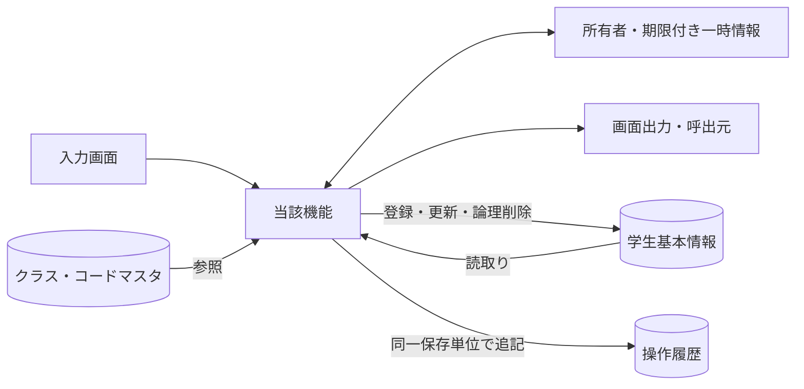

認証情報・業務日時は共通01～03から取得。マスタ保守の承認入力ファイルは画面機能のIOに含めず、方式別共通仕様に定義する。

## 項目一覧

| 項目ID | 項目グループ | 項目名 | コントロール | 必須 | 入力制限 | フォーマット | 初期値 | DBテーブル名 | DB項目名 | 備考 |
| --- | --- | --- | --- | --- | --- | --- | --- | --- | --- | --- |
| REG-001 | 基本 | 学生管理番号 | TextBox（読取専用） | - | - | 正の整数ID |  | 学生基本情報 | 学生管理番号 | 表示のみ、登録時自動採番 EV-REG-001・EV-REG-002 |
| REG-002 | 基本 | 学籍番号 | TextBox | 〇 | 入力・保存15字・新規のみ | 先頭ゼロ保持 |  | 学生基本情報 | 学籍番号 | 新規登録時。既存は表示のみ・変更不可。新規のみ設定。登録後不変、削除済み含め一意 N-06／CHK-001・CHK-002・CHK-003・CHK-004／EV-REG-004 |
| REG-003 | 基本 | 氏名 | TextBox | 〇 | 入力・保存8字 | - |  | 学生基本情報 | 学生氏名 | N-02、原表記を保存 N-02／CHK-001・CHK-002・CHK-005／EV-REG-004 |
| REG-004 | 基本 | 氏名カナ | TextBox | 〇 | 入力36字／保存18字 | 全角カナ |  | 学生基本情報 | 学生氏名カナ | N-04、全角カナ18文字 N-04・N-05／CHK-001・CHK-002・CHK-006・CHK-005／EV-REG-004 |
| REG-005 | 基本 | 生年月日 | ComboBox・TextBox（元号・年月日） | 〇 | 元号10字・年4桁・月2桁・日2桁 | 和暦（DATE-R01）／内部ISO10字 |  | 学生基本情報 | 生年月日 | 元号・年・月・日すべて。新規は全部空。和暦入力→厳密変換→日付保存、DATE-R01 候補:元号／N-11／CHK-001・CHK-007・CHK-008・CHK-032・CHK-033／EV-REG-004 |
| REG-006 | 基本 | 性別 | ComboBox | 〇 | 入力1字／正規化後数字1桁 | 値・名称 | 0（未回答） | 学生基本情報 コード管理マスタ | 学生基本情報：性別のコード分類・性別 コード管理マスタ：コード分類・コード値・コード名称 | 未回答を0として許容。NULL不可。コード値保存／性別分類のコード名称表示 候補:性別／N-07／CHK-010・CHK-011／EV-REG-004 |
| REG-007 | 住所 | 郵便番号 | TextBox | 〇 | 入力10字／保存数字7桁 | 3桁－4桁 |  | 学生基本情報 | 郵便番号 | N-08、数字7桁保存、3桁－4桁表示 N-08／CHK-001・CHK-002・CHK-016／EV-REG-004 |
| REG-008 | 住所 | 都道府県 | ComboBox | 〇 | 入力2字／正規化後数字2桁 | 値・名称 |  | 学生基本情報 コード管理マスタ | 学生基本情報：都道府県のコード分類・都道府県 コード管理マスタ：コード分類・コード値・コード名称 | コード値保存／都道府県分類の名称表示 候補:都道府県／N-07／CHK-001・CHK-010・CHK-011／EV-REG-004 |
| REG-009 | 住所 | 住所1 | TextBox | 〇 | 入力・保存45字 | - |  | 学生基本情報 | 住所1 | N-02、市区町村・番地、45文字 N-02／CHK-001・CHK-002／EV-REG-004 |
| REG-010 | 住所 | 住所2 | TextBox |  | 入力・保存45字 | - |  | 学生基本情報 | 住所2 | 空白除去後空はNULL。N-02、任意45文字、空は未設定 N-02／CHK-002／EV-REG-004 |
| REG-011 | 連絡先 | 本人電話 | TextBox | 条件付 | 入力20字／保存16字 | 国内10/11桁・国際+7～15桁 |  | 学生基本情報 | 本人電話 | 本人電話・本人メール・緊急電話のいずれか1つ以上。N-09、連絡手段条件あり N-09／CHK-002・CHK-017・CHK-019／EV-REG-004 |
| REG-012 | 連絡先 | 本人メール | TextBox | 条件付 | 入力・保存60字 | ASCII限定形式 |  | 学生基本情報 | 本人メール | 本人電話・本人メール・緊急電話のいずれか1つ以上。N-10、連絡手段条件あり N-10／CHK-002・CHK-018・CHK-019／EV-REG-004 |
| REG-013 | 在籍 | 入学日 | TextBox | 〇 | 西暦10字・年4桁 | 入力yyyy-MM-dd／表示yyyy/MM/dd |  | 学生基本情報 | 入学日 | 通常保存時。生年月日以上・業務日以下。西暦入力・表示、DATE-R02 N-11／CHK-001・CHK-007・CHK-008・CHK-033／EV-REG-004 |
| REG-014 | 在籍 | 在籍区分 | ComboBox | 〇 | 入力2字／正規化後数字2桁 | 値・名称 | 01（在学） | 学生基本情報 コード管理マスタ | 学生基本情報：在籍区分のコード分類・在籍区分 コード管理マスタ：コード分類・コード値・コード名称 | 01在学・02休学・03卒業・04退学。値保存／在籍区分分類の名称表示 候補:在籍区分／N-07／CHK-001・CHK-010・CHK-011・CHK-009・CHK-026／EV-REG-004 |
| REG-015 | 在籍 | 卒業・退学日 | TextBox | 条件付 | 西暦10字・年4桁 | 入力yyyy-MM-dd／表示yyyy/MM/dd |  | 学生基本情報 | 卒業・退学日 | 03・04で必須、01・02ではNULL。西暦。03/04で必須、01/02は未設定 N-11／CHK-007・CHK-009・CHK-033／EV-REG-004。DATE-R02 |
| REG-016 | 所属補助 | 年度 | ComboBox |  | 4桁・1900～9998 | 西暦年度 | 当年度 | クラスマスタ | 学校年度 | 選択補助。値があれば年度範囲・クラス実値を検査。選択補助・整合検査のみ。学生へ保存しない 候補:年度／N-11／CHK-010・CHK-014・CHK-034／EV-REG-004 |
| REG-017 | 所属補助 | 学年 | ComboBox |  | 入力2字／正規化後数字2桁 | 学年名称 |  | クラスマスタ コード管理マスタ | クラスマスタ：学年のコード分類・学年 コード管理マスタ：コード分類・コード値・コード名称 | 選択補助。値があればコード存在とクラス実値を検査。選択補助。学年名称は学年分類のコード名称。DB保存なし 候補:学年／N-07／CHK-010・CHK-014／EV-REG-004 未指定表示は「すべて」。 |
| REG-018 | 所属 | クラス | ComboBox | 条件付 | 正の整数・方式別DB型の範囲 | 年度・学年・コード・名称 |  | 学生基本情報 クラスマスタ コード管理マスタ | 学生基本情報：現在・最終所属クラス クラスマスタ：クラス管理番号・学校年度・学年のコード分類・学年・クラスコード・クラス名 コード管理マスタ：コード分類・コード値・コード名称 | 01・02で必須、03・04は任意。識別番号保存／年度・学年・コード・名称表示 候補:クラス／CHK-010・CHK-012・CHK-013・CHK-014・CHK-015・CHK-031／EV-REG-004 |
| REG-019 | 所属 | 所属人数・定員 | Label | - | - | 人数0以上／定員1～9999・NULL可 |  | 学生基本情報 クラスマスタ | 学生基本情報：現在・最終所属クラス・在籍区分・削除の状態 クラスマスタ：クラス管理番号・定員 | 非削除01/02の参考人数。確保予約ではない EV-REG-004 |
| REG-020 | 緊急 | 緊急連絡先氏名 | TextBox | 条件付 | 入力・保存8字 | - |  | 学生基本情報 | 緊急連絡先氏名 | 緊急氏名・続柄・電話のいずれか入力時は全3項目必須。緊急3項目は全部入力または全部未設定 N-02／CHK-002・CHK-020／EV-REG-004 |
| REG-021 | 緊急 | 緊急連絡先続柄 | ComboBox | 条件付 | 入力2字／正規化後数字2桁 | 値・名称 |  | 学生基本情報 コード管理マスタ | 学生基本情報：続柄のコード分類・緊急連絡先続柄 コード管理マスタ：コード分類・コード値・コード名称 | 緊急氏名・続柄・電話のいずれか入力時は全3項目必須。続柄値・名称を対応。未選択なら続柄分類もNULL、選択時は分類を処理設定（UPD-103） 候補:続柄／N-07／CHK-010・CHK-011・CHK-020／EV-REG-004 |
| REG-022 | 緊急 | 緊急連絡先電話 | TextBox | 条件付 | 入力20字／保存16字 | 国内10/11桁・国際+7～15桁 |  | 学生基本情報 | 緊急連絡先電話 | 緊急氏名・続柄・電話のいずれか入力時は全3項目必須。N-09、緊急3項目一式 N-09／CHK-002・CHK-017・CHK-019・CHK-020／EV-REG-004 |
| REG-023 | その他 | 備考 | TextBox（複数行） |  | 入力・保存120字 | LF改行 |  | 学生基本情報 | 備考 | 空白除去後空はNULL。LF改行可。プレーンテキスト、120文字、改行可 N-01／CHK-002／EV-REG-004 |
| REG-024 | 確認 | 確認・変更理由 | TextBox（複数行） | 条件付 | 入力・保存60字 | LF改行 |  | 操作履歴 | 操作・確認理由 | 重複確認続行、卒業・退学からの区分訂正時に必須。警告続行・終了区分訂正時必須、60文字 N-01／CHK-002・CHK-025・CHK-026／EV-REG-005 |
| REG-025 | 更新情報 | 更新日時・更新者 | Label | - | - | 西暦日時19字・JST／更新者64字 |  | 学生基本情報 | 更新日時・更新者 | システム設定。西暦日時、日本時間 EV-REG-002 |
| REG-026 | 削除確認 | 削除理由 | TextBox（複数行） | 条件付 | 入力・保存60字 | LF改行 |  | 学生基本情報 操作履歴 | 学生基本情報：削除理由 操作履歴：操作・確認理由 | 論理削除イベントで必須。通常保存では使用しない。削除時のみ、60文字、編集中の業務値は保存しない N-01／CHK-001・CHK-002・CHK-027／EV-REG-006 |
| REG-027 | 操作・確認 | 登録／更新 | CommandButton | - | - | - | - | - | - | 保存処理を呼ぶ EV-REG-004 |
| REG-028 | 操作・確認 | 入力クリア／編集取消 | CommandButton | - | - | - | - | - | - | 新規は初期値、既存は読込時値 EV-REG-007 |
| REG-029 | 操作・確認 | 最新情報を再読込 | CommandButton | - | - | - | - | - | - | 確認後にDB最新値を取得 EV-REG-007 |
| REG-030 | 操作・確認 | 検索へ戻る | CommandButton | - | - | - | - | - | - | 未保存破棄確認後に復帰 EV-REG-007 |
| REG-031 | 操作・確認 | 論理削除 | CommandButton | - | - | - | - | - | - | 管理者のみ、理由・明示確認 EV-REG-006 |
| REG-032 | 操作・確認 | 重複候補一覧 | ListBox | - | - | 全候補件数＋最大20行 |  | 学生基本情報 クラスマスタ | 学生基本情報：学生管理番号・学籍番号・学生氏名・生年月日・現在・最終所属クラス・更新管理番号 クラスマスタ：クラス管理番号・クラス名 | 全候補件数＋最大20件、個人情報を最小化 EV-REG-005 |
| REG-033 | 操作・確認 | 別人と確認して続行 | CommandButton | - | - | - | - | - | - | 理由・確認情報付きで保存を再検証 EV-REG-005 |
| REG-034 | 操作・確認 | 確認取消 | CommandButton | - | - | - | - | - | - | 入力へ戻る。DB更新なし EV-REG-005 |
## 選択候補一覧

| 候補ID | 参照元・分類 | 選択値 | 表示値 | 抽出条件 | 表示順 | 初期値・連動 |
| --- | --- | --- | --- | --- | --- | --- |
| 年度 | クラスマスタ・学校年度 | 学校年度 | 年度 | 停止・過去年度を含め範囲1900～9998。新規登録は当年度を選択補助へ | 年度降順 | 検索すべて／登録当年度、クラス0件を区別 |
| 学年 | コード管理マスタ（学年） | 学年コード値 | コード名称 | 検索は停止を含む。新規選択は有効値、既存値は別枠保持 | 表示順→コード値 | すべて。学年なし00は未所属と別 |
| クラス | クラスマスタ・コード管理マスタ（学年） | クラス管理番号 | 年度・学年・クラスコード・クラス名 | 検索は停止を含む。登録は共通モジュール07の新規所属／最終所属／既存保持の区別 | 年度降順→学年表示順→クラス表示順→コード→ID | 検索すべて／新規未選択。上位変更で不適合なら解除 |
| 在籍区分 | コード管理マスタ（在籍区分） | 在籍区分コード値 | コード名称 | 検索は分類内の値。登録の新規選択は有効値。01～04は保護 | 表示順→コード値 | 検索01・02／新規登録01、全解除検索は全区分 |
| 都道府県 | コード管理マスタ（都道府県） | 都道府県コード値 | コード名称 | 検索は停止を含む。登録新規選択は有効、既存同値は保持 | 表示順→コード値 | 検索すべて／登録未選択 |
| 性別 | コード管理マスタ（性別） | 性別コード値 | コード名称 | 新規選択は有効値。既存同値は保持。未回答0は保護 | 表示順→コード値 | 新規0、未回答を許容 |
| 続柄 | コード管理マスタ（緊急連絡先続柄） | 続柄コード値 | コード名称 | 新規選択は有効、既存同値は保持 | 表示順→コード値 | 未選択。緊急3項目一式 |
| 元号 | 共通日付仕様（文書07）・元号の変換定義（共通暦定義） | 共通定義の元号識別値 | 元号名 | 生年月日の許容範囲に重なる元号、業務日まで | 新しい元号順 | 未選択。変更時に年・月・日の範囲を再検証 |

## イベント仕様

### EV-REG-001 新規画面表示

#### 処理概要

作成権限のある利用者が新規モードを開く。

#### 処理手順

1. 共通01・02・03で権限と業務日時を確定。OP-CODE・OP-CLASSで候補と初期値の存在を確認する。
2. 性別0、在籍01、年度は当年度。他の値、特に生年月日・入学日を未入力にする。学生管理番号・版は未採番。
3. 必須コード不足は保存不可。クラス0件はW-STU-108。在学・休学はクラス設定まで保存不可だが卒業等の過去入力は妨げない。

#### 処理フロー

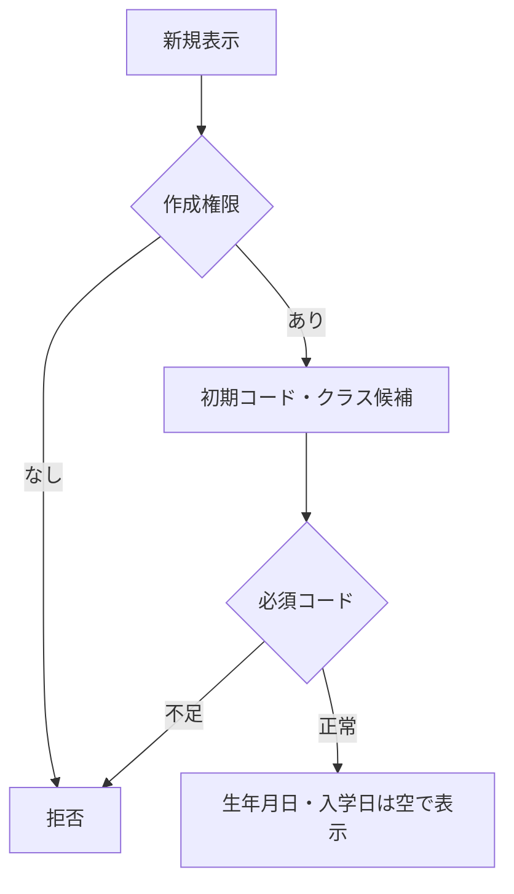

#### SQL・テーブル関連（ER図）

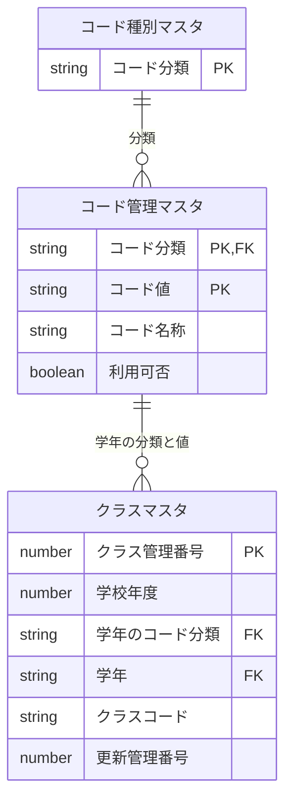

名称参照は未所属・停止値を残す外部結合相当。コードは用途ごとの別名で**分類と値**を結合する。図は読取りの関連であり、履歴への書込みや削除連動を意味しない。単独の存在確認・採番・書込みの表関連は下記操作IDで特定する。

#### DB操作の詳細

`OP-CODE` → `OP-CLASS`。下記「DB操作定義」の同名操作を実行する。

本イベント単独の学生・クラス・コード・操作履歴の追加/更新/削除は0件。候補/表示の取得と学生保存を混同せず、続行による実変更はEV-REG-004だけが確定する。

#### 結果・例外時の扱い

入力不備は原入力保持、対象不在はE-STU-103、版競合はE-STU-105。確認待ちは保存を確定せず、変更なしはI-STU-004。成功通知は学生と履歴の確定確認後だけ。確定結果不明はE-COM-004と検索確認の案内。 各イベントで実行していない処理の結果状態は発生対象外。

##### 判定・メッセージと復帰

| 判定ID | 判定・分岐 | メッセージ・復帰 | DB結果 |
| --- | --- | --- | --- |
| CHK-023・CHK-024 | 新規の操作主体と画面状態が正しいか | 認証E-COM-001、認可E-COM-002、状態不正E-COM-003 | 学生書込み0件 |
| CHK-010・CHK-012 | 性別0/在籍01等の必須初期値が存在するか。クラス0件か | 必須コード不足E-MST-001で保存不可。クラス0件W-STU-108、在学/休学は所属選択まで不可 | 候補読取だけ、ID/版未採番 |

### EV-REG-002 編集・参照画面表示

#### 処理概要

既存学生の識別番号で最新値を表示する。

#### 処理手順

1. OP-STUDENTへ学生管理番号を渡し非削除1件を取得。不在はE-STU-103、新規へ切替えない。
2. 学生・クラス・コード名称を取得し、元の値と更新管理番号を読込時スナップショットへ複製。編集値とは分離する。
3. 生年月日を和暦へ変換。学籍番号・管理項目は表示のみ、閲覧者は全項目表示のみ。停止・期間外の既存値を消さない。

#### 処理フロー

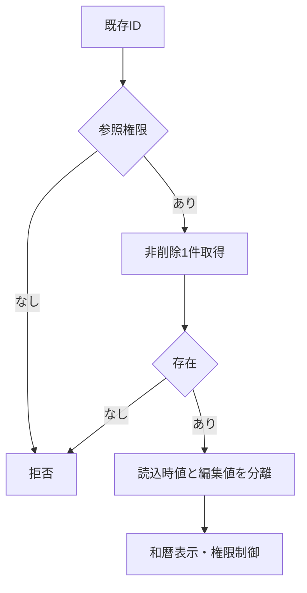

#### SQL・テーブル関連（ER図）

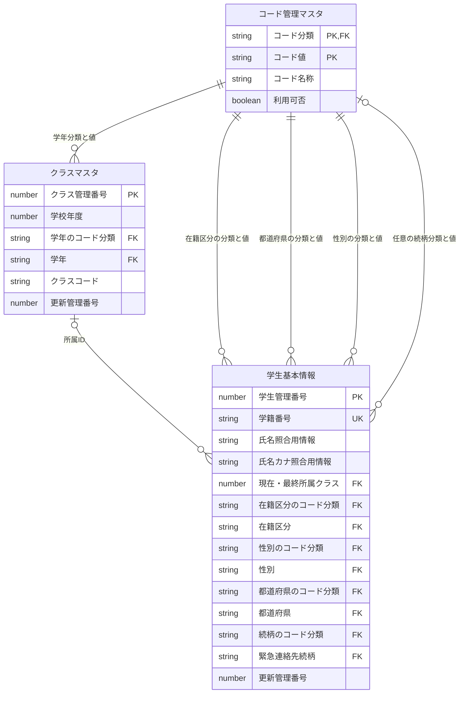

名称参照は未所属・停止値を残す外部結合相当。コードは用途ごとの別名で**分類と値**を結合する。図は読取りの関連であり、履歴への書込みや削除連動を意味しない。単独の存在確認・採番・書込みの表関連は下記操作IDで特定する。

#### DB操作の詳細

`OP-STUDENT` → `OP-CODE` → `OP-CLASS`。下記「DB操作定義」の同名操作を実行する。

本イベント単独の学生・クラス・コード・操作履歴の追加/更新/削除は0件。候補/表示の取得と学生保存を混同せず、続行による実変更はEV-REG-004だけが確定する。

#### 結果・例外時の扱い

入力不備は原入力保持、対象不在はE-STU-103、版競合はE-STU-105。確認待ちは保存を確定せず、変更なしはI-STU-004。成功通知は学生と履歴の確定確認後だけ。確定結果不明はE-COM-004と検索確認の案内。 各イベントで実行していない処理の結果状態は発生対象外。

##### 判定・メッセージと復帰

| 判定ID | 判定・分岐 | メッセージ・復帰 | DB結果 |
| --- | --- | --- | --- |
| CHK-023・CHK-024 | 編集/参照の主体・対象ID・画面状態が正しいか | 認証/認可/画面不正はE-COM-001/002/003。閲覧者は参照専用 | 対象学生参照のみ |
| CHK-021 | 非削除の対象がちょうど1件か | 0件E-STU-103「対象の学生が見つからないか、既に削除されています。」。複数件はE-COM-004、新規へ切り替えない | 読取失敗で保存不可 |
| CHK-010・CHK-011 | 参照名称を分類と値で対応し、停止/期間外の現値を保持できるか | 名称欠落は不整合を明示しE-MST-001を案内、学生行/保存値を消さない。候補の先頭へ置換しない | 原本/編集値/読込版を分離、書込み0件 |

### EV-REG-003 入力補助

#### 処理概要

所属・在籍・生年月日の入力部品を連動させる。

#### 処理手順

1. 共通16・17で生年月日の元号・年・月・日を厳密検査。不正値を次元号・翌月へ補正せず原入力を保持する。
2. 在籍01/02はクラス必須・終了日なし、03/04は終了日必須・最終所属任意。終了区分からの訂正は権限・理由条件を表示する。
3. 年度・学年・区分変更に応じOP-CLASSで候補を再取得。不適合値解除を通知し、人数は参考表示とする。

#### 処理フロー

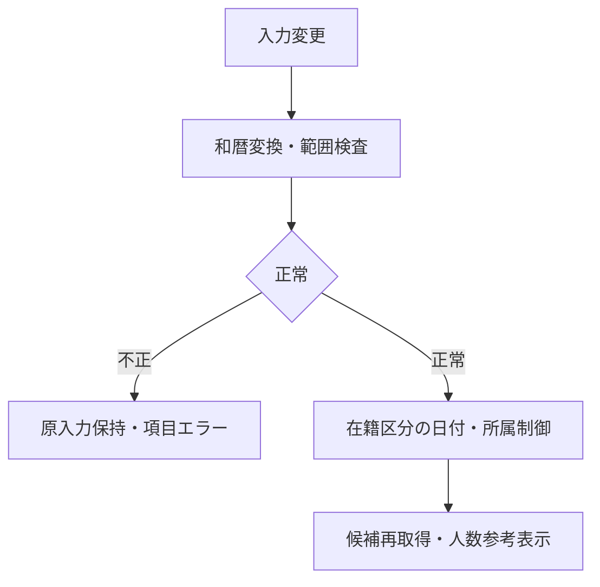

#### SQL・テーブル関連（ER図）

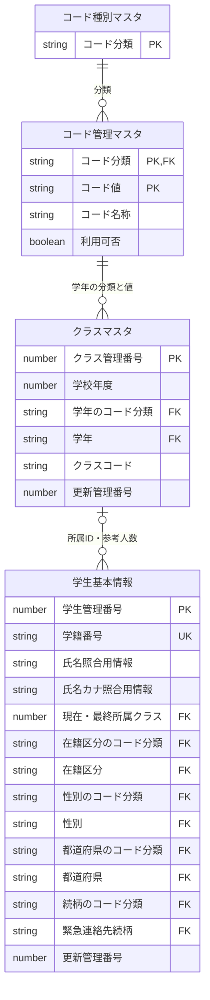

名称参照は未所属・停止値を残す外部結合相当。コードは用途ごとの別名で**分類と値**を結合する。図は読取りの関連であり、履歴への書込みや削除連動を意味しない。単独の存在確認・採番・書込みの表関連は下記操作IDで特定する。

#### DB操作の詳細

`OP-CLASS`。下記「DB操作定義」の同名操作を実行する。

本イベント単独の学生・クラス・コード・操作履歴の追加/更新/削除は0件。候補/表示の取得と学生保存を混同せず、続行による実変更はEV-REG-004だけが確定する。

#### 結果・例外時の扱い

入力不備は原入力保持、対象不在はE-STU-103、版競合はE-STU-105。確認待ちは保存を確定せず、変更なしはI-STU-004。成功通知は学生と履歴の確定確認後だけ。確定結果不明はE-COM-004と検索確認の案内。 各イベントで実行していない処理の結果状態は発生対象外。

##### 判定・メッセージと復帰

| 判定ID | 判定・分岐 | メッセージ・復帰 | DB結果 |
| --- | --- | --- | --- |
| CHK-007・CHK-032・CHK-033 | 和暦4要素が実在日/改元境界/許容範囲を満たすか | E-STU-005・E-DATE-001/002。不正日を補正せず元の入力へ | DB更新0件 |
| CHK-009・CHK-012・CHK-026 | 在籍区分と終了日/所属/終了区分訂正の権限・理由の条件 | E-STU-008/012/106。01/02と03/04の条件を混同しない | 補助表示だけ |
| CHK-010・CHK-014・CHK-034 | 補助年度/学年と選択クラスが適合し、年度が範囲内か | 不適合解除W-STU-107、候補なしW-STU-108、年度E-DATE-003。人数は席予約ではない | 候補/参考人数参照のみ |

### EV-REG-004 新規登録・更新

#### 処理概要

検証済み学生1件と操作履歴1件を一括確定する。

#### 処理手順

1. **入力・最新状態の検査**
   1. 入力19業務項目を複製。和暦原入力は共通16で日付へ変換、共通04・05・17で正規化・必須・範囲・連絡手段を検査する。 続柄未選択なら分類もNULL、選択時は続柄分類を算定する。緊急一式４保存項目を変更なし比較・保存・監査へ渡す。
   2. 共通13の短い保存単位内で同時保存制御を取得。既存モードのみOP-STUDENTを実行し、OP-EXISTSとともに最新存在・版・分類・クラス・日付・区分権限を再検証し、学籍番号不変・全行一意を確認する。

2. **定員・重複候補の判定**
   1. OP-CAPACITYで旧席から新席が増加する場合だけ定員を検査する。変更なしなら版・更新日時・履歴を増やさずI-STU-004。
   2. OP-DUPで全候補と版を確認。未確認なら保存単位を終了して確認画面へ。確認待ちにDBロックを持たない。

3. **学生・履歴の一括確定**
   1. OP-INSERTまたはOP-UPDATEで学生1件、OP-AUDITで履歴1件を確定。失敗は双方取消、成否不明は自動再送せず検索確認。

#### 処理フロー

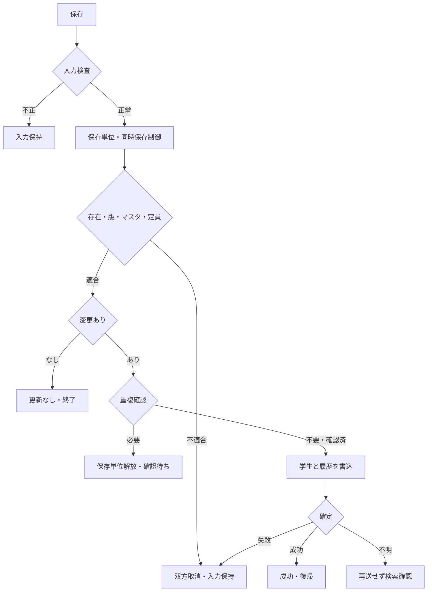

#### SQL・テーブル関連（ER図）

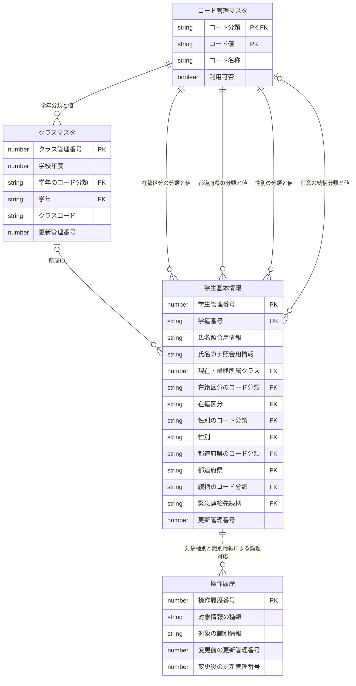

名称参照は未所属・停止値を残す外部結合相当。コードは用途ごとの別名で**分類と値**を結合する。図は読取りの関連であり、履歴への書込みや削除連動を意味しない。単独の存在確認・採番・書込みの表関連は下記操作IDで特定する。

操作履歴との線は対象情報の種類と対象の識別情報による追記先の論理対応で、学生への物理FKや検索JOINを追加する指定ではない。学生1件の実変更と履歴1件は同じ確定単位に含める。

#### DB操作の詳細

同時保存制御取得→既存だけOP-STUDENT→OP-EXISTS→OP-CAPACITY→OP-DUP→新規はOP-INSERT／既存実変更はOP-UPDATE（排他分岐）→OP-AUDIT→全体確定。新規と更新を両方実行しない。

学生の項目別設定は同文書「項目更新仕様」のUPD-002～023・UPD-101～107を適用する。年度/学年は選択補助だけで学生へ保存しない。学生1件と操作履歴1件、その他の業務テーブル更新0件を期待し、無変更は学生/履歴とも0件。学生更新0件は存在再確認してE-STU-103又はE-STU-105、予想外の複数件/履歴失敗はE-COM-004で全取消する。

確認待ちは保存単位を終了し、再続行で同じ保護範囲内の存在/版/マスタ/定員/全重複候補を再確認する。確定を確認する前に採番結果だけで成功にしない。

#### 結果・例外時の扱い

入力不備は原入力保持、対象不在はE-STU-103、版競合はE-STU-105。確認待ちは保存を確定せず、変更なしはI-STU-004。成功通知は学生と履歴の確定確認後だけ。確定結果不明はE-COM-004と検索確認の案内。 各イベントで実行していない処理の結果状態は発生対象外。

##### 判定・メッセージと復帰

| 判定ID | 判定・分岐 | メッセージ・復帰 | DB結果 |
| --- | --- | --- | --- |
| CHK-023・CHK-024 | 許可操作主体・画面・要求と、処理中の二重実行でないこと | E-COM-001/002/003。UI表示だけで更新を認可しない | 拒否なら書込み0件 |
| CHK-001・CHK-002・CHK-003・CHK-006 | 19入力の必須・原入力/保存長・禁止文字・番号/カナ形式が正しいか | E-STU-001/002/003/004。複数の独立入力誤りは対象欄へ、全原入力保持 | DB変更なし |
| CHK-007・CHK-008・CHK-009・CHK-032・CHK-033 | 生年月日≦入学日≦業務日、区分と終了日、和暦境界/範囲 | E-STU-005～008・E-DATE-001/002。形式成立後に関係を判定 | DB変更なし |
| CHK-016・CHK-017・CHK-018・CHK-019・CHK-020 | 郵便/電話/メール、連絡手段1つ以上、緊急3入力と分類込み4保存項目が一式か | E-STU-015～019。続柄未選択は分類もNULL、一部だけNULLにしない | 全体保存を止める |
| CHK-021・CHK-022・CHK-003・CHK-004 | 保護範囲内で非削除対象1件・期待版・番号不変/削除済み含む一意 | 不在E-STU-103、版E-STU-105、不変E-STU-104、使用済みE-STU-101 | 先行部分変更なし |
| CHK-010・CHK-011・CHK-012・CHK-013・CHK-014・CHK-026・CHK-031 | 分類付き参照/現在有効性、既存同値保持、所属/年度学年/期間、終了区分訂正 | E-STU-009～014/106/108。保存済み値と比較し例外を適用、住所訂正へ所属変更条件を再強制しない | 同時保存制御下で現在値再検査 |
| CHK-015 | 新席が旧席と異なり増加する場合だけ自分以外の01/02人数+1≦定員 | 超過E-STU-102「クラスの定員を超えるため保存できません。別のクラスを選択してください。」。席解放/定員NULLは別扱い | 学生変更前に判定 |
| CHK-005・CHK-025 | 非削除他学生の同日生まれ＋氏名又はカナ照合一致の全候補と確認情報が一致か | W-STU-101で全件数/最大20件表示。理由不足E-STU-107、入力/全候補/版/10分期限差はW-STU-102。待機中は排他解放 | 未確認は学生/履歴0件 |
| CHK-022・CHK-030 | 版一致後の実差分、学生1件＋履歴1件の原子的な確定 | 全無変更I-STU-004「変更内容がありません。」で両方0件。成功はI-STU-001/002。障害E-COM-004で双方取消、成否不明は検索確認 | 実変更だけ版+1/監査1件 |

### EV-REG-005 重複候補の確認続行・取消

#### 処理概要

別人確認と理由を保存処理へ引き渡す。

#### 処理手順

1. 候補は全件数と最大20件の学籍番号・氏名・和暦生年月日・クラスのみ。既定操作は取消。
2. 続行では共通11により本人・認証状態・対象・旧版・正規化内容・全候補IDと版・10分期限を照合。相違はW-STU-102で再確認する。
3. 理由を付けEV-REG-004を再実行し全検査を行う。取消は入力画面に留まりDB更新なし。

#### 処理フロー

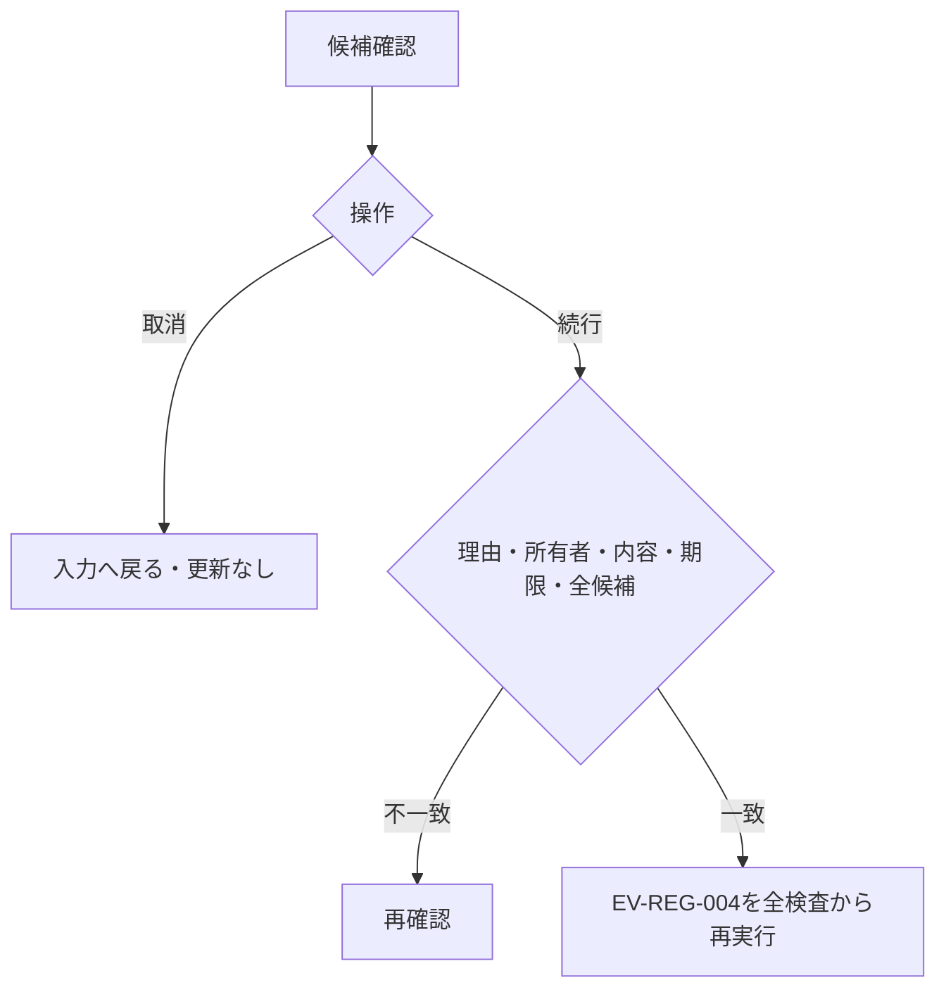

#### SQL・テーブル関連（ER図）

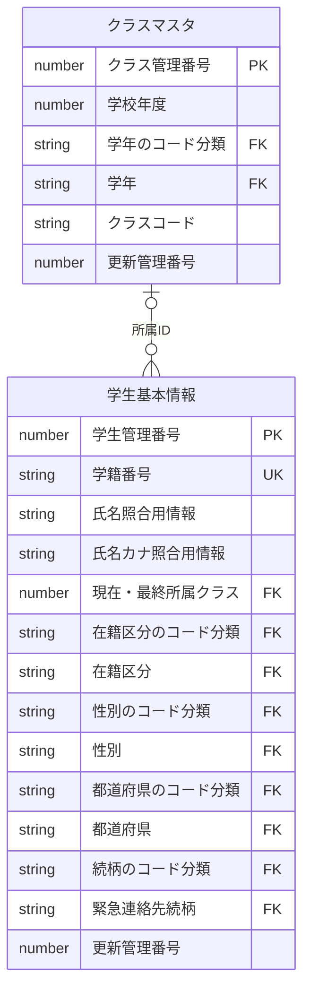

名称参照は未所属・停止値を残す外部結合相当。コードは用途ごとの別名で**分類と値**を結合する。図は読取りの関連であり、履歴への書込みや削除連動を意味しない。単独の存在確認・採番・書込みの表関連は下記操作IDで特定する。

#### DB操作の詳細

`OP-DUP`。下記「DB操作定義」の同名操作を実行する。

本イベント単独の学生・クラス・コード・操作履歴の追加/更新/削除は0件。候補/表示の取得と学生保存を混同せず、続行による実変更はEV-REG-004だけが確定する。

#### 結果・例外時の扱い

入力不備は原入力保持、対象不在はE-STU-103、版競合はE-STU-105。確認待ちは保存を確定せず、変更なしはI-STU-004。成功通知は学生と履歴の確定確認後だけ。確定結果不明はE-COM-004と検索確認の案内。 各イベントで実行していない処理の結果状態は発生対象外。

##### 判定・メッセージと復帰

| 判定ID | 判定・分岐 | メッセージ・復帰 | DB結果 |
| --- | --- | --- | --- |
| CHK-005・CHK-025 | 全候補件数/最大20件の表示と、本人・状態・対象・版・入力・全候補集合・10分期限の一致 | W-STU-101で確認、差があればW-STU-102で再確認。表示20件だけで全候補一致としない | 確認待ちの業務書込み0件/排他保持なし |
| CHK-002・CHK-025 | 別人として続行する理由が設定済み・60字以内か | E-STU-107。続行はEV-REG-004の全検査を再実行し、確認済みBooleanだけで迂回しない | 確認だけで確定しない |
| CHK-024 | 確認取消又は確認画面の状態不正か | 取消既定で原入力へ戻り確認情報を失効。状態不正E-COM-003 | 取消はDB更新0件 |

### EV-REG-006 論理削除

#### 処理概要

管理者が対象と理由を確認して通常検索から除外する。

#### 処理手順

1. 対象ID・読込時版・削除理由・明示確認のみを受ける。編集中の氏名・住所・生年月日等は保存しない。
2. 同時保存制御下でOP-STUDENTを再読込し権限・非削除・版を検証する。対象不在と版競合を区別する。
3. OP-DELETEで削除属性と更新管理情報だけを変更しOP-AUDITと一括確定。確定後に検索へ戻る。

#### 処理フロー

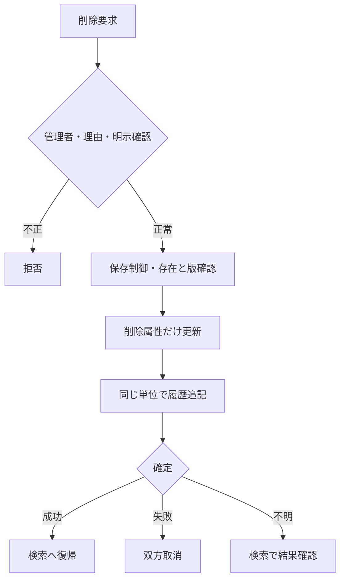

#### SQL・テーブル関連（ER図）

名称参照は未所属・停止値を残す外部結合相当。コードは用途ごとの別名で**分類と値**を結合する。図は読取りの関連であり、履歴への書込みや削除連動を意味しない。単独の存在確認・採番・書込みの表関連は下記操作IDで特定する。

操作履歴との線は対象情報の種類と対象の識別情報による追記先の論理対応で、学生への物理FKや検索JOINを追加する指定ではない。学生1件の実変更と履歴1件は同じ確定単位に含める。

#### DB操作の詳細

`OP-STUDENT` → `OP-DELETE` → `OP-AUDIT`。下記「DB操作定義」の同名操作を実行する。

OP-DELETEは対象学生管理番号＋期待更新管理番号＋非削除を条件とし、UPD-105/106の削除属性と更新管理項目だけを1件更新する。OP-AUDITのUPD-107を1件追記し同じ単位で確定する。0件は対象不在/削除済みと版競合を分け、予期しない件数又は履歴追記失敗はE-COM-004で双方取消する。編集途中の業務項目、クラス/コード、作成属性は更新0件。

#### 結果・例外時の扱い

入力不備は原入力保持、対象不在はE-STU-103、版競合はE-STU-105。確認待ちは保存を確定せず、変更なしはI-STU-004。成功通知は学生と履歴の確定確認後だけ。確定結果不明はE-COM-004と検索確認の案内。 各イベントで実行していない処理の結果状態は発生対象外。

##### 判定・メッセージと復帰

| 判定ID | 判定・分岐 | メッセージ・復帰 | DB結果 |
| --- | --- | --- | --- |
| CHK-023・CHK-024・CHK-027 | 管理者、対象ID/期待版、削除理由60字以内、明示確認がそろうか | 権限E-COM-002、理由/確認不足E-STU-020。編集中の一般業務値は受け付けない | 未成立なら学生/履歴0件 |
| CHK-021・CHK-022 | 同時保存制御後の非削除対象1件と期待版の一致 | 不在/削除済みE-STU-103、版不一致E-STU-105。自動上書きなし | 不成立は全取消 |
| CHK-030 | 削除/更新管理属性だけの更新1件と操作履歴1件を同じ単位で確定できたか | 成功I-STU-003「学生情報を論理削除しました。」。障害E-COM-004で双方取消、成否不明は検索確認 | 物理削除0件、一般入力/マスタ変更0件 |

### EV-REG-007 取消・再読込・検索へ戻る

#### 処理概要

原入力の取消、最新取得、検索への復帰を区別する。

#### 処理手順

1. 新規クリアは初期値、編集取消は最後の読込時スナップショットへ戻す。DBから最新取得する処理ではない。
2. 再読込は明示確認後OP-STUDENTを実行し値と版をともに置換。競合時に版だけを最新にしない。
3. 戻る・ウィンドウ終了は未保存変更の破棄確認を行い、取消を既定とする。保存結果不明は再保存前の検索確認を案内する。

#### 処理フロー

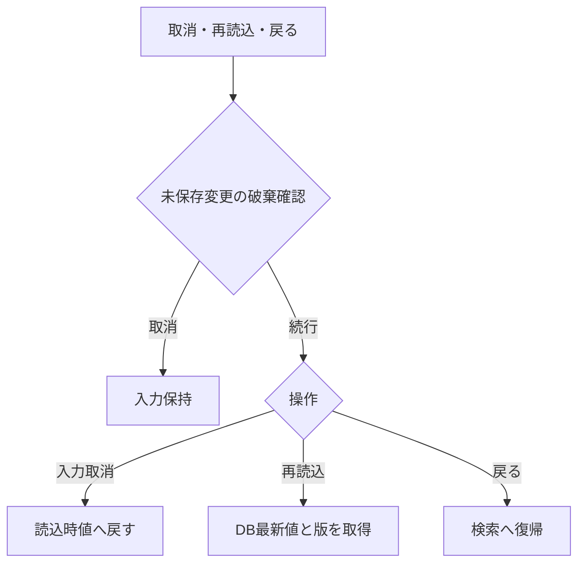

#### SQL・テーブル関連（ER図）

名称参照は未所属・停止値を残す外部結合相当。コードは用途ごとの別名で**分類と値**を結合する。図は読取りの関連であり、履歴への書込みや削除連動を意味しない。単独の存在確認・採番・書込みの表関連は下記操作IDで特定する。

#### DB操作の詳細

`OP-STUDENT`。下記「DB操作定義」の同名操作を実行する。

本イベント単独の学生・クラス・コード・操作履歴の追加/更新/削除は0件。候補/表示の取得と学生保存を混同せず、続行による実変更はEV-REG-004だけが確定する。

#### 結果・例外時の扱い

入力不備は原入力保持、対象不在はE-STU-103、版競合はE-STU-105。確認待ちは保存を確定せず、変更なしはI-STU-004。成功通知は学生と履歴の確定確認後だけ。確定結果不明はE-COM-004と検索確認の案内。 各イベントで実行していない処理の結果状態は発生対象外。

##### 判定・メッセージと復帰

| 判定ID | 判定・分岐 | メッセージ・復帰 | DB結果 |
| --- | --- | --- | --- |
| CHK-024 | クリア/編集取消/再読込/戻るの別と未保存変更 | 取消W-STU-104、戻るW-STU-103、再読込W-STU-109。既定取消で原入力保持 | クリア/取消/戻る自体はDB更新0件 |
| CHK-021・CHK-024 | 明示再読込を承認後、現在の非削除対象を取得できるか | 不在E-STU-103、状態不正E-COM-003、取得失敗E-COM-004。成功時は全値と版を同時置換 | 読込版だけの置換なし、未保存値の自動適用なし |
| CHK-030 | 直前の保存成否を確認できているか | 成否不明はE-COM-004と「再保存前に検索で結果を確認してください」。盲目的再送なし | 取消で確定済み変更を巻き戻さない |

### DB操作定義

操作の業務契約は[共通データアクセス](../共通/08_データアクセス仕様.md)が正本。本機能における具体的な対象・引数・確定単位は以下。

#### OP-CODE

| 項目 | 内容 |
| --- | --- |
| 対象テーブル | コード種別マスタ・コード管理マスタ |
| 操作 | 参照 |
| 実行条件・引数 | 分類、用途（検索／新規選択／既存表示）、既存値、業務日 |
| 取得・設定項目／対象条件 | 分類・値・名称・表示順・利用可否・期間。分類＋値で取得 |
| 件数・順序 | 候補0件を検出。既定値を先頭値へ代替しない |
| 確定・取消 | 参照のみ |

#### OP-CLASS

| 項目 | 内容 |
| --- | --- |
| 対象テーブル | クラスマスタ・コード管理マスタ（学年）・学生基本情報 |
| 操作 | 参照 |
| 実行条件・引数 | 用途、年度、学年、在籍区分、在籍期間、既存所属、業務日、人数参照要否 |
| 取得・設定項目／対象条件 | 年度・学年・クラスID・コード・名称・期間・定員。人数集計は登録側で要求した場合のみ。検索の候補取得では学生を集計しない |
| 件数・順序 | 年度降順、学年表示順、クラス表示順、クラスコード、ID |
| 確定・取消 | 参照のみ、人数は予約ではない |

#### OP-STUDENT

| 項目 | 内容 |
| --- | --- |
| 対象テーブル | 学生基本情報・クラスマスタ・コード管理マスタ |
| 操作 | 参照 |
| 実行条件・引数 | 対象学生ID |
| 取得・設定項目／対象条件 | 非削除の1件、全保存値・版・参照名称。名称はLEFT JOIN相当 |
| 件数・順序 | 0件E-STU-103、1件正常、複数件は整合性障害 |
| 確定・取消 | 画面読込は参照のみ。保存時の再検証は保存単位内 |

#### OP-EXISTS

| 項目 | 内容 |
| --- | --- |
| 対象テーブル | 学生基本情報・クラスマスタ・コード種別マスタ・コード管理マスタ |
| 操作 | 参照 |
| 実行条件・引数 | 用途（検索／保存）、分類付きコード・クラスID・選択補助。保存だけ対象ID・完全な学籍番号・期待版 |
| 取得・設定項目／対象条件 | 検索は指定コード・クラスの存在と年度学年の整合のみ。学籍番号前方一致に重複・完全一致存在検査をしない。保存は全行学籍番号一意、分類付き存在、変更有無、有効性を再検査 |
| 件数・順序 | 未存在／重複／組合せ／停止を区別。未指定の検索条件は検査対象外 |
| 確定・取消 | 検索は参照のみ、保存は保護した最新値で確認 |

#### OP-CAPACITY

| 項目 | 内容 |
| --- | --- |
| 対象テーブル | 学生基本情報・クラスマスタ |
| 操作 | 参照 |
| 実行条件・引数 | 旧席、新席、対象学生ID |
| 取得・設定項目／対象条件 | 非削除01/02、自分以外の対象クラス人数と定員 |
| 件数・順序 | 新席が未設定でなく、旧席から追加・異動するときだけ人数＋1≦定員。卒業・退学・削除による席解放はこの加算検査をしない。定員未設定は制限なし |
| 確定・取消 | 保存制御取得後に判定、休学も1席 |

#### OP-DUP

| 項目 | 内容 |
| --- | --- |
| 対象テーブル | 学生基本情報・クラスマスタ |
| 操作 | 参照 |
| 実行条件・引数 | 日付型生年月日、氏名照合値、カナ照合値、自分ID |
| 取得・設定項目／対象条件 | 非削除かつ自分除外、同生年月日かつ氏名照合用情報または氏名カナ照合用情報一致 |
| 件数・順序 | 全ID・版をID順、表示は最大20件。クラス名は表示のみ |
| 確定・取消 | 確認照合は同時保存制御内、応答待ちは解放 |

#### OP-INSERT

| 項目 | 内容 |
| --- | --- |
| 対象テーブル | 学生基本情報 |
| 操作 | 登録 |
| 実行条件・引数 | 検証済み19入力、生成照合値2、固定分類、認証情報 |
| 取得・設定項目／対象条件 | 学生ID自動採番、版1、作成更新情報設定、未削除 |
| 件数・順序 | 必ず1件。学籍番号一意制約でも競合防止 |
| 確定・取消 | OP-AUDITと同一確定単位 |

#### OP-UPDATE

| 項目 | 内容 |
| --- | --- |
| 対象テーブル | 学生基本情報 |
| 操作 | 更新 |
| 実行条件・引数 | 対象ID、期待版、学籍番号以外18入力、生成照合値2 |
| 取得・設定項目／対象条件 | 対象ID＋期待版＋非削除。続柄分類を続柄と同時更新。作成情報・学籍番号・必須３分類・削除情報は変更なし |
| 件数・順序 | 更新1件。0件は存在再確認後不在／版競合に分離 |
| 確定・取消 | OP-AUDITと一括、版＋1。変更なしは実行しない |

#### OP-AUDIT

| 項目 | 内容 |
| --- | --- |
| 対象テーブル | 操作履歴 |
| 操作 | 登録 |
| 実行条件・引数 | 対象、操作、前後版、変更項目名、実行者・時点・理由・受付番号 |
| 取得・設定項目／対象条件 | 変更した変更項目名だけ。個人情報の値はコピーしない |
| 件数・順序 | 実際の変更1件につき履歴1件。追記専用 |
| 確定・取消 | 業務変更と同じ接続・保存単位。失敗は双方取消 |

#### OP-DELETE

| 項目 | 内容 |
| --- | --- |
| 対象テーブル | 学生基本情報 |
| 操作 | 更新（論理削除） |
| 実行条件・引数 | 対象ID、期待版、理由、認証情報 |
| 取得・設定項目／対象条件 | 削除状態・日時・者・理由、更新日時・者・版だけ変更 |
| 件数・順序 | 更新1件。編集中の一般項目を含めない |
| 確定・取消 | 物理DELETEではない。OP-AUDITと一括 |

### 業務判断の決定表

#### 主要な業務チェック

| チェック | 判定 | 結果 |
| --- | --- | --- |
| 学籍番号重複 | 削除済みを含む全学生で使用済み | 保存不可。番号の再利用も不可 |
| 同一人物候補 | 非削除の他学生と生年月日が同じ、氏名またはカナの照合値が同じ | 別人確認・理由付きなら保存可 |
| コード存在 | 正しい分類内に値がある | 不存在は保存不可 |
| コード利用可否 | 新規・変更する値が有効・期間内 | 不可値は保存不可。既存の同値保持は可 |
| クラス存在 | 選択クラスが実在し年度・学年が一致 | 不存在・不一致は保存不可 |
| 日付 | 生年月日≦入学日≦本日、終了日も本日以前 | 不整合は保存不可 |
| 連絡手段 | 本人電話・メール・緊急電話の1つ以上 | 不足は保存不可 |
| 緊急連絡先 | 氏名・続柄・電話を全部空または全部入力 | 一部だけは保存不可 |
| 他者の更新 | 画面読込後に別操作が更新済み | 上書きせずエラー。入力を保持 |
| 理由 | 必要な操作で空白でない60文字以内 | 不足は保存不可 |

#### クラス選択・定員の決定表

| 保存後の状態・変更 | クラス要否・利用規則 | 定員 |
| --- | --- | --- |
| 新規の在学・休学、別クラスへの異動、卒業等から在学へ訂正 | 必須。利用可かつ本日が利用期間内 | 自分を除いた在学・休学人数＋1が定員以下 |
| 在学・休学のまま同じクラスを保持 | 存在必須。期間外等でも住所などの変更は可、見直し警告 | 席が増えないため既存の超過だけでは拒否しない |
| 新規の卒業・退学 | 任意。指定するならクラス利用期間と入学～終了日の期間が重なる | 席を消費しない |
| 卒業・退学の最終所属・在籍日付・区分を変更 | 停止・過去クラスも可。指定した期間の重なりを確認 | 席を消費しない |
| 卒業・退学の最終所属・在籍日付・区分を変えず住所等だけ変更 | 既存値を保持できる | 席を消費しない |
| 論理削除 | 元のクラス情報を保持 | 削除後は人数に含めない |

休学も1席を使用する。定員未設定は制限なし。定員40人に対し39人在籍で同時に2人を登録した場合は片方だけ保存でき、超過させない。期間の重なりは1日以上あればよく、卒業日がクラス利用期間内に入ることまでは必須にしない。

#### 在籍区分の状態遷移

| 変更前 | 変更後 | 実行者・条件 |
| --- | --- | --- |
| 在学・休学 | 在学・休学・卒業・退学 | 担当者または管理者。変更後の日付・クラス規則を満たす |
| 卒業・退学 | 同一区分 | 担当者または管理者。通常項目の訂正可 |
| 卒業・退学 | 別区分 | 管理者のみ。確認・変更理由が必須 |
| 新規 | 任意の4区分 | 担当者または管理者。過去データ登録を認める |

在籍区分は日付到来だけで自動変更しない。再入学や年度別履歴は本版に含まない。

## 項目更新仕様

| 更新ID | 項目ID | 対象 | 登録 | 更新 | 論理削除 | 規則・設定元 |
| --- | --- | --- | --- | --- | --- | --- |
| UPD-002 | REG-002 | 学生基本情報・学籍番号 | 検証済み入力値 | 変更なし | 変更なし | 新規のみ設定。登録後不変、削除済み含め一意 |
| UPD-003 | REG-003 | 学生基本情報・学生氏名 | 検証済み入力値 | 同左。空の任意値は未設定で上書き | 変更なし | N-02、原表記を保存 |
| UPD-004 | REG-004 | 学生基本情報・学生氏名カナ | 検証済み入力値 | 同左。空の任意値は未設定で上書き | 変更なし | N-04、全角カナ18文字 |
| UPD-005 | REG-005 | 学生基本情報・生年月日 | 検証済み入力値（生年月日は日付へ変換） | 同左。空の任意値は未設定で上書き | 変更なし | 和暦入力→厳密変換→日付保存、DATE-R01 |
| UPD-006 | REG-006 | 学生基本情報・性別 | 検証済み入力値 | 同左。空の任意値は未設定で上書き | 変更なし | コード値保存／性別分類のコード名称表示 |
| UPD-007 | REG-007 | 学生基本情報・郵便番号 | 検証済み入力値 | 同左。空の任意値は未設定で上書き | 変更なし | N-08、数字7桁保存、3桁－4桁表示 |
| UPD-008 | REG-008 | 学生基本情報・都道府県 | 検証済み入力値 | 同左。空の任意値は未設定で上書き | 変更なし | コード値保存／都道府県分類の名称表示 |
| UPD-009 | REG-009 | 学生基本情報・住所1 | 検証済み入力値 | 同左。空の任意値は未設定で上書き | 変更なし | N-02、市区町村・番地、45文字 |
| UPD-010 | REG-010 | 学生基本情報・住所2 | 検証済み入力値 | 同左。空の任意値は未設定で上書き | 変更なし | N-02、任意45文字、空は未設定 |
| UPD-011 | REG-011 | 学生基本情報・本人電話 | 検証済み入力値 | 同左。空の任意値は未設定で上書き | 変更なし | N-09、連絡手段条件あり |
| UPD-012 | REG-012 | 学生基本情報・本人メール | 検証済み入力値 | 同左。空の任意値は未設定で上書き | 変更なし | N-10、連絡手段条件あり |
| UPD-013 | REG-013 | 学生基本情報・入学日 | 検証済み入力値 | 同左。空の任意値は未設定で上書き | 変更なし | 西暦入力・表示、DATE-R02 |
| UPD-014 | REG-014 | 学生基本情報・在籍区分 | 検証済み入力値 | 同左。空の任意値は未設定で上書き | 変更なし | 値保存／在籍区分分類の名称表示 |
| UPD-015 | REG-015 | 学生基本情報・卒業・退学日 | 検証済み入力値 | 同左。空の任意値は未設定で上書き | 変更なし | 西暦。03/04で必須、01/02は未設定 |
| UPD-018 | REG-018 | 学生基本情報・現在・最終所属クラス | 検証済み入力値 | 同左。空の任意値は未設定で上書き | 変更なし | 識別番号保存／年度・学年・コード・名称表示 |
| UPD-020 | REG-020 | 学生基本情報・緊急連絡先氏名 | 検証済み入力値 | 同左。空の任意値は未設定で上書き | 変更なし | 緊急3項目は全部入力または全部未設定 |
| UPD-021 | REG-021 | 学生基本情報・緊急連絡先続柄 | 検証済み入力値 | 同左。空の任意値は未設定で上書き | 変更なし | 続柄値・名称を対応。未選択なら続柄分類もNULL、選択時は分類を処理設定（UPD-103） |
| UPD-022 | REG-022 | 学生基本情報・緊急連絡先電話 | 検証済み入力値 | 同左。空の任意値は未設定で上書き | 変更なし | N-09、緊急3項目一式 |
| UPD-023 | REG-023 | 学生基本情報・備考 | 検証済み入力値 | 同左。空の任意値は未設定で上書き | 変更なし | プレーンテキスト、120文字、改行可 |
| UPD-101 | REG-003／004 | 氏名・氏名カナ照合用情報 | 共通04で生成 | 元の氏名等から再生成 | 変更なし | 入力された照合値を信用しない |
| UPD-102 | REG-001 | 学生管理番号 | 自動採番 | 変更なし | 変更なし | 最大値＋1は禁止 |
| UPD-103 | ― | 性別・都道府県・在籍区分・続柄のコード分類 | 必須３分類を固定設定。続柄未選択は分類もNULL、選択時のみ続柄分類を設定 | 必須３分類は維持。続柄分類は続柄と同時に設定／NULL化 | 変更なし | 利用者入力を受けず保存側で算定。新規・更新の派生値と変更列監査を一致 |
| UPD-104 | ― | 作成日時・作成者 | 共通03・01 | 変更なし | 変更なし | システム設定 |
| UPD-105 | REG-025 | 更新日時・更新者・更新管理番号 | 実行時点・実行者・1 | 実変更時だけ実行時点・実行者・版＋1 | 同左 | 期待版一致が条件、変更なしでは更新しない |
| UPD-106 | REG-026／031 | 削除状態・削除日時・削除者・削除理由 | 未削除、削除属性未設定 | 変更なし | 削除済・実行時点・実行者・検査済理由 | 削除時に一般入力を保存しない |
| UPD-107 | REG-024／026 | 操作履歴 | 前版未設定・後版1・操作新規 | 前後版・変更項目名・操作更新 | 前後版・変更項目名・操作論理削除 | 対象識別、実行者時点、理由、受付番号、重複確認有無。値は複写しない |

## 補足説明

同じ電話・メールを家族で共有しても登録可能とし、連絡先の重複だけでは拒否しない。学籍番号や氏名の検索・比較に使う文字変換は共通仕様に従う。個人情報の保存期間、削除復元、物理消去は運用要件の確認事項であり、論理削除を永久保存の承認とは扱わない。

関連：[論理テーブル](03_テーブル仕様書.md)／[コード](04_コード設計書.md)／[共通チェック](../共通/05_チェック・メッセージ設計.md)

### 正本・受入観点

共通業務は共通03・05・07・08、技術実装は方式別詳細を正本とする。顧客IT部門は入出力、権限、画面とDBの追跡、競合・障害時結果を確認する。言語の構文説明は本書に含めない。

[適合試験一覧](../共通/06_要件対応・設計判断.md)とレビュー結果を参照。

### 項目と一覧章の扱い

項目一覧は共通UIの11列、選択候補一覧は既存列の表だけを置くLIST章とする。入力制限で原入力/保存後上限を区別し、必須と条件・DB2列を維持する。項目IDは前版のまま。詳細の内部項目は同じ論理項目の細分化であり新たな業務機能ではない。

### 更新表の補足

EV-REG-004・006から呼び出す。新規19入力、通常更新18入力（学籍番号以外）、生成照合値2の対応を固定する。更新・削除は対象ID＋期待版＋非削除で1件を要求し、0件の場合は不在／競合を区別する。
