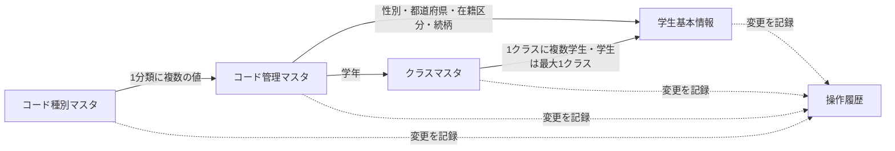

<!-- spec-meta: {"schema":"spec-md/1.0","documentId":"ACCESS-BAS-STU-03","version":"8.1","path":"sample-project1/spec/Access/基本設計書/03_テーブル仕様書.md","sheets":[{"heading":"概要","kind":"GRID","sheet":"01_概要"},{"heading":"テーブル一覧","kind":"LIST","sheet":"02_テーブル一覧","key":["No"]},{"heading":"イベント仕様","kind":"GRID","sheet":"03_イベント仕様"},{"heading":"補足説明","kind":"GRID","sheet":"04_補足説明"}],"isolationProfile":"Access"} -->
# テーブル仕様書（索引・共通規則）

版8.1／2026-10-25。仕様書の書式改訂。業務アプリ・実DBの実行試験は未実施。

## 概要

本書はテーブル別仕様への索引と共通の保存・制約規則。各テーブルは「テーブルヘッダー＋項目詳細」の１ファイルで定義し、Excelでは同一シートに配置する。索引・共通規則はテーブルシートへ繰返し展開しない。

学生、クラス、業務コード、操作履歴を管理する。本文は論理名・言語非依存で記述する。分冊の物理名はDBとの対応確認用として併記し、実DB型・索引・作成命令は製品別DB定義で具体化する。元版の5テーブル・89項目を引き継ぐ。年齢・学年・クラス名称を学生へ重複保存しない。成績テーブルは設けない。

| 番号 | テーブル名 | 1件の単位 | 一意に識別する項目 | 項目数 |
| --- | --- | --- | --- | --- |
| 1 | 学生基本情報 | 学生1人 | 学生管理番号 | 35 |
| 2 | クラスマスタ | 年度内のクラス1件 | クラス管理番号 | 17 |
| 3 | コード種別マスタ | コード分類1件 | コード分類 | 11 |
| 4 | コード管理マスタ | 分類内のコード1件 | コード分類とコード値 | 14 |
| 5 | 操作履歴 | 確定した変更1件 | 操作履歴番号 | 12 |

### データ関連図

実線は保存情報の参照関係、点線は変更時の記録であり、削除連動を意味しない。学生のクラスは卒業・退学時に未所属を許容する。操作履歴は複数のテーブルを対象とする汎用記録であり、履歴の削除が学生へ連動することはない。

各分冊の明細は９列。NOT NULLは〇/空欄、DB確定時のタイプは実DB型、長さは業務上限。初期値なしは空欄とする。保存制約・型容量・業務上限は変更しない。

## テーブル一覧

| No | 論理名 | 物理名 | 分類 | 項目数 | 仕様書 |
| --- | --- | --- | --- | --- | --- |
| 1 | 学生基本情報 | m_student | 業務 | 35 | [01_m_student](テーブル/01_m_student.md) |
| 2 | クラスマスタ | m_class | 業務 | 17 | [02_m_class](テーブル/02_m_class.md) |
| 3 | コード種別マスタ | m_code_category | 業務 | 11 | [03_m_code_category](テーブル/03_m_code_category.md) |
| 4 | コード管理マスタ | m_code | 業務 | 14 | [04_m_code](テーブル/04_m_code.md) |
| 5 | 操作履歴 | t_operation_log | 業務 | 12 | [05_t_operation_log](テーブル/05_t_operation_log.md) |

## イベント仕様

| 操作 | 保存・検査規則 |
| --- | --- |
| 学生登録 | 学籍番号を全件で重複確認。参照先・連絡先・日付・定員・同一人物候補を検査。学生と履歴を一括保存 |
| 学生更新 | 対象存在、学籍番号不変、他者更新なしを確認。業務上の変更なしなら保存・履歴なし |
| 学生削除 | 削除状態・日時・者・理由・更新管理情報だけ変更し履歴を追記 |
| クラス保守 | 年度内一意、参照学生、現在人数、学年、期間を検証し履歴と保存 |
| コード保守 | 分類内一意、桁数、保護、利用期間、意味の不変を確認し履歴と保存 |
| 検索・画面表示 | 参照のみ。履歴は増やさない |

参照されているクラス・コードの実体を通常処理で削除しない。参照先が存在していても停止・期間外・満員等の業務条件は別に確認する。削除済みの学生からの参照も、マスタの意味を変えてよいかの判断に含める。

## 補足説明

物理消去と保管期間は別途運用承認が必要。サンプル学生・クラスは本番へ自動投入しない。初期投入はコード分類、コード値、学校が確認したクラスの順とする。学校名や実クラスは未指定である。

### 共通日付・項目追跡

[日付・年範囲](../共通/07_日付・和暦仕様.md)を正本とする。生年月日だけ和暦表示、他は西暦。元号は共通暦定義であり、既存5分類70コードへ追加しない。画面項目の表示・検索・保存の向きは各機能の項目IDから追跡する。

### 共通の管理項目

学生基本情報、クラスマスタ、コード種別マスタ、コード管理マスタに以下5項目を持つ。各表の項目数にはこの5項目を含む。

日時は同じ時点を一意に扱える形式で保存し、画面は日本時間で表示する。日付項目は時刻を持たない。管理項目を利用者の入力で上書きしない。

### 学生基本情報（個別30項目＋共通5項目）

学年は所属クラスから参照する。「学年なし」と「クラス未所属」は別概念。電話・メール・緊急電話のいずれか1つ以上を必要とする。緊急連絡先は氏名・続柄・電話の全部を空にするか、全部を入力する。

### クラスマスタ（個別12項目＋共通5項目）

同年度では学年が異なっても同じクラスコードは使用不可。同年度・同学年で同名クラスは警告するが、別コードなら保存可。学年の変更は削除済みを含む参照学生がいない場合だけ可能。利用停止は在学・休学の非削除学生が0人の場合だけ可能。定員を在籍人数未満へ減らさない。期間変更で現時点の所属学生が利用期間外になる場合は拒否する。

### コード管理マスタ（個別9項目＋共通5項目）

分類と値の組で一意。異なる分類の「01」は別の意味として共存する。名称は識別情報にしない。名称変更で学生のコード値を変更しない。コード値を別の意味へ再利用しない。

### 操作履歴（12項目）

操作履歴は確定した変更だけを記録し、追記のみとする。変更前後の個人情報を保持する履歴ではないため、過去の氏名・住所・所属を復元する機能を保証しない。
