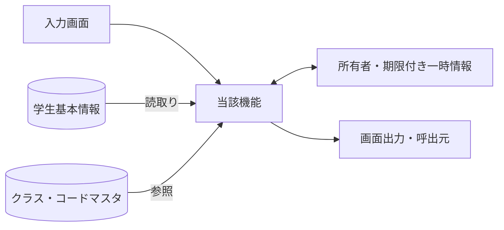
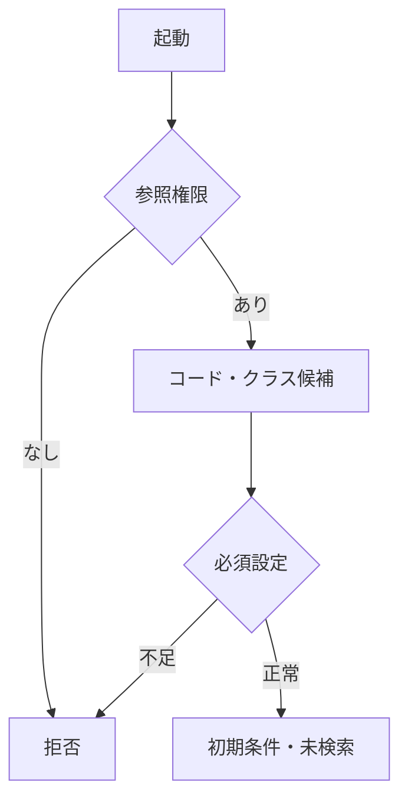
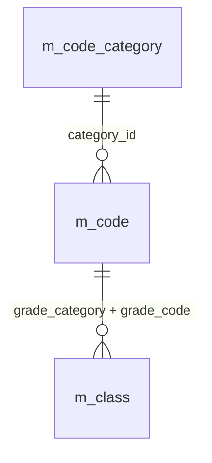
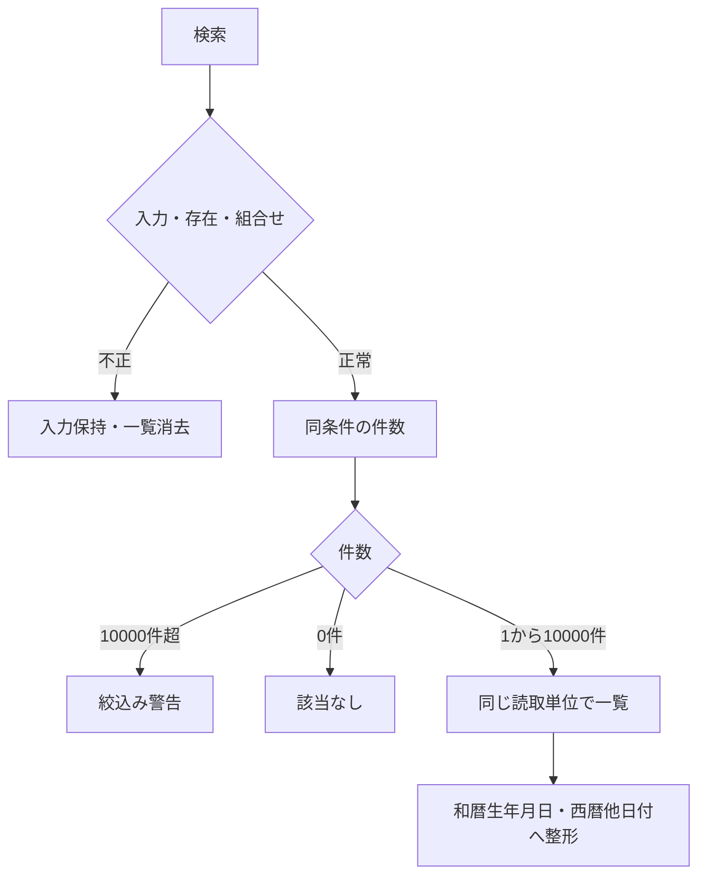
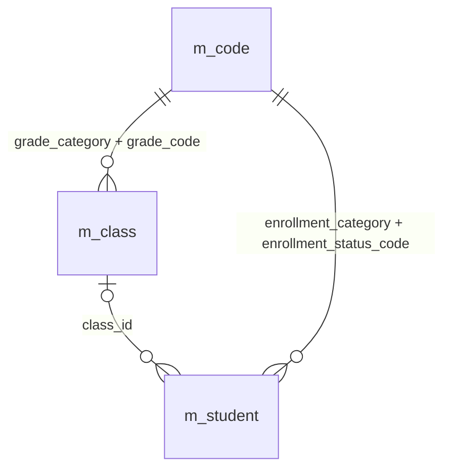
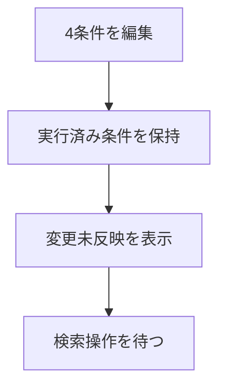
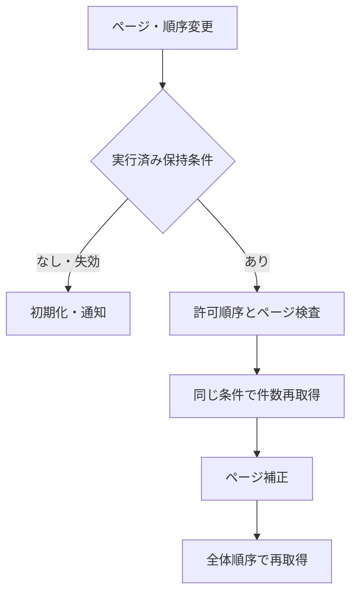
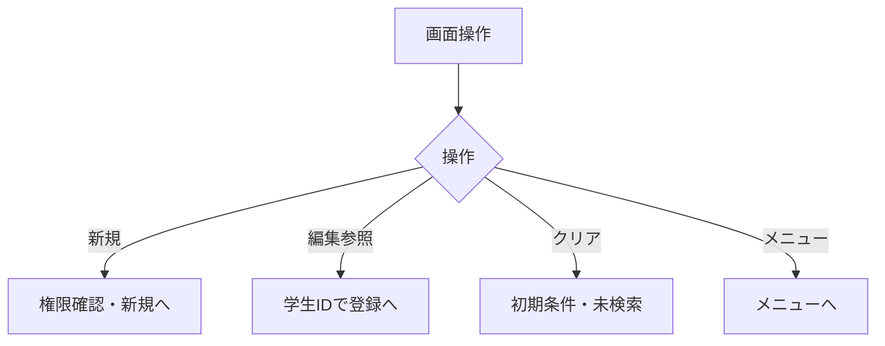
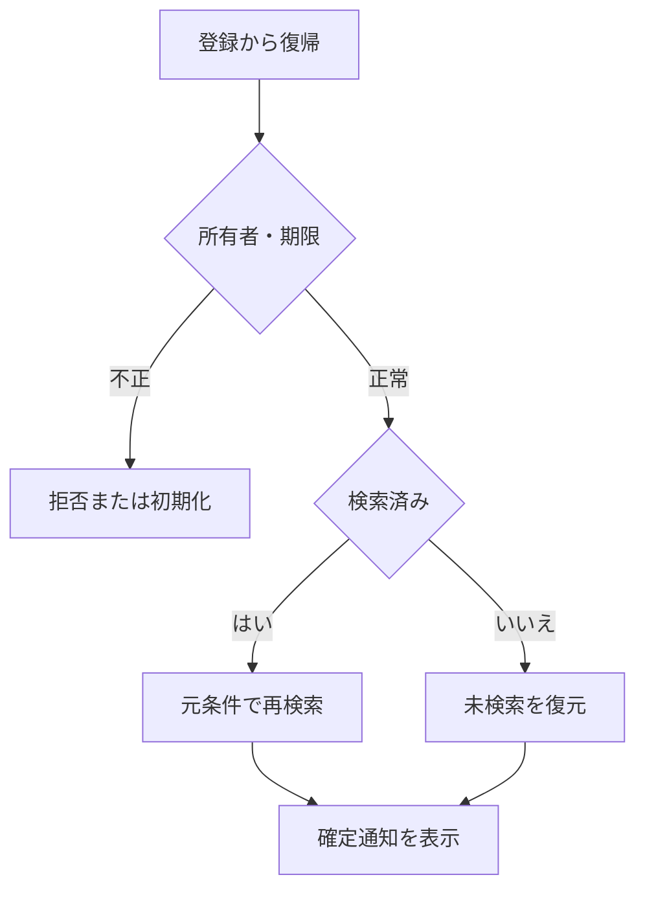

<!-- spec-meta: {"schema":"spec-md/1.0","documentId":"COBOL-DET-COBOL-SCR-STU-001","version":"8.6","path":"sample-project1/spec/COBOL/詳細仕様書/01_学生検索画面.md","sheets":[{"heading":"概要","kind":"GRID","sheet":"01_概要"},{"heading":"項目一覧","kind":"LIST","sheet":"02_項目一覧","key":["項目ID"]},{"heading":"選択候補一覧","kind":"LIST","sheet":"03_選択候補一覧","key":["候補ID"]},{"heading":"内部項目一覧","kind":"LIST","sheet":"04_内部項目一覧","key":["内部項目ID"]},{"heading":"イベント仕様","kind":"GRID","sheet":"05_イベント仕様"},{"heading":"項目移送仕様","kind":"LIST","sheet":"06_項目移送仕様","key":["移送ID"]},{"heading":"補足説明","kind":"GRID","sheet":"07_補足説明"},{"heading":"Windows認証なしサンプル","kind":"GRID","sheet":"08_Windows認証なしサンプル"}],"isolationProfile":"COBOL"} -->
# 学生検索画面 詳細仕様書（COBOL）

| 項目 | 内容 |
| --- | --- |
| システム名 | 学生管理システム |
| 機能ID | SCR-STU-001 |
| 版数・改訂日 | 8.6／2026-10-25 |
| 対象読者 | 実務経験５年程度のプログラマー |
| 状態 | 実装前の設計仕様。実装・コンパイル・実機試験は未実施 |
| 開発方式 | COBOL |
| 対応基本設計 | [基本設計](../基本設計書/01_学生検索画面.md) |

## 概要

### 概要説明

検索条件と一覧を管理する。業務DBは参照のみ。

| 責務 | 物理構成 |
| --- | --- |
| 画面・提示制御 | STMAIN / STSRCH / STRENDER |
| 業務処理・共通呼出 | STRULES / STDBOP / STAUDIT |
| 共通実装仕様 | [方式別共通仕様・DB定義・開発規約](../共通/方式別/01_共通実装仕様.md) |
| 原則 | DB列・変数・型は本書・共通仕様・DB定義・開発規約。業務要件を言語都合で弱めない |

### 画面設計

#### 画面レイアウト（描画可能な埋め込みHTML）

画面の配置は下記の埋め込みHTMLを正本とし、基本設計にも同じ断片を掲載する。値は架空の設計例であり、製品実機の画面ではない。PNGや別配置の簡略図、単独HTMLプレビューは併置しない。等幅文字と空白を保持するHTML表示で確認し、ビューアーが要素を除去した表示を正規の配置とみなさない。描画確認用の抽出HTML・画像は方式内.tmp/だけで扱い、今回の検査記録と入出力manifestは方式内build/spec-generation/の固定先へ更新する。

<!-- screen-html-start: SRC -->

<section class="cobol-text-panel spec-screen" data-family="TEXT" data-screen="SRC" data-state="normal" data-rows="27" data-cols="132" aria-label="COBOL文字端末 SRC normal"><pre>学生管理 / 学生検索    COBOL Text系    管理者                                                                                       情報: 検索完了。条件変更はF5検索まで未反映。                                                                                                                                                                                                                            学籍番号:                         氏名:    見本                                                                                     クラスID:                          すべて（F4で年度/学年/コード/名称を確認）                                                        在籍区分:    01[X]在学 02[X]休学 03[ ]卒業 04[ ]退学                                                                                取得件数:    20    20/50/100  並び:   1  1番号 2氏名 3入学日 4更新日時  方向:        A  A昇順/D降順                                                                                                                                                                     検索結果:2件  取得頁:1/1  表示窓:1/1                            検索日時:2026/10/25 10:00:00                                        選択 学籍番号        氏名              生年月日               年度/学年                                                             _   S2026-0001       見本 太郎         平成20年05月15日        2026 学年なし                                                            カナ: ミホン タロウ                         クラス:  C-A Aクラス                                       在学                     _   S2026-0002       見本 花子         平成20年07月20日        2026 学年なし                                                            カナ: ミホン ハナコ                         クラス:  C-A Aクラス                                       休学                                                                                                                                                                                                                                                                                                                                                                                                                                                                                                                                                                     結果は4件x2行の表示窓。長い名称・和暦はF8全文。選択行は学生IDで識別。                                                               行選択:  01   Enter:編集/参照（権限に従う）                                                                                                                                                                                                                             F5=検索        F6=クリア         F2=新規登録           F3=メニュー                                                                  PgUp/PgDn=表示窓の前/次  F7/F10=取得頁の前/次  Ctrl+Home/End=取得先頭/最後                                                          在籍欄のX/空欄を切替。全解除=全区分。クラス未設定=すべて。Spaceは在籍欄だけ切替。                                                                                                                                                                                       Tab/Shift+Tab:項目移動  F4:候補  F8:全文  F1:項目説明  Enter:検査・操作要求                                                         27行x132桁 / 全角2桁・半角1桁 / 架空データの仕様モック / 実機未検証                                                                 </pre></section>
<section hidden class="cobol-text-panel spec-screen" data-family="TEXT" data-screen="SRC" data-state="candidate" data-rows="27" data-cols="132" aria-label="COBOL文字端末 SRC candidate"><pre>学生管理 / クラス候補    COBOL Text系    管理者                                                                                     情報: 選択番号で決定。ID/年度/学年/コード/名称を照合。検索は停止・期間外も表示。                                                                                                                                                                                        候補件数:2  表示:1-2  選択番号:           01                                                                                                                                                                                                                            番号 ID                  年度 学年          コード    状態 / 名称                                                                   01   1                   2026 学年なし      C-A       有効 / Aクラス                                                                                                                                                                                                    02   2                   2025 学年なし      C-A       停止 / Aクラス                                                                                                                                                                                                                                                                                                                                                                                                                                                                                                                                                                                                                                                                                                                                                                                                                                                                                                                                                                                                                                                                                                                                                                                                                                                                                                                                                                                                                                                                                                                                                                                                                                                                                                                F4候補は6件x2行。長い値は選択行F8全文。F12で選択前の値へ戻る。                                                                                                                                                                                                          F12=取消（既定）  Enter=選択内容の検査  PgUp/PgDn=表示窓移動                                                                                                                                                                                                            Tab/Shift+Tab:項目移動  F4:候補  F8:全文  F1:項目説明  Enter:検査・操作要求                                                         27行x132桁 / 全角2桁・半角1桁 / 架空データの仕様モック / 実機未検証                                                                 </pre></section>
<!-- screen-html-end: SRC -->

#### 表示状態・モード別制御

[共通UI状態](../共通/04_共通UI部品設計.md)に従う。初回は未検索。処理中は二重検索を抑止し、0件・上限超過・検索失敗を区別する。参照権限では新規登録を表示せず行操作を参照とする。検索画面では生年月日を編集しない。

#### 小規模運用の検索と配置

学生を特定する入口を学籍番号・氏名・クラス・在籍区分の4条件へ限定する。学籍番号はN-06後の前方一致、氏名はN-03後のname_key部分一致、クラスはID完全一致、在籍区分の複数値だけOR、異なる条件はANDとする。未指定条件は追加しない。非削除は常時必須で利用者が解除できない。初回とクリアは在学・休学、20件、学籍番号昇順、未検索。全区分解除は全区分とし、空条件でも明示的な検索操作後に取得する。

氏名カナ・年度・学年・未所属のみ・都道府県・電話番号・入学日開始終了（SRC-003/004/005/007/009/010/011/012）は廃止しIDを予約する。未知の条件名と廃止したキーは空文字・null・falseでも拒否し、無視して検索しない。登録・編集の同名項目、保存値、コード・クラス制約は維持する。

クラス候補は全年度・停止・期間外を含み、年度／学年名称／コード／名称で識別する。独立した年度・学年・未所属条件、検索中の候補連動を設けない。EV-SRC-003は条件変更未反映の表示だけでDBを呼ばない。

一覧は学籍番号、氏名、カナ、生年月日、年度と学年、クラス、在籍区分、操作の8論理項目を固定行桁で表示する。SRC-027住所・028電話・029更新日時は検索応答から除外し、必要時は既存の編集／参照で確認する。氏名等は表示窓で参照し、F8全文で元値を確認できる。20/50/100件、許可4ソートと昇降順、学生IDの同順位順序、10,000件上限を維持する。

#### Text系の固定桁配置と操作

本方式はText系とし、通常検索は27行×132桁の固定パネルにする。行・桁は左上(1,1)、半角1桁・全角2桁を設計上の表示単位とする。このサイズは今回の設計値であり、COBOL処理系や端末製品の標準値を断定しない。等幅16px/行高20pxのHTMLは仕様モックの表示媒体だけで、製品のWebフォームではない。各行末まで132桁を確保し、自動折返し・カード・プルダウン・ボタンを置かない。

| 項目ID・領域 | 行,桁 | 表示幅（半角桁） | 属性・操作 |
| --- | --- | --- | --- |
| SRC-001 学籍番号 | 4,14 | 15 | U、前方一致。raw上限15スカラーは維持、全角原入力はF8でも扱う |
| SRC-002 氏名 | 4,44 | 16 | U、原入力8スカラー・正規化後160は維持 |
| SRC-006 クラス | 5,14 | 19 | U、ID原入力またはF4候補。説明は同じ行36桁から |
| SRC-008 在籍 | 6,14 | 60 | U、4区分のX/空欄。各値と件数は既存型、空欄全部は全区分 |
| SRC-019/032/033 取得件数・ソート・方向 | 7,14 / 7,39 / 7,86 | 3 / 1 / 1 | U、20/50/100、1～4、A/Dを検査後に既存値へ対応付ける |
| SRC-017/018 件数・検索日時 | 9,1 / 9,65 | 60 / 40 | P、取得頁と表示窓を区別 |
| SRC-020～026 一覧 | 11～18,5～132 | 4件、1件2行 | P。番号15、氏名16、カナ36、和暦22、年度学年30、クラス48、在籍24の表示窓 |
| SRC-030 編集/参照 | 20,10 | 2 | U、表示窓内行01～04。サーバー保持の学生IDへ変換し再取得 |
| SRC-013/014/015/016 | 22行 | 操作文字 | F5検索/F6クリア/F2新規/F3メニュー。権限による操作可否は既存どおり |
| SRC-031 ページ操作 | 23行 | 操作文字 | PgUp/PgDnは表示窓、F7/F10は取得頁前後、Ctrl+Home/Endは取得先頭/最後 |

P=保護表示、U=入力、R=見出し反転、E=警告・エラー。色だけに依存せず文字で意味を示す。検索条件は4条件を維持し、氏名等を画面幅の都合で削らない。取得1頁20/50/100件と物理表示窓4件を分離する。窓内移動は取得済み同じ応答の行を表示するだけでDB呼出しなし。取得頁の移動だけEV-SRC-004を実行し、最後の確定条件を使う。新検索/並び/件数変更で取得頁・表示窓とも先頭へ戻す。検索から復帰は取得頁・窓開始位置・選択学生IDを所有者付き状態へ保持し、学生削除等で窓が空なら最後の有効窓へ補正する。

短縮表示は元値を切捨てず表示窓にのみ適用する。表示幅に収まらない和暦・クラス・学年・名称はF8の保護全文パネルで確認でき、元値の保存・検索応答は変えない。4件の各行は11/12,13/14,15/16,17/18を使用する。F4候補は6件×2行、PgUp/PgDnで候補集合を移動し、年度・学年・コード・名称・停止を照合、F8で長い候補を全文確認する。検索クラスは全年度・停止・期間外を保持する。

Enterは入力検査と選択行の編集/参照要求。検索の実行はF5。Tab/Shift+Tabは有効なU項目を画面順に移動し、F1は当該項目の説明、F12は補助パネルを閉じ元入力と起点へ戻る。在籍欄以外のSpaceは文字入力。初回/0件/上限超過/処理中/条件未反映/障害は2行目へ文字表示し、エラーが複数または長い場合は別のエラー一覧パネルへ切替、選択番号で不正項目へ戻す。背景の操作は受け付けず、原入力・確定条件は別管理する。ソート表示1/2/3/4はstudentNo/name/admissionDate/updatedAt、A/Dはasc/descへ固定対応させる。画面形式版はcobol-text-1、検索条件形式版はsearch-compact-1を分け、旧GUI座標・窓を黙示継承しない。

端末入力・表示はWindows標準Console／Win32 W APIのアダプター契約。UTF-8の既存raw/実長/NULL標識、正規化・業務スカラー長検査を維持する。表示できないUnicodeを代替文字へ保存しない。結合文字・補助文字は表示セル幅を独断で1/2桁へ固定せず、F8のコードポイント編集（U+XXXX列と原値プレビュー）で完全往復し、利用できる端末/IME/鍵盤割当はQA-TEXT-COBOLで実機確認する。通常パネルが27×132を確保できない場合は起動時に適合不可を通知し、文字縮小や項目欠落で起動しない。

### ファイル・DB入出力関係

#### 入出力一覧

方向は当該機能から見たもの。画面入力、DB読取り、DB書込みを区別する。

| IO-ID | 分類 | 対象 | 入出力 | 主な項目 | 保存単位・備考 |
| --- | --- | --- | --- | --- | --- |
| 01 | 画面 | 入力条件・操作 | 入力 | 当該機能の項目一覧 | 要求開始時の値を複製 |
| 02 | 永続DB | m_student | 入力（参照） | 学生基本情報・版 | 更新なし |
| 03 | 永続DB | m_class | 入力（参照） | 年度・学年・名称・期間・定員 | 学生機能からマスタを更新しない |
| 04 | 永続DB | m_code_category / m_code | 入力（参照） | 分類・値・名称・有効性 | 学生機能からマスタを更新しない |
| 05 | 一時情報 | 期限付きT-RUNTIME-STATE | 入出力 | 確定検索条件・ページ・原入力・確認対象 | 業務表と別。所有者・期限を検査 |
| 06 | 外部ファイル | なし | なし | CSV・帳票・取込は本機能の対象外 | 仕様書MDを業務IOに数えない |
| 07 | 画面 | 一覧・メッセージ | 出力 | 個人情報は必要項目のみ | DB保存とは別の出力 |

#### データ操作関連図

認証情報・業務日時は共通01～03から取得。マスタ保守の承認入力ファイルは画面機能のIOに含めず、方式別共通仕様に定義する。

### 実装契約の配置

共用クラス／プログラム構造は[方式別共通仕様](../共通/方式別/01_共通実装仕様.md)、SQLの永続項目・制約は[DB定義](../DB定義/SQLServer/01_DB定義書.md)、命名・配備は[開発規約](../規約/COBOL.md)へ分離する。本機能の具体的な画面・変数・DB割当・イベント順序は本書を正とし、共通契約を引数と結果で具体化する。

## 項目一覧

| 項目ID | グループ | 論理項目名 | 種類 | 入出力 | 入力最大長 | 保存・正規化最大長 | 長さ単位 | 必須区分 | 必須条件 | 初期値 | 未設定値 | 表示形式・許容範囲 | 関連論理DB項目 | 物理コントロール | 変数・プロパティ | 言語型 | 物理DB項目 | 候補ID | 正規化ID | チェックID | 関連イベント | DB連携説明 | Raw入力表現 | 対応DB型 | 対応DB_NULL可否 |
| --- | --- | --- | --- | --- | --- | --- | --- | --- | --- | --- | --- | --- | --- | --- | --- | --- | --- | --- | --- | --- | --- | --- | --- | --- | --- |
| SRC-001 | 検索条件 | 学籍番号 | 文字入力 | I（検索条件） | 15 | 15 | Unicodeスカラー値 | 任意 | 未指定は条件なし。CHK-003は番号形式だけ、重複・変更不可は非適用 | 空 | NULL相当 | 15文字以内 | 学生基本情報・学籍番号 | Q-STUDENT-NO | Q-STUDENT-NO | PIC X(60)＋実バイト長 | m_student.student_no | － | N-06 | CHK-002,CHK-003 | EV-SRC-002 | 前方一致、N-06。保存なし | 画面文字列（空・不正を保持）／UTF-8 PIC Xバッファ＋実長 | m_student.student_no:varchar(15) | m_student.student_no:不可 |
| SRC-002 | 検索条件 | 氏名 | 文字入力 | I（検索条件） | 8 | 160 | Unicodeスカラー値 | 任意 | 表示氏名ではなく照合キーに部分一致 | 空 | NULL相当 | 原入力8文字以内、正規化後160文字以内 | 学生基本情報・氏名照合用情報 | Q-NAME | Q-NAME | PIC X(32)＋実バイト長 | m_student.name_key | － | N-03 | CHK-002 | EV-SRC-002 | N-03後の部分一致。氏名の原表記と区別 | 画面文字列（空・不正を保持）／UTF-8 PIC Xバッファ＋実長 | m_student.name_key:nvarchar(320) | m_student.name_key:不可 |
| SRC-006 | 検索条件 | クラス | 選択 | I（検索条件） | 19 | 64bit正整数 | 数字またはASCII文字 | 任意 | 実在するクラスID。全年度、停止・期間外も可 | すべて | NULL相当 | 正の整数。型範囲は方式別DB定義 | 学生基本情報・現在・最終所属クラス | Q-CLASS-ID | Q-CLASS-ID | PIC S9(18) COMP-5＋NULL標識 | m_student.class_id | クラス | 非適用 | CHK-010 | EV-SRC-002 | クラスID完全一致。年度・学年の独立入力なし | 画面文字列（空・不正を保持）／UTF-8 PIC Xバッファ＋実長 | m_student.class_id:bigint | m_student.class_id:可 |
| SRC-008 | 検索条件 | 在籍区分 | 複数選択 | I（検索条件） | 2×最大4件 | 2×最大4件 | 数字またはASCII文字 | 任意 | 空配列は全区分。重複値・未定義値は拒否 | 01,02 | 空配列 | 在学・休学・卒業・退学 | 学生基本情報・在籍区分 | Q-STATUS OCCURS 4 | Q-STATUS OCCURS 4 | PIC X(2) OCCURS 4＋件数 | m_student.enrollment_status_code | 在籍区分 | N-07 | CHK-010,CHK-024 | EV-SRC-002 | 複数値はいずれか一致、全解除は全区分 | 選択値の配列／チェック状態／UTF-8 PIC Xバッファ＋実長 | m_student.enrollment_status_code:varchar(2) | m_student.enrollment_status_code:不可 |
| SRC-013 | 操作 | 検索 | 操作 | 操作 | 非適用 | 非適用 | 非適用 | 非適用 | 表示または操作項目 | 条件を検査して1ページ目を表示 | 非適用 | ― | DB保存なし | SEARCH | SEARCH | イベント／引数はイベント仕様 | － | － | 非適用 | 非適用 | EV-SRC-002 | 入力検査後、最初のページを取得 | 入力対象外 | 非適用（操作・計算または一覧DTO） | 非適用 |
| SRC-014 | 操作 | クリア | 操作 | 操作 | 非適用 | 非適用 | 非適用 | 非適用 | 表示または操作項目 | 初期条件・未検索へ戻す | 非適用 | ― | DB保存なし | CLEAR | CLEAR | イベント／引数はイベント仕様 | － | － | 非適用 | 非適用 | EV-SRC-005 | 初期条件・未検索へ、保持条件を消去 | 入力対象外 | 非適用（操作・計算または一覧DTO） | 非適用 |
| SRC-015 | 操作 | 新規登録 | 操作 | 操作 | 非適用 | 非適用 | 非適用 | 非適用 | 表示または操作項目 | 担当者・管理者だけ表示 | 非適用 | ― | DB保存なし | NEW | NEW | イベント／引数はイベント仕様 | － | － | 非適用 | 非適用 | EV-SRC-005 | 権限を確認し学生登録へ遷移 | 入力対象外 | 非適用（操作・計算または一覧DTO） | 非適用 |
| SRC-016 | 操作 | メニューへ | 操作 | 操作 | 非適用 | 非適用 | 非適用 | 非適用 | 表示または操作項目 | 共通メニューへ戻る | 非適用 | ― | DB保存なし | MENU | MENU | イベント／引数はイベント仕様 | － | － | 非適用 | 非適用 | EV-SRC-005 | 共通メニューへ | 入力対象外 | 非適用（操作・計算または一覧DTO） | 非適用 |
| SRC-017 | 結果・一覧 | 検索件数・表示範囲 | 表示 | O（表示） | 非適用 | 表示元の上限：件数0～10000・範囲0～10000 | 非適用 | 自動表示 | 入力対象外。取得結果または計算値を表示 | 未検索 | 表示欠損は－、マスタ欠落は不整合表示 | 件数0～10000・範囲0～10000 | 計算：全条件一致の学生件数 | WS-TOTAL / WS-FROM / WS-TO | WS-TOTAL / WS-FROM / WS-TO | 表示DTO／複合項目は内部項目一覧 | count of matching student_id | － | 非適用 | 非適用 | EV-SRC-002 | 未検索／0件／上限超過を区別 | 入力対象外 | 非適用（操作・計算または一覧DTO） | 非適用 |
| SRC-018 | 結果・一覧 | 検索日時 | 表示 | O（表示） | 非適用 | 表示元の上限：西暦日時19文字 | 非適用 | 自動表示 | 入力対象外。取得結果または計算値を表示 | 未検索 | 表示欠損は－、マスタ欠落は不整合表示 | 西暦日時19文字 | 計算：今回の検索実行日時 | WS-SEARCHED-AT | WS-SEARCHED-AT | 表示DTO／複合項目は内部項目一覧 | RequestContext.ExecutedAt | － | 非適用 | 非適用 | EV-SRC-002 | 西暦日時、日本時間。DB保存なし | 入力対象外 | 非適用（操作・計算または一覧DTO） | 非適用 |
| SRC-019 | 結果・一覧 | 表示件数 | 選択 | I（表示指定） | 3 | 保存なし | 数字またはASCII文字 | 必須 | 20・50・100のみ | 20 | 不可 | 表示規則による | DB保存なし：取得範囲 | Q-PAGE-SIZE | Q-PAGE-SIZE | PIC S9(9) COMP-5＋NULL標識 | pageSize | 表示件数 | 非適用 | CHK-024 | EV-SRC-004 | 20／50／100、既定20 | 画面文字列（空・不正を保持）／UTF-8 PIC Xバッファ＋実長 | 非適用（操作・計算または一覧DTO） | 非適用 |
| SRC-020 | 結果・一覧 | 学籍番号 | 表示 | O（表示） | 非適用 | 表示元の上限：15 | 非適用 | 自動表示 | 入力対象外。取得結果または計算値を表示 | 未検索 | 表示欠損は－、マスタ欠落は不整合表示 | 15 | 学生基本情報・学籍番号 | ST-STUDENT-NO OF ST-RESULT | ST-STUDENT-NO OF ST-RESULT | 表示DTO／複合項目は内部項目一覧 | m_student.student_no | － | 非適用 | 非適用 | EV-SRC-002,EV-SRC-004,EV-SRC-006 | 保存済み文字列、文字順 | 入力対象外 | m_student.student_no:varchar(15) | m_student.student_no:不可 |
| SRC-021 | 結果・一覧 | 氏名 | 表示 | O（表示） | 非適用 | 表示元の上限：8 | 非適用 | 自動表示 | 入力対象外。取得結果または計算値を表示 | 未検索 | 表示欠損は－、マスタ欠落は不整合表示 | 8 | 学生基本情報・学生氏名 | ST-STUDENT-NAME OF ST-RESULT | ST-STUDENT-NAME OF ST-RESULT | 表示DTO／複合項目は内部項目一覧 | m_student.student_name | － | 非適用 | 非適用 | EV-SRC-002,EV-SRC-004,EV-SRC-006 | 氏名を第1行、SRC-022のカナを第2行で表示し、F8全文へ到達 | 入力対象外 | m_student.student_name:nvarchar(16) | m_student.student_name:不可 |
| SRC-022 | 結果・一覧 | 氏名カナ | 表示 | O（表示） | 非適用 | 表示元の上限：18 | 非適用 | 自動表示 | 入力対象外。取得結果または計算値を表示 | 未検索 | 表示欠損は－、マスタ欠落は不整合表示 | 18 | 学生基本情報・学生氏名カナ | ST-STUDENT-NAME-KANA OF ST-RESULT | ST-STUDENT-NAME-KANA OF ST-RESULT | 表示DTO／複合項目は内部項目一覧 | m_student.student_name_kana | － | 非適用 | 非適用 | EV-SRC-002,EV-SRC-004,EV-SRC-006 | SRC-021の次行に表示。長い原値はF8保護全文 | 入力対象外 | m_student.student_name_kana:nvarchar(36) | m_student.student_name_kana:不可 |
| SRC-023 | 結果・一覧 | 生年月日 | 表示 | O（表示） | 非適用 | 表示元の上限：共通和暦書式 | 非適用 | 自動表示 | 入力対象外。取得結果または計算値を表示 | 未検索 | 表示欠損は－、マスタ欠落は不整合表示 | 共通和暦書式 | 学生基本情報・生年月日 | ST-BIRTH-DATE-WAREKI OF ST-RESULT | ST-BIRTH-DATE-WAREKI OF ST-RESULT | 表示DTO／複合項目は内部項目一覧 | m_student.birth_date | － | 非適用 | 非適用 | EV-SRC-002,EV-SRC-004,EV-SRC-006 | 和暦表示。共通16で日付から変換 | 入力対象外 | m_student.birth_date:date | m_student.birth_date:不可 |
| SRC-024 | 結果・一覧 | 年度・学年 | 表示 | O（表示） | 非適用 | 表示元の上限：年度4桁＋学年名称12 | 非適用 | 自動表示 | 入力対象外。取得結果または計算値を表示 | 未検索 | 表示欠損は－、マスタ欠落は不整合表示 | 年度4桁＋学年名称12 | クラスマスタ・学校年度／学年→コード管理マスタ（学年）・コード名称 | ST-SCHOOL-YEAR / ST-GRADE-NAME OF ST-RESULT | ST-SCHOOL-YEAR / ST-GRADE-NAME OF ST-RESULT | 表示DTO／複合項目は内部項目一覧 | m_class.school_year / grade_code → m_code.code_name | － | 非適用 | 非適用 | EV-SRC-002,EV-SRC-004,EV-SRC-006 | 年度は西暦、学年は名称。未所属は－ | 入力対象外 | m_class.school_year:smallint／m_code.code_name:nvarchar(24) | m_class.school_year:不可；m_code.code_name:不可 |
| SRC-025 | 結果・一覧 | クラス | 表示 | O（表示） | 非適用 | 表示元の上限：コード9＋名称18＋注記 | 非適用 | 自動表示 | 入力対象外。取得結果または計算値を表示 | 未検索 | 表示欠損は－、マスタ欠落は不整合表示 | コード9＋名称18＋注記 | 学生基本情報・現在・最終所属クラス→クラスマスタ・クラスコード／クラス名 | ST-CLASS-CODE / ST-CLASS-NAME OF ST-RESULT | ST-CLASS-CODE / ST-CLASS-NAME OF ST-RESULT | 表示DTO／複合項目は内部項目一覧 | m_student.class_id → m_class.class_code / class_name | － | 非適用 | 非適用 | EV-SRC-002,EV-SRC-004,EV-SRC-006 | 未所属／停止／期間外を区別 | 入力対象外 | m_class.class_code:varchar(9)／m_class.class_name:nvarchar(36) | m_class.class_code:不可；m_class.class_name:不可 |
| SRC-026 | 結果・一覧 | 在籍区分 | 表示 | O（表示） | 非適用 | 表示元の上限：名称12 | 非適用 | 自動表示 | 入力対象外。取得結果または計算値を表示 | 未検索 | 表示欠損は－、マスタ欠落は不整合表示 | 名称12 | 学生基本情報・在籍区分→コード管理マスタ（在籍区分）・コード名称 | ST-ENROLLMENT-NAME OF ST-RESULT | ST-ENROLLMENT-NAME OF ST-RESULT | 表示DTO／複合項目は内部項目一覧 | m_student.enrollment_status_code → m_code.code_name | － | 非適用 | 非適用 | EV-SRC-002,EV-SRC-004,EV-SRC-006 | 種別と値で結合、名称未取得でも学生行を落とさない | 入力対象外 | m_code.code_name:nvarchar(24) | m_code.code_name:不可 |
| SRC-030 | 結果・一覧 | 編集／参照 | 操作 | 操作 | 非適用 | 非適用 | 非適用 | 非適用 | 表示または操作項目 | 未検索 | 非適用 | 表示規則による | 学生基本情報・学生管理番号 | OPEN | OPEN | イベント／引数はイベント仕様 | m_student.student_id | － | 非適用 | 非適用 | EV-SRC-005 | 行番号ではなく対象IDで遷移、遷移先で再取得 | 入力対象外 | 非適用（操作・計算または一覧DTO） | 非適用 |
| SRC-031 | 結果・一覧 | ページ操作 | 操作 | 操作 | 非適用 | 非適用 | 非適用 | 非適用 | 表示または操作項目 | 未検索 | 非適用 | 表示規則による | DB保存なし：取得範囲 | FIRST / PREV / NEXT / LAST | FIRST / PREV / NEXT / LAST | イベント／引数はイベント仕様 | page / pageSize | － | 非適用 | 非適用 | EV-SRC-004 | 先頭・前・次・最後。有効範囲へ再補正 | 入力対象外 | 非適用（操作・計算または一覧DTO） | 非適用 |
| SRC-032 | 結果操作 | 並び順項目 | 選択 | I（表示指定） | 13 | 保存なし | Unicodeスカラー値 | 必須 | studentNo・name・admissionDate・updatedAtのみ | studentNo | 不可 | 固定候補 | 検索：学籍番号／氏名照合用情報／入学日／更新日時 | Q-SORT-KEY | Q-SORT-KEY | PIC X(40)＋実バイト長 | sortKey | 並び順 | 非適用 | CHK-024 | EV-SRC-004 | 許可4項目。最後に学生ID昇順を加える | 画面文字列（空・不正を保持）／UTF-8 PIC Xバッファ＋実長 | 非適用（操作・計算または一覧DTO） | 非適用 |
| SRC-033 | 結果操作 | 並び順方向 | 選択 | I（表示指定） | 4 | 保存なし | Unicodeスカラー値 | 必須 | asc・descのみ | asc | 不可 | 固定候補 | DB保存なし：取得順 | Q-SORT-DIRECTION | Q-SORT-DIRECTION | PIC X(40)＋実バイト長 | sortDirection | 昇降順 | 非適用 | CHK-024 | EV-SRC-004 | 昇順／降順。初期は昇順 | 画面文字列（空・不正を保持）／UTF-8 PIC Xバッファ＋実長 | 非適用（操作・計算または一覧DTO） | 非適用 |

## 選択候補一覧

| 候補ID | 参照元・分類 | 選択値 | 表示値 | 抽出条件 | 表示順 | 初期値・連動 |
| --- | --- | --- | --- | --- | --- | --- |
| クラス | クラスマスタ・コード管理マスタ（学年） | class_id | 年度・学年・クラスコード・クラス名 | 全年度・停止・期間外を含む。検索では人数集計なし | 年度降順→学年表示順→クラス表示順→コード→ID | すべて。独立した上位条件・候補連動なし |
| 在籍区分 | コード管理マスタ（在籍区分） | ENROLLMENT_STATUS / code_value | コード名称 | 分類ENROLLMENT_STATUSの01～04。停止を含む | 表示順→コード値 | 01・02、全解除は全区分 |
| 表示件数 | 共通UI固定定義 | 20 / 50 / 100 | 20件／50件／100件 | 固定3候補。業務コードではない | 20→50→100 | 20、変更で1ページへ |
| 並び順 | 共通UI固定定義 | studentNo / name / admissionDate / updatedAt | 学籍番号／氏名／入学日／更新日時 | 固定4候補。自由文字でDB列を指定しない | 左記順 | 学籍番号 |
| 昇降順 | 共通UI固定定義 | asc / desc | 昇順／降順 | 固定2候補 | 昇順→降順 | 昇順 |

## 内部項目一覧

| 内部項目ID | 親項目ID | 論理名 | 変数・コントロール | 型 | 最大長・範囲 | 必須条件 | 未設定 | 設定元 | 用途・制約 |
| --- | --- | --- | --- | --- | --- | --- | --- | --- | --- |
| SRC-INT-001 | SRC-017 | 件数 | WS-TOTAL-COUNT | 非負整数 | 5 | 検索成功時 | 未検索／上限超過は未設定 | OP-COUNT / page | 0件の範囲は0～0。表示件数と混同しない |
| SRC-INT-002 | SRC-017 | 開始位置 | WS-RANGE-FROM | 非負整数 | 5 | 検索成功時 | 未検索／上限超過は未設定 | OP-COUNT / page | 0件の範囲は0～0。表示件数と混同しない |
| SRC-INT-003 | SRC-017 | 終了位置 | WS-RANGE-TO | 非負整数 | 5 | 検索成功時 | 未検索／上限超過は未設定 | OP-COUNT / page | 0件の範囲は0～0。表示件数と混同しない |
| SRC-INT-004 | SRC-024 | 年度 | ST-SCHOOL-YEAR OF ST-RESULT | 任意整数 | 4 | 表示 | 未所属は－ | m_class.school_year | 1900～9998、西暦 |
| SRC-INT-005 | SRC-024 | 学年名称 | ST-GRADE-NAME OF ST-RESULT | PIC X＋実長 | 12 | 表示 | 未所属は－ | m_code GRADE.code_name | 保存値でなく名称 |
| SRC-INT-006 | SRC-025 | クラスコード | ST-CLASS-CODE OF ST-RESULT | PIC X＋実長 | 9 | 表示 | 未所属表示 | m_class | 名称欠落で学生行を消さない |
| SRC-INT-007 | SRC-025 | クラス名称 | ST-CLASS-NAME OF ST-RESULT | PIC X＋実長 | 18 | 表示 | 未所属表示 | m_class | 名称欠落で学生行を消さない |
| SRC-INT-008 | SRC-023 | 内部生年月日 | ST-BIRTH-DATE OF ST-RESULT | PIC X(10)＋NULL標識 | 日付／ISO10 | 取得時必須 | 欠損はデータ不整合 | m_student.birth_date | 共通16で和暦へ変換。時差を適用しない |
| SRC-INT-009 | SRC-030 | 対象学生ID | WS-STUDENT-ID | PIC S9(18) COMP-5（正64bit） | 19 | 更新削除・既存読込時 | 新規はNULL | DB採番値／行モデル／ルート | 行番号ではない。権限・存在を再確認 |
| SRC-INT-010 | SRC-031 | 検索状態キー | WS-CONTEXT-ID | PIC X＋実長 | 64 | 復帰または一覧操作時 | 初回だけ未指定 | 共通12の256bit乱数を64桁hexへ符号化した不透明キー | 利用者・セッション・画面ごと、30分 |
| SRC-INT-011 | SRC-013 | 端末セッション検証情報 | WS-CSRF-TOKEN（互換名） | サンプルランタイムのopaque文字列 | Windowsサンプル実行環境の接続検証契約 | 全端末要求 | 不可 | 信頼する端末接続基盤 | 旧CSRF用内部IDを維持。ブラウザーCSRFではなく端末主体・要求の検証情報。再送・認可の代替ではない |
| SRC-INT-012 | SRC-013 | 処理中 | WS-IS-BUSY | 真偽 | 1 | 自動 | false | 処理開始終了 | UI再入防止のみ。DB排他は共通13 |
| SRC-INT-013 | SRC-013 | 応答世代 | WS-REQUEST-SEQUENCE | 非負整数 | 数値 | 非同期要求時 | 0初期 | 画面内要求連番 | 旧応答を無視。桁あふれ時は採番継続しない |

## イベント仕様

### EV-SRC-001 初期表示

#### 処理概要

固定sample-userがサンプルメニューから起動。学生一覧は取得しない。

#### 処理手順

1. 共通01・02で参照権限を確認し、共通03で業務日時を確定する。
2. OP-CODE・OP-CLASSで候補取得。在学・休学、20件、学籍番号昇順、未検索を設定する。必須マスタ不足なら検索を不可とする。
3. 共通12の画面別状態を作成する。復帰識別がある場合はEV-SRC-006へ進む。

##### 実装詳細

入口：`STMAIN→STSRCH 端末初期表示`。機能内の入力・結果型は項目一覧、共通実装は[方式別共通仕様](../共通/方式別/01_共通実装仕様.md)を使用する。 `Draft`相当の未実行値と`AppliedCriteria`相当の確定条件を分離。呼出引数を複製し、結果を返した要求が最新であることを確認して画面へ移送する。

#### 処理フロー

#### SQL・テーブル関連（ER図）

名称参照は未所属・停止値を残す外部結合相当。コードは用途ごとの別名で**分類と値**を結合する。図は読取りの関連であり、履歴への書込みや削除連動を意味しない。単独の存在確認・採番・書込みの表関連は下記操作IDで特定する。

#### DB操作の詳細

`OP-CODE` → `OP-CLASS`。下記「DB操作定義」の同名操作を実行する。

#### 結果・例外時の扱い

入力不備は項目エラーと原入力を保持。検索要求の失敗は一覧消去、0件はI-SRC-001、上限超過はW-SRC-001。権限不備・他者の保持情報は拒否する。条件変更だけでは既存一覧を再検索しない。 各イベントで実行していない処理の結果状態は発生対象外。

### EV-SRC-002 検索実行

#### 処理概要

入力した検索条件で、非削除学生を検索する。

#### 処理手順

1. 入力を複製し共通04・05で4条件の正規化、桁、選択値と許可キーを検査する。項目エラーは入力保持・一覧消去、DB検索なし。
2. OP-EXISTSで指定した在籍区分の分類付き存在とクラスIDの存在を検査する。検索では停止・期間外の既存値を許容する。
3. OP-COUNT・OP-PAGEへ同じ確定条件を渡す。10001件で上限、0件は該当なし、それ以外は最初のページを表示する。件数と一覧の読取りを揃える。
4. 正常時に実行済み条件を共通12へ保持。生年月日は共通16で和暦表示。他の日付・日時は西暦。

##### 実装詳細

入口：`action=SEARCH`。機能内の入力・結果型は項目一覧、共通実装は[方式別共通仕様](../共通/方式別/01_共通実装仕様.md)を使用する。 `Draft`相当の未実行値と`AppliedCriteria`相当の確定条件を分離。呼出引数を複製し、結果を返した要求が最新であることを確認して画面へ移送する。

#### 処理フロー

#### SQL・テーブル関連（ER図）

名称参照は未所属・停止値を残す外部結合相当。コードは用途ごとの別名で**分類と値**を結合する。図は読取りの関連であり、履歴への書込みや削除連動を意味しない。単独の存在確認・採番・書込みの表関連は下記操作IDで特定する。

#### DB操作の詳細

`OP-EXISTS` → `OP-COUNT` → `OP-PAGE`。下記「DB操作定義」の同名操作を実行する。

#### 結果・例外時の扱い

入力不備は項目エラーと原入力を保持。検索要求の失敗は一覧消去、0件はI-SRC-001、上限超過はW-SRC-001。権限不備・他者の保持情報は拒否する。条件変更だけでは既存一覧を再検索しない。 各イベントで実行していない処理の結果状態は発生対象外。

### EV-SRC-003 条件変更未反映

#### 処理概要

4条件の編集を未実行状態として表示する。自動検索・候補連動は行わない。

#### 処理手順

1. 編集値と最後の実行済み条件を分離し、「条件変更は未反映」を表示する。
2. クラスは全候補から選択する。年度・学年の独立入力、候補の再取得や選択の自動解除は行わない。
3. 検索操作でEV-SRC-002へ進む。ページ移動では最後に実行した条件を使用する。STRENDERの2行目へ条件未反映を表示し、端末入力確定時にもSTSTATEの実行済条件を維持する。

#### 処理フロー

#### SQL・テーブル関連（ER図）

業務DB参照なし。ER図は非適用。

#### DB操作の詳細

OP-CLASS・OP-COUNT・OP-PAGEは呼び出さない。保持された実行条件を更新しない。

#### 結果・例外時の扱い

検索成功までは一覧を実行済み条件に対応付ける。未検索状態では一覧を作らない。入力途中の値を確定条件と扱わない。

### EV-SRC-004 並び替え・ページ移動

#### 処理概要

実行済み条件の結果を別の順序・ページで取得する。

#### 処理手順

1. 共通12から保持条件を取得。未検索は不可、期限切れはW-SRC-002。入力途中の条件を混ぜない。
2. 並び順4項目・方向2種・件数20/50/100・正のページ番号を検査する。並び順・件数変更時は1ページへ戻す。
3. OP-COUNT・OP-PAGEを再実行。件数減少時は最終有効ページへ補正。0件は一覧なし・ページ操作不可。

##### 実装詳細

入口：`action=PAGE`。機能内の入力・結果型は項目一覧、共通実装は[方式別共通仕様](../共通/方式別/01_共通実装仕様.md)を使用する。 `Draft`相当の未実行値と`AppliedCriteria`相当の確定条件を分離。呼出引数を複製し、結果を返した要求が最新であることを確認して画面へ移送する。

#### 処理フロー

#### SQL・テーブル関連（ER図）

名称参照は未所属・停止値を残す外部結合相当。コードは用途ごとの別名で**分類と値**を結合する。図は読取りの関連であり、履歴への書込みや削除連動を意味しない。単独の存在確認・採番・書込みの表関連は下記操作IDで特定する。

#### DB操作の詳細

`OP-COUNT` → `OP-PAGE`。下記「DB操作定義」の同名操作を実行する。

#### 結果・例外時の扱い

入力不備は項目エラーと原入力を保持。検索要求の失敗は一覧消去、0件はI-SRC-001、上限超過はW-SRC-001。権限不備・他者の保持情報は拒否する。条件変更だけでは既存一覧を再検索しない。 各イベントで実行していない処理の結果状態は発生対象外。

### EV-SRC-005 新規・編集・参照・クリア

#### 処理概要

表示窓内の選択番号＋Enter、または画面に表示した対応機能キーを受け付ける。

#### 処理手順

1. 新規は作成権限を確認し学生登録へ。検索条件を登録値へ流用しない。
2. 編集・参照は選択行の学生管理番号で登録機能を起動する。行番号・表示名を識別子にしない。読込みは登録側の責務。
3. クリアは初期条件・未検索へ戻し共通12も初期化。メニューへ戻る処理はDB更新なし。

##### 実装詳細

入口：`NEW / EDIT / CLEAR / MENU`。機能内の入力・結果型は項目一覧、共通実装は[方式別共通仕様](../共通/方式別/01_共通実装仕様.md)を使用する。 `Draft`相当の未実行値と`AppliedCriteria`相当の確定条件を分離。呼出引数を複製し、結果を返した要求が最新であることを確認して画面へ移送する。

#### 処理フロー

#### SQL・テーブル関連（ER図）

DB参照なし。ER図は対象外。

#### DB操作の詳細

このイベントで業務DBを読み書きしない。遷移先の読込みと混同しない。

#### 結果・例外時の扱い

入力不備は項目エラーと原入力を保持。検索要求の失敗は一覧消去、0件はI-SRC-001、上限超過はW-SRC-001。権限不備・他者の保持情報は拒否する。条件変更だけでは既存一覧を再検索しない。 各イベントで実行していない処理の結果状態は発生対象外。

### EV-SRC-006 学生登録からの復帰

#### 処理概要

保存・削除・取消・戻るから検索状態を復元する。

#### 処理手順

1. 共通12で所有者・認証・画面・期限・形式版search-compact-1を確認。他者状態は拒否、期限切れは初期化する。
2. 未検索から起動していた場合は未検索へ。検索済みなら元条件でOP-COUNT・OP-PAGEを再実行し最新DBを表示する。
3. 確定済み成功通知だけを表示。保存した学生が条件外でも検索条件を変更しない。

##### 実装詳細

入口：`保持Context付き検索`。機能内の入力・結果型は項目一覧、共通実装は[方式別共通仕様](../共通/方式別/01_共通実装仕様.md)を使用する。 `Draft`相当の未実行値と`AppliedCriteria`相当の確定条件を分離。呼出引数を複製し、結果を返した要求が最新であることを確認して画面へ移送する。

#### 処理フロー

#### SQL・テーブル関連（ER図）

名称参照は未所属・停止値を残す外部結合相当。コードは用途ごとの別名で**分類と値**を結合する。図は読取りの関連であり、履歴への書込みや削除連動を意味しない。単独の存在確認・採番・書込みの表関連は下記操作IDで特定する。

#### DB操作の詳細

`OP-COUNT` → `OP-PAGE`。下記「DB操作定義」の同名操作を実行する。

#### 結果・例外時の扱い

入力不備は項目エラーと原入力を保持。検索要求の失敗は一覧消去、0件はI-SRC-001、上限超過はW-SRC-001。権限不備・他者の保持情報は拒否する。条件変更だけでは既存一覧を再検索しない。 各イベントで実行していない処理の結果状態は発生対象外。

### DB操作定義

操作の業務契約は[共通データアクセス](../共通/08_データアクセス仕様.md)が正本。本機能における具体的な対象・引数・確定単位は以下。

#### OP-CODE

| 項目 | 内容 |
| --- | --- |
| 対象テーブル | m_code_category / m_code |
| 操作 | 参照 |
| 実行条件・引数 | 分類、用途（検索／新規選択／既存表示）、既存値、業務日 |
| 取得・設定項目／対象条件 | 分類・値・名称・表示順・利用可否・期間。分類＋値で取得 |
| 件数・順序 | 候補0件を検出。既定値を先頭値へ代替しない |
| 確定・取消 | 参照のみ |

#### OP-CLASS

| 項目 | 内容 |
| --- | --- |
| 対象テーブル | m_class / m_code / m_student |
| 操作 | 参照 |
| 実行条件・引数 | 用途、年度、学年、在籍区分、在籍期間、既存所属、業務日、人数参照要否 |
| 取得・設定項目／対象条件 | 年度・学年・クラスID・コード・名称・期間・定員。人数集計は登録側で要求した場合のみ。検索の候補取得では学生を集計しない |
| 件数・順序 | 年度降順、学年表示順、クラス表示順、クラスコード、ID |
| 確定・取消 | 参照のみ、人数は予約ではない |

#### OP-EXISTS

| 項目 | 内容 |
| --- | --- |
| 対象テーブル | m_student / m_class / m_code_category / m_code |
| 操作 | 参照 |
| 実行条件・引数 | 用途（検索／保存）、分類付きコード・クラスID・選択補助。保存だけ対象ID・完全な学籍番号・期待版 |
| 取得・設定項目／対象条件 | 検索は指定在籍区分とクラスIDの存在のみ（停止・期間外可）。学籍番号前方一致に重複・完全一致存在検査をしない。保存は全行学籍番号一意、分類付き存在、変更有無、有効性を再検査 |
| 件数・順序 | 未存在／重複／組合せ／停止を区別。未指定の検索条件は検査対象外 |
| 確定・取消 | 検索は参照のみ、保存は保護した最新値で確認 |

#### OP-COUNT

| 項目 | 内容 |
| --- | --- |
| 対象テーブル | m_student s LEFT JOIN m_class c |
| 操作 | 参照 |
| 実行条件・引数 | 正規化後の実行済み検索条件 |
| 取得・設定項目／対象条件 | 非削除固定。学籍番号前方・氏名name_key部分・クラスID完全をAND、在籍区分だけOR。未指定は条件なし。最大10001件 |
| 件数・順序 | 10001件は上限、10000件以下は実件数。0件は該当なし |
| 確定・取消 | OP-PAGEと同じ読取り整合性 |

#### OP-PAGE

| 項目 | 内容 |
| --- | --- |
| 対象テーブル | m_student s / m_class c / m_code g, es |
| 操作 | 参照 |
| 実行条件・引数 | OP-COUNTと同じ条件、ページ、件数、許可並び順 |
| 取得・設定項目／対象条件 | 一覧8論理項目を固定行桁表示＋非表示学生ID。住所・電話・更新日時・メール・緊急連絡先・備考を返さない |
| 件数・順序 | 全一致集合をソート後ページ化。同順位学生ID昇順 |
| 確定・取消 | 参照のみ、旧結果を最新として残さない |

### ネイティブイベント・通信の対応

#### 要求・イベント

端末入口はSTMAINへランタイム発行セッション、画面ID、action、入力項目名/原文字列/実長、期待revision、要求IDを渡す。初期表示と既存参照はINIT/OPEN、操作はSEARCH/PAGE/CLEAR/OPTIONS/CREATE/UPDATE/DELETE/CONFIRM/RESET/RELOAD/BACK/CANCEL、遷移はNEW/MENU。キーは詳細の操作対応へ変換し、任意の端末文字列をCOBOL命令として実行しない。許可外action・同名単一項目重複・廃止条件をE-SRC-002で拒否する。確認種別とpendingActionはサーバー保持し、[登録詳細の状態遷移](02_学生登録画面.md)へ従う。

初回STSRCHは候補、在籍01/02、20件、未検索。SEARCHは共通検査→同一読取Txの最大10001件判定と一覧→文字パネル。0件と上限超過は一覧空。PAGEは保持した最後の確定4条件だけを使用。検索OPTIONSは全年度クラス、編集OPTIONSは既存所属連動。pageSize20/50/100と許可4ソートを維持し、取得応答を4件ずつの物理表示窓へ分ける。最大100取得行・候補最大20表示行と、全候補照合の集合を混同しない。

同一サンプル端末接続内での画面再作成時に検索・確認状態を復帰できるよう、所有者付きT-RUNTIME-STATEへ期限/形式版/期待revisionを保存する。login_session_idはサンプル端末接続ごとに分離し、別接続へ状態を引き継がない。切断・再認証・アイドル期限切れでは当該接続の状態を失効し、再接続は未検索/未確認から開始する。保存結果不明の扱いは維持し、確認トークンで盲目的再送しない。WORKING-STORAGEだけを状態正本にしない。旧CGIのHTTP入口・HTML再描画は今回のText仕様では採用せず、既存プログラムは未改修。Windows標準Console／Win32 W APIの実glyph/IME/キーの適合試験はQA-TEXT-COBOLに残す。QA-AUTHは本サンプルでは対象外。

## 項目移送仕様

| 移送ID | 項目ID | 関連イベント | 画面側 | 処理変数 | DB側・出力値 | 方向 | 変換ID | 未設定 | 移送条件・説明 | 異常時 |
| --- | --- | --- | --- | --- | --- | --- | --- | --- | --- | --- |
| MAP-SRC-001 | SRC-001 | EV-SRC-002 | Q-STUDENT-NO | Q-STUDENT-NO | m_student.student_no | I（検索条件） | N-06 | NULL相当 | 前方一致、N-06。保存なし | 入力不正は原入力保持・DB処理なし |
| MAP-SRC-002 | SRC-002 | EV-SRC-002 | Q-NAME | Q-NAME | m_student.name_key | I（検索条件） | N-03 | NULL相当 | N-03後の部分一致。氏名の原表記と区別 | 入力不正は原入力保持・DB処理なし |
| MAP-SRC-006 | SRC-006 | EV-SRC-002 | Q-CLASS-ID | Q-CLASS-ID | m_student.class_id | I（検索条件） | 非適用 | NULL相当 | クラスID完全一致。年度・学年の照合を要求しない | 入力不正は原入力保持・DB処理なし |
| MAP-SRC-008 | SRC-008 | EV-SRC-002 | Q-STATUS OCCURS 4 | Q-STATUS OCCURS 4 | m_student.enrollment_status_code | I（検索条件） | N-07 | 空配列 | 複数値はいずれか一致、全解除は全区分 | 入力不正は原入力保持・DB処理なし |
| MAP-SRC-017 | SRC-017 | EV-SRC-002 | WS-TOTAL / WS-FROM / WS-TO | WS-TOTAL / WS-FROM / WS-TO | count of matching student_id | O（表示） | 非適用 | 表示欠損は－、マスタ欠落は不整合表示 | 未検索／0件／上限超過を区別 | 取得不整合は明示・行を無言で落とさない |
| MAP-SRC-018 | SRC-018 | EV-SRC-002 | WS-SEARCHED-AT | WS-SEARCHED-AT | RequestContext.ExecutedAt | O（表示） | 非適用 | 表示欠損は－、マスタ欠落は不整合表示 | 西暦日時、日本時間。DB保存なし | 取得不整合は明示・行を無言で落とさない |
| MAP-SRC-019 | SRC-019 | EV-SRC-004 | Q-PAGE-SIZE | Q-PAGE-SIZE | pageSize | I（表示指定） | 非適用 | 不可 | 20／50／100、既定20 | 入力不正は原入力保持・DB処理なし |
| MAP-SRC-020 | SRC-020 | EV-SRC-002,EV-SRC-004,EV-SRC-006 | ST-STUDENT-NO OF ST-RESULT | ST-STUDENT-NO OF ST-RESULT | m_student.student_no | O（表示） | 非適用 | 表示欠損は－、マスタ欠落は不整合表示 | 保存済み文字列、文字順 | 取得不整合は明示・行を無言で落とさない |
| MAP-SRC-021 | SRC-021 | EV-SRC-002,EV-SRC-004,EV-SRC-006 | ST-STUDENT-NAME OF ST-RESULT | ST-STUDENT-NAME OF ST-RESULT | m_student.student_name | O（表示） | 非適用 | 表示欠損は－、マスタ欠落は不整合表示 | 登録表記のまま文字列表示 | 取得不整合は明示・行を無言で落とさない |
| MAP-SRC-022 | SRC-022 | EV-SRC-002,EV-SRC-004,EV-SRC-006 | ST-STUDENT-NAME-KANA OF ST-RESULT | ST-STUDENT-NAME-KANA OF ST-RESULT | m_student.student_name_kana | O（表示） | 非適用 | 表示欠損は－、マスタ欠落は不整合表示 | 保存済みカナ表記 | 取得不整合は明示・行を無言で落とさない |
| MAP-SRC-023 | SRC-023 | EV-SRC-002,EV-SRC-004,EV-SRC-006 | ST-BIRTH-DATE-WAREKI OF ST-RESULT | ST-BIRTH-DATE-WAREKI OF ST-RESULT | m_student.birth_date | O（表示） | 非適用 | 表示欠損は－、マスタ欠落は不整合表示 | 和暦表示。共通16で日付から変換 | 取得不整合は明示・行を無言で落とさない |
| MAP-SRC-024 | SRC-024 | EV-SRC-002,EV-SRC-004,EV-SRC-006 | ST-SCHOOL-YEAR / ST-GRADE-NAME OF ST-RESULT | ST-SCHOOL-YEAR / ST-GRADE-NAME OF ST-RESULT | m_class.school_year / grade_code → m_code.code_name | O（表示） | 非適用 | 表示欠損は－、マスタ欠落は不整合表示 | 年度は西暦、学年は名称。未所属は－ | 取得不整合は明示・行を無言で落とさない |
| MAP-SRC-025 | SRC-025 | EV-SRC-002,EV-SRC-004,EV-SRC-006 | ST-CLASS-CODE / ST-CLASS-NAME OF ST-RESULT | ST-CLASS-CODE / ST-CLASS-NAME OF ST-RESULT | m_student.class_id → m_class.class_code / class_name | O（表示） | 非適用 | 表示欠損は－、マスタ欠落は不整合表示 | 未所属／停止／期間外を区別 | 取得不整合は明示・行を無言で落とさない |
| MAP-SRC-026 | SRC-026 | EV-SRC-002,EV-SRC-004,EV-SRC-006 | ST-ENROLLMENT-NAME OF ST-RESULT | ST-ENROLLMENT-NAME OF ST-RESULT | m_student.enrollment_status_code → m_code.code_name | O（表示） | 非適用 | 表示欠損は－、マスタ欠落は不整合表示 | 種別と値で結合、名称未取得でも学生行を落とさない | 取得不整合は明示・行を無言で落とさない |
| MAP-SRC-032 | SRC-032 | EV-SRC-004 | Q-SORT-KEY | Q-SORT-KEY | sortKey | I（表示指定） | 非適用 | 不可 | 許可4項目。最後に学生ID昇順を加える | 入力不正は原入力保持・DB処理なし |
| MAP-SRC-033 | SRC-033 | EV-SRC-004 | Q-SORT-DIRECTION | Q-SORT-DIRECTION | sortDirection | I（表示指定） | 非適用 | 不可 | 昇順／降順。初期は昇順 | 入力不正は原入力保持・DB処理なし |

## 補足説明

### 制約・正本

本書は1機能を対象とし、複数クラス・API・パネルはその内部実装である。マスタ保守、共通UI、物理テーブル、ビルド・配備は[方式別共通仕様](../共通/方式別/01_共通実装仕様.md)を参照する。

### 試験観点

[共通T-01～28](../共通/06_要件対応・設計判断.md)と[DATE-T01～20](../共通/07_日付・和暦仕様.md)の該当項目を実装工程で実施する。入力→処理値→DB→再表示を往復確認し、Unicode最大長、日付境界、停止候補、最終席競合、旧版、履歴失敗、保存結果不明を含める。

レビュー結果。文書検査と実装試験合格を区別する。

### 実装上の移送・制御補足

#### 物理バインド・変数定義

##### 検索入力COPY・条件

| 端末要求の論理項目名 | COBOL領域 | 物理容量と条件 |
| --- | --- | --- |
| studentNo | Q-STUDENT-NO | UTF-8 PIC X(60)＋実長。raw15スカラー、N-06後15、前方一致 |
| name | Q-NAME | UTF-8 PIC X(32)＋実長。raw8スカラー、name_key用正規化領域は640byte以上＋実長、部分一致 |
| classId | Q-CLASS-ID | raw10進19桁を厳密変換しPIC S9(18) COMP-5＋NULL標識。正64bit、完全一致 |
| statusCode（複数） | Q-STATUS OCCURS 4＋件数 | PIC X(2)各4件。01～04だけOR、重複拒否。全未選択は全区分 |

STMAINはactionごとの許可項目名を照合する。SEARCHの業務条件は上記4名だけ。kana/schoolYear/gradeCode/unassignedOnly/prefectureCode/phoneNumber/admissionFrom/admissionToと未知名は空値でもE-SRC-002にする。共通制御情報contextId/contextRevision、pageSize/sortKey/sortDirection、サンプル端末セッション情報は条件と分離する。statusCodeだけ反復可能で、他の同名重複は拒否する。全チェックを終えてからST-SEARCH COPYへ設定し、PIC領域切捨てを正常扱いしない。

空条件はNULL標識で表現する。UTF-8のバイト容量と業務スカラー長、正規化領域を分ける。STDBOP→CブリッジではUnicodeと長さを検証してSQL Server型へバインドし、IDを文字列順や近似数で比較しない。

##### 型と制御情報

| 対象 | 規約 |
| --- | --- |
| 日付型 | PIC X(10)、SQL NULLは別標識 |
| ID・版 | 方式別ID型を使用し近似数へ変換しない。新規は対象・期待版なし、更新削除は正のID・期待版必須 |
| 隠し状態 | 原スナップショット、編集値、期待版、戻りContext、確認Token、要求連番、Busyを分離。利用者権限は入力にしない |
| 生年月日 | 一覧の日付値→共通16→和暦表示（入力なし） |
| 一覧出力 | 一覧取得DTOはOP-PAGEの8論理項目を固定行桁表示＋非表示学生ID。birth_dateは和暦表示へ変換。更新日時は応答に含めずソート指定だけ維持 |
| 未設定 | 任意文字の空は共通04でNULL相当。変換失敗をNULLや0にしない |

### 開発入力と責務

本機能を実装する直接入力は、本書、[方式別共通仕様](../共通/方式別/01_共通実装仕様.md)、[DB定義](../DB定義/SQLServer/01_DB定義書.md)、[方式別開発規約](../規約/COBOL.md)、[共通開発規約](../規約/開発規約.md)である。基本設計は背景理解・承認確認に用いる。項目の必須・長さ・初期値は本書に再掲し、[共通項目制約](../共通/09_項目制約定義.md)と一致させる。

raw入力は表示用に保持し、正規化成功後の値だけを型付き命令に移す。型変換エラーをNULLと扱わない。生年月日は和暦4入力、変換後のみbirth_dateとして保存する。氏名・カナの照合値は保存側が再生成する。操作イベントごとの引数・結果分岐は本書イベント仕様に従い、共通呼出しの成功を業務保存の成功と混同しない。

本書の構成要素IDは親項目の細分化であり、新たな業務要件を追加するものではない。内部名が前版で未指定だった表示用変数は本版の実装設計名。ソースが実在するという主張ではない。

### 長さと物理領域の解釈

項目一覧の「言語型」は検証途中のモデルを含む。DateOnly?等の未設定状態を許容しても、保存時の必須検査を省略しない。Raw入力と正規化値を別領域へ保持する。対応DB型・NULL可否は採用DB定義と同じ値を再掲している。

Unicode入力はスカラー値で業務長を判定する。半角/全角の表示桁数、UTF-8実バイト長、PIC容量、DB容量を別管理し、見える欄幅を業務上限へ読み替えない。原入力は4×raw上限byte以上＋実長＋NULL標識で保持し、表示窓/F8全文/コードポイント編集から同じ原値へ往復する。端末へ出せない文字を代替文字で保存せず、変換不能を項目エラーにする。

### SQL Serverとの接続

COBOLはSTDBOP→student_bridge.cのODBC境界、SQLSTATEとネイティブ番号を返す。[DB定義](../DB定義/SQLServer/01_DB定義書.md)と[方式別共通](../共通/方式別/01_共通実装仕様.md)のSNAPSHOT検索、書込ゲート・負戻り値、OUTPUT後の確定確認を適用。表示用の和暦値ではなく内部dateを保存・比較する。文字数は業務スカラー値で検査し、nvarchar容量は別に確保する。

### 廃止・一覧除外IDの予約

以下は現行項目一覧・移送対象ではなく変更履歴。IDは再利用しない。登録・編集とDBの保存項目は維持する。

| 予約ID | 旧項目・対応 | 現行の扱い |
| --- | --- | --- |
| SRC-003 | 氏名カナ | 検索条件廃止・空値でも送信拒否 |
| SRC-004 | 年度 | 検索条件廃止・空値でも送信拒否 |
| SRC-005 | 学年 | 検索条件廃止・空値でも送信拒否 |
| SRC-007 | 未所属のみ | 検索条件廃止・空値でも送信拒否 |
| SRC-009 | 都道府県 | 検索条件廃止・空値でも送信拒否 |
| SRC-010 | 電話番号 | 検索条件廃止・空値でも送信拒否 |
| SRC-011 | 入学日・開始 | 検索条件廃止・空値でも送信拒否 |
| SRC-012 | 入学日・終了 | 検索条件廃止・空値でも送信拒否 |
| SRC-027 | 住所 | 一覧応答から除外・編集参照で確認 |
| SRC-028 | 本人電話 | 一覧応答から除外・編集参照で確認 |
| SRC-029 | 更新日時 | 一覧応答から除外・編集参照で確認 |
| MAP-SRC-003 | SRC-003 | 検索条件廃止・空値でも送信拒否 |
| MAP-SRC-004 | SRC-004 | 検索条件廃止・空値でも送信拒否 |
| MAP-SRC-005 | SRC-005 | 検索条件廃止・空値でも送信拒否 |
| MAP-SRC-007 | SRC-007 | 検索条件廃止・空値でも送信拒否 |
| MAP-SRC-009 | SRC-009 | 検索条件廃止・空値でも送信拒否 |
| MAP-SRC-010 | SRC-010 | 検索条件廃止・空値でも送信拒否 |
| MAP-SRC-011 | SRC-011 | 検索条件廃止・空値でも送信拒否 |
| MAP-SRC-012 | SRC-012 | 検索条件廃止・空値でも送信拒否 |
| MAP-SRC-027 | SRC-027 | 一覧応答から除外・編集参照で確認 |
| MAP-SRC-028 | SRC-028 | 一覧応答から除外・編集参照で確認 |
| MAP-SRC-029 | SRC-029 | 一覧応答から除外・編集参照で確認 |

## Windows認証なしサンプル

| 項目 | 本方式での適用 |
| --- | --- |
| 利用者指定 | 「Windowsで実行できる環境を想定する」「サンプルのため、認証はしない」 |
| 実行前提 | Windows x64／GnuCOBOL 3.2／同bit C／Windows標準ConsoleとWin32 W API／Windows ODBC Driver18。Linux・unixODBC・pkg-configの必須前提を置換する |
| 認証の例外 | このサンプルではログイン・Windows token・利用者/role mappingを行わず、実行側が固定actor `sample-user`、固定操作role `Administrator` を設定する。全サンプル機能確認用であり、本番認証・認可への適合を主張しない。一般の認証/権限表と用語は、本サンプルではこの例外を適用して読む |
| 信頼境界 | actor/role/sessionを端末rawまたはREMOTE_USER/ST_TRUSTED_ROLEから受付けない。DB接続の権限・TLS・保存時の業務検査・期待版・理由・同時保存・監査は維持する |
| 状態 | 接続ごとのCSPRNG32byte・64桁hex session、画面instance・要求ID・期待Revision・期限を照合。検索30分・確認10分。実キー活動だけがidle期限を更新し、timerでは延長しない。idle30分で失効し、終了/切断/再起動/別プロセスへ引き継がない |
| 正本と未実施 | [Windows実行環境](../共通/方式別/02_Windows実行環境.md)を適用。QA-AUTHは本サンプルで対象外、QA-TEXT-COBOLはOS/技術選定済み・実glyph/IME/キー適合未検証。実DB・本番受入・正式採点は未実施 |
