<!-- spec-meta: {"schema":"spec-md/1.0","documentId":"CSHARP_ASPNET-BAS-STU-02","version":"8.5","path":"sample-project1/spec/CSharp_ASPNET/基本設計書/02_学生登録画面.md","sheets":[{"heading":"概要","kind":"GRID","sheet":"01_概要"},{"heading":"項目一覧","kind":"LIST","sheet":"02_項目一覧","key":["項目ID"]},{"heading":"選択候補一覧","kind":"LIST","sheet":"03_選択候補一覧","key":["候補ID"]},{"heading":"イベント仕様","kind":"GRID","sheet":"04_イベント仕様"},{"heading":"項目更新仕様","kind":"LIST","sheet":"05_項目更新仕様","key":["更新ID"]},{"heading":"補足説明","kind":"GRID","sheet":"06_補足説明"}],"isolationProfile":"CSharp_ASPNET"} -->
# 学生登録画面 基本設計書

| 項目 | 内容 |
| --- | --- |
| システム名 | 学生管理システム |
| 機能ID | SCR-STU-002 |
| 版数・改訂日 | 8.5／2026-10-28 |
| 対象読者 | 顧客（所在団体のIT部門） |
| 状態 | 実装前の設計仕様。実装・コンパイル・実機試験は未実施 |

## 概要

### 概要説明

学生の氏名、住所、連絡先、生年月日、在籍状態、現在／最終所属クラスを管理する。新規登録・編集・参照は同じ画面を使用する。元版の追加提案である管理者向け論理削除を引き継ぐ。成績は管理しない。

| 情報 | 内容 |
| --- | --- |
| 呼出元・復帰先 | 学生検索画面 |
| 保存単位 | 学生1人とその操作履歴をまとめて保存 |
| 参照情報 | クラスマスタ、コード種別マスタ、コード管理マスタ |
| 通常の削除 | 学生情報を物理的に消さず通常検索・参照から除外する |
| 対象外 | 学籍番号訂正、削除復元、物理消去、所属履歴一覧、将来の異動予約 |

### 画面設計

#### 画面レイアウト（詳細と共通の埋め込みHTML）

以下は編集時の架空例。新規時は学籍番号を入力でき、学生管理番号は「登録時に採番」とする。必須印は「※」。編集・新規・参照は同じ項目配置を使い、モードに応じて入力可否と操作を切り替える。

ブラウザー本文1366×650 CSS px・100%を標準とし、1280×650でも確認する。基本情報を上段に横並びで置き、下段の関連項目を3列に分ける。通常編集では全入力グループと下部操作まで1画面に納める。保存項目、文字数上限、必須条件は変えない。長い値やエラー増加、狭幅・拡大時は折返し・縦スクロールを許容し、項目や操作を切り捨てない。

以下は詳細仕様と同一の埋め込みHTMLによる配置定義である。論理項目と状態の説明は本文で補い、別配置の簡略図やPNGを重ねて置かない。架空値の仕様モックであり実機画面ではない。CSSとフォーム要素を保持するHTML表示で確認する。

<!-- screen-html-start: REG -->

仕様モック：すべて架空の表示例です。入力・保存・確認操作は動作しません。

<header class="titlebar"><strong>学生管理システム</strong>利用者：見本担当者　｜　管理者</header>
<main class="main">

<h2>学生登録・編集</h2>

学生管理番号<strong>10001</strong>
編集

登録済みの学生情報です。学籍番号は変更できません。必須：必ず入力　条件付：該当時に入力

入力内容を確認してください。<a href="#reg-3-0">氏名のエラーへ移動</a>

<section class="section basic-strip" aria-labelledby="reg-heading-1"><h3 id="reg-heading-1">基本情報</h3>

<label class="label" id="label-REG-002" for="reg-2-0">学籍番号必須15文字まで</label>
<input aria-label="学籍番号" class="input" data-business-maxlength="15" data-normalized-maxlength="15" maxlength="30" readonly="" value="S2026-0001" id="reg-2-0" title="15文字以内" name="StudentSaveInput.StudentNo">

<label class="label" id="label-REG-003" for="reg-3-0">氏名必須8文字まで</label>
<input aria-label="氏名" class="input" data-business-maxlength="8" data-normalized-maxlength="8" maxlength="16" value="見本 太郎" id="reg-3-0" title="8文字以内" name="StudentSaveInput.StudentName">
氏名を8文字以内で入力してください。

<label class="label" id="label-REG-004" for="reg-4-0">氏名カナ必須入力36／保存18字</label>
<input aria-label="氏名カナ" class="input" data-business-maxlength="36" data-normalized-maxlength="18" maxlength="72" value="ミホン タロウ" id="reg-4-0" title="入力36文字以内／保存・正規化18文字以内" name="StudentSaveInput.StudentNameKana">

生年月日必須和暦・実在日

<select data-part="era" id="reg-select-5" aria-label="元号" data-child-field-id="REG-INT-001" data-control="BirthDateInput.Era" data-binding="StudentSaveInput.BirthDateInput.Era" name="StudentSaveInput.BirthDateInput.Era"><option>平成</option></select><input aria-label="元号年" class="input" data-part="year" maxlength="4" value="20" id="reg-5-0" title="表示：平成20年05月15日。元号境界・実在日を検査" data-child-field-id="REG-INT-002" data-control="BirthDateInput.Year" data-binding="StudentSaveInput.BirthDateInput.Year" name="StudentSaveInput.BirthDateInput.Year">年<input aria-label="生年月日の月" class="input" data-part="month" maxlength="2" value="05" id="reg-5-1" title="表示：平成20年05月15日。元号境界・実在日を検査" data-child-field-id="REG-INT-003" data-control="BirthDateInput.Month" data-binding="StudentSaveInput.BirthDateInput.Month" name="StudentSaveInput.BirthDateInput.Month">月<input aria-label="生年月日の日" class="input" data-part="day" maxlength="2" value="15" id="reg-5-2" title="表示：平成20年05月15日。元号境界・実在日を検査" data-child-field-id="REG-INT-004" data-control="BirthDateInput.Day" data-binding="StudentSaveInput.BirthDateInput.Day" name="StudentSaveInput.BirthDateInput.Day">日

<label class="label" id="label-REG-006" for="reg-select-6">性別必須</label>
<select aria-label="性別" id="reg-select-6" name="StudentSaveInput.GenderCode"><option>未回答</option></select>

</section>

<section class="section" aria-labelledby="reg-heading-7"><h3 id="reg-heading-7">住所・連絡先</h3>

<label class="label" id="label-REG-007" for="reg-7-0">郵便番号必須</label>
<input aria-label="郵便番号" class="input" data-business-maxlength="10" maxlength="20" value="100-0000" id="reg-7-0" name="StudentSaveInput.PostalCode">

<label class="label" id="label-REG-008" for="reg-select-8">都道府県必須</label>
<select aria-label="都道府県" id="reg-select-8" name="StudentSaveInput.PrefectureCode"><option>東京都</option></select>

<label class="label" id="label-REG-009" for="reg-9-0">住所1必須45文字まで</label>
<input aria-label="住所1" class="input" data-business-maxlength="45" data-normalized-maxlength="45" maxlength="90" value="見本市見本町1-1" id="reg-9-0" title="45文字以内" name="StudentSaveInput.AddressLine1">

<label class="label" id="label-REG-010" for="reg-10-0">住所245文字まで</label>
<input aria-label="住所2" class="input" data-business-maxlength="45" data-normalized-maxlength="45" maxlength="90" value="見本ビル201" id="reg-10-0" title="45文字以内" name="StudentSaveInput.AddressLine2">

<label class="label" id="label-REG-011" for="reg-11-0">本人電話条件付入力20／保存16字</label>
<input aria-label="本人電話" class="input" data-business-maxlength="20" data-normalized-maxlength="16" maxlength="40" value="03-0000-0000" id="reg-11-0" title="入力20文字以内／保存・正規化16文字以内" name="StudentSaveInput.PhoneNumber">

<label class="label" id="label-REG-012" for="reg-12-0">本人メール条件付60文字まで</label>
<input aria-label="本人メール" class="input" data-business-maxlength="60" data-normalized-maxlength="60" maxlength="120" value="sample@example.invalid" id="reg-12-0" title="60文字以内" name="StudentSaveInput.EmailAddress">

本人電話・本人メール・緊急連絡先電話のいずれか1つは必要です。
</section>

<section class="section" aria-labelledby="reg-heading-13"><h3 id="reg-heading-13">在籍・所属</h3>

<label class="label" id="label-REG-013" for="reg-13-0">入学日必須西暦・業務日以前</label>
<input aria-label="入学日" class="input" data-business-maxlength="10" maxlength="10" value="2026-04-01" id="reg-13-0" title="西暦・業務日以前" name="StudentSaveInput.AdmissionDate">

<label class="label" id="label-REG-014" for="reg-select-14">在籍区分必須</label>
<select aria-label="在籍区分" id="reg-select-14" name="StudentSaveInput.EnrollmentStatusCode"><option>在学</option></select>

<label class="label" id="label-REG-015" for="reg-15-0">卒業・退学日条件付</label>
<input aria-label="卒業・退学日" class="input" data-business-maxlength="10" maxlength="10" value="" id="reg-15-0" title="在学・休学では未設定。卒業・退学時に必須" disabled="" placeholder="在学・休学は未設定" name="StudentSaveInput.EnrollmentEndDate">

<label class="label" id="label-REG-016" for="reg-select-16">年度</label>
<select aria-label="年度" id="reg-select-16" name="SchoolYear"><option>2026</option></select>

<label class="label" id="label-REG-017" for="reg-select-17">学年</label>
<select aria-label="学年" id="reg-select-17" name="GradeCode"><option>学年なし</option></select>

<label class="label" id="label-REG-018" for="reg-select-18">クラス条件付</label>
<select aria-label="クラス" id="reg-select-18" name="StudentSaveInput.ClassId"><option>C-A　Aクラス</option></select>

所属人数・定員

所属人数 18名　／　定員 30名

在学・休学はクラス必須。卒業・退学は終了日必須。人数は参考値です。
</section>

<section class="section" aria-labelledby="reg-heading-20"><h3 id="reg-heading-20">緊急連絡先</h3>

<label class="label" id="label-REG-020" for="reg-20-0">氏名条件付8文字まで</label>
<input aria-label="緊急連絡先氏名" class="input" data-business-maxlength="8" data-normalized-maxlength="8" maxlength="16" value="見本 保護者" id="reg-20-0" title="8文字以内" name="StudentSaveInput.EmergencyContactName">

<label class="label" id="label-REG-021" for="reg-select-21">続柄条件付</label>
<select aria-label="緊急連絡先続柄" id="reg-select-21" name="StudentSaveInput.RelationshipCode"><option>父</option></select>

<label class="label" id="label-REG-022" for="reg-22-0">電話条件付入力20／保存16字</label>
<input aria-label="緊急連絡先電話" class="input" data-business-maxlength="20" data-normalized-maxlength="16" maxlength="40" value="090-0000-0000" id="reg-22-0" title="入力20文字以内／保存・正規化16文字以内" name="StudentSaveInput.EmergencyPhoneNumber">

1項目でも入力すると、氏名・続柄・電話がすべて必要です。
</section><section class="section notes" aria-labelledby="reg-notes-heading"><h3 id="reg-notes-heading">備考・確認理由</h3>

<label class="label" id="label-REG-023" for="reg-23-0">備考120文字まで</label>
<textarea aria-label="備考" data-business-maxlength="120" data-normalized-maxlength="120" maxlength="240" rows="2" id="reg-23-0" title="120文字以内" name="StudentSaveInput.Remarks">連絡は本人電話を優先してください。</textarea>

<label class="label" id="label-REG-024" for="reg-24-0">理由条件付60文字まで</label>
<textarea aria-label="確認・変更理由" data-business-maxlength="60" data-normalized-maxlength="60" maxlength="120" rows="2" id="reg-24-0" title="60文字以内" name="OperationReason"></textarea>

理由は重複候補を別人と確認する場合、卒業・退学から区分を訂正する場合に必要です。
</section>

更新日時：2026/10/11 09:00:00　更新者：operator.demo生年月日以外の日付は西暦

</main>
<button class="primary" data-binding="Save" data-control="Save" data-field-id="REG-027" type="button">更新</button><button class="" data-binding="Reset" data-control="Reset" data-field-id="REG-028" type="button">編集取消</button><button class="" data-binding="Reload" data-control="Reload" data-field-id="REG-029" type="button">最新情報を再読込</button><button class="" data-binding="Back" data-control="Back" data-field-id="REG-030" type="button">検索へ戻る</button><button class="danger" data-binding="Delete" data-control="Delete" data-field-id="REG-031" type="button">論理削除</button>

<dialog class="dialog-state" data-binding="DuplicateCandidates" data-control="DuplicateCandidates" data-field-id="REG-032" data-screen-state="duplicate" hidden="" role="dialog" aria-modal="true" aria-labelledby="reg-duplicate-title"><h4 id="reg-duplicate-title">重複候補の確認</h4>

同じ学生の可能性があります。別人であることを確認してください。

<table><tbody><tr><th>学籍番号</th><th>氏名</th><th>生年月日</th><th>クラス</th></tr><tr><td>S2026-0002</td><td>見本 太郎</td><td>平成20年05月15日</td><td>C-A Aクラス</td></tr></tbody></table>

全候補1件／表示1件（最大20件）。
<label>確認理由（必須・60文字以内）<textarea aria-label="確認理由" data-business-maxlength="60" data-normalized-maxlength="60" maxlength="120" rows="2" id="reg-duplicate-reason" name="OperationReason">同姓同名の別人であることを確認したため。</textarea></label>
<button class="" data-binding="Cancel" data-control="Cancel" data-field-id="REG-034" type="button" data-default-action="true" autofocus="">取消（既定）</button><button class="primary" data-binding="Confirm" data-control="Confirm" data-field-id="REG-033" type="button">別人と確認して続行</button>

</dialog>
<dialog class="dialog-state" data-binding="DeleteReason" data-control="DeleteReason" data-field-id="REG-026" data-screen-state="delete" hidden="" role="dialog" aria-modal="true" aria-labelledby="reg-delete-title"><h4 id="reg-delete-title">論理削除の確認</h4>

この学生を通常の検索・参照対象から除外します。

対象：S2026-0001　見本 太郎
<label>削除理由（必須・60文字以内）<textarea aria-label="削除理由" data-business-maxlength="60" data-normalized-maxlength="60" maxlength="120" rows="2" id="reg-delete-reason" name="DeleteReason">誤登録のため。</textarea></label>
編集中の氏名・住所などは保存しません。実際の削除は管理者だけが実行できます。

<button type="button" data-default-action="true" autofocus="">取消（既定）</button><button class="danger" type="button">論理削除する</button>

</dialog>
<dialog class="dialog-state" data-screen-state="discard" data-intent="back" hidden="" aria-labelledby="reg-discard-title"><h4 id="reg-discard-title">変更を破棄しますか</h4>

保存していない変更があります。破棄して検索へ戻りますか。

<button data-default-action="true" type="button" autofocus="">取消（既定）</button><button type="button">破棄して検索へ戻る</button>

</dialog>

<!-- screen-html-end: REG -->

通常画面では基本情報を上段へ置き、下段を住所・連絡先、在籍・所属、緊急連絡先・備考・確認理由の3列として左から順に配置する。緊急連絡先の氏名と続柄は同じ行にまとめる。行間や重複説明を減らし、管理情報は表示専用の短い行へまとめる。重複候補・論理削除・変更破棄の確認は必要なときだけ別ダイアログで表示し、通常画面の下に常時展開しない。ダイアログの取消を初期選択とし、閉じた後は起動操作へフォーカスを戻す。

狭い領域では2列、1列へ折り返す。キーボード移動順は上段の左→右、下段の各列上→下を左列から右列、下部操作とし、見た目の順序と一致させる。エラー時は入力とモードを保持し、要約から該当項目へ移動できるようにする。通常サイズでもエラーや長い表示で縦に伸びる場合はスクロールで到達させる。

#### 重複候補の確認

配置は上記HTMLの確認状態を用いる。同じ生年月日で氏名または氏名カナが一致する候補を表示し、確認理由を必須とする。取消を既定とし、別人と明示確認した場合だけ続行する。

候補は最大20件を表示し、全候補件数も表示する。候補の住所・電話・メールは表示しない。警告は同一人物と断定するものではなく、正当に異なる学生を排除しない。

#### 削除確認

配置は上記HTMLの削除確認状態を用いる。対象学生と必須の削除理由を表示し、取消を既定とする。編集中の氏名・住所等は保存せず、明示確認後だけ論理削除を実行する。

生年月日は和暦、その他の日付・日時・年度は西暦。例示値は架空。日付範囲の正本は[共通日付仕様](../共通/07_日付・和暦仕様.md)。

### ファイル・DB入出力関係

#### 入出力一覧

方向は当該機能から見たもの。画面入力、DB読取り、DB書込みを区別する。

| IO-ID | 分類 | 対象 | 入出力 | 主な項目 | 保存単位・備考 |
| --- | --- | --- | --- | --- | --- |
| 01 | 画面 | 入力値・操作・確認理由 | 入力 | 当該機能の項目一覧 | 要求開始時の値を複製 |
| 02 | 永続DB | 学生基本情報 | 入出力（参照・登録・更新・論理削除） | 学生基本情報・版 | 学生1件。履歴と一括確定 |
| 03 | 永続DB | クラスマスタ | 入力（参照） | 年度・学年・名称・期間・定員 | 学生機能からマスタを更新しない |
| 04 | 永続DB | コード種別マスタ／コード管理マスタ | 入力（参照） | 分類・値・名称・有効性 | 学生機能からマスタを更新しない |
| 08 | 永続DB | 操作履歴 | 出力（追記） | 対象・前後版・変更項目名・実行者・理由 | 学生変更と同一保存単位、実変更時のみ1件 |
| 05 | 一時情報 | 検索状態・確認情報（共通管理） | 入出力 | 確定検索条件・ページ・原入力・確認対象 | 業務表と別。所有者・期限を検査 |
| 06 | 外部ファイル | なし | なし | CSV・帳票・取込は本機能の対象外 | 仕様書MDを業務IOに数えない |
| 07 | 画面 | 表示値・確認・保存結果 | 出力 | 個人情報は必要項目のみ | DB保存とは別の出力 |

#### データ操作関連図

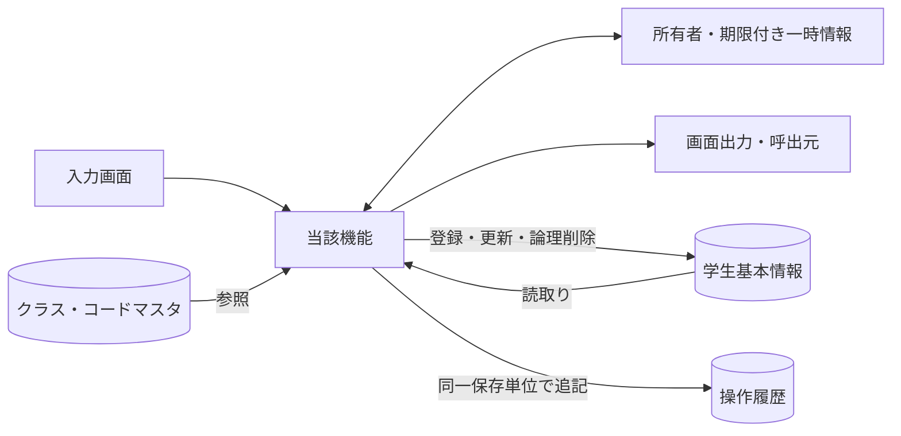

認証情報・業務日時は共通01～03から取得。マスタ保守の承認入力ファイルは画面機能のIOに含めず、方式別共通仕様に定義する。

## 項目一覧

| 項目ID | 項目グループ | 項目名 | コントロール | 必須 | 入力制限 | フォーマット | 初期値 | DBテーブル名 | DB項目名 | 備考 |
| --- | --- | --- | --- | --- | --- | --- | --- | --- | --- | --- |
| REG-001 | 基本 | 学生管理番号 | Label（表示） | - | - | 正のID | - | 学生基本情報 | 学生管理番号 | 未設定：表示欠損は－、マスタ欠落は不整合表示。EV-REG-001,EV-REG-002。表示のみ、登録時自動採番。 |
| REG-002 | 基本 | 学籍番号 | TextBox（input） | 〇 | 15字・新規のみ | - |  | 学生基本情報 | 学籍番号 | 新規登録時。既存は表示のみ・変更不可。N-06。CHK-001,CHK-002,CHK-003,CHK-004。EV-REG-004。新規のみ設定。登録後不変、削除済み含め一意。 |
| REG-003 | 基本 | 氏名 | TextBox（input） | 〇 | 8字 | - |  | 学生基本情報 | 学生氏名 | N-02。CHK-001,CHK-002,CHK-005。EV-REG-004。N-02、原表記を保存。 |
| REG-004 | 基本 | 氏名カナ | TextBox（input） | 〇 | 入力36字／保存18字 | - |  | 学生基本情報 | 学生氏名カナ | N-04,N-05。CHK-001,CHK-002,CHK-006,CHK-005。EV-REG-004。N-04、全角カナ18文字。 |
| REG-005 | 基本 | 生年月日 | Select・TextBox（元号・年月日） | 〇 | 元号10字・年4桁・月日各2桁 | 和暦→日付（DATE-R01、ISO10字相当） |  | 学生基本情報 | 生年月日 | 元号・年・月・日すべて。新規は全部空。候補：元号。N-11。CHK-001,CHK-007,CHK-008,CHK-032,CHK-033。EV-REG-004。和暦入力→厳密変換→日付保存、DATE-R01。 |
| REG-006 | 基本 | 性別 | Select（select） | 〇 | 選択のみ（数字1桁） | コード値／名称 | 0（未回答） | 学生基本情報 コード管理マスタ | 学生基本情報：性別のコード分類・性別 コード管理マスタ：コード分類・コード値・コード名称 | 未回答を0として許容。NULL不可。候補：性別。N-07。CHK-010,CHK-011。EV-REG-004。コード値保存／性別分類のコード名称表示。 |
| REG-007 | 住所 | 郵便番号 | TextBox（input） | 〇 | 入力10字／保存7桁 | 3桁－4桁・先頭ゼロ保持 |  | 学生基本情報 | 郵便番号 | N-08。CHK-001,CHK-002,CHK-016。EV-REG-004。N-08、数字7桁保存、3桁－4桁表示。 |
| REG-008 | 住所 | 都道府県 | Select（select） | 〇 | 選択のみ（数字2桁） | コード値／名称 |  | 学生基本情報 コード管理マスタ | 学生基本情報：都道府県のコード分類・都道府県 コード管理マスタ：コード分類・コード値・コード名称 | 候補：都道府県。N-07。CHK-001,CHK-010,CHK-011。EV-REG-004。コード値保存／都道府県分類の名称表示。 |
| REG-009 | 住所 | 住所1 | TextBox（input） | 〇 | 45字 | - |  | 学生基本情報 | 住所1 | N-02。CHK-001,CHK-002。EV-REG-004。N-02、市区町村・番地、45文字。 |
| REG-010 | 住所 | 住所2 | TextBox（input） |  | 45字 | - |  | 学生基本情報 | 住所2 | 空白除去後空はNULL。N-02。CHK-002。EV-REG-004。N-02、任意45文字、空は未設定。 |
| REG-011 | 連絡先 | 本人電話 | TextBox（input） | 条件付 | 入力20字／保存16字 | - |  | 学生基本情報 | 本人電話 | 本人電話・本人メール・緊急電話のいずれか1つ以上。N-09。CHK-002,CHK-017,CHK-019。EV-REG-004。N-09、連絡手段条件あり。 |
| REG-012 | 連絡先 | 本人メール | TextBox（input） | 条件付 | 60字 | - |  | 学生基本情報 | 本人メール | 本人電話・本人メール・緊急電話のいずれか1つ以上。N-10。CHK-002,CHK-018,CHK-019。EV-REG-004。N-10、連絡手段条件あり。 |
| REG-013 | 在籍 | 入学日 | TextBox（input・日付） | 〇 | 入力10字・実在日 | 入力yyyy-MM-dd／表示yyyy/MM/dd |  | 学生基本情報 | 入学日 | 通常保存時。生年月日以上・業務日以下。N-11。CHK-001,CHK-007,CHK-008,CHK-033。EV-REG-004。西暦入力・表示、DATE-R02。 |
| REG-014 | 在籍 | 在籍区分 | Select（select） | 〇 | 選択のみ（数字2桁） | コード値／名称 | 01（在学） | 学生基本情報 コード管理マスタ | 学生基本情報：在籍区分のコード分類・在籍区分 コード管理マスタ：コード分類・コード値・コード名称 | 01在学・02休学・03卒業・04退学。候補：在籍区分。N-07。CHK-001,CHK-010,CHK-011,CHK-009,CHK-026。EV-REG-004。値保存／在籍区分分類の名称表示。 |
| REG-015 | 在籍 | 卒業・退学日 | TextBox（input・日付） | 条件付 | 入力10字・実在日 | 入力yyyy-MM-dd／表示yyyy/MM/dd |  | 学生基本情報 | 卒業・退学日 | 03・04で必須、01・02ではNULL。N-11。CHK-007,CHK-009,CHK-033。EV-REG-004。西暦。03/04で必須、01/02は未設定。 DATE-R02。 |
| REG-016 | 所属補助 | 年度 | Select（select） |  | 選択のみ（西暦4桁・1900～9998） | 西暦4桁 | 当年度 | クラスマスタ | 学校年度 | 選択補助。値があれば年度範囲・クラス実値を検査。保存なし。候補：年度。N-11。CHK-010,CHK-014,CHK-034。EV-REG-004。選択補助・整合検査のみ。学生へ保存しない。 |
| REG-017 | 所属補助 | 学年 | Select（select） |  | 選択のみ（数字2桁） | 学年名称 |  | クラスマスタ コード管理マスタ | クラスマスタ：学年のコード分類・学年 コード管理マスタ：コード分類・コード値・コード名称 | 選択補助。値があればコード存在とクラス実値を検査。未指定表示は「すべて」。保存なし。候補：学年。N-07。CHK-010,CHK-014。EV-REG-004。選択補助。学年名称は学年分類のコード名称。 |
| REG-018 | 所属 | クラス | Select（select） | 条件付 | 選択のみ（正のID・範囲はDB定義） | 年度・学年・コード・名称 |  | 学生基本情報 クラスマスタ コード管理マスタ | 学生基本情報：現在・最終所属クラス クラスマスタ：クラス管理番号・学校年度・学年のコード分類・学年・クラスコード・クラス名 コード管理マスタ：コード分類・コード値・コード名称 | 01・02で必須、03・04は任意。候補：クラス。CHK-010,CHK-012,CHK-013,CHK-014,CHK-015,CHK-031。EV-REG-004。識別番号保存／年度・学年・コード・名称表示。 |
| REG-019 | 所属 | 所属人数・定員 | Label（表示） | - | - | 人数は非負整数／定員1～9999又は未設定 | - | 学生基本情報 クラスマスタ | 学生基本情報：在籍区分・現在・最終所属クラス・削除の状態 クラスマスタ：クラス管理番号・定員 | 未設定：表示欠損は－、マスタ欠落は不整合表示。EV-REG-004。非削除01/02の参考人数。確保予約ではない。 |
| REG-020 | 緊急 | 緊急連絡先氏名 | TextBox（input） | 条件付 | 8字 | - |  | 学生基本情報 | 緊急連絡先氏名 | 緊急氏名・続柄・電話のいずれか入力時は全3項目必須。N-02。CHK-002,CHK-020。EV-REG-004。緊急3項目は全部入力または全部未設定。 |
| REG-021 | 緊急 | 緊急連絡先続柄 | Select（select） | 条件付 | 選択のみ（数字2桁） | コード値／名称 |  | 学生基本情報 コード管理マスタ | 学生基本情報：続柄のコード分類・緊急連絡先続柄 コード管理マスタ：コード分類・コード値・コード名称 | 緊急氏名・続柄・電話のいずれか入力時は全3項目必須。候補：続柄。N-07。CHK-010,CHK-011,CHK-020。EV-REG-004。続柄値・名称を対応。未選択なら続柄分類もNULL、選択時は分類を処理設定（UPD-103）。 |
| REG-022 | 緊急 | 緊急連絡先電話 | TextBox（input） | 条件付 | 入力20字／保存16字 | - |  | 学生基本情報 | 緊急連絡先電話 | 緊急氏名・続柄・電話のいずれか入力時は全3項目必須。N-09。CHK-002,CHK-017,CHK-019,CHK-020。EV-REG-004。N-09、緊急3項目一式。 |
| REG-023 | その他 | 備考 | TextBox（textarea） |  | 120字 | LF改行 |  | 学生基本情報 | 備考 | 空白除去後空はNULL。LF改行可。N-01。CHK-002。EV-REG-004。プレーンテキスト、120文字、改行可。 |
| REG-024 | 確認 | 確認・変更理由 | TextBox（textarea） | 条件付 | 60字 | LF改行可 |  | 操作履歴 | 操作・確認理由 | 重複確認続行、卒業・退学からの区分訂正時に必須。関連操作で保存。N-01。CHK-002,CHK-025,CHK-026。EV-REG-005。警告続行・終了区分訂正時必須、60文字。 |
| REG-025 | 更新情報 | 更新日時・更新者 | Label（表示） | - | - | 日時19字・更新者64字／日本時間 | - | 学生基本情報 | 更新日時・更新者 | 未設定：表示欠損は－、マスタ欠落は不整合表示。EV-REG-002。システム設定。西暦日時、日本時間。 |
| REG-026 | 削除確認 | 削除理由 | TextBox（textarea） | 条件付 | 60字 | LF改行可 |  | 学生基本情報 操作履歴 | 学生基本情報：削除理由 操作履歴：操作・確認理由 | 論理削除イベントで必須。通常保存では使用しない。関連操作で保存。N-01。CHK-001,CHK-002,CHK-027。EV-REG-006。削除時のみ、60文字、編集中の業務値は保存しない。 |
| REG-027 | 操作・確認 | 登録／更新 | Button | - | - | - | - | - | - | EV-REG-004。保存処理を呼ぶ。 |
| REG-028 | 操作・確認 | 入力クリア／編集取消 | Button | - | - | - | - | - | - | EV-REG-007。新規は初期値、既存は読込時値。 |
| REG-029 | 操作・確認 | 最新情報を再読込 | Button | - | - | - | - | - | - | EV-REG-007。確認後にDB最新値を取得。 |
| REG-030 | 操作・確認 | 検索へ戻る | Button | - | - | - | - | - | - | EV-REG-007。未保存破棄確認後に復帰。 |
| REG-031 | 操作・確認 | 論理削除 | Button | - | - | - | - | - | - | EV-REG-006。管理者のみ、理由・明示確認。 |
| REG-032 | 操作・確認 | 重複候補一覧 | Table（表示） | - | - | 生年月日は和暦・最大20行 | - | 学生基本情報 クラスマスタ | 学生基本情報：学籍番号・学生氏名・生年月日・現在・最終所属クラス クラスマスタ：クラス管理番号・クラス名 | 未設定：表示欠損は－、マスタ欠落は不整合表示。EV-REG-005。全候補件数＋最大20件、個人情報を最小化。 |
| REG-033 | 操作・確認 | 別人と確認して続行 | Button | - | - | - | - | - | - | EV-REG-005。理由・確認情報付きで保存を再検証。 |
| REG-034 | 操作・確認 | 確認取消 | Button | - | - | - | - | - | - | EV-REG-005。入力へ戻る。DB更新なし。 |

## 選択候補一覧

| 候補ID | 参照元・分類 | 選択値 | 表示値 | 抽出条件 | 表示順 | 初期値・連動 |
| --- | --- | --- | --- | --- | --- | --- |
| 年度 | クラスマスタ・学校年度 | 学校年度 | 年度 | 停止・過去年度を含め範囲1900～9998。新規登録は当年度を選択補助へ | 年度降順 | 検索すべて／登録当年度、クラス0件を区別 |
| 学年 | コード管理マスタ（学年） | 学年コード値 | コード名称 | 検索は停止を含む。新規選択は有効値、既存値は別枠保持 | 表示順→コード値 | すべて。学年なし00は未所属と別 |
| クラス | クラスマスタ・コード管理マスタ（学年） | クラス管理番号 | 年度・学年・クラスコード・クラス名 | 検索は停止を含む。登録は共通モジュール07の新規所属／最終所属／既存保持の区別 | 年度降順→学年表示順→クラス表示順→コード→ID | 検索すべて／新規未選択。上位変更で不適合なら解除 |
| 在籍区分 | コード管理マスタ（在籍区分） | 在籍区分コード値 | コード名称 | 検索は分類内の値。登録の新規選択は有効値。01～04は保護 | 表示順→コード値 | 検索01・02／新規登録01、全解除検索は全区分 |
| 都道府県 | コード管理マスタ（都道府県） | 都道府県コード値 | コード名称 | 検索は停止を含む。登録新規選択は有効、既存同値は保持 | 表示順→コード値 | 検索すべて／登録未選択 |
| 性別 | コード管理マスタ（性別） | 性別コード値 | コード名称 | 新規選択は有効値。既存同値は保持。未回答0は保護 | 表示順→コード値 | 新規0、未回答を許容 |
| 続柄 | コード管理マスタ（緊急連絡先続柄） | 続柄コード値 | コード名称 | 新規選択は有効、既存同値は保持 | 表示順→コード値 | 未選択。緊急3項目一式 |
| 元号 | 共通日付仕様（文書07）・元号の変換定義（共通暦定義） | 共通定義の元号識別値 | 元号名 | 生年月日の許容範囲に重なる元号、業務日まで | 新しい元号順 | 未選択。変更時に年・月・日の範囲を再検証 |

## イベント仕様

### EV-REG-001 新規画面表示

#### 処理概要

作成権限のある利用者が新規モードを開く。

#### 処理手順

1. 共通01・02・03で権限と業務日時を確定。OP-CODE・OP-CLASSで候補と初期値の存在を確認する。
2. 性別0、在籍01、年度は当年度。他の値、特に生年月日・入学日を未入力にする。学生管理番号・版は未採番。
3. 必須コード不足は保存不可。クラス0件はW-STU-108。在学・休学はクラス設定まで保存不可だが卒業等の過去入力は妨げない。

既存チェックと本イベントの分岐を以下へ対応付ける。日本語文言の正本は[共通05](../共通/05_チェック・メッセージ設計.md)とし、欄名・件数等の引数を設定する。

| 既存チェック・処理 | 条件・分岐 | メッセージID・文言 | 復帰・確定境界 |
| --- | --- | --- | --- |
| CHK-023 | 新規作成権限と業務日時 | E-COM-001：ログインの有効期限が切れました。再度ログインしてください。 E-COM-002：この操作を行う権限がありません。 | 起動拒否 |
| OP-CODE・OP-CLASS | 性別0・在籍01等の必須初期値が存在 | E-MST-001：マスタの初期設定が不足しています。管理者に連絡してください。 W-STU-108：登録可能なクラスがありません。クラスマスタを確認してください。 | 不足時保存不可。卒業等の過去入力の可否は既存条件を維持 |

#### 処理フロー

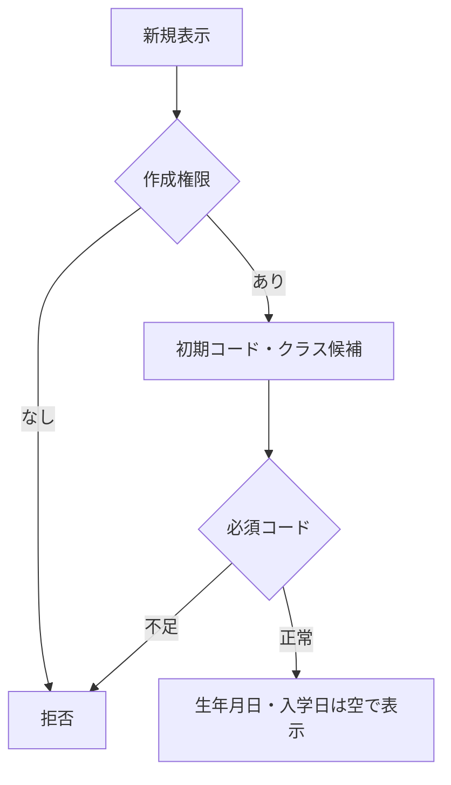

#### SQL・テーブル関連（ER図）

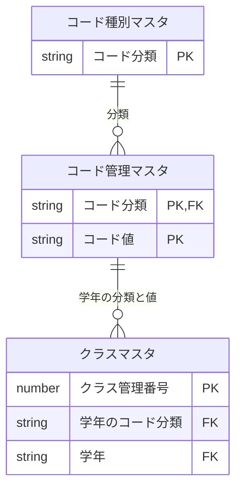

名称参照は未所属・停止値を残す外部結合相当。コードは用途ごとの別名で**分類と値**を結合する。図は読取りの関連であり、履歴への書込みや削除連動を意味しない。単独の存在確認・採番・書込みの表関連は下記操作IDで特定する。

#### DB操作の詳細

`OP-CODE` → `OP-CLASS`。下記「DB操作定義」の同名操作を実行する。保存系ではINSERTとUPDATEをモードで選択し、両方を実行しない。

#### 結果・例外時の扱い

入力不備は原入力保持、対象不在はE-STU-103、版競合はE-STU-105。確認待ちは保存を確定せず、変更なしはI-STU-004。成功通知は学生と履歴の確定確認後だけ。確定結果不明はE-COM-004と検索確認の案内。 各イベントで実行していない処理の結果状態は発生対象外。

### EV-REG-002 編集・参照画面表示

#### 処理概要

既存学生の識別番号で最新値を表示する。

#### 処理手順

1. OP-STUDENTへ学生管理番号を渡し非削除1件を取得。不在はE-STU-103、新規へ切替えない。
2. 学生・クラス・コード名称を取得し、元の値と更新管理番号を読込時スナップショットへ複製。編集値とは分離する。
3. 生年月日を和暦へ変換。学籍番号・管理項目は表示のみ、閲覧者は全項目表示のみ。停止・期間外の既存値を消さない。

既存チェックと本イベントの分岐を以下へ対応付ける。日本語文言の正本は[共通05](../共通/05_チェック・メッセージ設計.md)とし、欄名・件数等の引数を設定する。

| 既存チェック・処理 | 条件・分岐 | メッセージID・文言 | 復帰・確定境界 |
| --- | --- | --- | --- |
| CHK-021・023 | 対象が非削除で1件、役割別モード | E-STU-103：対象の学生が見つからないか、既に削除されています。 E-COM-002：この操作を行う権限がありません。 | 不在を新規へ切替えない |
| OP-STUDENT | 元値と読込版をスナップショットへ取得 | E-COM-004：処理を完了できませんでした。受付番号：{correlationId} | 停止/期間外既存値は消さない。閲覧者は表示のみ |

#### 処理フロー

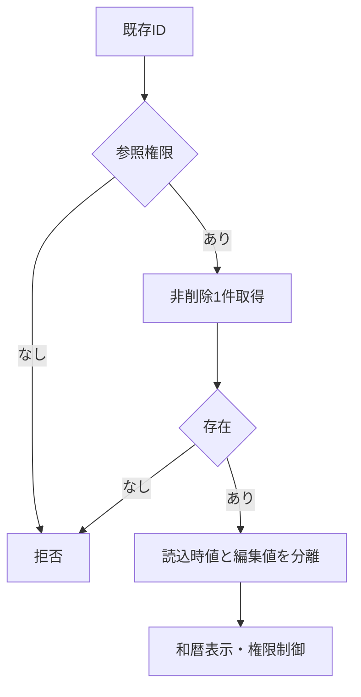

#### SQL・テーブル関連（ER図）

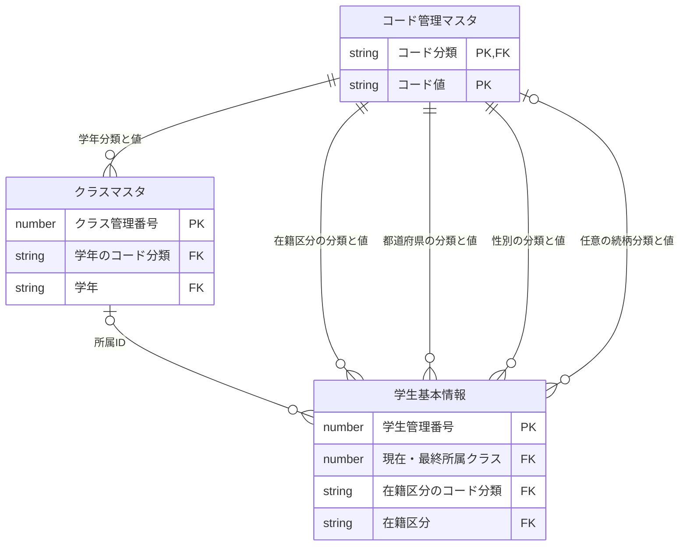

名称参照は未所属・停止値を残す外部結合相当。コードは用途ごとの別名で**分類と値**を結合する。図は読取りの関連であり、履歴への書込みや削除連動を意味しない。単独の存在確認・採番・書込みの表関連は下記操作IDで特定する。

#### DB操作の詳細

`OP-STUDENT` → `OP-CODE` → `OP-CLASS`。下記「DB操作定義」の同名操作を実行する。保存系ではINSERTとUPDATEをモードで選択し、両方を実行しない。

#### 結果・例外時の扱い

入力不備は原入力保持、対象不在はE-STU-103、版競合はE-STU-105。確認待ちは保存を確定せず、変更なしはI-STU-004。成功通知は学生と履歴の確定確認後だけ。確定結果不明はE-COM-004と検索確認の案内。 各イベントで実行していない処理の結果状態は発生対象外。

### EV-REG-003 入力補助

#### 処理概要

所属・在籍・生年月日の入力部品を連動させる。

#### 処理手順

1. 共通16・17で生年月日の元号・年・月・日を厳密検査。不正値を次元号・翌月へ補正せず原入力を保持する。
2. 在籍01/02はクラス必須・終了日なし、03/04は終了日必須・最終所属任意。終了区分からの訂正は権限・理由条件を表示する。
3. 年度・学年・区分変更に応じOP-CLASSで候補を再取得。不適合値解除を通知し、人数は参考表示とする。

既存チェックと本イベントの分岐を以下へ対応付ける。日本語文言の正本は[共通05](../共通/05_チェック・メッセージ設計.md)とし、欄名・件数等の引数を設定する。

| 既存チェック・処理 | 条件・分岐 | メッセージID・文言 | 復帰・確定境界 |
| --- | --- | --- | --- |
| CHK-007・032・033 | 元号境界・実在日・範囲 | E-STU-005：{field}に正しい日付を入力してください。 E-DATE-001：生年月日の元号・年・月・日を確認してください。 E-DATE-002：{field}は{minDate}から{maxDate}までの日付で入力してください。 | 不正日を補正せず入力保持 |
| CHK-009・012・014 | 区分・終了日・上位候補の連動 | E-STU-008：在籍区分に対応する卒業・退学日を設定してください。 E-STU-012：在学・休学の学生はクラスを選択してください。 E-STU-014：年度・学年と選択したクラスが一致していません。 W-STU-107：選択条件が変わったためクラスの選択を解除しました。 | 候補の旧応答を採用しない。参考人数は予約ではない |
| CHK-026 | 卒業/退学からの訂正に必要な管理者/変更理由の条件表示。確定検査はEV-REG-004 | 保存時の不成立：E-STU-106：卒業・退学からの在籍区分変更には管理者権限と変更理由が必要です。 | この入力補助では条件を案内し、DB保存を確定しない。原入力を保持して理由/権限条件を示す |

#### 処理フロー

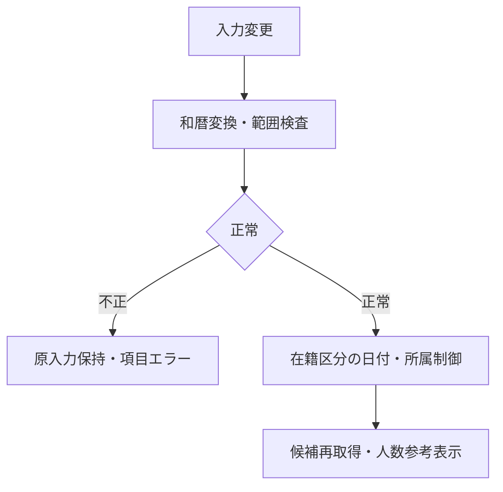

#### SQL・テーブル関連（ER図）

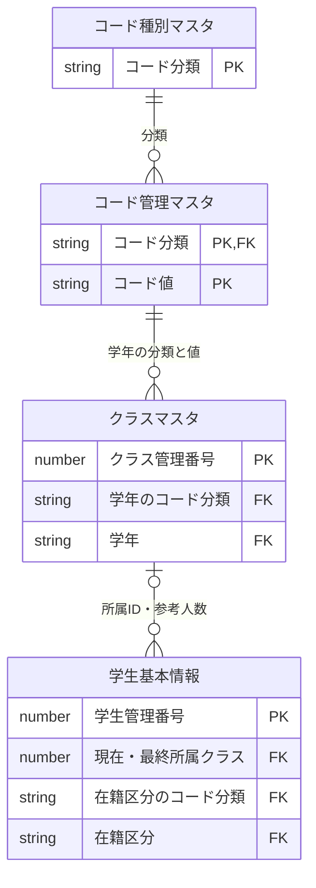

名称参照は未所属・停止値を残す外部結合相当。コードは用途ごとの別名で**分類と値**を結合する。図は読取りの関連であり、履歴への書込みや削除連動を意味しない。単独の存在確認・採番・書込みの表関連は下記操作IDで特定する。

#### DB操作の詳細

`OP-CLASS`。下記「DB操作定義」の同名操作を実行する。保存系ではINSERTとUPDATEをモードで選択し、両方を実行しない。

#### 結果・例外時の扱い

入力不備は原入力保持、対象不在はE-STU-103、版競合はE-STU-105。確認待ちは保存を確定せず、変更なしはI-STU-004。成功通知は学生と履歴の確定確認後だけ。確定結果不明はE-COM-004と検索確認の案内。 各イベントで実行していない処理の結果状態は発生対象外。

### EV-REG-004 新規登録・更新

#### 処理概要

検証済み学生1件と操作履歴1件を一括確定する。

#### 処理手順

1. **入力・参照条件の検査**
   1. 入力19業務項目を複製。和暦原入力は共通16で日付へ変換、共通04・05・17で正規化・必須・範囲・連絡手段を検査する。 続柄未選択なら分類もNULL、選択時は続柄分類を算定する。緊急一式４保存項目を変更なし比較・保存・監査へ渡す。
   2. 共通13の短い保存単位内で同時保存制御を取得。既存モードのみOP-STUDENTを実行し、OP-EXISTSとともに最新存在・版・分類・クラス・日付・区分権限を再検証し、学籍番号不変・全行一意を確認する。

2. **取得・確定と結果設定**
   1. OP-CAPACITYで旧席から新席が増加する場合だけ定員を検査する。変更なしなら版・更新日時・履歴を増やさずI-STU-004。
   2. OP-DUPで全候補と版を確認。未確認なら保存単位を終了して確認画面へ。確認待ちにDBロックを持たない。
   3. OP-INSERTまたはOP-UPDATEで学生1件、OP-AUDITで履歴1件を確定。失敗は双方取消、成否不明は自動再送せず検索確認。

既存チェックと本イベントの分岐を以下へ対応付ける。日本語文言の正本は[共通05](../共通/05_チェック・メッセージ設計.md)とし、欄名・件数等の引数を設定する。

| 既存チェック・処理 | 条件・分岐 | メッセージID・文言 | 復帰・確定境界 |
| --- | --- | --- | --- |
| CHK-023・CHK-024 | 採用主体・操作権限・要求/画面識別と二重実行の可否 | E-COM-001：ログインの有効期限が切れました。再度ログインしてください。 E-COM-002：この操作を行う権限がありません。 E-COM-003：画面情報が無効です。画面を開き直してください。 | 拒否時は学生/履歴とも変更0件。採用主体を要求入力で代用しない |
| CHK-001・CHK-002・CHK-003・CHK-006 | 必須、原入力/正規化後の長さ・禁止文字、学籍番号形式、カナの変換後文字種 | E-STU-001：{field}を入力してください。 E-STU-002：{field}は{max}文字以内の使用可能な文字で入力してください。 E-STU-003：学籍番号は半角英数字・ハイフンで15文字以内にしてください。先頭は英数字です。 E-STU-004：氏名カナはカタカナで入力してください。中点・長音・空白は使用できます。 | 切捨てず全原入力保持。対象欄へ戻す。日付等の派生判定は形式成立後 |
| CHK-007・CHK-008・CHK-009 | 日付実在と前後関係、生年月日≦入学日≦業務日、在籍区分と卒業/退学日 | E-STU-005：{field}に正しい日付を入力してください。 E-STU-006：{fromField}は{toField}以前の日付にしてください。 E-STU-007：生年月日・入学日は本日以前とし、生年月日≦入学日となるよう入力してください。 E-STU-008：在籍区分に対応する卒業・退学日を設定してください。 | 不正日を補正しない。E-STU-006～008は当該の日付関係に対応させ、同じ欄の派生エラーを重ねない |
| CHK-032・CHK-033・CHK-034 | 元号・元号年・改元境界、日付の上下限、西暦4桁・学校年度1900～9998 | E-DATE-001：生年月日の元号・年・月・日を確認してください。 E-DATE-002：{field}は{minDate}から{maxDate}までの日付で入力してください。 E-DATE-003：{field}は西暦4桁の{minYear}年から{maxYear}年で指定してください。 | 生年月日の範囲案内は和暦、その他は西暦。元の4入力と選択補助を保持 |
| CHK-016・CHK-017・CHK-018・CHK-019・CHK-020 | 郵便7桁、電話/メール形式、本人電話/メール/緊急電話の1つ以上、緊急3入力と分類込み4保存値の一式 | E-STU-015：郵便番号は7桁の数字で入力してください。 E-STU-016：{field}の形式が正しくありません。国内10～11桁または国番号付きの番号を入力してください。 E-STU-017：メールアドレスの形式が正しくありません。 E-STU-018：本人電話、本人メール、緊急連絡先電話のいずれかを入力してください。 E-STU-019：緊急連絡先は氏名・続柄・電話番号をすべて入力してください。 | 対象欄へ戻す。緊急続柄未選択は分類もNULL、一部だけのNULLで保存しない。DB変更0件 |
| CHK-003・CHK-004・CHK-021・CHK-022 | 保存制御取得後の非削除対象1件、読込版一致、学籍番号不変/削除済みを含む全行一意 | E-STU-101：この学籍番号は使用済みです。入力を確認してください。直前の送信結果が不明な場合は検索で登録状況を確認してください。 E-STU-103：対象の学生が見つからないか、既に削除されています。 E-STU-104：登録済みの学籍番号は変更できません。 E-STU-105：他の操作で更新されています。入力内容を控え、最新情報を再読み込みしてください。 | 最新値で再検査。不在と版競合を分離し、競合を無変更成功にしない。部分更新なし |
| CHK-010・CHK-011・CHK-012・CHK-013・CHK-014・CHK-031 | 分類とコードの存在/有効性、在学/休学の所属、年度学年一致、新規所属/最終所属の期間条件 | E-STU-009：{field}のコードが存在しません。選択し直してください。 E-STU-010：指定したクラスが存在しません。選択し直してください。 E-STU-011：{field}は現在使用できないコードです。選択し直してください。 E-STU-012：在学・休学の学生はクラスを選択してください。 E-STU-013：このクラスには新たに所属できません。利用可否と利用期間を確認してください。 E-STU-014：年度・学年と選択したクラスが一致していません。 E-STU-108：最終所属クラスの利用期間が学生の在籍期間と重なっていません。クラスまたは在籍日付を確認してください。 | 元の同一値の停止/期間外保持と新規割当を区別。所属/日付/区分を保持した住所等の変更へ新規割当条件を再強制しない |
| CHK-015 | 新席が旧席と異なる増加先だけ、自分以外の非削除01/02人数+1が定員以下か | E-STU-102：クラスの定員を超えるため保存できません。別のクラスを選択してください。 | 定員NULLは制限なし、卒業/退学/削除の席解放へ増加検査をしない。同時保存制御下で判定 |
| CHK-026 | 卒業/退学から別の在籍区分へ訂正する場合の管理者権限と変更理由 | E-STU-106：卒業・退学からの在籍区分変更には管理者権限と変更理由が必要です。 | 不成立は入力を保持して保存しない。理由入力後も有効クラス/定員等を同じ保存単位で再検査 |
| 共通11・CHK-005・CHK-025 | 同日生まれ＋氏名又はカナ一致の全候補、理由、本人/状態/対象/旧版/正規化内容/全候補IDと版/10分期限 | W-STU-101：同じ生年月日で氏名または氏名カナが一致する学生が{count}件あります。別人であることを確認してください。 W-STU-102：入力内容または重複候補が変わりました。もう一度確認してください。 E-STU-107：確認・変更理由を60文字以内で入力してください。 | 全件数と最大20件を表示。表示20件だけで確認一致を判定しない。確認待ちはDBロックを解放、続行時全検査 |
| CHK-030・OP-AUDIT | 正規化後の実差分と学生1件＋履歴1件の原子的確定 | I-STU-001：学生を登録しました。（学籍番号：{studentNo}） I-STU-002：学生情報を更新しました。 I-STU-004：変更内容がありません。 E-COM-004：処理を完了できませんでした。受付番号：{correlationId} | 無変更は学生/履歴とも0件、版/日時不変。実変更は双方確定又は取消。成否不明を自動再送せず検索確認 |

#### 処理フロー

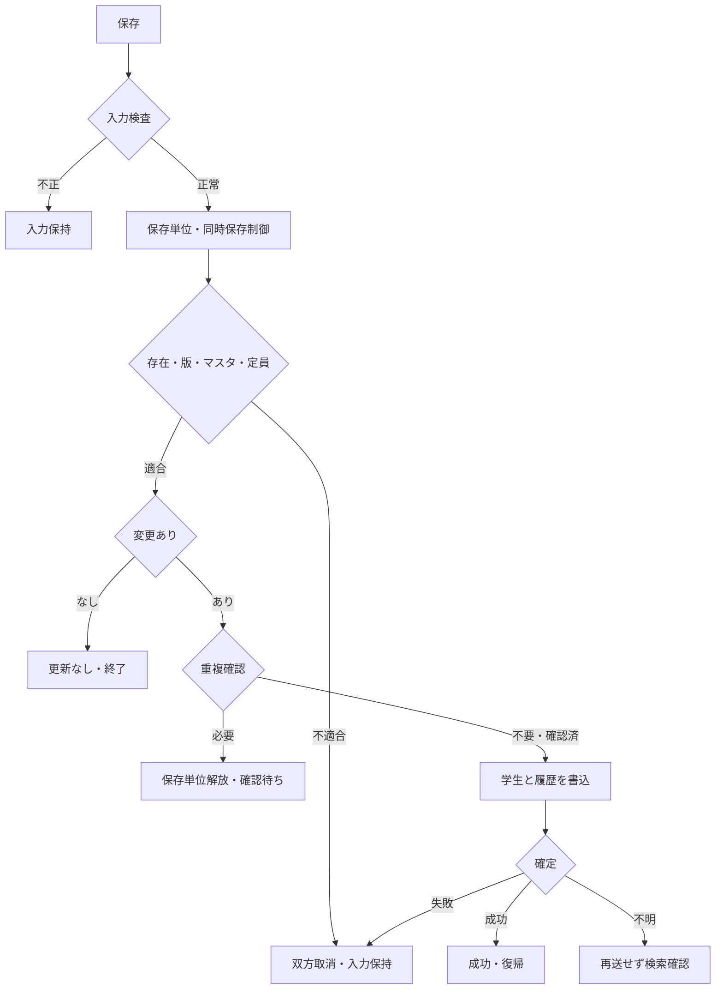

#### SQL・テーブル関連（ER図）

名称参照は未所属・停止値を残す外部結合相当。コードは用途ごとの別名で**分類と値**を結合する。図は読取りの関連であり、履歴への書込みや削除連動を意味しない。単独の存在確認・採番・書込みの表関連は下記操作IDで特定する。

#### DB操作の詳細

`OP-STUDENT` → `OP-EXISTS` → `OP-CAPACITY` → `OP-DUP` → `OP-INSERT` → `OP-UPDATE` → `OP-AUDIT`。下記「DB操作定義」と[項目更新仕様](#項目更新仕様)の対応で取得/設定を確認する。通常保存は学生1件と履歴1件を同一確定単位にし、無変更は両方0件。新規はOP-INSERT、更新はOP-UPDATEの一方だけで、読込時ID/版/非削除を条件にする。0件を成功扱いせず存在/版へ分離し、履歴失敗も双方取消。成否不明を再登録しない。保存系ではINSERTとUPDATEをモードで選択し、両方を実行しない。

#### 結果・例外時の扱い

入力不備は原入力保持、対象不在はE-STU-103、版競合はE-STU-105。確認待ちは保存を確定せず、変更なしはI-STU-004。成功通知は学生と履歴の確定確認後だけ。確定結果不明はE-COM-004と検索確認の案内。 各イベントで実行していない処理の結果状態は発生対象外。

### EV-REG-005 重複候補の確認続行・取消

#### 処理概要

別人確認と理由を保存処理へ引き渡す。

#### 処理手順

1. 候補は全件数と最大20件の学籍番号・氏名・和暦生年月日・クラスのみ。既定操作は取消。
2. 続行では共通11により本人・認証状態・対象・旧版・正規化内容・全候補IDと版・10分期限を照合。相違はW-STU-102で再確認する。
3. 理由を付けEV-REG-004を再実行し全検査を行う。取消は入力画面に留まりDB更新なし。

既存チェックと本イベントの分岐を以下へ対応付ける。日本語文言の正本は[共通05](../共通/05_チェック・メッセージ設計.md)とし、欄名・件数等の引数を設定する。

| 既存チェック・処理 | 条件・分岐 | メッセージID・文言 | 復帰・確定境界 |
| --- | --- | --- | --- |
| 共通11・CHK-005・CHK-025 | 全候補ID/版・本人/認証/入力・対象/旧版・10分期限 | W-STU-101：同じ生年月日で氏名または氏名カナが一致する学生が{count}件あります。別人であることを確認してください。 W-STU-102：入力内容または重複候補が変わりました。もう一度確認してください。 E-STU-107：確認・変更理由を60文字以内で入力してください。 | 表示最大20件でも確認範囲は全候補、既定取消 |
| EV-REG-004 | 確認続行後の再検証 | - | 理由付きで再実行。取消は入力維持、DB更新0件 |

#### 処理フロー

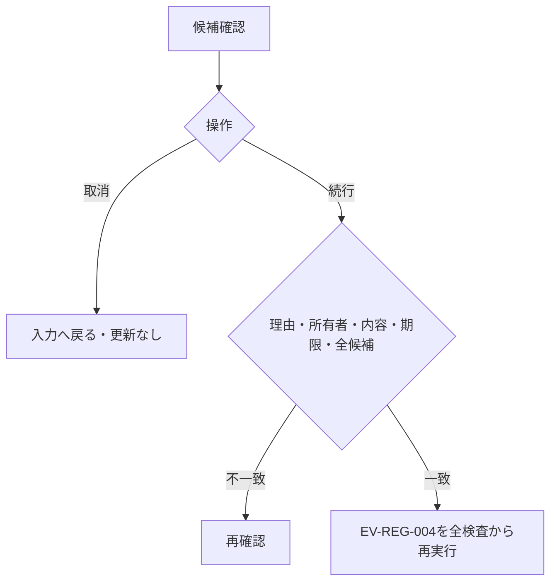

#### SQL・テーブル関連（ER図）

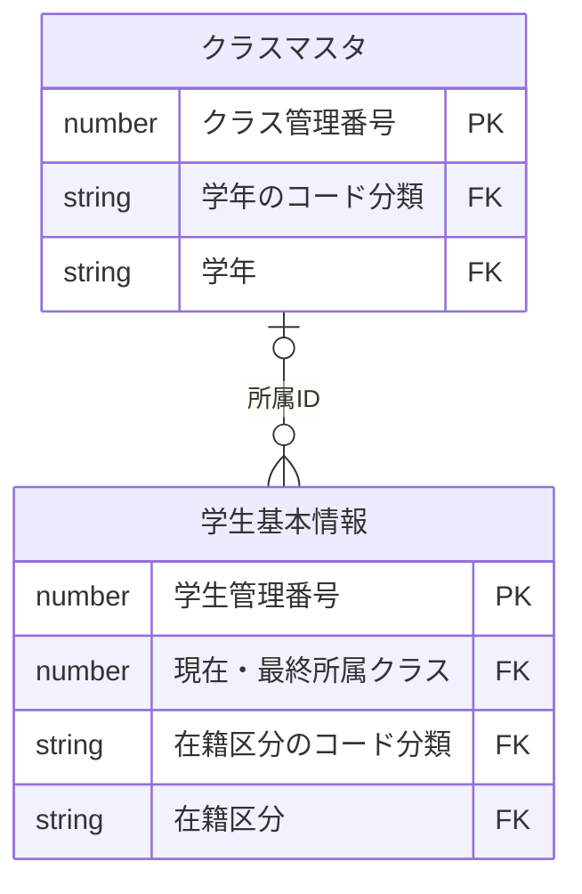

名称参照は未所属・停止値を残す外部結合相当。コードは用途ごとの別名で**分類と値**を結合する。図は読取りの関連であり、履歴への書込みや削除連動を意味しない。単独の存在確認・採番・書込みの表関連は下記操作IDで特定する。

#### DB操作の詳細

`OP-DUP`。下記「DB操作定義」の同名操作を実行する。保存系ではINSERTとUPDATEをモードで選択し、両方を実行しない。

#### 結果・例外時の扱い

入力不備は原入力保持、対象不在はE-STU-103、版競合はE-STU-105。確認待ちは保存を確定せず、変更なしはI-STU-004。成功通知は学生と履歴の確定確認後だけ。確定結果不明はE-COM-004と検索確認の案内。 各イベントで実行していない処理の結果状態は発生対象外。

### EV-REG-006 論理削除

#### 処理概要

管理者が対象と理由を確認して通常検索から除外する。

#### 処理手順

1. 対象ID・読込時版・削除理由・明示確認のみを受ける。編集中の氏名・住所・生年月日等は保存しない。
2. 同時保存制御下でOP-STUDENTを再読込し権限・非削除・版を検証する。対象不在と版競合を区別する。
3. OP-DELETEで削除属性と更新管理情報だけを変更しOP-AUDITと一括確定。確定後に検索へ戻る。

既存チェックと本イベントの分岐を以下へ対応付ける。日本語文言の正本は[共通05](../共通/05_チェック・メッセージ設計.md)とし、欄名・件数等の引数を設定する。

| 既存チェック・処理 | 条件・分岐 | メッセージID・文言 | 復帰・確定境界 |
| --- | --- | --- | --- |
| CHK-021・022・023・027 | 管理者/非削除/期待版/削除理由/明示確認 | E-COM-002：この操作を行う権限がありません。 E-STU-103：対象の学生が見つからないか、既に削除されています。 E-STU-105：他の操作で更新されています。入力内容を控え、最新情報を再読み込みしてください。 E-STU-020：削除理由を60文字以内で入力してください。 W-STU-105：この学生を論理削除します。削除後は通常検索できません。よろしいですか。 | 編集中の一般業務値を保存しない |
| CHK-030・OP-DELETE・OP-AUDIT | 削除/更新属性だけ学生1件＋履歴1件 | I-STU-003：学生情報を論理削除しました。 E-COM-004：処理を完了できませんでした。受付番号：{correlationId} | 同一確定・取消。物理消去しない |

#### 処理フロー

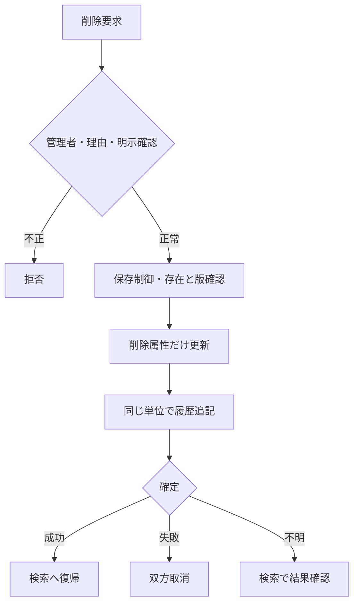

#### SQL・テーブル関連（ER図）

名称参照は未所属・停止値を残す外部結合相当。コードは用途ごとの別名で**分類と値**を結合する。図は読取りの関連であり、履歴への書込みや削除連動を意味しない。単独の存在確認・採番・書込みの表関連は下記操作IDで特定する。

#### DB操作の詳細

`OP-STUDENT` → `OP-DELETE` → `OP-AUDIT`。下記「DB操作定義」の同名操作を実行する。保存系ではINSERTとUPDATEをモードで選択し、両方を実行しない。

#### 結果・例外時の扱い

入力不備は原入力保持、対象不在はE-STU-103、版競合はE-STU-105。確認待ちは保存を確定せず、変更なしはI-STU-004。成功通知は学生と履歴の確定確認後だけ。確定結果不明はE-COM-004と検索確認の案内。 各イベントで実行していない処理の結果状態は発生対象外。

### EV-REG-007 取消・再読込・検索へ戻る

#### 処理概要

原入力の取消、最新取得、検索への復帰を区別する。

#### 処理手順

1. 新規クリアは初期値、編集取消は最後の読込時スナップショットへ戻す。DBから最新取得する処理ではない。
2. 再読込は明示確認後OP-STUDENTを実行し値と版をともに置換。競合時に版だけを最新にしない。
3. 戻る・ウィンドウ終了は未保存変更の破棄確認を行い、取消を既定とする。保存結果不明は再保存前の検索確認を案内する。

既存チェックと本イベントの分岐を以下へ対応付ける。日本語文言の正本は[共通05](../共通/05_チェック・メッセージ設計.md)とし、欄名・件数等の引数を設定する。

| 既存チェック・処理 | 条件・分岐 | メッセージID・文言 | 復帰・確定境界 |
| --- | --- | --- | --- |
| 共通11・12 | クリア/編集取消/再読込/戻るを区別 | W-STU-103：変更内容を破棄して戻りますか。 W-STU-104：入力内容を取り消しますか。 W-STU-109：最新情報を再読み込みすると入力中の変更は破棄されます。続行しますか。 | クリアは初期、編集取消は読込値。再読込だけDB最新を取得 |
| CHK-024 | 対象と画面情報の妥当性 | E-COM-003：画面情報が無効です。画面を開き直してください。 E-COM-004：処理を完了できませんでした。受付番号：{correlationId} | 版だけ最新化しない。結果不明は検索確認 |

#### 処理フロー

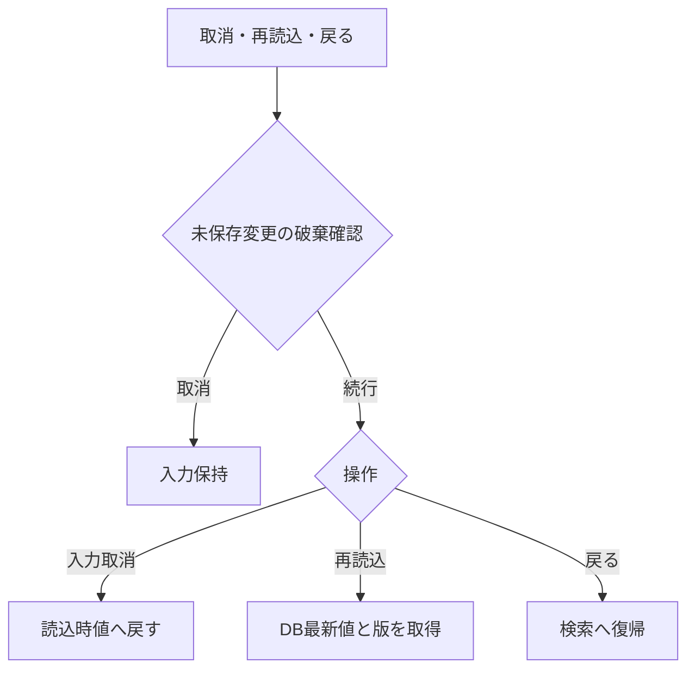

#### SQL・テーブル関連（ER図）

名称参照は未所属・停止値を残す外部結合相当。コードは用途ごとの別名で**分類と値**を結合する。図は読取りの関連であり、履歴への書込みや削除連動を意味しない。単独の存在確認・採番・書込みの表関連は下記操作IDで特定する。

#### DB操作の詳細

`OP-STUDENT`。下記「DB操作定義」の同名操作を実行する。保存系ではINSERTとUPDATEをモードで選択し、両方を実行しない。

#### 結果・例外時の扱い

入力不備は原入力保持、対象不在はE-STU-103、版競合はE-STU-105。確認待ちは保存を確定せず、変更なしはI-STU-004。成功通知は学生と履歴の確定確認後だけ。確定結果不明はE-COM-004と検索確認の案内。 各イベントで実行していない処理の結果状態は発生対象外。

### DB操作定義

操作の業務契約は[共通データアクセス](../共通/08_データアクセス仕様.md)が正本。本機能における具体的な対象・引数・確定単位は以下。

#### OP-CODE

| 項目 | 内容 |
| --- | --- |
| 対象テーブル | コード種別マスタ・コード管理マスタ |
| 操作 | 参照 |
| 実行条件・引数 | 分類、用途（検索／新規選択／既存表示）、既存値、業務日 |
| 取得・設定項目／対象条件 | 分類・値・名称・表示順・利用可否・期間。分類＋値で取得 |
| 件数・順序 | 候補0件を検出。既定値を先頭値へ代替しない |
| 確定・取消 | 参照のみ |

#### OP-CLASS

| 項目 | 内容 |
| --- | --- |
| 対象テーブル | クラスマスタ・コード管理マスタ（学年）・学生基本情報 |
| 操作 | 参照 |
| 実行条件・引数 | 用途、年度、学年、在籍区分、在籍期間、既存所属、業務日、人数参照要否 |
| 取得・設定項目／対象条件 | 年度・学年・クラスID・コード・名称・期間・定員。人数集計は登録側で要求した場合のみ。検索の候補取得では学生を集計しない |
| 件数・順序 | 年度降順、学年表示順、クラス表示順、クラスコード、ID |
| 確定・取消 | 参照のみ、人数は予約ではない |

#### OP-STUDENT

| 項目 | 内容 |
| --- | --- |
| 対象テーブル | 学生基本情報・クラスマスタ・コード管理マスタ |
| 操作 | 参照 |
| 実行条件・引数 | 対象学生ID |
| 取得・設定項目／対象条件 | 非削除の1件、全保存値・版・参照名称。名称はLEFT JOIN相当 |
| 件数・順序 | 0件E-STU-103、1件正常、複数件は整合性障害 |
| 確定・取消 | 画面読込は参照のみ。保存時の再検証は保存単位内 |

#### OP-EXISTS

| 項目 | 内容 |
| --- | --- |
| 対象テーブル | 学生基本情報・クラスマスタ・コード種別マスタ・コード管理マスタ |
| 操作 | 参照 |
| 実行条件・引数 | 用途（検索／保存）、分類付きコード・クラスID・選択補助。保存だけ対象ID・完全な学籍番号・期待版 |
| 取得・設定項目／対象条件 | 検索は指定コード・クラスの存在と年度学年の整合のみ。学籍番号前方一致に重複・完全一致存在検査をしない。保存は全行学籍番号一意、分類付き存在、変更有無、有効性を再検査 |
| 件数・順序 | 未存在／重複／組合せ／停止を区別。未指定の検索条件は検査対象外 |
| 確定・取消 | 検索は参照のみ、保存は保護した最新値で確認 |

#### OP-CAPACITY

| 項目 | 内容 |
| --- | --- |
| 対象テーブル | 学生基本情報・クラスマスタ |
| 操作 | 参照 |
| 実行条件・引数 | 旧席、新席、対象学生ID |
| 取得・設定項目／対象条件 | 非削除01/02、自分以外の対象クラス人数と定員 |
| 件数・順序 | 新席が未設定でなく、旧席から追加・異動するときだけ人数＋1≦定員。卒業・退学・削除による席解放はこの加算検査をしない。定員未設定は制限なし |
| 確定・取消 | 保存制御取得後に判定、休学も1席 |

#### OP-DUP

| 項目 | 内容 |
| --- | --- |
| 対象テーブル | 学生基本情報・クラスマスタ |
| 操作 | 参照 |
| 実行条件・引数 | 日付型生年月日、氏名照合値、カナ照合値、自分ID |
| 取得・設定項目／対象条件 | 非削除かつ自分除外、同生年月日かつ氏名照合用情報または氏名カナ照合用情報一致 |
| 件数・順序 | 全ID・版をID順、表示は最大20件。クラス名は表示のみ |
| 確定・取消 | 確認照合は同時保存制御内、応答待ちは解放 |

#### OP-INSERT

| 項目 | 内容 |
| --- | --- |
| 対象テーブル | 学生基本情報 |
| 操作 | 登録 |
| 実行条件・引数 | 検証済み19入力、生成照合値2、固定分類、認証情報 |
| 取得・設定項目／対象条件 | 学生ID自動採番、版1、作成更新情報設定、未削除 |
| 件数・順序 | 必ず1件。学籍番号一意制約でも競合防止 |
| 確定・取消 | OP-AUDITと同一確定単位 |

#### OP-UPDATE

| 項目 | 内容 |
| --- | --- |
| 対象テーブル | 学生基本情報 |
| 操作 | 更新 |
| 実行条件・引数 | 対象ID、期待版、学籍番号以外18入力、生成照合値2 |
| 取得・設定項目／対象条件 | 対象ID＋期待版＋非削除。続柄分類を続柄と同時更新。作成情報・学籍番号・必須３分類・削除情報は変更なし |
| 件数・順序 | 更新1件。0件は存在再確認後不在／版競合に分離 |
| 確定・取消 | OP-AUDITと一括、版＋1。変更なしは実行しない |

#### OP-AUDIT

| 項目 | 内容 |
| --- | --- |
| 対象テーブル | 操作履歴 |
| 操作 | 登録 |
| 実行条件・引数 | 対象、操作、前後版、変更項目名、実行者・時点・理由・受付番号 |
| 取得・設定項目／対象条件 | 変更した変更項目名だけ。個人情報の値はコピーしない |
| 件数・順序 | 実際の変更1件につき履歴1件。追記専用 |
| 確定・取消 | 業務変更と同じ接続・保存単位。失敗は双方取消 |

#### OP-DELETE

| 項目 | 内容 |
| --- | --- |
| 対象テーブル | 学生基本情報 |
| 操作 | 更新（論理削除） |
| 実行条件・引数 | 対象ID、期待版、理由、認証情報 |
| 取得・設定項目／対象条件 | 削除状態・日時・者・理由、更新日時・者・版だけ変更 |
| 件数・順序 | 更新1件。編集中の一般項目を含めない |
| 確定・取消 | 物理DELETEではない。OP-AUDITと一括 |

### 業務判断の決定表

#### 主要な業務チェック

| チェック | 判定 | 結果 |
| --- | --- | --- |
| 学籍番号重複 | 削除済みを含む全学生で使用済み | 保存不可。番号の再利用も不可 |
| 同一人物候補 | 非削除の他学生と生年月日が同じ、氏名またはカナの照合値が同じ | 別人確認・理由付きなら保存可 |
| コード存在 | 正しい分類内に値がある | 不存在は保存不可 |
| コード利用可否 | 新規・変更する値が有効・期間内 | 不可値は保存不可。既存の同値保持は可 |
| クラス存在 | 選択クラスが実在し年度・学年が一致 | 不存在・不一致は保存不可 |
| 日付 | 生年月日≦入学日≦本日、終了日も本日以前 | 不整合は保存不可 |
| 連絡手段 | 本人電話・メール・緊急電話の1つ以上 | 不足は保存不可 |
| 緊急連絡先 | 氏名・続柄・電話を全部空または全部入力 | 一部だけは保存不可 |
| 他者の更新 | 画面読込後に別操作が更新済み | 上書きせずエラー。入力を保持 |
| 理由 | 必要な操作で空白でない60文字以内 | 不足は保存不可 |

#### クラス選択・定員の決定表

| 保存後の状態・変更 | クラス要否・利用規則 | 定員 |
| --- | --- | --- |
| 新規の在学・休学、別クラスへの異動、卒業等から在学へ訂正 | 必須。利用可かつ本日が利用期間内 | 自分を除いた在学・休学人数＋1が定員以下 |
| 在学・休学のまま同じクラスを保持 | 存在必須。期間外等でも住所などの変更は可、見直し警告 | 席が増えないため既存の超過だけでは拒否しない |
| 新規の卒業・退学 | 任意。指定するならクラス利用期間と入学～終了日の期間が重なる | 席を消費しない |
| 卒業・退学の最終所属・在籍日付・区分を変更 | 停止・過去クラスも可。指定した期間の重なりを確認 | 席を消費しない |
| 卒業・退学の最終所属・在籍日付・区分を変えず住所等だけ変更 | 既存値を保持できる | 席を消費しない |
| 論理削除 | 元のクラス情報を保持 | 削除後は人数に含めない |

休学も1席を使用する。定員未設定は制限なし。定員40人に対し39人在籍で同時に2人を登録した場合は片方だけ保存でき、超過させない。期間の重なりは1日以上あればよく、卒業日がクラス利用期間内に入ることまでは必須にしない。

#### 在籍区分の状態遷移

| 変更前 | 変更後 | 実行者・条件 |
| --- | --- | --- |
| 在学・休学 | 在学・休学・卒業・退学 | 担当者または管理者。変更後の日付・クラス規則を満たす |
| 卒業・退学 | 同一区分 | 担当者または管理者。通常項目の訂正可 |
| 卒業・退学 | 別区分 | 管理者のみ。確認・変更理由が必須 |
| 新規 | 任意の4区分 | 担当者または管理者。過去データ登録を認める |

在籍区分は日付到来だけで自動変更しない。再入学や年度別履歴は本版に含まない。

## 項目更新仕様

| 更新ID | 項目ID | 対象 | 登録 | 更新 | 論理削除 | 規則・設定元 |
| --- | --- | --- | --- | --- | --- | --- |
| UPD-002 | REG-002 | 学生基本情報・学籍番号 | 検証済み入力値 | 変更なし | 変更なし | 新規のみ設定。登録後不変、削除済み含め一意 |
| UPD-003 | REG-003 | 学生基本情報・学生氏名 | 検証済み入力値 | 同左。空の任意値は未設定で上書き | 変更なし | N-02、原表記を保存 |
| UPD-004 | REG-004 | 学生基本情報・学生氏名カナ | 検証済み入力値 | 同左。空の任意値は未設定で上書き | 変更なし | N-04、全角カナ18文字 |
| UPD-005 | REG-005 | 学生基本情報・生年月日 | 検証済み入力値（生年月日は日付へ変換） | 同左。空の任意値は未設定で上書き | 変更なし | 和暦入力→厳密変換→日付保存、DATE-R01 |
| UPD-006 | REG-006 | 学生基本情報・性別 | 検証済み入力値 | 同左。空の任意値は未設定で上書き | 変更なし | コード値保存／性別分類のコード名称表示 |
| UPD-007 | REG-007 | 学生基本情報・郵便番号 | 検証済み入力値 | 同左。空の任意値は未設定で上書き | 変更なし | N-08、数字7桁保存、3桁－4桁表示 |
| UPD-008 | REG-008 | 学生基本情報・都道府県 | 検証済み入力値 | 同左。空の任意値は未設定で上書き | 変更なし | コード値保存／都道府県分類の名称表示 |
| UPD-009 | REG-009 | 学生基本情報・住所1 | 検証済み入力値 | 同左。空の任意値は未設定で上書き | 変更なし | N-02、市区町村・番地、45文字 |
| UPD-010 | REG-010 | 学生基本情報・住所2 | 検証済み入力値 | 同左。空の任意値は未設定で上書き | 変更なし | N-02、任意45文字、空は未設定 |
| UPD-011 | REG-011 | 学生基本情報・本人電話 | 検証済み入力値 | 同左。空の任意値は未設定で上書き | 変更なし | N-09、連絡手段条件あり |
| UPD-012 | REG-012 | 学生基本情報・本人メール | 検証済み入力値 | 同左。空の任意値は未設定で上書き | 変更なし | N-10、連絡手段条件あり |
| UPD-013 | REG-013 | 学生基本情報・入学日 | 検証済み入力値 | 同左。空の任意値は未設定で上書き | 変更なし | 西暦入力・表示、DATE-R02 |
| UPD-014 | REG-014 | 学生基本情報・在籍区分 | 検証済み入力値 | 同左。空の任意値は未設定で上書き | 変更なし | 値保存／在籍区分分類の名称表示 |
| UPD-015 | REG-015 | 学生基本情報・卒業・退学日 | 検証済み入力値 | 同左。空の任意値は未設定で上書き | 変更なし | 西暦。03/04で必須、01/02は未設定 |
| UPD-018 | REG-018 | 学生基本情報・現在・最終所属クラス | 検証済み入力値 | 同左。空の任意値は未設定で上書き | 変更なし | 識別番号保存／年度・学年・コード・名称表示 |
| UPD-020 | REG-020 | 学生基本情報・緊急連絡先氏名 | 検証済み入力値 | 同左。空の任意値は未設定で上書き | 変更なし | 緊急3項目は全部入力または全部未設定 |
| UPD-021 | REG-021 | 学生基本情報・緊急連絡先続柄 | 検証済み入力値 | 同左。空の任意値は未設定で上書き | 変更なし | 続柄値・名称を対応。未選択なら続柄分類もNULL、選択時は分類を処理設定（UPD-103） |
| UPD-022 | REG-022 | 学生基本情報・緊急連絡先電話 | 検証済み入力値 | 同左。空の任意値は未設定で上書き | 変更なし | N-09、緊急3項目一式 |
| UPD-023 | REG-023 | 学生基本情報・備考 | 検証済み入力値 | 同左。空の任意値は未設定で上書き | 変更なし | プレーンテキスト、120文字、改行可 |
| UPD-101 | REG-003／004 | 氏名・氏名カナ照合用情報 | 共通04で生成 | 元の氏名等から再生成 | 変更なし | 入力された照合値を信用しない |
| UPD-102 | REG-001 | 学生管理番号 | 自動採番 | 変更なし | 変更なし | 最大値＋1は禁止 |
| UPD-103 | ― | 性別・都道府県・在籍区分・続柄のコード分類 | 必須３分類を固定設定。続柄未選択は分類もNULL、選択時のみ続柄分類を設定 | 必須３分類は維持。続柄分類は続柄と同時に設定／NULL化 | 変更なし | 利用者入力を受けず保存側で算定。新規・更新の派生値と変更列監査を一致 |
| UPD-104 | ― | 作成日時・作成者 | 共通03・01 | 変更なし | 変更なし | システム設定 |
| UPD-105 | REG-025 | 更新日時・更新者・更新管理番号 | 実行時点・実行者・1 | 実変更時だけ実行時点・実行者・版＋1 | 同左 | 期待版一致が条件、変更なしでは更新しない |
| UPD-106 | REG-026／031 | 削除状態・削除日時・削除者・削除理由 | 未削除、削除属性未設定 | 変更なし | 削除済・実行時点・実行者・検査済理由 | 削除時に一般入力を保存しない |
| UPD-107 | REG-024／026 | 操作履歴 | 前版未設定・後版1・操作新規 | 前後版・変更項目名・操作更新 | 前後版・変更項目名・操作論理削除 | 対象識別、実行者時点、理由、受付番号、重複確認有無。値は複写しない |

## 補足説明

同じ電話・メールを家族で共有しても登録可能とし、連絡先の重複だけでは拒否しない。学籍番号や氏名の検索・比較に使う文字変換は共通仕様に従う。個人情報の保存期間、削除復元、物理消去は運用要件の確認事項であり、論理削除を永久保存の承認とは扱わない。

関連：[論理テーブル](03_テーブル仕様書.md)／[コード](04_コード設計書.md)／[共通チェック](../共通/05_チェック・メッセージ設計.md)

### 正本・受入観点

共通業務は共通03・05・07・08、技術実装は方式別詳細を正本とする。顧客IT部門は入出力、権限、画面とDBの追跡、競合・障害時結果を確認する。言語の構文説明は本書に含めない。

[適合試験一覧](../共通/06_要件対応・設計判断.md)とレビュー結果を参照。

### 項目と一覧章の扱い

項目一覧・選択候補一覧は表だけのLIST章とする。入力上限、保存上限、必須区分と条件を区別する。項目IDは前版のまま。詳細の内部項目は同じ論理項目の細分化であり新たな業務機能ではない。

項目一覧は11列。〇＝必須、空欄＝任意、条件付＝備考の条件成立時に必須、-＝非該当。初期値の空欄は空・未選択、-は初期値なし。真偽は〇／空欄で表すが、性別コード0・在籍コード01等を真偽へ読み替えない。rawは正規化前、保存は正規化後の上限。文字数・新規/編集/参照・初期有効性は[共通UI](../共通/04_共通UI部品設計.md)、正規化/CHK/日本語MSGは[共通チェック](../共通/05_チェック・メッセージ設計.md)に従う。DB2列はTABLE正本の論理名、保存しない項目も永続起源があれば参照元を示す。

### 更新表の補足

EV-REG-004・006から呼び出す。新規19入力、通常更新18入力（学籍番号以外）、生成照合値2の対応を固定する。更新・削除は対象ID＋期待版＋非削除で1件を要求し、0件の場合は不在／競合を区別する。
