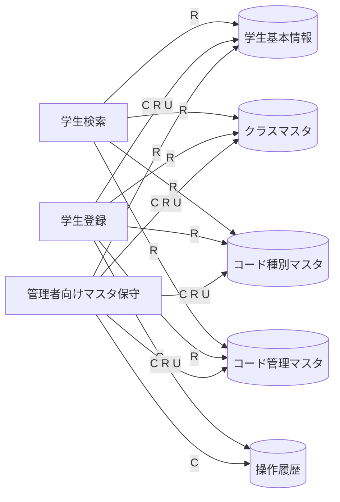
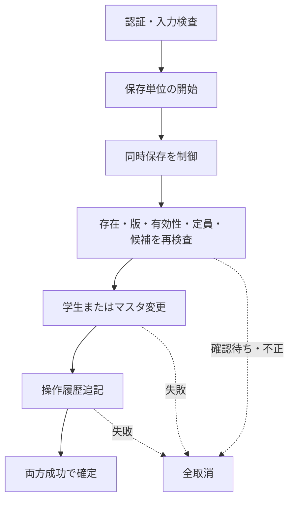

<!-- spec-meta: {"schema":"spec-md/1.0","documentId":"CSHARP_WPF-COM-STU-002","version":"8.1","path":"sample-project1/spec/CSharp_WPF/共通/02_CRUD図.md","sheets":[{"heading":"確定境界","kind":"GRID","sheet":"01_確定境界"},{"heading":"一時情報","kind":"GRID","sheet":"02_一時情報"},{"heading":"技術補助情報の区別","kind":"GRID","sheet":"03_技術補助情報の区別"}],"isolationProfile":"CSharp_WPF"} -->
# CRUD図（言語非依存）

版：8.1／2026-10-25。文書ID：COM-STU-002。

C＝登録、R＝参照、U＝変更、D＝物理削除。通常処理のDはなし。論理削除は削除状態の変更なのでU。ロックを取得しても業務値を変えなければUとはしない。方式固有の一時状態・制御表は本表の業務5表に含めない。

| 処理 | 学生基本情報 | クラスマスタ | コード種別マスタ | コード管理マスタ | 操作履歴 |
| --- | --- | --- | --- | --- | --- |
| 検索初期表示 | ― | R | R | R | ― |
| 検索・ページ・並び順 | R | R | R | R | ― |
| 条件候補変更 | ― | R | R | R | ― |
| 登録新規表示 | ― | R | R | R | ― |
| 編集・参照・再読込 | R | R | R | R | ― |
| 人数参考表示 | R | R | ― | ― | ― |
| 番号重複・同一人物候補 | R | R | ― | ― | ― |
| 学生新規保存 | C・R | R | R | R | C |
| 学生更新 | R・U | R | R | R | C |
| 学生論理削除 | R・U | R | ― | ― | C |
| 変更なし更新 | R | R | R | R | ― |
| 入力クリア・編集取消 | ― | ― | ― | ― | ― |
| 検索へ復帰（検索済み） | R | R | R | R | ― |
| クラス新規・変更・停止・再開 | R | C・R・U | R | R | C |
| コード種別初期投入・名称保守 | ― | ― | C・R・U | R | C |
| コード値初期投入・保守 | ― | ― | R | C・R・U | C |

図のマスタ保守から学生への参照は、クラス人数・参照学生確認。コード値のキー・意味変更や物理削除は参照数にかかわらず禁止し、学生を連鎖更新しない。

## 確定境界

利用者の重複候補確認・削除確認を待ちながらDBロックを保持しない。保存前の警告では業務値も履歴も未確定。確認回答後に別の短い保存単位で全条件を再検査する。検索は業務データを変更せず、件数と表示行の整合性を同一要求内で保証する。

## 一時情報

| 一時情報 | 論理目的 | 寿命 |
| --- | --- | --- |
| 利用者・権限 | 共通認証情報 | 基盤の失効規則 |
| 検索条件・並び順・ページ | 元の画面へ復帰 | 30分、画面インスタンス別 |
| 編集入力・読込時版 | 取消・排他・入力保持 | 画面終了まで |
| 重複確認情報 | 確認した対象・入力・候補の照合 | 10分 |
| 保存成功通知 | 確定した結果を元画面に案内 | 一回表示 |

保持先はメモリー、セッション、ジョブ、一時テーブルなど各方式で決定する。共通仕様では特定言語のセッション製品やDBロック構文を規定しない。

## 技術補助情報の区別

本図の検索は業務5表の参照のみ。Access・IBM i方式が一貫した読取りのために更新する制御行は技術補助表であり、学生情報の更新や操作履歴の業務変更に数えない。制御行は検索終了時に取消す。技術制御を迂回する直接更新を認めないことが一貫性の前提である。
