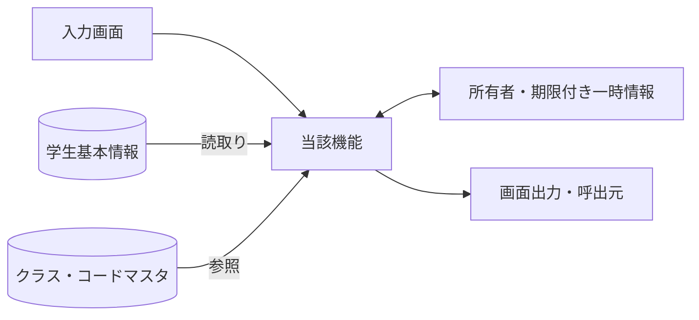
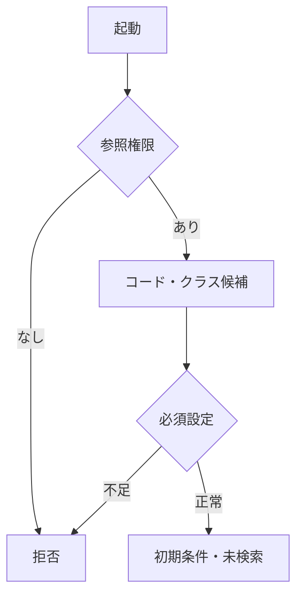
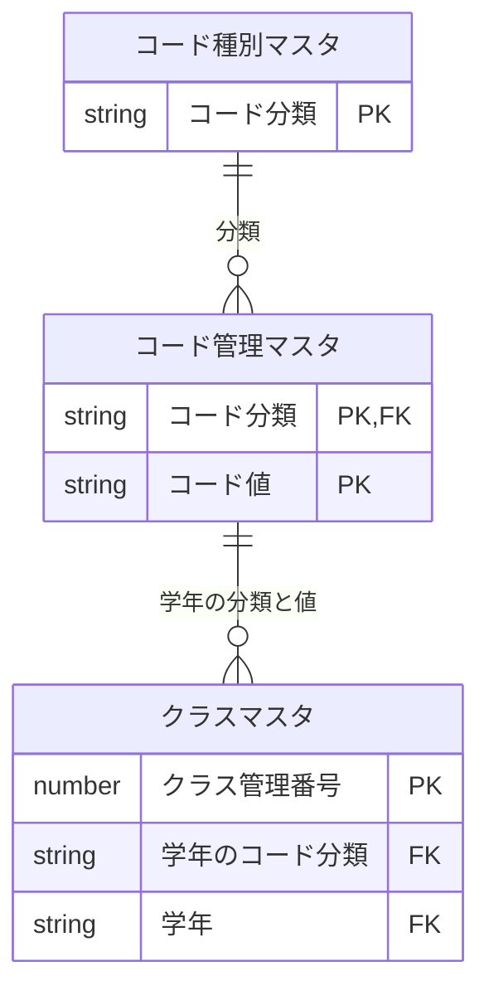
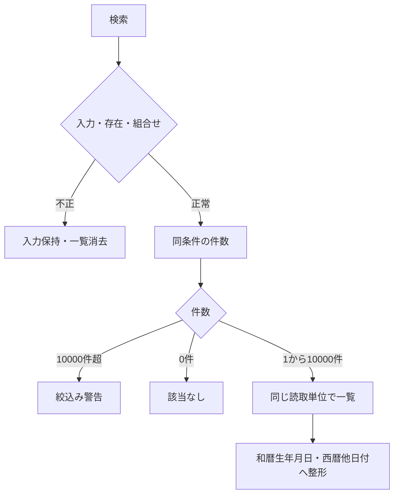
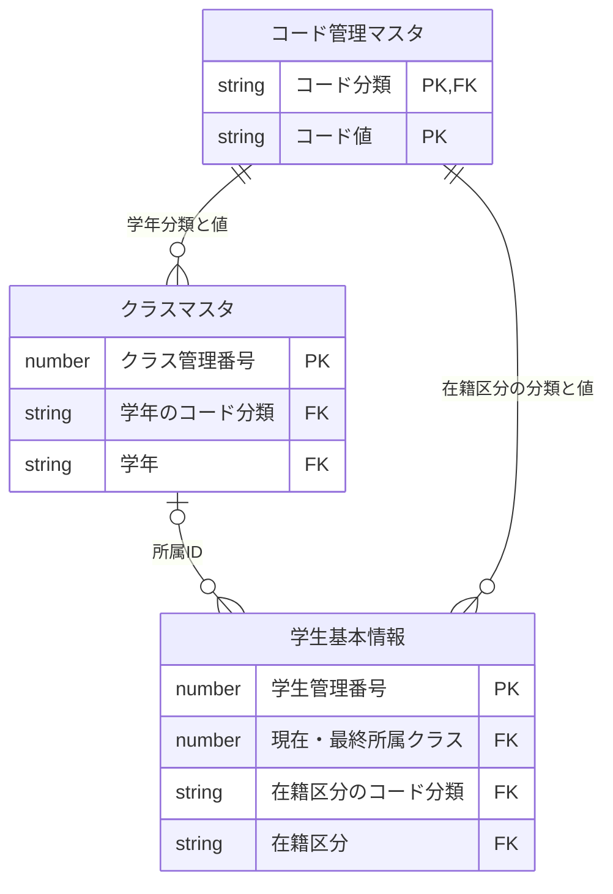
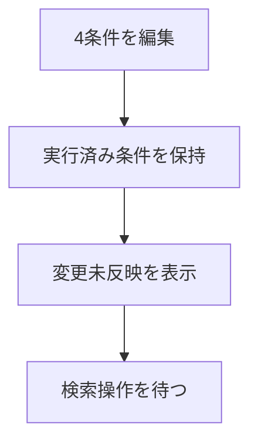
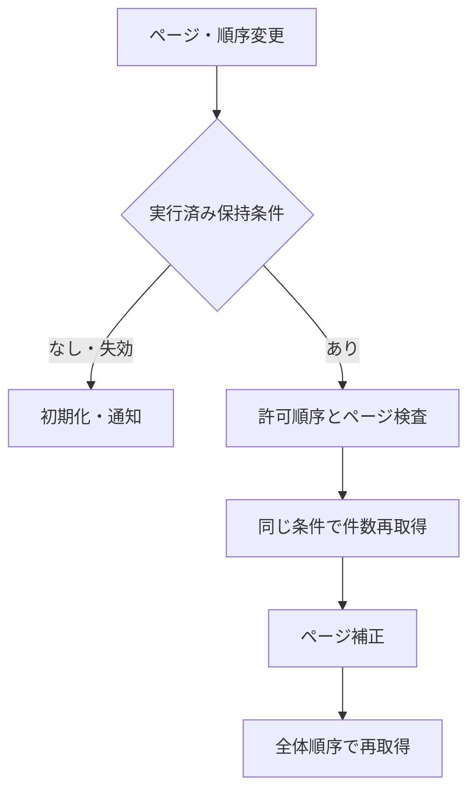
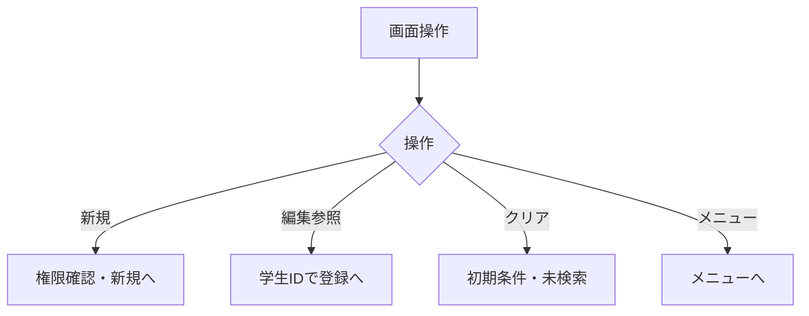
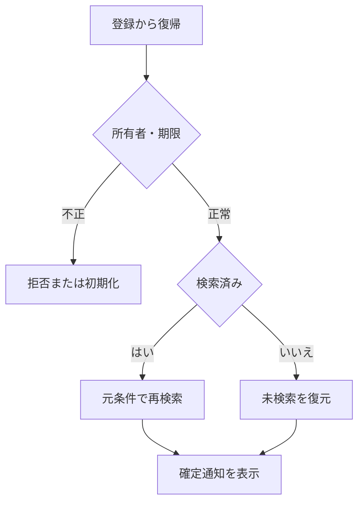

<!-- spec-meta: {"schema":"spec-md/1.0","documentId":"VUE_CSHARPAPI-BAS-STU-01","version":"8.4","path":"sample-project1/spec/Vue_CSharpAPI/基本設計書/01_学生検索画面.md","sheets":[{"heading":"概要","kind":"GRID","sheet":"01_概要"},{"heading":"項目一覧","kind":"LIST","sheet":"02_項目一覧","key":["項目ID"]},{"heading":"選択候補一覧","kind":"LIST","sheet":"03_選択候補一覧","key":["候補ID"]},{"heading":"イベント仕様","kind":"GRID","sheet":"04_イベント仕様"},{"heading":"補足説明","kind":"GRID","sheet":"05_補足説明"}],"isolationProfile":"Vue_CSharpAPI"} -->
# 学生検索画面 基本設計書

| 項目 | 内容 |
| --- | --- |
| システム名 | 学生管理システム |
| 機能ID | SCR-STU-001 |
| 版数・改訂日 | 8.4／2026-10-28 |
| 対象読者 | 顧客（所在団体のIT部門） |
| 状態 | 実装前の設計仕様。実装・コンパイル・実機試験は未実施 |

## 概要

### 概要説明

学生の基本情報を条件指定して検索し、学生登録画面の新規・編集・参照へ進む。検索画面では学生情報を変更しない。成績を検索・表示しない。単一校を対象とし、年度・学年は現在または最終所属クラスの属性を示す。過去の年度別所属履歴を検索するものではない。

| 情報 | 内容 |
| --- | --- |
| 開始契機 | 共通メニューからの起動、学生登録画面からの復帰 |
| 利用者 | 閲覧者、担当者、管理者 |
| 参照情報 | 学生基本情報、クラスマスタ、コード種別マスタ、コード管理マスタ |
| 呼出先 | 学生登録画面 |
| 対象外 | 成績、帳票、一覧の直接編集、一括更新、削除済み学生の照会 |

### 画面設計

#### 画面レイアウト（詳細と共通の埋め込みHTML）

以下は詳細仕様と同一の埋め込みHTMLによる配置定義である。論理項目と状態の説明は本文で補い、別配置の簡略図やPNGを重ねて置かない。架空値の仕様モックであり実機画面ではない。CSSとフォーム要素を保持するHTML表示で確認する。

<!-- screen-html-start: SRC -->

<header class="titlebar"><strong>学生管理 ／ 学生検索</strong>Vue ／ C# API　｜　管理者</header><main class="body">
検索が完了しました。変更した条件は「検索」で反映します。
<section class="section">
検索条件

学籍番号

<input aria-label="学籍番号" class="input" data-business-maxlength="15" data-normalized-maxlength="15" maxlength="30" value=""/>

氏名

<input aria-label="氏名" class="input" data-business-maxlength="8" data-normalized-maxlength="160" maxlength="16" value="見本"/>

クラス

<select aria-label="クラス"><option value="">すべて（全年度・停止含む）</option><option value="1">2026 ／ 学年なし ／ C-A ／ Aクラス</option><option value="2">2025 ／ 学年なし ／ C-A ／ Aクラス（停止）</option></select>

在籍区分

<label><input checked="" type="checkbox"/>在学</label><label><input checked="" type="checkbox"/>休学</label><label><input type="checkbox"/>卒業</label><label><input type="checkbox"/>退学</label>

</section>
学籍番号：前方一致 ／ 氏名：部分一致 ／ クラス：完全一致 ／ 在籍：全解除ですべて

<button class="primary" data-binding="search → C# Search" data-control="search" data-field-id="SRC-013" type="button">検索</button><button class="" data-binding="clear → C# Clear" data-control="clear" data-field-id="SRC-014" type="button">クリア</button><button class="" data-binding="new → C# New" data-control="new" data-field-id="SRC-015" type="button">新規登録</button><button class="" data-binding="menu → C# Menu" data-control="menu" data-field-id="SRC-016" type="button">メニューへ</button>

<strong data-binding="totalCount / RangeFrom / RangeTo → C# TotalCount / RangeFrom / RangeTo" data-control="totalCount / RangeFrom / RangeTo" data-field-id="SRC-017">検索結果 2件　1–2件を表示</strong><label data-binding="pageSize → C# PageSize" data-control="pageSize" data-field-id="SRC-019">表示件数 <select><option>20</option><option>50</option><option>100</option></select></label><label data-binding="sortKey → C# SortKey" data-control="sortKey" data-field-id="SRC-032">並び順 <select><option>学籍番号</option><option>氏名</option><option>入学日</option><option>更新日時</option></select></label><label data-binding="sortDirection → C# SortDirection" data-control="sortDirection" data-field-id="SRC-033"><select><option>昇順</option><option>降順</option></select></label>

<table class="grid"><thead><tr><th data-binding="studentNo → C# StudentNo" data-control="studentNo" data-field-id="SRC-020">学籍番号</th><th data-binding="studentName → C# StudentName" data-control="studentName" data-field-id="SRC-021" data-includes-field-id="SRC-022">氏名 ／ カナ</th><th data-binding="birthDateWareki → C# BirthDateWareki" data-control="birthDateWareki" data-field-id="SRC-023">生年月日</th><th data-binding="schoolYear / GradeName → C# SchoolYear / GradeName" data-control="schoolYear / GradeName" data-field-id="SRC-024">年度／学年</th><th data-binding="classCode / ClassName → C# ClassCode / ClassName" data-control="classCode / ClassName" data-field-id="SRC-025">クラス</th><th data-binding="enrollmentName → C# EnrollmentName" data-control="enrollmentName" data-field-id="SRC-026">在籍区分</th><th data-binding="openSelectedStudent → C# OpenSelectedStudent" data-control="openSelectedStudent" data-field-id="SRC-030">操作</th></tr></thead><tbody><tr><td>S2026-0001</td><td>見本 太郎ミホン タロウ</td><td>平成20年05月15日</td><td>2026 学年なし</td><td>C-A Aクラス</td><td>在学</td><td><button type="button">編集</button></td></tr><tr><td>S2026-0002</td><td>見本 花子ミホン ハナコ</td><td>平成20年07月20日</td><td>2026 学年なし</td><td>C-A Aクラス</td><td>休学</td><td><button type="button">編集</button></td></tr></tbody></table>

<button disabled="">先頭</button><button disabled="">前へ</button><strong>1 / 1</strong><button disabled="">次へ</button><button disabled="">最後</button>

検索日時：2026/10/11 10:00:00　｜　最終実行条件：氏名「見本」、在学・休学
</main><footer class="foot">仕様モック・架空データ ／ 2026-10-23 ／ 100% CSS px</footer>
<section class="confirmations" hidden=""></section>

<!-- screen-html-end: SRC -->

2件／1ページ　表示［20・50・100］　並び順［学籍番号 ▼］［昇順 ▼］　［先頭］［前］［次］［最後］

#### 表示状態

| 状態 | 条件欄 | 結果欄 | 操作 |
| --- | --- | --- | --- |
| 初回・クリア直後 | 初期条件 | 「条件を指定して検索してください」。件数・日時なし | 一覧操作は使用不可 |
| 検索中 | 入力値を保持 | 処理中表示 | 二重検索を抑止 |
| 入力エラー | 入力値と項目別エラー | 前回結果を消去 | 修正後に検索 |
| 0件 | 実行した条件を保持 | 「該当する学生がありません。」 | ページ操作不可 |
| 上限超過 | 実行した条件を保持 | 絞込みを要求。一部だけの一覧は出さない | 条件追加後に検索 |
| 正常 | 実行した条件 | 件数、一覧、検索日時 | 有効なページ操作 |
| 条件変更・未実行 | 変更値を保持 | 最後に実行した結果と「条件変更は未反映」 | ページ操作は最後の実行条件を使う |
| システムエラー | 入力値を保持 | 前回結果を最新結果として残さない | 受付番号を案内 |

生年月日は和暦、その他の日付・日時・年度は西暦。例示値は架空。日付範囲の正本は[共通日付仕様](../共通/07_日付・和暦仕様.md)。

#### 小規模運用の検索と配置

学生を特定する入口を学籍番号・氏名・クラス・在籍区分の4条件へ限定する。学籍番号はN-06後の前方一致、氏名はN-03後のname_key部分一致、クラスはID完全一致、在籍区分の複数値だけOR、異なる条件はANDとする。未指定条件は追加しない。非削除は常時必須で利用者が解除できない。初回とクリアは在学・休学、20件、学籍番号昇順、未検索。全区分解除は全区分とし、空条件でも明示的な検索操作後に取得する。

氏名カナ・年度・学年・未所属のみ・都道府県・電話番号・入学日開始終了（SRC-003/004/005/007/009/010/011/012）は廃止しIDを予約する。未知の条件名と廃止したキーは空文字・null・falseでも拒否し、無視して検索しない。登録・編集の同名項目、保存値、コード・クラス制約は維持する。

クラス候補は全年度・停止・期間外を含み、年度／学年名称／コード／名称で識別する。独立した年度・学年・未所属条件、検索中の候補連動を設けない。EV-SRC-003は条件変更未反映の表示だけでDBを呼ばない。

一覧は学籍番号、氏名とカナの同一セル、生年月日、年度と学年、クラス、在籍区分、操作の7列・8論理項目。SRC-027住所・028電話・029更新日時は検索応答から除外し、必要時は既存の編集／参照で確認する。氏名等を省略記号で欠落させず折り返す。20/50/100件、許可4ソートと昇降順、学生IDの同順位順序、10,000件上限を維持する。

1366×650と1280×650 CSS px、100%の通常画面で条件・件数・一覧枠・ページ・主要操作を収める。一覧だけを高さ制限した内部スクロールにし、20件全行の同時表示は要求しない。12px以上の文字と34px以上の入力操作を確保する。エラー・長い名称・狭幅・拡大では画面の縦スクロールを許し、項目や操作を切り捨てない。保持状態は形式版search-compact-1を持ち、旧形式は所有者とRevisionの確認後にW-SRC-002で未検索へ再初期化する。旧条件の黙示移行は行わない。

### ファイル・DB入出力関係

#### 入出力一覧

方向は当該機能から見たもの。画面入力、DB読取り、DB書込みを区別する。

| IO-ID | 分類 | 対象 | 入出力 | 主な項目 | 保存単位・備考 |
| --- | --- | --- | --- | --- | --- |
| 01 | 画面 | 入力条件・操作 | 入力 | 当該機能の項目一覧 | 要求開始時の値を複製 |
| 02 | 永続DB | 学生基本情報 | 入力（参照） | 学生基本情報・版 | 更新なし |
| 03 | 永続DB | クラスマスタ | 入力（参照） | 年度・学年・名称・期間・定員 | 学生機能からマスタを更新しない |
| 04 | 永続DB | コード種別マスタ／コード管理マスタ | 入力（参照） | 分類・値・名称・有効性 | 学生機能からマスタを更新しない |
| 05 | 一時情報 | 検索状態・確認情報（共通管理） | 入出力 | 確定検索条件・ページ・原入力・確認対象 | 業務表と別。所有者・期限を検査 |
| 06 | 外部ファイル | なし | なし | CSV・帳票・取込は本機能の対象外 | 仕様書MDを業務IOに数えない |
| 07 | 画面 | 一覧・メッセージ | 出力 | 個人情報は必要項目のみ | DB保存とは別の出力 |

#### データ操作関連図

認証情報・業務日時は共通01～03から取得。マスタ保守の承認入力ファイルは画面機能のIOに含めず、方式別共通仕様に定義する。

## 項目一覧

| 項目ID | 項目グループ | 項目名 | コントロール | 必須 | 入力制限 | フォーマット | 初期値 | DBテーブル名 | DB項目名 | 備考 |
| --- | --- | --- | --- | --- | --- | --- | --- | --- | --- | --- |
| SRC-001 | 検索条件 | 学籍番号 | TextBox（input） |  | 15字 | 先頭ゼロ保持 |  | 学生基本情報 | 学籍番号 | 未指定は条件なし。CHK-003は番号形式だけ、重複・変更不可は非適用。保存なし。N-06。CHK-002,CHK-003。EV-SRC-002。前方一致、N-06。保存なし。 |
| SRC-002 | 検索条件 | 氏名 | TextBox（input） |  | 入力8字／正規化160字 | - |  | 学生基本情報 | 氏名照合用情報 | 表示氏名ではなく照合キーに部分一致。保存なし。N-03。CHK-002。EV-SRC-002。N-03後の部分一致。氏名の原表記と区別。 |
| SRC-006 | 検索条件 | クラス | Select（select） |  | 選択のみ（正のID・範囲はDB定義） | 年度・学年・コード・名称 |  | 学生基本情報 クラスマスタ コード管理マスタ | 学生基本情報：現在・最終所属クラス クラスマスタ：クラス管理番号・学校年度・学年のコード分類・学年・クラスコード・クラス名・表示順 コード管理マスタ：コード分類・コード値・コード名称・表示順 | 実在するクラスID。全年度、停止・期間外も可。未指定表示は「すべて」。保存なし。候補：クラス。CHK-010。EV-SRC-002。クラスID完全一致。年度・学年の独立入力なし。 |
| SRC-008 | 検索条件 | 在籍区分 | CheckBox（input・複数） |  | 2桁コードを最大4件選択 | 在学・休学・卒業・退学 | 01,02 | 学生基本情報 コード管理マスタ | 学生基本情報：在籍区分のコード分類・在籍区分 コード管理マスタ：コード分類・コード値・コード名称 | 空配列は全区分。重複値・未定義値は拒否。未設定：空配列。保存なし。候補：在籍区分。N-07。CHK-010,CHK-024。EV-SRC-002。複数値はいずれか一致、全解除は全区分。 |
| SRC-013 | 操作 | 検索 | Button | - | - | - | - | - | - | 条件を検査して1ページ目を表示。EV-SRC-002。入力検査後、最初のページを取得。 |
| SRC-014 | 操作 | クリア | Button | - | - | - | - | - | - | 初期条件・未検索へ戻す。EV-SRC-005。初期条件・未検索へ、保持条件を消去。 |
| SRC-015 | 操作 | 新規登録 | Button | - | - | - | - | - | - | 担当者・管理者だけ表示。EV-SRC-005。権限を確認し学生登録へ遷移。 |
| SRC-016 | 操作 | メニューへ | Button | - | - | - | - | - | - | 共通メニューへ戻る。EV-SRC-005。共通メニューへ。 |
| SRC-017 | 結果・一覧 | 検索件数・表示範囲 | Label（表示） | - | - | 件数・範囲0～10000 | 未検索 | 学生基本情報 | 学生管理番号 | 未設定：表示欠損は－、マスタ欠落は不整合表示。EV-SRC-002。未検索／0件／上限超過を区別。 |
| SRC-018 | 結果・一覧 | 検索日時 | Label（表示） | - | - | 西暦日時19字・日本時間 | 未検索 | - | - | 未設定：表示欠損は－、マスタ欠落は不整合表示。EV-SRC-002。西暦日時、日本時間。DB保存なし。 |
| SRC-019 | 結果・一覧 | 表示件数 | Select（select） | 〇 | 20・50・100のみ（3桁） | - | 20 | - | - | 20・50・100のみ。保存なし。候補：表示件数。CHK-024。EV-SRC-004。20／50／100、既定20。 |
| SRC-020 | 結果・一覧 | 学籍番号 | Tableセル（表示） | - | - | 15字以内・先頭ゼロ保持 | 未検索 | 学生基本情報 | 学籍番号 | 未設定：表示欠損は－、マスタ欠落は不整合表示。EV-SRC-002,EV-SRC-004,EV-SRC-006。保存済み文字列、文字順。 |
| SRC-021 | 結果・一覧 | 氏名 | Tableセル（表示） | - | - | 8字以内 | 未検索 | 学生基本情報 | 学生氏名 | 未設定：表示欠損は－、マスタ欠落は不整合表示。EV-SRC-002,EV-SRC-004,EV-SRC-006。氏名を上段、SRC-022のカナを下段に同一セルで表示。 |
| SRC-022 | 結果・一覧 | 氏名カナ | Tableセル（表示） | - | - | カナ18字以内 | 未検索 | 学生基本情報 | 学生氏名カナ | 未設定：表示欠損は－、マスタ欠落は不整合表示。EV-SRC-002,EV-SRC-004,EV-SRC-006。SRC-021と同一セルの2段目。全文を折返し表示。 |
| SRC-023 | 結果・一覧 | 生年月日 | Tableセル（表示） | - | - | 共通和暦書式 | 未検索 | 学生基本情報 | 生年月日 | 未設定：表示欠損は－、マスタ欠落は不整合表示。EV-SRC-002,EV-SRC-004,EV-SRC-006。和暦表示。共通16で日付から変換。 |
| SRC-024 | 結果・一覧 | 年度・学年 | Tableセル（表示） | - | - | 年度4桁＋学年名12字 | 未検索 | クラスマスタ コード管理マスタ | クラスマスタ：学校年度・学年のコード分類・学年 コード管理マスタ：コード分類・コード値・コード名称 | 未設定：表示欠損は－、マスタ欠落は不整合表示。EV-SRC-002,EV-SRC-004,EV-SRC-006。年度は西暦、学年は名称。未所属は－。 |
| SRC-025 | 結果・一覧 | クラス | Tableセル（表示） | - | - | コード9字＋名称18字＋注記 | 未検索 | 学生基本情報 クラスマスタ | 学生基本情報：現在・最終所属クラス クラスマスタ：クラス管理番号・クラスコード・クラス名 | 未設定：表示欠損は－、マスタ欠落は不整合表示。EV-SRC-002,EV-SRC-004,EV-SRC-006。未所属／停止／期間外を区別。 |
| SRC-026 | 結果・一覧 | 在籍区分 | Tableセル（表示） | - | - | 在籍名12字 | 未検索 | 学生基本情報 コード管理マスタ | 学生基本情報：在籍区分のコード分類・在籍区分 コード管理マスタ：コード分類・コード値・コード名称 | 未設定：表示欠損は－、マスタ欠落は不整合表示。EV-SRC-002,EV-SRC-004,EV-SRC-006。種別と値で結合、名称未取得でも学生行を落とさない。 |
| SRC-030 | 結果・一覧 | 編集／参照 | Button | - | - | - | - | 学生基本情報 | 学生管理番号 | 未検索時は操作不可。EV-SRC-005。行番号ではなく対象IDで遷移、遷移先で再取得。 |
| SRC-031 | 結果・一覧 | ページ操作 | Button | - | - | - | - | - | - | 未検索時は操作不可。EV-SRC-004。先頭・前・次・最後。有効範囲へ再補正。 |
| SRC-032 | 結果操作 | 並び順項目 | Select（select） | 〇 | 許可4値から選択（最大13字） | 学籍番号・氏名・入学日・更新日時 | studentNo | 学生基本情報 | 学籍番号・氏名照合用情報・入学日・更新日時 | studentNo・name・admissionDate・updatedAtのみ。保存なし。候補：並び順。CHK-024。EV-SRC-004。許可4項目。最後に学生ID昇順を加える。 |
| SRC-033 | 結果操作 | 並び順方向 | Select（select） | 〇 | asc・descのみ（最大4字） | 昇順／降順 | asc | - | - | asc・descのみ。保存なし。候補：昇降順。CHK-024。EV-SRC-004。昇順／降順。初期は昇順。 |

## 選択候補一覧

| 候補ID | 参照元・分類 | 選択値 | 表示値 | 抽出条件 | 表示順 | 初期値・連動 |
| --- | --- | --- | --- | --- | --- | --- |
| クラス | クラスマスタ・コード管理マスタ（学年） | クラス管理番号 | 年度・学年・クラスコード・クラス名 | 全年度・停止・期間外を含む。検索では人数集計なし | 年度降順→学年表示順→クラス表示順→コード→ID | すべて。独立した上位条件・候補連動なし |
| 在籍区分 | コード管理マスタ（在籍区分） | 在籍区分コード値 | コード名称 | 分類ENROLLMENT_STATUSの01～04。停止を含む | 表示順→コード値 | 01・02、全解除は全区分 |
| 表示件数 | 共通UI固定定義 | 20 / 50 / 100 | 20件／50件／100件 | 固定3候補。業務コードではない | 20→50→100 | 20、変更で1ページへ |
| 並び順 | 共通UI固定定義 | 学籍番号／氏名／入学日／更新日時 | 学籍番号／氏名／入学日／更新日時 | 固定4候補。自由文字でDB列を指定しない | 左記順 | 学籍番号 |
| 昇降順 | 共通UI固定定義 | 昇順／降順 | 昇順／降順 | 固定2候補 | 昇順→降順 | 昇順 |

## イベント仕様

### EV-SRC-001 初期表示

#### 処理概要

認証済み利用者がメニューから起動。学生一覧は取得しない。

#### 処理手順

1. 共通01・02で参照権限を確認し、共通03で業務日時を確定する。
2. OP-CODE・OP-CLASSで候補取得。在学・休学、20件、学籍番号昇順、未検索を設定する。必須マスタ不足なら検索を不可とする。
3. 共通12の画面別状態を作成する。復帰識別がある場合はEV-SRC-006へ進む。

既存チェックと本イベントの分岐を以下へ対応付ける。日本語文言の正本は[共通05](../共通/05_チェック・メッセージ設計.md)とし、欄名・件数等の引数を設定する。

| 既存チェック・処理 | 条件・分岐 | メッセージID・文言 | 復帰・確定境界 |
| --- | --- | --- | --- |
| CHK-023 | 参照権限・採用主体 | E-COM-001：ログインの有効期限が切れました。再度ログインしてください。 E-COM-002：この操作を行う権限がありません。 | 起動拒否 |
| OP-CODE・OP-CLASS | 必須分類/既定値を取得 | E-MST-001：マスタの初期設定が不足しています。管理者に連絡してください。 | 不足時は検索不可、先頭値へ代替しない |

#### 処理フロー

#### SQL・テーブル関連（ER図）

名称参照は未所属・停止値を残す外部結合相当。コードは用途ごとの別名で**分類と値**を結合する。図は読取りの関連であり、履歴への書込みや削除連動を意味しない。単独の存在確認・採番・書込みの表関連は下記操作IDで特定する。

#### DB操作の詳細

`OP-CODE` → `OP-CLASS`。下記「DB操作定義」の同名操作を実行する。

#### 結果・例外時の扱い

入力不備は項目エラーと原入力を保持。検索要求の失敗は一覧消去、0件はI-SRC-001、上限超過はW-SRC-001。権限不備・他者の保持情報は拒否する。条件変更だけでは既存一覧を再検索しない。 各イベントで実行していない処理の結果状態は発生対象外。

### EV-SRC-002 検索実行

#### 処理概要

入力した検索条件で、非削除学生を検索する。

#### 処理手順

1. **入力・参照条件の検査**
   1. 入力を複製し共通04・05で4条件の正規化、桁、選択値と許可キーを検査する。項目エラーは入力保持・一覧消去、DB検索なし。
   2. OP-EXISTSで指定した在籍区分の分類付き存在とクラスIDの存在を検査する。検索では停止・期間外の既存値を許容する。

2. **取得・確定と結果設定**
   1. OP-COUNT・OP-PAGEへ同じ確定条件を渡す。10001件で上限、0件は該当なし、それ以外は最初のページを表示する。件数と一覧の読取りを揃える。
   2. 正常時に実行済み条件を共通12へ保持。生年月日は共通16で和暦表示。他の日付・日時は西暦。

既存チェックと本イベントの分岐を以下へ対応付ける。日本語文言の正本は[共通05](../共通/05_チェック・メッセージ設計.md)とし、欄名・件数等の引数を設定する。

| 既存チェック・処理 | 条件・分岐 | メッセージID・文言 | 復帰・確定境界 |
| --- | --- | --- | --- |
| CHK-002・003・024 | raw/正規化後上限・番号形式・受理4条件 | E-STU-002：{field}は{max}文字以内の使用可能な文字で入力してください。 E-STU-003：学籍番号は半角英数字・ハイフンで15文字以内にしてください。先頭は英数字です。 E-SRC-002：検索条件または表示指定が正しくありません。 | 原入力保持・一覧消去、DB検索なし |
| CHK-010 | 分類付きコードと指定クラスが存在 | E-STU-009：{field}のコードが存在しません。選択し直してください。 E-STU-010：指定したクラスが存在しません。選択し直してください。 | 停止/期間外を理由に検索を拒否しない |
| OP-COUNT・OP-PAGE | 同じ条件/読取りで件数とページを取得 | I-SRC-001：該当する学生がありません。 W-SRC-001：検索結果が10,000件を超えています。検索条件を追加してください。 | 0件/10001件を区別、超過の部分表示なし |

#### 処理フロー

#### SQL・テーブル関連（ER図）

名称参照は未所属・停止値を残す外部結合相当。コードは用途ごとの別名で**分類と値**を結合する。図は読取りの関連であり、履歴への書込みや削除連動を意味しない。単独の存在確認・採番・書込みの表関連は下記操作IDで特定する。

TABLE正本のキー対応は、学生の現在・最終所属クラス→クラス管理番号、クラスの学年のコード分類・学年→コード分類・コード値、学生の在籍区分のコード分類・在籍区分→同複合キー。分類名と値を混同せず、名称参照で未所属/停止の学生を落とさない。

#### DB操作の詳細

`OP-EXISTS` → `OP-COUNT` → `OP-PAGE`。下記「DB操作定義」の同名操作を実行する。

#### 結果・例外時の扱い

入力不備は項目エラーと原入力を保持。検索要求の失敗は一覧消去、0件はI-SRC-001、上限超過はW-SRC-001。権限不備・他者の保持情報は拒否する。条件変更だけでは既存一覧を再検索しない。 各イベントで実行していない処理の結果状態は発生対象外。

### EV-SRC-003 条件変更未反映

#### 処理概要

4条件の編集を未実行状態として表示する。自動検索・候補連動は行わない。

#### 処理手順

1. 編集値と最後の実行済み条件を分離し、「条件変更は未反映」を表示する。
2. クラスは全候補から選択する。年度・学年の独立入力、候補の再取得や選択の自動解除は行わない。
3. 検索操作でEV-SRC-002へ進む。ページ移動では最後に実行した条件を使用する。

既存チェックと本イベントの分岐を以下へ対応付ける。日本語文言の正本は[共通05](../共通/05_チェック・メッセージ設計.md)とし、欄名・件数等の引数を設定する。

| 既存チェック・処理 | 条件・分岐 | メッセージID・文言 | 復帰・確定境界 |
| --- | --- | --- | --- |
| 共通12 | 入力途中と最後の実行条件を分離 | - | 旧実行条件の一覧/ページを保持、検索押下までDBなし |

#### 処理フロー

#### SQL・テーブル関連（ER図）

業務DB参照なし。ER図は非適用。

#### DB操作の詳細

OP-CLASS・OP-COUNT・OP-PAGEは呼び出さない。保持された実行条件を更新しない。

#### 結果・例外時の扱い

検索成功までは一覧を実行済み条件に対応付ける。未検索状態では一覧を作らない。入力途中の値を確定条件と扱わない。

### EV-SRC-004 並び替え・ページ移動

#### 処理概要

実行済み条件の結果を別の順序・ページで取得する。

#### 処理手順

1. 共通12から保持条件を取得。未検索は不可、期限切れはW-SRC-002。入力途中の条件を混ぜない。
2. 並び順4項目・方向2種・件数20/50/100・正のページ番号を検査する。並び順・件数変更時は1ページへ戻す。
3. OP-COUNT・OP-PAGEを再実行。件数減少時は最終有効ページへ補正。0件は一覧なし・ページ操作不可。

既存チェックと本イベントの分岐を以下へ対応付ける。日本語文言の正本は[共通05](../共通/05_チェック・メッセージ設計.md)とし、欄名・件数等の引数を設定する。

| 既存チェック・処理 | 条件・分岐 | メッセージID・文言 | 復帰・確定境界 |
| --- | --- | --- | --- |
| 共通12 | 保持条件の所有者/認証/期限 | W-SRC-002：検索条件の保持期限が切れました。条件を再指定してください。 E-COM-003：画面情報が無効です。画面を開き直してください。 | 期限切れを案内、入力途中条件を混ぜない |
| CHK-024 | 並び順4値・方向2値・件数20/50/100・正ページ | E-SRC-002：検索条件または表示指定が正しくありません。 | 不正指定を補完しない |
| OP-COUNT・OP-PAGE | 件数減少と有効ページを再確認 | I-SRC-001：該当する学生がありません。 W-SRC-001：検索結果が10,000件を超えています。検索条件を追加してください。 | 最終有効ページへ補正、0件はページ不可 |

#### 処理フロー

#### SQL・テーブル関連（ER図）

名称参照は未所属・停止値を残す外部結合相当。コードは用途ごとの別名で**分類と値**を結合する。図は読取りの関連であり、履歴への書込みや削除連動を意味しない。単独の存在確認・採番・書込みの表関連は下記操作IDで特定する。

TABLE正本のキー対応は、学生の現在・最終所属クラス→クラス管理番号、クラスの学年のコード分類・学年→コード分類・コード値、学生の在籍区分のコード分類・在籍区分→同複合キー。分類名と値を混同せず、名称参照で未所属/停止の学生を落とさない。

#### DB操作の詳細

`OP-COUNT` → `OP-PAGE`。下記「DB操作定義」の同名操作を実行する。

#### 結果・例外時の扱い

入力不備は項目エラーと原入力を保持。検索要求の失敗は一覧消去、0件はI-SRC-001、上限超過はW-SRC-001。権限不備・他者の保持情報は拒否する。条件変更だけでは既存一覧を再検索しない。 各イベントで実行していない処理の結果状態は発生対象外。

### EV-SRC-005 新規・編集・参照・クリア

#### 処理概要

行操作または機能ボタンを受け付ける。

#### 処理手順

1. 新規は作成権限を確認し学生登録へ。検索条件を登録値へ流用しない。
2. 編集・参照は選択行の学生管理番号で登録機能を起動する。行番号・表示名を識別子にしない。読込みは登録側の責務。
3. クリアは初期条件・未検索へ戻し共通12も初期化。メニューへ戻る処理はDB更新なし。

既存チェックと本イベントの分岐を以下へ対応付ける。日本語文言の正本は[共通05](../共通/05_チェック・メッセージ設計.md)とし、欄名・件数等の引数を設定する。

| 既存チェック・処理 | 条件・分岐 | メッセージID・文言 | 復帰・確定境界 |
| --- | --- | --- | --- |
| CHK-023・024 | 新規/編集/参照の役割と対象キー | E-COM-002：この操作を行う権限がありません。 E-COM-003：画面情報が無効です。画面を開き直してください。 | 行番号を対象IDにしない。実体再取得は登録側 |
| 共通12 | クリア/メニューの状態更新 | - | クリアは初期条件・未検索、DB更新0件 |

#### 処理フロー

#### SQL・テーブル関連（ER図）

DB参照なし。ER図は対象外。

#### DB操作の詳細

このイベントで業務DBを読み書きしない。遷移先の読込みと混同しない。

#### 結果・例外時の扱い

入力不備は項目エラーと原入力を保持。検索要求の失敗は一覧消去、0件はI-SRC-001、上限超過はW-SRC-001。権限不備・他者の保持情報は拒否する。条件変更だけでは既存一覧を再検索しない。 各イベントで実行していない処理の結果状態は発生対象外。

### EV-SRC-006 学生登録からの復帰

#### 処理概要

保存・削除・取消・戻るから検索状態を復元する。

#### 処理手順

1. 共通12で所有者・認証・画面・期限・形式版search-compact-1を確認。他者状態は拒否、期限切れは初期化する。
2. 未検索から起動していた場合は未検索へ。検索済みなら元条件でOP-COUNT・OP-PAGEを再実行し最新DBを表示する。
3. 確定済み成功通知だけを表示。保存した学生が条件外でも検索条件を変更しない。

既存チェックと本イベントの分岐を以下へ対応付ける。日本語文言の正本は[共通05](../共通/05_チェック・メッセージ設計.md)とし、欄名・件数等の引数を設定する。

| 既存チェック・処理 | 条件・分岐 | メッセージID・文言 | 復帰・確定境界 |
| --- | --- | --- | --- |
| 共通12 | 復帰情報の所有者/認証/画面/期限 | E-COM-003：画面情報が無効です。画面を開き直してください。 W-SRC-002：検索条件の保持期限が切れました。条件を再指定してください。 | 他者状態を拒否、期限切れを初期化 |
| OP-COUNT・OP-PAGE | 保持済み条件で最新結果を再取得 | I-SRC-001：該当する学生がありません。 W-SRC-001：検索結果が10,000件を超えています。検索条件を追加してください。 | 条件外の保存学生のために条件を書き換えない |

#### 処理フロー

#### SQL・テーブル関連（ER図）

名称参照は未所属・停止値を残す外部結合相当。コードは用途ごとの別名で**分類と値**を結合する。図は読取りの関連であり、履歴への書込みや削除連動を意味しない。単独の存在確認・採番・書込みの表関連は下記操作IDで特定する。

TABLE正本のキー対応は、学生の現在・最終所属クラス→クラス管理番号、クラスの学年のコード分類・学年→コード分類・コード値、学生の在籍区分のコード分類・在籍区分→同複合キー。分類名と値を混同せず、名称参照で未所属/停止の学生を落とさない。

#### DB操作の詳細

`OP-COUNT` → `OP-PAGE`。下記「DB操作定義」の同名操作を実行する。

#### 結果・例外時の扱い

入力不備は項目エラーと原入力を保持。検索要求の失敗は一覧消去、0件はI-SRC-001、上限超過はW-SRC-001。権限不備・他者の保持情報は拒否する。条件変更だけでは既存一覧を再検索しない。 各イベントで実行していない処理の結果状態は発生対象外。

### DB操作定義

操作の業務契約は[共通データアクセス](../共通/08_データアクセス仕様.md)が正本。本機能における具体的な対象・引数・確定単位は以下。

#### OP-CODE

| 項目 | 内容 |
| --- | --- |
| 対象テーブル | コード種別マスタ・コード管理マスタ |
| 操作 | 参照 |
| 実行条件・引数 | 分類、用途（検索／新規選択／既存表示）、既存値、業務日 |
| 取得・設定項目／対象条件 | 分類・値・名称・表示順・利用可否・期間。分類＋値で取得 |
| 件数・順序 | 候補0件を検出。既定値を先頭値へ代替しない |
| 確定・取消 | 参照のみ |

#### OP-CLASS

| 項目 | 内容 |
| --- | --- |
| 対象テーブル | クラスマスタ・コード管理マスタ（学年）・学生基本情報 |
| 操作 | 参照 |
| 実行条件・引数 | 用途、年度、学年、在籍区分、在籍期間、既存所属、業務日、人数参照要否 |
| 取得・設定項目／対象条件 | 年度・学年・クラスID・コード・名称・期間・定員。人数集計は登録側で要求した場合のみ。検索の候補取得では学生を集計しない |
| 件数・順序 | 年度降順、学年表示順、クラス表示順、クラスコード、ID |
| 確定・取消 | 参照のみ、人数は予約ではない |

#### OP-EXISTS

| 項目 | 内容 |
| --- | --- |
| 対象テーブル | 学生基本情報・クラスマスタ・コード種別マスタ・コード管理マスタ |
| 操作 | 参照 |
| 実行条件・引数 | 用途（検索／保存）、分類付きコード・クラスID・選択補助。保存だけ対象ID・完全な学籍番号・期待版 |
| 取得・設定項目／対象条件 | 検索は指定在籍区分とクラスIDの存在のみ（停止・期間外可）。学籍番号前方一致に重複・完全一致存在検査をしない。保存は全行学籍番号一意、分類付き存在、変更有無、有効性を再検査 |
| 件数・順序 | 未存在／重複／組合せ／停止を区別。未指定の検索条件は検査対象外 |
| 確定・取消 | 検索は参照のみ、保存は保護した最新値で確認 |

#### OP-COUNT

| 項目 | 内容 |
| --- | --- |
| 対象テーブル | 学生基本情報・クラスマスタ |
| 操作 | 参照 |
| 実行条件・引数 | 正規化後の実行済み検索条件 |
| 取得・設定項目／対象条件 | 非削除固定。学籍番号前方・氏名name_key部分・クラスID完全をAND、在籍区分だけOR。未指定は条件なし。最大10001件 |
| 件数・順序 | 10001件は上限、10000件以下は実件数。0件は該当なし |
| 確定・取消 | OP-PAGEと同じ読取り整合性 |

#### OP-PAGE

| 項目 | 内容 |
| --- | --- |
| 対象テーブル | 学生基本情報・クラスマスタ・コード管理マスタ（学年・在籍区分） |
| 操作 | 参照 |
| 実行条件・引数 | OP-COUNTと同じ条件、ページ、件数、許可並び順 |
| 取得・設定項目／対象条件 | 一覧8論理項目を7列表示＋学生ID。住所・電話・更新日時・メール・緊急連絡先・備考を返さない |
| 件数・順序 | 全一致集合をソート後ページ化。同順位学生ID昇順 |
| 確定・取消 | 参照のみ、旧結果を最新として残さない |

## 補足説明

停止・期間外のコード／クラスも検索候補と名称表示に含める。表示名称を取得できない異常があっても学生の行を消さず、不整合を明示する。文字の「%」「_」「!」を入力しても検索対象が意図せず広がらないものとする。検索条件や個人情報を画面アドレス・永続保存へ残さない。

| 受入観点 | 期待結果 |
| --- | --- |
| 初回、クリア | 在学・休学が選択済み、未検索 |
| 氏名空白差・全角番号 | N-03／N-06どおりに検索。検索カナ条件なし |
| 停止クラス、卒業 | 過去の最終所属を含めて検索できる |
| 廃止条件名・未知条件名 | 空値でもE-SRC-002。旧状態形式はW-SRC-002で未検索へ |
| 0件・10,000件・10,001件 | 該当なし・正常一覧・上限警告を区別 |
| 条件変更後にページ移動 | 最後に実行した条件で移動し、未反映を明示 |
| 閲覧者の更新操作 | 操作できない |
| 複数タブから復帰 | 条件・成功メッセージを混同しない |

関連：[学生登録](02_学生登録画面.md)／[共通UI](../共通/04_共通UI部品設計.md)／[共通チェック](../共通/05_チェック・メッセージ設計.md)

### 正本・受入観点

共通業務は共通03・05・07・08、技術実装は方式別詳細を正本とする。顧客IT部門は入出力、権限、画面とDBの追跡、競合・障害時結果を確認する。言語の構文説明は本書に含めない。

[適合試験一覧](../共通/06_要件対応・設計判断.md)とレビュー結果を参照。

### 項目と一覧章の扱い

項目一覧・選択候補一覧は表だけのLIST章とする。入力上限、保存上限、必須区分と条件を区別する。項目IDは前版のまま。詳細の内部項目は同じ論理項目の細分化であり新たな業務機能ではない。

項目一覧は11列。〇＝必須、空欄＝任意、条件付＝備考の条件成立時に必須、-＝非該当。初期値の空欄は空・未選択、-は初期値なし。真偽は〇／空欄で表すが、性別コード0・在籍コード01等を真偽へ読み替えない。rawは正規化前、保存は正規化後の上限。文字数・新規/編集/参照・初期有効性は[共通UI](../共通/04_共通UI部品設計.md)、正規化/CHK/日本語MSGは[共通チェック](../共通/05_チェック・メッセージ設計.md)に従う。DB2列はTABLE正本の論理名、保存しない項目も永続起源があれば参照元を示す。

### 廃止・一覧除外IDの予約

以下は現行項目一覧・移送対象ではなく変更履歴。IDは再利用しない。登録・編集とDBの保存項目は維持する。

| 予約ID | 旧項目・対応 | 現行の扱い |
| --- | --- | --- |
| SRC-003 | 氏名カナ | 検索条件廃止・空値でも送信拒否 |
| SRC-004 | 年度 | 検索条件廃止・空値でも送信拒否 |
| SRC-005 | 学年 | 検索条件廃止・空値でも送信拒否 |
| SRC-007 | 未所属のみ | 検索条件廃止・空値でも送信拒否 |
| SRC-009 | 都道府県 | 検索条件廃止・空値でも送信拒否 |
| SRC-010 | 電話番号 | 検索条件廃止・空値でも送信拒否 |
| SRC-011 | 入学日・開始 | 検索条件廃止・空値でも送信拒否 |
| SRC-012 | 入学日・終了 | 検索条件廃止・空値でも送信拒否 |
| SRC-027 | 住所 | 一覧応答から除外・編集参照で確認 |
| SRC-028 | 本人電話 | 一覧応答から除外・編集参照で確認 |
| SRC-029 | 更新日時 | 一覧応答から除外・編集参照で確認 |
