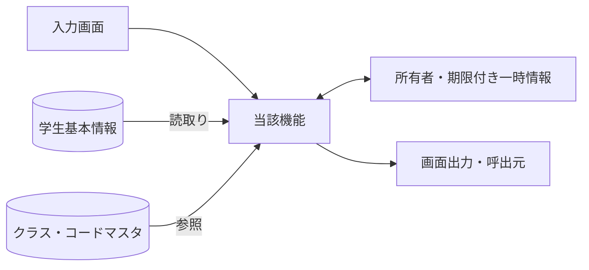
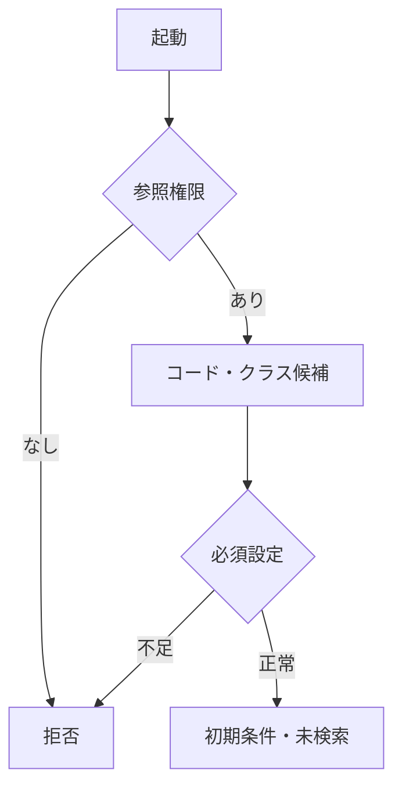
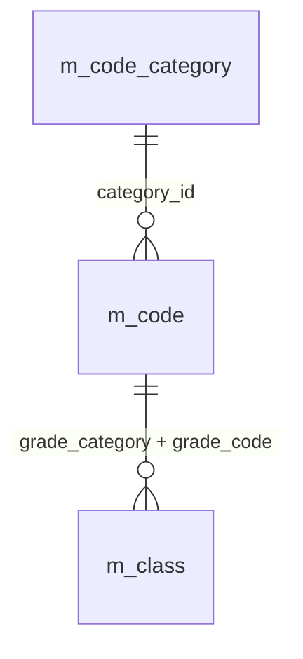
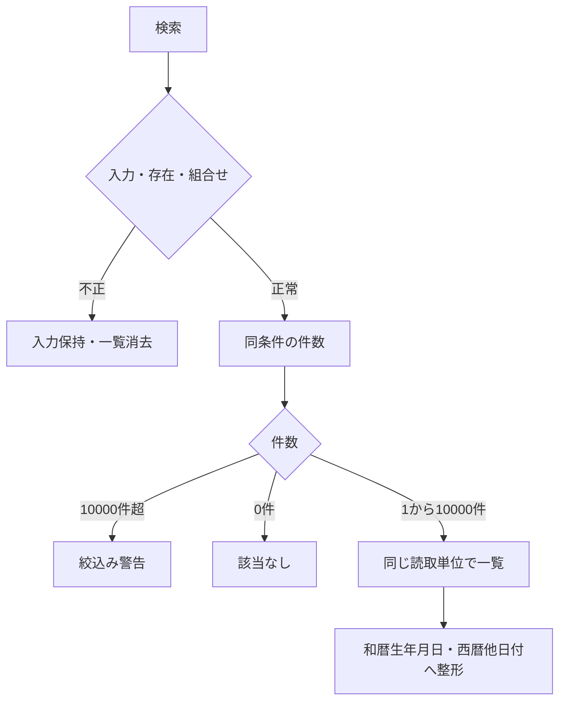
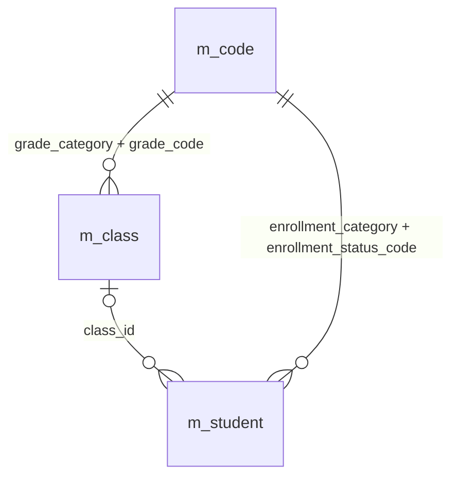
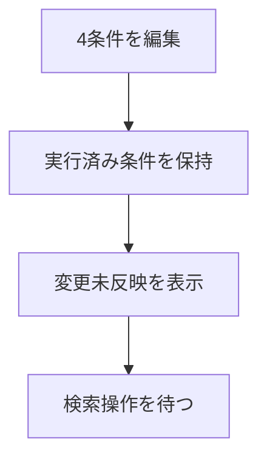
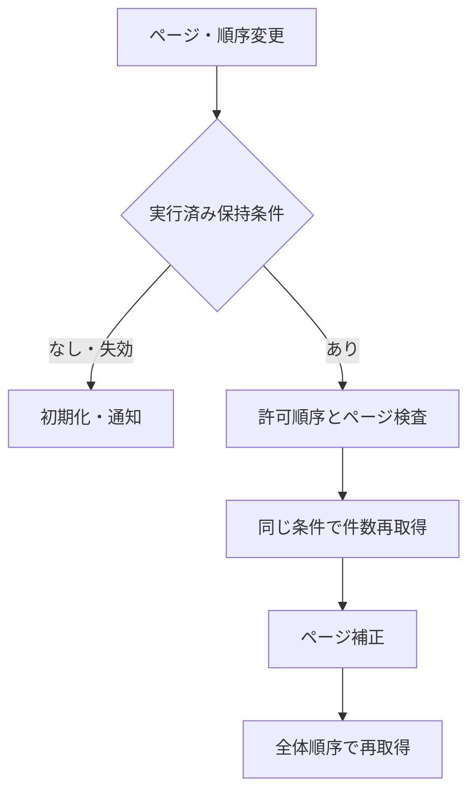
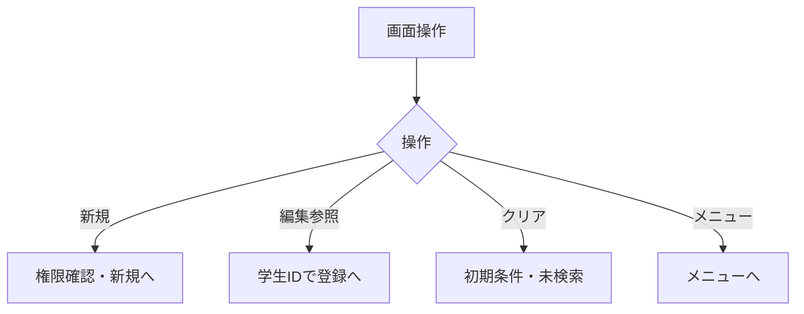
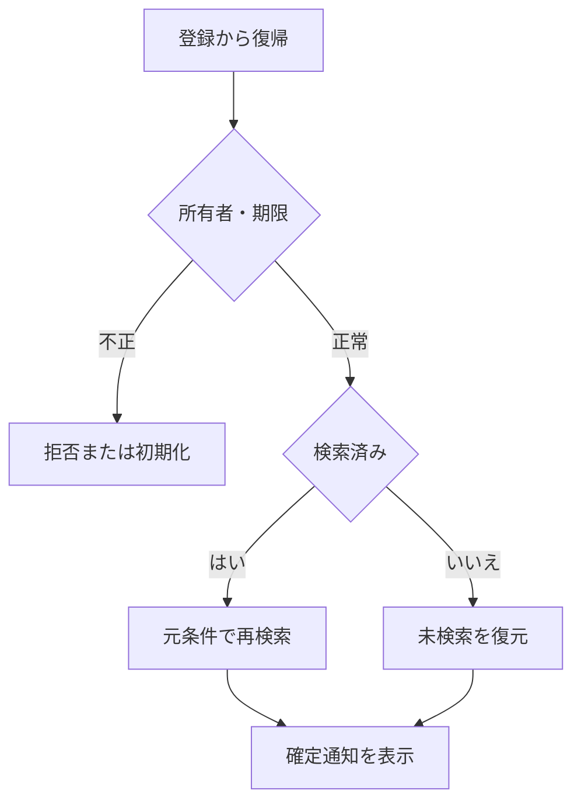

<!-- spec-meta: {"schema":"spec-md/1.0","documentId":"VUE_CSHARPAPI-DET-Vue_CSharpAPI-SCR-STU-001","version":"8.4","path":"sample-project1/spec/Vue_CSharpAPI/詳細仕様書/01_学生検索画面.md","sheets":[{"heading":"概要","kind":"GRID","sheet":"01_概要"},{"heading":"項目一覧","kind":"LIST","sheet":"02_項目一覧","key":["項目ID"]},{"heading":"選択候補一覧","kind":"LIST","sheet":"03_選択候補一覧","key":["候補ID"]},{"heading":"内部項目一覧","kind":"LIST","sheet":"04_内部項目一覧","key":["内部項目ID"]},{"heading":"イベント仕様","kind":"GRID","sheet":"05_イベント仕様"},{"heading":"項目移送仕様","kind":"LIST","sheet":"06_項目移送仕様","key":["移送ID"]},{"heading":"補足説明","kind":"GRID","sheet":"07_補足説明"}],"isolationProfile":"Vue_CSharpAPI"} -->
# 学生検索画面 詳細仕様書（Vue／C# API）

| 項目 | 内容 |
| --- | --- |
| システム名 | 学生管理システム |
| 機能ID | SCR-STU-001 |
| 版数・改訂日 | 8.4／2026-10-25 |
| 対象読者 | 実務経験５年程度のプログラマー |
| 状態 | 実装前の設計仕様。実装・コンパイル・実機試験は未実施 |
| 開発方式 | Vue／C# API |
| 対応基本設計 | [基本設計](../基本設計書/01_学生検索画面.md) |

## 概要

### 概要説明

検索条件と一覧を管理する。業務DBは参照のみ。

| 責務 | 物理構成 |
| --- | --- |
| 画面・提示制御 | StudentSearchPage.vue / useStudentSearch |
| 業務処理・共通呼出 | StudentQueryService |
| 共通実装仕様 | [方式別共通仕様・DB定義・開発規約](../共通/方式別/01_共通実装仕様.md) |
| 原則 | DB列・変数・型は本書・共通仕様・DB定義・開発規約。業務要件を言語都合で弱めない |

### 画面設計

#### 画面レイアウト（描画可能な埋め込みHTML）

画面の配置は下記の埋め込みHTMLを正本とし、基本設計にも同じ断片を掲載する。値は架空の設計例であり、製品実機の画面ではない。PNGや別配置の簡略図、単独HTMLプレビューは併置しない。CSSとフォーム要素を保持するHTML表示で確認し、ビューアーが要素を除去した表示を正規の配置とみなさない。描画確認用の抽出HTML・画像は方式内.tmp/だけで扱い、今回の検査記録と入出力manifestは方式内build/spec-generation/の固定先へ更新する。

<!-- screen-html-start: SRC -->

<header class="titlebar"><strong>学生管理 ／ 学生検索</strong>Vue ／ C# API　｜　管理者</header><main class="body">
検索が完了しました。変更した条件は「検索」で反映します。
<section class="section">
検索条件

学籍番号

<input aria-label="学籍番号" class="input" data-business-maxlength="15" data-normalized-maxlength="15" maxlength="30" value=""/>

氏名

<input aria-label="氏名" class="input" data-business-maxlength="8" data-normalized-maxlength="160" maxlength="16" value="見本"/>

クラス

<select aria-label="クラス"><option value="">すべて（全年度・停止含む）</option><option value="1">2026 ／ 学年なし ／ C-A ／ Aクラス</option><option value="2">2025 ／ 学年なし ／ C-A ／ Aクラス（停止）</option></select>

在籍区分

<label><input checked="" type="checkbox"/>在学</label><label><input checked="" type="checkbox"/>休学</label><label><input type="checkbox"/>卒業</label><label><input type="checkbox"/>退学</label>

</section>
学籍番号：前方一致 ／ 氏名：部分一致 ／ クラス：完全一致 ／ 在籍：全解除ですべて

<button class="primary" data-binding="search → C# Search" data-control="search" data-field-id="SRC-013" type="button">検索</button><button class="" data-binding="clear → C# Clear" data-control="clear" data-field-id="SRC-014" type="button">クリア</button><button class="" data-binding="new → C# New" data-control="new" data-field-id="SRC-015" type="button">新規登録</button><button class="" data-binding="menu → C# Menu" data-control="menu" data-field-id="SRC-016" type="button">メニューへ</button>

<strong data-binding="totalCount / RangeFrom / RangeTo → C# TotalCount / RangeFrom / RangeTo" data-control="totalCount / RangeFrom / RangeTo" data-field-id="SRC-017">検索結果 2件　1–2件を表示</strong><label data-binding="pageSize → C# PageSize" data-control="pageSize" data-field-id="SRC-019">表示件数 <select><option>20</option><option>50</option><option>100</option></select></label><label data-binding="sortKey → C# SortKey" data-control="sortKey" data-field-id="SRC-032">並び順 <select><option>学籍番号</option><option>氏名</option><option>入学日</option><option>更新日時</option></select></label><label data-binding="sortDirection → C# SortDirection" data-control="sortDirection" data-field-id="SRC-033"><select><option>昇順</option><option>降順</option></select></label>

<table class="grid"><thead><tr><th data-binding="studentNo → C# StudentNo" data-control="studentNo" data-field-id="SRC-020">学籍番号</th><th data-binding="studentName → C# StudentName" data-control="studentName" data-field-id="SRC-021" data-includes-field-id="SRC-022">氏名 ／ カナ</th><th data-binding="birthDateWareki → C# BirthDateWareki" data-control="birthDateWareki" data-field-id="SRC-023">生年月日</th><th data-binding="schoolYear / GradeName → C# SchoolYear / GradeName" data-control="schoolYear / GradeName" data-field-id="SRC-024">年度／学年</th><th data-binding="classCode / ClassName → C# ClassCode / ClassName" data-control="classCode / ClassName" data-field-id="SRC-025">クラス</th><th data-binding="enrollmentName → C# EnrollmentName" data-control="enrollmentName" data-field-id="SRC-026">在籍区分</th><th data-binding="openSelectedStudent → C# OpenSelectedStudent" data-control="openSelectedStudent" data-field-id="SRC-030">操作</th></tr></thead><tbody><tr><td>S2026-0001</td><td>見本 太郎ミホン タロウ</td><td>平成20年05月15日</td><td>2026 学年なし</td><td>C-A Aクラス</td><td>在学</td><td><button type="button">編集</button></td></tr><tr><td>S2026-0002</td><td>見本 花子ミホン ハナコ</td><td>平成20年07月20日</td><td>2026 学年なし</td><td>C-A Aクラス</td><td>休学</td><td><button type="button">編集</button></td></tr></tbody></table>

<button disabled="">先頭</button><button disabled="">前へ</button><strong>1 / 1</strong><button disabled="">次へ</button><button disabled="">最後</button>

検索日時：2026/10/11 10:00:00　｜　最終実行条件：氏名「見本」、在学・休学
</main><footer class="foot">仕様モック・架空データ ／ 2026-10-23 ／ 100% CSS px</footer>
<section class="confirmations" hidden=""></section>

<!-- screen-html-end: SRC -->

#### 表示状態・モード別制御

[共通UI状態](../共通/04_共通UI部品設計.md)に従う。初回は未検索。処理中は二重検索を抑止し、0件・上限超過・検索失敗を区別する。参照権限では新規登録を表示せず行操作を参照とする。検索画面では生年月日を編集しない。

#### 小規模運用の検索と配置

学生を特定する入口を学籍番号・氏名・クラス・在籍区分の4条件へ限定する。学籍番号はN-06後の前方一致、氏名はN-03後のname_key部分一致、クラスはID完全一致、在籍区分の複数値だけOR、異なる条件はANDとする。未指定条件は追加しない。非削除は常時必須で利用者が解除できない。初回とクリアは在学・休学、20件、学籍番号昇順、未検索。全区分解除は全区分とし、空条件でも明示的な検索操作後に取得する。

氏名カナ・年度・学年・未所属のみ・都道府県・電話番号・入学日開始終了（SRC-003/004/005/007/009/010/011/012）は廃止しIDを予約する。未知の条件名と廃止したキーは空文字・null・falseでも拒否し、無視して検索しない。登録・編集の同名項目、保存値、コード・クラス制約は維持する。

クラス候補は全年度・停止・期間外を含み、年度／学年名称／コード／名称で識別する。独立した年度・学年・未所属条件、検索中の候補連動を設けない。EV-SRC-003は条件変更未反映の表示だけでDBを呼ばない。

一覧は学籍番号、氏名とカナの同一セル、生年月日、年度と学年、クラス、在籍区分、操作の7列・8論理項目。SRC-027住所・028電話・029更新日時は検索応答から除外し、必要時は既存の編集／参照で確認する。氏名等を省略記号で欠落させず折り返す。20/50/100件、許可4ソートと昇降順、学生IDの同順位順序、10,000件上限を維持する。

1366×650と1280×650 CSS px、100%の通常画面で条件・件数・一覧枠・ページ・主要操作を収める。一覧だけを高さ制限した内部スクロールにし、20件全行の同時表示は要求しない。12px以上の文字と34px以上の入力操作を確保する。エラー・長い名称・狭幅・拡大では画面の縦スクロールを許し、項目や操作を切り捨てない。保持状態は形式版search-compact-1を持ち、旧形式は所有者とRevisionの確認後にW-SRC-002で未検索へ再初期化する。旧条件の黙示移行は行わない。

### ファイル・DB入出力関係

#### 入出力一覧

方向は当該機能から見たもの。画面入力、DB読取り、DB書込みを区別する。

| IO-ID | 分類 | 対象 | 入出力 | 主な項目 | 保存単位・備考 |
| --- | --- | --- | --- | --- | --- |
| 01 | 画面 | 入力条件・操作 | 入力 | 当該機能の項目一覧 | 要求開始時の値を複製 |
| 02 | 永続DB | m_student | 入力（参照） | 学生基本情報・版 | 更新なし |
| 03 | 永続DB | m_class | 入力（参照） | 年度・学年・名称・期間・定員 | 学生機能からマスタを更新しない |
| 04 | 永続DB | m_code_category / m_code | 入力（参照） | 分類・値・名称・有効性 | 学生機能からマスタを更新しない |
| 05 | 一時情報 | API側SearchContext | 入出力 | 確定検索条件・ページ・原入力・確認対象 | 業務表と別。所有者・期限を検査 |
| 06 | 外部ファイル | なし | なし | CSV・帳票・取込は本機能の対象外 | 仕様書MDを業務IOに数えない |
| 07 | 画面 | 一覧・メッセージ | 出力 | 個人情報は必要項目のみ | DB保存とは別の出力 |

#### データ操作関連図

認証情報・業務日時は共通01～03から取得。マスタ保守の承認入力ファイルは画面機能のIOに含めず、方式別共通仕様に定義する。

### 実装契約の配置

共用クラス／プログラム構造は[方式別共通仕様](../共通/方式別/01_共通実装仕様.md)、SQLの永続項目・制約は[DB定義](../DB定義/SQLServer/01_DB定義書.md)、命名・配備は[開発規約](../規約/Vue_CSharpAPI.md)へ分離する。本機能の具体的な画面・変数・DB割当・イベント順序は本書を正とし、共通契約を引数と結果で具体化する。

## 項目一覧

| 項目ID | グループ | 論理項目名 | 種類 | 入出力 | 入力最大長 | 保存・正規化最大長 | 長さ単位 | 必須区分 | 必須条件 | 初期値 | 未設定値 | 表示形式・許容範囲 | 関連論理DB項目 | 物理コントロール | 変数・プロパティ | 言語型 | 物理DB項目 | 候補ID | 正規化ID | チェックID | 関連イベント | DB連携説明 | Raw入力表現 | 対応DB型 | 対応DB_NULL可否 |
| --- | --- | --- | --- | --- | --- | --- | --- | --- | --- | --- | --- | --- | --- | --- | --- | --- | --- | --- | --- | --- | --- | --- | --- | --- | --- |
| SRC-001 | 検索条件 | 学籍番号 | 文字入力 | I（検索条件） | 15 | 15 | Unicodeスカラー値 | 任意 | 未指定は条件なし。CHK-003は番号形式だけ、重複・変更不可は非適用 | 空 | NULL相当 | 15文字以内 | 学生基本情報・学籍番号 | draft.studentNo | draft.studentNo → C# StudentNoPrefix | string／C# string | m_student.student_no | － | N-06 | CHK-002,CHK-003 | EV-SRC-002 | 前方一致、N-06。保存なし | 画面文字列（空・不正を保持） | m_student.student_no:varchar(15) | m_student.student_no:不可 |
| SRC-002 | 検索条件 | 氏名 | 文字入力 | I（検索条件） | 8 | 160 | Unicodeスカラー値 | 任意 | 表示氏名ではなく照合キーに部分一致 | 空 | NULL相当 | 原入力8文字以内、正規化後160文字以内 | 学生基本情報・氏名照合用情報 | draft.name | draft.name → C# NameKey | string／C# string | m_student.name_key | － | N-03 | CHK-002 | EV-SRC-002 | N-03後の部分一致。氏名の原表記と区別 | 画面文字列（空・不正を保持） | m_student.name_key:nvarchar(320) | m_student.name_key:不可 |
| SRC-006 | 検索条件 | クラス | 選択 | I（検索条件） | 19 | 64bit正整数 | 数字またはASCII文字 | 任意 | 実在するクラスID。全年度、停止・期間外も可 | すべて | NULL相当 | 正の整数。型範囲は方式別DB定義 | 学生基本情報・現在・最終所属クラス | draft.classId | draft.classId → C# ClassId | decimal string／C# long? | m_student.class_id | クラス | 非適用 | CHK-010 | EV-SRC-002 | クラスID完全一致。年度・学年の独立入力なし | 画面文字列（空・不正を保持） | m_student.class_id:bigint | m_student.class_id:可 |
| SRC-008 | 検索条件 | 在籍区分 | 複数選択 | I（検索条件） | 2×最大4件 | 2×最大4件 | 数字またはASCII文字 | 任意 | 空配列は全区分。重複値・未定義値は拒否 | 01,02 | 空配列 | 在学・休学・卒業・退学 | 学生基本情報・在籍区分 | draft.statusCodes | draft.statusCodes → C# StatusCodes | string[]／C# IReadOnlyList&lt;string&gt; | m_student.enrollment_status_code | 在籍区分 | N-07 | CHK-010,CHK-024 | EV-SRC-002 | 複数値はいずれか一致、全解除は全区分 | 選択値の配列／チェック状態 | m_student.enrollment_status_code:varchar(2) | m_student.enrollment_status_code:不可 |
| SRC-013 | 操作 | 検索 | 操作 | 操作 | 非適用 | 非適用 | 非適用 | 非適用 | 表示または操作項目 | 条件を検査して1ページ目を表示 | 非適用 | ― | DB保存なし | search | search → C# Search | イベント／引数はイベント仕様 | － | － | 非適用 | 非適用 | EV-SRC-002 | 入力検査後、最初のページを取得 | 入力対象外 | 非適用（操作・計算または一覧DTO） | 非適用 |
| SRC-014 | 操作 | クリア | 操作 | 操作 | 非適用 | 非適用 | 非適用 | 非適用 | 表示または操作項目 | 初期条件・未検索へ戻す | 非適用 | ― | DB保存なし | clear | clear → C# Clear | イベント／引数はイベント仕様 | － | － | 非適用 | 非適用 | EV-SRC-005 | 初期条件・未検索へ、保持条件を消去 | 入力対象外 | 非適用（操作・計算または一覧DTO） | 非適用 |
| SRC-015 | 操作 | 新規登録 | 操作 | 操作 | 非適用 | 非適用 | 非適用 | 非適用 | 表示または操作項目 | 担当者・管理者だけ表示 | 非適用 | ― | DB保存なし | new | new → C# New | イベント／引数はイベント仕様 | － | － | 非適用 | 非適用 | EV-SRC-005 | 権限を確認し学生登録へ遷移 | 入力対象外 | 非適用（操作・計算または一覧DTO） | 非適用 |
| SRC-016 | 操作 | メニューへ | 操作 | 操作 | 非適用 | 非適用 | 非適用 | 非適用 | 表示または操作項目 | 共通メニューへ戻る | 非適用 | ― | DB保存なし | menu | menu → C# Menu | イベント／引数はイベント仕様 | － | － | 非適用 | 非適用 | EV-SRC-005 | 共通メニューへ | 入力対象外 | 非適用（操作・計算または一覧DTO） | 非適用 |
| SRC-017 | 結果・一覧 | 検索件数・表示範囲 | 表示 | O（表示） | 非適用 | 表示元の上限：件数0～10000・範囲0～10000 | 非適用 | 自動表示 | 入力対象外。取得結果または計算値を表示 | 未検索 | 表示欠損は－、マスタ欠落は不整合表示 | 件数0～10000・範囲0～10000 | 計算：全条件一致の学生件数 | totalCount / RangeFrom / RangeTo | totalCount / RangeFrom / RangeTo → C# TotalCount / RangeFrom / RangeTo | 表示DTO／複合項目は内部項目一覧 | count of matching student_id | － | 非適用 | 非適用 | EV-SRC-002 | 未検索／0件／上限超過を区別 | 入力対象外 | 非適用（操作・計算または一覧DTO） | 非適用 |
| SRC-018 | 結果・一覧 | 検索日時 | 表示 | O（表示） | 非適用 | 表示元の上限：西暦日時19文字 | 非適用 | 自動表示 | 入力対象外。取得結果または計算値を表示 | 未検索 | 表示欠損は－、マスタ欠落は不整合表示 | 西暦日時19文字 | 計算：今回の検索実行日時 | searchedAt | searchedAt → C# SearchedAt | 表示DTO／複合項目は内部項目一覧 | RequestContext.ExecutedAt | － | 非適用 | 非適用 | EV-SRC-002 | 西暦日時、日本時間。DB保存なし | 入力対象外 | 非適用（操作・計算または一覧DTO） | 非適用 |
| SRC-019 | 結果・一覧 | 表示件数 | 選択 | I（表示指定） | 3 | 保存なし | 数字またはASCII文字 | 必須 | 20・50・100のみ | 20 | 不可 | 表示規則による | DB保存なし：取得範囲 | pageSize | pageSize → C# PageSize | number／C# int? | pageSize | 表示件数 | 非適用 | CHK-024 | EV-SRC-004 | 20／50／100、既定20 | 画面文字列（空・不正を保持） | 非適用（操作・計算または一覧DTO） | 非適用 |
| SRC-020 | 結果・一覧 | 学籍番号 | 表示 | O（表示） | 非適用 | 表示元の上限：15 | 非適用 | 自動表示 | 入力対象外。取得結果または計算値を表示 | 未検索 | 表示欠損は－、マスタ欠落は不整合表示 | 15 | 学生基本情報・学籍番号 | studentNo | studentNo → C# StudentNo | 表示DTO／複合項目は内部項目一覧 | m_student.student_no | － | 非適用 | 非適用 | EV-SRC-002,EV-SRC-004,EV-SRC-006 | 保存済み文字列、文字順 | 入力対象外 | m_student.student_no:varchar(15) | m_student.student_no:不可 |
| SRC-021 | 結果・一覧 | 氏名 | 表示 | O（表示） | 非適用 | 表示元の上限：8 | 非適用 | 自動表示 | 入力対象外。取得結果または計算値を表示 | 未検索 | 表示欠損は－、マスタ欠落は不整合表示 | 8 | 学生基本情報・学生氏名 | studentName | studentName → C# StudentName | 表示DTO／複合項目は内部項目一覧 | m_student.student_name | － | 非適用 | 非適用 | EV-SRC-002,EV-SRC-004,EV-SRC-006 | 氏名を上段、SRC-022のカナを下段に同一セルで表示 | 入力対象外 | m_student.student_name:nvarchar(16) | m_student.student_name:不可 |
| SRC-022 | 結果・一覧 | 氏名カナ | 表示 | O（表示） | 非適用 | 表示元の上限：18 | 非適用 | 自動表示 | 入力対象外。取得結果または計算値を表示 | 未検索 | 表示欠損は－、マスタ欠落は不整合表示 | 18 | 学生基本情報・学生氏名カナ | studentNameKana | studentNameKana → C# StudentNameKana | 表示DTO／複合項目は内部項目一覧 | m_student.student_name_kana | － | 非適用 | 非適用 | EV-SRC-002,EV-SRC-004,EV-SRC-006 | SRC-021と同一セルの2段目。全文を折返し表示 | 入力対象外 | m_student.student_name_kana:nvarchar(36) | m_student.student_name_kana:不可 |
| SRC-023 | 結果・一覧 | 生年月日 | 表示 | O（表示） | 非適用 | 表示元の上限：共通和暦書式 | 非適用 | 自動表示 | 入力対象外。取得結果または計算値を表示 | 未検索 | 表示欠損は－、マスタ欠落は不整合表示 | 共通和暦書式 | 学生基本情報・生年月日 | birthDateWareki | birthDateWareki → C# BirthDateWareki | 表示DTO／複合項目は内部項目一覧 | m_student.birth_date | － | 非適用 | 非適用 | EV-SRC-002,EV-SRC-004,EV-SRC-006 | 和暦表示。共通16で日付から変換 | 入力対象外 | m_student.birth_date:date | m_student.birth_date:不可 |
| SRC-024 | 結果・一覧 | 年度・学年 | 表示 | O（表示） | 非適用 | 表示元の上限：年度4桁＋学年名称12 | 非適用 | 自動表示 | 入力対象外。取得結果または計算値を表示 | 未検索 | 表示欠損は－、マスタ欠落は不整合表示 | 年度4桁＋学年名称12 | クラスマスタ・学校年度／学年→コード管理マスタ（学年）・コード名称 | schoolYear / GradeName | schoolYear / GradeName → C# SchoolYear / GradeName | 表示DTO／複合項目は内部項目一覧 | m_class.school_year / grade_code → m_code.code_name | － | 非適用 | 非適用 | EV-SRC-002,EV-SRC-004,EV-SRC-006 | 年度は西暦、学年は名称。未所属は－ | 入力対象外 | m_class.school_year:smallint／m_code.code_name:nvarchar(24) | m_class.school_year:不可；m_code.code_name:不可 |
| SRC-025 | 結果・一覧 | クラス | 表示 | O（表示） | 非適用 | 表示元の上限：コード9＋名称18＋注記 | 非適用 | 自動表示 | 入力対象外。取得結果または計算値を表示 | 未検索 | 表示欠損は－、マスタ欠落は不整合表示 | コード9＋名称18＋注記 | 学生基本情報・現在・最終所属クラス→クラスマスタ・クラスコード／クラス名 | classCode / ClassName | classCode / ClassName → C# ClassCode / ClassName | 表示DTO／複合項目は内部項目一覧 | m_student.class_id → m_class.class_code / class_name | － | 非適用 | 非適用 | EV-SRC-002,EV-SRC-004,EV-SRC-006 | 未所属／停止／期間外を区別 | 入力対象外 | m_class.class_code:varchar(9)／m_class.class_name:nvarchar(36) | m_class.class_code:不可；m_class.class_name:不可 |
| SRC-026 | 結果・一覧 | 在籍区分 | 表示 | O（表示） | 非適用 | 表示元の上限：名称12 | 非適用 | 自動表示 | 入力対象外。取得結果または計算値を表示 | 未検索 | 表示欠損は－、マスタ欠落は不整合表示 | 名称12 | 学生基本情報・在籍区分→コード管理マスタ（在籍区分）・コード名称 | enrollmentName | enrollmentName → C# EnrollmentName | 表示DTO／複合項目は内部項目一覧 | m_student.enrollment_status_code → m_code.code_name | － | 非適用 | 非適用 | EV-SRC-002,EV-SRC-004,EV-SRC-006 | 種別と値で結合、名称未取得でも学生行を落とさない | 入力対象外 | m_code.code_name:nvarchar(24) | m_code.code_name:不可 |
| SRC-030 | 結果・一覧 | 編集／参照 | 操作 | 操作 | 非適用 | 非適用 | 非適用 | 非適用 | 表示または操作項目 | 未検索 | 非適用 | 表示規則による | 学生基本情報・学生管理番号 | openSelectedStudent | openSelectedStudent → C# OpenSelectedStudent | イベント／引数はイベント仕様 | m_student.student_id | － | 非適用 | 非適用 | EV-SRC-005 | 行番号ではなく対象IDで遷移、遷移先で再取得 | 入力対象外 | 非適用（操作・計算または一覧DTO） | 非適用 |
| SRC-031 | 結果・一覧 | ページ操作 | 操作 | 操作 | 非適用 | 非適用 | 非適用 | 非適用 | 表示または操作項目 | 未検索 | 非適用 | 表示規則による | DB保存なし：取得範囲 | page | page → C# Page | イベント／引数はイベント仕様 | page / pageSize | － | 非適用 | 非適用 | EV-SRC-004 | 先頭・前・次・最後。有効範囲へ再補正 | 入力対象外 | 非適用（操作・計算または一覧DTO） | 非適用 |
| SRC-032 | 結果操作 | 並び順項目 | 選択 | I（表示指定） | 13 | 保存なし | Unicodeスカラー値 | 必須 | studentNo・name・admissionDate・updatedAtのみ | studentNo | 不可 | 固定候補 | 検索：学籍番号／氏名照合用情報／入学日／更新日時 | sortKey | sortKey → C# SortKey | string／C# string | sortKey | 並び順 | 非適用 | CHK-024 | EV-SRC-004 | 許可4項目。最後に学生ID昇順を加える | 画面文字列（空・不正を保持） | 非適用（操作・計算または一覧DTO） | 非適用 |
| SRC-033 | 結果操作 | 並び順方向 | 選択 | I（表示指定） | 4 | 保存なし | Unicodeスカラー値 | 必須 | asc・descのみ | asc | 不可 | 固定候補 | DB保存なし：取得順 | sortDirection | sortDirection → C# SortDirection | string／C# string | sortDirection | 昇降順 | 非適用 | CHK-024 | EV-SRC-004 | 昇順／降順。初期は昇順 | 画面文字列（空・不正を保持） | 非適用（操作・計算または一覧DTO） | 非適用 |

## 選択候補一覧

| 候補ID | 参照元・分類 | 選択値 | 表示値 | 抽出条件 | 表示順 | 初期値・連動 |
| --- | --- | --- | --- | --- | --- | --- |
| クラス | クラスマスタ・コード管理マスタ（学年） | class_id | 年度・学年・クラスコード・クラス名 | 全年度・停止・期間外を含む。検索では人数集計なし | 年度降順→学年表示順→クラス表示順→コード→ID | すべて。独立した上位条件・候補連動なし |
| 在籍区分 | コード管理マスタ（在籍区分） | ENROLLMENT_STATUS / code_value | コード名称 | 分類ENROLLMENT_STATUSの01～04。停止を含む | 表示順→コード値 | 01・02、全解除は全区分 |
| 表示件数 | 共通UI固定定義 | 20 / 50 / 100 | 20件／50件／100件 | 固定3候補。業務コードではない | 20→50→100 | 20、変更で1ページへ |
| 並び順 | 共通UI固定定義 | studentNo / name / admissionDate / updatedAt | 学籍番号／氏名／入学日／更新日時 | 固定4候補。自由文字でDB列を指定しない | 左記順 | 学籍番号 |
| 昇降順 | 共通UI固定定義 | asc / desc | 昇順／降順 | 固定2候補 | 昇順→降順 | 昇順 |

## 内部項目一覧

| 内部項目ID | 親項目ID | 論理名 | 変数・コントロール | 型 | 最大長・範囲 | 必須条件 | 未設定 | 設定元 | 用途・制約 |
| --- | --- | --- | --- | --- | --- | --- | --- | --- | --- |
| SRC-INT-001 | SRC-017 | 件数 | TotalCount | 非負整数 | 5 | 検索成功時 | 未検索／上限超過は未設定 | OP-COUNT / page | 0件の範囲は0～0。表示件数と混同しない |
| SRC-INT-002 | SRC-017 | 開始位置 | RangeFrom | 非負整数 | 5 | 検索成功時 | 未検索／上限超過は未設定 | OP-COUNT / page | 0件の範囲は0～0。表示件数と混同しない |
| SRC-INT-003 | SRC-017 | 終了位置 | RangeTo | 非負整数 | 5 | 検索成功時 | 未検索／上限超過は未設定 | OP-COUNT / page | 0件の範囲は0～0。表示件数と混同しない |
| SRC-INT-004 | SRC-024 | 年度 | StudentListItem.SchoolYear | 任意整数 | 4 | 表示 | 未所属は－ | m_class.school_year | 1900～9998、西暦 |
| SRC-INT-005 | SRC-024 | 学年名称 | StudentListItem.GradeName | string | 12 | 表示 | 未所属は－ | m_code GRADE.code_name | 保存値でなく名称 |
| SRC-INT-006 | SRC-025 | クラスコード | StudentListItem.ClassCode | string | 9 | 表示 | 未所属表示 | m_class | 名称欠落で学生行を消さない |
| SRC-INT-007 | SRC-025 | クラス名称 | StudentListItem.ClassName | string | 18 | 表示 | 未所属表示 | m_class | 名称欠落で学生行を消さない |
| SRC-INT-008 | SRC-023 | 内部生年月日 | StudentListItem.BirthDate | ISO string／C# DateOnly? | 日付／ISO10 | 取得時必須 | 欠損はデータ不整合 | m_student.birth_date | 共通16で和暦へ変換。時差を適用しない |
| SRC-INT-009 | SRC-030 | 対象学生ID | StudentId | TypeScript decimal string／C# long（正64bit） | 19 | 更新削除・既存読込時 | 新規はNULL | DB採番値／行モデル／ルート | 行番号ではない。権限・存在を再確認 |
| SRC-INT-010 | SRC-031 | 検索状態キー | ContextId | string | 64 | 復帰または一覧操作時 | 初回だけ未指定 | 共通12の256bit乱数を64桁hexへ符号化した不透明キー | 利用者・セッション・画面ごと、30分 |
| SRC-INT-011 | SRC-013 | CSRF情報 | CsrfToken | 認証基盤のopaque文字列 | 基盤定義・QA-AUTH | 状態変更・規約で指定するPOST | 必須条件時不可 | 共通認証基盤 | 二重送信や認可の代替ではない。実値長は基盤決定事項 |
| SRC-INT-012 | SRC-013 | 処理中 | IsBusy | 真偽 | 1 | 自動 | false | 処理開始終了 | UI再入防止のみ。DB排他は共通13 |
| SRC-INT-013 | SRC-013 | 応答世代 | RequestSequence | 非負整数 | 数値 | 非同期要求時 | 0初期 | 画面内要求連番 | 旧応答を無視。桁あふれ時は採番継続しない |

## イベント仕様

### EV-SRC-001 初期表示

#### 処理概要

認証済み利用者がメニューから起動。学生一覧は取得しない。

#### 処理手順

1. 共通01・02で参照権限を確認し、共通03で業務日時を確定する。
2. OP-CODE・OP-CLASSで候補取得。在学・休学、20件、学籍番号昇順、未検索を設定する。必須マスタ不足なら検索を不可とする。
3. 共通12の画面別状態を作成する。復帰識別がある場合はEV-SRC-006へ進む。

##### 実装詳細

入口：`GET /api/students/bootstrap`。機能内の入力・結果型は項目一覧、共通実装は[方式別共通仕様](../共通/方式別/01_共通実装仕様.md)を使用する。 `Draft`相当の未実行値と`AppliedCriteria`相当の確定条件を分離。呼出引数を複製し、結果を返した要求が最新であることを確認して画面へ移送する。

#### 処理フロー

#### SQL・テーブル関連（ER図）

名称参照は未所属・停止値を残す外部結合相当。コードは用途ごとの別名で**分類と値**を結合する。図は読取りの関連であり、履歴への書込みや削除連動を意味しない。単独の存在確認・採番・書込みの表関連は下記操作IDで特定する。

#### DB操作の詳細

`OP-CODE` → `OP-CLASS`。下記「DB操作定義」の同名操作を実行する。

#### 結果・例外時の扱い

入力不備は項目エラーと原入力を保持。検索要求の失敗は一覧消去、0件はI-SRC-001、上限超過はW-SRC-001。権限不備・他者の保持情報は拒否する。条件変更だけでは既存一覧を再検索しない。 各イベントで実行していない処理の結果状態は発生対象外。

### EV-SRC-002 検索実行

#### 処理概要

入力した検索条件で、非削除学生を検索する。

#### 処理手順

1. 入力を複製し共通04・05で4条件の正規化、桁、選択値と許可キーを検査する。項目エラーは入力保持・一覧消去、DB検索なし。
2. OP-EXISTSで指定した在籍区分の分類付き存在とクラスIDの存在を検査する。検索では停止・期間外の既存値を許容する。
3. OP-COUNT・OP-PAGEへ同じ確定条件を渡す。10001件で上限、0件は該当なし、それ以外は最初のページを表示する。件数と一覧の読取りを揃える。
4. 正常時に実行済み条件を共通12へ保持。生年月日は共通16で和暦表示。他の日付・日時は西暦。

##### 実装詳細

入口：`POST /api/students/search`。機能内の入力・結果型は項目一覧、共通実装は[方式別共通仕様](../共通/方式別/01_共通実装仕様.md)を使用する。 `Draft`相当の未実行値と`AppliedCriteria`相当の確定条件を分離。呼出引数を複製し、結果を返した要求が最新であることを確認して画面へ移送する。

#### 処理フロー

#### SQL・テーブル関連（ER図）

名称参照は未所属・停止値を残す外部結合相当。コードは用途ごとの別名で**分類と値**を結合する。図は読取りの関連であり、履歴への書込みや削除連動を意味しない。単独の存在確認・採番・書込みの表関連は下記操作IDで特定する。

#### DB操作の詳細

`OP-EXISTS` → `OP-COUNT` → `OP-PAGE`。下記「DB操作定義」の同名操作を実行する。

#### 結果・例外時の扱い

入力不備は項目エラーと原入力を保持。検索要求の失敗は一覧消去、0件はI-SRC-001、上限超過はW-SRC-001。権限不備・他者の保持情報は拒否する。条件変更だけでは既存一覧を再検索しない。 各イベントで実行していない処理の結果状態は発生対象外。

### EV-SRC-003 条件変更未反映

#### 処理概要

4条件の編集を未実行状態として表示する。自動検索・候補連動は行わない。

#### 処理手順

1. 編集値と最後の実行済み条件を分離し、「条件変更は未反映」を表示する。
2. クラスは全候補から選択する。年度・学年の独立入力、候補の再取得や選択の自動解除は行わない。
3. 検索操作でEV-SRC-002へ進む。ページ移動では最後に実行した条件を使用する。Vueのdraft変更を監視し、appliedCriteriaと分離する。候補APIは呼ばない。

#### 処理フロー

#### SQL・テーブル関連（ER図）

業務DB参照なし。ER図は非適用。

#### DB操作の詳細

OP-CLASS・OP-COUNT・OP-PAGEは呼び出さない。保持された実行条件を更新しない。

#### 結果・例外時の扱い

検索成功までは一覧を実行済み条件に対応付ける。未検索状態では一覧を作らない。入力途中の値を確定条件と扱わない。

### EV-SRC-004 並び替え・ページ移動

#### 処理概要

実行済み条件の結果を別の順序・ページで取得する。

#### 処理手順

1. 共通12から保持条件を取得。未検索は不可、期限切れはW-SRC-002。入力途中の条件を混ぜない。
2. 並び順4項目・方向2種・件数20/50/100・正のページ番号を検査する。並び順・件数変更時は1ページへ戻す。
3. OP-COUNT・OP-PAGEを再実行。件数減少時は最終有効ページへ補正。0件は一覧なし・ページ操作不可。

##### 実装詳細

入口：`POST /api/students/page`。機能内の入力・結果型は項目一覧、共通実装は[方式別共通仕様](../共通/方式別/01_共通実装仕様.md)を使用する。 `Draft`相当の未実行値と`AppliedCriteria`相当の確定条件を分離。呼出引数を複製し、結果を返した要求が最新であることを確認して画面へ移送する。

#### 処理フロー

#### SQL・テーブル関連（ER図）

名称参照は未所属・停止値を残す外部結合相当。コードは用途ごとの別名で**分類と値**を結合する。図は読取りの関連であり、履歴への書込みや削除連動を意味しない。単独の存在確認・採番・書込みの表関連は下記操作IDで特定する。

#### DB操作の詳細

`OP-COUNT` → `OP-PAGE`。下記「DB操作定義」の同名操作を実行する。

#### 結果・例外時の扱い

入力不備は項目エラーと原入力を保持。検索要求の失敗は一覧消去、0件はI-SRC-001、上限超過はW-SRC-001。権限不備・他者の保持情報は拒否する。条件変更だけでは既存一覧を再検索しない。 各イベントで実行していない処理の結果状態は発生対象外。

### EV-SRC-005 新規・編集・参照・クリア

#### 処理概要

行操作または機能ボタンを受け付ける。

#### 処理手順

1. 新規は作成権限を確認し学生登録へ。検索条件を登録値へ流用しない。
2. 編集・参照は選択行の学生管理番号で登録機能を起動する。行番号・表示名を識別子にしない。読込みは登録側の責務。
3. クリアは初期条件・未検索へ戻し共通12も初期化。メニューへ戻る処理はDB更新なし。

##### 実装詳細

入口：`openNew / open / context-clear`。機能内の入力・結果型は項目一覧、共通実装は[方式別共通仕様](../共通/方式別/01_共通実装仕様.md)を使用する。 `Draft`相当の未実行値と`AppliedCriteria`相当の確定条件を分離。呼出引数を複製し、結果を返した要求が最新であることを確認して画面へ移送する。

#### 処理フロー

#### SQL・テーブル関連（ER図）

DB参照なし。ER図は対象外。

#### DB操作の詳細

このイベントで業務DBを読み書きしない。遷移先の読込みと混同しない。

#### 結果・例外時の扱い

入力不備は項目エラーと原入力を保持。検索要求の失敗は一覧消去、0件はI-SRC-001、上限超過はW-SRC-001。権限不備・他者の保持情報は拒否する。条件変更だけでは既存一覧を再検索しない。 各イベントで実行していない処理の結果状態は発生対象外。

### EV-SRC-006 学生登録からの復帰

#### 処理概要

保存・削除・取消・戻るから検索状態を復元する。

#### 処理手順

1. 共通12で所有者・認証・画面・期限・形式版search-compact-1を確認。他者状態は拒否、期限切れは初期化する。
2. 未検索から起動していた場合は未検索へ。検索済みなら元条件でOP-COUNT・OP-PAGEを再実行し最新DBを表示する。
3. 確定済み成功通知だけを表示。保存した学生が条件外でも検索条件を変更しない。

##### 実装詳細

入口：`POST /api/students/resume`。機能内の入力・結果型は項目一覧、共通実装は[方式別共通仕様](../共通/方式別/01_共通実装仕様.md)を使用する。 `Draft`相当の未実行値と`AppliedCriteria`相当の確定条件を分離。呼出引数を複製し、結果を返した要求が最新であることを確認して画面へ移送する。

#### 処理フロー

#### SQL・テーブル関連（ER図）

名称参照は未所属・停止値を残す外部結合相当。コードは用途ごとの別名で**分類と値**を結合する。図は読取りの関連であり、履歴への書込みや削除連動を意味しない。単独の存在確認・採番・書込みの表関連は下記操作IDで特定する。

#### DB操作の詳細

`OP-COUNT` → `OP-PAGE`。下記「DB操作定義」の同名操作を実行する。

#### 結果・例外時の扱い

入力不備は項目エラーと原入力を保持。検索要求の失敗は一覧消去、0件はI-SRC-001、上限超過はW-SRC-001。権限不備・他者の保持情報は拒否する。条件変更だけでは既存一覧を再検索しない。 各イベントで実行していない処理の結果状態は発生対象外。

### DB操作定義

操作の業務契約は[共通データアクセス](../共通/08_データアクセス仕様.md)が正本。本機能における具体的な対象・引数・確定単位は以下。

#### OP-CODE

| 項目 | 内容 |
| --- | --- |
| 対象テーブル | m_code_category / m_code |
| 操作 | 参照 |
| 実行条件・引数 | 分類、用途（検索／新規選択／既存表示）、既存値、業務日 |
| 取得・設定項目／対象条件 | 分類・値・名称・表示順・利用可否・期間。分類＋値で取得 |
| 件数・順序 | 候補0件を検出。既定値を先頭値へ代替しない |
| 確定・取消 | 参照のみ |

#### OP-CLASS

| 項目 | 内容 |
| --- | --- |
| 対象テーブル | m_class / m_code / m_student |
| 操作 | 参照 |
| 実行条件・引数 | 用途、年度、学年、在籍区分、在籍期間、既存所属、業務日、人数参照要否 |
| 取得・設定項目／対象条件 | 年度・学年・クラスID・コード・名称・期間・定員。人数集計は登録側で要求した場合のみ。検索の候補取得では学生を集計しない |
| 件数・順序 | 年度降順、学年表示順、クラス表示順、クラスコード、ID |
| 確定・取消 | 参照のみ、人数は予約ではない |

#### OP-EXISTS

| 項目 | 内容 |
| --- | --- |
| 対象テーブル | m_student / m_class / m_code_category / m_code |
| 操作 | 参照 |
| 実行条件・引数 | 用途（検索／保存）、分類付きコード・クラスID・選択補助。保存だけ対象ID・完全な学籍番号・期待版 |
| 取得・設定項目／対象条件 | 検索は指定在籍区分とクラスIDの存在のみ（停止・期間外可）。学籍番号前方一致に重複・完全一致存在検査をしない。保存は全行学籍番号一意、分類付き存在、変更有無、有効性を再検査 |
| 件数・順序 | 未存在／重複／組合せ／停止を区別。未指定の検索条件は検査対象外 |
| 確定・取消 | 検索は参照のみ、保存は保護した最新値で確認 |

#### OP-COUNT

| 項目 | 内容 |
| --- | --- |
| 対象テーブル | m_student s LEFT JOIN m_class c |
| 操作 | 参照 |
| 実行条件・引数 | 正規化後の実行済み検索条件 |
| 取得・設定項目／対象条件 | 非削除固定。学籍番号前方・氏名name_key部分・クラスID完全をAND、在籍区分だけOR。未指定は条件なし。最大10001件 |
| 件数・順序 | 10001件は上限、10000件以下は実件数。0件は該当なし |
| 確定・取消 | OP-PAGEと同じ読取り整合性 |

#### OP-PAGE

| 項目 | 内容 |
| --- | --- |
| 対象テーブル | m_student s / m_class c / m_code g, es |
| 操作 | 参照 |
| 実行条件・引数 | OP-COUNTと同じ条件、ページ、件数、許可並び順 |
| 取得・設定項目／対象条件 | 一覧8論理項目を7列表示＋学生ID。住所・電話・更新日時・メール・緊急連絡先・備考を返さない |
| 件数・順序 | 全一致集合をソート後ページ化。同順位学生ID昇順 |
| 確定・取消 | 参照のみ、旧結果を最新として残さない |

### ネイティブイベント・通信の対応

## 項目移送仕様

| 移送ID | 項目ID | 関連イベント | 画面側 | 処理変数 | DB側・出力値 | 方向 | 変換ID | 未設定 | 移送条件・説明 | 異常時 |
| --- | --- | --- | --- | --- | --- | --- | --- | --- | --- | --- |
| MAP-SRC-001 | SRC-001 | EV-SRC-002 | draft.studentNo | draft.studentNo → C# StudentNoPrefix | m_student.student_no | I（検索条件） | N-06 | NULL相当 | 前方一致、N-06。保存なし | 入力不正は原入力保持・DB処理なし |
| MAP-SRC-002 | SRC-002 | EV-SRC-002 | draft.name | draft.name → C# NameKey | m_student.name_key | I（検索条件） | N-03 | NULL相当 | N-03後の部分一致。氏名の原表記と区別 | 入力不正は原入力保持・DB処理なし |
| MAP-SRC-006 | SRC-006 | EV-SRC-002 | draft.classId | draft.classId → C# ClassId | m_student.class_id | I（検索条件） | 非適用 | NULL相当 | クラスID完全一致。年度・学年の照合を要求しない | 入力不正は原入力保持・DB処理なし |
| MAP-SRC-008 | SRC-008 | EV-SRC-002 | draft.statusCodes | draft.statusCodes → C# StatusCodes | m_student.enrollment_status_code | I（検索条件） | N-07 | 空配列 | 複数値はいずれか一致、全解除は全区分 | 入力不正は原入力保持・DB処理なし |
| MAP-SRC-017 | SRC-017 | EV-SRC-002 | totalCount / RangeFrom / RangeTo | totalCount / RangeFrom / RangeTo → C# TotalCount / RangeFrom / RangeTo | count of matching student_id | O（表示） | 非適用 | 表示欠損は－、マスタ欠落は不整合表示 | 未検索／0件／上限超過を区別 | 取得不整合は明示・行を無言で落とさない |
| MAP-SRC-018 | SRC-018 | EV-SRC-002 | searchedAt | searchedAt → C# SearchedAt | RequestContext.ExecutedAt | O（表示） | 非適用 | 表示欠損は－、マスタ欠落は不整合表示 | 西暦日時、日本時間。DB保存なし | 取得不整合は明示・行を無言で落とさない |
| MAP-SRC-019 | SRC-019 | EV-SRC-004 | pageSize | pageSize → C# PageSize | pageSize | I（表示指定） | 非適用 | 不可 | 20／50／100、既定20 | 入力不正は原入力保持・DB処理なし |
| MAP-SRC-020 | SRC-020 | EV-SRC-002,EV-SRC-004,EV-SRC-006 | studentNo | studentNo → C# StudentNo | m_student.student_no | O（表示） | 非適用 | 表示欠損は－、マスタ欠落は不整合表示 | 保存済み文字列、文字順 | 取得不整合は明示・行を無言で落とさない |
| MAP-SRC-021 | SRC-021 | EV-SRC-002,EV-SRC-004,EV-SRC-006 | studentName | studentName → C# StudentName | m_student.student_name | O（表示） | 非適用 | 表示欠損は－、マスタ欠落は不整合表示 | 登録表記のまま文字列表示 | 取得不整合は明示・行を無言で落とさない |
| MAP-SRC-022 | SRC-022 | EV-SRC-002,EV-SRC-004,EV-SRC-006 | studentNameKana | studentNameKana → C# StudentNameKana | m_student.student_name_kana | O（表示） | 非適用 | 表示欠損は－、マスタ欠落は不整合表示 | 保存済みカナ表記 | 取得不整合は明示・行を無言で落とさない |
| MAP-SRC-023 | SRC-023 | EV-SRC-002,EV-SRC-004,EV-SRC-006 | birthDateWareki | birthDateWareki → C# BirthDateWareki | m_student.birth_date | O（表示） | 非適用 | 表示欠損は－、マスタ欠落は不整合表示 | 和暦表示。共通16で日付から変換 | 取得不整合は明示・行を無言で落とさない |
| MAP-SRC-024 | SRC-024 | EV-SRC-002,EV-SRC-004,EV-SRC-006 | schoolYear / GradeName | schoolYear / GradeName → C# SchoolYear / GradeName | m_class.school_year / grade_code → m_code.code_name | O（表示） | 非適用 | 表示欠損は－、マスタ欠落は不整合表示 | 年度は西暦、学年は名称。未所属は－ | 取得不整合は明示・行を無言で落とさない |
| MAP-SRC-025 | SRC-025 | EV-SRC-002,EV-SRC-004,EV-SRC-006 | classCode / ClassName | classCode / ClassName → C# ClassCode / ClassName | m_student.class_id → m_class.class_code / class_name | O（表示） | 非適用 | 表示欠損は－、マスタ欠落は不整合表示 | 未所属／停止／期間外を区別 | 取得不整合は明示・行を無言で落とさない |
| MAP-SRC-026 | SRC-026 | EV-SRC-002,EV-SRC-004,EV-SRC-006 | enrollmentName | enrollmentName → C# EnrollmentName | m_student.enrollment_status_code → m_code.code_name | O（表示） | 非適用 | 表示欠損は－、マスタ欠落は不整合表示 | 種別と値で結合、名称未取得でも学生行を落とさない | 取得不整合は明示・行を無言で落とさない |
| MAP-SRC-032 | SRC-032 | EV-SRC-004 | sortKey | sortKey → C# SortKey | sortKey | I（表示指定） | 非適用 | 不可 | 許可4項目。最後に学生ID昇順を加える | 入力不正は原入力保持・DB処理なし |
| MAP-SRC-033 | SRC-033 | EV-SRC-004 | sortDirection | sortDirection → C# SortDirection | sortDirection | I（表示指定） | 非適用 | 不可 | 昇順／降順。初期は昇順 | 入力不正は原入力保持・DB処理なし |

## 補足説明

### 制約・正本

本書は1機能を対象とし、複数クラス・API・パネルはその内部実装である。マスタ保守、共通UI、物理テーブル、ビルド・配備は[方式別共通仕様](../共通/方式別/01_共通実装仕様.md)を参照する。

### 試験観点

[共通T-01～28](../共通/06_要件対応・設計判断.md)と[DATE-T01～20](../共通/07_日付・和暦仕様.md)の該当項目を実装工程で実施する。入力→処理値→DB→再表示を往復確認し、Unicode最大長、日付境界、停止候補、最終席競合、旧版、履歴失敗、保存結果不明を含める。

レビュー結果。文書検査と実装試験合格を区別する。

### 実装上の移送・制御補足

#### 物理バインド・変数定義

##### 検索I/O・API

| TypeScript項目 | API側型付き値 | 条件と境界 |
| --- | --- | --- |
| studentNo: string | StudentNoPrefix: string? | raw15スカラー、N-06後15、前方一致 |
| name: string | NameKey: string? | raw8スカラー、N-03後160、name_key部分一致 |
| classId: string または null | ClassId: long? | 正の64bit整数、未指定別標識、全年度の実在ID |
| statusCodes: string[] | IReadOnlyList<string> | 最大4件、各2桁、[]は全区分、null・重複は不正 |

StudentSearchCriteriaはこの4キーだけを受け付ける。APIのraw stringを正規化して型付き条件を生成し、未知キー・廃止キーは空値でも422/E-SRC-002。UTF-16長とスカラー長を別に検査する。IDとcontextRevisionはJSON文字列を維持し、Numberへ変換しない。criteriaに日時・権限・利用者情報を受け付けない。

| API | 入力 | 出力・処理 |
| --- | --- | --- |
| GET /api/students/bootstrap | なし | Read認可、在籍と全クラス候補、初期01/02、新Contextと形式版、一覧なし |
| POST /api/students/search | contextId、contextRevision、criteria、pageSize、sortKey、sortDirection | 同一SNAPSHOTの件数・7列8項目items、1ページ目 |
| POST /api/students/page | contextId、contextRevision、page、pageSize、sort | APIの最後の実行済み4条件だけを使用 |
| POST /api/students/context/clear | contextId、contextRevision | 初期条件・未検索、Revisionを更新 |
| POST /api/students/options | 用途、編集用の年度・学年・学生ID・在籍区分・日付 | 検索用途は上位絞込を受けず全クラス。編集用途の既存連動を維持 |
| POST /api/students/resume | contextId、contextRevision | 所有者・形式版・版確認後、検索済みだけ再検索 |

`useStudentSearch.search()`はdraftを複製し、成功時だけappliedCriteriaを更新する。入力不備422、障害503でitemsを消去しdraftを保持する。0件はempty、上限超過はtooMany・totalCount=null・items=[]、正常はfound。許可4ソート以外は拒否する。draftのwatchは未反映表示だけで候補APIを呼ばない。bootstrap／再初期化等の応答はlookupSeqとAbortControllerで逆転を抑止し、古い応答も番号照合で破棄する。編集中候補の通信制御は編集詳細に従う。ContextIdだけを遷移へ渡し検索個人情報を永続保存しない。

##### 型と制御情報

| 対象 | 規約 |
| --- | --- |
| 日付型 | TypeScript ISO文字列／C# DateOnly |
| ID・版 | 方式別ID型を使用し近似数へ変換しない。新規は対象・期待版なし、更新削除は正のID・期待版必須 |
| 隠し状態 | 原スナップショット、編集値、期待版、戻りContext、確認Token、要求連番、Busyを分離。利用者権限は入力にしない |
| 生年月日 | 一覧の日付値→共通16→和暦表示（入力なし） |
| 一覧出力 | 一覧取得DTOはOP-PAGEの8論理項目（7列）＋学生ID。birth_dateは和暦表示へ変換。更新日時は応答に含めずソート指定だけ維持 |
| 未設定 | 任意文字の空は共通04でNULL相当。変換失敗をNULLや0にしない |

### 開発入力と責務

本機能を実装する直接入力は、本書、[方式別共通仕様](../共通/方式別/01_共通実装仕様.md)、[DB定義](../DB定義/SQLServer/01_DB定義書.md)、[方式別開発規約](../規約/Vue_CSharpAPI.md)、[共通開発規約](../規約/開発規約.md)である。基本設計は背景理解・承認確認に用いる。項目の必須・長さ・初期値は本書に再掲し、[共通項目制約](../共通/09_項目制約定義.md)と一致させる。

raw入力は表示用に保持し、正規化成功後の値だけを型付き命令に移す。型変換エラーをNULLと扱わない。生年月日は和暦4入力、変換後のみbirth_dateとして保存する。氏名・カナの照合値は保存側が再生成する。操作イベントごとの引数・結果分岐は本書イベント仕様に従い、共通呼出しの成功を業務保存の成功と混同しない。

本書の構成要素IDは親項目の細分化であり、新たな業務要件を追加するものではない。内部名が前版で未指定だった表示用変数は本版の実装設計名。ソースが実在するという主張ではない。

### 長さと物理領域の解釈

項目一覧の「言語型」は検証途中のモデルを含む。DateOnly?等の未設定状態を許容しても、保存時の必須検査を省略しない。Raw入力と正規化値を別領域へ保持する。対応DB型・NULL可否は採用DB定義と同じ値を再掲している。

Unicode入力はスカラー値で業務長を判定し、UTF-16のMaxLength／HTML maxlengthが同じ数字だから正しいとは判断しない。画面部品の物理入力上限は必要に応じ2Nコード単位以上を確保し、共通検査でNスカラー値を厳守する。描画モックのdata-business-maxlengthが業務上限であり、HTMLの物理ガード値は業務上限を拡張する指定ではない。

### SQL Serverとの接続

Microsoft.Data.SqlClientの型付きパラメーターを使用する。[DB定義](../DB定義/SQLServer/01_DB定義書.md)と[方式別共通](../共通/方式別/01_共通実装仕様.md)のSNAPSHOT検索、書込ゲート・負戻り値、OUTPUT後の確定確認を適用。表示用の和暦値ではなく内部dateを保存・比較する。文字数は業務スカラー値で検査し、nvarchar容量は別に確保する。

### 検索状態の版照合

既に発行された検索状態を利用する検索・ページ・クリア・復帰は、状態IDと最後に受領したRevisionを渡す。新規初期表示だけは状態未発行として状態ID・Revisionをサーバーが発行する。所有者・認証状態・タブ・有効期限を確認後、同一状態の排他区間で期待Revisionを照合し、現Revisionだけ形式版search-compact-1を確認する。旧形式はW-SRC-002で初期条件・未検索へ再初期化する。省略時にサーバーの最新Revisionで補完しない。旧Revisionは拒否し、検索状態・実行済み条件・一覧を上書きしない。

Revisionは既存の検索状態契約の版番号であり、学生のExpectedVersionとは別。成功して状態を変えた場合だけRevisionを進め、応答へ返す。拒否時は入力を保持し、再取得による再確認を案内する。単に古い要求を自動再送しない。並行する同じRevisionの２要求が両方とも状態更新に成功してはならない。

API／HTTPパラメーターの省略補完ではなく、既存の状態Revision照合を全該当経路へ明示した。状態版の取得・拒否応答は方式別共通仕様へ合わせる。

### 廃止・一覧除外IDの予約

以下は現行項目一覧・移送対象ではなく変更履歴。IDは再利用しない。登録・編集とDBの保存項目は維持する。

| 予約ID | 旧項目・対応 | 現行の扱い |
| --- | --- | --- |
| SRC-003 | 氏名カナ | 検索条件廃止・空値でも送信拒否 |
| SRC-004 | 年度 | 検索条件廃止・空値でも送信拒否 |
| SRC-005 | 学年 | 検索条件廃止・空値でも送信拒否 |
| SRC-007 | 未所属のみ | 検索条件廃止・空値でも送信拒否 |
| SRC-009 | 都道府県 | 検索条件廃止・空値でも送信拒否 |
| SRC-010 | 電話番号 | 検索条件廃止・空値でも送信拒否 |
| SRC-011 | 入学日・開始 | 検索条件廃止・空値でも送信拒否 |
| SRC-012 | 入学日・終了 | 検索条件廃止・空値でも送信拒否 |
| SRC-027 | 住所 | 一覧応答から除外・編集参照で確認 |
| SRC-028 | 本人電話 | 一覧応答から除外・編集参照で確認 |
| SRC-029 | 更新日時 | 一覧応答から除外・編集参照で確認 |
| MAP-SRC-003 | SRC-003 | 検索条件廃止・空値でも送信拒否 |
| MAP-SRC-004 | SRC-004 | 検索条件廃止・空値でも送信拒否 |
| MAP-SRC-005 | SRC-005 | 検索条件廃止・空値でも送信拒否 |
| MAP-SRC-007 | SRC-007 | 検索条件廃止・空値でも送信拒否 |
| MAP-SRC-009 | SRC-009 | 検索条件廃止・空値でも送信拒否 |
| MAP-SRC-010 | SRC-010 | 検索条件廃止・空値でも送信拒否 |
| MAP-SRC-011 | SRC-011 | 検索条件廃止・空値でも送信拒否 |
| MAP-SRC-012 | SRC-012 | 検索条件廃止・空値でも送信拒否 |
| MAP-SRC-027 | SRC-027 | 一覧応答から除外・編集参照で確認 |
| MAP-SRC-028 | SRC-028 | 一覧応答から除外・編集参照で確認 |
| MAP-SRC-029 | SRC-029 | 一覧応答から除外・編集参照で確認 |
