<!-- spec-meta: {"schema":"spec-md/1.0","documentId":"ACCESS-BAS-STU-01","version":"0.1","path":"sample-project1/srcs/Access/build/spec-generation/design-generation-check/spec/Access/基本設計書/01_学生検索画面.md","sheets":[{"heading":"概要","kind":"GRID","sheet":"01_概要"},{"heading":"項目一覧","kind":"LIST","sheet":"02_項目一覧","key":["項目ID"]},{"heading":"選択候補一覧","kind":"LIST","sheet":"03_選択候補一覧","key":["候補ID"]},{"heading":"イベント仕様","kind":"GRID","sheet":"04_イベント仕様"},{"heading":"補足説明","kind":"GRID","sheet":"05_補足説明"}],"isolationProfile":"Access","generationStatus":"verification-draft"} -->
# 学生検索画面 基本設計書

| 項目 | 内容 |
| --- | --- |
| システム名 | 学生管理システム |
| 機能ID | SCR-STU-001 |
| 版数・改訂日 | 0.1／2026-10-28 |
| 対象読者 | 顧客団体のIT部門 |
| 状態 | 試験生成・未採用（verification-draft）。正本への反映、実装・実DB・実機・受入試験は未実施 |
| 継承した入力 | Access基本設計8.4、同方式の確定前提・共通・DB・規約。既存の機能/項目/イベント/判定IDを維持 |

## 概要

### 目的と範囲

単一校の非削除学生を4条件で探し、選択した学生の編集・参照、または新規登録へ進む。学生情報、クラス、コード、操作履歴を検索画面から変更しない。所属は現在又は最終の1件であり、クラスの年度・学年を所属履歴や入学年度として解釈しない。成績、削除済み照会、帳票・CSV・取込、一覧直接編集、一括更新は対象外。

閲覧者・担当者・管理者が検索・参照でき、新規・編集は担当者と管理者だけが行う。Access単一ACCDBのWindows利用者と内包役割の対応を信頼する方式前提を継承する。画面の無効化だけで認可せず共通01・02を各操作で適用する。ファイルを直接改変できる利用者への強いDB権限分離は保証範囲外である。

### 画面と表示状態

WinForms系のAccess標準フォームを使用する。条件は学籍番号・氏名・クラス・在籍区分だけ。結果は上限以内の全件を一括取得してListBox内でスクロールし、ページ番号・件数選択・次ページ取得を設けない。原入力と実行済み条件を別に保持し、条件を編集しても一覧は自動更新しない。

初回とクリア後は在学01・休学02、学籍番号昇順、未検索である。生年月日だけ和暦表示、その他の日付・日時は西暦・日本時間とする。氏名とカナは同一セルの単一行表示、操作は選択行に対する標準ボタンとし、ListBoxの複数行セルや行内ボタンを仮定しない。

#### 標準画面（埋め込みHTML）

検索4条件・7列相当の論理項目を保持し、標準単票フォームの入力位置と幅を揃える。ListBox内の操作は案内文字で、選択行を外部ボタン／ダブルクリックから開く。HTMLはAccess標準部品の静的な配置図であり、Web画面へ変更する指定ではない。幅・Twips換算・長文の到達方法は対応する詳細設計に定義する。

<!-- screen-html-start: SRC -->

<strong>学生検索</strong>Access 単票フォーム ／ 管理者

検索完了。条件を変更した場合は［検索］で反映します。

学籍番号

<input aria-label="学籍番号" class="input" data-business-maxlength="15" data-normalized-maxlength="15" maxlength="30" value=""/>txtStudentNo

15文字以内

氏名

<input aria-label="氏名" class="input" data-business-maxlength="8" data-normalized-maxlength="160" maxlength="16" value="見本"/>txtName

入力8文字以内／保存・正規化160文字以内

クラス

すべて（年度・学年・コード・名称で識別）▾
cboClass

在籍区分

<label><input checked="" type="checkbox"/>在学</label><label><input checked="" type="checkbox"/>休学</label><label><input type="checkbox"/>卒業</label><label><input type="checkbox"/>退学</label>

すべて解除した場合は全区分
chkEnrolled / chkLeave / chkGraduated / chkWithdrawn

<button class="" data-binding="Search" data-control="cmdSearch" data-field-id="SRC-013" type="button">検索</button><button class="" data-binding="Clear" data-control="cmdClear" data-field-id="SRC-014" type="button">クリア</button><button class="" data-binding="New" data-control="cmdNew" data-field-id="SRC-015" type="button">新規登録</button><button class="" data-binding="Menu" data-control="cmdMenu" data-field-id="SRC-016" type="button">メニューへ</button>

<strong data-binding="TotalCount" data-control="lblCount" data-field-id="SRC-017">検索結果　全20件</strong><label data-binding="SortKey" data-control="cboSortKey" data-field-id="SRC-032">並び順 <select><option>学籍番号</option><option>氏名</option><option>入学日</option><option>更新日時</option></select></label><label data-binding="SortDirection" data-control="cboSortDirection" data-field-id="SRC-033"><select><option>昇順</option><option>降順</option></select></label>

<table class="grid"><thead><tr><th data-binding="StudentNo" data-control="lstStudents.StudentNo" data-field-id="SRC-020" style="width:136px">学籍番号</th><th style="width:340px">氏名 ／ カナ</th><th data-binding="BirthDateWareki" data-control="lstStudents.BirthDateWareki" data-field-id="SRC-023" style="width:152px">生年月日</th><th data-binding="SchoolYear / GradeName" data-control="lstStudents.SchoolYearGrade" data-field-id="SRC-024" style="width:164px">年度／学年</th><th data-binding="ClassCode / ClassName" data-control="lstStudents.ClassDisplay" data-field-id="SRC-025" style="width:244px">クラス</th><th data-binding="EnrollmentName" data-control="lstStudents.EnrollmentName" data-field-id="SRC-026" style="width:72px">在籍</th><th style="width:80px">操作案内</th></tr></thead><tbody><tr><td>S2026-0001</td><td>見本 太郎 ／ ミホン タロウ</td><td>平成20年05月15日</td><td>2026／学年なし</td><td>C-A Aクラス</td><td>在学</td><td>編集／参照</td></tr><tr><td>S2026-0002</td><td>見本 花子 ／ ミホン ハナコ</td><td>平成20年05月15日</td><td>2026／学年なし</td><td>C-A Aクラス</td><td>休学</td><td>編集／参照</td></tr><tr><td>S2026-0003</td><td>見本 太郎 ／ ミホン タロウ</td><td>平成20年05月15日</td><td>2026／学年なし</td><td>C-A Aクラス</td><td>在学</td><td>編集／参照</td></tr><tr><td>S2026-0004</td><td>見本 花子 ／ ミホン ハナコ</td><td>平成20年05月15日</td><td>2026／学年なし</td><td>C-A Aクラス</td><td>休学</td><td>編集／参照</td></tr><tr><td>S2026-0005</td><td>見本 太郎 ／ ミホン タロウ</td><td>平成20年05月15日</td><td>2026／学年なし</td><td>C-A Aクラス</td><td>在学</td><td>編集／参照</td></tr><tr><td>S2026-0006</td><td>見本 花子 ／ ミホン ハナコ</td><td>平成20年05月15日</td><td>2026／学年なし</td><td>C-A Aクラス</td><td>休学</td><td>編集／参照</td></tr><tr><td>S2026-0007</td><td>見本 太郎 ／ ミホン タロウ</td><td>平成20年05月15日</td><td>2026／学年なし</td><td>C-A Aクラス</td><td>在学</td><td>編集／参照</td></tr><tr><td>S2026-0008</td><td>見本 花子 ／ ミホン ハナコ</td><td>平成20年05月15日</td><td>2026／学年なし</td><td>C-A Aクラス</td><td>休学</td><td>編集／参照</td></tr><tr><td>S2026-0009</td><td>見本 太郎 ／ ミホン タロウ</td><td>平成20年05月15日</td><td>2026／学年なし</td><td>C-A Aクラス</td><td>在学</td><td>編集／参照</td></tr><tr><td>S2026-0010</td><td>見本 花子 ／ ミホン ハナコ</td><td>平成20年05月15日</td><td>2026／学年なし</td><td>C-A Aクラス</td><td>休学</td><td>編集／参照</td></tr><tr><td>S2026-0011</td><td>見本 太郎 ／ ミホン タロウ</td><td>平成20年05月15日</td><td>2026／学年なし</td><td>C-A Aクラス</td><td>在学</td><td>編集／参照</td></tr><tr><td>S2026-0012</td><td>見本 花子 ／ ミホン ハナコ</td><td>平成20年05月15日</td><td>2026／学年なし</td><td>C-A Aクラス</td><td>休学</td><td>編集／参照</td></tr><tr><td>S2026-0013</td><td>見本 太郎 ／ ミホン タロウ</td><td>平成20年05月15日</td><td>2026／学年なし</td><td>C-A Aクラス</td><td>在学</td><td>編集／参照</td></tr><tr><td>S2026-0014</td><td>見本 花子 ／ ミホン ハナコ</td><td>平成20年05月15日</td><td>2026／学年なし</td><td>C-A Aクラス</td><td>休学</td><td>編集／参照</td></tr><tr><td>S2026-0015</td><td>見本 太郎 ／ ミホン タロウ</td><td>平成20年05月15日</td><td>2026／学年なし</td><td>C-A Aクラス</td><td>在学</td><td>編集／参照</td></tr><tr><td>S2026-0016</td><td>見本 花子 ／ ミホン ハナコ</td><td>平成20年05月15日</td><td>2026／学年なし</td><td>C-A Aクラス</td><td>休学</td><td>編集／参照</td></tr><tr><td>S2026-0017</td><td>見本 太郎 ／ ミホン タロウ</td><td>平成20年05月15日</td><td>2026／学年なし</td><td>C-A Aクラス</td><td>在学</td><td>編集／参照</td></tr><tr><td>S2026-0018</td><td>見本 花子 ／ ミホン ハナコ</td><td>平成20年05月15日</td><td>2026／学年なし</td><td>C-A Aクラス</td><td>休学</td><td>編集／参照</td></tr><tr><td>S2026-0019</td><td>見本 太郎 ／ ミホン タロウ</td><td>平成20年05月15日</td><td>2026／学年なし</td><td>C-A Aクラス</td><td>在学</td><td>編集／参照</td></tr><tr><td>S2026-0020</td><td>見本 花子 ／ ミホン ハナコ</td><td>平成20年05月15日</td><td>2026／学年なし</td><td>C-A Aクラス</td><td>休学</td><td>編集／参照</td></tr></tbody></table>

選択行全文：見本 太郎 ／ ミホン タロウ ｜ 2026／学年なし ｜ C-A Aクラス

<button class="" data-binding="OpenSelectedStudent" data-control="cmdOpenSelected" data-field-id="SRC-030" type="button">選択行の編集／参照</button>行選択後に実行／ダブルクリック

検索日時：2026/10/11 10:00:00　｜　最終実行条件：氏名「見本」、在学・休学

Access標準フォームの配置をHTMLで図示。架空値・静的設計見本。実機画面ではありません。

<!-- screen-html-end: SRC -->

4条件をAND、在籍集合内をORで結ぶ。未指定は条件なし、初期は在学・休学、クリアは初期条件と未検索へ戻す。非削除と参照権限は固定とし、クラスは全年度・停止・期間外を候補に含める。条件変更は未反映表示だけで自動検索しない。SRC-003／004／005／007／009／010／011／012、一覧SRC-027～029は既に廃止しID再利用禁止。検索のページングは利用者指定により廃止した。SRC-019（表示件数選択）・SRC-031（ページ操作）と内部範囲SRC-INT-002／003は廃止IDとして予約し、再利用しない。OP-PAGEは廃止予約し、現在の全件一覧取得にはOP-LISTを使う。現役の検索親項目は20件で、REG-001～034は維持する。Page／PageSize／page／pageSize／offset／limit等の旧入力は、値が空でもE-SRC-001で拒否する。形式版1・2や版不明の旧保持状態はW-SRC-002で初期化し、破棄した値を新状態へ移さない。

### ファイル・DB入出力関係

| IO-ID | 分類 | 対象 | 方向 | 内容と境界 |
| --- | --- | --- | --- | --- |
| 01 | 画面 | 4条件・並び順・操作 | 入力 | 要求受付時に複製し、処理途中の入力と混同しない |
| 02 | 永続DB | 学生基本情報 | 参照 | 非削除学生、検索用照合値と一覧項目。書込みなし |
| 03 | 永続DB | クラスマスタ | 参照 | 所属、年度・学年・名称・期間。検索候補では人数を集計しない |
| 04 | 永続DB | コード種別マスタ・コード管理マスタ | 参照 | 分類と値で存在・名称を照合。候補選択と既存名称取得を分ける |
| 05 | 一時情報 | 画面別検索状態 | 入出力 | 実行済み4条件、並び順、選択学生ID、スクロール位置、原入力、所有者・期限・版。業務DBへ保存しない |
| 06 | 外部ファイル | なし | - | 帳票・CSV・取込なし。仕様書MDを業務IOへ数えない |
| 07 | 画面 | 件数・日時・一覧・メッセージ | 出力 | 必要な個人情報だけを返す。検索条件を画面アドレスや永続保存へ残さない |

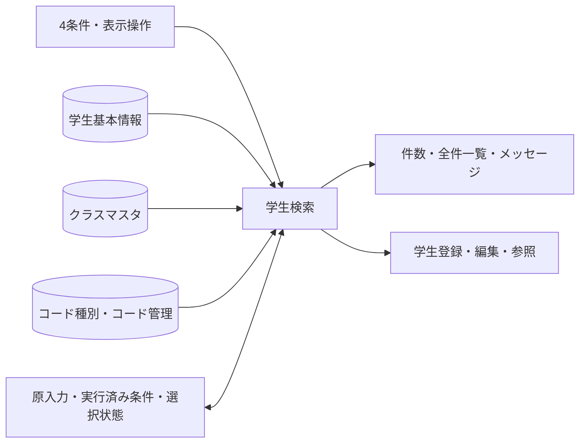

## 項目一覧

| 項目ID | 項目グループ | 項目名 | コントロール | 必須 | 入力制限 | フォーマット | 初期値 | DBテーブル名 | DB項目名 | 備考 |
| --- | --- | --- | --- | --- | --- | --- | --- | --- | --- | --- |
| SRC-001 | 検索条件 | 学籍番号 | TextBox |  | 入力・正規化後15字 | 先頭ゼロ保持 |  | 学生基本情報 | 学籍番号 | N-06、前方一致。空は条件なし。CHK-002・CHK-003は長さと形式だけを検査し、重複・変更不可を検査しない。保存なし／EV-SRC-002 |
| SRC-002 | 検索条件 | 氏名 | TextBox |  | 入力8字／正規化後160字 | - |  | 学生基本情報 | 氏名照合用情報 | N-03後の照合値へ部分一致。表示氏名の原表記とは区別。CHK-002／EV-SRC-002 |
| SRC-006 | 検索条件 | クラス | ComboBox |  | 正の整数・方式別DB型範囲 | 年度・学年・コード・名称 |  | 学生基本情報 クラスマスタ コード管理マスタ | 学生基本情報：現在・最終所属クラス クラスマスタ：クラス管理番号・学校年度・学年のコード分類・学年・クラスコード・クラス名・表示順 コード管理マスタ：コード分類・コード値・コード名称・表示順 | 全年度、停止・期間外を含む実在クラス。ID完全一致。年度・学年は表示識別で検索条件にしない。未選択表示「すべて」。CHK-010／EV-SRC-002 |
| SRC-008 | 検索条件 | 在籍区分 | CheckBox（4区分） |  | 入力2字×最大4件／正規化後数字2桁 | 在学・休学・卒業・退学 | 01,02 | 学生基本情報 コード管理マスタ | 学生基本情報：在籍区分のコード分類・在籍区分 コード管理マスタ：コード分類・コード値・コード名称 | N-07、集合内OR。重複・未定義値は拒否、全解除は全区分。候補停止値も検索可。CHK-010・CHK-024／EV-SRC-002 |
| SRC-013 | 操作 | 検索 | CommandButton | - | - | - | - | - | - | 4条件を検査して全一致一覧を一括取得／EV-SRC-002 |
| SRC-014 | 操作 | クリア | CommandButton | - | - | - | - | - | - | 原入力・保持条件・一覧を初期条件と未検索へ／EV-SRC-005 |
| SRC-015 | 操作 | 新規登録 | CommandButton | - | - | - | - | - | - | 担当者・管理者だけ。検索条件を登録値へ流用しない／EV-SRC-005 |
| SRC-016 | 操作 | メニューへ | CommandButton | - | - | - | - | - | - | 共通メニューへ戻る。業務DB更新なし／EV-SRC-005 |
| SRC-017 | 結果・一覧 | 検索件数 | Label | - | - | 0～10000件 | 未検索 | 学生基本情報 | 学生管理番号 | 条件一致IDの件数。未検索・0件・上限超過を区別／EV-SRC-002 |
| SRC-018 | 結果・一覧 | 検索日時 | Label | - | - | 西暦日時19字・JST | 未検索 | - | - | 共通03の処理時点。DB保存なし／EV-SRC-002 |
| SRC-020 | 結果・一覧 | 学籍番号 | ListBox（一覧列） | - | - | 15字・先頭ゼロ保持 |  | 学生基本情報 | 学籍番号 | 保存済み文字列を文字順で表示／EV-SRC-002・EV-SRC-004・EV-SRC-006 |
| SRC-021 | 結果・一覧 | 氏名 | ListBox（一覧列） | - | - | 8字 |  | 学生基本情報 | 学生氏名 | 原表記を表示／EV-SRC-002・EV-SRC-004・EV-SRC-006 |
| SRC-022 | 結果・一覧 | 氏名カナ | ListBox（一覧列） | - | - | 18字 |  | 学生基本情報 | 学生氏名カナ | 保存済みカナを表示／EV-SRC-002・EV-SRC-004・EV-SRC-006 |
| SRC-023 | 結果・一覧 | 生年月日 | ListBox（一覧列） | - | - | 共通和暦書式 |  | 学生基本情報 | 生年月日 | 共通16で日付から表示文字列を生成／EV-SRC-002・EV-SRC-004・EV-SRC-006 |
| SRC-024 | 結果・一覧 | 年度・学年 | ListBox（一覧列） | - | - | 年度4桁＋学年名称12字 |  | クラスマスタ コード管理マスタ | クラスマスタ：学校年度・学年のコード分類・学年 コード管理マスタ：コード分類・コード値・コード名称 | 年度は西暦。未所属は－。学年はクラス属性／EV-SRC-002・EV-SRC-004・EV-SRC-006 |
| SRC-025 | 結果・一覧 | クラス | ListBox（一覧列） | - | - | コード9字＋名称18字＋注記 |  | 学生基本情報 クラスマスタ | 学生基本情報：現在・最終所属クラス クラスマスタ：クラス管理番号・クラスコード・クラス名 | 未所属・停止・期間外を区別／EV-SRC-002・EV-SRC-004・EV-SRC-006 |
| SRC-026 | 結果・一覧 | 在籍区分 | ListBox（一覧列） | - | - | 名称12字 |  | 学生基本情報 コード管理マスタ | 学生基本情報：在籍区分のコード分類・在籍区分 コード管理マスタ：コード分類・コード値・コード名称 | 分類＋値で名称取得。名称欠落でも学生行を消さない／EV-SRC-002・EV-SRC-004・EV-SRC-006 |
| SRC-030 | 結果・一覧 | 編集／参照 | CommandButton | - | - | - | - | 学生基本情報 | 学生管理番号 | 行番号・表示名でなく学生IDを渡し、遷移先で再取得／EV-SRC-005 |
| SRC-032 | 結果操作 | 並び順項目 | ComboBox | 〇 | 13字・許可4値 | 固定4候補 | studentNo | 学生基本情報 | 学籍番号・氏名照合用情報・入学日・更新日時・学生管理番号 | studentNo/name/admissionDate/updatedAt。最終キーは学生ID昇順。DB保存なし。CHK-024／EV-SRC-004 |
| SRC-033 | 結果操作 | 並び順方向 | ComboBox | 〇 | 4字・asc/desc | 昇順／降順 | asc | - | - | 許可2値のみ。DB保存なし。CHK-024／EV-SRC-004 |

## 選択候補一覧

| 候補ID | 参照元・分類 | 選択値 | 表示値 | 抽出条件 | 表示順 | 初期値・連動 |
| --- | --- | --- | --- | --- | --- | --- |
| クラス | クラスマスタ・コード管理マスタ（学年） | クラス管理番号 | 年度・学年・クラスコード・クラス名 | 全年度・停止・期間外を含む。検索用途で上位条件による絞込みなし | 年度降順→学年表示順→クラス表示順→コード→ID | 未選択表示「すべて」。上位連動なし、人数取得なし |
| 在籍区分 | コード管理マスタ（在籍区分） | 在籍区分コード値 | コード名称 | 分類内01～04。停止も検索可、保護値を維持 | 表示順→コード値 | 01・02。全解除は全区分、新規登録側の初期値は01 |
| 並び順 | 共通UI固定定義 | studentNo/name/admissionDate/updatedAt | 学籍番号／氏名／入学日／更新日時 | 自由なDB列指定なし | 左記順 | studentNo |
| 昇降順 | 共通UI固定定義 | asc/desc | 昇順／降順 | 固定2候補 | 昇順→降順 | asc |

## イベント仕様

### EV-SRC-001 初期表示

#### 処理概要

共通メニューからの起動で候補と独立した画面状態を準備し、学生の自動検索は行わない。

#### 処理手順

1. 共通01・02で認証と参照権限を確認し、共通03で要求内の業務日時・受付番号を確定する。
2. OP-CODE・OP-CLASSで候補と初期在籍値を確認する。在籍01・02、並び順studentNo/asc、空条件と未検索を設定する。必要な初期値が不足した場合は検索を不可とする。
3. 共通12で所有者・認証状態・フォームに属する状態を作る。復帰識別がある起動はEV-SRC-006で検証し、初期化によって復帰状態を上書きしない。

#### 処理フロー

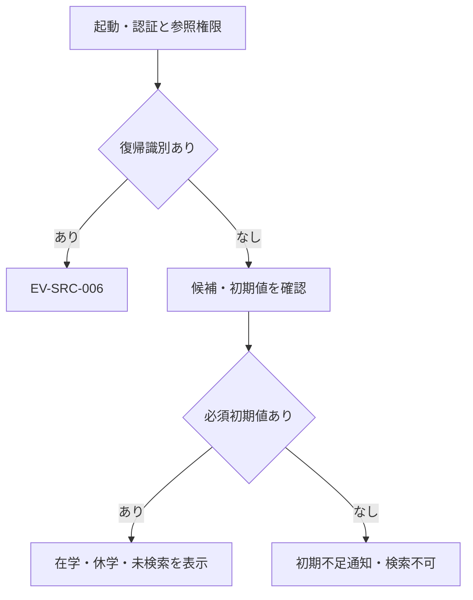

#### SQL・テーブル関連（ER図）

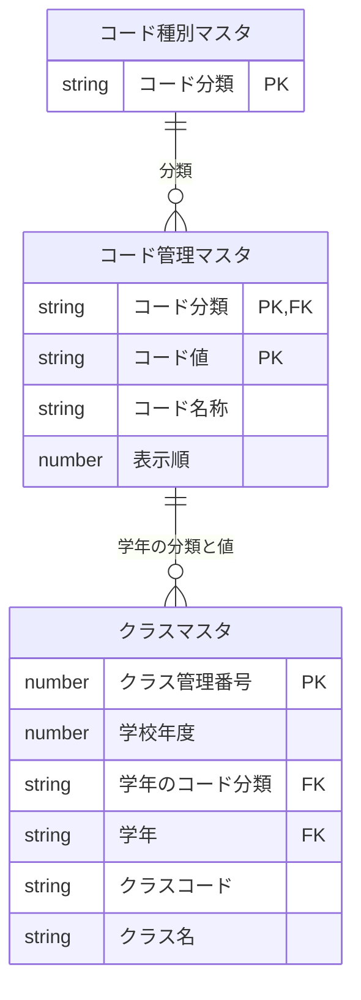

候補取得の関連であり、学生や履歴の変更関係ではない。学年名称は分類＋値で参照し、検索用クラスは停止・期間外を含める。

#### DB操作の詳細

OP-CODE→OP-CLASSを参照だけで行う。クラス候補に人数集計を混ぜず、初期表示でOP-COUNT・OP-LISTを呼ばない。業務表と履歴への追加・更新・削除はいずれも0件。

#### 結果・例外時の扱い

| 判定ID | 条件と結果 | メッセージ・復帰 |
| --- | --- | --- |
| CHK-023 | 認証・参照権限不成立なら候補・業務値を返さない | E-COM-001/002。実文言は下記の共通表示表。操作不可 |
| CHK-010 | 必須初期コードがない | E-MST-001「マスタの初期設定が不足しています。管理者に連絡してください。」。先頭候補で補わず検索不可 |
| CHK-024 | 他者・別フォームの状態は拒否、期限/旧形式は初期化 | E-COM-003又はW-SRC-002。状態を黙って流用しない |

学生0件の検索結果と、未検索・初期不足を区別する。候補読取障害はE-COM-004で案内し、部分的な候補を正常として採用しない。

### EV-SRC-002 検索実行

#### 処理概要

入力時点の4条件を検査し、同じ一致集合の件数と全一覧を取得する。

#### 処理手順

1. **受付・入力検査**
   1. 認証・画面状態・期待Revision・再入を検査し、原入力を複製する。4条件以外の未知/廃止キーは値が空でもCHK-029で拒否する。
   2. 共通04・05で原入力上限と正規化後上限を別々に検査する。学籍番号はN-06、氏名はN-03、在籍集合はN-07、検索メタ文字はN-12を適用する。独立した項目誤りはまとめて示し、入力を保持して一覧を消去する。
   3. OP-EXISTSで指定在籍コードの分類付き存在と指定クラスIDの実在を確認する。空条件は検査対象外。停止・期間外は検索可とし、学籍番号の重複検査や登録用の年度/学年整合検査は行わない。
2. **読取りと結果の反映**
   1. 4条件をAND、指定在籍の内部をORとして非削除学生を取得する。OP-COUNT・OP-LISTを同じ要求・同じ読取り整合性で実行する。
   2. 0件は一覧空、1～10000件は全件を一括表示、10001件到達は一覧空と上限警告にする。途中の部分一覧を返さない。
   3. 成立した検索状態へ実行済み4条件・並び順・件数・日本時間の検索日時を不可分に反映しRevisionを進める。生年月日は共通16で和暦表示し、未反映表示を解除する。

#### 処理フロー

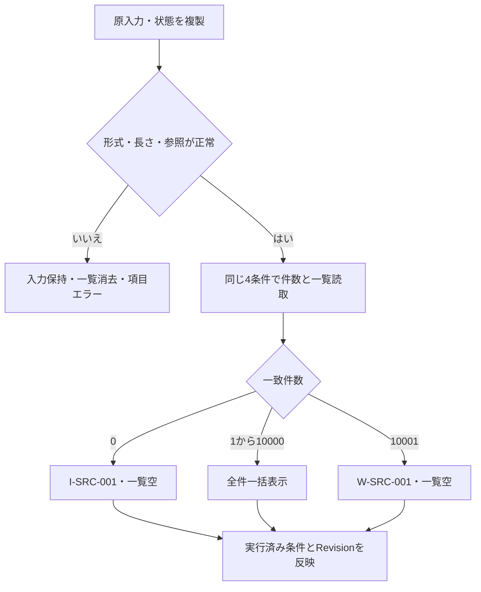

#### SQL・テーブル関連（ER図）

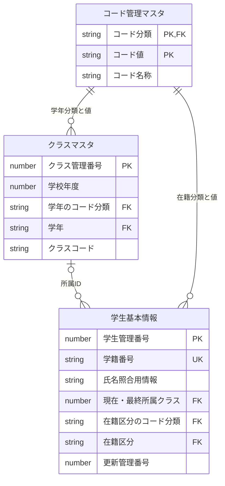

学生→クラスは所属ID、学年・在籍名称は用途別の分類＋値で結合する。名称用は外部結合相当とし、未所属・停止・名称欠落でも学生行を落とさない。物理FKと検索JOINは別の責務で、図は履歴追記や削除連動を指定しない。件数側へ名称だけの結合を混ぜず、重複行の発生を一意キー/条件の不整合として検出する。

#### DB操作の詳細

OP-EXISTS→OP-COUNT→OP-LIST。番号は前方一致、氏名照合値は部分一致、クラスはID完全一致。未指定は条件なし、在籍全解除も全区分。`%`・`_`・`!`は文字として比較する。住所・電話・メール・緊急連絡先・備考など一覧不要項目は取得しない。学生・マスタ・履歴の更新は0件。

#### 結果・例外時の扱い

| 判定ID | 判定・分岐 | 日本語メッセージと復帰 |
| --- | --- | --- |
| CHK-002・CHK-003・CHK-029 | 原入力/正規化上限、番号形式、既知キー・在籍集合 | E-STU-002/003、E-SRC-001。入力保持、一覧消去、先頭の誤り欄へ復帰。DB検索なし |
| CHK-010 | 指定コード・クラスの存在 | E-STU-009/010。再選択を案内。重複番号検査へ置換しない |
| CHK-028 | 0件/上限内/10001件 | I-SRC-001「該当する学生がありません。」又はW-SRC-001「検索結果が10,000件を超えています。検索条件を追加してください。」 |
| CHK-024 | 古いRevision・他画面・再入 | E-COM-003。確定条件と一覧を古い応答で上書きしない |

読取失敗はE-COM-004で原入力を保持し、旧一覧と途中取得値を消去する。0件と上限超過も実行済み条件は保持する。

### EV-SRC-003 条件変更の未反映表示

#### 処理概要

入力編集中の条件と、表示中一覧を取得した条件の違いを示す。

#### 処理手順

1. 現在画面で再入中でないことを確認し、原入力だけを更新する。実行済み条件・選択学生・検索状態のRevisionは変更しない。
2. 差があれば「条件変更未反映。検索を実行してください」を表示する。クラス候補の上位連動・再取得や自動検索をしない。
3. 並び替え・再表示は実行済み条件を用いる。EV-SRC-002の成立又はEV-SRC-005のクリアで未反映表示を解除する。

#### 処理フロー

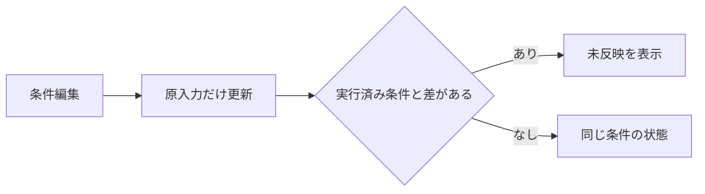

#### SQL・テーブル関連（ER図）

DBアクセスがなく、ER図は非該当。画面内の原入力と表示状態だけを扱う。

#### DB操作の詳細

OP-CLASS・OP-COUNT・OP-LISTを実行しない。全業務表・履歴は参照/更新0件、状態Revisionも進めない。

#### 結果・例外時の扱い

CHK-024で再入は受付せず入力を保持し、画面不正はE-COM-003で開き直しを案内する。編集中の誤りや未反映状態を、検索成功・0件・上限超過と表示しない。既存の件数と一覧は最後の実行条件による結果として保持する。

### EV-SRC-004 一覧並び替え・再表示

#### 処理概要

最後に実行した条件の全一致集合を許可並び順で再取得する。スクロール操作自体にDB呼出しはない。

#### 処理手順

1. **保持状態と表示操作を検査する**
   1. 共通12で所有者・認証・フォーム・30分期限・形式版3・期待Revisionを照合する。未検索ならDBを呼ばず未検索のまま終了する。
   2. sortKeyの4値と方向asc/descだけを許可する。不正表示指定はE-SRC-002、Page/PageSize/offset/limit等の旧範囲指定や未知キーは空でもE-SRC-001。未実行の原入力をAppliedCriteriaへ混ぜない。
2. **全件を再取得して状態を反映する**
   1. OP-COUNT・OP-LISTを同じ読取り単位で実行する。0件は一覧空、1～10000件は全件、10001件は上限警告と一覧空。
   2. 同順位は学生ID昇順。選択IDが現在の全件一覧にあれば復元し、なければ選択解除する。スクロール位置を範囲内へ補正し、件数・日時・Revisionを更新する。原入力が実行済み条件と違えば未反映表示を保つ。

#### 処理フロー

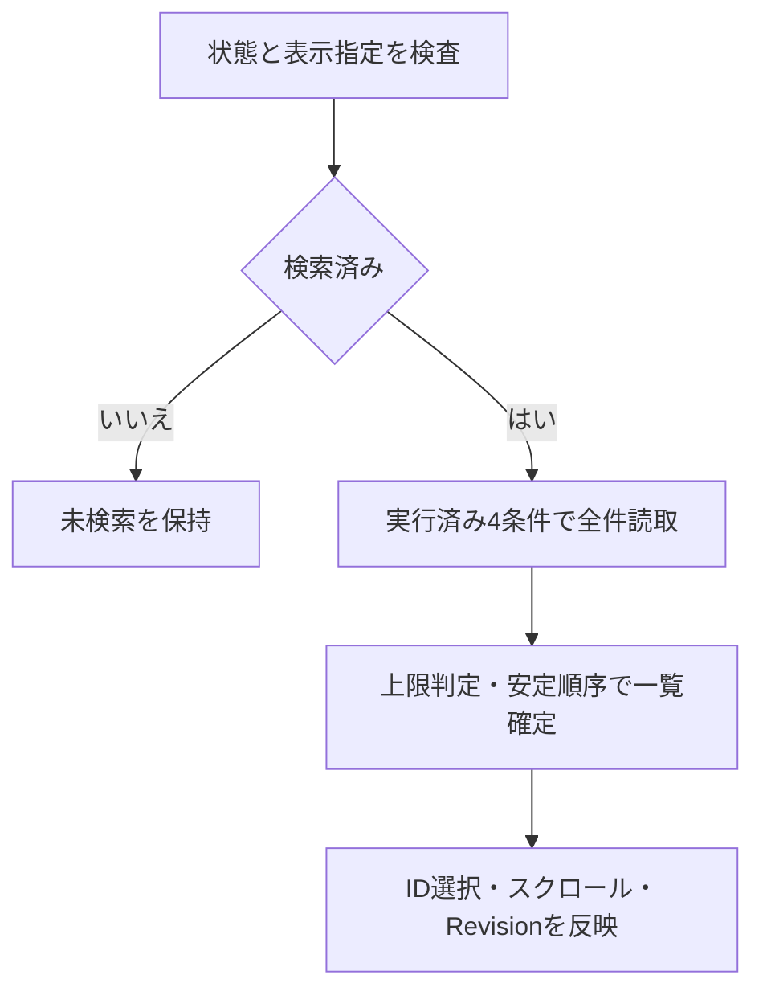

#### SQL・テーブル関連（ER図）

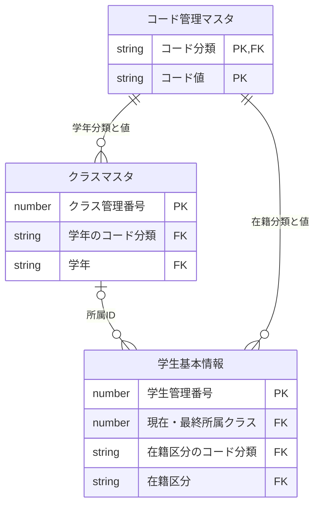

EV-SRC-002と同じ外部結合・分類条件・多重度を適用し、並び順の変更で抽出条件を増減しない。検索JOINは物理FKを追加する指定ではない。

#### DB操作の詳細

OP-COUNT→OP-LIST。入力はAppliedCriteria、許可した並び順・方向だけで、抽出開始位置・取得件数は受け取らない。業務/履歴の追加・更新・削除は0件。

#### 結果・例外時の扱い

CHK-024の所有者/フォーム/Revision違反はE-COM-003で拒否し、期限切れ・形式版1/2/不明はW-SRC-002で初期化する。CHK-028の0件・超過表示は検索と同じ。DB失敗はE-COM-004で旧一覧と部分結果を消去し、入力を保持する。正常に状態を更新した場合だけRevisionを進め、拒否要求を現在Revisionで補完・自動再送しない。

### EV-SRC-005 新規・編集・参照・クリア

#### 処理概要

検索状態を保った遷移と、初期化又はメニュー復帰を操作別に扱う。

#### 処理手順

1. 新規は作成権限を再確認して学生登録の新規モードへ進む。検索条件から学籍番号や氏名等を初期設定しない。
2. 編集/参照は選択した学生管理番号を渡す。閲覧者は参照、担当者・管理者は許可された編集で開き、現在値の取得は登録側で行う。
3. クリアは原入力・実行済み条件・選択・スクロール・結果を初期化し、01/02・studentNo/asc・未検索へ戻す。メニューへは業務更新なしで復帰する。

#### 処理フロー

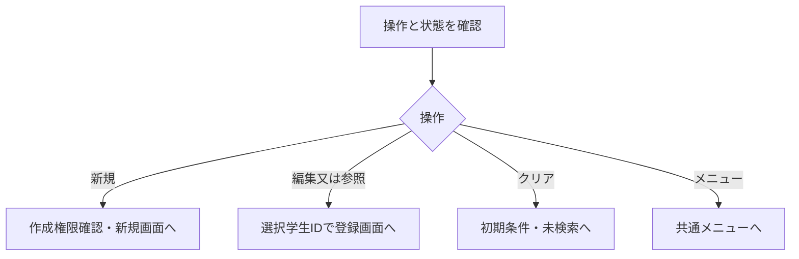

#### SQL・テーブル関連（ER図）

このイベントは業務DBを参照しないためER図は非該当。遷移先の対象読込はEV-REG-002の責務とする。

#### DB操作の詳細

当イベントの全業務表・操作履歴の参照/更新は0件。遷移の識別には学生IDを使い、表示行番号・表示名で代用しない。検索状態への変更は共通12で画面別に扱う。

#### 結果・例外時の扱い

CHK-023で権限不足はE-COM-002「この操作を行う権限がありません。」。CHK-024で選択対象・状態が不正ならE-COM-003。拒否時は入力と現在の状態を保持し、閲覧者に更新入口を渡さない。クリアで検索を自動実行せず、単なる遷移に保存成功のメッセージを出さない。

### EV-SRC-006 学生登録からの復帰

#### 処理概要

保存・論理削除・取消・戻るの結果を受け、元の検索条件で最新の一覧へ戻す。

#### 処理手順

1. 所有者・認証・フォーム・30分期限・CriteriaFormatVersion=3・期待Revisionを検査する。他者状態は拒否、期限切れ/旧形式は通知して初期化する。
2. 元が未検索なら学生を取得せず未検索へ戻る。元が検索済みなら同じ実行済み4条件でOP-COUNT・OP-LISTを再実行し、件数・全一覧・選択ID・スクロールを現在範囲へ復元する。
3. 確定確認済みの成功通知だけを表示する。保存学生が条件外でも条件を変更せず、一覧再取得失敗を保存失敗へ読み替えたり保存要求を再送したりしない。

#### 処理フロー

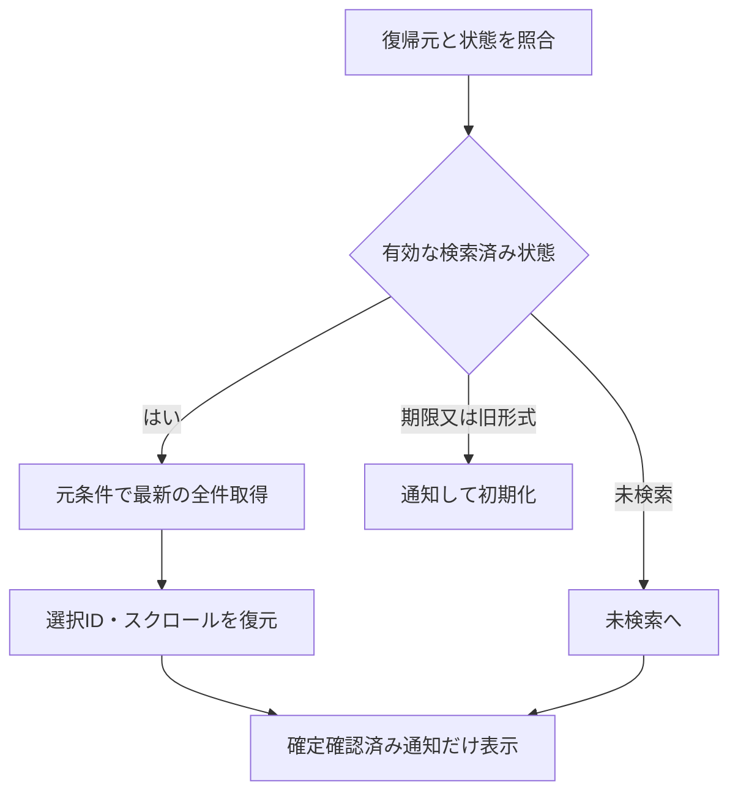

#### SQL・テーブル関連（ER図）

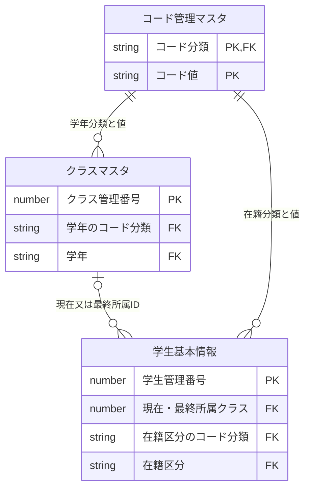

検索済みの復帰時だけの読取関連。外部結合・分類＋値・0～10000件/10001件判定はEV-SRC-002と同じで、未検索復帰はDB呼出しなし。

#### DB操作の詳細

OP-COUNT→OP-LISTを同じ一致集合で実行する。取得後の選択復元はIDで行い、存在しない学生の選択を残さない。学生・履歴・マスタへの書込みは0件、保存操作の再実行も0件。

#### 結果・例外時の扱い

CHK-024違反はE-COM-003、失効/旧形式はW-SRC-002。CHK-028は0件I-SRC-001、超過W-SRC-001、読取障害E-COM-004で一覧空とする。CHK-030に基づき確認済みI-STU-001/002/003だけを表示する。保存成功後の再表示障害では保存済みを維持し、再表示だけが失敗したことを別に案内する。

### DB操作定義

[共通データアクセス](../共通/08_データアクセス仕様.md)と[方式別共通](../共通/方式別/01_共通実装仕様.md)を、同じ試験生成用仕様セット内の支援文書として参照する。DBの物理型や実装構文を本基本設計で変更しない。

| 操作ID | 対象・操作 | 入力と対象条件 | 取得内容・期待件数・順序 | 確定境界 |
| --- | --- | --- | --- | --- |
| OP-CODE | コード種別マスタ・コード管理マスタ参照 | 分類、用途、既存値、業務日。分類＋値 | 名称・表示順・利用可否・期間。候補0件と初期値不足を区別し先頭代替しない | 参照のみ |
| OP-CLASS | クラスマスタ・学年コード参照 | 検索用途、全年度・停止・期間外を含む。上位条件なし | 年度→学年→クラスの表示情報。年度降順→学年表示順→クラス表示順→コード→ID。学生人数は集計しない | 参照のみ、席予約なし |
| OP-EXISTS | 学生・クラス・コードの用途別存在参照 | 本検索では指定在籍分類/値とクラスIDの存在のみ | 未指定は対象外。検索番号の重複や完全一致存在、年度学年整合・コード利用期間は強制しない | 書込みなし。保存用途の検査と区別 |
| OP-COUNT | 学生基本情報の件数参照 | 非削除必須、指定4条件AND・在籍集合OR | 条件一致IDを最大10001件まで判定。0件/1～10000件/10001件を区別 | OP-LISTと同じ読取り整合性 |
| OP-LIST | 学生・クラス・学年/在籍名称参照 | OP-COUNTと同じ条件、許可sortKey/方向だけ | SRC-020～026・030の8論理項目を表示7列相当＋隠し学生IDで返す。住所・電話・更新日時・住所2・メール・緊急・備考は返さない。同順位は学生ID昇順 | 全件一括。上限時・失敗時は旧/部分一覧なし。操作030はUI生成 |

### 共通表示メッセージ

| メッセージID | 実文言・差込元 | 表示と復帰 |
| --- | --- | --- |
| E-STU-002 | {field}は{max}文字以内の使用可能な文字で入力してください。 | fieldは対象日本語項目名、maxは該当する入力又は正規化上限。原入力保持、項目近傍と先頭欄へ |
| E-STU-003 | 学籍番号は半角英数字・ハイフンで15文字以内にしてください。先頭は英数字です。 | 学籍番号欄へ戻す |
| E-STU-009 | {field}のコードが存在しません。選択し直してください。 | 在籍区分欄、fieldは日本語論理名 |
| E-STU-010 | 指定したクラスが存在しません。選択し直してください。 | クラス欄へ |
| E-SRC-001 | 検索条件の形式が現在の仕様と一致しません。条件を初期化して再入力してください。 | 旧/未知キーは空でも拒否。入力と拒否理由を示す |
| E-SRC-002 | 検索条件または表示指定が正しくありません。 | 並び順・方向を修正 |
| W-SRC-002 | 検索状態の期限または形式が現在の仕様と一致しません。条件を再指定してください。 | 旧形式1/2/不明・失効状態を初期化 |
| E-COM-001 | ログインの有効期限が切れました。再度ログインしてください。 | 業務値を返さず、Accessの認証前提に従う。独立ログイン画面の追加指定ではない |
| E-COM-002 | この操作を行う権限がありません。 | 更新入口・業務結果を返さない |
| E-COM-003 | 画面情報が無効です。画面を開き直してください。 | 古い要求で状態を上書きしない |
| E-COM-004 | 処理を完了できませんでした。受付番号：{correlationId} | 共通03の受付番号。SQL・接続先・個人情報値を出さず、入力保持と一覧消去 |
| I-STU-001 | 学生を登録しました。（学籍番号：{studentNo}） | 確定確認済み保存結果の学籍番号。再表示だけの失敗で保存要求を再送しない |
| I-STU-002 | 学生情報を更新しました。 | 確定確認済み通知だけ表示 |
| I-STU-003 | 学生情報を論理削除しました。 | 確定確認済み通知だけ表示 |

## 補足説明

### 状態・正規化・名称の整合

共通12の画面状態は所有者・認証・フォームインスタンスごとで、30分失効、形式版3、期待Revisionを確認する。Revisionは状態の更新世代であり、学生の期待版とも形式版とも異なる。省略した期待Revisionを現在値で補わず、状態照合と反映を不可分にする。フォーム終了又は認証変更で破棄し、別フォームの条件・通知を混ぜない。

原入力の氏名8字と照合用160字、登録氏名の8字を区別する。氏名照合はNFKC→英大文字→Unicode空白除去、学籍番号はNFKC→前後空白除去→英大文字とし数値化しない。中点・長音・異体字を推測統合せず、`%`・`_`・`!`を検索式にしない。元の文字受理範囲・計測方法を[共通チェック](../共通/05_チェック・メッセージ設計.md)から継承する。

名称が取得できない場合は不整合を示して行と保存値を残す。停止・期間外も検索対象とし、検索候補の年度・学年を条件に追加しない。住所等の非一覧個人情報を並び替えのために過剰取得しない。

### Pilot確認ケース（設計・未実施）

| ケース | 初期状態・操作 | 判定と期待結果 |
| --- | --- | --- |
| 初回/クリア | 一覧なしで起動又はSRC-014 | CHK-010/024、01・02、studentNo/asc、未検索。学生読取なし |
| 文字と境界 | 全角番号、氏名の空白差、%、_、!、氏名原入力9字 | N-03/06/12・CHK-002/003。正規化とリテラル照合。9字は正規化で短くても入力エラー |
| 旧入力 | Page/PageSize/offset/limit・旧日付条件・未知キーを空値で渡す | CHK-029・E-SRC-001、検索なし。旧形式1/2/不明の状態はW-SRC-002で初期化 |
| 件数境界 | 一致0/10000/10001件 | CHK-028、該当なし/全件一括/警告と一覧空。途中結果なし、スクロール追加取得なし |
| 所属と名称 | 停止・期間外クラス、卒業、未所属、名称欠落 | CHK-010、既存最終所属を含め検索可。名称不整合でも学生行を除外しない |
| 未反映と表示操作 | 条件編集後に並び替え | CHK-024、元AppliedCriteriaで再表示し未反映を保持。行選択はIDで復元 |
| 権限・競合 | 閲覧者の更新入口、別フォーム/古いRevisionから復帰 | CHK-023/024で拒否。状態・通知を他画面へ混ぜない |
| 保存後再表示失敗 | 登録側の確定成功後、OP-LISTが失敗 | CHK-030、保存成功は維持し一覧失敗を別案内。保存再実行0件 |

### 参照・未実施

[学生登録](02_学生登録画面.md)、[共通UI](../共通/04_共通UI部品設計.md)、[共通業務](../共通/03_共通モジュール設計.md)、[日付](../共通/07_日付・和暦仕様.md)、[適合試験・設計判断](../共通/06_要件対応・設計判断.md)を同じdraftRootの支援文書として参照する。項目一覧と候補一覧はそれぞれ1つの矩形LIST。廃止IDは再利用しない。

本書はAIによる試験生成であり、入力正本8.4を改訂・採用したものではない。静的HTML/CSSは既存配置契約の同一断片を再利用した。本文の構造・意味レビュー、描画確認、Accessネイティブ操作、実DB、受入・正式採点はそれぞれの実施記録で区別し、未採点はformalScore=nullとする。
