<!-- spec-meta: {"schema":"spec-md/1.0","documentId":"ACCESS-BAS-STU-02","version":"0.1","path":"sample-project1/srcs/Access/build/spec-generation/design-generation-check/spec/Access/基本設計書/02_学生登録画面.md","sheets":[{"heading":"概要","kind":"GRID","sheet":"01_概要"},{"heading":"項目一覧","kind":"LIST","sheet":"02_項目一覧","key":["項目ID"]},{"heading":"選択候補一覧","kind":"LIST","sheet":"03_選択候補一覧","key":["候補ID"]},{"heading":"イベント仕様","kind":"GRID","sheet":"04_イベント仕様"},{"heading":"項目更新仕様","kind":"LIST","sheet":"05_項目更新仕様","key":["更新ID"]},{"heading":"補足説明","kind":"GRID","sheet":"06_補足説明"}],"isolationProfile":"Access","generationStatus":"verification-draft"} -->
# 学生登録画面 基本設計書

| 項目 | 内容 |
| --- | --- |
| システム名 | 学生管理システム |
| 機能ID | SCR-STU-002 |
| 版数・改訂日 | 0.1／2026-10-28 |
| 対象読者 | 顧客団体のIT部門 |
| 状態 | 試験生成・未採用（verification-draft）。正本への反映、実装・実DB・実機・受入試験は未実施 |
| 継承した入力 | Access基本設計8.4、同方式の確定前提・共通・DB・規約。機能/項目/イベント/更新/判定IDを維持 |

## 概要

### 目的と範囲

学生1人の氏名、住所、連絡先、生年月日、在籍状態と現在又は最終所属クラスを、同じAccess標準単票フォームの新規・編集・参照モードで扱う。学生検索から開き、保存・論理削除・取消・戻るの結果を検索へ返す。成績、学籍番号訂正、削除復元、物理消去、年度別所属履歴、兼籍、将来の異動予約、自動進級は対象外。

保存は学生1件と操作履歴1件を同じ確定単位で行う。単一ACCDB、内包する役割と実Windows利用者の照合、共通01～17の前提を継承する。信頼された職員による評価構成であり、直接ファイル編集に対する強いDB権限分離を画面権限の保証に含めない。利用者が入力した実行者や画面の可否だけで保存を認可しない。

| 操作 | 閲覧者 | 担当者 | 管理者 |
| --- | --- | --- | --- |
| 参照 | 〇 | 〇 | 〇 |
| 新規・通常編集 |  | 〇 | 〇 |
| 在学・休学から4区分への変更 |  | 〇 | 〇 |
| 卒業・退学から別区分への訂正 |  |  | 理由付き |
| 論理削除 |  |  | 理由・明示確認付き |

クラス別の担当者制限は設けない。在籍区分は日付到来で自動変更しない。管理者向け論理削除は既存設計の追加提案を継承するもので、物理消去や永久保存を承認した扱いにはしない。

### 画面と入力状態

WinForms系のAccess標準フォーム・標準コントロールで、項目の桁数に応じた幅とラベル/入力の整列を保つ。学籍番号は新規だけ入力でき、学生ID、更新日時・更新者・読込版は利用者の変更対象にしない。閲覧者は全業務値を表示専用とする。

生年月日は元号・年・月・日を分けて和暦入力し、保存値は厳密変換した日付のみ。その他の日付は西暦、日時は日本時間とする。元号・新規生年月日・入学日を自動入力しない。重複・削除・未保存破棄は取消を既定にした標準ポップアップで確認し、確認中は背景フォームを操作不可とする。

#### 標準画面（埋め込みHTML）

全34項目と19業務入力を維持し、標準単票フォームの左右2列へ整列する。短い項目は短い欄、住所・メール・備考は長文に適した欄を用意し、全文を編集・確認する手段を残す。HTMLはAccess標準部品の静的な配置図であり、Web画面へ変更する指定ではない。幅・Twips換算・長文の到達方法は対応する詳細設計に定義する。

<!-- screen-html-start: REG -->

<strong>学生登録・編集 ／ 編集（学籍番号変更不可）</strong>Access 単票フォーム ／ 管理者

必須は保存時に検査。緊急連絡先3項目は一式入力。本人電話・メール・緊急電話のいずれかが必要です。

<fieldset><legend>基本情報</legend>

学生管理番号

<input aria-label="学生管理番号" class="input" readonly="" value="10001"/>txtStudentId

学籍番号必須

<input aria-label="学籍番号" class="input" data-business-maxlength="15" data-normalized-maxlength="15" maxlength="30" readonly="" value="S2026-0001"/>
15文字以内
txtStudentNo

氏名必須

<input aria-label="氏名" class="input" data-business-maxlength="8" data-normalized-maxlength="8" maxlength="16" value="見本 太郎"/>txtStudentName

8文字以内

氏名カナ必須

<input aria-label="氏名カナ" class="input" data-business-maxlength="36" data-normalized-maxlength="18" maxlength="72" value="ミホン タロウ"/>
入力36文字以内／保存・正規化18文字以内
txtStudentNameKana

生年月日必須

平成▾
<input aria-label="元号年" class="input" data-part="year" maxlength="4" value="20"/>年<input aria-label="生年月日の月" class="input" data-part="month" maxlength="2" value="05"/>月<input aria-label="生年月日の日" class="input" data-part="day" maxlength="2" value="15"/>日

表示：平成20年05月15日。元号境界・実在日を検査
cboBirthEra / txtBirthYear / txtBirthMonth / txtBirthDay

性別必須

未回答▾
cboGender

</fieldset><fieldset><legend>住所・本人連絡先</legend>

郵便番号必須

<input aria-label="郵便番号" class="input" data-business-maxlength="10" maxlength="20" value="100-0000"/>txtPostalCode

都道府県必須

東京都▾
cboPrefecture

住所1必須

<input aria-label="住所1" class="input" data-business-maxlength="45" data-normalized-maxlength="45" maxlength="90" value="見本市見本町1-1"/>txtAddressLine1

45文字以内

住所2

<input aria-label="住所2" class="input" data-business-maxlength="45" data-normalized-maxlength="45" maxlength="90" value="見本ビル201"/>txtAddressLine2

45文字以内

本人電話条件付

<input aria-label="本人電話" class="input" data-business-maxlength="20" data-normalized-maxlength="16" maxlength="40" value="03-0000-0000"/>txtPhoneNumber

入力20文字以内／保存・正規化16文字以内

本人メール条件付

<input aria-label="本人メール" class="input" data-business-maxlength="60" data-normalized-maxlength="60" maxlength="120" value="sample@example.invalid"/>
60文字以内
txtEmailAddress

</fieldset>

<fieldset><legend>在籍・所属</legend>

入学日必須

<input aria-label="入学日" class="input" data-business-maxlength="10" maxlength="10" value="2026-04-01"/>
西暦・業務日以前
txtAdmissionDate

在籍区分必須

在学▾
cboEnrollmentStatus

卒業・退学日条件付

<input aria-label="卒業・退学日" class="input" data-business-maxlength="10" maxlength="10" value=""/>
在学・休学では未設定。卒業・退学時に必須
txtEnrollmentEndDate

年度

2026▾

所属の選択補助。学生には重複保存しない
cboSchoolYear

学年

学年なし▾
cboGrade

クラス条件付

C-A　Aクラス▾

在学・休学のとき必須
cboClass

所属人数・定員

所属人数 18名　／　定員 30名

参考値。保存時に再判定
lblCapacity

</fieldset><fieldset><legend>緊急連絡先</legend>

緊急氏名条件付

<input aria-label="緊急連絡先氏名" class="input" data-business-maxlength="8" data-normalized-maxlength="8" maxlength="16" value="見本 保護者"/>txtEmergencyContactName

8文字以内

緊急続柄条件付

父▾
cboRelationship

緊急電話条件付

<input aria-label="緊急連絡先電話" class="input" data-business-maxlength="20" data-normalized-maxlength="16" maxlength="40" value="090-0000-0000"/>
入力20文字以内／保存・正規化16文字以内
txtEmergencyPhoneNumber

</fieldset><fieldset><legend>備考・理由</legend>

備考

<textarea aria-label="備考" data-business-maxlength="120" data-normalized-maxlength="120" maxlength="240" rows="3">連絡は本人電話を優先してください。</textarea>txtRemarks

120文字以内

確認・変更理由条件付

<textarea aria-label="確認・変更理由" data-business-maxlength="60" data-normalized-maxlength="60" maxlength="120" rows="2"></textarea>
60文字以内
txtOperationReason

</fieldset>

住所各45文字、備考120文字、理由60文字。長い入力は欄内移動・拡大入力で全文を編集できます。

更新日時：2026/10/11 09:00:00　　更新者：operator.demo

<button class="" data-binding="Save" data-control="cmdSave" data-field-id="REG-027" type="button">更新</button><button class="" data-binding="Reset" data-control="cmdReset" data-field-id="REG-028" type="button">編集取消</button><button class="" data-binding="Reload" data-control="cmdReload" data-field-id="REG-029" type="button">最新情報を再読込</button><button class="" data-binding="Back" data-control="cmdBack" data-field-id="REG-030" type="button">検索へ戻る</button><button class="" data-binding="Delete" data-control="cmdDelete" data-field-id="REG-031" type="button">論理削除</button>

<h3>確認ダイアログの配置設計</h3>
以下は状態別の別図です。同時に開く仕様ではありません。

<h4>重複候補の確認</h4>

同じ学生の可能性があります。別人であることを確認してください。
<table><tr><th>学籍番号</th><th>氏名</th><th>生年月日</th><th>クラス</th></tr><tr><td>S2026-0002</td><td>見本 太郎</td><td>平成20年05月15日</td><td>C-A Aクラス</td></tr></table>
全候補1件／表示1件。確認待機中にDBロックを保持しません。
<label>確認理由（必須・60文字以内）<textarea aria-label="確認理由" data-business-maxlength="60" data-normalized-maxlength="60" maxlength="120" rows="2">同姓同名の別人であることを確認したため。</textarea></label>
<button class="" data-binding="Cancel" data-control="frmDuplicateConfirm.cmdCancel" data-field-id="REG-034" type="button">取消（既定）</button><button class="" data-binding="Confirm" data-control="frmDuplicateConfirm.cmdConfirm" data-field-id="REG-033" type="button">別人と確認して続行</button>

<h4>論理削除の確認</h4>

この学生を通常の検索対象から除外します。

対象：S2026-0001　見本 太郎
<label>削除理由（必須・60文字以内）<textarea aria-label="削除理由" data-business-maxlength="60" data-normalized-maxlength="60" maxlength="120" rows="2">誤登録のため。</textarea></label>
編集中の氏名・住所などは保存しません。実際の削除は管理者だけが実行できます。

<button class="" type="button">取消（既定）</button><button class="" type="button">論理削除する</button>

60文字以内

<h4>未保存変更の確認</h4>

保存していない変更を破棄しますか。

<button data-control="frmDiscardConfirm.cmdCancel" type="button">取消（既定）</button><button data-control="frmDiscardConfirm.cmdDiscard" type="button">変更を破棄する</button>

Access標準フォームの配置をHTMLで図示。架空値・静的設計見本。実機画面ではありません。

<!-- screen-html-end: REG -->

### ファイル・DB入出力関係

| IO-ID | 分類 | 対象 | 方向 | 内容と境界 |
| --- | --- | --- | --- | --- |
| 01 | 画面 | 新規19入力、更新18入力、確認・削除理由 | 入力 | 受付時に複製。通常保存・確認・論理削除で許可する値を分ける |
| 02 | 永続DB | 学生基本情報 | 参照・登録・更新 | 対象1件の全保存値・読込版。削除は削除/更新管理属性だけ |
| 03 | 永続DB | クラスマスタ | 参照 | 年度・学年・名称・利用期間・定員。学生保存からクラスを更新しない |
| 04 | 永続DB | コード種別マスタ・コード管理マスタ | 参照 | 分類と値で存在・有効性・名称を確認。学生保存からコードを更新しない |
| 05 | 一時情報 | 読込時値、編集値、確認情報、検索復帰状態 | 入出力 | 原本と編集値、学生期待版と検索Revision、確認10分を区別 |
| 06 | 外部ファイル | なし | - | 帳票・CSV・取込なし |
| 07 | 画面 | 学生情報・候補・エラー・結果 | 出力 | 重複候補は必要な4項目・最大20件。全候補件数を別表示 |
| 08 | 永続DB | 操作履歴 | 追記 | 実変更と同時に1件。個人情報の値を複写せず、変更項目名を記録 |

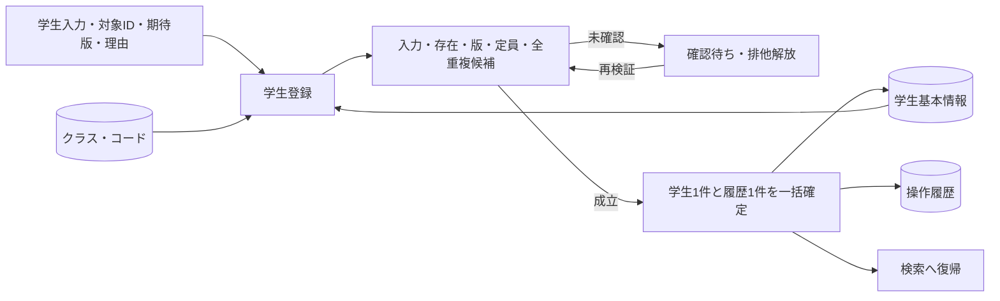

## 項目一覧

| 項目ID | 項目グループ | 項目名 | コントロール | 必須 | 入力制限 | フォーマット | 初期値 | DBテーブル名 | DB項目名 | 備考 |
| --- | --- | --- | --- | --- | --- | --- | --- | --- | --- | --- |
| REG-001 | 基本 | 学生管理番号 | TextBox（読取専用） | - | - | 正の整数ID |  | 学生基本情報 | 学生管理番号 | 新規保存で自動採番、初期表示は未採番。EV-REG-001・EV-REG-002 |
| REG-002 | 基本 | 学籍番号 | TextBox | 〇 | 入力・保存15字、新規のみ | 先頭ゼロ保持 |  | 学生基本情報 | 学籍番号 | N-06、登録後不変・削除済みを含め一意。CHK-001・CHK-002・CHK-003・CHK-004／EV-REG-004 |
| REG-003 | 基本 | 氏名 | TextBox | 〇 | 入力・保存8字 | - |  | 学生基本情報 | 学生氏名 | N-02で原表記を保存。CHK-001・CHK-002・CHK-005／EV-REG-004 |
| REG-004 | 基本 | 氏名カナ | TextBox | 〇 | 入力36字／保存18字 | 全角カナ |  | 学生基本情報 | 学生氏名カナ | N-04で保存値、N-05で照合値を生成。CHK-001・CHK-002・CHK-006・CHK-005／EV-REG-004 |
| REG-005 | 基本 | 生年月日 | ComboBox・TextBox（元号・年月日） | 〇 | 元号10字・年4桁・月2桁・日2桁 | 和暦／内部ISO10字 |  | 学生基本情報 | 生年月日 | 4要素必須。N-11・DATE-R01、共通16で厳密変換。CHK-001・CHK-007・CHK-008・CHK-032・CHK-033／EV-REG-004 |
| REG-006 | 基本 | 性別 | ComboBox | 〇 | 入力1字／数字1桁 | 値・名称 | 0（未回答） | 学生基本情報 コード管理マスタ | 学生基本情報：性別のコード分類・性別 コード管理マスタ：コード分類・コード値・コード名称 | 未回答0可、NULL不可。N-07、候補:性別、CHK-010・CHK-011／EV-REG-004 |
| REG-007 | 住所 | 郵便番号 | TextBox | 〇 | 入力10字／保存数字7桁 | 3桁－4桁 |  | 学生基本情報 | 郵便番号 | N-08。CHK-001・CHK-002・CHK-016／EV-REG-004 |
| REG-008 | 住所 | 都道府県 | ComboBox | 〇 | 入力2字／数字2桁 | 値・名称 |  | 学生基本情報 コード管理マスタ | 学生基本情報：都道府県のコード分類・都道府県 コード管理マスタ：コード分類・コード値・コード名称 | N-07、候補:都道府県。CHK-001・CHK-010・CHK-011／EV-REG-004 |
| REG-009 | 住所 | 住所1 | TextBox | 〇 | 入力・保存45字 | - |  | 学生基本情報 | 住所1 | N-02、市区町村・番地。CHK-001・CHK-002／EV-REG-004 |
| REG-010 | 住所 | 住所2 | TextBox |  | 入力・保存45字 | - |  | 学生基本情報 | 住所2 | N-02、前後空白除去後空はNULL。CHK-002／EV-REG-004 |
| REG-011 | 連絡先 | 本人電話 | TextBox | 条件付 | 入力20字／保存16字 | 国内10/11桁・国際+7～15桁 |  | 学生基本情報 | 本人電話 | 本人電話・本人メール・緊急電話の1つ以上。N-09、CHK-002・CHK-017・CHK-019／EV-REG-004 |
| REG-012 | 連絡先 | 本人メール | TextBox | 条件付 | 入力・保存60字 | ASCII限定形式 |  | 学生基本情報 | 本人メール | 連絡手段の1つ以上。N-10、CHK-002・CHK-018・CHK-019／EV-REG-004 |
| REG-013 | 在籍 | 入学日 | TextBox | 〇 | 西暦10字・年4桁 | 入力yyyy-MM-dd／表示yyyy/MM/dd |  | 学生基本情報 | 入学日 | 生年月日以上・業務日以下。N-11・DATE-R02。CHK-001・CHK-007・CHK-008・CHK-033／EV-REG-004 |
| REG-014 | 在籍 | 在籍区分 | ComboBox | 〇 | 入力2字／数字2桁 | 値・名称 | 01（在学） | 学生基本情報 コード管理マスタ | 学生基本情報：在籍区分のコード分類・在籍区分 コード管理マスタ：コード分類・コード値・コード名称 | 01在学・02休学・03卒業・04退学。N-07、候補:在籍区分。CHK-001・CHK-010・CHK-011・CHK-009・CHK-026／EV-REG-004 |
| REG-015 | 在籍 | 卒業・退学日 | TextBox | 条件付 | 西暦10字・年4桁 | 入力yyyy-MM-dd／表示yyyy/MM/dd |  | 学生基本情報 | 卒業・退学日 | 03/04で必須、01/02はNULL。N-11・DATE-R02。CHK-007・CHK-009・CHK-033／EV-REG-004 |
| REG-016 | 所属補助 | 年度 | ComboBox |  | 4桁・1900～9998 | 西暦年度 | 当年度 | クラスマスタ | 学校年度 | 選択補助だけ、学生へ保存しない。N-11、候補:年度。CHK-010・CHK-014・CHK-034／EV-REG-004 |
| REG-017 | 所属補助 | 学年 | ComboBox |  | 入力2字／数字2桁 | 学年名称 |  | クラスマスタ コード管理マスタ | クラスマスタ：学年のコード分類・学年 コード管理マスタ：コード分類・コード値・コード名称 | 未選択表示「すべて」。補助だけで学生へ保存しない。N-07、候補:学年、CHK-010・CHK-014／EV-REG-004 |
| REG-018 | 所属 | クラス | ComboBox | 条件付 | 正の整数・方式別DB型範囲 | 年度・学年・コード・名称 |  | 学生基本情報 クラスマスタ コード管理マスタ | 学生基本情報：現在・最終所属クラス クラスマスタ：クラス管理番号・学校年度・学年のコード分類・学年・クラスコード・クラス名 コード管理マスタ：コード分類・コード値・コード名称 | 01/02は必須、03/04は任意。候補:クラス、CHK-010・CHK-012・CHK-013・CHK-014・CHK-015・CHK-031／EV-REG-004 |
| REG-019 | 所属 | 所属人数・定員 | Label | - | - | 人数0以上／定員1～9999・NULL可 |  | 学生基本情報 クラスマスタ | 学生基本情報：現在・最終所属クラス・在籍区分・削除の状態 クラスマスタ：クラス管理番号・定員 | 非削除01/02の参考人数。席の予約ではない／EV-REG-004 |
| REG-020 | 緊急 | 緊急連絡先氏名 | TextBox | 条件付 | 入力・保存8字 | - |  | 学生基本情報 | 緊急連絡先氏名 | 緊急3入力は全未入力又は全入力。N-02、CHK-002・CHK-020／EV-REG-004 |
| REG-021 | 緊急 | 緊急連絡先続柄 | ComboBox | 条件付 | 入力2字／数字2桁 | 値・名称 |  | 学生基本情報 コード管理マスタ | 学生基本情報：続柄のコード分類・緊急連絡先続柄 コード管理マスタ：コード分類・コード値・コード名称 | 未選択なら分類もNULL、選択時だけ分類算定（UPD-103）。N-07、候補:続柄。CHK-010・CHK-011・CHK-020／EV-REG-004 |
| REG-022 | 緊急 | 緊急連絡先電話 | TextBox | 条件付 | 入力20字／保存16字 | 国内10/11桁・国際+7～15桁 |  | 学生基本情報 | 緊急連絡先電話 | 緊急3入力一式、連絡手段1つ以上。N-09、CHK-002・CHK-017・CHK-019・CHK-020／EV-REG-004 |
| REG-023 | その他 | 備考 | TextBox（複数行） |  | 入力・保存120字 | LF改行 |  | 学生基本情報 | 備考 | N-01、空はNULL、プレーンテキスト。CHK-002／EV-REG-004 |
| REG-024 | 確認 | 確認・変更理由 | TextBox（複数行） | 条件付 | 入力・保存60字 | LF改行 |  | 操作履歴 | 操作・確認理由 | 重複確認続行・終了区分訂正で必須。N-01、CHK-002・CHK-025・CHK-026／EV-REG-005 |
| REG-025 | 更新情報 | 更新日時・更新者 | Label | - | - | 西暦日時19字・JST／更新者64字 |  | 学生基本情報 | 更新日時・更新者 | 実行時点と認証者から設定／EV-REG-002 |
| REG-026 | 削除確認 | 削除理由 | TextBox（複数行） | 条件付 | 入力・保存60字 | LF改行 |  | 学生基本情報 操作履歴 | 学生基本情報：削除理由 操作履歴：操作・確認理由 | 削除イベントだけで必須、通常保存には使わない。N-01、CHK-001・CHK-002・CHK-027／EV-REG-006 |
| REG-027 | 操作・確認 | 登録／更新 | CommandButton | - | - | - | - | - | - | 役割・モードを再確認して保存／EV-REG-004 |
| REG-028 | 操作・確認 | 入力クリア／編集取消 | CommandButton | - | - | - | - | - | - | 新規は初期値、既存は読込時値／EV-REG-007 |
| REG-029 | 操作・確認 | 最新情報を再読込 | CommandButton | - | - | - | - | - | - | 明示確認後に全値と版を置換／EV-REG-007 |
| REG-030 | 操作・確認 | 検索へ戻る | CommandButton | - | - | - | - | - | - | 未保存破棄確認後に検索へ／EV-REG-007 |
| REG-031 | 操作・確認 | 論理削除 | CommandButton | - | - | - | - | - | - | 管理者・理由・明示確認が必要／EV-REG-006 |
| REG-032 | 操作・確認 | 重複候補一覧 | ListBox | - | - | 全件数＋最大20行 |  | 学生基本情報 クラスマスタ | 学生基本情報：学生管理番号・学籍番号・学生氏名・生年月日・現在・最終所属クラス・更新管理番号 クラスマスタ：クラス管理番号・クラス名 | 表示は学籍番号・氏名・和暦生年月日・クラス。確認集合は全候補IDと版／EV-REG-005 |
| REG-033 | 操作・確認 | 別人と確認して続行 | CommandButton | - | - | - | - | - | - | 理由と確認情報を付けて全保存検査を再実行／EV-REG-005 |
| REG-034 | 操作・確認 | 確認取消 | CommandButton | - | - | - | - | - | - | 既定操作。入力に留まりDB更新なし／EV-REG-005 |

## 選択候補一覧

| 候補ID | 参照元・分類 | 選択値 | 表示値 | 抽出条件 | 表示順 | 初期値・連動 |
| --- | --- | --- | --- | --- | --- | --- |
| 年度 | クラスマスタ・学校年度 | 学校年度 | 年度 | 停止・過去年度を含む1900～9998 | 年度降順 | 新規は当年度の選択補助。クラス0件は別判定。学生へ保存しない |
| 学年 | コード管理マスタ（学年） | 学年コード値 | コード名称 | 新規選択は有効、既存は同値保持。学年なし00と未所属は別 | 表示順→コード値 | 未選択表示「すべて」、学生へ保存しない |
| クラス | クラスマスタ・コード管理マスタ（学年） | クラス管理番号 | 年度・学年・コード・名称 | 共通07の新規所属・最終所属・既存保持を分離。新規01/02は利用可・当日期間内 | 年度降順→学年表示順→クラス表示順→コード→ID | 新規未選択。上位変更で不適合なら解除して通知 |
| 在籍区分 | コード管理マスタ（在籍区分） | 在籍区分コード値 | コード名称 | 新規選択は有効、01～04は保護。既存同値保持を区別 | 表示順→コード値 | 新規01。検索側は01/02、全解除で全区分 |
| 都道府県 | コード管理マスタ（都道府県） | 都道府県コード値 | コード名称 | 新規/変更は有効・期間内、既存同値保持可 | 表示順→コード値 | 新規未選択 |
| 性別 | コード管理マスタ（性別） | 性別コード値 | コード名称 | 新規選択は有効、既存同値保持可、未回答0は保護 | 表示順→コード値 | 0（未回答） |
| 続柄 | コード管理マスタ（緊急連絡先続柄） | 続柄コード値 | コード名称 | 新規選択は有効、既存同値保持可 | 表示順→コード値 | 未選択。緊急3入力と分類の一式を検査 |
| 元号 | 共通07・共通暦定義 | 元号識別値 | 元号名 | 生年月日許容範囲と重なる元号、業務日まで | 新しい元号順 | 未選択。変更後の年月日を補正せず再検査 |

## イベント仕様

### EV-REG-001 新規画面表示

#### 処理概要

作成権限を確認し、新規入力と初期候補を準備する。学生ID・版は保存まで採番しない。

#### 処理手順

1. 共通01・02・03で利用者・作成権限・業務日を確定し、OP-CODE・OP-CLASSで候補と初期値の存在を確認する。
2. 性別0、在籍01、年度は当年度を選択補助へ設定する。元号を含む生年月日・入学日・他業務値は未入力、学生管理番号と版は未採番とする。
3. 必須初期コード不足は保存不可とする。クラス0件は警告し、01/02は所属選択が成立するまで保存不可だが、03/04の過去データ入力はクラス0件だけで止めない。

#### 処理フロー

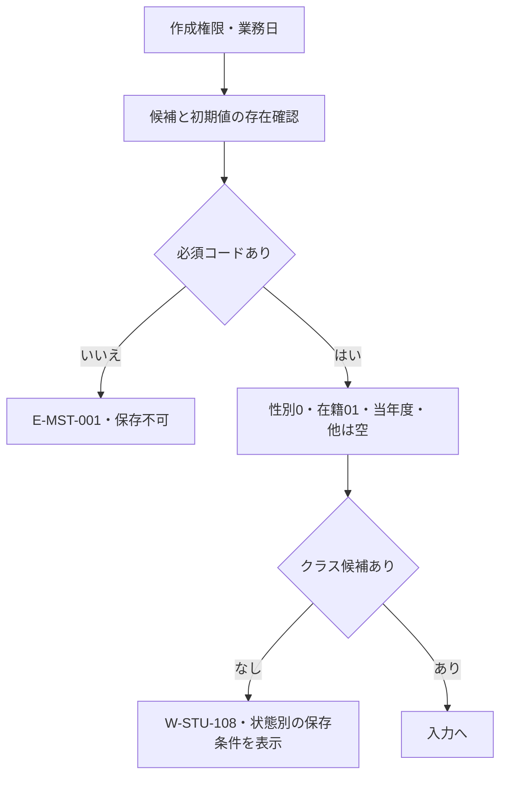

#### SQL・テーブル関連（ER図）

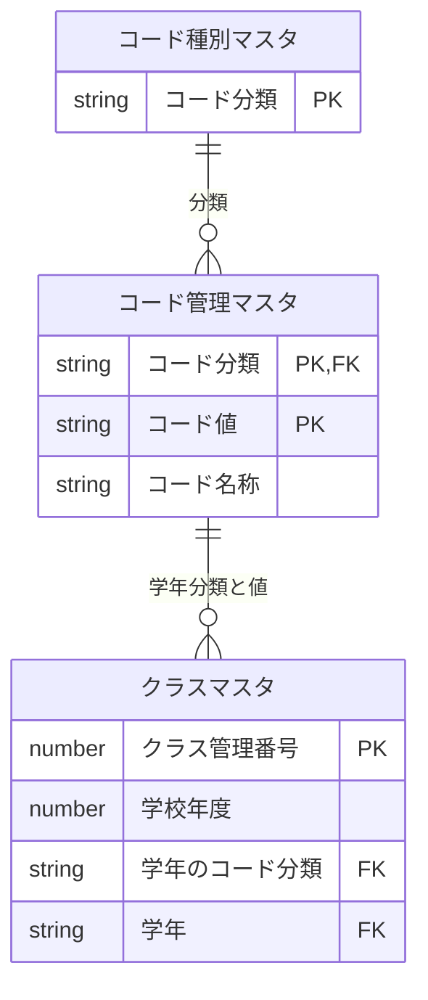

候補参照だけの関連。クラス0件とコードの必須初期値不足を分け、先頭候補への置換はしない。

#### DB操作の詳細

OP-CODE→OP-CLASSを参照として実行する。学生・マスタ・操作履歴の書込みは全て0件。候補や参考人数の取得は学生保存・席予約ではない。

#### 結果・例外時の扱い

CHK-023/024の認証・認可・状態不正はE-COM-001/002/003で拒否する。CHK-010の必須初期値不足はE-MST-001「マスタの初期設定が不足しています。管理者に連絡してください。」、クラス0件はW-STU-108「登録可能なクラスがありません。クラスマスタを確認してください。」。読取障害はE-COM-004。学生未作成の段階で不在・更新競合・保存成功を表示しない。

### EV-REG-002 編集・参照画面表示

#### 処理概要

指定学生IDの現在の保存値と版を取得し、表示用名称、編集値、読込時原本を分離する。

#### 処理手順

1. 共通01・02と画面状態で編集/参照の権限・対象IDを確認し、OP-STUDENTで非削除対象を1件取得する。不在を新規モードへ切り替えない。
2. OP-CODE・OP-CLASSで保存値の名称・候補を取得し、全保存値と更新管理番号を読込時スナップショットへ複製する。編集値は別に持ち、停止・期間外の既存値を消さない。
3. 生年月日を共通16で和暦表示し、学籍番号・管理項目は表示専用にする。閲覧者は全項目を表示専用にし、権限別の操作を整える。

#### 処理フロー

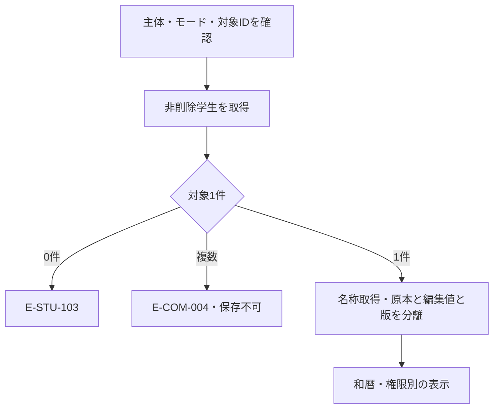

#### SQL・テーブル関連（ER図）

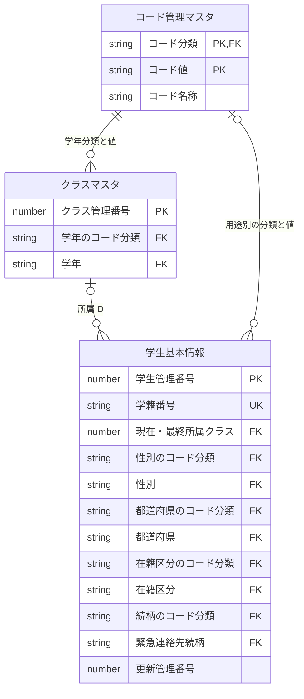

学生からの名称参照は外部結合相当。性別・都道府県・在籍・続柄・学年の各用途で分類＋値を別々に結合する。続柄全NULL、未所属、停止値、名称欠落で学生行を除外しない。図の検索JOINと物理FKは区別する。

#### DB操作の詳細

OP-STUDENT→OP-CODE→OP-CLASS。OP-STUDENTは非削除ID1件を期待し、0件はE-STU-103、複数件は整合性障害とする。参照モードで業務表・履歴を更新しない。保存時の最新読取と、この表示用読取の確定境界を分ける。

#### 結果・例外時の扱い

CHK-023/024不成立はE-COM-001/002/003、CHK-021の0件はE-STU-103「対象の学生が見つからないか、既に削除されています。」。CHK-010/011の名称欠落は不整合を示しE-MST-001を案内するが、保存値を先頭候補で置換しない。全値・原本・版の取得が成立するまで保存操作を可能にしない。

### EV-REG-003 入力補助

#### 処理概要

和暦、在籍状態、年度・学年とクラスの入力関係を表示し、補助入力を保存判断へすり替えない。

#### 処理手順

1. 共通16・17で和暦4要素を実在日・元号境界・日付範囲の順に厳密検査する。原入力を保持し、不正日を次元号・翌月へ補正しない。
2. 在籍01/02はクラス必須・終了日なし、03/04は終了日必須・最終所属任意の条件を示す。終了区分から別区分への訂正に必要な管理者権限と理由を表示する。実保存時にも同条件を検査する。
3. 年度・学年・在籍区分変更時にOP-CLASSで候補を再取得する。選択クラスが不適合なら解除して通知する。人数は参考であり席を予約しない。

#### 処理フロー

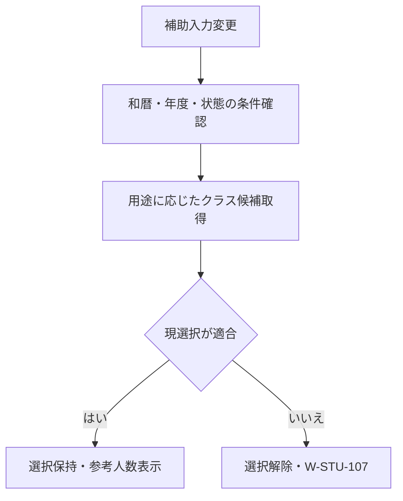

#### SQL・テーブル関連（ER図）

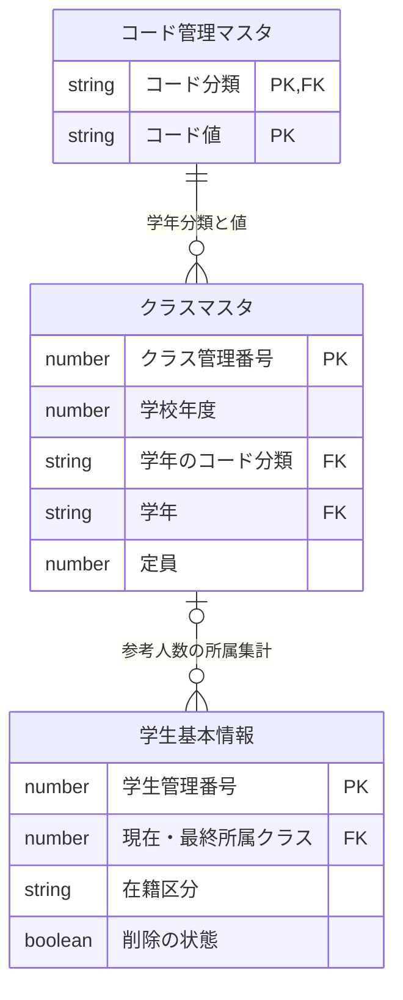

集計は非削除01/02だけを席として数える。候補条件は新規所属/最終所属/既存保持ごとで、参照時人数と保存時定員再判定を区別する。

#### DB操作の詳細

OP-CLASSの参照のみ。和暦部品の変換は共通暦定義を使用し、入力補助だけで学生・マスタ・履歴を更新しない。

#### 結果・例外時の扱い

| 判定ID | 条件 | メッセージと復帰 |
| --- | --- | --- |
| CHK-007・CHK-032・CHK-033 | 和暦4要素の構文・実在日・改元・1900-01-01～業務日 | E-STU-005、E-DATE-001/002。原入力を保持して日付欄へ |
| CHK-009・CHK-012・CHK-026 | 状態と終了日・所属、終了区分訂正の条件 | E-STU-008/012/106の適用条件を表示し、保存で再判定 |
| CHK-010・CHK-014・CHK-034 | 補助年度/学年の存在・1900～9998・クラス実値 | 不適合解除W-STU-107、候補なしW-STU-108、年度E-DATE-003。型変換で補正しない |

### EV-REG-004 新規登録・更新

#### 処理概要

正規化した業務値を最新の対象・マスタと照合し、変更がある学生1件と履歴1件だけを原子的に確定する。

#### 処理手順

1. **受付・入力と保存値を整える**
   1. 共通01・02・03で認証、役割、操作、業務日・受付番号を確定し、画面・期待版・二重実行を検査する。新規19入力、更新は学籍番号以外18入力を複製する。
   2. 共通04・05・16・17により原入力上限→正規化/和暦厳密変換→保存上限/必須/形式→日付関係/連絡手段を判定する。独立した基本誤りはまとめて該当欄へ表示し、依存する関係判定は形式成立後に行う。
   3. 氏名/カナ照合値2つを生成し、続柄未選択は分類もNULL、選択時は続柄分類を算定する。緊急氏名・分類・続柄・電話の4保存値を同じ比較・保存・監査に渡す。年度・学年の補助値や削除理由は通常保存の学生項目へ混ぜない。
2. **最新値・席・確認を保護下で再判定する**
   1. 共通13の短い保存単位で、複数接続に有効な同時保存制御を取得する。既存だけOP-STUDENTを再読取し、対象の非削除1件・読込版・学籍番号不変を確認する。OP-EXISTSで削除済みを含む全学籍番号一意、分類付き存在、新規/変更値の有効性、クラス・日付・区分訂正権限を現在値で確認する。
   2. OP-CAPACITYで旧席と新席を比較する。新席が設定済みで旧席と異なる増加先だけ、自分以外の非削除01/02人数＋1≦定員を判定する。続柄分類も含め全保存値に実差分がなければ書込みせずI-STU-004で終了する。版競合を変更なしへ置換しない。
   3. OP-DUPで非削除の他学生の全候補ID・版を取得する。未確認又は確認不一致は保存単位を終了し、EV-REG-005へ渡す。確認待ちにDBロックを保持しない。続行でも本人・認証・対象・旧版・全正規化業務値・全候補集合・10分期限と、理由・補助値を再検査する。
3. **学生と履歴を同じ単位で確定する**
   1. 新規はOP-INSERT、既存の実変更はOP-UPDATEのどちらか一方を実行し、学生1件を変更する。項目別設定はUPD-002～023・UPD-101～106に限定する。
   2. OP-AUDITで変更項目名・対象・前後版・実行者/時点・理由・受付番号・重複確認有無を1件追記する。個人情報の値は複写しない。学生と履歴を同じ接続・保存単位で確定する。
   3. 確定確認後だけI-STU-001/002を表示し、確認情報を消費して検索へ返す。確定前失敗は双方取消。結果不明はE-COM-004と検索確認の案内とし、採番済みだけで成功にせず自動再送しない。

#### 処理フロー

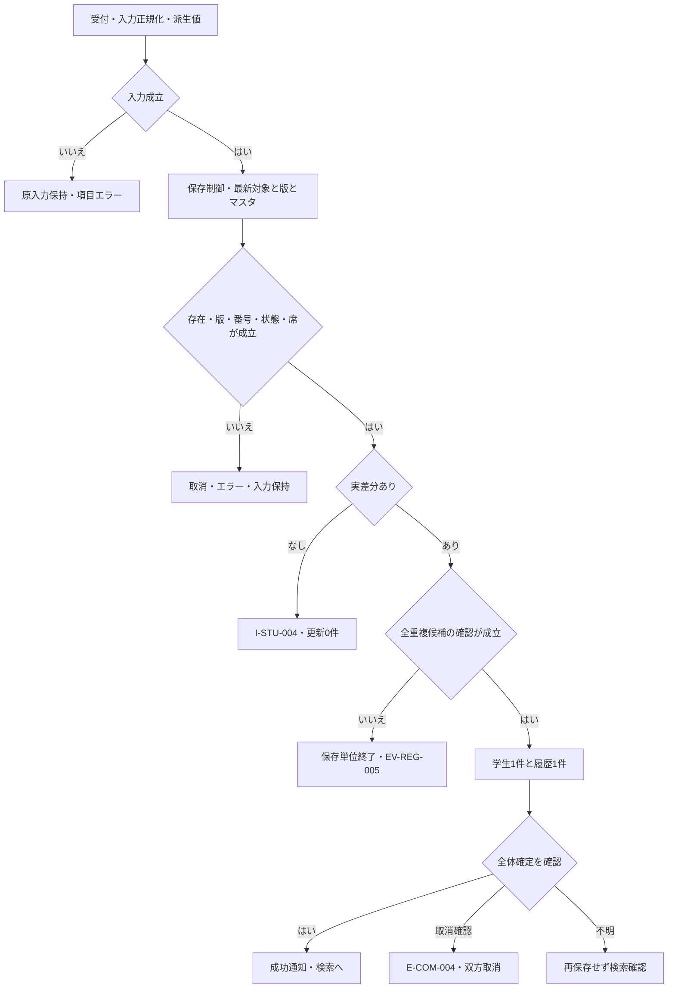

#### SQL・テーブル関連（ER図）

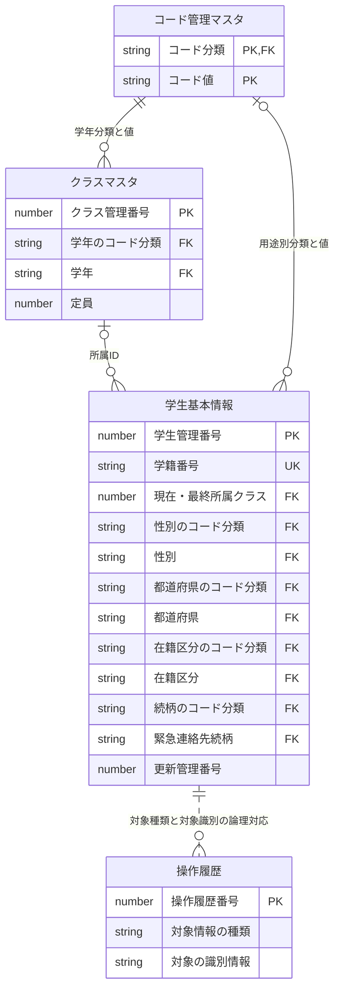

クラスとコードは保護下で参照する。名称取得の外部結合と保存時の分類付き参照整合を分ける。操作履歴との線は対象種類/識別情報による追記先の論理対応で、学生への物理FKや検索JOIN追加ではない。学生1件と履歴1件だけを同じ確定単位に含め、マスタを変更しない。

#### DB操作の詳細

同時保存制御→既存のみOP-STUDENT→OP-EXISTS→OP-CAPACITY→変更なし判定→OP-DUP/確認照合→OP-INSERT又はOP-UPDATE→OP-AUDIT→全体確定。学生更新は対象ID＋期待更新管理番号＋非削除を条件とし1件を期待する。0件なら再確認して不在/削除済みE-STU-103と版競合E-STU-105を区別し、予期しない複数件又は履歴失敗はE-COM-004で全取消する。

新規は19入力＋照合値2＋固定/派生分類と管理属性を設定する。更新は18入力＋照合値2＋条件付き続柄分類だけを許可し、学籍番号・作成属性・必須3分類・削除属性を変更しない。全無変更は学生/履歴0件、版・更新日時も不変。実変更だけ学生1件/履歴1件、版＋1。新規と更新の両方を実行しない。

#### 結果・例外時の扱い

| 判定ID | 判定時点・条件 | 結果と復帰 |
| --- | --- | --- |
| CHK-023・CHK-024 | 受付と保存時の主体・役割・画面・操作・再入 | E-COM-001/002/003。業務書込み0件、許可されない入口を渡さない |
| CHK-001・CHK-002・CHK-003・CHK-006 | 入力前/保存長・必須・禁止文字・番号/カナ | E-STU-001～004。原入力全体を保持し、複数の独立誤りを対象欄へ |
| CHK-007・CHK-008・CHK-009・CHK-032・CHK-033 | 形式成立後の実在日・元号境界・日付範囲と前後関係 | E-STU-005～008・E-DATE-001/002。日付を補正しない |
| CHK-016・CHK-017・CHK-018・CHK-019・CHK-020 | 郵便/電話/メール、連絡手段1つ以上、緊急一式 | E-STU-015～019。緊急4保存値の片側NULLも拒否、DB変更なし |
| CHK-021・CHK-022・CHK-003・CHK-004 | 保護下の対象1件・期待版・番号不変/全行一意 | E-STU-103/105/104/101。先行部分更新なし、自動上書きなし |
| CHK-010・CHK-011・CHK-012・CHK-013・CHK-014・CHK-026・CHK-031・CHK-034 | 分類付き参照、新規/変更の有効性、所属/補助/年度/期間、終了区分訂正 | E-STU-009～014/106/108、E-DATE-003。既存同値保持と新規所属の条件を分ける |
| CHK-015 | 新席増加時だけ人数＋1≦定員、休学も1席 | E-STU-102。席解放と定員NULLは加算制限なし。書込み前に判定 |
| CHK-005・CHK-025 | 非削除他学生の同生年月日＋氏名又はカナ一致、全候補版と確認 | W-STU-101で全件数/最大20件。差はW-STU-102、理由不足E-STU-107。待機中は排他解放・書込み0件 |
| CHK-022・CHK-030 | 版一致後の実差分と原子的確定 | 変更なしI-STU-004、成功I-STU-001/002。取消確認と結果不明を分離する |

確定前失敗と取消確認は原入力を保持して訂正・再操作へ戻す。結果不明では「再保存前に検索で結果を確認してください」と案内し、未保存・取消済みと断定しない。確定成功後の検索再表示だけの失敗は成功を維持して別に案内する。切断中まで文言表示を保証しない。

### EV-REG-005 重複候補の確認続行・取消

#### 処理概要

同一人物候補を見て別人として続行する理由を確認し、全保存検査へ戻す。確認だけでDB確定しない。

#### 処理手順

1. 全候補件数と最大20件の学籍番号・氏名・和暦生年月日・クラスを表示する。既定は取消。候補の20件表示と全候補ID/版の確認集合を分ける。
2. 続行は共通11により本人・認証状態・操作・対象・旧版・全正規化業務値・全候補ID/版・10分期限を照合する。相違又は他要求の確認処理中は続行させず再確認する。理由と年度/学年補助・復帰先は学生確認業務値と分けて個別検査する。
3. 理由付きでEV-REG-004を再実行し、認可・存在・版・日付・マスタ・定員・全候補を保護下で再検証する。取消は確認情報を失効して原入力に留まる。確認待ちにDBロックを保持しない。

#### 処理フロー

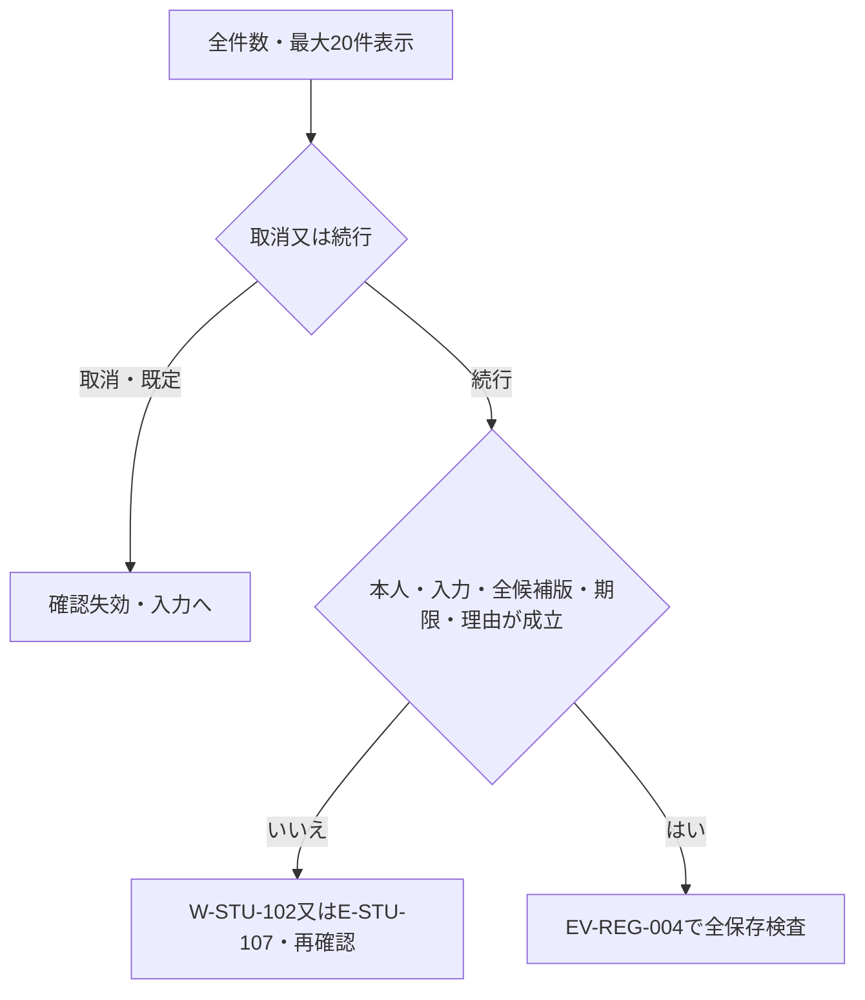

#### SQL・テーブル関連（ER図）

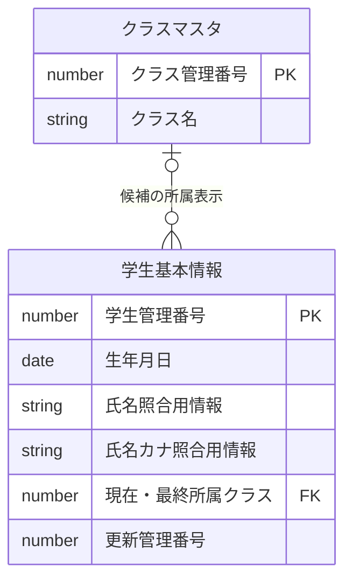

非削除かつ自分以外、同一の日付型生年月日と氏名/カナいずれかの照合値一致を候補とする。クラス名称は外部結合相当で表示用だけ、候補の一致条件へ追加しない。電話・メール重複は候補条件にしない。

#### DB操作の詳細

OP-DUPで全IDと版を学生ID順に取得し、表示は最大20件。確認照合は再保存時の同時保存制御内で行う。このイベント単独の業務/履歴書込みは0件で、実変更はEV-REG-004だけが確定する。成功後の確認情報消費、フォーム終了/認証変更時の破棄は共通11に従う。

#### 結果・例外時の扱い

CHK-005/025でW-STU-101「同じ生年月日で氏名または氏名カナが一致する学生が{count}件あります。別人であることを確認してください。」を表示する。countは全候補件数。相違/期限切れはW-STU-102「入力内容または重複候補が変わりました。もう一度確認してください。」。CHK-002/025で空白だけ又は60字超の理由はE-STU-107。CHK-024の状態不正はE-COM-003。確認済みBooleanだけで保存を迂回させない。

### EV-REG-006 論理削除

#### 処理概要

管理者が対象・読込版・理由・明示確認を指定し、削除属性と履歴だけを確定して通常検索/参照から除外する。

#### 処理手順

1. 対象ID・期待版・削除理由・明示確認だけを受け、共通01・02とCHK-027で管理者権限・理由60字以内を確認する。確認はW-STU-105、取消を既定とし、編集中の氏名・住所等を保存へ混ぜない。
2. 短い保存単位の同時保存制御下でOP-STUDENTを再読込し、非削除1件と期待版を検査する。不在/削除済みと版競合を分ける。
3. OP-DELETEで削除属性・更新管理属性だけを1件更新し、OP-AUDITを1件追記して同じ単位で確定する。確定確認後だけ成功通知と検索復帰を行う。

#### 処理フロー

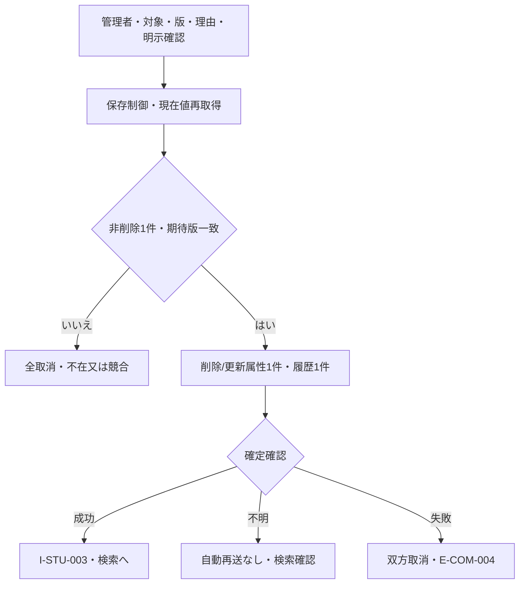

#### SQL・テーブル関連（ER図）

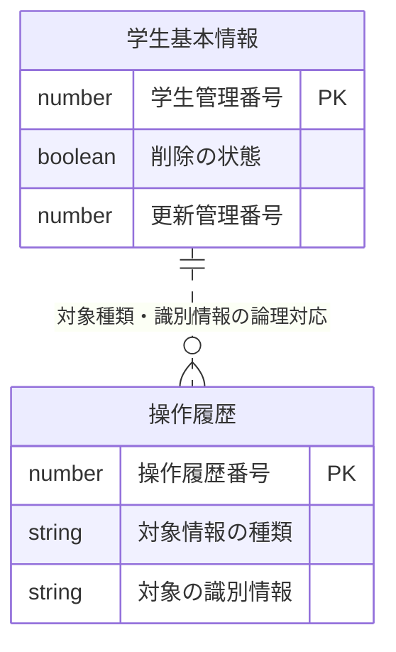

履歴との線は追記先の論理対応であり、学生への物理FK/検索JOINを追加しない。元の所属クラスは保持し、削除後は所属人数に含めない。

#### DB操作の詳細

OP-STUDENT→OP-DELETE→OP-AUDIT。対象ID＋期待版＋非削除を条件にUPD-105/106だけを1件更新し、UPD-107を1件追記する。0件は不在/版競合を再確認、複数件又は履歴失敗は全取消。物理削除、一般業務項目、クラス/コード、作成属性の変更はいずれも0件。

#### 結果・例外時の扱い

CHK-023/024/027の不成立はE-COM-002/003又はE-STU-020、CHK-021/022はE-STU-103/105。確認文言はW-STU-105「この学生を論理削除します。削除後は通常検索できません。よろしいですか。」。CHK-030の確定成功だけI-STU-003「学生情報を論理削除しました。」。障害の取消確認と結果不明を区別し、後者はE-COM-004と検索確認を案内する。

### EV-REG-007 取消・再読込・検索へ戻る

#### 処理概要

画面内の取消、DBの明示再読込、検索復帰を別操作として扱い、未保存値の破棄を利用者に確認する。

#### 処理手順

1. 新規クリアは初期値、編集取消は最後の読込時原本へ戻す。W-STU-104で確認し取消を既定とする。DBの最新値を取得する操作とはしない。
2. 最新再読込はW-STU-109で破棄確認後OP-STUDENTを実行し、全値・原本・版を同時に置き換える。未保存値を自動適用したり、値を残して版だけを最新にしたりしない。
3. 検索へ戻る・ウィンドウ終了は未保存変更があればW-STU-103で確認する。取消は入力を保持。保存結果不明なら再保存前の検索確認を案内し、確定済みの変更を取消で巻き戻さない。

#### 処理フロー

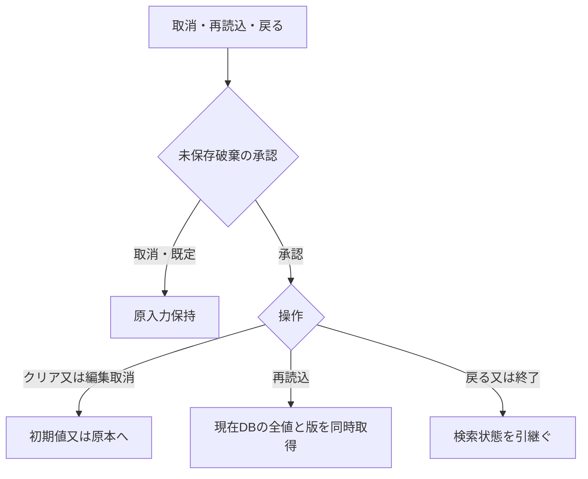

#### SQL・テーブル関連（ER図）

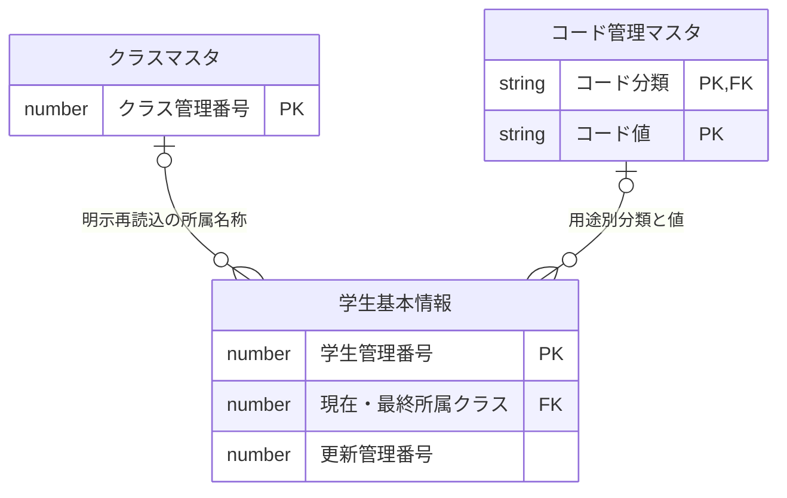

図は明示再読込だけに適用する。取消・クリア・戻る自体は業務DBの参照/更新なし。名称の取得はEV-REG-002と同じ外部結合・分類付き参照である。

#### DB操作の詳細

明示再読込だけOP-STUDENTを呼び、必要な名称はOP-CODE/OP-CLASSの表示契約を使う。新規クリア/編集取消は原本から画面を戻すだけ。全操作で業務/履歴の書込みは0件、検索側の再取得は復帰先EV-SRC-006の責務。

#### 結果・例外時の扱い

CHK-024の破棄確認はW-STU-104「入力内容を取り消しますか。」、W-STU-109「最新情報を再読み込みすると入力中の変更は破棄されます。続行しますか。」、W-STU-103「変更内容を破棄して戻りますか。」。取消時は原入力を保持する。CHK-021の不在E-STU-103、状態不正E-COM-003、読取障害E-COM-004では版だけの置換をしない。CHK-030の結果不明は「再保存前に検索で結果を確認してください」と案内し、盲目的再送をしない。

### DB操作定義

業務契約の正本は[共通データアクセス](../共通/08_データアクセス仕様.md)で、Accessの保存制御・型・接続は[方式別共通](../共通/方式別/01_共通実装仕様.md)を参照する。新しい実装方式や業務表を追加しない。

| 操作ID | 対象・操作 | 条件と設定 | 件数・確定境界 |
| --- | --- | --- | --- |
| OP-CODE | コード種別・コード管理の参照 | 分類、用途、新規/変更/既存同値、業務日。分類＋値で名称・利用可否・期間 | 候補0件/必須初期値不足を区別、先頭値代替なし。参照のみ |
| OP-CLASS | クラス・学年コード・必要時の学生人数参照 | 用途、年度・学年・在籍区分・在籍期間・既存所属・業務日・人数要否 | 年度降順→学年表示順→クラス表示順→コード→ID。参照人数は予約でない |
| OP-STUDENT | 学生と所属/コード名称参照 | 対象IDかつ非削除、全保存値と版。名称は外部結合相当 | 0件不在、1件正常、複数は整合性障害。保存時再検証は保護された単位内 |
| OP-EXISTS | 学生・クラス・コード存在参照 | 保存用途は全行学籍番号一意（自分除外）、分類付き存在、新規/変更値有効性、補助年度学年とクラス実値。検索用途とは分ける | 保存制御後の現在値で不在/一意/組合せ/停止を区別 |
| OP-CAPACITY | 学生・クラス参照 | 自分以外の非削除01/02人数。新席設定済みかつ旧席と異なる時だけ＋1≦定員 | 休学も1席、定員NULLは制限なし。卒業/退学/削除による席解放に加算検査なし |
| OP-DUP | 学生・表示用クラス参照 | 非削除、自分以外、同生日かつ氏名又はカナ照合値一致 | 全ID/版をID順に確認。表示最大20件、全件数は別。確認待ちは保存制御解放 |
| OP-INSERT | 学生登録 | 19入力＋生成照合値2、固定3分類/条件付き続柄分類、ID自動採番、版1、作成/更新属性、未削除 | 必ず1件。番号一意でも競合防止。OP-AUDITと一括、最大値＋1採番なし |
| OP-UPDATE | 学生更新 | ID＋期待版＋非削除、18入力＋照合値2＋続柄分類。学籍番号・必須3分類・作成/削除属性は不変 | 1件、0件は不在/競合へ分離、版＋1。全無変更は実行せず監査なし |
| OP-AUDIT | 操作履歴追記 | 対象、操作、前後版、変更項目名、実行者・時点・理由・受付番号、確認有無。個人情報値を複写しない | 実変更1件につき1件、追記専用。同じ接続/保存単位、失敗は双方取消 |
| OP-DELETE | 学生の論理削除更新 | ID＋期待版＋非削除、削除状態/日時/者/理由と更新日時/者/版だけ | 1件、物理DELETEなし、一般編集値なし。OP-AUDITと一括 |

### 業務判断の決定表

| 判断 | 成立条件 | 不成立又は既存保持の扱い |
| --- | --- | --- |
| 番号一意 | 削除済みを含め全行で未使用。更新は自分を除く | 使用済みは再利用不可。登録後の番号訂正不可 |
| 同一人物候補 | 他の非削除学生と生日が同じで氏名/カナ照合値いずれか一致 | 拒否固定ではなく、別人確認と理由、全候補再照合で保存可 |
| コード | 正しい分類内に存在、新規/変更は利用可・期間内 | 不存在不可。停止/期間外の既存同値保持は可 |
| 連絡手段 | 本人電話・本人メール・緊急電話の1つ以上 | 全て未設定は保存不可。家族の同じ電話/メールは重複だけで拒否しない |
| 緊急一式 | 3入力全空又は全入力。保存4値は全NULL又は全非NULL | 一部入力、分類だけ/値だけNULLは不可。続柄全消去は4値同時NULL |
| 日付 | 1900-01-01≦生年月日≦入学日≦業務日 | 01/02は終了日NULL。03/04は入学日≦終了日≦業務日。年齢の追加制限なし |
| 版・差分 | 存在・期待版一致後に全保存値を比較 | 版競合は拒否、全無変更は版/日時/履歴不変 |
| 理由 | 必要操作で空白でなく60字以内 | 重複続行/終了区分訂正はREG-024、削除はREG-026を別判定 |

| 保存後の状態・変更 | クラスと期間 | 定員と席 |
| --- | --- | --- |
| 新規01/02・別クラス異動・03/04から01/02への訂正 | 必須、利用可・業務日が利用期間内。補助年度/学年と実値一致 | 自分以外の01/02人数＋1≦定員 |
| 01/02で同じクラスを保持 | 実在必須。停止/期間外でも住所等の無関係な訂正を許容しW-STU-106 | 席が増えないため既存超過だけで拒否しない |
| 新規03/04 | 最終所属任意。指定時はクラス期間と入学～終了日が1日以上重なる | 席なし |
| 03/04の最終所属・在籍日付・区分を変更 | 停止・過去クラス可。指定した在籍期間との重なりを検査 | 席なし |
| 03/04の最終所属・在籍日付・区分を保持し住所等だけ変更 | 既存値保持。重なりを再強制しない | 席なし |
| 論理削除 | 元のクラスを保持 | 削除後は人数から除外 |

定員NULLは制限なし、休学は1席。期間の重なりはクラス開始日≦終了日かつクラス終了日≧入学日で判定し、卒業日自体がクラス期間内であることまでは要求しない。

| 変更前 | 変更後 | 実行者・条件 |
| --- | --- | --- |
| 在学・休学 | 4区分 | 担当者又は管理者、変更後の日付・所属規則を満たす |
| 卒業・退学 | 同一区分 | 担当者又は管理者、通常項目を訂正可 |
| 卒業・退学 | 別区分 | 管理者と確認・変更理由が必要 |
| 新規 | 4区分 | 担当者又は管理者。過去データ登録も可 |

### メッセージ・差込値・復帰の対応

共通05のID・実文言を継承し、項目名は日本語論理名、maxは当該制限、countは全候補件数、studentNoは確定済み結果、correlationIdは共通03の受付番号から取得する。通常の入力誤りは原入力全体を保持し、項目近傍と一覧にまとめ、先頭の誤り欄へ戻す。内部列名・SQL・接続先・例外スタックや個人情報の値を通常エラーへ露出しない。

| メッセージID | 実文言 | 適用・復帰 |
| --- | --- | --- |
| E-STU-001 | {field}を入力してください。 | 必須・条件必須の対象欄へ |
| E-STU-002 | {field}は{max}文字以内の使用可能な文字で入力してください。 | 原入力/保存長・禁止文字を区別 |
| E-STU-003 | 学籍番号は半角英数字・ハイフンで15文字以内にしてください。先頭は英数字です。 | 番号欄へ |
| E-STU-004 | 氏名カナはカタカナで入力してください。中点・長音・空白は使用できます。 | カナ原入力保持 |
| E-STU-005 | {field}に正しい日付を入力してください。 | 不正日を補正しない |
| E-STU-006 | {fromField}は{toField}以前の日付にしてください。 | 日本語項目名を差し込む |
| E-STU-007 | 生年月日・入学日は本日以前とし、生年月日≦入学日となるよう入力してください。 | 形式成立後の日付関係 |
| E-STU-008 | 在籍区分に対応する卒業・退学日を設定してください。 | 区分と終了日へ |
| E-STU-009 | {field}のコードが存在しません。選択し直してください。 | 分類付き存在不成立 |
| E-STU-010 | 指定したクラスが存在しません。選択し直してください。 | クラス再選択 |
| E-STU-011 | {field}は現在使用できないコードです。選択し直してください。 | 新規/変更値の利用可否 |
| E-STU-012 | 在学・休学の学生はクラスを選択してください。 | 01/02の所属欄へ |
| E-STU-013 | このクラスには新たに所属できません。利用可否と利用期間を確認してください。 | 新たな所属条件不成立 |
| E-STU-014 | 年度・学年と選択したクラスが一致していません。 | 補助値とクラスを修正 |
| E-STU-015 | 郵便番号は7桁の数字で入力してください。 | 郵便欄へ |
| E-STU-016 | {field}の形式が正しくありません。国内10～11桁または国番号付きの番号を入力してください。 | 本人又は緊急電話欄へ |
| E-STU-017 | メールアドレスの形式が正しくありません。 | メール原入力保持 |
| E-STU-018 | 本人電話、本人メール、緊急連絡先電話のいずれかを入力してください。 | 連絡先の組合せを修正 |
| E-STU-019 | 緊急連絡先は氏名・続柄・電話番号をすべて入力してください。 | 全未設定又は一式入力へ |
| E-STU-020 | 削除理由を60文字以内で入力してください。 | 削除確認だけ、一般入力は保存しない |
| E-STU-101 | この学籍番号は使用済みです。入力を確認してください。直前の送信結果が不明な場合は検索で登録状況を確認してください。 | 番号再利用なし、結果不明の再送なし |
| E-STU-102 | クラスの定員を超えるため保存できません。別のクラスを選択してください。 | 入力保持・所属再選択 |
| E-STU-103 | 対象の学生が見つからないか、既に削除されています。 | 新規へ切替えない |
| E-STU-104 | 登録済みの学籍番号は変更できません。 | 変更なしに見せかけて受理しない |
| E-STU-105 | 他の操作で更新されています。入力内容を控え、最新情報を再読み込みしてください。 | 自動上書き/版だけ更新なし |
| E-STU-106 | 卒業・退学からの在籍区分変更には管理者権限と変更理由が必要です。 | 終了区分からの訂正条件 |
| E-STU-107 | 確認・変更理由を60文字以内で入力してください。 | 確認理由欄へ |
| E-STU-108 | 最終所属クラスの利用期間が学生の在籍期間と重なっていません。クラスまたは在籍日付を確認してください。 | 最終所属・在籍日付の対象変更時 |
| E-DATE-001 | 生年月日の元号・年・月・日を確認してください。 | 元号4要素の原入力保持 |
| E-DATE-002 | {field}は{minDate}から{maxDate}までの日付で入力してください。 | 範囲は共通07と業務日。生年月日上下限も和暦、その他は西暦 |
| E-DATE-003 | {field}は西暦4桁の{minYear}年から{maxYear}年で指定してください。 | 年度1900～9998、翌年計算前に検査 |
| E-COM-001 | ログインの有効期限が切れました。再度ログインしてください。 | Accessの主体照合へ。ログイン画面追加ではない |
| E-COM-002 | この操作を行う権限がありません。 | 業務書込みなし |
| E-COM-003 | 画面情報が無効です。画面を開き直してください。 | 不正な操作を拒否 |
| E-COM-004 | 処理を完了できませんでした。受付番号：{correlationId} | 取消確認と成否不明を分ける。結果不明は検索確認を追記 |
| W-STU-106 | 所属クラスが利用期間外です。住所等は変更できますが、クラスの見直しが必要です。 | 既存所属を保持した無関係の訂正を妨げない |
| W-STU-107 | 選択条件が変わったためクラスの選択を解除しました。 | 年度/学年/区分に不適合な選択を解除 |
| I-STU-001 | 学生を登録しました。（学籍番号：{studentNo}） | 全体確定確認後だけ |
| I-STU-002 | 学生情報を更新しました。 | 全体確定確認後だけ |
| I-STU-003 | 学生情報を論理削除しました。 | 全体確定確認後だけ |
| I-STU-004 | 変更内容がありません。 | 学生/履歴/日時/版すべて変更なし |

## 項目更新仕様

| 更新ID | 項目ID | 対象 | 登録 | 更新 | 論理削除 | 規則・設定元 |
| --- | --- | --- | --- | --- | --- | --- |
| UPD-002 | REG-002 | 学生基本情報・学籍番号 | 検証済み入力 | 変更なし | 変更なし | N-06、全行一意、登録後不変 |
| UPD-003 | REG-003 | 学生基本情報・学生氏名 | 検証済み入力 | 検証済み入力 | 変更なし | N-02、前後空白だけ除去して原表記保持 |
| UPD-004 | REG-004 | 学生基本情報・学生氏名カナ | 正規化入力 | 正規化入力 | 変更なし | N-04、入力36/保存18字 |
| UPD-005 | REG-005 | 学生基本情報・生年月日 | 厳密変換日付 | 厳密変換日付 | 変更なし | N-11、DATE-R01。元号を重複保存しない |
| UPD-006 | REG-006 | 学生基本情報・性別 | 検証済みコード値 | 同左 | 変更なし | 未回答0可、必須分類で参照 |
| UPD-007 | REG-007 | 学生基本情報・郵便番号 | 正規化数字7桁 | 同左 | 変更なし | N-08、表示3桁－4桁 |
| UPD-008 | REG-008 | 学生基本情報・都道府県 | 検証済みコード値 | 同左 | 変更なし | N-07、必須分類で参照 |
| UPD-009 | REG-009 | 学生基本情報・住所1 | 検証済み入力 | 同左 | 変更なし | N-02、45字 |
| UPD-010 | REG-010 | 学生基本情報・住所2 | 検証済み入力/NULL | 同左、空はNULLで上書き | 変更なし | N-02、45字 |
| UPD-011 | REG-011 | 学生基本情報・本人電話 | 正規化入力/NULL | 同左 | 変更なし | N-09、入力20/保存16字、連絡手段条件 |
| UPD-012 | REG-012 | 学生基本情報・本人メール | 正規化入力/NULL | 同左 | 変更なし | N-10、60字、連絡手段条件 |
| UPD-013 | REG-013 | 学生基本情報・入学日 | 検証済み日付 | 同左 | 変更なし | N-11、DATE-R02、西暦 |
| UPD-014 | REG-014 | 学生基本情報・在籍区分 | 検証済みコード値 | 同左 | 変更なし | N-07、区分遷移の権限/理由を確認 |
| UPD-015 | REG-015 | 学生基本情報・卒業・退学日 | 検証済み日付/NULL | 同左、空はNULLで上書き | 変更なし | DATE-R02、03/04必須、01/02NULL |
| UPD-018 | REG-018 | 学生基本情報・現在・最終所属クラス | 検証済みID/NULL | 同左 | 変更なし | 年度/学年補助は保存せず、クラスIDを設定 |
| UPD-020 | REG-020 | 学生基本情報・緊急連絡先氏名 | 検証済み入力/NULL | 同左 | 変更なし | N-02、8字。緊急4保存値を同時設定/NULL化 |
| UPD-021 | REG-021 | 学生基本情報・緊急連絡先続柄 | 検証済みコード値/NULL | 同左 | 変更なし | N-07、未選択は続柄分類もNULL、選択時はUPD-103 |
| UPD-022 | REG-022 | 学生基本情報・緊急連絡先電話 | 正規化入力/NULL | 同左 | 変更なし | N-09、入力20/保存16字、緊急一式 |
| UPD-023 | REG-023 | 学生基本情報・備考 | 検証済み入力/NULL | 同左 | 変更なし | N-01、120字・LF改行、プレーンテキスト |
| UPD-101 | REG-003／004 | 氏名・氏名カナ照合用情報 | 共通04で生成 | 保存する氏名/カナから再生成 | 変更なし | N-03・N-05。入力された照合値は使わない |
| UPD-102 | REG-001 | 学生管理番号 | 自動採番 | 変更なし | 変更なし | 最大値＋1採番禁止 |
| UPD-103 | ― | 性別・都道府県・在籍区分・続柄のコード分類 | 必須3分類固定、続柄は選択時のみ設定/未選択NULL | 必須3分類は不変、続柄分類は続柄と同時設定/NULL化 | 変更なし | 利用者入力を受けず算定し、差分比較と変更項目名監査へ含める |
| UPD-104 | ― | 作成日時・作成者 | 共通03の時点・共通01の実行者 | 変更なし | 変更なし | システム設定 |
| UPD-105 | REG-025 | 更新日時・更新者・更新管理番号 | 実行時点・実行者・版1 | 実変更時だけ時点・実行者・版＋1 | 同左 | 対象ID＋期待版＋非削除で1件、無変更では更新しない |
| UPD-106 | REG-026／031 | 削除状態・削除日時・削除者・削除理由 | 未削除、他削除属性NULL | 変更なし | 削除済・実行時点・実行者・検査済理由 | 削除で一般編集中値を保存しない |
| UPD-107 | REG-024／026 | 操作履歴 | 前版なし・後版1・CREATE | 前後版・実変更項目名・UPDATE | 前後版・削除/更新管理項目名・DELETE | 対象識別、実行者時点、理由、受付番号、重複確認有無。個人情報値はコピーせず業務変更と同時確定 |

## 補足説明

### 正規化と日付

文字計測・許容文字は[共通チェック](../共通/05_チェック・メッセージ設計.md)のN-01～12を継承する。正規化で短くなる値でも原入力上限を先に検査する。氏名・住所・緊急氏名の内部空白・中点・異体字は保持し、照合値だけN-03/N-05で生成する。カナはNFKC・ひらがな→カタカナ・空白集約後18字で、中点・長音を残す。

郵便は入力10字から数字7桁、電話は入力20字から国内0始まり10/11桁又は国際+の後0以外で始まる7～15桁とする。許可ハイフン・丸括弧等だけを除去し、任意の記号/英字を黙って削除しない。国番号と国内表記を相互変換しない。メールは共通N-10のASCII限定形式で、前後空白除去・ドメインのみ小文字化し、ローカル部大小を保持する。到達確認や全メール構文への適合を意味しない。備考・理由だけLF改行可、他単一行は改行/タブ不可、NUL・禁止制御文字不可。

生年月日はDATE-R01で1900-01-01（明治33年1月1日）～要求開始時業務日、入学・卒業/退学日はDATE-R02で同じ業務範囲、年度はDATE-R04で1900～9998。業務日はJSTで要求内に固定し、確認続行は新要求として取り直す。元年入力、実在日、元号の開始/終了、逆変換、範囲、前後関係を順に確認し、昭和64年1月8日や令和元年4月30日等を受理しない。年度は4月1日～翌3月31日で9999年度を作らない。生年月日1900年下限は既存の設計仮定で、追加年齢制限や法令要件に読み替えない。

### Pilot確認ケース（設計・未実施）

| ケース | 初期状態・操作 | 判定と期待結果 |
| --- | --- | --- |
| 初期・参照 | 新規、閲覧者、対象0件、名称欠落 | CHK-010/021/023/024。0/01/当年度以外は空。閲覧者は参照、不在を新規にせず名称欠落で行を落とさない |
| 入力境界 | 氏名8/9、カナ原入力36/37と保存18/19、電話20/21・保存16/17 | CHK-001/002/006/017。原入力と保存長を別検査、切捨てや無言の受理なし |
| 日付・状態 | 改元境界、未来日、卒業→在学を担当者/管理者理由ありで試す | CHK-007～009/026/032～034。原入力保持、担当者不可、管理者でも日付・クラス・定員再検査 |
| 連絡先 | 電話/メール/緊急電話全空、緊急一部、全消去、家族共用 | CHK-019/020。全空/一部を拒否、一式全消去は4値同時NULL。家族共用だけでは拒否しない |
| 番号・同姓同名 | 削除済み番号、同生日同名の別人、表示20件外の候補更新 | CHK-004/005/025。番号再利用不可、別人理由で続行可。全候補版変更で再確認 |
| 確認期限 | 確認後の本人/対象/版/入力/理由変更、10分期限切れ | CHK-025。W-STU-102又は理由エラー、確認待ちにロックなし、再続行は全検査 |
| クラスと席 | 期間外既存の住所訂正、最終1席へ2接続同時保存、休学、定員NULL | CHK-011/013/015/031。住所訂正許容、同時増加は片方のみ、休学1席、NULL無制限 |
| 在籍期間 | 新規03/04の過去所属、卒業日がクラス期間外だが在籍期間は重なる | CHK-031。1日以上の重なりで成立、卒業日自体の期間内を追加強制しない |
| 競合・無変更 | 同じ旧版の更新/削除、実差分なし、続柄分類だけの派生差分 | CHK-021/022/030。競合拒否、全無変更は版/日時/履歴不変、派生分類を比較・監査へ含める |
| 原子的確定 | 学生変更後に履歴失敗、確定応答不明、保存成功後再表示失敗 | CHK-030。履歴失敗は双方取消、結果不明は再送せず検索確認、再表示失敗は保存成功維持 |
| 削除・取消 | 住所編集中に削除、再読込取消、戻る取消 | CHK-024/027。削除は一般入力を保存しない。取消は入力保持、再読込承認時だけ全値/版置換 |

### 参照と未実施

[論理テーブル](03_テーブル仕様書.md)、[コード設計](04_コード設計書.md)、[共通業務](../共通/03_共通モジュール設計.md)、[日付](../共通/07_日付・和暦仕様.md)、[項目制約](../共通/09_項目制約定義.md)、[適合試験・設計判断](../共通/06_要件対応・設計判断.md)を同じdraftRootの支援文書として参照する。全34項目、7イベント、新規19/更新18入力と照合値2、26更新IDの意味を継承する。原入力の未設定とDBのNULLを区別し、廃止IDを再利用しない。

個人情報の保存期間、削除復元、物理消去は既存QAの運用確認事項で、ここで確定しない。本書はAIによる試験生成・未採用で、入力正本8.4を改訂していない。静的HTML/CSSだけ既存配置契約を再利用した。文書検査、描画・目視、Accessネイティブ/IME、実DB、受入・正式採点を別状態で記録し、未採点はformalScore=nullとする。
