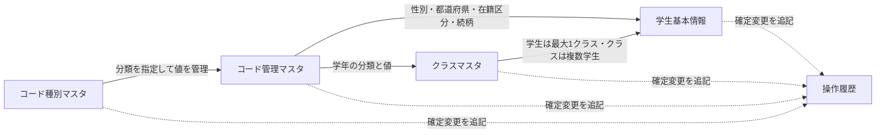

<!-- spec-meta: {"schema":"spec-md/1.0","documentId":"ACCESS-BAS-STU-03","version":"0.1","path":"sample-project1/srcs/Access/build/spec-generation/design-generation-check/spec/Access/基本設計書/03_テーブル仕様書.md","sheets":[{"heading":"概要","kind":"GRID","sheet":"01_概要"},{"heading":"テーブル一覧","kind":"LIST","sheet":"02_テーブル一覧","key":["No"]},{"heading":"イベント仕様","kind":"GRID","sheet":"03_イベント仕様"},{"heading":"補足説明","kind":"GRID","sheet":"04_補足説明"}],"isolationProfile":"Access","generationStatus":"verification-draft","inputSpecRoot":"sample-project1/spec/Access/"} -->
# テーブル仕様書（索引・共通規則）

版0.1／2026-10-28。基本設計Agentの試験生成。verification-draft・未採用。アプリ・実DBの実行は未実施。

## 概要

学生属性、現在・最終所属、業務コード、確定変更の記録を、既存の5業務表・89論理項目で管理する。本書を各分冊の入口とし、1表1文書にHEADERと9列LISTを置く。論理型と業務上限を維持し、分冊の物理名はDBとの対応確認用とする。実DB型・容量・索引・参照制約は[Access DB定義](../DB定義/Access/01_DB定義書.md)を参照する。

年齢、学年、クラス名称を学生へ重複保存せず、成績・出欠・年度所属履歴の表を増やさない。書込み制御・認証等の技術補助は[方式別共通仕様](../共通/方式別/01_共通実装仕様.md)に従い、業務5表・89項目には含めない。

### データの参照と変更記録

実線は業務上の参照、点線は変更記録であり、物理FKや連鎖削除の指定とは区別する。卒業・退学の学生はクラス未所属を許容する。操作履歴は複数表を対象とする追記記録であり、履歴の扱いから学生やマスタの削除を連動させない。

## テーブル一覧

| No | 論理名 | 物理名 | 分類 | 項目数 | 仕様書 |
| --- | --- | --- | --- | --- | --- |
| 1 | 学生基本情報 | m_student | 業務 | 35 | [01_m_student](テーブル/01_m_student.md) |
| 2 | クラスマスタ | m_class | 業務 | 17 | [02_m_class](テーブル/02_m_class.md) |
| 3 | コード種別マスタ | m_code_category | 業務 | 11 | [03_m_code_category](テーブル/03_m_code_category.md) |
| 4 | コード管理マスタ | m_code | 業務 | 14 | [04_m_code](テーブル/04_m_code.md) |
| 5 | 操作履歴 | t_operation_log | 業務 | 12 | [05_t_operation_log](テーブル/05_t_operation_log.md) |

## イベント仕様

| 操作 | 保存・検査規則 |
| --- | --- |
| 学生登録 | 全学生の学籍番号重複、参照先、連絡先、日付、定員、同一人物候補を確認し、学生と履歴を一括保存する |
| 学生更新 | 対象存在、学籍番号不変、期待版を確認する。業務値が無変更なら保存・履歴を行わない |
| 学生削除 | 削除状態・日時・者・理由・更新管理情報だけを変え、履歴を追記する |
| クラス保守 | 年度内一意、参照学生、在籍人数、学年、期間を検証し、変更と履歴を保存する |
| コード保守 | 分類内一意、固定桁、保護、有効期間、意味不変を確認し、変更と履歴を保存する |
| 検索・画面表示 | 参照のみ。操作履歴を増やさない |

### 共通の保存境界

1. **対象と成立条件の確認**
   1. 対象・保存済み値・期待版を照合し、参照実体の存在と停止・期間外・満員等の業務条件を分けて判定する。
   2. クラス・コードの意味変更では、削除済み学生からの参照も確認する。画面の有効・無効だけを保存可否の保証にしない。
2. **変更と履歴の確定**
   1. 検証済みの項目を保存し、実変更の時だけ更新日時・更新者・版を更新する。作成日時・作成者を変更しない。
   2. 対象件数と履歴の追記を確認し、同じ確定単位で完了する。失敗・競合・件数不一致は途中の変更を残さない。
3. **結果と再操作**
   1. 無変更0件と競合による0件を分け、各機能に定めた入力保持・再読込みへ戻す。
   2. 確定応答が不明な場合は成功や全取消済みと断定せず、[データアクセス仕様](../共通/08_データアクセス仕様.md)の成立確認と再操作条件に従う。

通常処理で参照中クラス・コードの実体を削除しない。停止・期間外の既存コードを変えずに保存できる条件は[コード設計](04_コード設計書.md)に従う。チェック文言と復帰は[共通チェック・メッセージ](../共通/05_チェック・メッセージ設計.md)に対応付ける。

## 補足説明

### 共通管理項目

学生基本情報、クラスマスタ、コード種別マスタ、コード管理マスタは、作成日時・作成者・更新日時・更新者・更新管理番号の5項目を持つ。分冊の項目数にこの5項目を含む。新規の版は1、実変更ごとに1加算し、採用DBの上限で停止する。日時は同じ時点を一意に保存し、日本時間で表示する。日付に時刻を持たせず、管理項目を利用者入力で上書きしない。

PK・NOT NULLは〇／空欄、初期値なし・長さ対象外は空欄を維持する。条件付き必須をNOT NULLへ強めない。空文字・未選択・NULL、Unicode受理、正規化前後の長さは[項目制約](../共通/09_項目制約定義.md)と[長さ基準](../共通/11_項目長設計基準.md)を保持する。

### 表ごとの条件

学生基本情報は個別30項目と共通5項目。「学年なし」はクラス側の値、「クラス未所属」は学生側の状態であり区別する。本人電話・本人メール・緊急電話のいずれか1つ以上を必須とする。緊急連絡先は氏名・続柄・電話の全空または全入力とする。

クラスマスタは個別12項目と共通5項目。同年度なら学年が違っても同じコードは不可。同年度・同学年の同名は警告するが、異なるコードなら保存できる。削除済みを含む参照学生がいる学年の変更は不可。在学・休学の非削除学生がいるクラスの停止、在籍人数未満への定員減少、現在の所属学生が期間外になる利用期間変更は拒否する。

コード管理マスタは個別9項目と共通5項目。分類と値の組で一意とし、異なる分類の「01」は別物とする。名称は識別子とせず、名称の変更によって学生のコード値を変えない。既存値を別の意味へ再利用しない。

操作履歴は確定した変更の12項目を追記する。個人情報の変更前後値を保存せず、過去の氏名・住所・所属の復元は保証しない。

### 日付・投入・未確定

[日付・年範囲](../共通/07_日付・和暦仕様.md)を正本とし、生年月日だけ和暦表示、他は西暦とする。元号は5分類70コードへ追加しない。機能別項目IDから参照・保存先を追跡する。

初期投入はコード分類、コード値、学校が確認したクラスの順とする。学校名と実クラスは未指定であり、サンプル学生・クラスを本番へ自動投入しない。物理消去と保管期間には別途運用承認が必要。この試験生成で未指定条件や実DB実行結果を補わない。
