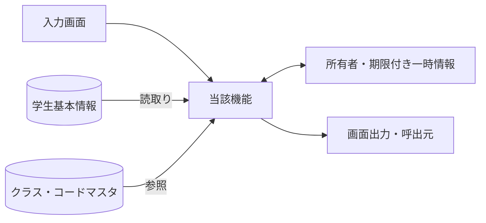
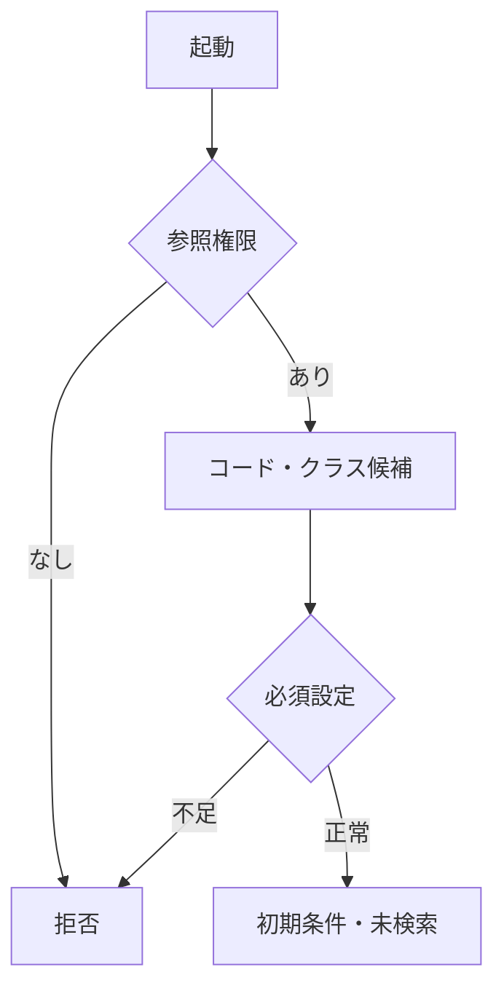
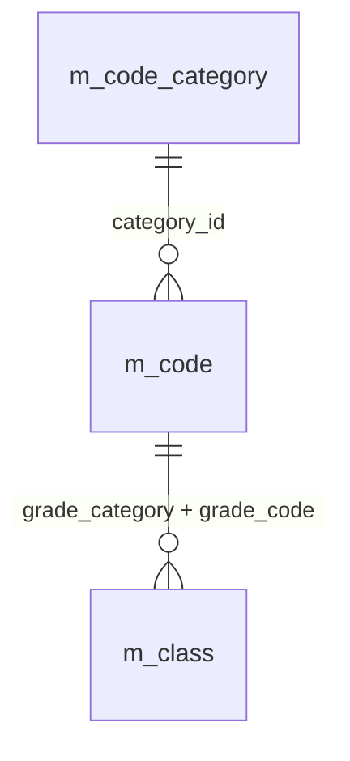
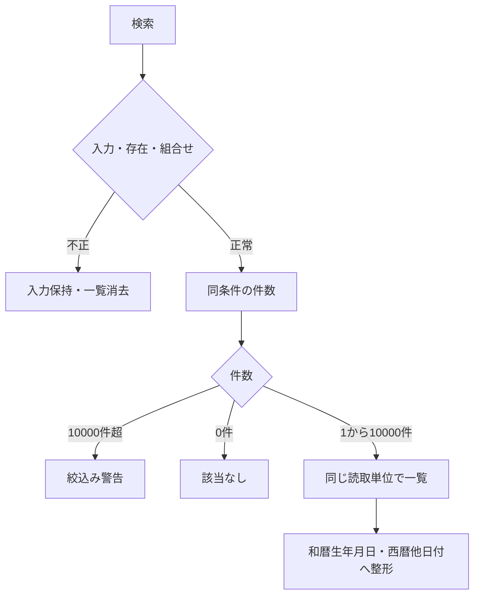
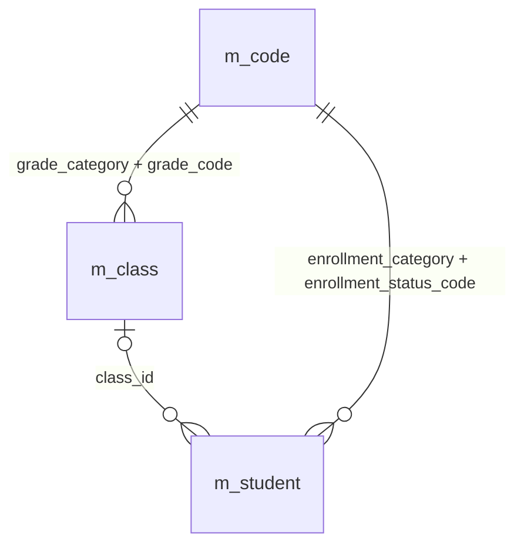
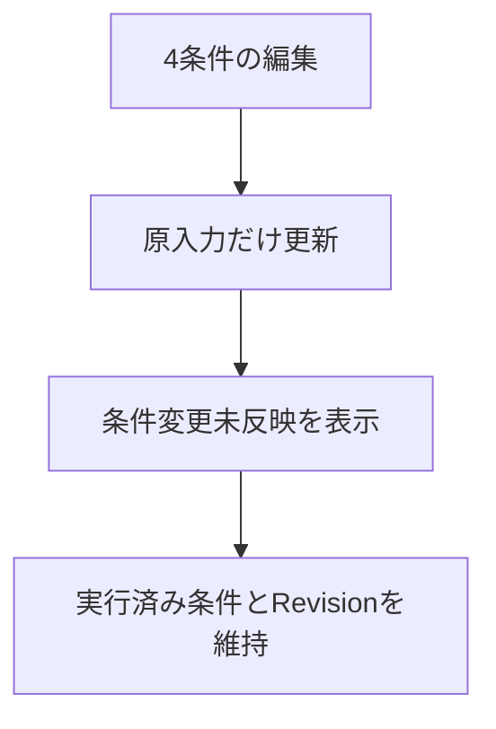
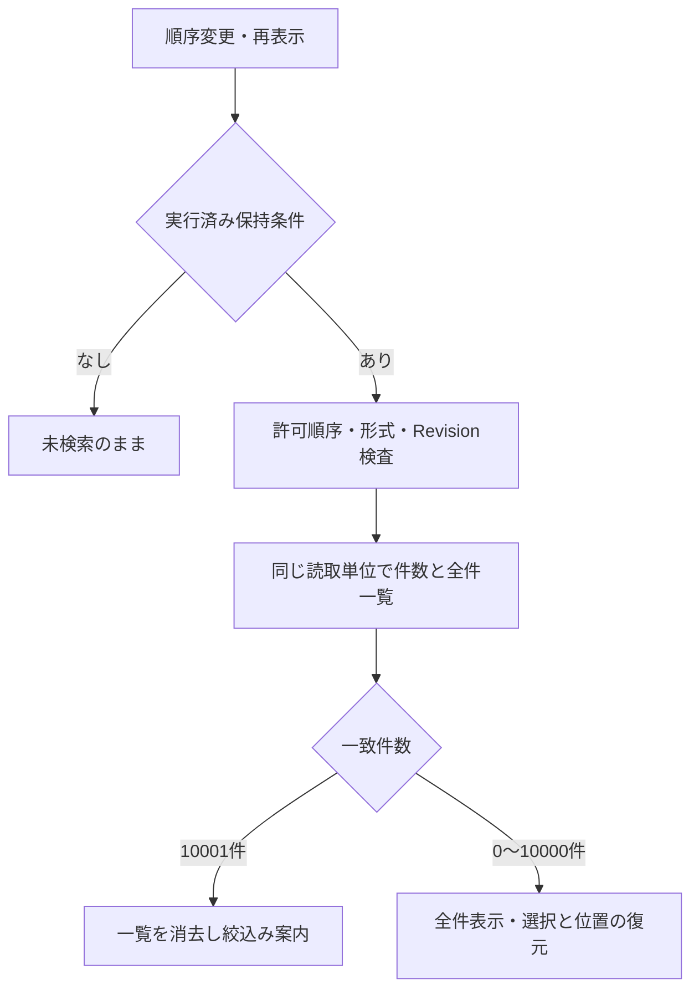
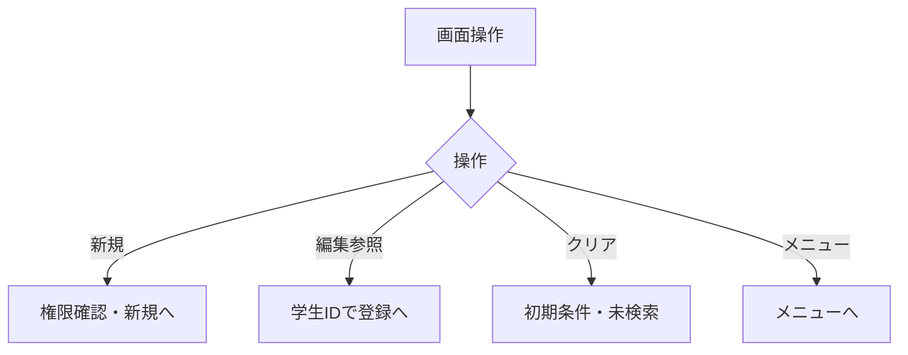
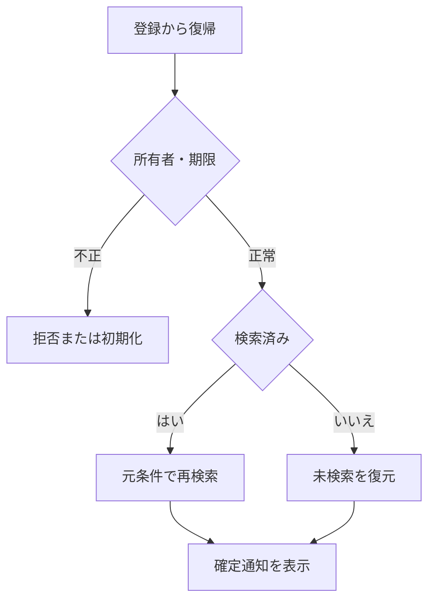

<!-- spec-meta: {"schema":"spec-md/1.0","documentId":"ACCESS-DET-Access-SCR-STU-001","version":"0.1","path":"sample-project1/srcs/Access/build/spec-generation/design-generation-check/spec/Access/詳細仕様書/01_学生検索画面.md","sheets":[{"heading":"概要","kind":"GRID","sheet":"01_概要"},{"heading":"項目一覧","kind":"LIST","sheet":"02_項目一覧","key":["項目ID"]},{"heading":"選択候補一覧","kind":"LIST","sheet":"03_選択候補一覧","key":["候補ID"]},{"heading":"内部項目一覧","kind":"LIST","sheet":"04_内部項目一覧","key":["内部項目ID"]},{"heading":"イベント仕様","kind":"GRID","sheet":"05_イベント仕様"},{"heading":"項目移送仕様","kind":"LIST","sheet":"06_項目移送仕様","key":["移送ID"]},{"heading":"補足説明","kind":"GRID","sheet":"07_補足説明"}],"isolationProfile":"Access","generationStatus":"verification-draft","generationAgent":{"id":"AG-DETAIL-DESIGN","version":"1.0"},"inputReferences":{"canonicalDocumentId":"ACCESS-DET-Access-SCR-STU-001","canonicalVersion":"8.4","canonicalSha256":"cdc679bc9c1d6b38e65977887dd53bc368f71dadbda5ef2818b11d2f023b3d94","basicDocumentSha256":"a6a2ef2851eb609f90b9fd3ea8ac13983c8fd48912d6f4eb4229430a160e5ca3"}} -->
# 学生検索画面 詳細仕様書（Access）

| 項目 | 内容 |
| --- | --- |
| システム名 | 学生管理システム |
| 機能ID | SCR-STU-001 |
| 版数・改訂日 | 0.1／2026-10-28 |
| 対象読者 | 実務経験５年程度のプログラマー |
| 状態 | 試験生成・未採用。既存仕様正本は未更新。実装・コンパイル・実機試験は未実施 |
| 開発方式 | Access |
| 対応基本設計 | [基本設計](../基本設計書/01_学生検索画面.md) |

## 概要

### 概要説明

本書はAG-DETAIL-DESIGN 1.0による試験生成版0.1／2026-10-28であり、未採用である。入力詳細8.4の20項目・候補・内部項目・移送・OP契約を保持し、生成済み基本設計0.1をVBA/DAO/ACEの制御・型・照合・資源解放へ具体化した。既存の仕様正本とアプリ/DBは更新しない。

[要件定義書](../要件定義書.md)のREQ-F-001～007・REQ-D-006と対応し、既存仕様の再構成を新たな利用者承認と扱わない。4条件と非削除、全件一覧と未反映・復帰を担当し、マスタ保守・帳票・CSVは本機能へ追加しない。frmStudentSearchは非連結Single Form、検索Contextはフォーム別メモリーとする。

検索条件と一覧を管理する。業務DBは参照のみ。

| 責務 | 物理構成 |
| --- | --- |
| 画面・提示制御 | frmStudentSearch / clsSearchCriteria |
| 業務処理・共通呼出 | clsStudentService |
| 共通実装仕様 | [方式別共通仕様・DB定義・開発規約](../共通/方式別/01_共通実装仕様.md) |
| 原則 | DB列・変数・型は本書・共通仕様・DB定義・開発規約。業務要件を言語都合で弱めない |

### 画面設計

#### 画面レイアウト（描画可能な埋め込みHTML）

Access標準フォーム部品の位置・幅・整列を示す静的HTML設計図。架空値を使った文書表現であり、Access製品の実機画面やWeb実装ではない。

画面配置は同じdraftRootの基本設計試験生成版と本書で共通の埋込みHTML断片を使用する。正式採用前の配置検証用であり、既存正本を置き換えない。ブラウザー確認用の抽出物は方式内.tmp/で扱い、今回の検査と入出力manifestはbuild/spec-generation/の固定先へ保存する。MDビューアーのCSS・フォーム表示制限は、ブラウザーで確認した配置とは区別する。

<!-- screen-html-start: SRC -->

<strong>学生検索</strong>Access 単票フォーム ／ 管理者

検索完了。条件を変更した場合は［検索］で反映します。

学籍番号

<input aria-label="学籍番号" class="input" data-business-maxlength="15" data-normalized-maxlength="15" maxlength="30" value=""/>txtStudentNo

15文字以内

氏名

<input aria-label="氏名" class="input" data-business-maxlength="8" data-normalized-maxlength="160" maxlength="16" value="見本"/>txtName

入力8文字以内／保存・正規化160文字以内

クラス

すべて（年度・学年・コード・名称で識別）▾
cboClass

在籍区分

<label><input checked="" type="checkbox"/>在学</label><label><input checked="" type="checkbox"/>休学</label><label><input type="checkbox"/>卒業</label><label><input type="checkbox"/>退学</label>

すべて解除した場合は全区分
chkEnrolled / chkLeave / chkGraduated / chkWithdrawn

<button class="" data-binding="Search" data-control="cmdSearch" data-field-id="SRC-013" type="button">検索</button><button class="" data-binding="Clear" data-control="cmdClear" data-field-id="SRC-014" type="button">クリア</button><button class="" data-binding="New" data-control="cmdNew" data-field-id="SRC-015" type="button">新規登録</button><button class="" data-binding="Menu" data-control="cmdMenu" data-field-id="SRC-016" type="button">メニューへ</button>

<strong data-binding="TotalCount" data-control="lblCount" data-field-id="SRC-017">検索結果　全20件</strong><label data-binding="SortKey" data-control="cboSortKey" data-field-id="SRC-032">並び順 <select><option>学籍番号</option><option>氏名</option><option>入学日</option><option>更新日時</option></select></label><label data-binding="SortDirection" data-control="cboSortDirection" data-field-id="SRC-033"><select><option>昇順</option><option>降順</option></select></label>

<table class="grid"><thead><tr><th data-binding="StudentNo" data-control="lstStudents.StudentNo" data-field-id="SRC-020" style="width:136px">学籍番号</th><th style="width:340px">氏名 ／ カナ</th><th data-binding="BirthDateWareki" data-control="lstStudents.BirthDateWareki" data-field-id="SRC-023" style="width:152px">生年月日</th><th data-binding="SchoolYear / GradeName" data-control="lstStudents.SchoolYearGrade" data-field-id="SRC-024" style="width:164px">年度／学年</th><th data-binding="ClassCode / ClassName" data-control="lstStudents.ClassDisplay" data-field-id="SRC-025" style="width:244px">クラス</th><th data-binding="EnrollmentName" data-control="lstStudents.EnrollmentName" data-field-id="SRC-026" style="width:72px">在籍</th><th style="width:80px">操作案内</th></tr></thead><tbody><tr><td>S2026-0001</td><td>見本 太郎 ／ ミホン タロウ</td><td>平成20年05月15日</td><td>2026／学年なし</td><td>C-A Aクラス</td><td>在学</td><td>編集／参照</td></tr><tr><td>S2026-0002</td><td>見本 花子 ／ ミホン ハナコ</td><td>平成20年05月15日</td><td>2026／学年なし</td><td>C-A Aクラス</td><td>休学</td><td>編集／参照</td></tr><tr><td>S2026-0003</td><td>見本 太郎 ／ ミホン タロウ</td><td>平成20年05月15日</td><td>2026／学年なし</td><td>C-A Aクラス</td><td>在学</td><td>編集／参照</td></tr><tr><td>S2026-0004</td><td>見本 花子 ／ ミホン ハナコ</td><td>平成20年05月15日</td><td>2026／学年なし</td><td>C-A Aクラス</td><td>休学</td><td>編集／参照</td></tr><tr><td>S2026-0005</td><td>見本 太郎 ／ ミホン タロウ</td><td>平成20年05月15日</td><td>2026／学年なし</td><td>C-A Aクラス</td><td>在学</td><td>編集／参照</td></tr><tr><td>S2026-0006</td><td>見本 花子 ／ ミホン ハナコ</td><td>平成20年05月15日</td><td>2026／学年なし</td><td>C-A Aクラス</td><td>休学</td><td>編集／参照</td></tr><tr><td>S2026-0007</td><td>見本 太郎 ／ ミホン タロウ</td><td>平成20年05月15日</td><td>2026／学年なし</td><td>C-A Aクラス</td><td>在学</td><td>編集／参照</td></tr><tr><td>S2026-0008</td><td>見本 花子 ／ ミホン ハナコ</td><td>平成20年05月15日</td><td>2026／学年なし</td><td>C-A Aクラス</td><td>休学</td><td>編集／参照</td></tr><tr><td>S2026-0009</td><td>見本 太郎 ／ ミホン タロウ</td><td>平成20年05月15日</td><td>2026／学年なし</td><td>C-A Aクラス</td><td>在学</td><td>編集／参照</td></tr><tr><td>S2026-0010</td><td>見本 花子 ／ ミホン ハナコ</td><td>平成20年05月15日</td><td>2026／学年なし</td><td>C-A Aクラス</td><td>休学</td><td>編集／参照</td></tr><tr><td>S2026-0011</td><td>見本 太郎 ／ ミホン タロウ</td><td>平成20年05月15日</td><td>2026／学年なし</td><td>C-A Aクラス</td><td>在学</td><td>編集／参照</td></tr><tr><td>S2026-0012</td><td>見本 花子 ／ ミホン ハナコ</td><td>平成20年05月15日</td><td>2026／学年なし</td><td>C-A Aクラス</td><td>休学</td><td>編集／参照</td></tr><tr><td>S2026-0013</td><td>見本 太郎 ／ ミホン タロウ</td><td>平成20年05月15日</td><td>2026／学年なし</td><td>C-A Aクラス</td><td>在学</td><td>編集／参照</td></tr><tr><td>S2026-0014</td><td>見本 花子 ／ ミホン ハナコ</td><td>平成20年05月15日</td><td>2026／学年なし</td><td>C-A Aクラス</td><td>休学</td><td>編集／参照</td></tr><tr><td>S2026-0015</td><td>見本 太郎 ／ ミホン タロウ</td><td>平成20年05月15日</td><td>2026／学年なし</td><td>C-A Aクラス</td><td>在学</td><td>編集／参照</td></tr><tr><td>S2026-0016</td><td>見本 花子 ／ ミホン ハナコ</td><td>平成20年05月15日</td><td>2026／学年なし</td><td>C-A Aクラス</td><td>休学</td><td>編集／参照</td></tr><tr><td>S2026-0017</td><td>見本 太郎 ／ ミホン タロウ</td><td>平成20年05月15日</td><td>2026／学年なし</td><td>C-A Aクラス</td><td>在学</td><td>編集／参照</td></tr><tr><td>S2026-0018</td><td>見本 花子 ／ ミホン ハナコ</td><td>平成20年05月15日</td><td>2026／学年なし</td><td>C-A Aクラス</td><td>休学</td><td>編集／参照</td></tr><tr><td>S2026-0019</td><td>見本 太郎 ／ ミホン タロウ</td><td>平成20年05月15日</td><td>2026／学年なし</td><td>C-A Aクラス</td><td>在学</td><td>編集／参照</td></tr><tr><td>S2026-0020</td><td>見本 花子 ／ ミホン ハナコ</td><td>平成20年05月15日</td><td>2026／学年なし</td><td>C-A Aクラス</td><td>休学</td><td>編集／参照</td></tr></tbody></table>

選択行全文：見本 太郎 ／ ミホン タロウ ｜ 2026／学年なし ｜ C-A Aクラス

<button class="" data-binding="OpenSelectedStudent" data-control="cmdOpenSelected" data-field-id="SRC-030" type="button">選択行の編集／参照</button>行選択後に実行／ダブルクリック

検索日時：2026/10/11 10:00:00　｜　最終実行条件：氏名「見本」、在学・休学

Access標準フォームの配置をHTMLで図示。架空値・静的設計見本。実機画面ではありません。

<!-- screen-html-end: SRC -->

#### 小規模運用に合わせた検索契約

学籍番号の前方一致、氏名照合値の部分一致、クラスIDの完全一致、在籍区分の集合という4条件だけを使用する。4条件はAND、在籍区分内はOR。空の文字列・未選択クラスは条件なし。在籍区分は初期01・02、全解除は01～04の全区分。全条件未指定でも非削除と参照権限の制約を常に適用する。初回・クリアでは自動検索しない。

SRC-003／004／005／007／009／010／011／012は廃止し、IDを再利用しない。学年なしはクラス候補に含むが、年度・学年の独立条件、未所属のみ、カナ・都道府県・電話・入学日期間による検索を設けない。クラス候補は全年度・停止・期間外を含み、年度／学年名称／コード／名称を一体表示する。未所属はクラス未指定の結果から確認できる。登録時の年度・学年連動、住所・連絡先・日付の保存検査は維持する。

一覧の論理表示はSRC-020～026と030の8項目。氏名とカナを同じ表示領域に置き、7列相当へ整理する。SRC-027住所・028本人電話・029更新日時は一覧投影から外し、学生編集／参照で確認する。更新日時による並び替えは維持し、そのソート用値は表示DTOへ返さない。検索結果は0～10000件を一括取得して一覧へ返す。許可4ソートと方向・同順位学生ID・認可・Revision・復帰を維持する。

保持状態はCriteriaFormatVersion=3を持ち、所有者・セッション・画面・30分期限・Revisionと照合する。旧形式・廃止条件を含む状態はW-SRC-002で初期化し、未知の条件キーを黙って無視しない。ネイティブ入力DS／クラスへ旧プロパティを残して受け付けることも禁止する。最新Revisionだけを採用し、旧応答や古い復帰で一覧を上書きしない。

検索のページングは利用者指定により廃止した。SRC-019（表示件数選択）・SRC-031（ページ操作）と内部範囲SRC-INT-002／003は廃止IDとして予約し、再利用しない。OP-PAGEは廃止予約し、現在の全件一覧取得にはOP-LISTを使う。現役の検索親項目は20件で、REG-001～034は維持する。Page／PageSize／page／pageSize／offset／limit等の旧入力は、値が空でもE-SRC-001で拒否する。形式版1・2や版不明の旧保持状態はW-SRC-002で初期化し、破棄した値を新状態へ移さない。

#### Access標準フォームの配置・寸法

frmStudentSearchは非連結Single Form（単票）を使う。Label／TextBox／ComboBox／CheckBox／ListBox／CommandButtonを配置し、標準の灰色フォーム背景、白い入力面、細いFrameで構成する。強い色帯・カード・角丸・Webの画面幅による縦積み切替は使わない。HTML/CSSはネイティブ部品の配置図を文書に埋め込む媒体であり、HTML実装へ変更する指示ではない。

フォーム外形1216×約575 CSS px相当を96 DPIで設計する。AccessはLeft／Top／Width／HeightをTwipsで指定し、1 CSS px=15 twips、1 pt=20 twips、96 CSS px=1440 twipsとして換算する。本文文字は9pt、入力高24px=360twips=18pt、行ピッチ28px=420twips、操作高26px=390twips。DPI・Office版・フォントで実画面の字幅は変わるため、Access実機で最終確認する。

条件行の開始位置は本文左端、入力左端をラベル列の後へ揃える。学籍番号は15文字を見込んで136px（2040twips）、氏名は全角8文字＋内側余白で120px（1800twips）、クラスは年度・学年・コード・名称を識別できる440px（6600twips）とする。在籍チェックを次行へ揃え、検索・クリアを左、登録・メニューを右へ配置する。選択候補が欄幅を超える場合はComboBoxのListWidthを広げて候補全体を確認できるようにする。

lstStudentsはRowSourceType=StudentListCallback、ColumnCount=8、BoundColumn=1、先頭StudentId列の幅0を維持する。表示7列の幅は学籍番号136／氏名とカナ340／生年月日152／年度学年164／クラス244／在籍72／操作案内80px相当（合計1188px）。ColumnWidthsへは各値×15のTwips換算を適用する。氏名とカナは同一セルの単一行文字列であり、複数行セルやセル内ボタンを仮定しない。

ListBoxの表示高268px、行高24px相当は静的図示の寸法である。検索一致0～10000件を一括取得し、一覧内はListBoxの縦スクロールだけで移動する。操作案内列は文字でありcmdOpenSelected／ダブルクリックから非表示StudentIdを使う。参照権限は新規非表示・参照案内とする。長い氏名／カナ・クラスは選択行全文欄とShift+F2の拡大表示で確認でき、表示省略を保存値へ反映しない。1366×650／1280×650のフォーム領域では通常の主要操作を表示し、狭幅・拡大時はフォームのスクロールで到達させる。リボン・ナビゲーションを含むAccess全ウィンドウ寸法ではない。

#### 表示状態・モード別制御

[共通UI状態](../共通/04_共通UI部品設計.md)に従う。初回は未検索。処理中は二重検索を抑止し、0件・上限超過・検索失敗を区別する。参照権限では新規登録を表示せず行操作を参照とする。検索画面では生年月日を編集しない。

### ファイル・DB入出力関係

#### 入出力一覧

方向は当該機能から見たもの。画面入力、DB読取り、DB書込みを区別する。

| IO-ID | 分類 | 対象 | 入出力 | 主な項目 | 保存単位・備考 |
| --- | --- | --- | --- | --- | --- |
| 01 | 画面 | 入力条件・操作 | 入力 | 当該機能の項目一覧 | 要求開始時の値を複製 |
| 02 | 永続DB | m_student | 入力（参照） | 学生基本情報・版 | 更新なし |
| 03 | 永続DB | m_class | 入力（参照） | 年度・学年・名称・期間・定員 | 学生機能からマスタを更新しない |
| 04 | 永続DB | m_code_category / m_code | 入力（参照） | 分類・値・名称・有効性 | 学生機能からマスタを更新しない |
| 05 | 一時情報 | フォーム別clsSearchContext | 入出力 | 確定4条件・並び順・選択学生ID・スクロール位置・原入力・確認対象 | 業務表と別。所有者・期限を検査 |
| 06 | 外部ファイル | なし | なし | CSV・帳票・取込は本機能の対象外 | 仕様書MDを業務IOに数えない |
| 07 | 画面 | 一覧・メッセージ | 出力 | 個人情報は必要項目のみ | DB保存とは別の出力 |

#### データ操作関連図

認証情報・業務日時は共通01～03から取得。マスタ保守の承認入力ファイルは画面機能のIOに含めず、方式別共通仕様に定義する。

### 実装契約の配置

共用クラス／プログラム構造は[方式別共通仕様](../共通/方式別/01_共通実装仕様.md)、SQLの永続項目・制約は[DB定義](../DB定義/Access/01_DB定義書.md)、命名・配備は[開発規約](../規約/Access.md)へ分離する。本機能の具体的な画面・変数・DB割当・イベント順序は本書を正とし、共通契約を引数と結果で具体化する。

## 項目一覧

| 項目ID | グループ | 論理項目名 | 種類 | 入出力 | 入力最大長 | 保存・正規化最大長 | 長さ単位 | 必須区分 | 必須条件 | 初期値 | 未設定値 | 表示形式・許容範囲 | 関連論理DB項目 | 物理コントロール | 変数・プロパティ | 言語型 | 物理DB項目 | 候補ID | 正規化ID | チェックID | 関連イベント | DB連携説明 | Raw入力表現 | 対応DB型 | 対応DB_NULL可否 |
| --- | --- | --- | --- | --- | --- | --- | --- | --- | --- | --- | --- | --- | --- | --- | --- | --- | --- | --- | --- | --- | --- | --- | --- | --- | --- |
| SRC-001 | 検索条件 | 学籍番号 | 文字入力 | I（検索条件） | 15 | 15 | Unicodeスカラー値 | 任意 | 未指定は条件なし。CHK-003は番号形式だけ、重複・変更不可は非適用 | 空 | NULL相当 | 15文字以内 | 学生基本情報・学籍番号 | txtStudentNo | criteria.StudentNoPrefix | String／空はVariant Null | m_student.student_no | － | N-06 | CHK-002,CHK-003 | EV-SRC-002 | 前方一致、N-06。保存なし | 画面文字列（空・不正を保持） | m_student.student_no:TEXT(30) | m_student.student_no:不可 |
| SRC-002 | 検索条件 | 氏名 | 文字入力 | I（検索条件） | 8 | 160 | Unicodeスカラー値 | 任意 | 表示氏名ではなく照合キーに部分一致 | 空 | NULL相当 | 原入力8文字以内、正規化後160文字以内 | 学生基本情報・氏名照合用情報 | txtName | criteria.NameKey | String／空はVariant Null | m_student.name_key | － | N-03 | CHK-002 | EV-SRC-002 | N-03後の部分一致。氏名の原表記と区別 | 画面文字列（空・不正を保持） | m_student.name_key:LONGTEXT | m_student.name_key:不可 |
| SRC-006 | 検索条件 | クラス | 選択 | I（検索条件） | 10 | 32bit正整数 | 数字またはASCII文字 | 任意 | 全年度の実在クラス。停止・期間外も許容 | すべて | NULL相当 | 正の整数。型範囲は方式別DB定義 | 学生基本情報・現在・最終所属クラス | cboClass | criteria.ClassId | Variant(Null/Long) | m_student.class_id | クラス | 非適用 | CHK-010 | EV-SRC-002 | クラスID完全一致。年度・学年は表示識別だけ | 画面文字列（空・不正を保持） | m_student.class_id:LONG | m_student.class_id:可 |
| SRC-008 | 検索条件 | 在籍区分 | 複数選択 | I（検索条件） | 2×最大4件 | 2×最大4件 | 数字またはASCII文字 | 任意 | 空配列は全区分。重複値・未定義値は拒否 | 01,02 | 空配列 | 在学・休学・卒業・退学 | 学生基本情報・在籍区分 | chkEnrolled / chkLeave / chkGraduated / chkWithdrawn | criteria.StatusSelected(1 To 4) | Boolean(1 To 4) | m_student.enrollment_status_code | 在籍区分 | N-07 | CHK-010,CHK-024 | EV-SRC-002 | 複数値はいずれか一致、全解除は全区分 | 選択値の配列／チェック状態 | m_student.enrollment_status_code:TEXT(4) | m_student.enrollment_status_code:不可 |
| SRC-013 | 操作 | 検索 | 操作 | 操作 | 非適用 | 非適用 | 非適用 | 非適用 | 表示または操作項目 | 条件を検査して全一致一覧を表示 | 非適用 | ― | DB保存なし | cmdSearch | Search | イベント／引数はイベント仕様 | － | － | 非適用 | 非適用 | EV-SRC-002 | 入力検査後、上限以内の全一致一覧を一括取得 | 入力対象外 | 非適用（操作・計算または一覧DTO） | 非適用 |
| SRC-014 | 操作 | クリア | 操作 | 操作 | 非適用 | 非適用 | 非適用 | 非適用 | 表示または操作項目 | 初期条件・未検索へ戻す | 非適用 | ― | DB保存なし | cmdClear | Clear | イベント／引数はイベント仕様 | － | － | 非適用 | 非適用 | EV-SRC-005 | 初期条件・未検索へ、保持条件を消去 | 入力対象外 | 非適用（操作・計算または一覧DTO） | 非適用 |
| SRC-015 | 操作 | 新規登録 | 操作 | 操作 | 非適用 | 非適用 | 非適用 | 非適用 | 表示または操作項目 | 担当者・管理者だけ表示 | 非適用 | ― | DB保存なし | cmdNew | New | イベント／引数はイベント仕様 | － | － | 非適用 | 非適用 | EV-SRC-005 | 権限を確認し学生登録へ遷移 | 入力対象外 | 非適用（操作・計算または一覧DTO） | 非適用 |
| SRC-016 | 操作 | メニューへ | 操作 | 操作 | 非適用 | 非適用 | 非適用 | 非適用 | 表示または操作項目 | 共通メニューへ戻る | 非適用 | ― | DB保存なし | cmdMenu | Menu | イベント／引数はイベント仕様 | － | － | 非適用 | 非適用 | EV-SRC-005 | 共通メニューへ | 入力対象外 | 非適用（操作・計算または一覧DTO） | 非適用 |
| SRC-017 | 結果・一覧 | 検索件数 | 表示 | O（表示） | 非適用 | 表示元の上限：件数0～10000 | 非適用 | 自動表示 | 入力対象外。取得結果または計算値を表示 | 未検索 | 表示欠損は－、マスタ欠落は不整合表示 | 件数0～10000 | 計算：全条件一致の学生件数 | lblCount | TotalCount | 表示DTO／複合項目は内部項目一覧 | count of matching student_id | － | 非適用 | 非適用 | EV-SRC-002 | 未検索／0件／上限超過を区別 | 入力対象外 | 非適用（操作・計算または一覧DTO） | 非適用 |
| SRC-018 | 結果・一覧 | 検索日時 | 表示 | O（表示） | 非適用 | 表示元の上限：西暦日時19文字 | 非適用 | 自動表示 | 入力対象外。取得結果または計算値を表示 | 未検索 | 表示欠損は－、マスタ欠落は不整合表示 | 西暦日時19文字 | 計算：今回の検索実行日時 | lblSearchedAt | SearchedAt | 表示DTO／複合項目は内部項目一覧 | RequestContext.ExecutedAt | － | 非適用 | 非適用 | EV-SRC-002 | 西暦日時、日本時間。DB保存なし | 入力対象外 | 非適用（操作・計算または一覧DTO） | 非適用 |
| SRC-020 | 結果・一覧 | 学籍番号 | 表示 | O（表示） | 非適用 | 表示元の上限：15 | 非適用 | 自動表示 | 入力対象外。取得結果または計算値を表示 | 未検索 | 表示欠損は－、マスタ欠落は不整合表示 | 15 | 学生基本情報・学籍番号 | lstStudents.StudentNo | StudentNo | 表示DTO／複合項目は内部項目一覧 | m_student.student_no | － | 非適用 | 非適用 | EV-SRC-002,EV-SRC-004,EV-SRC-006 | 保存済み文字列、文字順 | 入力対象外 | m_student.student_no:TEXT(30) | m_student.student_no:不可 |
| SRC-021 | 結果・一覧 | 氏名 | 表示 | O（表示） | 非適用 | 表示元の上限：8 | 非適用 | 自動表示 | 入力対象外。取得結果または計算値を表示 | 未検索 | 表示欠損は－、マスタ欠落は不整合表示 | 8 | 学生基本情報・学生氏名 | lstStudents.NameKanaDisplay | StudentName | 表示DTO／複合項目は内部項目一覧 | m_student.student_name | － | 非適用 | 非適用 | EV-SRC-002,EV-SRC-004,EV-SRC-006 | 登録表記のまま文字列表示 | 入力対象外 | m_student.student_name:TEXT(16) | m_student.student_name:不可 |
| SRC-022 | 結果・一覧 | 氏名カナ | 表示 | O（表示） | 非適用 | 表示元の上限：18 | 非適用 | 自動表示 | 入力対象外。取得結果または計算値を表示 | 未検索 | 表示欠損は－、マスタ欠落は不整合表示 | 18 | 学生基本情報・学生氏名カナ | lstStudents.NameKanaDisplay | StudentNameKana | 表示DTO／複合項目は内部項目一覧 | m_student.student_name_kana | － | 非適用 | 非適用 | EV-SRC-002,EV-SRC-004,EV-SRC-006 | 保存済みカナ表記 | 入力対象外 | m_student.student_name_kana:TEXT(36) | m_student.student_name_kana:不可 |
| SRC-023 | 結果・一覧 | 生年月日 | 表示 | O（表示） | 非適用 | 表示元の上限：共通和暦書式 | 非適用 | 自動表示 | 入力対象外。取得結果または計算値を表示 | 未検索 | 表示欠損は－、マスタ欠落は不整合表示 | 共通和暦書式 | 学生基本情報・生年月日 | lstStudents.BirthDateWareki | BirthDateWareki | 表示DTO／複合項目は内部項目一覧 | m_student.birth_date | － | 非適用 | 非適用 | EV-SRC-002,EV-SRC-004,EV-SRC-006 | 和暦表示。共通16で日付から変換 | 入力対象外 | m_student.birth_date:TEXT(10) | m_student.birth_date:不可 |
| SRC-024 | 結果・一覧 | 年度・学年 | 表示 | O（表示） | 非適用 | 表示元の上限：年度4桁＋学年名称12 | 非適用 | 自動表示 | 入力対象外。取得結果または計算値を表示 | 未検索 | 表示欠損は－、マスタ欠落は不整合表示 | 年度4桁＋学年名称12 | クラスマスタ・学校年度／学年→コード管理マスタ（学年）・コード名称 | lstStudents.SchoolYearGrade | SchoolYear / GradeName | 表示DTO／複合項目は内部項目一覧 | m_class.school_year / grade_code → m_code.code_name | － | 非適用 | 非適用 | EV-SRC-002,EV-SRC-004,EV-SRC-006 | 年度は西暦、学年は名称。未所属は－ | 入力対象外 | m_class.school_year:LONG／m_code.code_name:TEXT(24) | m_class.school_year:不可；m_code.code_name:不可 |
| SRC-025 | 結果・一覧 | クラス | 表示 | O（表示） | 非適用 | 表示元の上限：コード9＋名称18＋注記 | 非適用 | 自動表示 | 入力対象外。取得結果または計算値を表示 | 未検索 | 表示欠損は－、マスタ欠落は不整合表示 | コード9＋名称18＋注記 | 学生基本情報・現在・最終所属クラス→クラスマスタ・クラスコード／クラス名 | lstStudents.ClassDisplay | ClassCode / ClassName | 表示DTO／複合項目は内部項目一覧 | m_student.class_id → m_class.class_code / class_name | － | 非適用 | 非適用 | EV-SRC-002,EV-SRC-004,EV-SRC-006 | 未所属／停止／期間外を区別 | 入力対象外 | m_class.class_code:TEXT(18)／m_class.class_name:TEXT(36) | m_class.class_code:不可；m_class.class_name:不可 |
| SRC-026 | 結果・一覧 | 在籍区分 | 表示 | O（表示） | 非適用 | 表示元の上限：名称12 | 非適用 | 自動表示 | 入力対象外。取得結果または計算値を表示 | 未検索 | 表示欠損は－、マスタ欠落は不整合表示 | 名称12 | 学生基本情報・在籍区分→コード管理マスタ（在籍区分）・コード名称 | lstStudents.EnrollmentName | EnrollmentName | 表示DTO／複合項目は内部項目一覧 | m_student.enrollment_status_code → m_code.code_name | － | 非適用 | 非適用 | EV-SRC-002,EV-SRC-004,EV-SRC-006 | 種別と値で結合、名称未取得でも学生行を落とさない | 入力対象外 | m_code.code_name:TEXT(24) | m_code.code_name:不可 |
| SRC-030 | 結果・一覧 | 編集／参照 | 操作 | 操作 | 非適用 | 非適用 | 非適用 | 非適用 | 表示または操作項目 | 未検索 | 非適用 | 表示規則による | 学生基本情報・学生管理番号 | cmdOpenSelected | OpenSelectedStudent | イベント／引数はイベント仕様 | m_student.student_id | － | 非適用 | 非適用 | EV-SRC-005 | 行番号ではなく対象IDで遷移、遷移先で再取得 | 入力対象外 | 非適用（操作・計算または一覧DTO） | 非適用 |
| SRC-032 | 結果操作 | 並び順項目 | 選択 | I（表示指定） | 13 | 保存なし | Unicodeスカラー値 | 必須 | studentNo・name・admissionDate・updatedAtのみ | studentNo | 不可 | 固定候補 | 検索：学籍番号／氏名照合用情報／入学日／更新日時 | cboSortKey | SortKey | String／空はVariant Null | sortKey | 並び順 | 非適用 | CHK-024 | EV-SRC-004 | 許可4項目。最後に学生ID昇順を加える | 画面文字列（空・不正を保持） | 非適用（操作・計算または一覧DTO） | 非適用 |
| SRC-033 | 結果操作 | 並び順方向 | 選択 | I（表示指定） | 4 | 保存なし | Unicodeスカラー値 | 必須 | asc・descのみ | asc | 不可 | 固定候補 | DB保存なし：取得順 | cboSortDirection | SortDirection | String／空はVariant Null | sortDirection | 昇降順 | 非適用 | CHK-024 | EV-SRC-004 | 昇順／降順。初期は昇順 | 画面文字列（空・不正を保持） | 非適用（操作・計算または一覧DTO） | 非適用 |

## 選択候補一覧

| 候補ID | 参照元・分類 | 選択値 | 表示値 | 抽出条件 | 表示順 | 初期値・連動 |
| --- | --- | --- | --- | --- | --- | --- |
| クラス | クラスマスタ・コード管理マスタ（学年） | class_id | 年度・学年・クラスコード・クラス名 | 全年度・停止・期間外を含む全クラス。検索用途では年度学年で候補を絞らない | 年度降順→学年表示順→クラス表示順→コード→ID | すべて。上位条件・連動なし。年度・学年・コード・名称を一体表示 |
| 在籍区分 | コード管理マスタ（在籍区分） | ENROLLMENT_STATUS / code_value | コード名称 | 在籍分類01～04。停止も表示し検索可、保護値を維持 | 表示順→コード値 | 検索01・02／新規登録01、全解除検索は全区分 |
| 並び順 | 共通UI固定定義 | studentNo / name / admissionDate / updatedAt | 学籍番号／氏名／入学日／更新日時 | 固定4候補。自由文字でDB列を指定しない | 左記順 | 学籍番号 |
| 昇降順 | 共通UI固定定義 | asc / desc | 昇順／降順 | 固定2候補 | 昇順→降順 | 昇順 |

## 内部項目一覧

| 内部項目ID | 親項目ID | 論理名 | 変数・コントロール | 型 | 最大長・範囲 | 必須条件 | 未設定 | 設定元 | 用途・制約 |
| --- | --- | --- | --- | --- | --- | --- | --- | --- | --- |
| SRC-INT-001 | SRC-017 | 件数 | TotalCount | 非負整数 | 0～10000 | 検索成功時 | 未検索／上限超過は未設定 | OP-COUNT | 全一致件数。部分範囲は持たない |
| SRC-INT-004 | SRC-024 | 年度 | StudentListItem.SchoolYear | 任意整数 | 4 | 表示 | 未所属は－ | m_class.school_year | 1900～9998、西暦 |
| SRC-INT-005 | SRC-024 | 学年名称 | StudentListItem.GradeName | String | 12 | 表示 | 未所属は－ | m_code GRADE.code_name | 保存値でなく名称 |
| SRC-INT-006 | SRC-025 | クラスコード | StudentListItem.ClassCode | String | 9 | 表示 | 未所属表示 | m_class | 名称欠落で学生行を消さない |
| SRC-INT-007 | SRC-025 | クラス名称 | StudentListItem.ClassName | String | 18 | 表示 | 未所属表示 | m_class | 名称欠落で学生行を消さない |
| SRC-INT-008 | SRC-023 | 内部生年月日 | StudentListItem.BirthDate | Variant(Null/ISO String) | 日付／ISO10 | 取得時必須 | 欠損はデータ不整合 | m_student.birth_date | 共通16で和暦へ変換。時差を適用しない |
| SRC-INT-009 | SRC-030 | 対象学生ID | StudentId | Long（1～2147483647） | 10 | 更新削除・既存読込時 | 新規はNULL | DB採番値／行モデル／ルート | 行番号ではない。権限・存在を再確認 |
| SRC-INT-010 | SRC-013 | 検索状態キー | ContextId | String | 36 | 復帰または一覧操作時 | 初回だけ未指定 | 共通12のUUID文字表記または同一形式のインスタンスキー | 利用者・セッション・画面ごと、30分 |
| SRC-INT-011 | SRC-013 | 処理中 | IsBusy | 真偽 | 1 | 自動 | false | 処理開始終了 | UI再入防止のみ。DB排他は共通13 |
| SRC-INT-012 | SRC-013 | 応答世代 | RequestSequence | 非負整数 | 数値 | 非同期要求時 | 0初期 | 画面内要求連番 | 旧応答を無視。桁あふれ時は採番継続しない |

## イベント仕様

### EV-SRC-001 初期表示

#### 処理概要

Form_LoadでWindows実利用者に対応する認証・Read権限を確認し、候補とフォーム別Contextを準備する。初回は学生一覧を取得しない。

#### 処理手順

1. **フォームの受付**
   1. mInitializingを設定して初期部品設定からのAfterUpdate連鎖を抑え、共通01・02でmodSecurityの実主体とRead権限、共通03で要求内業務日時・受付番号を固定する。画面から主体・役割を受け取らない。
   2. 復帰Contextがある場合は空状態で上書きせずEV-SRC-006へ渡す。初回だけ共通12で所有者・認証状態・Formに属するclsSearchContextを発行する。
2. **候補と未検索の準備**
   1. OP-CODEで在籍01・02を確認し、OP-CLASSを検索用途・全年度/停止/期間外を含む・人数不要で呼ぶ。候補キーと表示名称を分離し、先頭候補を既定値へ代用しない。
   2. 文字列/クラスは空、在籍は01・02、並び順studentNo/asc、件数・選択・一覧・日時は未検索へそろえる。必須初期コード不足は検索不可にする。
   3. mInitializingを解除する。ListBoxコールバックは初期化済みのフォーム別メモリー配列だけを参照させ、初回候補の失敗を該当学生0件へ読み替えない。

##### 実装詳細

入口：`Form_Load`。機能内の入力・結果型は項目一覧、共通実装は[方式別共通仕様](../共通/方式別/01_共通実装仕様.md)を使用する。 `Draft`相当の未実行値と`AppliedCriteria`相当の確定条件を分離。呼出引数を複製し、結果を返した要求が最新であることを確認して画面へ移送する。

#### 処理フロー

#### SQL・テーブル関連（ER図）

名称参照は未所属・停止値を残す外部結合相当。コードは用途ごとの別名で**分類と値**を結合する。図は読取りの関連であり、履歴への書込みや削除連動を意味しない。単独の存在確認・採番・書込みの表関連は下記操作IDで特定する。

#### DB操作の詳細

`OP-CODE` → `OP-CLASS`。下記「DB操作定義」の同名操作を実行する。

OP-CLASSは検索用途で全年度・停止・期間外を含み、m_studentの人数集計を要求しない。候補取得に学生一覧・監査の操作を付加しない。

#### 結果・例外時の扱い

| 判定ID | 条件と結果 | メッセージ・復帰 |
| --- | --- | --- |
| CHK-023 | 認証・参照権限不成立なら候補・業務値を返さない | E-COM-001/002。実文言は下記の共通表示表。操作不可 |
| CHK-010 | 必須初期コードがない | E-MST-001「マスタの初期設定が不足しています。管理者に連絡してください。」。先頭候補で補わず検索不可 |
| CHK-024 | 他者・別フォームの状態は拒否、期限/旧形式は初期化 | E-COM-003又はW-SRC-002。状態を黙って流用しない |

学生0件の検索結果と、未検索・初期不足を区別する。候補読取障害はE-COM-004で案内し、部分的な候補を正常として採用しない。

認証不成立はE-COM-001、認証後のRead拒否はE-COM-002へ分ける。Windows利用者照合を維持し、共通文言を理由にログイン画面を追加しない。

### EV-SRC-002 検索実行

#### 処理概要

cmdSearch_Clickで非連結入力の4条件を型付きに複製・検証し、DAOの同一読取りから件数と全件一覧を一括反映する。

#### 処理手順

1. **受付と型付き入力**
   1. mBusyとContext更新ガードで再入を抑止し、共通01・02・12で主体・Read・Form・30分期限・形式版3・期待Revisionを検査する。省略Revisionを現在値で補わない。未知/廃止キーとPage/PageSize/offset/limit等は空でもCHK-029・E-SRC-001で拒否する。
   2. 原入力を保持したままclsSearchCriteriaへStudentNoPrefix As String、NameKey As String、ClassId As Variant(Null/Long)、StatusSelected(1 To 4) As Booleanを複製する。正規化はN-06/03/07/12、raw上限を先に、保存/照合上限を後に検査する。氏名raw8字と照合160字、番号15字を別の契約として扱う。
   3. 変換失敗をNull/0へ置換せず、独立した項目誤りをまとめて表示する。OP-EXISTSは指定在籍の分類付き存在とClassIdの実在だけを検査する。未指定は対象外、停止/期間外は検索可とし、登録の年度/学年・番号一意検査を追加しない。
2. **全一致を同じ読取りで確定**
   1. 専用DAO.Workspace/Databaseで共通13のt_write_guardを取得する。同じ読取り内でクラス/在籍の型付きQueryDef.Parametersとマスタ辞書を使い、名前/番号はInStr/StrComp・vbBinaryCompareで正規化値をリテラル比較する。非削除必須、4条件AND・在籍内ORとする。
   2. OP-COUNTとOP-LISTはその一致集合を共有する。先に原始行TOP 10001を切って氏名条件を後掛けせず、全条件一致10001件で途中配列を破棄する。10000件以内は全DTOを保持し、許可4ソート・方向で全体を並べ、同順位はStudentId昇順とする。
   3. 結果をメモリーへコピーし、Rollbackでゲート変更を取消・解放してDAO資源を閉じる。検索で学生・監査を変更しない。保持世代がなお有効な結果だけを画面へ移送する。
3. **状態・結果の反映**
   1. 件数・全一覧・AppliedCriteria・並び順・JST検索日時をContextガード内で不可分に反映し、成功した状態更新だけRevisionを進める。旧応答で現在の状態を上書きしない。
   2. 0件はI-SRC-001、1～10000件は全件、10001件はW-SRC-001と一覧空。DTOはSRC-020～026・030と非表示StudentIdへ限定し、更新日時・住所・電話等を返さない。生年月日だけ共通16で和暦へ整形する。
   3. 正常実行で未反映表示を解除する。入力不備・読取障害・超過では旧一覧と部分配列を最新として残さず、原入力とエラーを保持する。全終了経路でmBusy・ガード・DAO資源を解除する。

##### 実装詳細

入口：`cmdSearch_Click`。機能内の入力・結果型は項目一覧、共通実装は[方式別共通仕様](../共通/方式別/01_共通実装仕様.md)を使用する。 `Draft`相当の未実行値と`AppliedCriteria`相当の確定条件を分離。呼出引数を複製し、結果を返した要求が最新であることを確認して画面へ移送する。

#### 処理フロー

#### SQL・テーブル関連（ER図）

名称参照は未所属・停止値を残す外部結合相当。コードは用途ごとの別名で**分類と値**を結合する。図は読取りの関連であり、履歴への書込みや削除連動を意味しない。単独の存在確認・採番・書込みの表関連は下記操作IDで特定する。

#### DB操作の詳細

`OP-EXISTS` → `OP-COUNT` → `OP-LIST`。下記「DB操作定義」の同名操作を実行する。

物理SQL・パラメーター型・リテラル比較と投影は[方式別共通仕様](../共通/方式別/01_共通実装仕様.md)のDAO検索契約に従う。t_write_guardの1行を同一Workspace内で取得し、件数と一覧の集合を固定してからRollbackでゲートを解放する。OPの参照のみは業務表の説明であり、整合読取り用ゲートを省略する意味ではない。

#### 結果・例外時の扱い

| 判定ID | 判定・分岐 | 日本語メッセージと復帰 |
| --- | --- | --- |
| CHK-002・CHK-003・CHK-029 | 原入力/正規化上限、番号形式、既知キー・在籍集合 | E-STU-002/003、E-SRC-001。入力保持、一覧消去、先頭の誤り欄へ復帰。DB検索なし |
| CHK-010 | 指定コード・クラスの存在 | E-STU-009/010。再選択を案内。重複番号検査へ置換しない |
| CHK-028 | 0件/上限内/10001件 | I-SRC-001「該当する学生がありません。」又はW-SRC-001「検索結果が10,000件を超えています。検索条件を追加してください。」 |
| CHK-024 | 古いRevision・他画面・再入 | E-COM-003。確定条件と一覧を古い応答で上書きしない |

読取失敗はE-COM-004で原入力を保持し、旧一覧と途中取得値を消去する。0件と上限超過も実行済み条件は保持する。

項目エラーは原TextBox値を保ち先頭エラーへSetFocusする。DAO例外はErr/DAO.Errorsを退避して共通例外へ変換する。ロック/読取り失敗を0件へ変換せず、解放後に共通表示表の実文言を設定する。旧応答は現在の表示へ採用しない。

### EV-SRC-003 条件変更の未反映表示

#### 処理概要

4条件のAfterUpdateは未実行の入力だけを変更し、AppliedCriteriaによる一覧が未反映であることを表示する。

#### 処理手順

1. mInitializing/mBusyによる内部設定・再入を除外し、利用者が編集した原入力だけを保持する。AppliedCriteria、選択学生、一覧、検索日時、Revisionは変更しない。
2. 差があれば「条件変更未反映。検索を実行してください」を表示する。候補の再取得、上位連動、自動補正、自動検索は行わない。
3. 並び替え・再表示には確定条件を使う。EV-SRC-002の成立又はEV-SRC-005のクリアで未反映を解除し、編集中の不備を0件・上限超過・検索成功へ読み替えない。

#### 処理フロー

#### SQL・テーブル関連（ER図）

DBアクセスなし。原入力と表示状態だけを更新するためER図は対象外。

#### DB操作の詳細

なし。OP-CLASS・OP-COUNT・OP-LISTを呼び出さない。

原入力と表示状態だけを変更する。OP-CLASS/OP-COUNT/OP-LIST及び状態Revisionの更新は行わない。

#### 結果・例外時の扱い

CHK-024で再入は受付せず入力を保持し、画面不正はE-COM-003で開き直しを案内する。編集中の誤りや未反映状態を、検索成功・0件・上限超過と表示しない。既存の件数と一覧は最後の実行条件による結果として保持する。

件数・検索日時・確定一覧を変更しない。mInitializingに伴う部品設定から未反映を誤発火させず、再入拒否で原入力を捨てない。

### EV-SRC-004 一覧並び替え・再表示

#### 処理概要

並び順のAfterUpdateでAppliedCriteriaの全一致を再取得する。ListBoxのスクロールではDBを呼ばない。

#### 処理手順

1. **保持条件と表示指定**
   1. 共通12とmBusyで主体・認証・Form・30分期限・形式版3・期待Revision・再入を検査する。未検索なら未検索のまま終了し、DB取得しない。
   2. sortKeyはstudentNo/name/admissionDate/updatedAt、方向はasc/descだけを許可する。不正表示値はE-SRC-002、旧範囲指定・未知キーは空でもE-SRC-001。原入力欄を確定条件へ混ぜない。
2. **全件の再表示**
   1. EV-SRC-002と同じt_write_guard配下のOP-COUNT/OP-LISTで0～10000件又は10001件を判定し、全一致を全体ソートする。結果をメモリーへ移してRollback・解放後に表示する。
   2. 現在世代との一致後、全配列・件数・時点・Revisionを移送する。選択StudentIdが全一覧にあれば復元、なければ解除し、上端位置を現在範囲へ補正する。原入力との差が残る間は未反映表示を保つ。
   3. StudentListCallbackはフォーム別配列から値を返し、上端位置をSQL抽出範囲へ変換しない。失敗・超過では旧一覧と部分配列を破棄し、処理中状態を解除する。

##### 実装詳細

入口はcboSortKey_AfterUpdate／cboSortDirection_AfterUpdateとする。選択IDとListBoxの上端位置は表示状態だけであり、DB抽出の開始位置や件数へ変換しない。mBusyとContext更新ガードで再入を抑止し、結果を返した要求のRevisionを確認してから全件配列を移送する。

#### 処理フロー

#### SQL・テーブル関連（ER図）

名称参照は未所属・停止値を残す外部結合相当。コードは用途ごとの別名で**分類と値**を結合する。図は読取りの関連であり、履歴への書込みや削除連動を意味しない。単独の存在確認・採番・書込みの表関連は下記操作IDで特定する。

#### DB操作の詳細

`OP-COUNT` → `OP-LIST`。両者は同じ4条件・同じ読取り単位を使う。一覧は分割せず全件を返し、スクロールは取得後のListBox内で行う。

RowSourceType=StudentListCallback、ColumnCount=8、BoundColumn=1、ID列幅0を維持する。コールバックや上端位置から追加SQLを発行せず、OP-PAGEを再使用しない。

#### 結果・例外時の扱い

CHK-024の所有者/フォーム/Revision違反はE-COM-003で拒否し、期限切れ・形式版1/2/不明はW-SRC-002で初期化する。CHK-028の0件・超過表示は検索と同じ。DB失敗はE-COM-004で旧一覧と部分結果を消去し、入力を保持する。正常に状態を更新した場合だけRevisionを進め、拒否要求を現在Revisionで補完・自動再送しない。

不正ソートをstudentNo/ascへ黙って補正しない。拒否要求に現在Revisionを付け直して自動再送しない。本イベントは保存・監査・保存成功通知を発生させない。

### EV-SRC-005 新規・編集・参照・クリア

#### 処理概要

新規・選択行の編集/参照・クリア・メニュー復帰を、権限と現在のContextで分岐する。

#### 処理手順

1. cmdNew_ClickはCreate権限を再確認して新規モードと戻りContextを渡す。検索条件をStudentDraft初期値へ使わず、閲覧者へ新規・更新入口を渡さない。
2. cmdOpenSelected_Click/lstStudents_DblClickは選択を確認し、非表示StudentIdをLongの対象IDとして渡す。ListIndex・表示名をIDにしない。編集/参照モードは権限で確定し、最新値・版の読取りは登録EV-REG-002に委ねる。
3. cmdClear_Clickは所有者・Form・期待Revisionを照合して原入力・AppliedCriteria・選択・位置・結果を初期化する。01/02・studentNo/asc・未検索へ戻し自動検索しない。cmdMenuは業務更新なしで戻り、Form終了で当Contextを解放する。

##### 実装詳細

入口：`cmdNew / cmdOpenSelected / cmdClear`。機能内の入力・結果型は項目一覧、共通実装は[方式別共通仕様](../共通/方式別/01_共通実装仕様.md)を使用する。 `Draft`相当の未実行値と`AppliedCriteria`相当の確定条件を分離。呼出引数を複製し、結果を返した要求が最新であることを確認して画面へ移送する。

#### 処理フロー

#### SQL・テーブル関連（ER図）

DB参照なし。ER図は対象外。

#### DB操作の詳細

このイベントで業務DBを読み書きしない。遷移先の読込みと混同しない。

遷移先のOP-STUDENTと本イベントを分ける。クリアで更新するのはメモリーの検索状態であり、学生表と履歴は変更しない。

#### 結果・例外時の扱い

CHK-023で権限不足はE-COM-002「この操作を行う権限がありません。」。CHK-024で選択対象・状態が不正ならE-COM-003。拒否時は入力と現在の状態を保持し、閲覧者に更新入口を渡さない。クリアで検索を自動実行せず、単なる遷移に保存成功のメッセージを出さない。

拒否時の業務DB操作は0件で、原入力と一覧を保持する。単なるクリアや遷移にI-STU-001/002を出さない。

### EV-SRC-006 学生登録からの復帰

#### 処理概要

登録フォーム終了後、元のContextの妥当性を確認して必要な場合だけ再読込みする。保存の確定と再表示の結果を分ける。

#### 処理手順

1. 共通12で所有者・認証・Form・30分期限・CriteriaFormatVersion=3・期待Revisionを照合する。他者/別画面/旧Revisionは拒否、期限切れ/旧形式はW-SRC-002で初期化する。別利用者や別Formの通知を混ぜない。
2. 元が未検索ならDBを読まず未検索へ戻る。検索済みなら元AppliedCriteriaと並び順でOP-COUNT/OP-LISTを再実行し、現在の全一覧・件数・選択ID・位置を復元する。保存学生が条件外でも条件を変えない。
3. 登録側が確定確認済みとしたI-STU-001/002/003だけを表示する。再表示の障害を保存失敗へ読み替えず、保存済み通知と一覧失敗を別案内にする。保存結果不明の要求は再送せず検索確認につなぐ。

##### 実装詳細

入口：`登録フォーム終了`。機能内の入力・結果型は項目一覧、共通実装は[方式別共通仕様](../共通/方式別/01_共通実装仕様.md)を使用する。 `Draft`相当の未実行値と`AppliedCriteria`相当の確定条件を分離。呼出引数を複製し、結果を返した要求が最新であることを確認して画面へ移送する。

#### 処理フロー

#### SQL・テーブル関連（ER図）

名称参照は未所属・停止値を残す外部結合相当。コードは用途ごとの別名で**分類と値**を結合する。図は読取りの関連であり、履歴への書込みや削除連動を意味しない。単独の存在確認・採番・書込みの表関連は下記操作IDで特定する。

#### DB操作の詳細

`OP-COUNT` → `OP-LIST`。下記「DB操作定義」の同名操作を実行する。

再表示は保存トランザクションとは別の読取り要求である。保存成功後の一覧取得に失敗しても保存コマンド・監査を再実行しない。

#### 結果・例外時の扱い

CHK-024違反はE-COM-003、失効/旧形式はW-SRC-002。CHK-028は0件I-SRC-001、超過W-SRC-001、読取障害E-COM-004で一覧空とする。CHK-030に基づき確認済みI-STU-001/002/003だけを表示する。保存成功後の再表示障害では保存済みを維持し、再表示だけが失敗したことを別に案内する。

確定済み保存後の再表示障害は「保存済み／再表示失敗」と分離する。Form終了や主体変更で旧Context/通知を破棄し、保存結果不明を成功・取消済みと断定しない。

### DB操作定義

操作の業務契約は[共通データアクセス](../共通/08_データアクセス仕様.md)が正本。本機能における具体的な対象・引数・確定単位は以下。

#### OP-CODE

| 項目 | 内容 |
| --- | --- |
| 対象テーブル | m_code_category / m_code |
| 操作 | 参照 |
| 実行条件・引数 | 分類、用途（検索／新規選択／既存表示）、既存値、業務日 |
| 取得・設定項目／対象条件 | 分類・値・名称・表示順・利用可否・期間。分類＋値で取得 |
| 件数・順序 | 候補0件を検出。既定値を先頭値へ代替しない |
| 確定・取消 | 参照のみ |

#### OP-CLASS

| 項目 | 内容 |
| --- | --- |
| 対象テーブル | m_class / m_code / m_student |
| 操作 | 参照 |
| 実行条件・引数 | 用途。検索は全年度・停止・期間外を含み人数なし、登録だけ年度・学年・在籍区分・在籍期間・既存所属・業務日・人数要否 |
| 取得・設定項目／対象条件 | 年度・学年・クラスID・コード・名称・期間・定員。人数集計は登録側で要求した場合のみ。検索の候補取得では学生を集計しない |
| 件数・順序 | 年度降順、学年表示順、クラス表示順、クラスコード、ID |
| 確定・取消 | 参照のみ、人数は予約ではない |

#### OP-EXISTS

| 項目 | 内容 |
| --- | --- |
| 対象テーブル | m_student / m_class / m_code_category / m_code |
| 操作 | 参照 |
| 実行条件・引数 | 用途（検索／保存）、分類付きコード・クラスID・選択補助。保存だけ対象ID・完全な学籍番号・期待版 |
| 取得・設定項目／対象条件 | 検索は在籍コードの分類付き存在とクラスIDの存在のみ。年度・学年は検索入力でない。学籍番号前方一致に重複・完全一致存在検査をしない。保存は全行学籍番号一意、分類付き存在、変更有無、有効性を再検査 |
| 件数・順序 | 未存在／重複／組合せ／停止を区別。未指定の検索条件は検査対象外 |
| 確定・取消 | 検索は参照のみ、保存は保護した最新値で確認 |

#### OP-COUNT

| 項目 | 内容 |
| --- | --- |
| 対象テーブル | m_student s LEFT JOIN m_class c |
| 操作 | 参照 |
| 実行条件・引数 | 正規化後の実行済み検索条件 |
| 取得・設定項目／対象条件 | 非削除必須、指定項目AND、在籍集合内OR。全条件一致IDだけ最大10001件 |
| 件数・順序 | 10001件は上限、10000件以下は実件数。0件は該当なし |
| 確定・取消 | OP-LISTと同じ読取り整合性 |

#### OP-LIST

| 項目 | 内容 |
| --- | --- |
| 対象テーブル | m_student s / m_class c / m_code g, es |
| 操作 | 参照 |
| 実行条件・引数 | OP-COUNTと同じ4条件、許可並び順・方向。抽出開始位置・取得件数の引数なし |
| 取得・設定項目／対象条件 | 一覧8論理項目（020～026・030）の7列相当＋学生ID。住所・電話・更新日時・住所2・メール・緊急連絡先・備考を返さない。操作030はUI生成 |
| 件数・順序 | 全一致0～10000件を許可順序で一括返却。同順位学生ID昇順。10001件なら一覧なし |
| 確定・取消 | 参照のみ、旧結果を最新として残さない |

### ネイティブイベント・通信の対応

#### イベント仕様

| イベント | 処理 |
| --- | --- |
| Form_Load | 利用者・Read権限→候補→在学・休学、学籍番号昇順、未検索。初期設定時のイベント連鎖をmInitializingで抑止 |
| cmdSearch_Click | 非連結入力を複製→正規化・検査→検索サービス→最大10001一致判定→上限以内の全一致をメモリー配列へ。正常な実行条件だけContextへ保持 |
| 条件_AfterUpdate | EV-SRC-003で未反映表示だけ。クラス候補連動・自動検索なし |
| 並び順_AfterUpdate | 最後に実行したAppliedCriteriaだけで全件再検索し、選択IDを照合、スクロール位置を範囲内へ補正 |
| lstStudents_DblClick / cmdOpenSelected_Click | 選択の有無を検査し、非表示列の学生IDで最新登録画面を開く。ListIndexを学生IDとしない |
| cmdNew_Click | Create権限を確認し新規表示。検索条件を学生値へ流用しない |
| cmdClear_Click | 初期条件・件数なし・一覧空、保持条件を初期化 |
| 登録フォームから復帰 | 検索済みなら元条件で再検索。未検索なら未検索のまま。確定通知だけを表示 |

氏名・学籍番号のリテラル比較は、DAOで取得した正規化値に対しVBAのバイナリー比較で行う。ACEのLIKEのワイルドカード設定に依存しない。**DBで先に10,001行を切り出してから氏名条件を適用しない**。全条件に一致した学生だけを数えて10,001件で上限判定する。詳細な絞込み・ソート・保存単位は方式別共通仕様を参照。

0件、10,000件以内、上限超過を分け、エラー・上限超過時に旧一覧を残さない。全一致一覧を許可順序で全体ソートして一括表示する。表示済みの一部分だけをソートしない。

### 共通表示メッセージ
| メッセージID | 実文言・差込元 | 表示と復帰 |
| --- | --- | --- |
| E-STU-002 | {field}は{max}文字以内の使用可能な文字で入力してください。 | fieldは対象日本語項目名、maxは該当する入力又は正規化上限。原入力保持、項目近傍と先頭欄へ |
| E-STU-003 | 学籍番号は半角英数字・ハイフンで15文字以内にしてください。先頭は英数字です。 | 学籍番号欄へ戻す |
| E-STU-009 | {field}のコードが存在しません。選択し直してください。 | 在籍区分欄、fieldは日本語論理名 |
| E-STU-010 | 指定したクラスが存在しません。選択し直してください。 | クラス欄へ |
| E-SRC-001 | 検索条件の形式が現在の仕様と一致しません。条件を初期化して再入力してください。 | 旧/未知キーは空でも拒否。入力と拒否理由を示す |
| E-SRC-002 | 検索条件または表示指定が正しくありません。 | 並び順・方向を修正 |
| W-SRC-002 | 検索状態の期限または形式が現在の仕様と一致しません。条件を再指定してください。 | 旧形式1/2/不明・失効状態を初期化 |
| E-COM-001 | ログインの有効期限が切れました。再度ログインしてください。 | 業務値を返さず、Accessの認証前提に従う。独立ログイン画面の追加指定ではない |
| E-COM-002 | この操作を行う権限がありません。 | 更新入口・業務結果を返さない |
| E-COM-003 | 画面情報が無効です。画面を開き直してください。 | 古い要求で状態を上書きしない |
| E-COM-004 | 処理を完了できませんでした。受付番号：{correlationId} | 共通03の受付番号。SQL・接続先・個人情報値を出さず、入力保持と一覧消去 |
| I-STU-001 | 学生を登録しました。（学籍番号：{studentNo}） | 確定確認済み保存結果の学籍番号。再表示だけの失敗で保存要求を再送しない |
| I-STU-002 | 学生情報を更新しました。 | 確定確認済み通知だけ表示 |
| I-STU-003 | 学生情報を論理削除しました。 | 確定確認済み通知だけ表示 |

## 項目移送仕様

| 移送ID | 項目ID | 関連イベント | 画面側 | 処理変数 | DB側・出力値 | 方向 | 変換ID | 未設定 | 移送条件・説明 | 異常時 |
| --- | --- | --- | --- | --- | --- | --- | --- | --- | --- | --- |
| MAP-SRC-001 | SRC-001 | EV-SRC-002 | txtStudentNo | criteria.StudentNoPrefix | m_student.student_no | I（検索条件） | N-06 | NULL相当 | 前方一致、N-06。保存なし | 入力不正は原入力保持・DB処理なし |
| MAP-SRC-002 | SRC-002 | EV-SRC-002 | txtName | criteria.NameKey | m_student.name_key | I（検索条件） | N-03 | NULL相当 | N-03後の部分一致。氏名の原表記と区別 | 入力不正は原入力保持・DB処理なし |
| MAP-SRC-006 | SRC-006 | EV-SRC-002 | cboClass | criteria.ClassId | m_student.class_id | I（検索条件） | 非適用 | NULL相当 | クラスID完全一致。年度・学年は表示識別だけ | 入力不正は原入力保持・DB処理なし |
| MAP-SRC-008 | SRC-008 | EV-SRC-002 | chkEnrolled / chkLeave / chkGraduated / chkWithdrawn | criteria.StatusSelected(1 To 4) | m_student.enrollment_status_code | I（検索条件） | N-07 | 空配列 | 複数値はいずれか一致、全解除は全区分 | 入力不正は原入力保持・DB処理なし |
| MAP-SRC-017 | SRC-017 | EV-SRC-002 | lblCount | TotalCount | count of matching student_id | O（表示） | 非適用 | 表示欠損は－、マスタ欠落は不整合表示 | 未検索／0件／上限超過を区別 | 取得不整合は明示・行を無言で落とさない |
| MAP-SRC-018 | SRC-018 | EV-SRC-002 | lblSearchedAt | SearchedAt | RequestContext.ExecutedAt | O（表示） | 非適用 | 表示欠損は－、マスタ欠落は不整合表示 | 西暦日時、日本時間。DB保存なし | 取得不整合は明示・行を無言で落とさない |
| MAP-SRC-020 | SRC-020 | EV-SRC-002,EV-SRC-004,EV-SRC-006 | lstStudents.StudentNo | StudentNo | m_student.student_no | O（表示） | 非適用 | 表示欠損は－、マスタ欠落は不整合表示 | 保存済み文字列、文字順 | 取得不整合は明示・行を無言で落とさない |
| MAP-SRC-021 | SRC-021 | EV-SRC-002,EV-SRC-004,EV-SRC-006 | lstStudents.NameKanaDisplay | StudentName | m_student.student_name | O（表示） | 非適用 | 表示欠損は－、マスタ欠落は不整合表示 | 登録表記のまま文字列表示 | 取得不整合は明示・行を無言で落とさない |
| MAP-SRC-022 | SRC-022 | EV-SRC-002,EV-SRC-004,EV-SRC-006 | lstStudents.NameKanaDisplay | StudentNameKana | m_student.student_name_kana | O（表示） | 非適用 | 表示欠損は－、マスタ欠落は不整合表示 | 保存済みカナ表記 | 取得不整合は明示・行を無言で落とさない |
| MAP-SRC-023 | SRC-023 | EV-SRC-002,EV-SRC-004,EV-SRC-006 | lstStudents.BirthDateWareki | BirthDateWareki | m_student.birth_date | O（表示） | 非適用 | 表示欠損は－、マスタ欠落は不整合表示 | 和暦表示。共通16で日付から変換 | 取得不整合は明示・行を無言で落とさない |
| MAP-SRC-024 | SRC-024 | EV-SRC-002,EV-SRC-004,EV-SRC-006 | lstStudents.SchoolYearGrade | SchoolYear / GradeName | m_class.school_year / grade_code → m_code.code_name | O（表示） | 非適用 | 表示欠損は－、マスタ欠落は不整合表示 | 年度は西暦、学年は名称。未所属は－ | 取得不整合は明示・行を無言で落とさない |
| MAP-SRC-025 | SRC-025 | EV-SRC-002,EV-SRC-004,EV-SRC-006 | lstStudents.ClassDisplay | ClassCode / ClassName | m_student.class_id → m_class.class_code / class_name | O（表示） | 非適用 | 表示欠損は－、マスタ欠落は不整合表示 | 未所属／停止／期間外を区別 | 取得不整合は明示・行を無言で落とさない |
| MAP-SRC-026 | SRC-026 | EV-SRC-002,EV-SRC-004,EV-SRC-006 | lstStudents.EnrollmentName | EnrollmentName | m_student.enrollment_status_code → m_code.code_name | O（表示） | 非適用 | 表示欠損は－、マスタ欠落は不整合表示 | 種別と値で結合、名称未取得でも学生行を落とさない | 取得不整合は明示・行を無言で落とさない |
| MAP-SRC-032 | SRC-032 | EV-SRC-004 | cboSortKey | SortKey | sortKey | I（表示指定） | 非適用 | 不可 | 許可4項目。最後に学生ID昇順を加える | 入力不正は原入力保持・DB処理なし |
| MAP-SRC-033 | SRC-033 | EV-SRC-004 | cboSortDirection | SortDirection | sortDirection | I（表示指定） | 非適用 | 不可 | 昇順／降順。初期は昇順 | 入力不正は原入力保持・DB処理なし |

## 補足説明

### 制約・正本

本書は1機能を対象とし、複数クラス・API・パネルはその内部実装である。マスタ保守、共通UI、物理テーブル、ビルド・配備は[方式別共通仕様](../共通/方式別/01_共通実装仕様.md)を参照する。

### 試験観点

[共通T-01～28](../共通/06_要件対応・設計判断.md)と[DATE-T01～20](../共通/07_日付・和暦仕様.md)の該当項目を実装工程で実施する。入力→処理値→DB→再表示を往復確認し、Unicode最大長、日付境界、停止候補、最終席競合、旧版、履歴失敗、保存結果不明を含める。

レビュー結果。文書検査と実装試験合格を区別する。

### 実装上の移送・制御補足

#### 物理バインド・変数定義

##### 条件・変数・対象

| コントロール | 変数・型 | 照合条件 |
| --- | --- | --- |
| txtStudentNo | StudentNoPrefix As String | 正規化学籍番号の前方一致、15文字 |
| txtName | NameKey As String | name_keyの正規化部分一致、原入力8文字・照合値160文字 |
| cboClass | ClassId As Variant | NullまたはLong、m_student.class_id |
| chkEnrolled/Leave/Graduated/Withdrawn | StatusSelected(1 To 4) As Boolean | 01/02/03/04、全Falseは全区分 |
| cboSortKey/Direction | clsSearchContext.SortKey/SortDirection As String | 許可4項目、昇順／降順 |

検索に日付入力は設けない。選択ComboBoxはBoundColumn=1、ColumnCount=2以上、コード／ID列を非表示、LimitToList=Yes。表示名を保存キーにしない。

##### 型と制御情報

| 対象 | 規約 |
| --- | --- |
| 日付型 | ISO文字列／任意値はVariant Null |
| ID・版 | 方式別ID型を使用し近似数へ変換しない。新規は対象・期待版なし、更新削除は正のID・期待版必須 |
| 隠し状態 | 原スナップショット、編集値、期待版、戻りContext、確認Token、要求連番、Busyを分離。利用者権限は入力にしない |
| 生年月日 | 一覧の日付値→共通16→和暦表示（入力なし） |
| 一覧出力 | 一覧取得DTOはOP-LISTの8論理項目（7列相当）＋学生ID。birth_dateだけ和暦表示へ変換。更新日時は並び替えの内部値に限り、表示DTOへ返さない |
| 未設定 | 任意文字の空は共通04でNULL相当。変換失敗をNULLや0にしない |

### 開発入力と責務

本機能を実装する直接入力は、本書、[方式別共通仕様](../共通/方式別/01_共通実装仕様.md)、[DB定義](../DB定義/Access/01_DB定義書.md)、[方式別開発規約](../規約/Access.md)、[共通開発規約](../規約/開発規約.md)である。基本設計は背景理解・承認確認に用いる。項目の必須・長さ・初期値は本書に再掲し、[共通項目制約](../共通/09_項目制約定義.md)と一致させる。

raw入力は表示用に保持し、正規化成功後の値だけを型付き命令に移す。型変換エラーをNULLと扱わない。生年月日は和暦4入力、変換後のみbirth_dateとして保存する。氏名・カナの照合値は保存側が再生成する。操作イベントごとの引数・結果分岐は本書イベント仕様に従い、共通呼出しの成功を業務保存の成功と混同しない。

本書の構成要素IDは親項目の細分化であり、新たな業務要件を追加するものではない。内部名が前版で未指定だった表示用変数は本版の実装設計名。ソースが実在するという主張ではない。

### 長さと物理領域の解釈

項目一覧の「言語型」は検証途中のモデルを含む。本方式のVariant Null／ISO日付Stringという未設定・変換途中の領域を許容しても、保存時の必須検査を省略しない。Raw入力と正規化値を別領域へ保持する。対応DB型・NULL可否は採用DB定義と同じ値を再掲している。

Unicode入力はスカラー値で業務長を判定し、UTF-16のMaxLength／HTML maxlengthが同じ数字だから正しいとは判断しない。画面部品の物理入力上限は必要に応じ2Nコード単位以上を確保し、共通検査でNスカラー値を厳守する。描画モックのdata-business-maxlengthが業務上限であり、HTMLの物理ガード値は業務上限を拡張する指定ではない。

### 詳細化した契約と試験生成の確認

#### 呼出しの入力・戻り値と型

原入力領域を保持し、検証成功値だけをclsSearchCriteriaへ渡す。入力はStudentNoPrefix As String、NameKey As String、ClassId As Variant(Null/Long)、StatusSelected(1 To 4) As Booleanの4業務値と、許可SortKey/SortDirection、Context識別、期待Revisionである。主体・権限・業務日時はmodSecurityと共通処理から取得し、Page/PageSize等の抽出範囲を引数にしない。

結果は全件数、0～10000件の全件配列又は上限/不正/障害の結果種別、検索時点、Revisionへ対応する。配列は非表示StudentIdと7表示列を持ち、複合表示は内部項目一覧の元値から作る。ListBoxのスクロールとコールバックは配列だけを読み、追加検索へ依存しない。

#### 物理領域と受理範囲

LongのID・版・件数をVBA Integerや近似数へ縮めない。氏名raw8とNameKey160、番号raw/正規化15、Unicodeスカラー長とUTF-16入力ガードを共通09/11と照合する。従来の汎用説明DateOnly?は、本AccessのVariant Null/ISO日付Stringという検証途中モデルを示すものとして具体化した。DB型・日付の受理範囲・保存時必須性を変更したものではない。

#### 要件・未決と検証範囲

QA-REQ-LEGACYの旧検索日付表現は現行4条件とDATE-R03廃止を優先し、日付検索・年度/学年条件を復活させない。QA-REQ-ACCESS-BOUNDARYの単一ACCDB評価用という境界を維持する。初期データ・性能・保持/復旧のQAを本書の都合で確定しない。

0/10000/10001件、旧Revision/範囲引数、失効Context、ロック/読取失敗、保存後再表示失敗を実装試験の確認点とする。本書はシナリオ設計と試験生成の出力であり、Access実機・DAO/ACE実行・受入・正式採点を実施した証拠ではない。
