<!-- spec-meta: {"schema":"spec-md/1.0","documentId":"ACCESS-DET-Access-SCR-STU-002","version":"0.1","path":"sample-project1/srcs/Access/build/spec-generation/design-generation-check/spec/Access/詳細仕様書/02_学生登録画面.md","sheets":[{"heading":"概要","kind":"GRID","sheet":"01_概要"},{"heading":"項目一覧","kind":"LIST","sheet":"02_項目一覧","key":["項目ID"]},{"heading":"選択候補一覧","kind":"LIST","sheet":"03_選択候補一覧","key":["候補ID"]},{"heading":"内部項目一覧","kind":"LIST","sheet":"04_内部項目一覧","key":["内部項目ID"]},{"heading":"イベント仕様","kind":"GRID","sheet":"05_イベント仕様"},{"heading":"項目移送仕様","kind":"LIST","sheet":"06_項目移送仕様","key":["移送ID"]},{"heading":"項目更新仕様","kind":"LIST","sheet":"07_項目更新仕様","key":["更新ID"]},{"heading":"補足説明","kind":"GRID","sheet":"08_補足説明"}],"isolationProfile":"Access","generationStatus":"verification-draft","generationAgent":{"id":"AG-DETAIL-DESIGN","version":"1.0"},"inputReferences":{"canonicalDocumentId":"ACCESS-DET-Access-SCR-STU-002","canonicalVersion":"8.4","canonicalSha256":"8535b7592e8cadf173d9ba232d340c46b026d2885159c62cd689af72e5321a3b","basicDocumentSha256":"d5f1f3ea6ccfa3d25a0d0846ad450a3220b2d42aa4daa8cdf86823d995c5e8fd"}} -->
# 学生登録画面 詳細仕様書（Access）

| 項目 | 内容 |
| --- | --- |
| システム名 | 学生管理システム |
| 機能ID | SCR-STU-002 |
| 版数・改訂日 | 0.1／2026-10-28 |
| 対象読者 | 実務経験５年程度のプログラマー |
| 状態 | 試験生成・未採用。既存仕様正本は未更新。実装・コンパイル・実機試験は未実施 |
| 開発方式 | Access |
| 対応基本設計 | [基本設計](../基本設計書/02_学生登録画面.md) |

## 概要

### 概要説明

本書はAG-DETAIL-DESIGN 1.0による試験生成版0.1／2026-10-28であり、未採用である。入力詳細8.4の34項目・候補・内部項目・移送・全26更新ID・OP/決定表を契約データとして保持し、生成済み基本設計0.1の7イベントをAccessの具体的な呼出し・型・保存単位・例外へ詳細化した。既存正本・アプリ・DBは変更しない。

[要件定義書](../要件定義書.md)のREQ-F-008～021・REQ-D-001～006と対応する。クラス/コードの管理者保守（REQ-F-022/023）は参照する共通処理の責務に維持し、本画面へ保守UIを追加しない。frmStudentEditは非連結Single Formで、新規・編集・参照を共用し、学生1件と監査1件の確定をDAO Workspace内で制御する。

学生1件の新規・編集・参照・論理削除。同じ画面のモードとして扱う。

| 責務 | 物理構成 |
| --- | --- |
| 画面・提示制御 | frmStudentEdit / clsStudentDraft |
| 業務処理・共通呼出 | clsStudentService |
| 共通実装仕様 | [方式別共通仕様・DB定義・開発規約](../共通/方式別/01_共通実装仕様.md) |
| 原則 | DB列・変数・型は本書・共通仕様・DB定義・開発規約。業務要件を言語都合で弱めない |

### 画面設計

#### 画面レイアウト（描画可能な埋め込みHTML）

Access標準フォーム部品の位置・幅・整列を示す静的HTML設計図。架空値を使った文書表現であり、Access製品の実機画面やWeb実装ではない。

画面配置は同じdraftRootの基本設計試験生成版と本書で共通の埋込みHTML断片を使用する。正式採用前の配置検証用であり、既存正本を置き換えない。ブラウザー確認用の抽出物は方式内.tmp/で扱い、今回の検査と入出力manifestはbuild/spec-generation/の固定先へ保存する。MDビューアーのCSS・フォーム表示制限は、ブラウザーで確認した配置とは区別する。

<!-- screen-html-start: REG -->

<strong>学生登録・編集 ／ 編集（学籍番号変更不可）</strong>Access 単票フォーム ／ 管理者

必須は保存時に検査。緊急連絡先3項目は一式入力。本人電話・メール・緊急電話のいずれかが必要です。

<fieldset><legend>基本情報</legend>

学生管理番号

<input aria-label="学生管理番号" class="input" readonly="" value="10001"/>txtStudentId

学籍番号必須

<input aria-label="学籍番号" class="input" data-business-maxlength="15" data-normalized-maxlength="15" maxlength="30" readonly="" value="S2026-0001"/>
15文字以内
txtStudentNo

氏名必須

<input aria-label="氏名" class="input" data-business-maxlength="8" data-normalized-maxlength="8" maxlength="16" value="見本 太郎"/>txtStudentName

8文字以内

氏名カナ必須

<input aria-label="氏名カナ" class="input" data-business-maxlength="36" data-normalized-maxlength="18" maxlength="72" value="ミホン タロウ"/>
入力36文字以内／保存・正規化18文字以内
txtStudentNameKana

生年月日必須

平成▾
<input aria-label="元号年" class="input" data-part="year" maxlength="4" value="20"/>年<input aria-label="生年月日の月" class="input" data-part="month" maxlength="2" value="05"/>月<input aria-label="生年月日の日" class="input" data-part="day" maxlength="2" value="15"/>日

表示：平成20年05月15日。元号境界・実在日を検査
cboBirthEra / txtBirthYear / txtBirthMonth / txtBirthDay

性別必須

未回答▾
cboGender

</fieldset><fieldset><legend>住所・本人連絡先</legend>

郵便番号必須

<input aria-label="郵便番号" class="input" data-business-maxlength="10" maxlength="20" value="100-0000"/>txtPostalCode

都道府県必須

東京都▾
cboPrefecture

住所1必須

<input aria-label="住所1" class="input" data-business-maxlength="45" data-normalized-maxlength="45" maxlength="90" value="見本市見本町1-1"/>txtAddressLine1

45文字以内

住所2

<input aria-label="住所2" class="input" data-business-maxlength="45" data-normalized-maxlength="45" maxlength="90" value="見本ビル201"/>txtAddressLine2

45文字以内

本人電話条件付

<input aria-label="本人電話" class="input" data-business-maxlength="20" data-normalized-maxlength="16" maxlength="40" value="03-0000-0000"/>txtPhoneNumber

入力20文字以内／保存・正規化16文字以内

本人メール条件付

<input aria-label="本人メール" class="input" data-business-maxlength="60" data-normalized-maxlength="60" maxlength="120" value="sample@example.invalid"/>
60文字以内
txtEmailAddress

</fieldset>

<fieldset><legend>在籍・所属</legend>

入学日必須

<input aria-label="入学日" class="input" data-business-maxlength="10" maxlength="10" value="2026-04-01"/>
西暦・業務日以前
txtAdmissionDate

在籍区分必須

在学▾
cboEnrollmentStatus

卒業・退学日条件付

<input aria-label="卒業・退学日" class="input" data-business-maxlength="10" maxlength="10" value=""/>
在学・休学では未設定。卒業・退学時に必須
txtEnrollmentEndDate

年度

2026▾

所属の選択補助。学生には重複保存しない
cboSchoolYear

学年

学年なし▾
cboGrade

クラス条件付

C-A　Aクラス▾

在学・休学のとき必須
cboClass

所属人数・定員

所属人数 18名　／　定員 30名

参考値。保存時に再判定
lblCapacity

</fieldset><fieldset><legend>緊急連絡先</legend>

緊急氏名条件付

<input aria-label="緊急連絡先氏名" class="input" data-business-maxlength="8" data-normalized-maxlength="8" maxlength="16" value="見本 保護者"/>txtEmergencyContactName

8文字以内

緊急続柄条件付

父▾
cboRelationship

緊急電話条件付

<input aria-label="緊急連絡先電話" class="input" data-business-maxlength="20" data-normalized-maxlength="16" maxlength="40" value="090-0000-0000"/>
入力20文字以内／保存・正規化16文字以内
txtEmergencyPhoneNumber

</fieldset><fieldset><legend>備考・理由</legend>

備考

<textarea aria-label="備考" data-business-maxlength="120" data-normalized-maxlength="120" maxlength="240" rows="3">連絡は本人電話を優先してください。</textarea>txtRemarks

120文字以内

確認・変更理由条件付

<textarea aria-label="確認・変更理由" data-business-maxlength="60" data-normalized-maxlength="60" maxlength="120" rows="2"></textarea>
60文字以内
txtOperationReason

</fieldset>

住所各45文字、備考120文字、理由60文字。長い入力は欄内移動・拡大入力で全文を編集できます。

更新日時：2026/10/11 09:00:00　　更新者：operator.demo

<button class="" data-binding="Save" data-control="cmdSave" data-field-id="REG-027" type="button">更新</button><button class="" data-binding="Reset" data-control="cmdReset" data-field-id="REG-028" type="button">編集取消</button><button class="" data-binding="Reload" data-control="cmdReload" data-field-id="REG-029" type="button">最新情報を再読込</button><button class="" data-binding="Back" data-control="cmdBack" data-field-id="REG-030" type="button">検索へ戻る</button><button class="" data-binding="Delete" data-control="cmdDelete" data-field-id="REG-031" type="button">論理削除</button>

<h3>確認ダイアログの配置設計</h3>
以下は状態別の別図です。同時に開く仕様ではありません。

<h4>重複候補の確認</h4>

同じ学生の可能性があります。別人であることを確認してください。
<table><tr><th>学籍番号</th><th>氏名</th><th>生年月日</th><th>クラス</th></tr><tr><td>S2026-0002</td><td>見本 太郎</td><td>平成20年05月15日</td><td>C-A Aクラス</td></tr></table>
全候補1件／表示1件。確認待機中にDBロックを保持しません。
<label>確認理由（必須・60文字以内）<textarea aria-label="確認理由" data-business-maxlength="60" data-normalized-maxlength="60" maxlength="120" rows="2">同姓同名の別人であることを確認したため。</textarea></label>
<button class="" data-binding="Cancel" data-control="frmDuplicateConfirm.cmdCancel" data-field-id="REG-034" type="button">取消（既定）</button><button class="" data-binding="Confirm" data-control="frmDuplicateConfirm.cmdConfirm" data-field-id="REG-033" type="button">別人と確認して続行</button>

<h4>論理削除の確認</h4>

この学生を通常の検索対象から除外します。

対象：S2026-0001　見本 太郎
<label>削除理由（必須・60文字以内）<textarea aria-label="削除理由" data-business-maxlength="60" data-normalized-maxlength="60" maxlength="120" rows="2">誤登録のため。</textarea></label>
編集中の氏名・住所などは保存しません。実際の削除は管理者だけが実行できます。

<button class="" type="button">取消（既定）</button><button class="" type="button">論理削除する</button>

60文字以内

<h4>未保存変更の確認</h4>

保存していない変更を破棄しますか。

<button data-control="frmDiscardConfirm.cmdCancel" type="button">取消（既定）</button><button data-control="frmDiscardConfirm.cmdDiscard" type="button">変更を破棄する</button>

Access標準フォームの配置をHTMLで図示。架空値・静的設計見本。実機画面ではありません。

<!-- screen-html-end: REG -->

#### Access標準の単票編集フォーム・寸法

frmStudentEditは非連結Single Formのまま、左列を基本情報／住所・本人連絡先、右列を在籍・所属／緊急連絡先／備考・理由とする。灰色背景・標準Label／TextBox／ComboBox／Frame／CommandButtonを用い、同じ行の高さ・ラベル左端・入力左端・グループ左右端・下端操作を揃える。色帯のカード、全入力を同じ幅へ引き延ばす配置、画面幅によるWeb型の縦積みは採用しない。HTMLはAccessのフォーム設計を図示する媒体である。

外形幅1216px=18240twips、左右余白12px=180twips、列幅585px=8775twips、列間18px=270twips。各Frame内のラベル列120px=1800twips、ラベルと入力の間隔8px=120twipsで揃える。文字9pt、入力高24px=360twips=18pt、行ピッチ28px=420twips、操作高26px=390twips。1 CSS px=15twips、1pt=20twipsは96 DPIの設計換算であり、実AccessのDPI・フォント差の実測は別途行う。短い欄の右端まで同幅にせず、同種の欄を同幅とする。

| 対象 | 表示幅（CSS px相当／Twips） | 字数・操作からの理由 |
| --- | --- | --- |
| 学生管理番号 | 96／1440 | Longの最大10桁を目安にした参照欄 |
| 学籍番号 | 136／2040 | 15文字の識別子と内側余白。既存編集は変更不可 |
| 氏名・緊急氏名 | 120／1800 | 全角8文字の約96pxに余白を加える |
| 氏名カナ | 440／6600 | raw36文字を考慮。正規化後18文字との違いを維持 |
| 生年月日 | 元号80、年52、月日42ずつ／1200、780、630ずつ | 和暦4原入力を同一行へ。年4文字・月日2文字に個別幅を与える |
| 性別・都道府県 | 104／1560、112／1680 | 実際の短い名称と選択矢印を考慮 |
| 郵便番号 | 120／1800 | raw10、正規化7桁、通常の3桁－4桁表示を区別 |
| 住所1・住所2 | 440／6600 | 各45文字は長いため単行TextBoxの移動と拡大入力を用意 |
| 本人電話・緊急電話 | 176／2640 | raw20・保存16。数字／記号主体の同じ入力幅 |
| 本人メール | 440／6600 | ASCII60文字の全文へカーソル移動・拡大入力で到達 |
| 入学日・卒業退学日 | 112／1680 | 西暦10文字と余白。任意空欄や不正原入力も保持 |
| 在籍・学年・続柄 | 176／2640 | 名称の上限12文字と選択矢印を考慮。候補はListWidthで補完 |
| 年度・クラス | 80／1200、440／6600 | 年度4桁と選択矢印、クラスは識別情報を一体表示 |
| 備考・確認変更理由 | 440×46／6600×690 | 複数行TextBox、縦スクロール、Shift+F2拡大入力。120文字／60文字を欠落させない |

字幅は9ptで全角を約12px、数字・記号を最大約8pxとする設計目安であり、Unicode文字数の検査式ではない。raw／正規化／保存上限と表示幅を分け、MaxLength等の物理ガードは補助文字のUTF-16容量も確保する。TextBoxの表示範囲で切り捨てたり、DB型を狭めたりしない。ComboBoxの候補はListWidth／選択全文欄、長文はTextBoxのカーソル移動・複数行・Shift+F2で全文を確認する。

通常編集は1366×650／1280×650、100%のフォーム本文領域で全入力と更新情報・操作へ到達できる配置を設計確認する。REG-001～034、新規19入力／通常更新18入力＋生成照合2、必須・権限・保存契約を維持する。狭幅・拡大・複数エラー時はフォームをスクロールし、項目エラーとSetFocusで該当位置へ到達する。レイアウトを縮小して文字を潰さない。

重複／論理削除／未保存破棄は標準の別ポップアップフォーム（Modal=True、PopUp=True）へ配置し、取消を既定とする。未保存破棄はfrmDiscardConfirm、削除はfrmDeleteConfirm、重複はfrmDuplicateConfirmへ分ける。frmDuplicateConfirm.lstCandidatesはListBox、REG-032～034は一覧・続行・取消へ対応する。frmDeleteConfirm.txtReasonはREG-026の削除理由で、削除時だけ使い、一般の編集中値は保存しない。確認フォーム表示中は背景フォームを操作不可とし、確認情報の10分期限・再認可・版検査・監査確定を変更しない。

#### 表示状態・モード別制御

[共通UI状態](../共通/04_共通UI部品設計.md)に従う。参照権限では全業務項目読取専用・保存不可。編集でも学籍番号・管理項目は変更不可。新規の生年月日・入学日は空。元号・年・月・日の原入力と正規化後日付を分け、エラー時に原入力を失わない。

### ファイル・DB入出力関係

#### 入出力一覧

方向は当該機能から見たもの。画面入力、DB読取り、DB書込みを区別する。

| IO-ID | 分類 | 対象 | 入出力 | 主な項目 | 保存単位・備考 |
| --- | --- | --- | --- | --- | --- |
| 01 | 画面 | 入力値・操作・確認理由 | 入力 | 当該機能の項目一覧 | 要求開始時の値を複製 |
| 02 | 永続DB | m_student | 入出力（参照・登録・更新・論理削除） | 学生基本情報・版 | 学生1件。履歴と一括確定 |
| 03 | 永続DB | m_class | 入力（参照） | 年度・学年・名称・期間・定員 | 学生機能からマスタを更新しない |
| 04 | 永続DB | m_code_category / m_code | 入力（参照） | 分類・値・名称・有効性 | 学生機能からマスタを更新しない |
| 08 | 永続DB | t_operation_log | 出力（追記） | 対象・前後版・変更項目名・実行者・理由 | 学生変更と同一保存単位、実変更時のみ1件 |
| 05 | 一時情報 | フォーム別clsSearchContext | 入出力 | 確定4条件・並び順・選択学生ID・スクロール位置・原入力・確認対象 | 業務表と別。所有者・期限を検査 |
| 06 | 外部ファイル | なし | なし | CSV・帳票・取込は本機能の対象外 | 仕様書MDを業務IOに数えない |
| 07 | 画面 | 表示値・確認・保存結果 | 出力 | 個人情報は必要項目のみ | DB保存とは別の出力 |

#### データ操作関連図

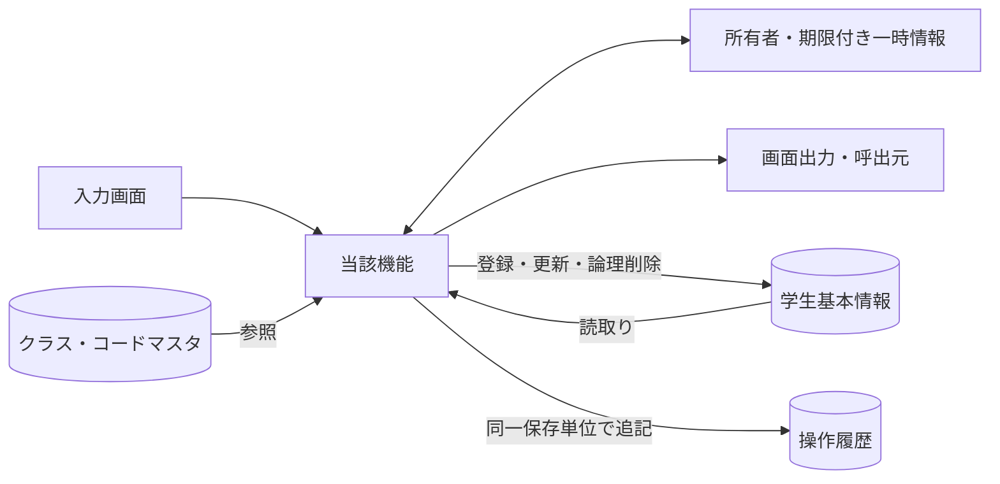

認証情報・業務日時は共通01～03から取得。マスタ保守の承認入力ファイルは画面機能のIOに含めず、方式別共通仕様に定義する。

### 実装契約の配置

共用クラス／プログラム構造は[方式別共通仕様](../共通/方式別/01_共通実装仕様.md)、SQLの永続項目・制約は[DB定義](../DB定義/Access/01_DB定義書.md)、命名・配備は[開発規約](../規約/Access.md)へ分離する。本機能の具体的な画面・変数・DB割当・イベント順序は本書を正とし、共通契約を引数と結果で具体化する。

## 項目一覧

| 項目ID | グループ | 論理項目名 | 種類 | 入出力 | 入力最大長 | 保存・正規化最大長 | 長さ単位 | 必須区分 | 必須条件 | 初期値 | 未設定値 | 表示形式・許容範囲 | 関連論理DB項目 | 物理コントロール | 変数・プロパティ | 言語型 | 物理DB項目 | 候補ID | 正規化ID | チェックID | 関連イベント | DB連携説明 | Raw入力表現 | 対応DB型 | 対応DB_NULL可否 |
| --- | --- | --- | --- | --- | --- | --- | --- | --- | --- | --- | --- | --- | --- | --- | --- | --- | --- | --- | --- | --- | --- | --- | --- | --- | --- |
| REG-001 | 基本 | 学生管理番号 | 表示 | O（表示） | 非適用 | 非適用 | 非適用 | 自動表示 | 入力対象外。取得結果または計算値を表示 | システム設定 | 表示欠損は－、マスタ欠落は不整合表示 | ID正の整数 | 学生基本情報・学生管理番号 | txtStudentId | StudentId | 表示DTO／複合項目は内部項目一覧 | m_student.student_id | － | 非適用 | 非適用 | EV-REG-001,EV-REG-002 | 表示のみ、登録時自動採番 | 入力対象外 | m_student.student_id:COUNTER | m_student.student_id:不可 |
| REG-002 | 基本 | 学籍番号 | 文字入力 | I/O（表示・保存） | 15 | 15 | Unicodeスカラー値 | 必須 | 新規登録時。既存は表示のみ・変更不可 | 新規は空／未設定 | 不可 | 15文字以内 | 学生基本情報・学籍番号 | txtStudentNo | mDraft.StudentNo | String／空はVariant Null | m_student.student_no | － | N-06 | CHK-001,CHK-002,CHK-003,CHK-004 | EV-REG-004 | 新規のみ設定。登録後不変、削除済み含め一意 | 画面文字列（空・不正を保持） | m_student.student_no:TEXT(30) | m_student.student_no:不可 |
| REG-003 | 基本 | 氏名 | 文字入力 | I/O（表示・保存） | 8 | 8 | Unicodeスカラー値 | 必須 | 通常保存時 | 新規は空／未設定 | 不可 | 8文字以内 | 学生基本情報・学生氏名 | txtStudentName | mDraft.StudentName | String／空はVariant Null | m_student.student_name | － | N-02 | CHK-001,CHK-002,CHK-005 | EV-REG-004 | N-02、原表記を保存 | 画面文字列（空・不正を保持） | m_student.student_name:TEXT(16) | m_student.student_name:不可 |
| REG-004 | 基本 | 氏名カナ | 文字入力 | I/O（表示・保存） | 36 | 18 | Unicodeスカラー値 | 必須 | 通常保存時 | 新規は空／未設定 | 不可 | 原入力36文字以内、正規化後18文字以内 | 学生基本情報・学生氏名カナ | txtStudentNameKana | mDraft.StudentNameKana | String／空はVariant Null | m_student.student_name_kana | － | N-04,N-05 | CHK-001,CHK-002,CHK-006,CHK-005 | EV-REG-004 | N-04、全角カナ18文字 | 画面文字列（空・不正を保持） | m_student.student_name_kana:TEXT(36) | m_student.student_name_kana:不可 |
| REG-005 | 基本 | 生年月日 | 和暦日付 | I/O（表示・保存） | 元号10・年4・月2・日2 | 日付 | 年4桁・ISO10文字 | 必須 | 元号・年・月・日すべて。新規は全部空 | 新規は空／未設定 | 不可 | 和暦（DATE-R01） | 学生基本情報・生年月日 | cboBirthEra / txtBirthYear / txtBirthMonth / txtBirthDay | mDraft.BirthDateIso | Variant(Null/ISO String) | m_student.birth_date | 元号 | N-11 | CHK-001,CHK-007,CHK-008,CHK-032,CHK-033 | EV-REG-004 | 和暦入力→厳密変換→日付保存、DATE-R01 | 元号・年・月・日のraw文字列4値 | m_student.birth_date:TEXT(10) | m_student.birth_date:不可 |
| REG-006 | 基本 | 性別 | 選択 | I/O（表示・保存） | 1 | 1 | 数字またはASCII文字 | 必須 | 未回答を0として許容。NULL不可 | 0（未回答） | 不可 | 数字1桁。候補一覧の分類・値 | 学生基本情報・性別 | cboGender | mDraft.GenderCode | Variant(Null/String) | m_student.gender_code | 性別 | N-07 | CHK-010,CHK-011 | EV-REG-004 | コード値保存／性別分類のコード名称表示 | 画面文字列（空・不正を保持） | m_student.gender_code:TEXT(2) | m_student.gender_code:不可 |
| REG-007 | 住所 | 郵便番号 | 文字入力 | I/O（表示・保存） | 10 | 7 | Unicodeスカラー値 | 必須 | 通常保存時 | 新規は空／未設定 | 不可 | 入力10文字、保存7桁 | 学生基本情報・郵便番号 | txtPostalCode | mDraft.PostalCode | String／空はVariant Null | m_student.postal_code | － | N-08 | CHK-001,CHK-002,CHK-016 | EV-REG-004 | N-08、数字7桁保存、3桁－4桁表示 | 画面文字列（空・不正を保持） | m_student.postal_code:TEXT(14) | m_student.postal_code:不可 |
| REG-008 | 住所 | 都道府県 | 選択 | I/O（表示・保存） | 2 | 2 | 数字またはASCII文字 | 必須 | 通常保存時 | 新規は空／未設定 | 不可 | 数字2桁。候補一覧の分類・値 | 学生基本情報・都道府県 | cboPrefecture | mDraft.PrefectureCode | Variant(Null/String) | m_student.prefecture_code | 都道府県 | N-07 | CHK-001,CHK-010,CHK-011 | EV-REG-004 | コード値保存／都道府県分類の名称表示 | 画面文字列（空・不正を保持） | m_student.prefecture_code:TEXT(4) | m_student.prefecture_code:不可 |
| REG-009 | 住所 | 住所1 | 文字入力 | I/O（表示・保存） | 45 | 45 | Unicodeスカラー値 | 必須 | 通常保存時 | 新規は空／未設定 | 不可 | 45文字以内 | 学生基本情報・住所1 | txtAddressLine1 | mDraft.AddressLine1 | String／空はVariant Null | m_student.address_line1 | － | N-02 | CHK-001,CHK-002 | EV-REG-004 | N-02、市区町村・番地、45文字 | 画面文字列（空・不正を保持） | m_student.address_line1:TEXT(90) | m_student.address_line1:不可 |
| REG-010 | 住所 | 住所2 | 文字入力 | I/O（表示・保存） | 45 | 45 | Unicodeスカラー値 | 任意 | 空白除去後空はNULL | 新規は空／未設定 | NULL相当 | 45文字以内 | 学生基本情報・住所2 | txtAddressLine2 | mDraft.AddressLine2 | String／空はVariant Null | m_student.address_line2 | － | N-02 | CHK-002 | EV-REG-004 | N-02、任意45文字、空は未設定 | 画面文字列（空・不正を保持） | m_student.address_line2:TEXT(90) | m_student.address_line2:可 |
| REG-011 | 連絡先 | 本人電話 | 文字入力 | I/O（表示・保存） | 20 | 16 | Unicodeスカラー値 | 条件付き | 本人電話・本人メール・緊急電話のいずれか1つ以上 | 新規は空／未設定 | NULL相当 | 原入力20文字以内、正規化後16文字以内 | 学生基本情報・本人電話 | txtPhoneNumber | mDraft.PhoneNumber | String／空はVariant Null | m_student.phone_number | － | N-09 | CHK-002,CHK-017,CHK-019 | EV-REG-004 | N-09、連絡手段条件あり | 画面文字列（空・不正を保持） | m_student.phone_number:TEXT(32) | m_student.phone_number:可 |
| REG-012 | 連絡先 | 本人メール | 文字入力 | I/O（表示・保存） | 60 | 60 | Unicodeスカラー値 | 条件付き | 本人電話・本人メール・緊急電話のいずれか1つ以上 | 新規は空／未設定 | NULL相当 | 60文字以内 | 学生基本情報・本人メール | txtEmailAddress | mDraft.EmailAddress | String／空はVariant Null | m_student.email_address | － | N-10 | CHK-002,CHK-018,CHK-019 | EV-REG-004 | N-10、連絡手段条件あり | 画面文字列（空・不正を保持） | m_student.email_address:TEXT(120) | m_student.email_address:可 |
| REG-013 | 在籍 | 入学日 | 西暦日付 | I/O（表示・保存） | 10 | 日付 | 年4桁・ISO10文字 | 必須 | 通常保存時。生年月日以上・業務日以下 | 新規は空／未設定 | 不可 | 西暦yyyy/MM/dd、入力yyyy-MM-dd、DATE-R02 | 学生基本情報・入学日 | txtAdmissionDate | mDraft.AdmissionDateIso | Variant(Null/ISO String) | m_student.admission_date | － | N-11 | CHK-001,CHK-007,CHK-008,CHK-033 | EV-REG-004 | 西暦入力・表示、DATE-R02 | 画面文字列（空・不正を保持） | m_student.admission_date:TEXT(10) | m_student.admission_date:不可 |
| REG-014 | 在籍 | 在籍区分 | 選択 | I/O（表示・保存） | 2 | 2 | 数字またはASCII文字 | 必須 | 01在学・02休学・03卒業・04退学 | 01（在学） | 不可 | 数字2桁。候補一覧の分類・値 | 学生基本情報・在籍区分 | cboEnrollmentStatus | mDraft.EnrollmentStatusCode | Variant(Null/String) | m_student.enrollment_status_code | 在籍区分 | N-07 | CHK-001,CHK-010,CHK-011,CHK-009,CHK-026 | EV-REG-004 | 値保存／在籍区分分類の名称表示 | 画面文字列（空・不正を保持） | m_student.enrollment_status_code:TEXT(4) | m_student.enrollment_status_code:不可 |
| REG-015 | 在籍 | 卒業・退学日 | 西暦日付 | I/O（表示・保存） | 10 | 日付 | 年4桁・ISO10文字 | 条件付き | 03・04で必須、01・02ではNULL | 新規は空／未設定 | NULL相当 | 西暦yyyy/MM/dd、入力yyyy-MM-dd、DATE-R02 | 学生基本情報・卒業・退学日 | txtEnrollmentEndDate | mDraft.EnrollmentEndDateIso | Variant(Null/ISO String) | m_student.enrollment_end_date | － | N-11 | CHK-007,CHK-009,CHK-033 | EV-REG-004 | 西暦。03/04で必須、01/02は未設定 | 画面文字列（空・不正を保持） | m_student.enrollment_end_date:TEXT(10) | m_student.enrollment_end_date:可 |
| REG-016 | 所属補助 | 年度 | 選択 | I/O（選択補助・保存なし） | 4 | 保存なし | 数字またはASCII文字 | 任意 | 選択補助。値があれば年度範囲・クラス実値を検査 | 当年度 | NULL相当 | 西暦1900～9998 | 選択補助：クラスマスタ・学校年度 | cboSchoolYear | SchoolYear | Variant(Null/Long) | m_class.school_year | 年度 | N-11 | CHK-010,CHK-014,CHK-034 | EV-REG-004 | 選択補助・整合検査のみ。学生へ保存しない | 画面文字列（空・不正を保持） | m_class.school_year:LONG | m_class.school_year:不可 |
| REG-017 | 所属補助 | 学年 | 選択 | I/O（選択補助・保存なし） | 2 | 保存なし | 数字またはASCII文字 | 任意 | 選択補助。値があればコード存在とクラス実値を検査 | すべて | NULL相当 | 数字2桁。候補一覧の分類・値 | 選択補助：クラスマスタ・学年 | cboGrade | GradeCode | Variant(Null/String) | m_class.grade_code | 学年 | N-07 | CHK-010,CHK-014 | EV-REG-004 | 選択補助。学年名称は学年分類のコード名称 | 画面文字列（空・不正を保持） | m_class.grade_code:TEXT(4) | m_class.grade_code:不可 |
| REG-018 | 所属 | クラス | 選択 | I/O（表示・保存） | 10 | 32bit正整数 | 数字またはASCII文字 | 条件付き | 01・02で必須、03・04は任意 | 新規は空／未設定 | NULL相当 | 正の整数。型範囲は方式別DB定義 | 学生基本情報・現在・最終所属クラス | cboClass | mDraft.ClassId | Variant(Null/Long) | m_student.class_id | クラス | 非適用 | CHK-010,CHK-012,CHK-013,CHK-014,CHK-015,CHK-031 | EV-REG-004 | 識別番号保存／年度・学年・コード・名称表示 | 画面文字列（空・不正を保持） | m_student.class_id:LONG | m_student.class_id:可 |
| REG-019 | 所属 | 所属人数・定員 | 表示 | O（表示） | 非適用 | 非適用 | 非適用 | 自動表示 | 入力対象外。取得結果または計算値を表示 | システム設定 | 表示欠損は－、マスタ欠落は不整合表示 | 人数は非負整数・定員1～9999またはNULL | 集計：学生基本情報・在籍区分／クラス、クラスマスタ・定員 | lblCapacity | Occupancy / Capacity | 表示DTO／複合項目は内部項目一覧 | count of m_student / m_class.capacity | － | 非適用 | 非適用 | EV-REG-004 | 非削除01/02の参考人数。確保予約ではない | 入力対象外 | m_class.capacity:LONG | m_class.capacity:可 |
| REG-020 | 緊急 | 緊急連絡先氏名 | 文字入力 | I/O（表示・保存） | 8 | 8 | Unicodeスカラー値 | 条件付き | 緊急氏名・続柄・電話のいずれか入力時は全3項目必須 | 新規は空／未設定 | NULL相当 | 8文字以内 | 学生基本情報・緊急連絡先氏名 | txtEmergencyContactName | mDraft.EmergencyContactName | String／空はVariant Null | m_student.emergency_contact_name | － | N-02 | CHK-002,CHK-020 | EV-REG-004 | 緊急3項目は全部入力または全部未設定 | 画面文字列（空・不正を保持） | m_student.emergency_contact_name:TEXT(16) | m_student.emergency_contact_name:可 |
| REG-021 | 緊急 | 緊急連絡先続柄 | 選択 | I/O（表示・保存） | 2 | 2 | 数字またはASCII文字 | 条件付き | 緊急氏名・続柄・電話のいずれか入力時は全3項目必須 | 新規は空／未設定 | NULL相当 | 数字2桁。候補一覧の分類・値 | 学生基本情報・緊急連絡先続柄 | cboRelationship | mDraft.RelationshipCode | Variant(Null/String) | m_student.relationship_code | 続柄 | N-07 | CHK-010,CHK-011,CHK-020 | EV-REG-004 | 続柄値・名称を対応。未選択なら続柄分類もNULL、選択時は分類を処理設定（UPD-103） | 画面文字列（空・不正を保持） | m_student.relationship_code:TEXT(4) | m_student.relationship_code:可 |
| REG-022 | 緊急 | 緊急連絡先電話 | 文字入力 | I/O（表示・保存） | 20 | 16 | Unicodeスカラー値 | 条件付き | 緊急氏名・続柄・電話のいずれか入力時は全3項目必須 | 新規は空／未設定 | NULL相当 | 原入力20文字以内、正規化後16文字以内 | 学生基本情報・緊急連絡先電話 | txtEmergencyPhoneNumber | mDraft.EmergencyPhoneNumber | String／空はVariant Null | m_student.emergency_phone_number | － | N-09 | CHK-002,CHK-017,CHK-019,CHK-020 | EV-REG-004 | N-09、緊急3項目一式 | 画面文字列（空・不正を保持） | m_student.emergency_phone_number:TEXT(32) | m_student.emergency_phone_number:可 |
| REG-023 | その他 | 備考 | 文字入力 | I/O（表示・保存） | 120 | 120 | Unicodeスカラー値 | 任意 | 空白除去後空はNULL。LF改行可 | 新規は空／未設定 | NULL相当 | 120文字以内 | 学生基本情報・備考 | txtRemarks | mDraft.Remarks | String／空はVariant Null | m_student.remarks | － | N-01 | CHK-002 | EV-REG-004 | プレーンテキスト、120文字、改行可 | 画面文字列（空・不正を保持） | m_student.remarks:TEXT(240) | m_student.remarks:可 |
| REG-024 | 確認 | 確認・変更理由 | 文字入力 | I（関連保存） | 60 | 60 | Unicodeスカラー値 | 条件付き | 重複確認続行、卒業・退学からの区分訂正時に必須 | 新規は空／未設定 | NULL相当 | 60文字以内 | 関連保存：操作履歴・操作・確認理由 | txtOperationReason | OperationReason | String／空はVariant Null | t_operation_log.operation_reason | － | N-01 | CHK-002,CHK-025,CHK-026 | EV-REG-005 | 警告続行・終了区分訂正時必須、60文字 | 画面文字列（空・不正を保持） | t_operation_log.operation_reason:TEXT(120) | t_operation_log.operation_reason:可 |
| REG-025 | 更新情報 | 更新日時・更新者 | 表示 | O（表示） | 非適用 | 非適用 | 非適用 | 自動表示 | 入力対象外。取得結果または計算値を表示 | システム設定 | 表示欠損は－、マスタ欠落は不整合表示 | 日時19文字・更新者64文字 | 表示：学生基本情報・更新日時／更新者 | lblUpdatedAt / lblUpdatedBy | UpdatedAt / UpdatedBy | 表示DTO／複合項目は内部項目一覧 | updated_at / updated_by | － | 非適用 | 非適用 | EV-REG-002 | システム設定。西暦日時、日本時間 | 入力対象外 | m_student.updated_at:DATETIME／m_student.updated_by:TEXT(128) | m_student.updated_at:不可；m_student.updated_by:不可 |
| REG-026 | 削除確認 | 削除理由 | 文字入力 | I（関連保存） | 60 | 60 | Unicodeスカラー値 | 条件付き | 論理削除イベントで必須。通常保存では使用しない | 新規は空／未設定 | NULL相当 | 60文字以内 | 保存：学生基本情報・削除理由／操作履歴・操作・確認理由 | frmDeleteConfirm.txtReason | DeleteReason | String／空はVariant Null | delete_reason / t_operation_log.operation_reason | － | N-01 | CHK-001,CHK-002,CHK-027 | EV-REG-006 | 削除時のみ、60文字、編集中の業務値は保存しない | 画面文字列（空・不正を保持） | m_student.delete_reason:TEXT(120)／t_operation_log.operation_reason:TEXT(120) | m_student.delete_reason:可；t_operation_log.operation_reason:可 |
| REG-027 | 操作・確認 | 登録／更新 | 操作 | 操作／表示 | 非適用 | 非適用 | 非適用 | 非適用 | 表示または操作項目 | 権限・モードに従う | 非適用 | ― | DB保存なし（呼出処理はイベント仕様） | cmdSave | Save | イベント／引数はイベント仕様 | 画面制御。次節のネイティブイベントへ対応 | － | 非適用 | 非適用 | EV-REG-004 | 保存処理を呼ぶ | 入力対象外 | 非適用（操作・計算または一覧DTO） | 非適用 |
| REG-028 | 操作・確認 | 入力クリア／編集取消 | 操作 | 操作／表示 | 非適用 | 非適用 | 非適用 | 非適用 | 表示または操作項目 | 権限・モードに従う | 非適用 | ― | DB保存なし（呼出処理はイベント仕様） | cmdReset | Reset | イベント／引数はイベント仕様 | 画面制御。次節のネイティブイベントへ対応 | － | 非適用 | 非適用 | EV-REG-007 | 新規は初期値、既存は読込時値 | 入力対象外 | 非適用（操作・計算または一覧DTO） | 非適用 |
| REG-029 | 操作・確認 | 最新情報を再読込 | 操作 | 操作／表示 | 非適用 | 非適用 | 非適用 | 非適用 | 表示または操作項目 | 権限・モードに従う | 非適用 | ― | DB保存なし（呼出処理はイベント仕様） | cmdReload | Reload | イベント／引数はイベント仕様 | 画面制御。次節のネイティブイベントへ対応 | － | 非適用 | 非適用 | EV-REG-007 | 確認後にDB最新値を取得 | 入力対象外 | 非適用（操作・計算または一覧DTO） | 非適用 |
| REG-030 | 操作・確認 | 検索へ戻る | 操作 | 操作／表示 | 非適用 | 非適用 | 非適用 | 非適用 | 表示または操作項目 | 権限・モードに従う | 非適用 | ― | DB保存なし（呼出処理はイベント仕様） | cmdBack | Back | イベント／引数はイベント仕様 | 画面制御。次節のネイティブイベントへ対応 | － | 非適用 | 非適用 | EV-REG-007 | 未保存破棄確認後に復帰 | 入力対象外 | 非適用（操作・計算または一覧DTO） | 非適用 |
| REG-031 | 操作・確認 | 論理削除 | 操作 | 操作／表示 | 非適用 | 非適用 | 非適用 | 非適用 | 表示または操作項目 | 権限・モードに従う | 非適用 | ― | DB保存なし（呼出処理はイベント仕様） | cmdDelete | Delete | イベント／引数はイベント仕様 | 画面制御。次節のネイティブイベントへ対応 | － | 非適用 | 非適用 | EV-REG-006 | 管理者のみ、理由・明示確認 | 入力対象外 | 非適用（操作・計算または一覧DTO） | 非適用 |
| REG-032 | 操作・確認 | 重複候補一覧 | 表示 | 操作／表示 | 非適用 | 非適用 | 非適用 | 自動表示 | 入力対象外。取得結果または計算値を表示 | 権限・モードに従う | 表示欠損は－、マスタ欠落は不整合表示 | 最大20行、全候補件数は別表示 | 学生基本情報・学籍番号／学生氏名／生年月日／所属クラス | frmDuplicateConfirm.lstCandidates | DuplicateCandidates | 表示DTO／複合項目は内部項目一覧 | OP-DUP result | － | 非適用 | 非適用 | EV-REG-005 | 全候補件数＋最大20件、個人情報を最小化 | 入力対象外 | 非適用（操作・計算または一覧DTO） | 非適用 |
| REG-033 | 操作・確認 | 別人と確認して続行 | 操作 | 操作／表示 | 非適用 | 非適用 | 非適用 | 非適用 | 表示または操作項目 | 権限・モードに従う | 非適用 | ― | DB保存なし（呼出処理はイベント仕様） | frmDuplicateConfirm.cmdConfirm | Confirm | イベント／引数はイベント仕様 | 画面制御。次節のネイティブイベントへ対応 | － | 非適用 | 非適用 | EV-REG-005 | 理由・確認情報付きで保存を再検証 | 入力対象外 | 非適用（操作・計算または一覧DTO） | 非適用 |
| REG-034 | 操作・確認 | 確認取消 | 操作 | 操作／表示 | 非適用 | 非適用 | 非適用 | 非適用 | 表示または操作項目 | 権限・モードに従う | 非適用 | ― | DB保存なし（呼出処理はイベント仕様） | frmDuplicateConfirm.cmdCancel | Cancel | イベント／引数はイベント仕様 | 画面制御。次節のネイティブイベントへ対応 | － | 非適用 | 非適用 | EV-REG-005 | 入力へ戻る。DB更新なし | 入力対象外 | 非適用（操作・計算または一覧DTO） | 非適用 |

## 選択候補一覧

| 候補ID | 参照元・分類 | 選択値 | 表示値 | 抽出条件 | 表示順 | 初期値・連動 |
| --- | --- | --- | --- | --- | --- | --- |
| 年度 | クラスマスタ・学校年度 | school_year | 年度 | 停止・過去年度を含め範囲1900～9998。新規登録は当年度を選択補助へ | 年度降順 | 検索すべて／登録当年度、クラス0件を区別 |
| 学年 | コード管理マスタ（学年） | GRADE / grade_code | コード名称 | 検索は停止を含む。新規選択は有効値、既存値は別枠保持 | 表示順→コード値 | すべて。学年なし00は未所属と別 |
| クラス | クラスマスタ・コード管理マスタ（学年） | class_id | 年度・学年・クラスコード・クラス名 | 検索は停止を含む。登録は共通モジュール07の新規所属／最終所属／既存保持の区別 | 年度降順→学年表示順→クラス表示順→コード→ID | 検索すべて／新規未選択。上位変更で不適合なら解除 |
| 在籍区分 | コード管理マスタ（在籍区分） | ENROLLMENT_STATUS / code_value | コード名称 | 検索は分類内の値。登録の新規選択は有効値。01～04は保護 | 表示順→コード値 | 検索01・02／新規登録01、全解除検索は全区分 |
| 都道府県 | コード管理マスタ（都道府県） | PREFECTURE / code_value | コード名称 | 検索は停止を含む。登録新規選択は有効、既存同値は保持 | 表示順→コード値 | 検索すべて／登録未選択 |
| 性別 | コード管理マスタ（性別） | GENDER / code_value | コード名称 | 新規選択は有効値。既存同値は保持。未回答0は保護 | 表示順→コード値 | 新規0、未回答を許容 |
| 続柄 | コード管理マスタ（緊急連絡先続柄） | RELATIONSHIP / code_value | コード名称 | 新規選択は有効、既存同値は保持 | 表示順→コード値 | 未選択。緊急3項目一式 |
| 元号 | 共通日付仕様（文書07）・元号の変換定義（共通暦定義） | MEIJI / TAISHO / SHOWA / HEISEI / REIWA | 元号名 | 生年月日の許容範囲に重なる元号、業務日まで | 新しい元号順 | 未選択。変更時に年・月・日の範囲を再検証 |

## 内部項目一覧

| 内部項目ID | 親項目ID | 論理名 | 変数・コントロール | 型 | 最大長・範囲 | 必須条件 | 未設定 | 設定元 | 用途・制約 |
| --- | --- | --- | --- | --- | --- | --- | --- | --- | --- |
| REG-INT-001 | REG-005 | 元号 | cboBirthEra | String | 10 | 全4値必須 | 新規画面は空、保存時空はエラー | 共通07元号定義 | 共通16で厳密変換、範囲CHK-032/033。元年は「元」または1。月日を補正しない |
| REG-INT-002 | REG-005 | 元号年 | txtBirthYear | String | 4 | 全4値必須 | 新規画面は空、保存時空はエラー | 和暦原入力 | 共通16で厳密変換、範囲CHK-032/033。元年は「元」または1。月日を補正しない |
| REG-INT-003 | REG-005 | 月 | txtBirthMonth | String | 2 | 全4値必須 | 新規画面は空、保存時空はエラー | 和暦原入力 | 共通16で厳密変換、範囲CHK-032/033。元年は「元」または1。月日を補正しない |
| REG-INT-004 | REG-005 | 日 | txtBirthDay | String | 2 | 全4値必須 | 新規画面は空、保存時空はエラー | 和暦原入力 | 共通16で厳密変換、範囲CHK-032/033。元年は「元」または1。月日を補正しない |
| REG-INT-005 | REG-005 | 変換後生年月日 | BirthDateIso | Variant(Null/ISO String) | 日付／ISO10 | 保存時必須 | 解析前は未確定 | 和暦4原入力 | m_student.birth_dateへ保存。原入力と同時に正本化しない |
| REG-INT-006 | REG-025 | 更新日時 | UpdatedAt | 時点型／UTC | 画面19文字 | 自動表示 | 新規は未設定 | m_student.updated_at | 西暦日本時間。入力DTOから受けない |
| REG-INT-007 | REG-025 | 更新者 | UpdatedBy | String | 64 | 自動表示 | 新規は未設定 | m_student.updated_by | 認証主体。入力DTOから受けない |
| REG-INT-008 | REG-019 | 所属人数 | Occupancy | 非負整数 | 数値 | 参考表示 | クラス未選択は未設定 | 非削除01/02人数 | 保存時再計算。表示値を定員判断の根拠にしない |
| REG-INT-009 | REG-019 | 定員 | Capacity | 任意整数 | 4 | 任意 | NULLは制限なし | m_class.capacity | 1～9999、0を制限なしの代替にしない |
| REG-INT-010 | REG-032 | 候補表示の生年月日 | DuplicateItem.BirthDateWareki | String | 共通和暦形式 | 自動表示 | 通常候補は日付必須 | OP-DUP birth_date | 元号を含む表示。比較は内部日付 |
| REG-INT-011 | REG-032 | 重複全件数 | DuplicateTotalCount | 非負整数 | 数値 | 自動 | 0は候補なし | OP-DUP全候補 | 表示最大20件と比較対象全件を混同しない |
| REG-INT-012 | REG-001 | 対象学生ID | StudentId | Long（1～2147483647） | 10 | 更新削除・既存読込時 | 新規はNULL | DB採番値／行モデル／ルート | 行番号ではない。権限・存在を再確認 |
| REG-INT-013 | REG-027 | 期待版 | ExpectedVersion | Long（1～2147483647） | 10 | 更新削除時 | 新規はNULL | 読込時row_version | 正数。最新の版へ勝手に差替えない |
| REG-INT-014 | REG-030 | 検索状態キー | ReturnContextId | String | 36 | 復帰または一覧操作時 | 初回だけ未指定 | 共通12のUUID文字表記または同一形式のインスタンスキー | 利用者・セッション・画面ごと、30分 |
| REG-INT-015 | REG-033 | 確認トークン | DuplicateToken | String | 36 | 警告続行時 | 未確認はNULL | 共通11で発行するUUID表記 | 10分、全業務値・候補・対象・版・主体に紐付く |
| REG-INT-016 | REG-027 | 読込スナップショット | OriginalSnapshot | 検証済み学生データ | 各DB列上限 | 既存編集時 | 新規なし | 最新DB読込み | 取消・変更なし判定。管理値を入力へ転用しない |
| REG-INT-017 | REG-003 | 氏名照合値 | NameKey | String | 160 | 保存時自動生成 | 不可 | 共通04 | 入力を信用せず保存側生成 |
| REG-INT-018 | REG-004 | カナ照合値 | KanaKey | String | 18 | 保存時自動生成 | 不可 | 共通04 | 入力を信用せず保存側生成 |
| REG-INT-019 | REG-027 | 処理中 | IsBusy | 真偽 | 1 | 自動 | false | 処理開始終了 | UI再入防止のみ。DB排他は共通13 |
| REG-INT-020 | REG-027 | 応答世代 | RequestSequence | 非負整数 | 数値 | 非同期要求時 | 0初期 | 画面内要求連番 | 旧応答を無視。桁あふれ時は採番継続しない |

## イベント仕様

### EV-REG-001 新規画面表示

#### 処理概要

新規Form_LoadでCreate権限・候補・初期値を確認し、未採番の非連結編集モデルを表示する。初期表示だけでは学生を保存しない。

#### 処理手順

1. mInitializingを設定し、共通01・02・03でWindows実主体、Create権限、要求内業務日・受付番号を固定する。mDraftと制御状態を初期化し、新規StudentId/ExpectedVersionはNullとする。フォームの自動保存は使わない。
2. OP-CODE・OP-CLASSから新規用途の候補を読み、性別0・在籍01・補助年度は当年度へ設定する。生年月日の元号・年・月・日、入学日、他の業務値は未入力とし、先頭候補で未設定を埋めない。
3. 必須初期コード不足は保存不可、候補クラス0件はW-STU-108を表示する。01/02は所属選択まで保存不可だが、クラス0件だけで03/04の過去入力を止めない。初期化連鎖を終えてmInitializingを解除し、mDirtyとmBusyを別に管理する。

##### 実装詳細

入口：`Form_Load新規`。機能内の入力・結果型は項目一覧、共通実装は[方式別共通仕様](../共通/方式別/01_共通実装仕様.md)を使用する。 編集用値と原スナップショットを別に保持。変換失敗を未入力へ置換せず、エラー項目と原入力を返す。

#### 処理フロー

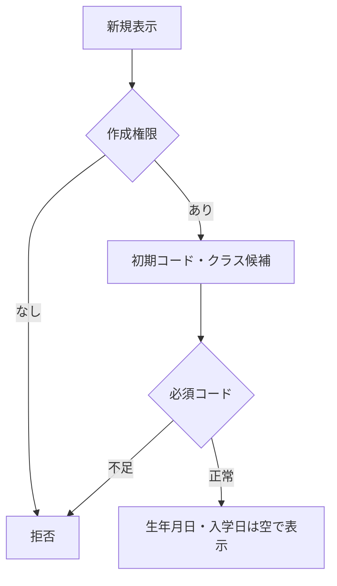

#### SQL・テーブル関連（ER図）

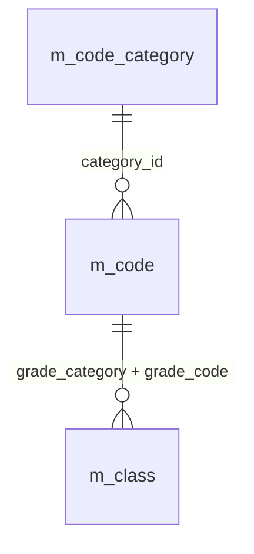

名称参照は未所属・停止値を残す外部結合相当。コードは用途ごとの別名で**分類と値**を結合する。図は読取りの関連であり、履歴への書込みや削除連動を意味しない。単独の存在確認・採番・書込みの表関連は下記操作IDで特定する。

#### DB操作の詳細

`OP-CODE` → `OP-CLASS`。下記「DB操作定義」の同名操作を実行する。保存系ではINSERTとUPDATEをモードで選択し、両方を実行しない。

新規候補は分類・用途・業務日を明示して取得する。学生のAddNew、版採番、OP-AUDITは行わない。初期クラス0件と必須コード欠落の結果を分ける。

#### 結果・例外時の扱い

CHK-023/024の認証・認可・状態不正はE-COM-001/002/003で拒否する。CHK-010の必須初期値不足はE-MST-001「マスタの初期設定が不足しています。管理者に連絡してください。」、クラス0件はW-STU-108「登録可能なクラスがありません。クラスマスタを確認してください。」。読取障害はE-COM-004。学生未作成の段階で不在・更新競合・保存成功を表示しない。

初回候補の障害に対象不在・更新競合・保存成功の文言は適用しない。Windows主体照合に失敗した場合はE-COM-001、作成権限不足はE-COM-002とする。初期データ不足を自動データ作成で隠さない。

### EV-REG-002 編集・参照画面表示

#### 処理概要

編集/参照Form_Loadは対象StudentIdから非削除1件の全保存値と版を読み、原スナップショットと編集モデルを分離する。

#### 処理手順

1. 共通01・02とCHK-024の画面検査で主体・Read/Edit権限、Form、対象ID As Longの正数範囲とモードを確認する。OP-STUDENTで非削除1件を取得し、0件はE-STU-103、複数件は整合性障害とする。不在を新規へ切り替えない。
2. 全保存値・row_versionと参照名称を取得後、mOriginal As clsStudentDraftとmDraftを別インスタンスにする。ExpectedVersionを読込版から固定し、OP-CODE・OP-CLASSで既存同値の停止・期間外候補/名称を保持する。名称欠落を先頭候補への置換で隠さない。
3. 共通16でBirthDateIsoから和暦4入力と表示を作り、学籍番号・管理情報をLockedにする。参照モードでは全入力をLocked、保存・削除・入力取消は非表示。全値・原本・版の読込み成立後だけ権限に応じた操作を可能にする。

##### 実装詳細

入口：`Form_Load既存`。機能内の入力・結果型は項目一覧、共通実装は[方式別共通仕様](../共通/方式別/01_共通実装仕様.md)を使用する。 編集用値と原スナップショットを別に保持。変換失敗を未入力へ置換せず、エラー項目と原入力を返す。

#### 処理フロー

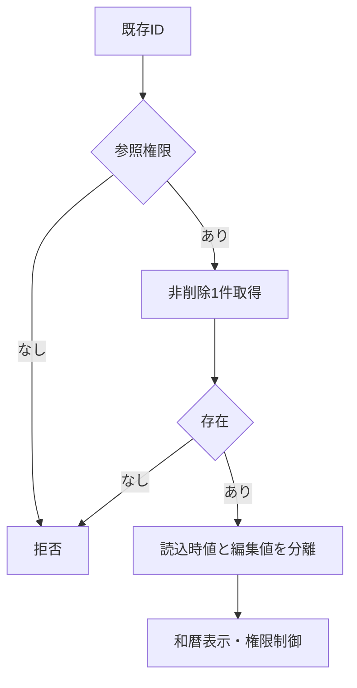

#### SQL・テーブル関連（ER図）

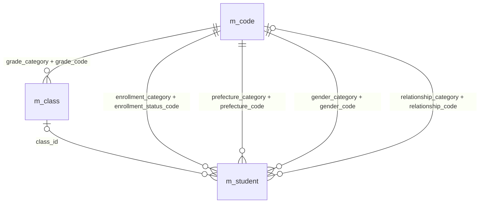

名称参照は未所属・停止値を残す外部結合相当。コードは用途ごとの別名で**分類と値**を結合する。図は読取りの関連であり、履歴への書込みや削除連動を意味しない。単独の存在確認・採番・書込みの表関連は下記操作IDで特定する。

#### DB操作の詳細

`OP-STUDENT` → `OP-CODE` → `OP-CLASS`。下記「DB操作定義」の同名操作を実行する。保存系ではINSERTとUPDATEをモードで選択し、両方を実行しない。

対象はm_student.student_id As Longかつis_deleted=False。保存値/row_versionと名称のLEFT JOINを使い、停止値やNULLの続柄/所属がある学生を名称結合で除外しない。読込版はExpectedVersionとして保持する。

#### 結果・例外時の扱い

CHK-023/024不成立はE-COM-001/002/003、CHK-021の0件はE-STU-103「対象の学生が見つからないか、既に削除されています。」。CHK-010/011の名称欠落は不整合を示しE-MST-001を案内するが、保存値を先頭候補で置換しない。全値・原本・版の取得が成立するまで保存操作を可能にしない。

部分的な画面移送は採用せず、全値・原本・版がそろうまで保存を無効にする。名称不整合でも保存値を先頭候補へ置換しない。参照モードからの不正保存/削除は画面非表示だけでなくサービス側も拒否する。

### EV-REG-003 入力補助

#### 処理概要

AfterUpdateで生年月日の厳密変換と在籍/所属候補の連動を行う。表示上の整合と、保存時の保護下再判定を分ける。

#### 処理手順

1. mInitializing/mBusyを検査し、cboBirthEra・txtBirthYear・txtBirthMonth・txtBirthDayのraw文字列4値を保持する。modJapaneseDate.ParseBirthDateに元号定義版・業務日を渡し、構文、実在日、元号境界、逆変換、DATE-R01の範囲を検査する。変換失敗をNullや補正済み翌月日へ変えない。
2. 在籍01/02ではクラス必須・終了日Null、03/04では終了日必須・最終所属任意を表示する。卒業/退学から別区分へ訂正する場合の管理者と理由、入学/終了日の関係を示すが、ここで実保存の許可を確定しない。
3. 年度・学年・在籍区分の変更時にOP-CLASSへ補助値・在籍期間・既存所属・業務日・人数要否を渡す。不適合選択はW-STU-107で解除し、候補なしはW-STU-108。人数は参考で席を予約せず、変更した入力/候補に結び付く重複確認は再利用しない。

##### 実装詳細

入口：`AfterUpdate／modJapaneseDate`。機能内の入力・結果型は項目一覧、共通実装は[方式別共通仕様](../共通/方式別/01_共通実装仕様.md)を使用する。 編集用値と原スナップショットを別に保持。変換失敗を未入力へ置換せず、エラー項目と原入力を返す。

#### 処理フロー

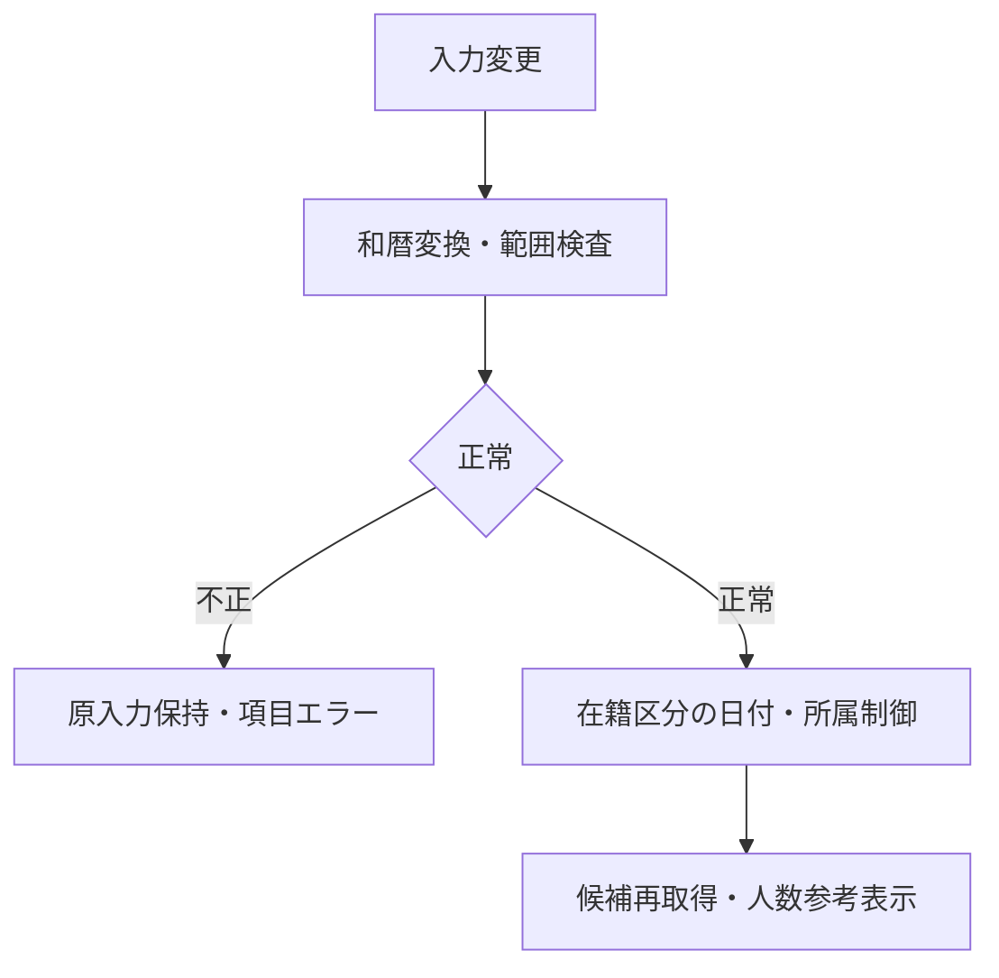

#### SQL・テーブル関連（ER図）

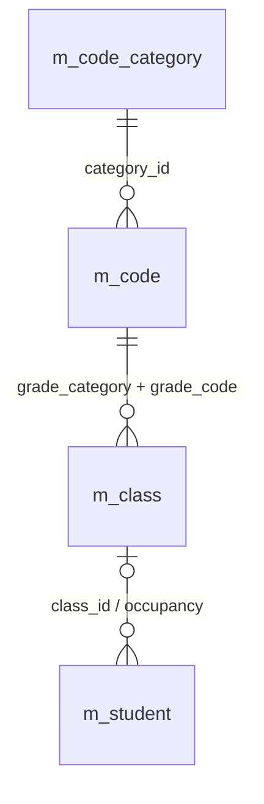

名称参照は未所属・停止値を残す外部結合相当。コードは用途ごとの別名で**分類と値**を結合する。図は読取りの関連であり、履歴への書込みや削除連動を意味しない。単独の存在確認・採番・書込みの表関連は下記操作IDで特定する。

#### DB操作の詳細

`OP-CLASS`。下記「DB操作定義」の同名操作を実行する。保存系ではINSERTとUPDATEをモードで選択し、両方を実行しない。

OP-CLASSへ渡すSchoolYear/GradeCodeは登録の選択補助であり学生保存列ではない。人数表示は参考値で、保存時OP-CAPACITYを置換しない。入力補助から学生/履歴を書き込まない。

#### 結果・例外時の扱い

| 判定ID | 条件 | メッセージと復帰 |
| --- | --- | --- |
| CHK-007・CHK-032・CHK-033 | 和暦4要素の構文・実在日・改元・1900-01-01～業務日 | E-STU-005、E-DATE-001/002。原入力を保持して日付欄へ |
| CHK-009・CHK-012・CHK-026 | 状態と終了日・所属、終了区分訂正の条件 | E-STU-008/012/106の適用条件を表示し、保存で再判定 |
| CHK-010・CHK-014・CHK-034 | 補助年度/学年の存在・1900～9998・クラス実値 | 不適合解除W-STU-107、候補なしW-STU-108、年度E-DATE-003。型変換で補正しない |

REG-005の和暦原入力は変換エラーでも保持し、最初の不正欄へSetFocusする。既存の卒業/退学からの訂正権限は表示時の説明だけで充足せず、保存直前にCHK-026/E-STU-106で再判定する。

### EV-REG-004 新規登録・更新

#### 処理概要

cmdSave_ClickからclsStudentService.SaveStudentへ検証用モデルを渡し、専用DAO.Workspaceの短い保存単位で学生1件と操作履歴1件を原子的に確定する。

#### 処理手順

1. **受付・保存モデルの作成**
   1. mBusyを確認し、共通01・02・03と画面検査で主体・役割・操作・対象/期待版・業務日・受付番号を固定する。19業務入力を複製し、更新可能な学生入力は学籍番号以外の18項目とする。主体・権限・作成更新情報はフォーム入力へ依存させない。
   2. 共通04・05・16・17でraw上限、正規化/和暦厳密変換、保存上限/必須/許容形式、日付の前後、連絡手段を順に判定する。独立した形式誤りは対象欄へまとめ、形式が成立しない値で依存する関係比較を行わない。元の画面入力は別に保持する。
   3. NameKey/KanaKeyを保存側で再生成し、続柄未選択はrelationship_categoryとrelationship_codeをともにNull、選択時だけRELATIONSHIP分類を算定する。緊急氏名・分類・値・電話の4保存値を一式で検査し、変更なし比較・保存・変更列監査へ渡す。SchoolYear/GradeCode、OperationReason、制御ID/版/確認情報を学生の許可列へ混ぜない。
2. **同じゲート下の最新再判定**
   1. db.Transactionsを確認し、専用DAO.WorkspaceのBeginTrans後、同じDatabaseでt_write_guardのguard_id=1を更新・RecordsAffected=1を確認する。ゲート未取得・制御行欠落なら処理を止める。DAO WorkspaceのAdmin指定を業務の管理者権限と見なさない。
   2. 既存だけOP-STUDENTで最新対象を再読取りし、非削除1件・ExpectedVersion一致・学籍番号不変を確認する。OP-EXISTSで削除済みを含む番号全行一意、分類付き参照、新規/変更値の有効性、補助年度/学年とクラス実値、日付・在籍期間、区分訂正権限/理由を現在値で再検証する。既存同値保持と新所属/変更を分ける。
   3. OP-CAPACITYで旧席と新席を比較し、新席が設定済みで増加するときだけ、自分以外の非削除01/02人数＋1≦定員を判定する。休学も1席、定員Nullは無制限、席解放は加算しない。派生分類を含む全保存値に差がなければRollback・解放しI-STU-004で終了する。版不一致を変更なしへ読み替えない。
   4. OP-DUPで同生年月日かつ氏名キー又はカナキーが一致する非削除他学生の全ID/版を取得する。未確認/差分/期限切れならRollback・解放してEV-REG-005へ進む。確認続行でも本人・認証・対象・旧版・全正規化業務値・全候補集合・10分期限、理由・補助値・復帰先を照合し、確認待ちにロックやWorkspaceを保持しない。
3. **許可列と監査の一括確定**
   1. 新規はOP-INSERTのAddNewで19入力・照合2・必須3分類/条件付き続柄分類・作成更新情報・版1を設定し、Update後のBookmark=LastModifiedからStudentIdを取得する。MAX+1を使わない。更新はstudent_id/row_version/is_deleted=FalseのQueryDefから単一表dynasetを開き、1件にEdit→Fields.Valueの許可列設定→Updateを行う。LongTextをTEXT(255)へ縮めず、UPD-002～023・101～106の対象外列を変更しない。
   2. 同じdb/wsのt_operation_logへOP-AUDIT（UPD-107）を1件AddNewする。実変更の対象・前後版・変更物理項目名・主体・時点・理由・受付番号・確認有無を記録し、個人情報の値を複写しない。学生と履歴を同じWorkspace/DatabaseでCommitTrans dbForceOSFlushする。
   3. 確定確認後だけ確認情報を消費し、mDirty=FalseとしてI-STU-001/002と検索復帰結果を返す。失敗はErr/DAO.Errorsを退避し、Tx中ならRollback、全DAO資源を解放する。確定前失敗・取消確認と成否不明を分け、採番済みだけで成功にせず、結果不明時の自動再送やExpectedVersion差替えをしない。

##### 実装詳細

入口：`cmdSave_Click`。機能内の入力・結果型は項目一覧、共通実装は[方式別共通仕様](../共通/方式別/01_共通実装仕様.md)を使用する。 対象ID・ExpectedVersionは検証するが、利用者・権限・業務日は信頼する実行側で決定する。保存値は固定許可列に限定し、結果種別により画面遷移を分岐する。

#### 処理フロー

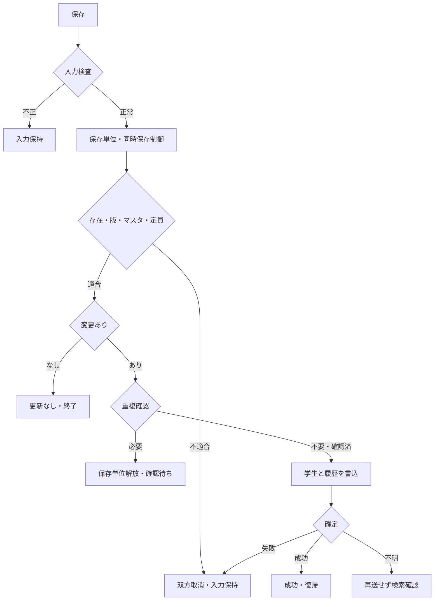

#### SQL・テーブル関連（ER図）

名称参照は未所属・停止値を残す外部結合相当。コードは用途ごとの別名で**分類と値**を結合する。図は読取りの関連であり、履歴への書込みや削除連動を意味しない。単独の存在確認・採番・書込みの表関連は下記操作IDで特定する。

#### DB操作の詳細

`OP-STUDENT` → `OP-EXISTS` → `OP-CAPACITY` → `OP-DUP` → `OP-INSERT` → `OP-UPDATE` → `OP-AUDIT`。下記「DB操作定義」の同名操作を実行する。保存系ではINSERTとUPDATEをモードで選択し、両方を実行しない。

OP-STUDENTは既存時だけ、OP-INSERTとOP-UPDATEはモードでどちらか一方である。OP定義表の「固定分類」は必須3分類と条件付きrelationship_categoryを指し、未選択時に続柄分類を復活させない。保存対象は項目更新仕様の全26更新IDで追跡し、監査はUPD-107を含む。SQLパラメーターの対象/版で1件を固定し、単一表dynasetへのFields.Value代入でLongTextを保持する。

#### 結果・例外時の扱い

| 判定ID | 判定時点・条件 | 結果と復帰 |
| --- | --- | --- |
| CHK-023・CHK-024 | 受付と保存時の主体・役割・画面・操作・再入 | E-COM-001/002/003。業務書込み0件、許可されない入口を渡さない |
| CHK-001・CHK-002・CHK-003・CHK-006 | 入力前/保存長・必須・禁止文字・番号/カナ | E-STU-001～004。原入力全体を保持し、複数の独立誤りを対象欄へ |
| CHK-007・CHK-008・CHK-009・CHK-032・CHK-033 | 形式成立後の実在日・元号境界・日付範囲と前後関係 | E-STU-005～008・E-DATE-001/002。日付を補正しない |
| CHK-016・CHK-017・CHK-018・CHK-019・CHK-020 | 郵便/電話/メール、連絡手段1つ以上、緊急一式 | E-STU-015～019。緊急4保存値の片側NULLも拒否、DB変更なし |
| CHK-021・CHK-022・CHK-003・CHK-004 | 保護下の対象1件・期待版・番号不変/全行一意 | E-STU-103/105/104/101。先行部分更新なし、自動上書きなし |
| CHK-010・CHK-011・CHK-012・CHK-013・CHK-014・CHK-026・CHK-031・CHK-034 | 分類付き参照、新規/変更の有効性、所属/補助/年度/期間、終了区分訂正 | E-STU-009～014/106/108、E-DATE-003。既存同値保持と新規所属の条件を分ける |
| CHK-015 | 新席増加時だけ人数＋1≦定員、休学も1席 | E-STU-102。席解放と定員NULLは加算制限なし。書込み前に判定 |
| CHK-005・CHK-025 | 非削除他学生の同生年月日＋氏名又はカナ一致、全候補版と確認 | W-STU-101で全件数/最大20件。差はW-STU-102、理由不足E-STU-107。待機中は排他解放・書込み0件 |
| CHK-022・CHK-030 | 版一致後の実差分と原子的確定 | 変更なしI-STU-004、成功I-STU-001/002。取消確認と結果不明を分離する |

確定前失敗と取消確認は原入力を保持して訂正・再操作へ戻す。結果不明では「再保存前に検索で結果を確認してください」と案内し、未保存・取消済みと断定しない。確定成功後の検索再表示だけの失敗は成功を維持して別に案内する。切断中まで文言表示を保証しない。

DAO3022は再確認して学籍番号一意等へ分類し、3188/3197/3218/3260はDAO.Errorsも退避してロック/競合として扱う。途中から自動再実行しない。E-COM-004の受付番号は信頼する共通03から取得し、個人情報値を通常障害ログへ複写しない。取消確認と確定結果不明を分け、後者は「再保存前に検索で結果を確認してください」と案内する。

### EV-REG-005 重複候補の確認続行・取消

#### 処理概要

frmDuplicateConfirmで全候補件数と最大20件を提示し、本人・内容・版・期限・理由を再確認した続行だけを通常保存入口へ戻す。

#### 処理手順

1. OP-DUPの全候補ID/版と全件数を確認状態へ結び付け、表示には最大20件の学籍番号・氏名・和暦生年月日・クラスだけを渡す。表示20件と比較する全集合を分け、ダイアログの既定操作は取消とする。表示中にDBロックは持たない。
2. 続行は共通11/CHK-025で本人・認証状態・操作・対象・旧版・全正規化業務値・全候補ID/版・10分期限と確認処理中状態を照合する。全候補版が変化した場合や期限切れはW-STU-102で再確認し、理由はN-01の空白除去後1～60字を検査する。補助年度/学年・理由・復帰先は業務値と別に検査する。
3. 有効な確認情報と理由を付けてEV-REG-004を入力検査から再実行し、保護下の認可・対象版・マスタ・在籍/日付・席・全候補を再判定する。取消は確認情報を失効させ原入力画面へ留まり、学生/履歴を変更しない。単純な確認済Booleanだけで警告を迂回しない。

##### 実装詳細

入口：`frmDuplicateConfirm`。機能内の入力・結果型は項目一覧、共通実装は[方式別共通仕様](../共通/方式別/01_共通実装仕様.md)を使用する。 対象ID・ExpectedVersionは検証するが、利用者・権限・業務日は信頼する実行側で決定する。保存値は固定許可列に限定し、結果種別により画面遷移を分岐する。

#### 処理フロー

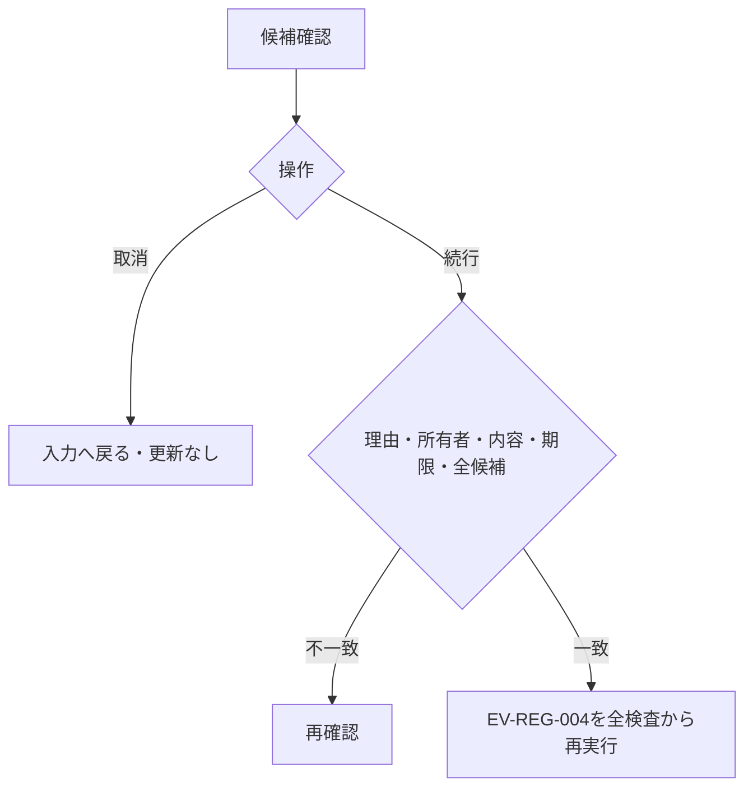

#### SQL・テーブル関連（ER図）

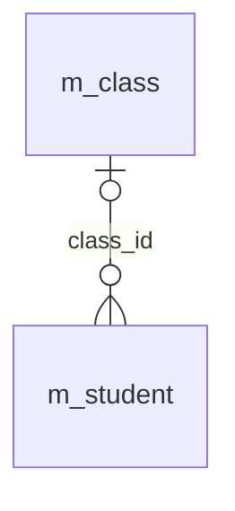

名称参照は未所属・停止値を残す外部結合相当。コードは用途ごとの別名で**分類と値**を結合する。図は読取りの関連であり、履歴への書込みや削除連動を意味しない。単独の存在確認・採番・書込みの表関連は下記操作IDで特定する。

#### DB操作の詳細

`OP-DUP`。下記「DB操作定義」の同名操作を実行する。保存系ではINSERTとUPDATEをモードで選択し、両方を実行しない。

OP-DUPの比較対象は表示20件に限らない。確認継続時の再取得と照合は保存ゲート内、ダイアログ表示はRollback・解放後に行う。確認取消自体は学生・操作履歴0件である。

#### 結果・例外時の扱い

CHK-005/025でW-STU-101「同じ生年月日で氏名または氏名カナが一致する学生が{count}件あります。別人であることを確認してください。」を表示する。countは全候補件数。相違/期限切れはW-STU-102「入力内容または重複候補が変わりました。もう一度確認してください。」。CHK-002/025で空白だけ又は60字超の理由はE-STU-107。CHK-024の状態不正はE-COM-003。確認済みBooleanだけで保存を迂回させない。

W-STU-101のcountは全集合件数で、表示件数20を差し込まない。理由不備はE-STU-107、内容/候補/版/期限の差はW-STU-102へ分ける。続行の受付だけでは成功表示せず、再実行したEV-REG-004の確定結果を待つ。

### EV-REG-006 論理削除

#### 処理概要

管理者のcmdDelete_Clickは対象ID・読込版・理由・明示確認だけを受け、一般編集値を保存せず論理削除と監査を一括確定する。

#### 処理手順

1. **削除要求と現在対象**
   1. 管理者権限、Form/対象、正のStudentId/ExpectedVersion、N-01で正規化した1～60字の削除理由、取消既定の明示確認を検査する。cmdDeleteはmDraftの氏名/住所/日付等を削除命令へ含めない。
   2. 共通13の専用DAO.Workspace・同じdbでt_write_guardを取得後、OP-STUDENTで非削除1件と読込版を再確認する。0件E-STU-103と版不一致E-STU-105を分け、読込み失敗や競合から物理削除・新規・強制更新へ切り替えない。
2. **削除属性と履歴**
   1. OP-DELETEはstudent_id/ExpectedVersion/非削除の1件にUPD-106のis_deleted/deleted_at/deleted_by/delete_reasonとUPD-105の更新情報/版＋1だけを設定する。学籍番号、連絡先、続柄分類、所属等は変更しない。削除後は人数集計から除外されるが、席解放を新席加算検査で拒否しない。
   2. OP-AUDIT（UPD-107）を同じdb/wsに1件追記し、学生と履歴をCommitTransで確定する。成功確認後だけI-STU-003と検索復帰を返す。例外は両方Rollback・資源解放、成否不明は検索確認を案内し自動再送しない。

##### 実装詳細

入口：`cmdDelete_Click`。機能内の入力・結果型は項目一覧、共通実装は[方式別共通仕様](../共通/方式別/01_共通実装仕様.md)を使用する。 対象ID・ExpectedVersionは検証するが、利用者・権限・業務日は信頼する実行側で決定する。保存値は固定許可列に限定し、結果種別により画面遷移を分岐する。

#### 処理フロー

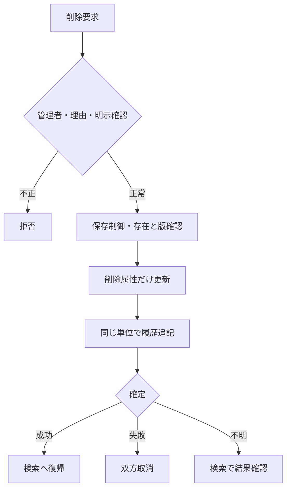

#### SQL・テーブル関連（ER図）

名称参照は未所属・停止値を残す外部結合相当。コードは用途ごとの別名で**分類と値**を結合する。図は読取りの関連であり、履歴への書込みや削除連動を意味しない。単独の存在確認・採番・書込みの表関連は下記操作IDで特定する。

#### DB操作の詳細

`OP-STUDENT` → `OP-DELETE` → `OP-AUDIT`。下記「DB操作定義」の同名操作を実行する。保存系ではINSERTとUPDATEをモードで選択し、両方を実行しない。

OP-DELETEは物理DELETEではなく、対象/期待版/非削除条件で1件の許可列更新を行う。OP-AUDITも同じdb/wsで1件、両方が確定した場合だけ成功。別CurrentDb/Workspaceに履歴だけを書かない。

#### 結果・例外時の扱い

CHK-023/024/027の不成立はE-COM-002/003又はE-STU-020、CHK-021/022はE-STU-103/105。確認文言はW-STU-105「この学生を論理削除します。削除後は通常検索できません。よろしいですか。」。CHK-030の確定成功だけI-STU-003「学生情報を論理削除しました。」。障害の取消確認と結果不明を区別し、後者はE-COM-004と検索確認を案内する。

確認取消・権限/理由/対象/版不正は学生・履歴0件のまま原入力へ戻る。履歴失敗は双方取消、Commit結果不明は成功にも取消済みにもせず、検索で確認する。保存済み後の検索再表示だけの障害を削除失敗へ読み替えない。

### EV-REG-007 取消・再読込・検索へ戻る

#### 処理概要

cmdReset・cmdReload・cmdBack・Form_Unloadを区別し、未保存入力の取消、最新値の取得、検索Context復帰を明示操作として処理する。

#### 処理手順

1. cmdResetは新規ならEV-REG-001の初期値、既存ならmOriginalの全値へ戻す。W-STU-104を取消既定で確認し、これはDB最新取得ではない。確認情報を失効し、復元時の部品連鎖をmInitializingで抑える。
2. cmdReloadはW-STU-109で未保存変更の破棄を明示確認してからOP-STUDENTを実行し、最新の全値・mOriginal・mDraft・ExpectedVersionをまとめて置換する。失敗時は部分更新を避け、版だけを最新へ差し替えて再保存しない。
3. cmdBack/Form_UnloadはmDirtyが残ればW-STU-103を取消既定で表示し、取消なら原入力を保持する。破棄を選んだ場合だけ確認情報を失効して元の検索Contextへ戻す。保存結果不明時は再保存前の検索確認を案内し、画面終了やMe.Dirty=Falseを業務保存に使わない。

##### 実装詳細

入口：`cmdReset / cmdReload / cmdBack / Form_Unload`。機能内の入力・結果型は項目一覧、共通実装は[方式別共通仕様](../共通/方式別/01_共通実装仕様.md)を使用する。 編集用値と原スナップショットを別に保持。変換失敗を未入力へ置換せず、エラー項目と原入力を返す。

#### 処理フロー

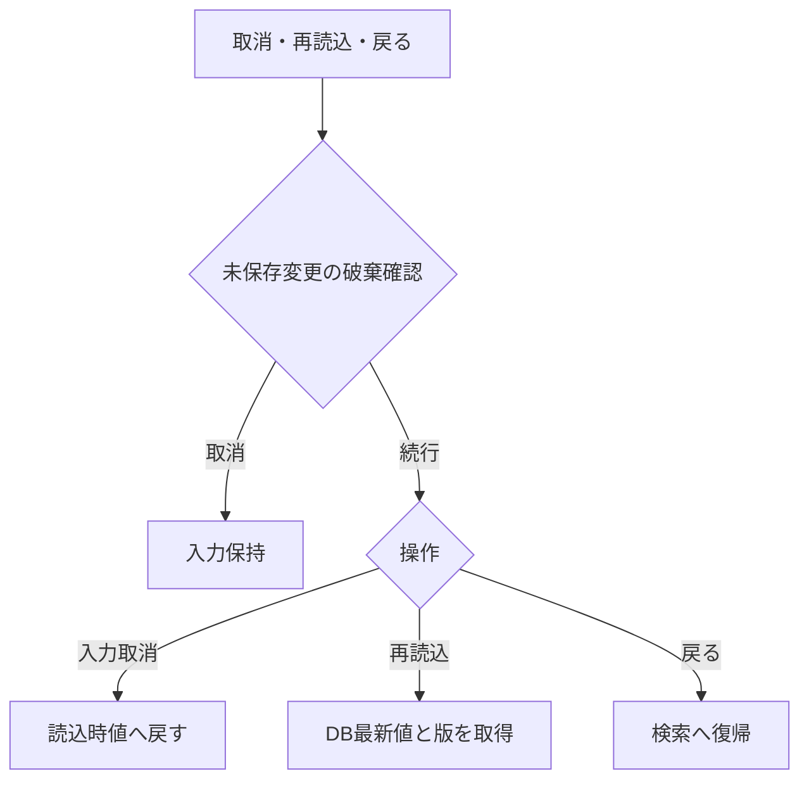

#### SQL・テーブル関連（ER図）

名称参照は未所属・停止値を残す外部結合相当。コードは用途ごとの別名で**分類と値**を結合する。図は読取りの関連であり、履歴への書込みや削除連動を意味しない。単独の存在確認・採番・書込みの表関連は下記操作IDで特定する。

#### DB操作の詳細

`OP-STUDENT`。下記「DB操作定義」の同名操作を実行する。保存系ではINSERTとUPDATEをモードで選択し、両方を実行しない。

OP-STUDENTを呼ぶのは再読込を明示確認した場合だけ。入力取消はmOriginalのメモリー復元、検索へ戻る操作は戻りContextの移送であり、学生・履歴の書込みを伴わない。

#### 結果・例外時の扱い

CHK-024の破棄確認はW-STU-104「入力内容を取り消しますか。」、W-STU-109「最新情報を再読み込みすると入力中の変更は破棄されます。続行しますか。」、W-STU-103「変更内容を破棄して戻りますか。」。取消時は原入力を保持する。CHK-021の不在E-STU-103、状態不正E-COM-003、読取障害E-COM-004では版だけの置換をしない。CHK-030の結果不明は「再保存前に検索で結果を確認してください」と案内し、盲目的再送をしない。

破棄確認の取消では入力とmOriginal/ExpectedVersionを保持する。再読込不在はE-STU-103であり新規へ切り替えない。保存結果不明の再操作では、入力復元や版差替えだけで再送可と判断しない。

### DB操作定義

操作の業務契約は[共通データアクセス](../共通/08_データアクセス仕様.md)が正本。本機能における具体的な対象・引数・確定単位は以下。

#### OP-CODE

| 項目 | 内容 |
| --- | --- |
| 対象テーブル | m_code_category / m_code |
| 操作 | 参照 |
| 実行条件・引数 | 分類、用途（検索／新規選択／既存表示）、既存値、業務日 |
| 取得・設定項目／対象条件 | 分類・値・名称・表示順・利用可否・期間。分類＋値で取得 |
| 件数・順序 | 候補0件を検出。既定値を先頭値へ代替しない |
| 確定・取消 | 参照のみ |

#### OP-CLASS

| 項目 | 内容 |
| --- | --- |
| 対象テーブル | m_class / m_code / m_student |
| 操作 | 参照 |
| 実行条件・引数 | 用途、年度、学年、在籍区分、在籍期間、既存所属、業務日、人数参照要否 |
| 取得・設定項目／対象条件 | 年度・学年・クラスID・コード・名称・期間・定員。人数集計は登録側で要求した場合のみ。検索の候補取得では学生を集計しない |
| 件数・順序 | 年度降順、学年表示順、クラス表示順、クラスコード、ID |
| 確定・取消 | 参照のみ、人数は予約ではない |

#### OP-STUDENT

| 項目 | 内容 |
| --- | --- |
| 対象テーブル | m_student / m_class / m_code |
| 操作 | 参照 |
| 実行条件・引数 | 対象学生ID |
| 取得・設定項目／対象条件 | 非削除の1件、全保存値・版・参照名称。名称はLEFT JOIN相当 |
| 件数・順序 | 0件E-STU-103、1件正常、複数件は整合性障害 |
| 確定・取消 | 画面読込は参照のみ。保存時の再検証は保存単位内 |

#### OP-EXISTS

| 項目 | 内容 |
| --- | --- |
| 対象テーブル | m_student / m_class / m_code_category / m_code |
| 操作 | 参照 |
| 実行条件・引数 | 用途（検索／保存）、分類付きコード・クラスID・選択補助。保存だけ対象ID・完全な学籍番号・期待版 |
| 取得・設定項目／対象条件 | 検索は指定コード・クラスの存在と年度学年の整合のみ。学籍番号前方一致に重複・完全一致存在検査をしない。保存は全行学籍番号一意、分類付き存在、変更有無、有効性を再検査 |
| 件数・順序 | 未存在／重複／組合せ／停止を区別。未指定の検索条件は検査対象外 |
| 確定・取消 | 検索は参照のみ、保存は保護した最新値で確認 |

#### OP-CAPACITY

| 項目 | 内容 |
| --- | --- |
| 対象テーブル | m_student / m_class |
| 操作 | 参照 |
| 実行条件・引数 | 旧席、新席、対象学生ID |
| 取得・設定項目／対象条件 | 非削除01/02、自分以外の対象クラス人数と定員 |
| 件数・順序 | 新席が未設定でなく、旧席から追加・異動するときだけ人数＋1≦定員。卒業・退学・削除による席解放はこの加算検査をしない。定員未設定は制限なし |
| 確定・取消 | 保存制御取得後に判定、休学も1席 |

#### OP-DUP

| 項目 | 内容 |
| --- | --- |
| 対象テーブル | m_student / m_class |
| 操作 | 参照 |
| 実行条件・引数 | 日付型生年月日、氏名照合値、カナ照合値、自分ID |
| 取得・設定項目／対象条件 | 非削除かつ自分除外、同生年月日かつ氏名キーORカナキー一致 |
| 件数・順序 | 全ID・版をID順、表示は最大20件。クラス名は表示のみ |
| 確定・取消 | 確認照合は同時保存制御内、応答待ちは解放 |

#### OP-INSERT

| 項目 | 内容 |
| --- | --- |
| 対象テーブル | m_student |
| 操作 | 登録 |
| 実行条件・引数 | 検証済み19入力、生成照合値2、固定分類、認証情報 |
| 取得・設定項目／対象条件 | 学生ID自動採番、版1、作成更新情報設定、未削除 |
| 件数・順序 | 必ず1件。学籍番号一意制約でも競合防止 |
| 確定・取消 | OP-AUDITと同一確定単位 |

#### OP-UPDATE

| 項目 | 内容 |
| --- | --- |
| 対象テーブル | m_student |
| 操作 | 更新 |
| 実行条件・引数 | 対象ID、期待版、学籍番号以外18入力、生成照合値2 |
| 取得・設定項目／対象条件 | 対象ID＋期待版＋非削除。続柄分類を続柄と同時更新。作成情報・学籍番号・必須３分類・削除情報は変更なし |
| 件数・順序 | 更新1件。0件は存在再確認後不在／版競合に分離 |
| 確定・取消 | OP-AUDITと一括、版＋1。変更なしは実行しない |

#### OP-AUDIT

| 項目 | 内容 |
| --- | --- |
| 対象テーブル | t_operation_log |
| 操作 | 登録 |
| 実行条件・引数 | 対象、操作、前後版、変更項目名、実行者・時点・理由・受付番号 |
| 取得・設定項目／対象条件 | 変更した物理項目名だけ。個人情報の値はコピーしない |
| 件数・順序 | 実際の変更1件につき履歴1件。追記専用 |
| 確定・取消 | 業務変更と同じ接続・保存単位。失敗は双方取消 |

#### OP-DELETE

| 項目 | 内容 |
| --- | --- |
| 対象テーブル | m_student |
| 操作 | 更新（論理削除） |
| 実行条件・引数 | 対象ID、期待版、理由、認証情報 |
| 取得・設定項目／対象条件 | 削除状態・日時・者・理由、更新日時・者・版だけ変更 |
| 件数・順序 | 更新1件。編集中の一般項目を含めない |
| 確定・取消 | 物理DELETEではない。OP-AUDITと一括 |

### ネイティブイベント・通信の対応

#### 保存・削除・取消

Form_Loadで既存対象の最新非削除レコードと版を取得し、`mOriginal As clsStudentDraft`と編集用`mDraft`を別インスタンスにする。参照モードは入力Locked、保存・削除・取消は非表示。学籍番号は編集でもLockedだが、サービス側でも旧値と比較する。

cmdSave_Clickは`mBusy`を確認して二重操作を抑止し、入力を複製してclsStudentService.SaveStudentへ渡す。入力検査後に専用DAO.Workspaceの保存単位を開始し、共有の同時実行制御行を保護する。最新対象・版・マスタ・在籍・定員を再検証し、変更なし／同一人物候補を判定する。確認待ちは必ずRollback・接続解放後にダイアログを開く。別人理由と確認情報を付けて再度全検査する。

正常保存は学生変更と操作履歴を同じWorkspace・同じバックエンドで確定。確定確認後だけmDirty=Falseとして検索へ戻る。`Me.Dirty=False`を業務保存の代わりに使わない。Accessの自動フォーム保存や、別WorkspaceのCurrentDbで履歴だけを書き込む構成は禁止する。

cmdDelete_ClickはID・ExpectedVersion・理由・明示確認だけを渡し、編集中の学生値を保存しない。cmdResetはmOriginalへ戻す、cmdReloadは確認後に最新取得、Form_UnloadはmDirtyが残る場合に取消を既定とする破棄確認を行う。版競合でExpectedVersionだけを最新に差し替えて再更新しない。

### 業務判断の決定表

#### 主要な業務チェック

| チェック | 判定 | 結果 |
| --- | --- | --- |
| 学籍番号重複 | 削除済みを含む全学生で使用済み | 保存不可。番号の再利用も不可 |
| 同一人物候補 | 非削除の他学生と生年月日が同じ、氏名またはカナの照合値が同じ | 別人確認・理由付きなら保存可 |
| コード存在 | 正しい分類内に値がある | 不存在は保存不可 |
| コード利用可否 | 新規・変更する値が有効・期間内 | 不可値は保存不可。既存の同値保持は可 |
| クラス存在 | 選択クラスが実在し年度・学年が一致 | 不存在・不一致は保存不可 |
| 日付 | 生年月日≦入学日≦本日、終了日も本日以前 | 不整合は保存不可 |
| 連絡手段 | 本人電話・メール・緊急電話の1つ以上 | 不足は保存不可 |
| 緊急連絡先 | 氏名・続柄・電話を全部空または全部入力 | 一部だけは保存不可 |
| 他者の更新 | 画面読込後に別操作が更新済み | 上書きせずエラー。入力を保持 |
| 理由 | 必要な操作で空白でない60文字以内 | 不足は保存不可 |

#### クラス選択・定員の決定表

| 保存後の状態・変更 | クラス要否・利用規則 | 定員 |
| --- | --- | --- |
| 新規の在学・休学、別クラスへの異動、卒業等から在学へ訂正 | 必須。利用可かつ本日が利用期間内 | 自分を除いた在学・休学人数＋1が定員以下 |
| 在学・休学のまま同じクラスを保持 | 存在必須。期間外等でも住所などの変更は可、見直し警告 | 席が増えないため既存の超過だけでは拒否しない |
| 新規の卒業・退学 | 任意。指定するならクラス利用期間と入学～終了日の期間が重なる | 席を消費しない |
| 卒業・退学の最終所属・在籍日付・区分を変更 | 停止・過去クラスも可。指定した期間の重なりを確認 | 席を消費しない |
| 卒業・退学の最終所属・在籍日付・区分を変えず住所等だけ変更 | 既存値を保持できる | 席を消費しない |
| 論理削除 | 元のクラス情報を保持 | 削除後は人数に含めない |

休学も1席を使用する。定員未設定は制限なし。定員40人に対し39人在籍で同時に2人を登録した場合は片方だけ保存でき、超過させない。期間の重なりは1日以上あればよく、卒業日がクラス利用期間内に入ることまでは必須にしない。

#### 在籍区分の状態遷移

| 変更前 | 変更後 | 実行者・条件 |
| --- | --- | --- |
| 在学・休学 | 在学・休学・卒業・退学 | 担当者または管理者。変更後の日付・クラス規則を満たす |
| 卒業・退学 | 同一区分 | 担当者または管理者。通常項目の訂正可 |
| 卒業・退学 | 別区分 | 管理者のみ。確認・変更理由が必須 |
| 新規 | 任意の4区分 | 担当者または管理者。過去データ登録を認める |

在籍区分は日付到来だけで自動変更しない。再入学や年度別履歴は本版に含まない。

### メッセージ・差込値・復帰の対応
共通05のID・実文言を継承し、項目名は日本語論理名、maxは当該制限、countは全候補件数、studentNoは確定済み結果、correlationIdは共通03の受付番号から取得する。通常の入力誤りは原入力全体を保持し、項目近傍と一覧にまとめ、先頭の誤り欄へ戻す。内部列名・SQL・接続先・例外スタックや個人情報の値を通常エラーへ露出しない。

| メッセージID | 実文言 | 適用・復帰 |
| --- | --- | --- |
| E-STU-001 | {field}を入力してください。 | 必須・条件必須の対象欄へ |
| E-STU-002 | {field}は{max}文字以内の使用可能な文字で入力してください。 | 原入力/保存長・禁止文字を区別 |
| E-STU-003 | 学籍番号は半角英数字・ハイフンで15文字以内にしてください。先頭は英数字です。 | 番号欄へ |
| E-STU-004 | 氏名カナはカタカナで入力してください。中点・長音・空白は使用できます。 | カナ原入力保持 |
| E-STU-005 | {field}に正しい日付を入力してください。 | 不正日を補正しない |
| E-STU-006 | {fromField}は{toField}以前の日付にしてください。 | 日本語項目名を差し込む |
| E-STU-007 | 生年月日・入学日は本日以前とし、生年月日≦入学日となるよう入力してください。 | 形式成立後の日付関係 |
| E-STU-008 | 在籍区分に対応する卒業・退学日を設定してください。 | 区分と終了日へ |
| E-STU-009 | {field}のコードが存在しません。選択し直してください。 | 分類付き存在不成立 |
| E-STU-010 | 指定したクラスが存在しません。選択し直してください。 | クラス再選択 |
| E-STU-011 | {field}は現在使用できないコードです。選択し直してください。 | 新規/変更値の利用可否 |
| E-STU-012 | 在学・休学の学生はクラスを選択してください。 | 01/02の所属欄へ |
| E-STU-013 | このクラスには新たに所属できません。利用可否と利用期間を確認してください。 | 新たな所属条件不成立 |
| E-STU-014 | 年度・学年と選択したクラスが一致していません。 | 補助値とクラスを修正 |
| E-STU-015 | 郵便番号は7桁の数字で入力してください。 | 郵便欄へ |
| E-STU-016 | {field}の形式が正しくありません。国内10～11桁または国番号付きの番号を入力してください。 | 本人又は緊急電話欄へ |
| E-STU-017 | メールアドレスの形式が正しくありません。 | メール原入力保持 |
| E-STU-018 | 本人電話、本人メール、緊急連絡先電話のいずれかを入力してください。 | 連絡先の組合せを修正 |
| E-STU-019 | 緊急連絡先は氏名・続柄・電話番号をすべて入力してください。 | 全未設定又は一式入力へ |
| E-STU-020 | 削除理由を60文字以内で入力してください。 | 削除確認だけ、一般入力は保存しない |
| E-STU-101 | この学籍番号は使用済みです。入力を確認してください。直前の送信結果が不明な場合は検索で登録状況を確認してください。 | 番号再利用なし、結果不明の再送なし |
| E-STU-102 | クラスの定員を超えるため保存できません。別のクラスを選択してください。 | 入力保持・所属再選択 |
| E-STU-103 | 対象の学生が見つからないか、既に削除されています。 | 新規へ切替えない |
| E-STU-104 | 登録済みの学籍番号は変更できません。 | 変更なしに見せかけて受理しない |
| E-STU-105 | 他の操作で更新されています。入力内容を控え、最新情報を再読み込みしてください。 | 自動上書き/版だけ更新なし |
| E-STU-106 | 卒業・退学からの在籍区分変更には管理者権限と変更理由が必要です。 | 終了区分からの訂正条件 |
| E-STU-107 | 確認・変更理由を60文字以内で入力してください。 | 確認理由欄へ |
| E-STU-108 | 最終所属クラスの利用期間が学生の在籍期間と重なっていません。クラスまたは在籍日付を確認してください。 | 最終所属・在籍日付の対象変更時 |
| E-DATE-001 | 生年月日の元号・年・月・日を確認してください。 | 元号4要素の原入力保持 |
| E-DATE-002 | {field}は{minDate}から{maxDate}までの日付で入力してください。 | 範囲は共通07と業務日。生年月日上下限も和暦、その他は西暦 |
| E-DATE-003 | {field}は西暦4桁の{minYear}年から{maxYear}年で指定してください。 | 年度1900～9998、翌年計算前に検査 |
| E-COM-001 | ログインの有効期限が切れました。再度ログインしてください。 | Accessの主体照合へ。ログイン画面追加ではない |
| E-COM-002 | この操作を行う権限がありません。 | 業務書込みなし |
| E-COM-003 | 画面情報が無効です。画面を開き直してください。 | 不正な操作を拒否 |
| E-COM-004 | 処理を完了できませんでした。受付番号：{correlationId} | 取消確認と成否不明を分ける。結果不明は検索確認を追記 |
| W-STU-106 | 所属クラスが利用期間外です。住所等は変更できますが、クラスの見直しが必要です。 | 既存所属を保持した無関係の訂正を妨げない |
| W-STU-107 | 選択条件が変わったためクラスの選択を解除しました。 | 年度/学年/区分に不適合な選択を解除 |
| I-STU-001 | 学生を登録しました。（学籍番号：{studentNo}） | 全体確定確認後だけ |
| I-STU-002 | 学生情報を更新しました。 | 全体確定確認後だけ |
| I-STU-003 | 学生情報を論理削除しました。 | 全体確定確認後だけ |
| I-STU-004 | 変更内容がありません。 | 学生/履歴/日時/版すべて変更なし |

## 項目移送仕様

| 移送ID | 項目ID | 関連イベント | 画面側 | 処理変数 | DB側・出力値 | 方向 | 変換ID | 未設定 | 移送条件・説明 | 異常時 |
| --- | --- | --- | --- | --- | --- | --- | --- | --- | --- | --- |
| MAP-REG-001 | REG-001 | EV-REG-001,EV-REG-002 | txtStudentId | StudentId | m_student.student_id | O（表示） | 非適用 | 表示欠損は－、マスタ欠落は不整合表示 | 表示のみ、登録時自動採番 | 取得不整合は明示・行を無言で落とさない |
| MAP-REG-002 | REG-002 | EV-REG-004 | txtStudentNo | mDraft.StudentNo | m_student.student_no | I/O（表示・保存） | N-06 | 不可 | 新規のみ設定。登録後不変、削除済み含め一意 | 入力不正は原入力保持・DB処理なし |
| MAP-REG-003 | REG-003 | EV-REG-004 | txtStudentName | mDraft.StudentName | m_student.student_name | I/O（表示・保存） | N-02 | 不可 | N-02、原表記を保存 | 入力不正は原入力保持・DB処理なし |
| MAP-REG-004 | REG-004 | EV-REG-004 | txtStudentNameKana | mDraft.StudentNameKana | m_student.student_name_kana | I/O（表示・保存） | N-04,N-05 | 不可 | N-04、全角カナ18文字 | 入力不正は原入力保持・DB処理なし |
| MAP-REG-005 | REG-005 | EV-REG-004 | cboBirthEra / txtBirthYear / txtBirthMonth / txtBirthDay | mDraft.BirthDateIso | m_student.birth_date | I/O（表示・保存） | N-11 | 不可 | 和暦入力→厳密変換→日付保存、DATE-R01 | 入力不正は原入力保持・DB処理なし |
| MAP-REG-006 | REG-006 | EV-REG-004 | cboGender | mDraft.GenderCode | m_student.gender_code | I/O（表示・保存） | N-07 | 不可 | コード値保存／性別分類のコード名称表示 | 入力不正は原入力保持・DB処理なし |
| MAP-REG-007 | REG-007 | EV-REG-004 | txtPostalCode | mDraft.PostalCode | m_student.postal_code | I/O（表示・保存） | N-08 | 不可 | N-08、数字7桁保存、3桁－4桁表示 | 入力不正は原入力保持・DB処理なし |
| MAP-REG-008 | REG-008 | EV-REG-004 | cboPrefecture | mDraft.PrefectureCode | m_student.prefecture_code | I/O（表示・保存） | N-07 | 不可 | コード値保存／都道府県分類の名称表示 | 入力不正は原入力保持・DB処理なし |
| MAP-REG-009 | REG-009 | EV-REG-004 | txtAddressLine1 | mDraft.AddressLine1 | m_student.address_line1 | I/O（表示・保存） | N-02 | 不可 | N-02、市区町村・番地、45文字 | 入力不正は原入力保持・DB処理なし |
| MAP-REG-010 | REG-010 | EV-REG-004 | txtAddressLine2 | mDraft.AddressLine2 | m_student.address_line2 | I/O（表示・保存） | N-02 | NULL相当 | N-02、任意45文字、空は未設定 | 入力不正は原入力保持・DB処理なし |
| MAP-REG-011 | REG-011 | EV-REG-004 | txtPhoneNumber | mDraft.PhoneNumber | m_student.phone_number | I/O（表示・保存） | N-09 | NULL相当 | N-09、連絡手段条件あり | 入力不正は原入力保持・DB処理なし |
| MAP-REG-012 | REG-012 | EV-REG-004 | txtEmailAddress | mDraft.EmailAddress | m_student.email_address | I/O（表示・保存） | N-10 | NULL相当 | N-10、連絡手段条件あり | 入力不正は原入力保持・DB処理なし |
| MAP-REG-013 | REG-013 | EV-REG-004 | txtAdmissionDate | mDraft.AdmissionDateIso | m_student.admission_date | I/O（表示・保存） | N-11 | 不可 | 西暦入力・表示、DATE-R02 | 入力不正は原入力保持・DB処理なし |
| MAP-REG-014 | REG-014 | EV-REG-004 | cboEnrollmentStatus | mDraft.EnrollmentStatusCode | m_student.enrollment_status_code | I/O（表示・保存） | N-07 | 不可 | 値保存／在籍区分分類の名称表示 | 入力不正は原入力保持・DB処理なし |
| MAP-REG-015 | REG-015 | EV-REG-004 | txtEnrollmentEndDate | mDraft.EnrollmentEndDateIso | m_student.enrollment_end_date | I/O（表示・保存） | N-11 | NULL相当 | 西暦。03/04で必須、01/02は未設定 | 入力不正は原入力保持・DB処理なし |
| MAP-REG-016 | REG-016 | EV-REG-004 | cboSchoolYear | SchoolYear | m_class.school_year | I/O（選択補助・保存なし） | N-11 | NULL相当 | 選択補助・整合検査のみ。学生へ保存しない | 入力不正は原入力保持・DB処理なし |
| MAP-REG-017 | REG-017 | EV-REG-004 | cboGrade | GradeCode | m_class.grade_code | I/O（選択補助・保存なし） | N-07 | NULL相当 | 選択補助。学年名称は学年分類のコード名称 | 入力不正は原入力保持・DB処理なし |
| MAP-REG-018 | REG-018 | EV-REG-004 | cboClass | mDraft.ClassId | m_student.class_id | I/O（表示・保存） | 非適用 | NULL相当 | 識別番号保存／年度・学年・コード・名称表示 | 入力不正は原入力保持・DB処理なし |
| MAP-REG-019 | REG-019 | EV-REG-004 | lblCapacity | Occupancy / Capacity | count of m_student / m_class.capacity | O（表示） | 非適用 | 表示欠損は－、マスタ欠落は不整合表示 | 非削除01/02の参考人数。確保予約ではない | 取得不整合は明示・行を無言で落とさない |
| MAP-REG-020 | REG-020 | EV-REG-004 | txtEmergencyContactName | mDraft.EmergencyContactName | m_student.emergency_contact_name | I/O（表示・保存） | N-02 | NULL相当 | 緊急3項目は全部入力または全部未設定 | 入力不正は原入力保持・DB処理なし |
| MAP-REG-021 | REG-021 | EV-REG-004 | cboRelationship | mDraft.RelationshipCode | m_student.relationship_code | I/O（表示・保存） | N-07 | NULL相当 | 続柄値・名称を対応。未選択なら続柄分類もNULL、選択時は分類を処理設定（UPD-103） | 入力不正は原入力保持・DB処理なし |
| MAP-REG-022 | REG-022 | EV-REG-004 | txtEmergencyPhoneNumber | mDraft.EmergencyPhoneNumber | m_student.emergency_phone_number | I/O（表示・保存） | N-09 | NULL相当 | N-09、緊急3項目一式 | 入力不正は原入力保持・DB処理なし |
| MAP-REG-023 | REG-023 | EV-REG-004 | txtRemarks | mDraft.Remarks | m_student.remarks | I/O（表示・保存） | N-01 | NULL相当 | プレーンテキスト、120文字、改行可 | 入力不正は原入力保持・DB処理なし |
| MAP-REG-024 | REG-024 | EV-REG-005 | txtOperationReason | OperationReason | t_operation_log.operation_reason | I（関連保存） | N-01 | NULL相当 | 警告続行・終了区分訂正時必須、60文字 | 入力不正は原入力保持・DB処理なし |
| MAP-REG-025 | REG-025 | EV-REG-002 | lblUpdatedAt / lblUpdatedBy | UpdatedAt / UpdatedBy | updated_at / updated_by | O（表示） | 非適用 | 表示欠損は－、マスタ欠落は不整合表示 | システム設定。西暦日時、日本時間 | 取得不整合は明示・行を無言で落とさない |
| MAP-REG-026 | REG-026 | EV-REG-006 | frmDeleteConfirm.txtReason | DeleteReason | delete_reason / t_operation_log.operation_reason | I（関連保存） | N-01 | NULL相当 | 削除時のみ、60文字、編集中の業務値は保存しない | 入力不正は原入力保持・DB処理なし |
| MAP-REG-032 | REG-032 | EV-REG-005 | frmDuplicateConfirm.lstCandidates | DuplicateCandidates | OP-DUP result | 操作／表示 | 非適用 | 表示欠損は－、マスタ欠落は不整合表示 | 全候補件数＋最大20件、個人情報を最小化 | 取得不整合は明示・行を無言で落とさない |

## 項目更新仕様

| 更新ID | 項目ID | 対象 | 登録 | 更新 | 論理削除 | 規則・設定元 |
| --- | --- | --- | --- | --- | --- | --- |
| UPD-002 | REG-002 | m_student.student_no | 検証済み入力値 | 変更なし | 変更なし | 新規のみ設定。登録後不変、削除済み含め一意 |
| UPD-003 | REG-003 | m_student.student_name | 検証済み入力値 | 同左。空の任意値は未設定で上書き | 変更なし | N-02、原表記を保存 |
| UPD-004 | REG-004 | m_student.student_name_kana | 検証済み入力値 | 同左。空の任意値は未設定で上書き | 変更なし | N-04、全角カナ18文字 |
| UPD-005 | REG-005 | m_student.birth_date | 検証済み入力値（生年月日は日付へ変換） | 同左。空の任意値は未設定で上書き | 変更なし | 和暦入力→厳密変換→日付保存、DATE-R01 |
| UPD-006 | REG-006 | m_student.gender_code | 検証済み入力値 | 同左。空の任意値は未設定で上書き | 変更なし | コード値保存／性別分類のコード名称表示 |
| UPD-007 | REG-007 | m_student.postal_code | 検証済み入力値 | 同左。空の任意値は未設定で上書き | 変更なし | N-08、数字7桁保存、3桁－4桁表示 |
| UPD-008 | REG-008 | m_student.prefecture_code | 検証済み入力値 | 同左。空の任意値は未設定で上書き | 変更なし | コード値保存／都道府県分類の名称表示 |
| UPD-009 | REG-009 | m_student.address_line1 | 検証済み入力値 | 同左。空の任意値は未設定で上書き | 変更なし | N-02、市区町村・番地、45文字 |
| UPD-010 | REG-010 | m_student.address_line2 | 検証済み入力値 | 同左。空の任意値は未設定で上書き | 変更なし | N-02、任意45文字、空は未設定 |
| UPD-011 | REG-011 | m_student.phone_number | 検証済み入力値 | 同左。空の任意値は未設定で上書き | 変更なし | N-09、連絡手段条件あり |
| UPD-012 | REG-012 | m_student.email_address | 検証済み入力値 | 同左。空の任意値は未設定で上書き | 変更なし | N-10、連絡手段条件あり |
| UPD-013 | REG-013 | m_student.admission_date | 検証済み入力値 | 同左。空の任意値は未設定で上書き | 変更なし | 西暦入力・表示、DATE-R02 |
| UPD-014 | REG-014 | m_student.enrollment_status_code | 検証済み入力値 | 同左。空の任意値は未設定で上書き | 変更なし | 値保存／在籍区分分類の名称表示 |
| UPD-015 | REG-015 | m_student.enrollment_end_date | 検証済み入力値 | 同左。空の任意値は未設定で上書き | 変更なし | 西暦。03/04で必須、01/02は未設定 |
| UPD-018 | REG-018 | m_student.class_id | 検証済み入力値 | 同左。空の任意値は未設定で上書き | 変更なし | 識別番号保存／年度・学年・コード・名称表示 |
| UPD-020 | REG-020 | m_student.emergency_contact_name | 検証済み入力値 | 同左。空の任意値は未設定で上書き | 変更なし | 緊急3項目は全部入力または全部未設定 |
| UPD-021 | REG-021 | m_student.relationship_code | 検証済み入力値 | 同左。空の任意値は未設定で上書き | 変更なし | 続柄値・名称を対応。未選択なら続柄分類もNULL、選択時は分類を処理設定（UPD-103） |
| UPD-022 | REG-022 | m_student.emergency_phone_number | 検証済み入力値 | 同左。空の任意値は未設定で上書き | 変更なし | N-09、緊急3項目一式 |
| UPD-023 | REG-023 | m_student.remarks | 検証済み入力値 | 同左。空の任意値は未設定で上書き | 変更なし | プレーンテキスト、120文字、改行可 |
| UPD-101 | REG-003／004 | name_key / kana_key | 共通04で生成 | 元の氏名等から再生成 | 変更なし | 入力された照合値を信用しない |
| UPD-102 | REG-001 | student_id | 自動採番 | 変更なし | 変更なし | 最大値＋1は禁止 |
| UPD-103 | ― | gender_category / prefecture_category / enrollment_category / relationship_category | 必須３分類を固定設定。続柄未選択は分類もNULL、選択時のみ続柄分類を設定 | 必須３分類は維持。続柄分類は続柄と同時に設定／NULL化 | 変更なし | 利用者入力を受けず保存側で算定。新規・更新の派生値と変更列監査を一致 |
| UPD-104 | ― | created_at / created_by | 共通03・01 | 変更なし | 変更なし | システム設定 |
| UPD-105 | REG-025 | updated_at / updated_by / row_version | 実行時点・実行者・1 | 実変更時だけ実行時点・実行者・版＋1 | 同左 | 期待版一致が条件、変更なしでは更新しない |
| UPD-106 | REG-026／031 | is_deleted / deleted_at / deleted_by / delete_reason | 未削除、削除属性未設定 | 変更なし | 削除済・実行時点・実行者・検査済理由 | 削除時に一般入力を保存しない |
| UPD-107 | REG-024／026 | t_operation_log | 前版未設定・後版1・操作新規 | 前後版・変更項目名・操作更新 | 前後版・変更項目名・操作論理削除 | 対象識別、実行者時点、理由、受付番号、重複確認有無。値は複写しない |

## 補足説明

### 制約・正本

本書は1機能を対象とし、複数クラス・API・パネルはその内部実装である。マスタ保守、共通UI、物理テーブル、ビルド・配備は[方式別共通仕様](../共通/方式別/01_共通実装仕様.md)を参照する。

### 試験観点

[共通T-01～28](../共通/06_要件対応・設計判断.md)と[DATE-T01～20](../共通/07_日付・和暦仕様.md)の該当項目を実装工程で実施する。入力→処理値→DB→再表示を往復確認し、Unicode最大長、日付境界、停止候補、最終席競合、旧版、履歴失敗、保存結果不明を含める。

レビュー結果。文書検査と実装試験合格を区別する。

### 実装上の移送・制御補足

#### 物理バインド・変数定義

##### 全保存項目対応

| clsStudentDraftプロパティ | 対応入力 | m_student列・業務保存上限 |
| --- | --- | --- |
| StudentNo | txtStudentNo | student_no 15、必須・更新不変 |
| StudentName | txtStudentName | student_name 8、必須 |
| StudentNameKana | txtStudentNameKana | student_name_kana 18、入力36・必須 |
| BirthDateIso | 和暦4コントロール→BirthDateIso | birth_date ISO年月日、必須 |
| GenderCode | cboGender | gender_code 1、初期0 |
| PostalCode | txtPostalCode | postal_code 7桁、入力10・必須 |
| PrefectureCode | cboPrefecture | prefecture_code 2、必須 |
| AddressLine1/2 | txtAddressLine1/2 | address_line1/2 各45、1必須・2任意 |
| PhoneNumber | txtPhoneNumber | phone_number 16、入力20・連絡条件 |
| EmailAddress | txtEmailAddress | email_address 60、連絡条件 |
| AdmissionDateIso | txtAdmissionDate | admission_date、必須 |
| EnrollmentStatusCode | cboEnrollmentStatus | enrollment_status_code 2、初期01 |
| EnrollmentEndDateIso | txtEnrollmentEndDate | enrollment_end_date、03/04必須・01/02はNull |
| ClassId | cboClass | class_id、01/02必須、NullまたはLong |
| EmergencyContactName | txtEmergencyContactName | emergency_contact_name 8、一式 |
| RelationshipCode | cboRelationship | relationship_code 2、一式 |
| EmergencyPhoneNumber | txtEmergencyPhoneNumber | emergency_phone_number 16、一式 |
| Remarks | txtRemarks | remarks 120、任意 |

上記19入力からNameKey・KanaKeyを生成する。入力19＋照合値2が業務保存対象。SchoolYear/GradeCodeは選択補助、OperationReasonは操作履歴、StudentId・ExpectedVersion・確認情報は制御。FixedCategory・Created/Updated・削除状態をフォーム入力から一括コピーしない。

##### REG-005 生年月日の物理移送契約

| 項目 | 定義 |
| --- | --- |
| 入力コントロール | cboBirthEra / txtBirthYear / txtBirthMonth / txtBirthDay |
| 入力→内部値 | Stringの原入力4値→mDraft.BirthDateIso（ISO日付String） |
| 共通呼出 | modJapaneseDate.ParseBirthDate / FormatBirthDate。業務日・元号定義版を渡す |
| 保存先 | m_student.birth_date。元号・元号年を別列へ保存しない |
| 既存値→画面 | 内部日付から4入力値と和暦表示を生成。日付に時差変換を適用しない |
| エラー | 元号・年・月・日の原入力を保持しREG-005へE-DATE-001または002等を関連付ける。変換失敗をNULL扱いしない |

既存のBirthDate／BirthDateIso／E-BIRTH-DATE等は変換後の内部日付を指す。生年月日の入力欄を西暦の単一DatePickerや単一テキストへ戻さない。日付型の必須性は保存命令を確定するときに検査し、新規画面の未入力状態と区別する。

##### 型と制御情報

| 対象 | 規約 |
| --- | --- |
| 日付型 | ISO文字列／任意値はVariant Null |
| ID・版 | 方式別ID型を使用し近似数へ変換しない。新規は対象・期待版なし、更新削除は正のID・期待版必須 |
| 隠し状態 | 原スナップショット、編集値、期待版、戻りContext、確認Token、要求連番、Busyを分離。利用者権限は入力にしない |
| 生年月日 | REG-005は元号・年・月・日のRaw文字列→共通16→birth_date。HTML上の名称と内部日付値を区別する |
| 一覧出力 | 一覧取得DTOはOP-LISTの8論理項目（7列相当）＋学生ID。birth_dateだけ和暦表示へ変換。更新日時は並び替えの内部値に限り、表示DTOへ返さない |
| 未設定 | 任意文字の空は共通04でNULL相当。変換失敗をNULLや0にしない |

### 開発入力と責務

本機能を実装する直接入力は、本書、[方式別共通仕様](../共通/方式別/01_共通実装仕様.md)、[DB定義](../DB定義/Access/01_DB定義書.md)、[方式別開発規約](../規約/Access.md)、[共通開発規約](../規約/開発規約.md)である。基本設計は背景理解・承認確認に用いる。項目の必須・長さ・初期値は本書に再掲し、[共通項目制約](../共通/09_項目制約定義.md)と一致させる。

raw入力は表示用に保持し、正規化成功後の値だけを型付き命令に移す。型変換エラーをNULLと扱わない。生年月日は和暦4入力、変換後のみbirth_dateとして保存する。氏名・カナの照合値は保存側が再生成する。操作イベントごとの引数・結果分岐は本書イベント仕様に従い、共通呼出しの成功を業務保存の成功と混同しない。

本書の構成要素IDは親項目の細分化であり、新たな業務要件を追加するものではない。内部名が前版で未指定だった表示用変数は本版の実装設計名。ソースが実在するという主張ではない。

### 更新表の補足

EV-REG-004・006から呼び出す。新規19入力、通常更新18入力（学籍番号以外）、生成照合値2の対応を固定する。更新・削除は対象ID＋期待版＋非削除で1件を要求し、0件の場合は不在／競合を区別する。

### 長さと物理領域の解釈

項目一覧の「言語型」は検証途中のモデルを含む。本方式のVariant Null／ISO日付Stringという未設定・変換途中の領域を許容しても、保存時の必須検査を省略しない。Raw入力と正規化値を別領域へ保持する。対応DB型・NULL可否は採用DB定義と同じ値を再掲している。

Unicode入力はスカラー値で業務長を判定し、UTF-16のMaxLength／HTML maxlengthが同じ数字だから正しいとは判断しない。画面部品の物理入力上限は必要に応じ2Nコード単位以上を確保し、共通検査でNスカラー値を厳守する。描画モックのdata-business-maxlengthが業務上限であり、HTMLの物理ガード値は業務上限を拡張する指定ではない。

### 続柄分類の派生・全消去

`Variant Null`を両列へ設定する。`Nz(..., "")`や固定DefaultValueで未設定の分類を復活させない。DAOの列Required・一式ValidationRule・複合FKはAccess DB定義に従う。

分類は新たな画面入力ではない。全消去時は氏名・分類・続柄値・電話を同時にNULL化する。原入力保持・読込時スナップショット・論理削除の更新範囲は変えない。生成物の旧固定分類代入は修正対象であり、本仕様変更だけで更新済みと扱わない。

### 詳細化した契約と試験生成の確認

#### SaveStudentの入力・戻り値と型

frmStudentEditはraw領域を残してclsStudentDraftの検証用値を複製し、既存入口clsStudentService.SaveStudentへ渡す。StudentId/ExpectedVersionは新規Null、既存はLongの正数。SchoolYear/GradeCodeは選択補助、OperationReasonは監査、ReturnContextId/DuplicateTokenは所有者・期限付き制御であり、学生列へ一括コピーしない。主体・役割・時点は実行側で決定する。

結果は入力エラー、対象不在、版競合、定員/マスタ不適合、重複確認待ち、無変更、確定成功、確定前失敗、成否不明を区別する。成功以外のすべてを単一Falseへ潰さず、項目エラー・MSG・対象/前後版・確認情報・原入力の保持・検索復帰の可否へ結び付ける。確認待ちではDAO資源を返却した後にダイアログを表示し、成功はCommit確認後だけ返す。

#### 型・長文・派生値の具体化

項目一覧の既存VBA型とDB型・NULLを維持する。従来の汎用説明DateOnly?等は、本方式ではVariant Null又はISO日付Stringという変換途中/未設定の表現に具体化した。保存必須の生年月日/入学日をNULL可へ変更せず、和暦4入力と厳密変換、DBのTEXT(10)によるISO値、日付範囲を保持する。DateOnly等の他言語クラスやWeb JSON入力を導入したものではない。

LongTextのname_key等はDAO Recordset.Fields.Valueで保持しTEXT(255)パラメーターへ縮めない。続柄未選択/全消去では緊急氏名・分類・値・電話の4値を同時にNullにし、NzやDefaultValueで分類を復活させない。必須3分類・作成情報・学籍番号・削除属性等の非更新範囲は項目更新表に従い、派生分類も差分判定と変更列監査へ含める。

#### 要件の未決と適用境界

QA-REQ-DATEは既存の1900年下限/和暦入力案を新たな利用者承認へ格上げしない。QA-REQ-SEED/REQ-N-010の初期配布5分類70コード・学生/クラス/監査0件・制御行1件をこの試験生成で変更しない。クラス0件時の新規01/02保存不可とW-STU-108を明示し、動作確認用架空データは別途契約確定・投入の工程へ残す。

QA-REQ-ACCESS-BOUNDARYの単一ACCDB・信頼された職員向け評価構成を維持し、ファイル直接改変に対する強い役割分離を主張しない。性能、保持/復旧、運用学校種別など未確定の値を追加しない。OP-EXISTS表の検索一般説明は登録の補助年度/学年を学生検索へ追加する意味ではなく、検索用途は共通08の現行4条件が正本である。

#### 確認シナリオと未実施

入力/保存長境界、和暦境界、緊急一式全消去、削除済み番号の再利用拒否、同姓同名の理由付き確認、表示外候補版変更、10分失効、最後の1席への2接続競合、履歴失敗、Commit応答不明、通常無変更、旧版更新/削除、未保存取消を確認観点にする。シナリオの記述はAccess/DAO実行試験・受入・正式採点の実績ではなく、未採点はformalScore=nullである。
