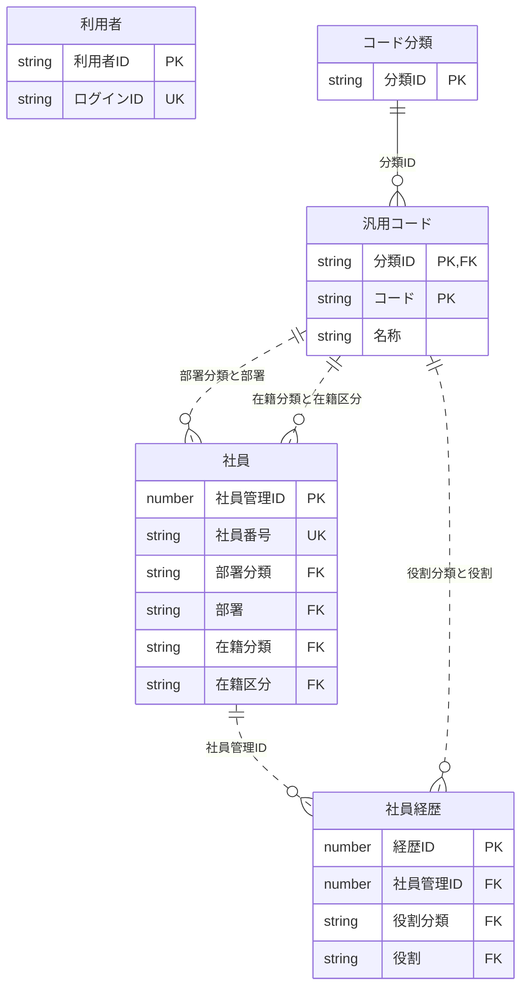

<!-- spec-meta: {"schema":"spec-md/1.0","documentId":"SP2-Access-COM-02","version":"1.4","path":"sample-project2/spec/Access/共通/02_CRUD図.md","sheets":[{"heading":"CRUD一覧","kind":"LIST","sheet":"01_CRUD一覧","key":["機能ID"]},{"heading":"関連と確定単位","kind":"GRID","sheet":"02_関連と確定単位"}]} -->
# CRUD・テーブル関連

版1.4／2026-10-28。

## CRUD一覧

| 機能ID | 利用者 | 社員 | 社員経歴 | コード分類 | 汎用コード | 外部出力 |
| --- | --- | --- | --- | --- | --- | --- |
| F01 | R/U（失敗回数・ロック） | なし | なし | なし | なし | なし |
| F02 | R（起動時に現在有効性・役割を確認） | なし | なし | なし | なし | なし |
| F03 | R（読取り開始時に現在有効性・役割を確認） | R | なし | R | R | なし |
| F04 | R（確定時に有効性・役割再確認） | C/R/U | C/R/U/D | R | R | なし |
| F05 | R（出力時に有効性・役割再確認） | R | R | なし（固定分類で照合） | R | xlsx作成1冊 |
| F06 | R（保存時に有効性・役割再確認） | なし | なし | R | C/R/U | なし |

## 関連と確定単位

図の汎用コードからの関係は分類別参照を表す。社員の部署はDEPARTMENT、在籍区分はEMPLOYMENT_STATUS、経歴の役割はPROJECT_ROLEのコードだけに結び付く。別分類の同じコードは別値である。利用者は独立した認証情報で、社員マスタへの連動登録をしない。更新者は利用者IDを記録する。

F04の保存は社員1行とその経歴全行を一つの確定単位とする。経歴行の除去も同一トランザクションで行う。F06はコード1行単位。F05は一貫した読取を終えてからファイルを生成し、出力で社員を更新しない。操作ログ専用テーブルは設けず、社員とコードの最終更新者・日時・版を保持する。ログイン失敗回数等は利用者表の認証制御属性として保持する。

検索F03のER図・照合条件は機能別設計を正本とする。F04/F06の更新項目・キー条件・期待件数・非更新・確定取消はそれぞれの保存イベントで追跡する。DBの参照整合（FK）と、検索時の名称取得や条件抽出（JOIN）は同一の意味として扱わない。

F02/F03の利用者参照は認証責務として業務検索と分離する。F02は現在表示名・役割を同期し、F03は検索開始前に現在有効性・役割を確認する。選択からの遷移自体は一時認証状態だけを確認して業務DB参照0件とし、現在利用者の再確認は遷移先F04/F05へ委譲する。汎用コードは分類ごと0～99件を表し、固定在籍分類の3値は別途保護する。
