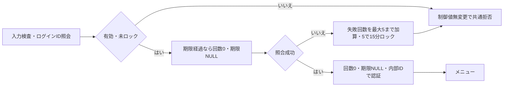
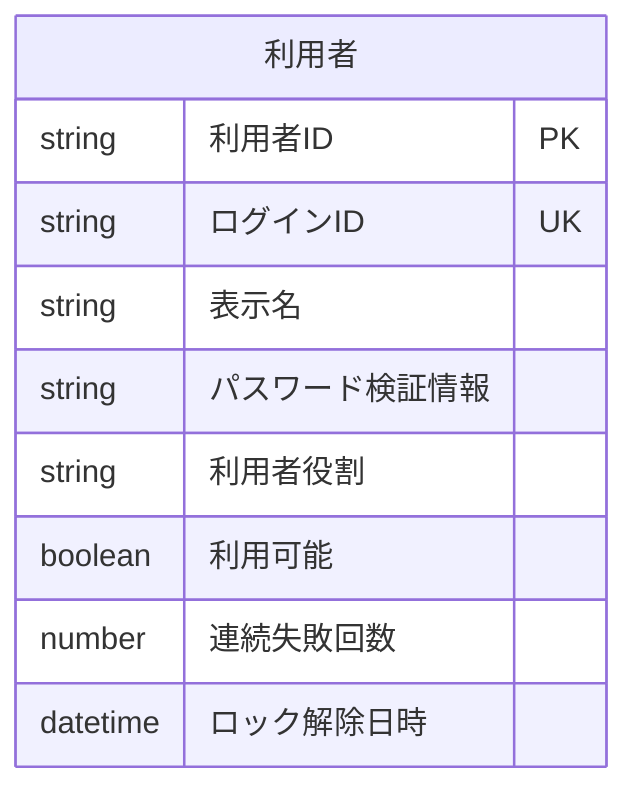

<!-- spec-meta: {"schema":"spec-md/1.0","documentId":"SP2-ACCESS-F01","version":"1.4","path":"sample-project2/spec/Access/基本設計書/01_ログイン画面.md","sheets":[{"heading":"概要","kind":"GRID","sheet":"01_概要"},{"heading":"項目一覧","kind":"LIST","sheet":"02_項目一覧","key":["項目ID"]},{"heading":"イベント仕様","kind":"GRID","sheet":"03_イベント仕様"},{"heading":"補足説明","kind":"GRID","sheet":"04_補足説明"}]} -->
# ログイン画面 基本設計書

| 項目 | 内容 |
| --- | --- |
| システム／機能ID | 社員経歴管理システム／F01 |
| 方式／版／日付 | Access／1.4／2026-10-28 |
| 読者・状態 | 顧客IT部門向けの基本設計。実装・DB実行・実機試験は未実施 |

## 概要

### 目的と入出力

ログインIDとパスワードを確認して、認証済み利用者だけを[メニュー](02_メニュー画面.md)へ進める。起動時および認証切れ後に表示する。管理者と担当者が使用し、入力は一回の認証要求として処理する。

永続DBは利用者のログインID（login_id）、内部利用者ID（user_id）、パスワード照合情報、有効状態、役割、失敗回数、ロック期限を参照し、失敗回数・ロック期限だけを更新する。パスワード原文を保存しない。認証主体と最後の操作時刻は一時的な認証状態で、外部ファイル入出力はない。利用者の追加、パスワード変更、外部認証連携は対象外。

### 画面設計

WinForms系のAccess固定単票フォーム。Label・TextBox・ComboBox・ListBox・CommandButton・標準タブを用い、HTMLは配置を示す媒体とする。1366×768 CSS px・100%を基準とする。ログイン欄を幅460pxにまとめ、ID20桁は240px、パスワードは320pxとする。Yu Gothic UIの11pt、入力高32px、ボタン高34pxを基準とする。入力エラーは欄の上に表示し、IDを保持してパスワードだけを消去する。初期フォーカスはログインID、Tab順はID→パスワード→ログイン→終了。

<!-- screen-html-start: F01 -->

<h3>社員経歴管理システム</h3>
ログインIDとパスワードを入力してください。

&nbsp;
<label for="sp2-login-id">ログインID</label><input id="sp2-login-id" class="id" data-item-id="F01-I01" data-max-scalars="20" autocomplete="username"><label for="sp2-login-pw">パスワード</label><input id="sp2-login-pw" class="pw" data-item-id="F01-I02" type="password" data-max-scalars="128" autocomplete="current-password">
<button class="primary" data-item-id="F01-I04">ログイン</button><button data-item-id="F01-I05">終了</button>

<!-- screen-html-end: F01 -->

通常・エラー・ロック中は同じ配置を使う。処理中はID・パスワード・操作を無効にし、二重送信を防ぐ。認証切れからの復帰では「認証が切れました。未保存の入力は保存されていません」を表示する。固定フォームが画面に収まらない時はフォーム全体のスクロールで操作に到達する。カードの積替えやレスポンシブ配置はしない。

## 項目一覧

| 項目ID | 項目グループ | 項目名 | コントロール | 必須 | 入力制限 | フォーマット | 初期値 | DBテーブル名 | DB項目名 | 備考 |
| --- | --- | --- | --- | --- | --- | --- | --- | --- | --- | --- |
| F01-I01 | 認証情報 | ログインID | TextBox | 〇 | 半角英数字20字 | - |  | 利用者 | ログインID | 大小文字を区別せず照合。前後空白除去・英字大文字化。 |
| F01-I02 | 認証情報 | パスワード | TextBox（パスワード） | 〇 | 12～128字 | 伏字 |  | 利用者 | パスワード検証情報 | 空白を含め加工しない。原文保存・再表示・ログ出力禁止。検証情報と照合。 |
| F01-I03 | 案内 | メッセージ | Label | - | - | - |  | - | - | 認証失敗は共通文言。 |
| F01-I04 | 操作 | ログイン | CommandButton | - | - | - | - | - | - | 認証成功でメニューへ。 |
| F01-I05 | 操作 | 終了 | CommandButton | - | - | - | - | - | - | 認証状態を破棄。 |

## イベント仕様

### F01-E01 ログイン

#### 処理概要

ID・パスワード・利用者の有効性を確認し、成功時に役割を持つ認証状態を作る。認証規則は[チェック・メッセージ設計](../共通/04_チェック・メッセージ設計.md)に従う。

#### 処理手順

1. 同じ画面の認証処理が実行中なら後続要求を開始せずMSG-029を表示する。今回の入力を固定し、送信後の追加操作で照合対象を差し替えない。
2. ログインID、パスワードの順に原入力の上限・形式を検査する。ログインIDは前後空白除去後の半角英数字1～20字、パスワードは加工せず12～128字。必須欠落はMSG-004、形式・上限はMSG-005に項目名を当てはめる。入力違反ではDBを更新しない。
3. 正規化したログインIDで利用者を0又は1件特定する。0件又は利用不可はMSG-001とし、認証制御の更新0件。複数一致・認証制御値の不整合も認証を成立させず、画面はMSG-001、内部では不整合の工程だけを記録する。
4. 得られた内部利用者IDの認証制御を排他する。排他取得後に利用可能・役割・検証情報・回数・ロック解除日時を再取得し、その判定用UTC時刻を1回取得する。待機中の成功・失敗・停止の変更を古い値で上書きしない。10秒の待ち上限超過は更新0件・外向きMSG-001とし、内部では待ち上限超過を記録する。
5. 利用不可へ変わっていればMSG-001。ロック解除日時が判定時刻より後ならロック中で、照合・加算・期限延長をすべて行わない。解除日時が判定時刻以下なら期限経過とし、回数0・解除日時未設定を今回の試行結果と同じ確定単位で扱う。日時の未設定と期限経過を区別する。
6. 未ロックの現検証情報に対してのみパスワードを照合する。失敗は排他内の現在回数に1加算し1～5を設定する。1～4は解除日時未設定、5は同じ判定時刻から15分を設定する。先行要求で既に5回・ロック中になっていれば、後続要求は手順5で拒否され、6回目を保存しない。
7. 照合成功でも、確定直前の利用可能と許可役割（ADMIN又はSTAFF）が有効である場合だけ回数0・解除日時未設定を確定する。停止・役割変更が先に確定していれば認証不成立とする。認証制御の排他と停止・役割変更は、同じ利用者の現在値を壊さない共通の確定境界に従う。
8. DB確定成功後にだけ内部利用者IDを主体とする認証状態を作り、表示名・役割・最後の操作時刻を設定してF02へ進む。既に回数0・解除日時未設定なら更新0件でも対象1件の有効確認を経て成功可。ID・役割・パスワード情報を変更しない。確定失敗なら認証状態0件で終了する。

チェックは表の判定順で行う。共通CHKとMSGの正本は[チェック・メッセージ設計](../共通/04_チェック・メッセージ設計.md)に置く。

| チェックID | 共通規則 | 判定順・条件 | 不成立MSG | 復帰・変更範囲 |
| --- | --- | --- | --- | --- |
| CHK-F01-01 | CHK-C02 | 1：認証要求が未実行又は終了済み | MSG-029 | 後続処理なし。既存要求を維持 |
| CHK-F01-02 | CHK-C03～C05 | 2：ID→パスワードの原入力・正規化後上限と必須 | MSG-004／MSG-005 | 該当欄。DB更新0件 |
| CHK-F01-03 | CHK-C01・C09 | 3：ログインIDの一意な対象と利用可能 | MSG-001 | ID保持、パスワード消去、認証なし |
| CHK-F01-04 | CHK-C12 | 4：10秒以内に利用者排他を取得し現在値を再読取り | MSG-001 | 全取消、ID保持、パスワード消去。内部原因を分離 |
| CHK-F01-05 | CHK-C01・C06 | 5：解除日時が未設定又は判定時刻以下 | MSG-001 | ロック中は照合・更新0件、延長なし |
| CHK-F01-06 | CHK-C10・C12 | 6：失敗回数0～5と期限の整合、直列加算 | MSG-001 | 不整合を自動修復せず取消、内部記録 |
| CHK-F01-07 | CHK-C01 | 7：成功確定直前も利用可・許可役割 | MSG-001 | 認証なし。停止・役割を変更しない |
| CHK-F01-08 | CHK-C12 | 8：認証制御の確定成功 | MSG-001 | 確定失敗で認証を発行しない |

#### 処理フロー

#### SQL・テーブル関連（ER図）

単表の論理ER図である。ログインIDで照合し、取得した利用者IDで認証制御の更新対象を固定する。利用可能・ロック解除日時・連続失敗回数を同じ利用者の現在値として検査し、更新対象は連続失敗回数とロック解除日時だけとする。他の業務表は読まない。PK/UKは論理上のキーであり、物理DDLを作成した意味ではない。

#### DB操作の詳細

論理テーブル「利用者」の認証制御だけを更新する。照合に使う「ログインID」と、更新対象を固定する「利用者ID」を分ける。社員・社員経歴・コードの変更は0件。パスワード原文はDBへ渡して保存せず、保存済みの「パスワード検証情報」と照合する。

| 操作ID | 操作・対象 | 特定条件・再確認 | 設定値・保持項目 | 期待件数 | 確定・取消 |
| --- | --- | --- | --- | --- | --- |
| F01-DB01 | 利用者の参照 | 入力ログインIDを英字大小を区別せず照合。取得した利用者IDで以後の対象を固定する | 取得は利用者ID・ログインID・表示名・パスワード検証情報・利用者役割・利用可能・連続失敗回数・ロック解除日時の8項目 | 0又は1件。2件以上は一意性不整合 | 0件/停止は共通拒否、制御属性も更新しない。取得障害では認証状態を作らない |
| F01-DB02 | 利用者のロック中判定 | 利用者ID一致・利用可能、有効なロック解除日時が現在より後 | 全項目を保持。照合・回数加算・期限延長を行わない | 更新0件 | ロック中の共通拒否。認証状態は作らない |
| F01-DB03 | 利用者の期限経過解除 | 利用者ID一致・利用可能、ロック解除日時が現在以下。同じ利用者の現在制御値を排他範囲で再確認 | 連続失敗回数=0、ロック解除日時=NULL。解除だけを別確定せず、今回の照合結果と一括で反映 | 対象1件 | F01-DB04又はDB05と一つの確定単位。途中障害は解除も取消 |
| F01-DB04 | 利用者の認証失敗更新 | 利用者ID一致・利用可能・未ロック。実際にパスワード照合を失敗した場合だけ | 現在回数+1（最大5）。結果5なら現在時刻+15分をロック解除日時へ、1～4なら未設定を維持 | 対象1件。0件/複数件は確定しない | 全体成功時だけ確定。競合している試行を直列化し加算喪失を防ぐ。更新失敗は取消・ログイン不成立 |
| F01-DB05 | 利用者の認証成功更新 | 利用者ID一致・利用可能・未ロック、照合成功。確定直前も停止/ロックの競合を確認 | 連続失敗回数=0、ロック解除日時=NULL。既に同値なら更新0件でもよい。その他の6項目は保持 | 変更あり1件、同値0件。対象消失は認証不成立 | DB確定後にだけ利用者ID・表示名・利用者役割を一時認証状態へ設定。確定失敗で認証を発行しない |

利用者ID・ログインID・表示名・パスワード検証情報・利用者役割・利用可能をこの機能から変更しない。通常の失敗/成功、期限経過の判定と更新は、同じ利用者の認証制御に対する排他の中で最新値を使う。社員保存用の更新版を認証制御へ流用しない。ロック期限経過の時刻判定は利用者排他の取得後に1回取得したUTCの判定時刻へ固定する。新規利用者の登録・削除、パスワード変更は対象外。

#### 結果・例外時の扱い

不明ID・停止・ロック・照合失敗・照会/確定障害はすべて外向きMSG-001とし、存在、停止理由、回数、解除時刻を画面へ返さない。内部では認証拒否・不整合・排他10秒超過・取得/確定障害を区別して受付番号と工程を記録し、秘密や入力原文を記録しない。IDは保持し、パスワードはすべての失敗経路で消去する。入力検査時のMSG-004/005は対象項目を示すが、利用者の存在とは結び付けない。

同時要求は排他取得順の結果とする。先行成功で回数0となった後の失敗は1、先行失敗で5となった後の成功入力はロック拒否となる。処理後に停止が確定した場合、発行済み状態だけを根拠に更新・出力を許可せず、各保護機能で現在の利用可能・役割を再確認する。認証発行後の全時点を一回の照合で保証したとはしない。

### F01-E02 終了

#### 処理概要

ログインを取り止め、入力と認証状態を消去する。

#### 処理手順

1. 認証処理中は終了操作を受け付けずMSG-029とし、認証更新を途中で切断しない。
2. 処理中でなければID・パスワード入力と一時認証状態を消去する。DBの連続失敗回数・解除日時は変更しない。
3. Accessアプリケーションを終了する。強制終了を失敗回数・ロック状態の解除手段にしない。

チェックは表の判定順で行う。共通CHKとMSGの正本は[チェック・メッセージ設計](../共通/04_チェック・メッセージ設計.md)に置く。

| チェックID | 共通規則 | 判定順・条件 | 不成立MSG | 復帰・変更範囲 |
| --- | --- | --- | --- | --- |
| CHK-F01-09 | CHK-C02 | 1：認証処理が終了している | MSG-029 | 現在の処理結果を待つ |
| CHK-F01-10 | CHK-C12 | 2～3：入力・認証状態のみを破棄 | - | DB参照・更新0件。以後は再認証 |

#### 処理フロー

#### SQL・テーブル関連（ER図）

DBなし。ER図は非適用。

#### DB操作の詳細

参照・更新とも0件。認証の失敗回数を終了操作で解除しない。

#### 結果・例外時の扱い

終了後は認証状態0件、DB参照・更新0件。業務画面の再表示にはF01の再認証を要求する。認証処理中はMSG-029で待機し、終了操作で失敗回数やロック解除日時をリセットしない。

## 補足説明

項目一覧の記号は、必須の〇＝必須、空欄＝任意、-＝判定対象外、条件付＝備考の条件成立時に必須。真偽は〇＝true、空欄＝false。初期値の空欄は空値・未選択、-は初期値なし。文字数・入力状態・編集時の値・操作可否の共通規則は[共通UI・入力設計](../共通/03_共通UI・入力設計.md)に従う。

無操作30分で認証を失効させる。編集中データを自動保存せず、破棄された旨をログイン画面へ示す。正常ログアウト時の未保存確認は[メニュー](02_メニュー画面.md)に従う。DEMOの初期ログインIDは `demoadmin`（管理者）と `demostaff`（担当者）とし、パスワードは初期化時に別途設定して原文を仕様へ埋め込まない。DEMO用のアプリ認証であり、運用環境・資格情報の用意は[プロジェクト情報](../プロジェクト情報.md)で扱う。

基本設計の自己確認は、必須欠落、大小文字、12/128文字、空白入りパスワード、5回失敗、15分経過、有効停止、認証切れを対象とする。これらの実機確認は未実施。

Accessの画面操作による役割判定はDEMO用である。ACCDBへ直接書き込める利用者に対する強い権限境界を保証しない。ブラウザーでの仕様モック確認とAccessフォーム・IME・Office環境での実機確認は別であり、実機は未確認。

HTMLの `data-max-scalars` は業務上限の説明属性とする。文字数の計測・上限検査は[共通UI・入力設計](../共通/03_共通UI・入力設計.md)に従い、受理範囲を狭めず、上限超過を切り捨てない。原文を保持したまま該当欄へ戻す。

### Pilot確認シナリオ（設計・未実施）

1. CHK-F01-04～08：失敗回数3の同じ利用者へ失敗2要求を重ねる。排他順に4→5となり期限は5回目の判定時刻+15分。後続の正しい入力も期限前は更新0件・MSG-001で、回数6・期限延長・認証発行がない。
2. CHK-F01-05：解除日時の直前、完全一致、直後を比較する。直前は照合0回、一致/直後は回数0から今回試行。失敗なら1、成功なら0・解除日時未設定。UTCの比較に端末表示の丸めを使わない。
3. CHK-F01-07～08：照合成功と利用者停止・役割変更・確定障害を競合させる。先に停止が確定した時は認証なし。成功確定が先でも次の更新/出力の現在値確認で停止を拒否する。DB確定失敗をログイン成功にしない。
