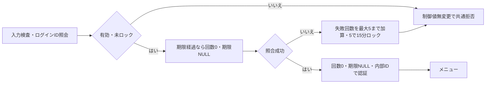
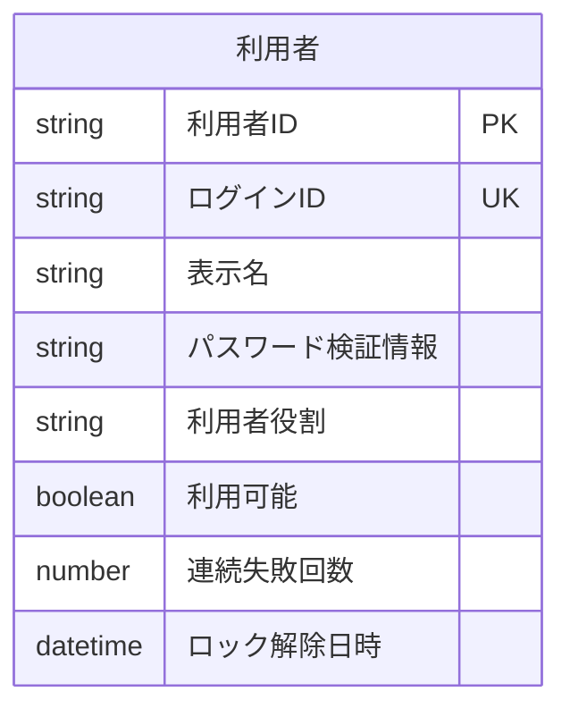

<!-- spec-meta: {"schema":"spec-md/1.0","documentId":"SP2-ACCESS-F01","version":"1.2","path":"sample-project2/spec/Access/基本設計書/01_ログイン画面.md","sheets":[{"heading":"概要","kind":"GRID","sheet":"01_概要"},{"heading":"項目一覧","kind":"LIST","sheet":"02_項目一覧","key":["項目ID"]},{"heading":"イベント仕様","kind":"GRID","sheet":"03_イベント仕様"},{"heading":"補足説明","kind":"GRID","sheet":"04_補足説明"}]} -->
# ログイン画面 基本設計書

| 項目 | 内容 |
| --- | --- |
| システム／機能ID | 社員経歴管理システム／F01 |
| 方式／版／日付 | Access／1.2／2026-10-28 |
| 読者・状態 | 顧客IT部門向けの基本設計。実装・DB実行・実機試験は未実施 |

## 概要

### 目的と入出力

ログインIDとパスワードを確認して、認証済み利用者だけを[メニュー](02_メニュー画面.md)へ進める。起動時および認証切れ後に表示する。管理者と担当者が使用し、入力は一回の認証要求として処理する。

永続DBは利用者のログインID（login_id）、内部利用者ID（user_id）、パスワード照合情報、有効状態、役割、失敗回数、ロック期限を参照し、失敗回数・ロック期限だけを更新する。パスワード原文を保存しない。認証主体と最後の操作時刻は一時的な認証状態で、外部ファイル入出力はない。利用者の追加、パスワード変更、外部認証連携は対象外。

### 画面設計

WinForms系のAccess固定単票フォーム。Label・TextBox・ComboBox・ListBox・CommandButton・標準タブを用い、HTMLは配置を示す媒体とする。1366×768 CSS px・100%を基準とする。ログイン欄を幅460pxにまとめ、ID20桁は240px、パスワードは320pxとする。Yu Gothic UIの11pt、入力高32px、ボタン高34pxを基準とする。入力エラーは欄の上に表示し、IDを保持してパスワードだけを消去する。初期フォーカスはログインID、Tab順はID→パスワード→ログイン→終了。

<!-- screen-html-start: F01 -->

<h3>社員経歴管理システム</h3>
ログインIDとパスワードを入力してください。

&nbsp;
<label for="sp2-login-id">ログインID</label><input id="sp2-login-id" class="id" data-item-id="F01-I01" data-max-scalars="20" autocomplete="username"><label for="sp2-login-pw">パスワード</label><input id="sp2-login-pw" class="pw" data-item-id="F01-I02" type="password" data-max-scalars="128" autocomplete="current-password">
<button class="primary" data-item-id="F01-I04">ログイン</button><button data-item-id="F01-I05">終了</button>

<!-- screen-html-end: F01 -->

通常・エラー・ロック中は同じ配置を使う。処理中はID・パスワード・操作を無効にし、二重送信を防ぐ。認証切れからの復帰では「認証が切れました。未保存の入力は保存されていません」を表示する。固定フォームが画面に収まらない時はフォーム全体のスクロールで操作に到達する。カードの積替えやレスポンシブ配置はしない。

## 項目一覧

| 項目ID | 項目グループ | 項目名 | コントロール | 必須 | 入力制限 | フォーマット | 初期値 | DBテーブル名 | DB項目名 | 備考 |
| --- | --- | --- | --- | --- | --- | --- | --- | --- | --- | --- |
| F01-I01 | 認証情報 | ログインID | TextBox | 〇 | 半角英数字20文字以内、入力可 | 文字列 | 初回は空 | 利用者 | ログインID | 扱い：入力・表示。ログイン照合に使用。未設定時：エラー。大小文字を区別せず照合。前後空白を除去し英字を大文字化。 |
| F01-I02 | 認証情報 | パスワード | TextBox（パスワード） | 〇 | 12～128文字、空白を含め入力可 | 伏字表示 | 初回は空 | 利用者 | パスワード検証情報 | 扱い：入力。原文保存なし。入力を加工しない。未設定時：エラー。空白を含めて加工しない。再表示・ログ出力禁止。入力したパスワード原文は保存せず、検証情報との照合にだけ使用する。 |
| F01-I03 | 案内 | メッセージ | Label | 非該当 | 編集不可 | 非該当 | 初回は空 | 非該当 | 非該当 | 扱い：表示のみ。条件：常時表示領域。未設定時：空領域。認証失敗の理由を識別できない共通文言。 |
| F01-I04 | 操作 | ログイン | CommandButton | 非該当 | 非該当 | 非該当 | 初期有効 | 非該当 | 非該当 | 扱い：操作。条件：入力可能時。認証成功時だけメニューへ遷移。 |
| F01-I05 | 操作 | 終了 | CommandButton | 非該当 | 非該当 | 非該当 | 初期有効 | 非該当 | 非該当 | 扱い：操作。条件：処理中以外。認証状態を破棄して終了案内。 |

## イベント仕様

### F01-E01 ログイン

#### 処理概要

ID・パスワード・利用者の有効性を確認し、成功時に役割を持つ認証状態を作る。認証規則は[チェック・メッセージ設計](../共通/04_チェック・メッセージ設計.md)に従う。

#### 処理手順

1. 必須・長さ・ログインID形式を検査する。パスワードは正規化しない。
2. 指定ログインID（login_id）で利用者を一件照会する。存在しない・無効な利用者は共通拒否し、認証制御情報を更新しない。
3. 有効な利用者でもロック期限が現在時刻より後なら共通拒否する。この場合はパスワード照合・失敗数加算・期限延長を一切行わない。
4. ロック期限を経過している場合は、失敗回数を0、ロック期限をNULLに戻してから新しい試行として照合する。期限と現在時刻が同じ場合も期限経過とする。
5. 未ロック状態で実際にパスワード照合を失敗した場合だけ失敗回数を1加算する。上限は5で、5回目に現在時刻から15分のロック期限を設定する。6以上にしない。
6. 成功時は失敗回数0・ロック期限NULLとし、内部利用者ID（user_id）を認証主体として表示名・役割・操作時刻とともに認証状態へ設定してメニューへ進む。入力ログインIDを内部利用者IDの代わりに使わない。

#### 処理フロー

#### SQL・テーブル関連（ER図）

単表の論理ER図である。ログインIDで照合し、取得した利用者IDで認証制御の更新対象を固定する。利用可能・ロック解除日時・連続失敗回数を同じ利用者の現在値として検査し、更新対象は連続失敗回数とロック解除日時だけとする。他の業務表は読まない。PK/UKは論理上のキーであり、物理DDLを作成した意味ではない。

#### DB操作の詳細

論理テーブル「利用者」の認証制御だけを更新する。照合に使う「ログインID」と、更新対象を固定する「利用者ID」を分ける。社員・社員経歴・コードの変更は0件。パスワード原文はDBへ渡して保存せず、保存済みの「パスワード検証情報」と照合する。

| 操作ID | 操作・対象 | 特定条件・再確認 | 設定値・保持項目 | 期待件数 | 確定・取消 |
| --- | --- | --- | --- | --- | --- |
| F01-DB01 | 利用者の参照 | 入力ログインIDを英字大小を区別せず照合。取得した利用者IDで以後の対象を固定する | 取得は利用者ID・ログインID・表示名・パスワード検証情報・利用者役割・利用可能・連続失敗回数・ロック解除日時の8項目 | 0又は1件。2件以上は一意性不整合 | 0件/停止は共通拒否、制御属性も更新しない。取得障害では認証状態を作らない |
| F01-DB02 | 利用者のロック中判定 | 利用者ID一致・利用可能、有効なロック解除日時が現在より後 | 全項目を保持。照合・回数加算・期限延長を行わない | 更新0件 | ロック中の共通拒否。認証状態は作らない |
| F01-DB03 | 利用者の期限経過解除 | 利用者ID一致・利用可能、ロック解除日時が現在以下。同じ利用者の現在制御値を排他範囲で再確認 | 連続失敗回数=0、ロック解除日時=NULL。解除だけを別確定せず、今回の照合結果と一括で反映 | 対象1件 | F01-DB04又はDB05と一つの確定単位。途中障害は解除も取消 |
| F01-DB04 | 利用者の認証失敗更新 | 利用者ID一致・利用可能・未ロック。実際にパスワード照合を失敗した場合だけ | 現在回数+1（最大5）。結果5なら現在時刻+15分をロック解除日時へ、1～4なら未設定を維持 | 対象1件。0件/複数件は確定しない | 全体成功時だけ確定。競合している試行を直列化し加算喪失を防ぐ。更新失敗は取消・ログイン不成立 |
| F01-DB05 | 利用者の認証成功更新 | 利用者ID一致・利用可能・未ロック、照合成功。確定直前も停止/ロックの競合を確認 | 連続失敗回数=0、ロック解除日時=NULL。既に同値なら更新0件でもよい。その他の6項目は保持 | 変更あり1件、同値0件。対象消失は認証不成立 | DB確定後にだけ利用者ID・表示名・利用者役割を一時認証状態へ設定。確定失敗で認証を発行しない |

利用者ID・ログインID・表示名・パスワード検証情報・利用者役割・利用可能をこの機能から変更しない。通常の失敗/成功、期限経過の判定と更新は、同じ利用者の認証制御に対する排他の中で最新値を使う。社員保存用の更新版を認証制御へ流用しない。ロック期限経過の時刻判定は同じ処理で取得したUTCの現在時刻に固定する。新規利用者の登録・削除、パスワード変更は対象外。

#### 結果・例外時の扱い

成功時だけメニューを表示する。不明ID、無効、誤パスワード、ロック中は「ログインできません。入力内容を確認し、時間をおいて再度お試しください」。残り回数やIDの存在は表示しない。システム障害は別の共通障害文言とし、ID保持・パスワード消去・再入力へ戻す。

### F01-E02 終了

#### 処理概要

ログインを取り止め、入力と認証状態を消去する。

#### 処理手順

入力を消去し、認証状態があれば破棄してAccessアプリケーションを終了する。

#### 処理フロー

#### SQL・テーブル関連（ER図）

DBなし。ER図は非適用。

#### DB操作の詳細

参照・更新とも0件。認証の失敗回数を終了操作で解除しない。

#### 結果・例外時の扱い

終了案内から業務画面を再表示しても再認証を要求する。処理中は終了を受け付けず結果を待つ。

## 補足説明

項目一覧は、項目ID・項目グループ・項目名・コントロール・必須・入力制限・フォーマット・初期値・DBテーブル名・DB項目名・備考の11列とする。必須は、〇＝必須、任意＝省略可、条件付き＝備考の条件成立時に必須、一部必須＝複合項目のうち備考で示す部分だけ必須、非該当＝操作や案内など値の必須判定対象外。入力制限には許容文字・上限・編集可否、フォーマットには入出力の書式、初期値には新規・初回と編集時の値または操作の初期有効／無効を示す。表示値の編集不可と操作に対する入力制限の非該当を区別し、選択候補の条件は備考に記す。フォーマット非該当は特別な入力・表示書式を定めない案内・操作・タブを示す。DB関連は論理名を維持し、複数表は備考の参照条件と対応付ける。条件付き必須・候補条件・保存・正規化・未設定時の扱いは備考に保持する。

無操作30分で認証を失効させる。編集中データを自動保存せず、破棄された旨をログイン画面へ示す。正常ログアウト時の未保存確認は[メニュー](02_メニュー画面.md)に従う。DEMOの初期ログインIDは `demoadmin`（管理者）と `demostaff`（担当者）とし、パスワードは初期化時に別途設定して原文を仕様へ埋め込まない。DEMO用のアプリ認証であり、運用環境・資格情報の用意は[プロジェクト情報](../プロジェクト情報.md)で扱う。

基本設計の自己確認は、必須欠落、大小文字、12/128文字、空白入りパスワード、5回失敗、15分経過、有効停止、認証切れを対象とする。これらの実機確認は未実施。

Accessの画面操作による役割判定はDEMO用である。ACCDBへ直接書き込める利用者に対する強い権限境界を保証しない。ブラウザーでの仕様モック確認とAccessフォーム・IME・Office環境での実機確認は別であり、実機は未確認。

HTMLの `data-max-scalars` は業務上限の説明属性とする。文字数の計測・上限検査は[共通UI・入力設計](../共通/03_共通UI・入力設計.md)に従い、受理範囲を狭めず、上限超過を切り捨てない。原文を保持したまま該当欄へ戻す。
