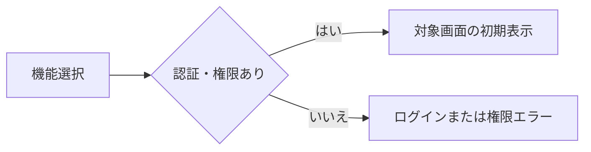
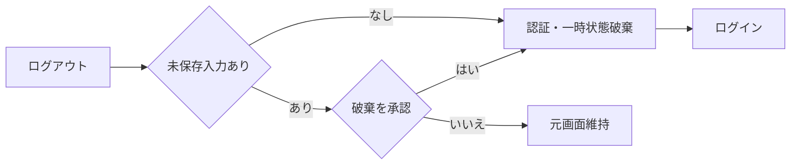

<!-- spec-meta: {"schema":"spec-md/1.0","documentId":"SP2-ACCESS-F02","version":"1.0","path":"sample-project2/spec/Access/基本設計書/02_メニュー画面.md","sheets":[{"heading":"概要","kind":"GRID","sheet":"01_概要"},{"heading":"項目一覧","kind":"LIST","sheet":"02_項目一覧","key":["項目ID"]},{"heading":"イベント仕様","kind":"GRID","sheet":"03_イベント仕様"},{"heading":"補足説明","kind":"GRID","sheet":"04_補足説明"}]} -->
# メニュー画面 基本設計書

| 項目 | 内容 |
| --- | --- |
| システム／機能ID | 社員経歴管理システム／F02 |
| 方式／版／日付 | Access／1.0／2026-10-27 |
| 読者・状態 | 顧客IT部門向け基本設計。実装・DB実行・実機試験は未実施 |

## 概要

### 目的と入出力

[ログイン](01_ログイン画面.md)成功後に、[社員検索](03_社員検索画面.md)または[汎用コードマスタ](06_汎用コードマスタ画面.md)を起動する。社員登録と経歴書作成は社員検索から開始し、メニューに重複した起動操作を設けない。担当者は社員検索、管理者は両機能を利用する。

利用者名と役割は一時的な認証状態から表示する。永続DB・外部ファイルの入出力はない。利用者管理、ダッシュボード、通知は対象外。未認証の起動はログインへ戻す。

### 画面設計

WinForms系のAccess固定単票フォーム。Label・TextBox・ComboBox・ListBox・CommandButton・標準タブを用い、HTMLは配置を示す媒体とする。1366×768 CSS px・100%。機能ボタンを左上から縦に並べ、利用者とログアウトを同じ画面に置く。Yu Gothic UI 11pt、ボタン高36px。初期フォーカスは社員検索、Tab順は社員検索→汎用コードマスタ（管理者のみ）→ログアウト。

<!-- screen-html-start: F02 -->

<h3>社員経歴管理システム</h3>デモ管理者／管理者<button data-item-id="F02-I04">ログアウト</button>

<button data-item-id="F02-I02">社員検索</button>
社員の検索・登録・経歴書Excelの作成
<button data-item-id="F02-I03">汎用コードマスタ</button>
部署・役割などの選択候補の管理

<!-- screen-html-end: F02 -->

担当者には汎用コードマスタ操作と説明を表示しない。処理中は起動操作を無効にする。エラーは下段のメッセージ領域へ表示する。固定フォームの拡大時はフォーム全体のスクロールで操作に到達する。Webのレスポンシブ配置にはしない。

## 項目一覧

| 項目ID | 論理項目名 | 入力・表示・保存 | raw上限 | 正規化・保存上限 | 単位 | 必須・条件 | 初期値 | 未設定時 | 関連DB項目 | 候補元・制約 |
| --- | --- | --- | --- | --- | --- | --- | --- | --- | --- | --- |
| F02-I01 | 利用者名・役割 | 表示のみ | 非適用 | 非適用 | 非適用 | 認証済み | 認証状態の値 | ログインへ戻る | 利用者.表示名・役割の認証時情報 | 認証状態を参照 |
| F02-I02 | 社員検索 | 操作 | 非適用 | 非適用 | 非適用 | 管理者・担当者 | 操作可 | 非適用 | 非適用 | F03へ遷移 |
| F02-I03 | 汎用コードマスタ | 操作 | 非適用 | 非適用 | 非適用 | 管理者のみ | 管理者に表示 | 担当者は非表示 | 非適用 | F06へ遷移。起動先でも権限検査 |
| F02-I04 | ログアウト | 操作 | 非適用 | 非適用 | 非適用 | 認証済み | 操作可 | 非適用 | 非適用 | 認証状態を破棄 |
| F02-I05 | メッセージ | 表示のみ | 非適用 | 非適用 | 非適用 | 常設 | 空 | 空領域 | 非適用 | 起動不可・認証失効案内 |

## イベント仕様

### F02-E01 機能起動

#### 処理概要

選択機能を認証状態と役割で検査し、許可された画面を初期状態で表示する。

#### 処理手順

認証の有効期限を検査する。社員検索は管理者・担当者、汎用コードマスタは管理者に限って許可する。遷移先へ利用者の認証状態を引き継ぐ。検索結果や未保存データをメニューから新規に生成しない。

#### 処理フロー

#### SQL・テーブル関連（ER図）

認証状態の検査のみでDB操作なし。ER図は非適用。

#### DB操作の詳細

メニュー内のDB参照・更新は0件。遷移先が必要な情報を自機能の初期表示イベントで取得する。

#### 結果・例外時の扱い

認証切れはログインへ戻す。権限不足はメニューに残して「この機能を利用する権限がありません」。画面の表示制御だけで権限を保証せず、起動先でも検査する。

### F02-E02 ログアウト

#### 処理概要

認証状態、検索条件・結果・選択、一時入力を破棄してログイン画面へ戻る。各業務画面の共通ログアウト操作にも同じ契約を適用する。

#### 処理手順

未保存入力がある場合は「保存されていない入力を破棄してログアウトしますか」を確認する。取消なら元画面・入力を維持する。承認なら入力と認証状態を破棄する。メニューに未保存入力はないため確認なしで終了する。

#### 処理フロー

#### SQL・テーブル関連（ER図）

DBなし。未保存の社員・経歴・コードを更新しないためER図は非適用。

#### DB操作の詳細

DB参照・更新0件。未保存データの確定処理を暗黙に実行しない。

#### 結果・例外時の扱い

ログアウト後に業務フォームを直接開こうとしても認証を要求する。無操作30分の失効は破棄確認を待たず認証を終了し、未保存内容が保存されていない旨を通知する。

## 補足説明

権限の正本は[システム概要](../共通/01_システム概要.md)、画面操作の共通契約は[共通UI・入力設計](../共通/03_共通UI・入力設計.md)。担当者の管理機能直接起動、ログアウト後の戻る操作、認証失効は将来の確認観点であり実機未実施。

Accessの画面操作による役割判定はDEMO用である。ACCDBへ直接書き込める利用者に対する強い権限境界を保証しない。ブラウザーでの仕様モック確認とAccessフォーム・IME・Office環境での実機確認は別であり、実機は未確認。
