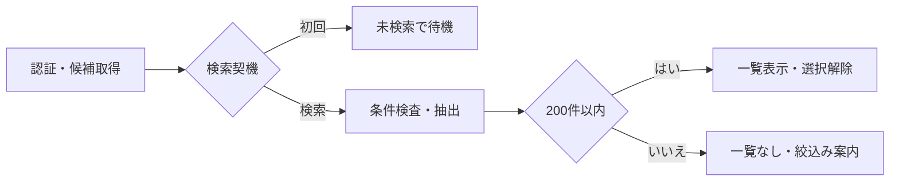
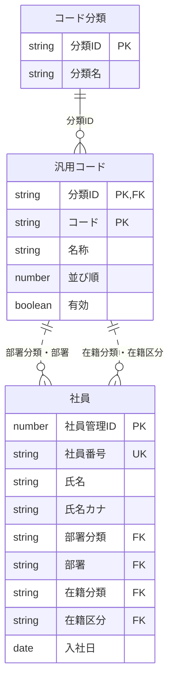
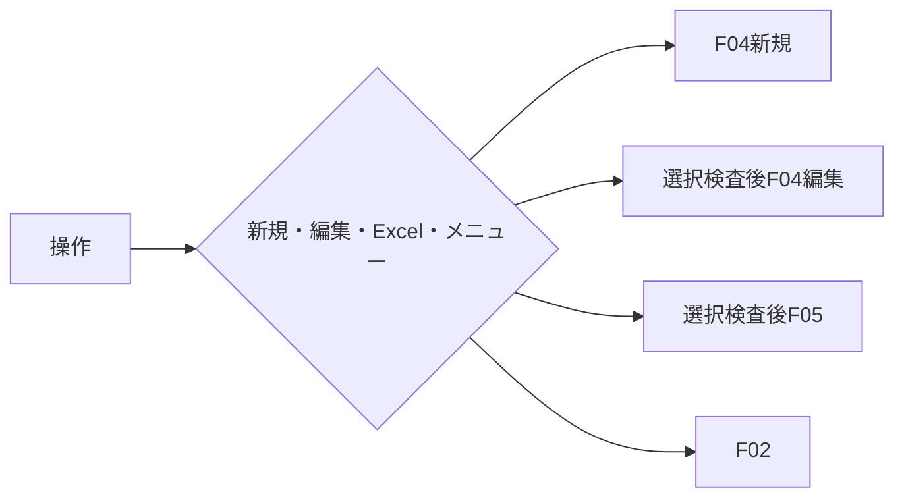

<!-- spec-meta: {"schema":"spec-md/1.0","documentId":"SP2-ACCESS-F03","version":"1.1","path":"sample-project2/spec/Access/基本設計書/03_社員検索画面.md","sheets":[{"heading":"概要","kind":"GRID","sheet":"01_概要"},{"heading":"項目一覧","kind":"LIST","sheet":"02_項目一覧","key":["項目ID"]},{"heading":"イベント仕様","kind":"GRID","sheet":"03_イベント仕様"},{"heading":"補足説明","kind":"GRID","sheet":"04_補足説明"}]} -->
# 社員検索画面 基本設計書

| 項目 | 内容 |
| --- | --- |
| システム／機能ID | 社員経歴管理システム／F03 |
| 方式／版／日付 | Access／1.1／2026-10-27 |
| 読者・状態 | 顧客IT部門向け基本設計。実装・DB実行・実機試験は未実施 |

## 概要

### 目的と入出力

[メニュー](02_メニュー画面.md)から社員を探し、[社員登録](04_社員登録画面.md)の新規・編集、または[経歴書Excel出力](05_経歴書出力.md)を開始する。管理者・担当者が使用する。検索条件は社員番号・氏名・部署・在籍区分の4条件に限る。経歴のキーワード検索、一括出力、社員の削除は対象外。

永続DBは社員、部署・在籍区分に対応する汎用コード、コード分類を参照する。検索では更新しない。条件・結果・選択社員は一時情報である。外部ファイル出力はF05を明示操作した時のxlsx一件のみで、検索自体にはない。

### 検索条件と結果

社員番号は6桁の半角数字で完全一致。氏名は前後空白を除いて、照合時だけNFKC・空白除去・英字大小無視で社員氏名または氏名カナに部分一致する。部署と在籍区分は選択値一致。指定された4条件をANDで結合し、未指定は制約にしない。氏名の記号を検索演算子として扱わない。

初回は在籍区分「01 在職」、他は未指定で検索未実行。全条件未指定で検索可能。結果は社員番号昇順で最大200件、ページングなし・一覧内スクロールとする。上限超過時は一部を表示せず条件絞込みを案内する。検索条件を一つでも変更した時点で旧結果と選択を解除し、「条件が変更されました。検索してください」を表示する。

### 画面設計

WinForms系のAccess固定単票フォーム。Label・TextBox・ComboBox・ListBox・CommandButton・標準タブを用い、HTMLは配置を示す媒体とする。1366×768 CSS px・100%で条件・操作・一覧を同じ画面に置く。Yu Gothic UI 11pt、入力高32px、ボタン高34px。社員番号は110px、氏名は220px、コード選択は180px。一覧は複数列ListBoxの単一選択とし、HTMLの表は列配置だけを示す。行内ボタン・複数行セルを作らない。長い氏名・部署名はListBoxの水平移動または選択時の全文表示で到達可能とする。新規登録は未選択でも可、編集・Excelは検索後の一人選択時だけ可。

<!-- screen-html-start: F03 -->

<h3>社員検索</h3>デモ担当者 <button data-item-id="F03-I13">メニュー</button>

<label>社員番号 <input class="no" data-item-id="F03-I01" data-max-scalars="6"></label><label>氏名・氏名カナ <input class="name" data-item-id="F03-I02" data-max-scalars="40"></label><label>部署 <select data-item-id="F03-I03"><option>すべて</option><option>01 開発</option></select></label><label>在籍区分 <select data-item-id="F03-I04"><option>01 在職</option><option>すべて</option></select></label><button class="primary" data-item-id="F03-I05">検索</button><button data-item-id="F03-I06">クリア</button>

検索結果：2件<button data-item-id="F03-I10">新規登録</button> <button data-item-id="F03-I11">編集</button> <button data-item-id="F03-I12">経歴書Excel</button>

<table><thead><tr><th style="width:45px">選択</th><th style="width:100px">社員番号</th><th style="width:210px">氏名</th><th style="width:200px">氏名カナ</th><th style="width:140px">部署</th><th style="width:100px">在籍</th><th>入社日</th></tr></thead><tbody><tr class="selected"><td>●</td><td>000001</td><td>山田 太郎</td><td>ヤマダ タロウ</td><td>開発</td><td>在職</td><td>2020-04-01</td></tr><tr><td>○</td><td>000002</td><td>佐藤 花子</td><td>サトウ ハナコ</td><td>基盤</td><td>在職</td><td>2022-04-01</td></tr></tbody></table>

選択：000001 山田 太郎

<!-- screen-html-end: F03 -->

図は検索済みの架空例。初回・クリア・条件変更後は0件と誤表示せず「未検索」とし、一覧を空にして編集・Excelを無効にする。0件は「該当する社員がいません」。処理中は条件と二重操作を無効にする。エラー後は条件を保持し、選択なしへ戻す。Tab順は4条件→検索→クリア→新規→編集→Excel→一覧→メニュー。固定フォームの拡大時はフォーム全体のスクロールで操作に到達する。レスポンシブ配置にはしない。

## 項目一覧

| 項目ID | 項目名 | 必須 | DBテーブル名（論理名） | DB項目名（論理名） | 備考 |
| --- | --- | --- | --- | --- | --- |
| F03-I01 | 社員番号条件 | 任意 | 社員 | 社員番号 | 扱い：入力・一時保持。指定時は半角数字6桁。条件：指定時6桁。初期値：空。未設定時：全社員。先頭ゼロ保持・完全一致。 |
| F03-I02 | 氏名条件 | 任意 | 社員 | 氏名・氏名カナ | 扱い：入力・一時保持。40文字以内（Unicodeスカラー値）。初期値：空。未設定時：全社員。表記を保持。照合だけ正規化し部分一致。 |
| F03-I03 | 部署条件 | 任意 | 社員 汎用コード コード分類 | 社員：部署分類・部署 汎用コード：分類ID・コード・名称 コード分類：分類ID・分類名 | 扱い：選択・一時保持。半角数字2桁以内。初期値：未指定。未設定時：全部署。DEPARTMENTの有効コード、停止既存も検索用候補に表示。並び順→コード順。 |
| F03-I04 | 在籍区分条件 | 任意 | 社員 汎用コード コード分類 | 社員：在籍分類・在籍区分 汎用コード：分類ID・コード・名称 コード分類：分類ID・分類名 | 扱い：選択・一時保持。半角数字2桁以内。初期値：01 在職。未設定時：全区分。EMPLOYMENT_STATUSの固定3値と「すべて」。 |
| F03-I05 | 検索 | 非該当 | 非該当 | 非該当 | 扱い：操作。条件：認証済み。初期値：操作可。条件を確定し再検索。 |
| F03-I06 | クリア | 非該当 | 非該当 | 非該当 | 扱い：操作。条件：処理中以外。初期値：操作可。初期条件・未検索へ戻す。 |
| F03-I07 | 件数・検索状態 | 非該当 | 社員 | 社員管理ID | 扱い：表示。範囲・上限：0～200件。条件：常設。初期値：未検索。未設定時：未検索。未検索・0件・取得件数・上限超過を区別。。件数は取得済み社員結果の行数から算出し、未検索・処理中・上限超過などの検索状態は画面の一時状態で管理する |
| F03-I08 | 社員一覧・選択 | 非該当 | 社員 汎用コード | 社員：社員管理ID・社員番号・氏名・氏名カナ・部署分類・部署・在籍分類・在籍区分・入社日 汎用コード：分類ID・コード・名称 | 扱い：表示・単一選択。範囲・上限：200行。条件：検索成功時のみ。初期値：空。未設定時：編集・Excel不可。社員番号昇順。内部番号は非表示で保持。 |
| F03-I09 | 選択・メッセージ | 非該当 | 社員 | 社員番号・氏名 | 扱い：表示。条件：常設。初期値：未検索案内。未設定時：空領域。長い選択社員名も全文到達可能。。選択表示は検索結果の社員番号・氏名を用い、メッセージ文そのものはDB項目ではない。表示のための追加DB参照はしない |
| F03-I10 | 新規登録 | 非該当 | 非該当 | 非該当 | 扱い：操作。条件：認証済み。初期値：操作可。F04新規へ遷移。 |
| F03-I11 | 編集 | 非該当 | 社員 | 社員管理ID | 扱い：操作。条件：検索後一人選択。初期値：無効。未設定時：無効。F04で最新値を再取得。遷移時は検索結果の社員管理IDだけを渡し、編集データはF04で再取得する。 |
| F03-I12 | 経歴書Excel | 非該当 | 社員 | 社員管理ID | 扱い：操作。条件：検索後一人選択。初期値：無効。未設定時：無効。F05呼出。最新の保存済み情報を再取得し、経歴0件等をF05で検査。遷移時は検索結果の社員管理IDだけを渡し、帳票データはF05で一貫再取得する。 |
| F03-I13 | メニュー | 非該当 | 非該当 | 非該当 | 扱い：操作。条件：処理中以外。初期値：操作可。F02へ戻る。 |

## イベント仕様

### F03-E01 初期表示・検索

#### 処理概要

初回は候補だけを取得し、検索操作時に社員を条件で絞り込む。新規・編集から保存成功で戻った場合は保持した条件で再検索し、条件に合致する場合だけ保存社員を再選択する。

#### 処理手順

1. 認証を検査し、部署・在籍区分の候補を分類とともに取得する。
2. 初回は初期条件で待機する。検索時に社員番号6桁・氏名40文字・候補の存在を検査する。
3. 指定された条件をANDで適用し、社員氏名またはカナへの氏名部分一致を加える。
4. 件数が200を超えた場合は一覧を出さず絞込みを案内する。200以内なら社員番号昇順で一覧を設定し選択を解除する。

#### 処理フロー

#### SQL・テーブル関連（ER図）

図は本検索が読む3テーブルの論理ER図である。PK・UK・FKは基本設計上の主キー・一意性・論理参照を表し、採用DBの物理制約やJOIN構文を作成済みという意味ではない。汎用コードは部署用と在籍用の2回の名称参照に使う。同じコード「01」でも分類が違えば別行として扱う。

| 関係・参照用途 | 元テーブル・論理項目 | 参照先テーブル・論理項目 | 結合条件・扱い |
| --- | --- | --- | --- |
| 分類の存在・表示名称 | 汎用コード.分類ID | コード分類.分類ID | 分類IDの一致。部署/在籍の分類名を候補見出しに使う |
| 部署名称 | 社員.部署分類・部署 | 汎用コード.分類ID・コード | 部署分類はDEPARTMENTに固定し、2項目の組が一致する1行を参照 |
| 在籍名称 | 社員.在籍分類・在籍区分 | 汎用コード.分類ID・コード | 在籍分類はEMPLOYMENT_STATUSに固定し、2項目の組が一致する1行を参照 |

上表の参照整合と、検索表示用の名称結合は別の責務である。名称参照を理由に停止済み部署の社員を検索から除外しない。参照先が欠ける不整合は、社員を黙って除外して0件や少ない件数とせず取得失敗として案内する。社員経歴と利用者の業務データは本検索で取得しない。社員経歴は編集開始時のF04、帳票作成時のF05が社員管理IDで別途再取得する。

#### DB操作の詳細

初回表示は候補だけを読み、社員検索は実行しない。検索時は次の参照を一つの検索結果として組み立てる。すべて参照操作で、社員・社員経歴・コード分類・汎用コードへの追加/更新/削除は0件である。

| 参照単位 | 対象テーブル（論理名） | 抽出条件・キー | 取得項目（論理名） | 件数・順序・結果の設定先 |
| --- | --- | --- | --- | --- |
| 分類確認 | コード分類 | 分類IDがDEPARTMENTまたはEMPLOYMENT_STATUS | 分類ID、分類名 | 対象2分類が揃うこと。部署→在籍の固定順で候補見出しへ設定。不足時は検索を開始しない |
| 選択候補 | 汎用コード | 上記2分類に属する行。部署は停止行も含み、在籍は固定3値 | 分類ID、コード、名称、並び順、有効 | 部署は最大99件、在籍は3件。分類ごと並び順昇順→コード昇順。選択値としてコード、表示には名称と必要な停止表示を使う |
| 社員候補 | 社員 | 社員番号の完全一致、氏名/氏名カナ照合値の部分一致、部署一致、在籍区分一致のうち指定された条件をANDで適用 | 社員管理ID、社員番号、氏名、氏名カナ、部署分類、部署、在籍分類、在籍区分、入社日 | 社員番号昇順。201件目の有無までを判定し、200件以下だけを一覧へ渡す。氏名/カナの照合規則は共通UI・入力設計に従う |
| 一覧の名称解決 | 汎用コード | 上記ERの部署・在籍の複合参照。各社員につき各用途1行 | 部署用の名称、在籍用の名称 | 停止済み部署も名称を表示。参照不足・複数一致は不整合として結果を表示しない |

検索条件の未指定は該当条件を付けない。「すべて」をコード値として照合しない。社員の固定分類を使って名称を解決し、部署と在籍のコード値だけを相互に結合しない。氏名の全半角/空白/大小対応は照合時の計算で、社員の保存表記を更新しない。

一覧へは社員番号、氏名、氏名カナ、部署名称、在籍名称、入社日を設定し、社員管理IDを非表示の選択キーとして保持する。名称結合で社員行を重複させず、1社員を1行として数える。201件目がある場合は200件だけの一覧を返さず、一覧・選択を空にして上限超過を案内する。0件は正常な空結果。参照だけのため保存の確定/取消は非適用で、読取資源を解放して画面へ返す。

#### 結果・例外時の扱い

0件・未検索・上限超過を区別する。入力不正は条件欄へ戻し、DB障害は条件を保持し結果と選択を解除する。氏名だけが一致する複数社員を勝手に一人へ確定しない。

### F03-E02 条件変更・クリア

#### 処理概要

旧条件の結果から誤って編集・出力しないよう、条件変更時に結果を無効化する。

#### 処理手順

一つでも条件が変更されたら一覧・選択を消去し未検索とする。クリアは社員番号・氏名・部署を空、在籍を01へ戻し、未検索・選択なしとする。自動検索はしない。

#### 処理フロー

#### SQL・テーブル関連（ER図）

DBなし。一時状態だけを変更するためER図は非適用。

#### DB操作の詳細

DB参照・更新0件。候補マスタの再取得は次の初期表示・検索時に行う。

#### 結果・例外時の扱い

クリア後は社員番号へフォーカスを戻す。変更後に以前の社員選択が残らない。処理中は条件の変更とクリアを無効にする。

### F03-E03 新規・編集・経歴書出力・メニュー

#### 処理概要

新規は選択なしでF04、編集は選択社員の内部番号でF04、Excelは選択社員の内部番号でF05を呼ぶ。

#### 処理手順

認証と検索状態を再検査する。編集・Excelは確定済み検索結果から一人だけを指定する。条件・結果の表示位置を保持して遷移する。F04取消から戻る場合は元条件を維持し、選択社員が存在するか再確認する。メニューは検索の一時状態を破棄して戻る。

#### 処理フロー

#### SQL・テーブル関連（ER図）

遷移の受け渡しだけでDBなし。最新の保存済み社員・経歴の参照は呼出先のイベントに含める。検索後に更新されていても取得時点の最新版を出力するためER図は非適用。

#### DB操作の詳細

遷移自体のDB参照・更新0件。社員番号をDBの内部識別子へ暗黙に変換せず、検索結果に保持した内部番号を渡す。F05の現在保存済みの全体を一貫して再取得する処理と、帳票への取得時点表示は[経歴書出力](05_経歴書出力.md)が行う。

#### 結果・例外時の扱い

未選択・条件変更後は編集も出力も開始しない。F05が経歴不足・読取り整合性エラー・出力失敗を返した場合は条件と一覧を保持して案内する。保存後の社員が条件に合わなくなった場合は再選択せず、その旨を知らせる。

## 補足説明

項目一覧の必須は、〇＝必須、任意＝省略可、条件付き＝備考の条件成立時に必須、一部必須＝複合項目のうち備考で示す部分だけ必須、非該当＝操作や案内など値の必須判定対象外とする。DB関連は論理テーブル名と論理項目名を示し、複数表は備考の参照条件と対応付ける。その他の入力・表示・保存、上限、初期値、候補、操作条件は備考へまとめる。

検索は必要な4条件のみとし、入社日の範囲・資格・技術などの追加検索は設けない。社員200件はDEMOの設計上限で、性能測定値ではない。保存時にも201件目を拒否し、外部改変などで超過した場合の検索も上限を明示する。コードと社員の定義は[テーブル仕様](07_テーブル仕様書.md)、[コード設計](08_コード設計書.md)を参照する。

空条件、6桁先頭ゼロ、カナ・全半角照合、条件変更後の出力不可、0/200/201件、停止部署、保存後の条件不一致を将来の確認観点とする。今回は実機未実施。

Accessの画面操作による役割判定はDEMO用である。ACCDBへ直接書き込める利用者に対する強い権限境界を保証しない。ブラウザーでの仕様モック確認とAccessフォーム・IME・Office環境での実機確認は別であり、実機は未確認。

HTMLの `data-max-scalars` は業務上限の説明属性であり、ブラウザー標準のUTF-16単位のmaxlengthで受理範囲を狭めない。実装時はUnicodeスカラー値で長さを検査し、上限超過を切り捨てずエラーにする。原文を保持したまま該当欄へ戻す。
