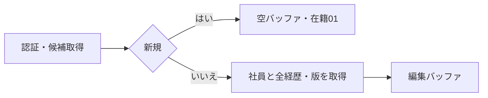
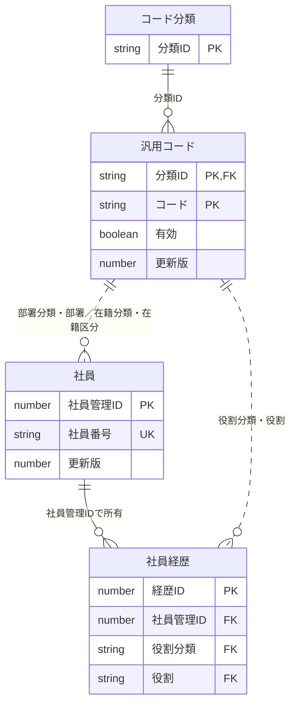
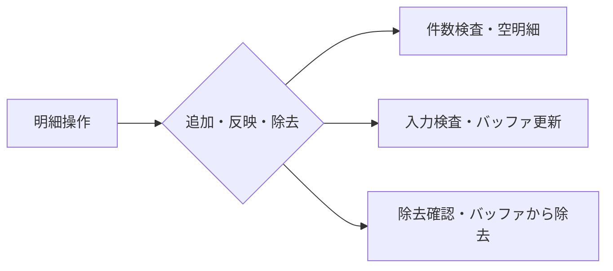
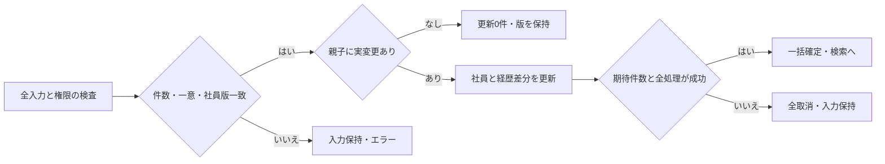
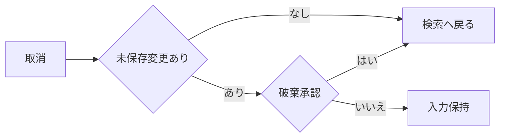

<!-- spec-meta: {"schema":"spec-md/1.0","documentId":"SP2-ACCESS-F04","version":"1.1","path":"sample-project2/spec/Access/基本設計書/04_社員登録画面.md","sheets":[{"heading":"概要","kind":"GRID","sheet":"01_概要"},{"heading":"項目一覧","kind":"LIST","sheet":"02_項目一覧","key":["項目ID"]},{"heading":"イベント仕様","kind":"GRID","sheet":"03_イベント仕様"},{"heading":"補足説明","kind":"GRID","sheet":"04_補足説明"}]} -->
# 社員登録画面 基本設計書

| 項目 | 内容 |
| --- | --- |
| システム／機能ID | 社員経歴管理システム／F04 |
| 方式／版／日付 | Access／1.1／2026-10-27 |
| 読者・状態 | 顧客IT部門向け基本設計。実装・DB実行・実機試験は未実施 |

## 概要

### 目的と入出力

[社員検索](03_社員検索画面.md)から、社員一人の基本情報と0～20件の経歴を登録・編集する。管理者・担当者とも同じ操作を行う。基本情報タブと経歴タブは同一社員の未保存入力を共有する。社員削除、社員番号訂正、一括登録、承認は対象外で、退職は在籍区分で管理する。

永続DBは社員、社員経歴、コード分類、汎用コードを参照する。保存時は社員一人とその全経歴を一つの確定単位で更新する。画面入力・追加変更除去した経歴・読込時の社員版は未保存の一時情報。外部ファイル入出力はない。経歴書は検索へ戻りF05から作る。

### 画面設計

WinForms系のAccess固定単票フォーム。Label・TextBox・ComboBox・ListBox・CommandButton・標準タブを用い、HTMLは配置を示す媒体とする。1366×768 CSS px・100%、本文幅1260px以下。Yu Gothic UI 11pt、入力高32px、ボタン高34px。社員番号110px、日付150px、氏名260px、氏名カナ330pxを基準とし、長文は複数行で欄内スクロールする。標準タブで表示面積を切替え、経歴一覧は単一行・複数列のListBox（期間・案件名）とし、明細入力は別欄に置く。保存・取消を常に見つけられる下部に置く。画面に見えないタブの入力も保存検査対象となり、エラー時は該当タブと項目へ移動する。

<!-- screen-html-start: F04-BASIC -->

<h3>社員登録［編集］　000001 山田 太郎</h3>
<button class="active">基本情報</button><button>経歴（2件）</button>

<label>社員番号 ※ <input class="no" data-item-id="F04-I01" value="000001" readonly></label><label>氏名 ※ <input class="name" data-item-id="F04-I02" value="山田 太郎" data-max-scalars="40"></label><label>氏名カナ ※ <input class="kana" data-item-id="F04-I03" value="ヤマダ タロウ" data-max-scalars="80"></label>

<label>部署 ※ <select class="code" data-item-id="F04-I04"><option>01 開発</option></select></label><label>在籍区分 ※ <select class="code" data-item-id="F04-I05"><option>01 在職</option></select></label><label>入社日 ※ <input class="date" data-item-id="F04-I06" value="2020-04-01"></label>

<label>職務要約<textarea data-item-id="F04-I07" data-max-scalars="1000">業務システムの設計・開発を担当。</textarea></label><label>得意技術・スキル<textarea data-item-id="F04-I08" data-max-scalars="1000">C#、ASP.NET、SQL Server</textarea></label><label>資格<textarea data-item-id="F04-I09" data-max-scalars="1000">基本情報技術者試験</textarea></label><label>自己PR<textarea data-item-id="F04-I10" data-max-scalars="1000">利用者の業務を理解して改善を提案します。</textarea></label>

※は必須です。タブの変更だけでは保存されません。

経歴を含めて一括保存します。<button class="primary" data-item-id="F04-I28">保存</button> <button data-item-id="F04-I29">取消・検索へ戻る</button>

<!-- screen-html-end: F04-BASIC -->

<!-- screen-html-start: F04-CAREER -->

<h3>社員登録［編集］　000001 山田 太郎</h3>
<button>基本情報</button><button class="active">経歴（2件）</button>

2024-04～継続中　社内販売管理システム

2020-04～2024-03　受発注システム保守

<button data-item-id="F04-I25">追加</button><button data-item-id="F04-I26">明細へ反映</button><button data-item-id="F04-I27">除去</button>

<label>開始年月 ※ <input class="month" data-item-id="F04-I14" value="2024-04"></label><label>終了年月（空＝継続中） <input class="month" data-item-id="F04-I15"></label><label>役割 ※ <select class="role" data-item-id="F04-I23"><option>02 リーダー</option></select></label><label>チーム人数 ※ <input class="team" data-item-id="F04-I24" value="5"></label>

<label>会社名 ※ <input class="company" data-item-id="F04-I16" value="デモソフト株式会社" data-max-scalars="100"></label><label>案件名 ※ <input class="project" data-item-id="F04-I17" value="社内販売管理システム" data-max-scalars="100"></label>

<label>業務・案件概要 ※<textarea data-item-id="F04-I18" data-max-scalars="1000">販売業務のWeb化。</textarea></label><label>担当業務 ※<textarea data-item-id="F04-I19" data-max-scalars="1000">基本設計、開発、試験。</textarea></label><label>成果・工夫<textarea data-item-id="F04-I20" data-max-scalars="1000">確認作業を標準化。</textarea></label><label>使用技術<textarea data-item-id="F04-I21" data-max-scalars="500">C#、ASP.NET、SQL Server</textarea></label>
<label>担当工程<textarea class="phases" data-item-id="F04-I22" data-max-scalars="200">基本設計、詳細設計、製造、単体・結合試験</textarea></label>

明細への反映・除去は未保存です。最後に「保存」してください。

経歴は20件まで。会社名・案件名は匿名表記も可能です。<button class="primary">保存</button> <button>取消・検索へ戻る</button>

<!-- screen-html-end: F04-CAREER -->

新規時の社員番号は入力可能で、内部番号は保存時の自動採番とする。編集時は社員番号を読取専用とし、他の業務項目を編集可能にする。基本情報の新規フォーカスは社員番号、編集は氏名。タブ内は表示順にTab移動し、経歴は一覧→明細項目→追加・反映・除去→保存・取消。未選択の明細欄は追加開始まで無効。読取専用番号も選択・コピー可能とする。

処理中は全変更と二重保存を無効にする。検査失敗時は全入力を保持し該当タブ・欄へ戻す。長い氏名・会社名・案件名は横移動で全文を編集でき、長文は欄内スクロール・拡大で全文へ到達できる。固定フォームの拡大時はフォーム全体のスクロールで項目へ到達し、切捨てやレスポンシブな積替えをしない。

## 項目一覧

| 項目ID | 項目名 | 必須 | DBテーブル名（論理名） | DB項目名（論理名） | 備考 |
| --- | --- | --- | --- | --- | --- |
| F04-I01 | 社員番号 | 〇 | 社員 | 社員番号 | 扱い：新規入力・表示・保存。編集不可。半角数字6桁。条件：必須・6桁。初期値：新規は空。未設定時：エラー。全社員で一意・先頭ゼロ保持・再採番なし。 |
| F04-I02 | 氏名 | 〇 | 社員 | 氏名 | 扱い：入力・表示・保存。40文字以内（Unicodeスカラー値）。初期値：新規は空。未設定時：エラー。前後空白除去・原表記保持。 |
| F04-I03 | 氏名カナ | 〇 | 社員 | 氏名カナ | 扱い：入力・表示・保存。80文字以内（Unicodeスカラー値）。初期値：新規は空。未設定時：エラー。全角カナ・空白。共通入力規則に従う。 |
| F04-I04 | 部署 | 〇 | 社員 汎用コード | 社員：部署分類・部署 汎用コード：分類ID・コード・名称 | 扱い：選択・表示・保存。半角数字2桁以内。初期値：新規は未選択。未設定時：エラー。DEPARTMENT有効値。既存停止値は保持・再保存可。 |
| F04-I05 | 在籍区分 | 〇 | 社員 汎用コード | 社員：在籍分類・在籍区分 汎用コード：分類ID・コード・名称 | 扱い：選択・表示・保存。半角数字2桁以内。初期値：01 在職。未設定時：エラー。EMPLOYMENT_STATUSの01在職・02休職・03退職。 |
| F04-I06 | 入社日 | 〇 | 社員 | 入社日 | 扱い：入力・表示・保存。入力形式YYYY-MM-DD（10文字）、保存値は日付。初期値：新規は空。未設定時：エラー。1900-01-01以上、業務日以下。 |
| F04-I07 | 職務要約 | 任意 | 社員 | 職務要約 | 扱い：入力・表示・保存。1000文字以内（Unicodeスカラー値）。初期値：空。未設定時：未設定。改行可。F05の出力時条件は別途検査。 |
| F04-I08 | 得意技術・スキル | 任意 | 社員 | スキル・得意分野 | 扱い：入力・表示・保存。1000文字以内（Unicodeスカラー値）。初期値：空。未設定時：未設定。改行可。 |
| F04-I09 | 資格 | 任意 | 社員 | 保有資格 | 扱い：入力・表示・保存。1000文字以内（Unicodeスカラー値）。初期値：空。未設定時：未設定。一資格一行を推奨。取得年月は文章へ含められる。 |
| F04-I10 | 自己PR | 任意 | 社員 | 自己PR | 扱い：入力・表示・保存。1000文字以内（Unicodeスカラー値）。初期値：空。未設定時：未設定。改行可。 |
| F04-I11 | メッセージ | 非該当 | 非該当 | 非該当 | 扱い：表示。条件：常設。初期値：必須案内。未設定時：空領域。エラーはタブ・項目を特定。 |
| F04-I12 | 基本情報・経歴タブ | 非該当 | 非該当 | 非該当 | 扱い：表示切替。条件：常設。初期値：基本情報。タブ切替で保存しない・入力保持。 |
| F04-I13 | 経歴一覧 | 非該当 | 社員経歴 | 経歴ID・開始年月・終了年月・案件名 | 扱い：表示・一人分の単一明細選択。範囲・上限：20件。条件：0件可。初期値：空。未設定時：保存可・F05不可。開始年月降順→内部番号降順。未保存行は追加順で同順位を固定。 |
| F04-I14 | 開始年月 | 条件付き | 社員経歴 | 開始年月 | 扱い：入力・表示・保存。入力形式YYYY-MM（7文字）、保存値は日付の月初。条件：明細がある場合必須。初期値：空。未設定時：明細エラー。1900-01以上、終了年月・業務年月以下。 |
| F04-I15 | 終了年月 | 任意 | 社員経歴 | 終了年月 | 扱い：入力・表示・保存。入力形式YYYY-MM（7文字）、保存値は日付の月初。初期値：空。未設定時：継続中。指定時は開始年月以上、業務年月以下。 |
| F04-I16 | 会社名 | 条件付き | 社員経歴 | 会社名 | 扱い：入力・表示・保存。100文字以内（Unicodeスカラー値）。条件：明細がある場合必須。初期値：空。未設定時：明細エラー。守秘対象は匿名名で登録可。 |
| F04-I17 | 案件名 | 条件付き | 社員経歴 | 案件名 | 扱い：入力・表示・保存。100文字以内（Unicodeスカラー値）。条件：明細がある場合必須。初期値：空。未設定時：明細エラー。守秘対象は匿名名で登録可。 |
| F04-I18 | 業務・案件概要 | 条件付き | 社員経歴 | 業務概要 | 扱い：入力・表示・保存。1000文字以内（Unicodeスカラー値）。条件：明細がある場合必須。初期値：空。未設定時：明細エラー。改行可・空白だけ不可。 |
| F04-I19 | 担当業務 | 条件付き | 社員経歴 | 担当業務 | 扱い：入力・表示・保存。1000文字以内（Unicodeスカラー値）。条件：明細がある場合必須。初期値：空。未設定時：明細エラー。改行可・空白だけ不可。 |
| F04-I20 | 成果・工夫 | 任意 | 社員経歴 | 実績・成果 | 扱い：入力・表示・保存。1000文字以内（Unicodeスカラー値）。初期値：空。未設定時：未設定。改行可。 |
| F04-I21 | 使用技術 | 任意 | 社員経歴 | 技術環境 | 扱い：入力・表示・保存。500文字以内（Unicodeスカラー値）。初期値：空。未設定時：未設定。言語・DB・OS等を改行で記述可。 |
| F04-I22 | 担当工程 | 任意 | 社員経歴 | 担当工程 | 扱い：入力・表示・保存。200文字以内（Unicodeスカラー値）。初期値：空。未設定時：未設定。自由記述。工程別マスタは作らない。 |
| F04-I23 | 役割 | 条件付き | 社員経歴 汎用コード | 社員経歴：役割分類・役割 汎用コード：分類ID・コード・名称 | 扱い：選択・表示・保存。半角数字2桁以内。条件：明細がある場合必須。初期値：未選択。未設定時：明細エラー。PROJECT_ROLE有効値。既存停止値は保持・再保存可。 |
| F04-I24 | チーム人数 | 条件付き | 社員経歴 | チーム人数 | 扱い：入力・表示・保存。1～999人の整数（入力3桁以内）。条件：明細がある場合必須。初期値：空。未設定時：明細エラー。0・小数不可。 |
| F04-I25 | 経歴追加 | 非該当 | 非該当 | 非該当 | 扱い：操作。条件：20件未満。初期値：操作可。新しい未保存明細を編集。 |
| F04-I26 | 明細へ反映 | 非該当 | 非該当 | 非該当 | 扱い：操作。条件：明細編集中。初期値：未選択時無効。明細検査後バッファ反映。DB保存なし。 |
| F04-I27 | 経歴除去 | 非該当 | 非該当 | 非該当 | 扱い：操作。条件：明細選択時。初期値：未選択時無効。確認後バッファから除去。 |
| F04-I28 | 保存 | 非該当 | 社員 社員経歴 | 社員：社員管理ID・更新版・更新日時・更新者 社員経歴：経歴ID・社員管理ID | 扱い：操作。条件：認証済み・処理中以外。初期値：操作可。全明細を検査して一括確定。業務項目の保存先と設定値は本書F04-E03の項目別更新仕様を参照する。 |
| F04-I29 | 取消・検索へ戻る | 非該当 | 非該当 | 非該当 | 扱い：操作。条件：処理中以外。初期値：操作可。未保存変更時は破棄確認。 |

## イベント仕様

### F04-E01 初期表示

#### 処理概要

新規なら初期値を設定し、編集なら指定社員と全経歴・候補を一貫して読み込む。

#### 処理手順

認証を確認し、部署・在籍・役割候補を取得する。編集は内部番号で社員一人と経歴0～20件を読み、社員版を保持する。存在しなければ検索へ戻す。新規は社員番号も含め空とし在籍01だけを設定する。経歴が20件を超える外部改変は無断に切捨てず編集開始を止める。

#### 処理フロー

#### SQL・テーブル関連（ER図）

本イベントは社員・社員経歴と候補コードを参照する。社員管理IDで親子を対応付け、固定分類とコードの複合参照で部署・在籍・役割の名称を取得する。図のPK・UK・FKは論理設計のキーであり、本イベントの追加/更新/削除は0件。

#### DB操作の詳細

指定社員を最大1件、同じ内部番号の経歴を開始年月降順・内部番号降順で全件取得する。コードは分類を指定し並び順・コード順。候補は有効値と当該レコードで使用中の停止値を取得する。更新は0件。読取りに失敗したら空の編集画面で上書きできないよう開始を止める。

#### 結果・例外時の扱い

停止既存値には「停止」を添えて表示し、同じ値での再保存を許す。新規選択には出さない。編集開始後のコード停止は保存時に再検査する。

### F04-E02 タブ切替・経歴の追加・反映・除去

#### 処理概要

一人の社員の入力を保持しながら経歴を編集する。明細操作だけではDBを変更しない。

#### 処理手順

追加は20件未満に限り空明細を作る。反映は年月・必須・長さ・役割・人数を検査してバッファへ設定する。選択明細の除去は「この経歴を未保存一覧から除去しますか」の承認後に行う。タブや明細を切り替える際の未反映入力は、検査してバッファへ反映するか破棄するかを選べる。取消なら元の編集欄に留まる。親の保存操作では現在の編集中明細も同じ検査を経て反映する。

#### 処理フロー

#### SQL・テーブル関連（ER図）

DBなし。社員・経歴の一時バッファを操作するためER図は非適用。

#### DB操作の詳細

DB参照・更新0件。経歴内部番号は保存済み行の識別用に保持し、新規行は未保存の一時識別子で区別する。未保存操作でDB自動採番を消費する必要はない。

#### 結果・例外時の扱い

明細検査失敗時は入力を保持する。20件時の追加は無効。経歴0件も社員保存は可能で、F05出力時には経歴不足として案内する。経歴期間の重複および入社前の前職経歴を許し、未来予定は受け付けない。

### F04-E03 社員と経歴の一括保存

#### 処理概要

社員一人と全経歴を検査し、一つの確定単位で保存する。社員版で同時更新を検知する。

#### 処理手順

1. 認証と未反映明細を検査し、全タブ・全経歴の必須、長さ、形式、年月、コード参照を再検査する。
2. 新規は社員総数200件以下と番号一意を、編集は内部番号の存在と読込時の社員版一致を確認する。
3. 社員と全経歴に実変更がない場合は更新0件とし、版・更新日時・更新者を据え置いて「変更はありません」を表示する。新規社員は内部番号と版1を設定する。編集は社員項目を更新し版を一つ進める。実変更時に更新日時・更新者を設定する。
4. 経歴の追加・変更・除去を同じ確定単位で反映する。画面が送った内部番号が当該社員の経歴に属することを確認する。
5. 全件成功時だけ確定し、検索へ戻って保持条件で再検索する。途中失敗は全て取消す。

#### 処理フロー

#### SQL・テーブル関連（ER図）

社員と社員経歴は同じ確定単位で更新する。PK・UK・FKは論理上の識別・参照を示す。社員経歴の所有条件は社員管理IDであり、他社員の経歴IDを本保存へ渡しても更新・除去できない。部署分類DEPARTMENT、在籍分類EMPLOYMENT_STATUS、役割分類PROJECT_ROLEをシステムが設定し、分類とコードの組で存在/有効性を検査する。コード分類・汎用コードは参照だけで本機能から変更しない。

#### DB操作の詳細

##### 保存対象・差分と確定境界

保存開始時に、認証主体の有効性、入力検査、読込時の社員管理ID・更新版・経歴ID集合を確認する。社員1人分の基本情報と全経歴を一つの集約として扱い、同一の排他/トランザクション範囲で現在版・社員総数・社員番号の一意性・コードの現在状態を再確認する。経歴だけを変更した場合も社員の更新版を1増やす。親版が一致しない場合は、無変更入力でも自動的に成功とせず競合を案内する。

保存予定の経歴を、読込時の保存済み行に対して「新規追加」「既存変更」「既存無変更」「既存除去」に分ける。保存済み経歴IDの重複・読込集合にないID・別社員IDを拒否する。未保存の追加行を取り消しただけならDB削除は発生しない。保存後の経歴数は追加・継続を合わせて0～20件。新規社員の保存は社員総数200人までで、201人目を同時登録と競合する隙間から通さない。

##### 社員への項目別設定

| 設定先テーブル | 設定先項目（論理名） | 移送元・設定値 | 新規・編集・保持の扱い |
| --- | --- | --- | --- |
| 社員 | 社員管理ID | 保存処理の自動採番 | 新規の同じ追加処理が得たIDを使用。編集は読込IDを保持。画面の業務番号やMAX+1で代用しない |
| 社員 | 社員番号 | F04-I01 社員番号 | 新規で設定。編集は保存済み値を保持し、異なる番号の要求を拒否。全社員で一意、先頭ゼロを保持 |
| 社員 | 氏名 | F04-I02 氏名 | 共通の前後空白整理後の表記を設定。氏名照合用の正規化値で上書きしない |
| 社員 | 氏名カナ | F04-I03 氏名カナ | 共通のカナ正規化後の値を設定 |
| 社員 | 部署分類 | 固定値DEPARTMENT | 利用者から入力させず固定する |
| 社員 | 部署 | F04-I04 部署 | 部署分類と組で汎用コードを参照。新規/変更は有効値、既存の同じ停止値は保持可 |
| 社員 | 在籍分類 | 固定値EMPLOYMENT_STATUS | 利用者から入力させず固定する |
| 社員 | 在籍区分 | F04-I05 在籍区分 | 固定3値の保存値を設定。退職でも社員/経歴を削除しない |
| 社員 | 入社日 | F04-I06 入社日 | 検査済み日付を設定。経歴の前職期間を制限する値にはしない |
| 社員 | 職務要約 | F04-I07 職務要約 | 改行を共通規則で整える。空/空白のみはNULL |
| 社員 | スキル・得意分野 | F04-I08 得意技術・スキル | 改行を共通規則で整える。空/空白のみはNULL |
| 社員 | 保有資格 | F04-I09 資格 | 自由記入と改行を保持し、空/空白のみはNULL |
| 社員 | 自己PR | F04-I10 自己PR | 改行を共通規則で整える。空/空白のみはNULL |
| 社員 | 更新日時 | 保存処理のUTC時点 | 新規/実変更の確定単位で設定。無変更なら保存済み値を保持 |
| 社員 | 更新者 | 認証状態の内部利用者ID | 新規/実変更時に設定。ログインIDや画面入力を主体へ代用しない。無変更なら保持 |
| 社員 | 更新版 | 新規1、編集は保存済み版+1 | 親子の実変更がある場合だけ進める。2147483647到達時は無変更で停止 |

##### 社員経歴への項目別設定

| 設定先テーブル | 設定先項目（論理名） | 移送元・設定値 | 追加・変更・保持の扱い |
| --- | --- | --- | --- |
| 社員経歴 | 経歴ID | 新規行の自動採番または保存済みID | 新規は保存時に採番。既存は読込IDを保持し、別のIDへ付替えない |
| 社員経歴 | 社員管理ID | 今回保存する親社員の社員管理ID | 全行で親から設定。画面送信の別社員IDを採用しない |
| 社員経歴 | 開始年月 | F04-I14 開始年月 | 検査した年月の1日を表す日付 |
| 社員経歴 | 終了年月 | F04-I15 終了年月 | 指定時は年月の1日、未設定はNULL（継続中） |
| 社員経歴 | 会社名 | F04-I16 会社名 | 共通規則で整えた保存値。必須 |
| 社員経歴 | 案件名 | F04-I17 案件名 | 共通規則で整えた保存値。匿名表記もそのまま保持 |
| 社員経歴 | 業務概要 | F04-I18 業務・案件概要 | 共通規則で整えた保存値。必須 |
| 社員経歴 | 担当業務 | F04-I19 担当業務 | 共通規則で整えた保存値。必須 |
| 社員経歴 | 実績・成果 | F04-I20 成果・工夫 | 改行を保持し、空/空白のみはNULL |
| 社員経歴 | 技術環境 | F04-I21 使用技術 | 改行を保持し、空/空白のみはNULL。技術項目を自動生成しない |
| 社員経歴 | 役割分類 | 固定値PROJECT_ROLE | 利用者から入力させず固定する |
| 社員経歴 | 役割 | F04-I23 役割 | 役割分類と組で汎用コードを参照。新規/変更は有効値、既存の同じ停止値は保持可 |
| 社員経歴 | チーム人数 | F04-I24 チーム人数 | 1～999の検査済み整数 |
| 社員経歴 | 担当工程 | F04-I22 担当工程 | 自由記入を保持し、空/空白のみはNULL |

経歴ごとの独立した更新版は持たず、社員の更新版が全行を代表する。子だけ先に確定する、社員管理IDを別社員へ移す、無変更行を全削除して再追加する処理は行わない。社員経歴の作成日時・作成者等、テーブル仕様にない監査項目は追加しない。

##### 操作条件・期待件数

| 操作 | 対象テーブル | キー・更新条件 | 設定・削除範囲 | 成功時の期待件数・判定 |
| --- | --- | --- | --- | --- |
| 新規社員追加 | 社員 | 社員番号重複なし、追加後200人以下 | 上の16項目 | 1件追加。自動採番IDを同じ確定単位の子に使用 |
| 既存社員更新 | 社員 | 社員管理ID=読込ID、更新版=読込版、親子に実変更あり | 不変ID/番号を保持し、変更値と監査値・更新版を設定 | 1件更新。0件は消失/版競合、2件以上は整合性異常として全取消 |
| 経歴追加 | 社員経歴 | 新規行、社員管理ID=今回の親ID | 上の14項目 | 新規行ごと1件。追加予定件数の合計と一致 |
| 経歴変更 | 社員経歴 | 経歴ID=読込ID、社員管理ID=今回の親ID、親版検査済み | 不変ID/親IDを保持し変更された業務値だけを設定 | 変更行ごと1件。0件または複数件は全取消 |
| 経歴除去 | 社員経歴 | 読込時の保存済み集合から除去された経歴ID、かつ社員管理ID=今回の親ID | 当該経歴1行のみ物理削除 | 除去行ごと1件。所有不一致/消失なら全取消。社員や他の経歴を連鎖削除しない |
| 経歴無変更 | 社員経歴 | 読込値と保存予定値が同じ既存行 | 設定/削除なし | 更新0件。親子の他行に変更があれば親版だけは進む |
| 親子すべて無変更 | 社員・社員経歴 | 現在の親版一致確認後、全業務値と経歴構成が同じ | 設定/削除なし | 全更新0件。更新版・日時・更新者を据え置いて変更なしを案内 |

保存開始から完了までの参照/更新順序は、現在の親と経歴取得→親版/所有/全体制約とコード状態の再確認→親の追加または版一致更新→経歴の差分反映→各操作件数と最終件数の確認→全体確定とする。新規追加時は200人上限と番号一意の判定が同時登録と競合しない境界を使い、コード停止と保存の競合も確定前に検出する。部署/役割は保存前後で同じ停止値を維持する場合だけ許容し、別の停止値への割当は拒否する。

全件成功時だけ一括確定する。親の追加後、子の途中、件数検査、コード/版再検査等のどこで失敗しても全て取消し、新規IDが欠番になっても社員や一部経歴だけを残さない。UIの保存成功は確定完了後にだけ通知する。DB障害・版不一致では入力を保持し、現在値の再読込みは破棄確認を経る。排他API・物理FK・SQL本文は詳細工程で具体化し、今回の基本設計で実行しない。

#### 結果・例外時の扱い

重複、201人目、20件超、コード停止、必須欠落は入力を保持して案内する。同時更新は上書きせず「別の操作で更新されました。入力を確認し、再読込してください」。再読込は未保存入力の破棄確認を経て行い、競合した内容を自動で再適用しない。DB障害は全取消、入力保持、保存未完了を明示する。認証失効時は保存しない。

### F04-E04 取消・検索へ戻る

#### 処理概要

未保存の社員・経歴入力を破棄し、元の検索条件へ戻る。

#### 処理手順

未保存変更がなければそのまま戻る。変更があれば破棄確認する。承認は全バッファを破棄して戻り、取消は元のタブ・選択・入力を保持する。保存中は戻る操作を無効にする。

#### 処理フロー

#### SQL・テーブル関連（ER図）

DBなし。一時入力の破棄のみでER図は非適用。

#### DB操作の詳細

DB参照・更新0件。経歴除去のバッファがあっても取消ではDBから消去しない。検索への復帰後の参照はF03で行う。

#### 結果・例外時の扱い

新規・編集とも未保存の変更を保存済みと表示しない。フォームを閉じる操作でも同じ確認を行うが、強制終了からの入力復元は保証しない。

## 補足説明

項目一覧の必須は、〇＝必須、任意＝省略可、条件付き＝備考の条件成立時に必須、一部必須＝複合項目のうち備考で示す部分だけ必須、非該当＝操作や案内など値の必須判定対象外とする。DB関連は論理テーブル名と論理項目名を示し、複数表は備考の参照条件と対応付ける。その他の入力・表示・保存、上限、初期値、候補、操作条件は備考へまとめる。

長さは[共通UI・入力設計](../共通/03_共通UI・入力設計.md)、日付・確定境界は[日付・データアクセス仕様](../共通/05_日付・データアクセス仕様.md)、項目の保存先は[テーブル仕様](07_テーブル仕様書.md)に従う。内部番号と更新日時・更新者・版は自動であり、業務入力欄にしない。

新規番号の入力、番号先頭ゼロ、20/21件、0件保存、開始終了同月、継続中、前職、期間重複、停止既存保持、明細除去後の取消、同時更新の全取消、長文・エラー時のタブ移動を将来の確認観点とする。今回は実機未実施。

Accessの画面操作による役割判定はDEMO用である。ACCDBへ直接書き込める利用者に対する強い権限境界を保証しない。ブラウザーでの仕様モック確認とAccessフォーム・IME・Office環境での実機確認は別であり、実機は未確認。

HTMLの `data-max-scalars` は業務上限の説明属性であり、ブラウザー標準のUTF-16単位のmaxlengthで受理範囲を狭めない。実装時はUnicodeスカラー値で長さを検査し、上限超過を切り捨てずエラーにする。原文を保持したまま該当欄へ戻す。
