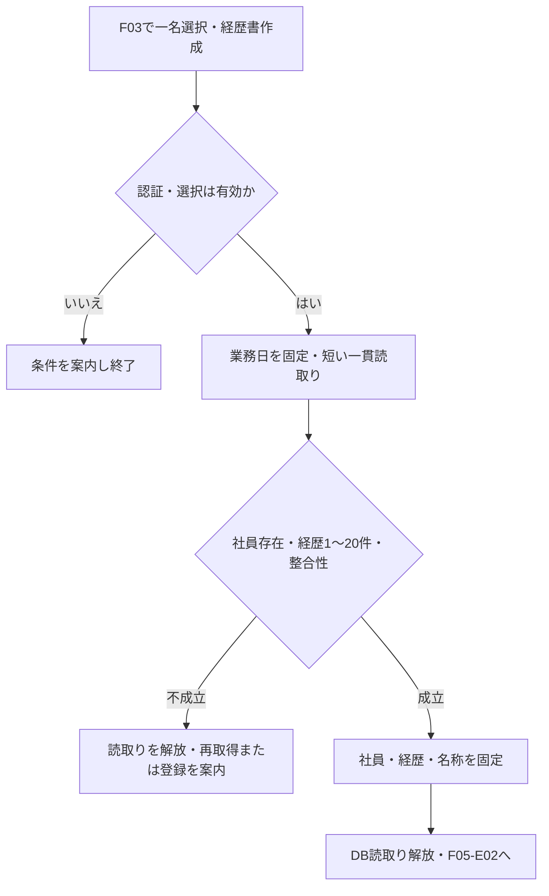
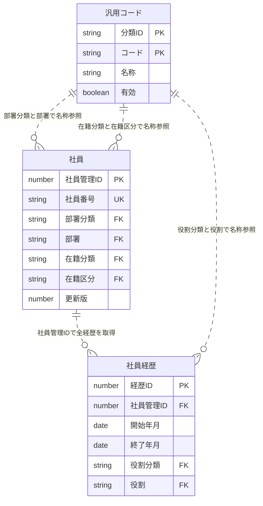
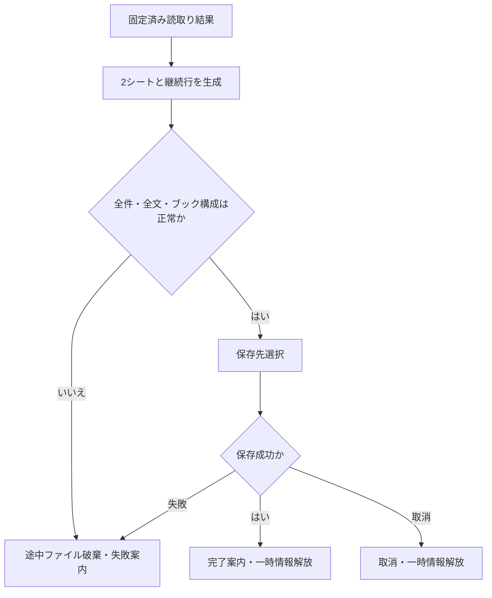
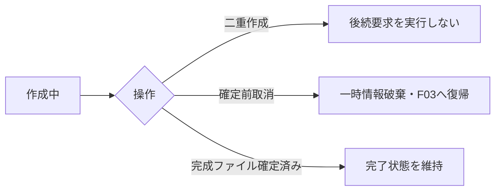

<!-- spec-meta: {"schema":"spec-md/1.0","documentId":"SP2-ACCESS-BAS-F05","version":"1.2","path":"sample-project2/spec/Access/基本設計書/05_経歴書出力.md","sheets":[{"heading":"概要","kind":"GRID","sheet":"01_概要"},{"heading":"項目一覧","kind":"LIST","sheet":"02_項目一覧","key":["項目ID"]},{"heading":"イベント仕様","kind":"GRID","sheet":"03_イベント仕様"},{"heading":"補足説明","kind":"GRID","sheet":"04_補足説明"}],"isolationProfile":"Access"} -->
# 経歴書出力 基本設計書

| 項目 | 内容 |
| --- | --- |
| システム名 | 社員経歴管理システム |
| projectId・対象方式 | sample-project2／Access |
| 機能ID・帳票ID | F05／R01 |
| 版数・改訂日 | 1.2／2026-10-28 |
| 対象読者 | 顧客のIT部門、Agent訓練・DEMOの設計確認者 |
| 状態 | 基本設計。Excel実ファイル生成・アプリ実装・実機印刷は未実施 |

## 概要

### 機能の目的と範囲

F03社員検索で選択した社員1名について、保存済みの社員情報と案件経歴を、日本語の職務経歴書としてExcel形式で出力する。一般職務にも利用し、技術環境と担当工程は任意とする。呼出し時に渡す業務キーは社員IDだけとし、検索一覧の表示値・検索時のrevisionは渡さず、出力開始時点の保存済み全体を一貫再取得する。ログイン済みの管理者・担当者が使用する。社員の一括出力、検索結果一覧のExcel出力、未保存入力の帳票化、PDF、帳票編集画面、送付・メール配信、出力履歴の管理は対象外とする。

出力は `.xlsx` の1ファイルとし、シートは「職務経歴書」「案件経歴」の2枚に固定する。公開事例の記載観点を参考にした本プロジェクト独自様式である。法定様式、JIS様式、採用企業による受入れを保証するものとして扱わない。出典・採用理由・独自設計の区別は[経歴書様式調査](../共通/07_経歴書様式調査.md)に記録する。

### 開始条件と入出力

| 区分 | 対象・扱い |
| --- | --- |
| 開始契機 | F03の「経歴書作成」。現在の検索結果に含まれる社員を1名選択済みであること |
| 権限 | ログイン済みのADMIN・STAFF。未認証・セッション失効は生成開始前に拒否する |
| 画面入力 | 選択社員IDだけ。検索時の版・表示内容は入力しない。基準日は日本の業務日を生成開始時に一度だけ取得する |
| 外部入力ファイル | なし。既存テンプレートのアップロードは受け付けない |
| 永続DB読取り | 社員 m_employee、社員経歴 t_career、汎用コード m_code。部署・在籍・案件役割の名称をコード分類と値の組合せで解決する |
| 永続DB更新 | なし。出力で社員・経歴の更新版を進めない |
| 一時情報 | 整合する時点の社員・経歴・名称・出力基準日・取得日時を保持する読取り結果、生成途中のブック |
| 外部出力ファイル | 職務経歴書_社員番号_yyyyMMdd.xlsx。例：職務経歴書_000001_20261027.xlsx |
| 呼出し後 | Accessの保存先選択へ渡す。取消時はファイルを確定しない。完了・失敗ともF03の条件と選択を保持する |

社員は保存済みであれば経歴0件でも存在できるが、経歴書は1～20件の保存済み経歴がある場合だけ作成できる。出力条件はF03と本機能の双方で検査する。ボタンの無効化だけを検査の代替にしない。

### 帳票レイアウト

画面を新設せず、既存F03から作成する。以下のHTMLは出力帳票の構成を表す架空の仕様見本であり、Accessフォームでも実際のExcelプレビューでもない。実ファイルの改ページ・行高・フォントは後工程で検証する。画面モックとは異なりA4縦の紙面を基準とする。

<!-- report-html-start: R01 -->

<section class="career-report" data-report-id="R01" aria-label="職務経歴書の架空見本">
  <h3>職務経歴書</h3>
  
2026年10月27日現在

  
作成日時（JST）：2026年10月27日 14:30

  <table><tbody><tr><th style="width:24%">氏名</th><td data-item-id="F05-I03">山田 太郎（ヤマダ タロウ）</td></tr><tr><th>社員番号／所属</th><td data-item-id="F05-I02">000001 ／ システム開発部</td></tr></tbody></table>
  <h4>職務要約</h4>
業務システムの設計、開発、テストを担当。利用部門との確認を重ね、操作を簡潔にする改善に取り組んでいます。

  <h4>活かせる経験・知識・技術</h4>
C#による業務画面開発、SQLによるデータ照会、テスト仕様作成。

  <h4>資格</h4>
基本情報技術者試験（2022年取得）

  <h4>自己PR</h4>
利用者への確認事項と対応結果を記録し、認識の相違を早い段階で解消しています。

  
職務経歴書シート：氏名とページ番号をフッターに表示

</section>
<section class="career-report" data-report-id="R01-CAREER" aria-label="案件経歴の架空見本">
  <h3>案件経歴</h3>
山田 太郎 ／ 2026年10月27日現在

  
作成日時（JST）：2026年10月27日 14:30

  <h4 data-item-id="F05-I10">01　販売管理システム改善</h4>
  <table><tbody>
    <tr><th style="width:24%">期間</th><td data-item-id="F05-I11">2025年04月 ～ 現在（1年7か月）</td></tr>
    <tr><th>所属会社／案件</th><td data-item-id="F05-I12">デモシステム株式会社 ／ 製造業向け販売管理</td></tr>
    <tr><th>概要</th><td data-item-id="F05-I13">受注・出荷情報を照会する業務システムの改善。</td></tr>
    <tr><th>担当業務／工程</th><td data-item-id="F05-I14">検索画面の設計とテスト仕様作成。基本設計、実装、テスト。</td></tr>
    <tr><th>実績・工夫</th><td data-item-id="F05-I15">検索条件の整理により、入力手順を簡潔にした。</td></tr>
    <tr><th>開発環境</th><td data-item-id="F05-I16">OS：Windows 言語・FW：C# / ASP.NET Core DB：SQL Server</td></tr>
    <tr><th>役割／チーム人数</th><td data-item-id="F05-I17">メンバー ／ 5名</td></tr>
  </tbody></table>
  
案件経歴シート：直近案件から全件掲載。長文・多数案件は次ページへ継続。

</section>
<!-- report-html-end: R01 -->

### Excelの配置と印刷契約

| 要素 | 設計値・挙動 |
| --- | --- |
| ブック | マクロなしのOffice Open XML。2枚とも表示。秘密情報、接続情報、内部ID、更新版を隠しセル・隠しシートへ書かない |
| 基準紙面 | A4縦、上下左右15mm、ヘッダー・フッター余白7mm。横1ページ・縦自動。ページ数を1に固定して全体を縮小しない |
| 方眼 | 各シートA:Xの24列、各列幅3.0相当、基準行高15pt。これは業務帳票の独自設定であり、仕様書MDの120列方眼とは別の定義 |
| 書体 | 日本語はメイリオ、本文10.5pt、見出し11pt太字、表題18pt。白地、濃紺の見出し線、灰色の罫線。印刷時の実フォント・文字欠けは後工程で確認する |
| 表題と日付 | A1:X2を表題、A3:X3を基準日、A4:X4を作成日時（JST）、A5:F5を氏名ラベル、G5:X5を氏名、A6:F6を社員番号・所属ラベル、G6:X6を値とする。氏名・所属が収まらなければ行を増やす |
| 職務経歴書シート | 8行目から職務要約、活かせる経験・知識・技術、資格、自己PRの順。各章見出しA:X、本文A:X。章見出しの次行から必要行数を展開し、後続章の開始行を後へ送る |
| 案件経歴シート | 1～3行目を表題・氏名・基準日、4行目を作成日時（JST）。5行目から案件連番・案件名、期間、所属会社、概要、担当業務、工程、実績・工夫、開発環境、役割・人数の順。ラベルA:F、値G:X。全20件まで可変行で積む |
| 長文 | 元の改行を保持し、長い論理行を最大32Unicodeスカラー相当の継続行に分ける。結合文字・絵文字の表示単位を途中分割しない。実フォントで横幅に収まらなければさらに分割する。各行を15pt以上で確保し、固定行高の結合セル1個へ全文を詰めない |
| 継続と改ページ | 章・案件の見出しと最初の本文行を同じページに置く。長い案件はページ境界で分割し、次ページに案件連番・案件名・「続き」と対象欄名を再掲する。再掲ラベルは元データに混入しない |
| 行高の上限対策 | 各文字列を複数行・複数セルへ配置し、Excelの1行高409ptや1セル32,767文字の限界に依存しない。全文到達が不可能なら出力を失敗にし、切捨てたブックを渡さない |
| 印刷範囲とフッター | A1:X最終行を印刷範囲とする。氏名、シート名、作成日時（JST）、ページ番号/総ページ数をフッターに表示する。自動拡大で紙幅を超えない |
| 値の型 | 全業務文字列・社員番号・日付表示は文字列として格納し、先頭ゼロと日本語を保持する。利用者入力の先頭が =、+、-、@ でも数式にしない。数式・マクロ・外部リンク・データ接続は使用しない |

32文字は保守的な行分割の設計基準であり、表示幅の実測を代替しない。改ページ位置・余白・文字サイズ・結合セルの行高を実Excelの印刷プレビューで確認するまで、印刷可能性を検証済みとしない。

## 項目一覧

| 項目ID | 項目グループ | 項目名 | コントロール | 必須 | 入力制限 | フォーマット | 初期値 | DBテーブル名 | DB項目名 | 備考 |
| --- | --- | --- | --- | --- | --- | --- | --- | --- | --- | --- |
| F05-I01 | 出力情報 | 出力基準日 | Excelセル | 〇 | 利用者入力なし。表示13文字以内 | yyyy年MM月dd日現在 | 生成開始時の日本業務日 | 非該当 | 非該当 | DB保存なし。生成中は固定する。 |
| F05-I02 | 基本情報 | 社員番号・所属 | Excelセル | 〇 | 利用者入力なし。社員番号6文字・部署名称40文字以内 | 社員番号は半角数字6桁、部署は名称 | 出力時：選択社員の保存済み社員番号と部署名称 | 社員 汎用コード | 社員：社員番号・部署分類・部署 汎用コード：分類ID・コード・名称 | DEPARTMENTの名称を参照し、先頭ゼロを保持する。 |
| F05-I03 | 基本情報 | 氏名・カナ | Excelセル | 〇 | 利用者入力なし。氏名40文字・カナ80文字以内 | 氏名とカナを区別して配置 | 出力時：選択社員の保存済み氏名・カナ | 社員 | 氏名・氏名カナ | 長い値は継続行で全文を表示する。 |
| F05-I04 | 出力条件 | 選択社員識別子 | 非該当 | 〇 | F03で選択した社員1名だけ。手入力不可 | 帳票には表示しない | F03から受け取る社員管理ID | 社員 | 社員管理ID | 呼出し引数であり画面コントロールを設けない。未選択は出力不可。社員IDだけを渡し、検索時の版・表示値は渡さない。 |
| F05-I05 | 出力条件 | 在籍区分 | 非該当 | 〇 | 利用者入力なし。参照元はコード2文字・名称40文字以内 | 帳票には表示しない | 出力時：保存済みの在籍区分 | 社員 汎用コード | 社員：在籍分類・在籍区分 汎用コード：分類ID・コード・名称 | EMPLOYMENT_STATUSの判定参照であり画面コントロールを設けない。在籍区分で過去経歴を落とさない。 |
| F05-I06 | 職務 | 職務要約 | Excelセル | 任意 | 利用者入力なし。参照元は1000文字以内 | 元の改行を保持し、折り返し・継続行で表示 | 出力時：保存済み職務要約。未設定は「未記入」 | 社員 | 職務要約 | 自動生成・内容補完を行わない。 |
| F05-I07 | 職務 | 活かせる経験・知識・技術 | Excelセル | 任意 | 利用者入力なし。参照元は1000文字以内 | 元の改行を保持し、折り返し・継続行で表示 | 出力時：保存済みスキル。未設定は「未記入」 | 社員 | スキル・得意分野 | 技術経験年数を案件期間から自動集計しない。 |
| F05-I08 | 職務 | 資格 | Excelセル | 任意 | 利用者入力なし。参照元は1000文字以内 | 保存済み改行を保持。取得年月は記入内容のまま | 出力時：保存済み保有資格。未設定は「未登録」 | 社員 | 保有資格 | 資格名や取得年月を補完しない。 |
| F05-I09 | 職務 | 自己PR | Excelセル | 任意 | 利用者入力なし。参照元は1000文字以内 | 元の改行を保持し、折り返し・継続行で表示 | 出力時：保存済み自己PR。未設定は「未記入」 | 社員 | 自己PR | 未記入を実績・評価で補完しない。 |
| F05-I10 | 経歴 | 案件連番・案件名 | Excelセル | 〇 | 利用者入力なし。連番2桁・案件名100文字以内 | 01からの連番と保存済み案件名 | 出力時：連番は01から採番、案件名は保存済み値 | 社員経歴 | 案件名・開始年月・経歴ID | 経歴1件以上を対象に、開始年月降順→経歴ID降順で全保存件を掲載する。連番はDBへ保存しない。 |
| F05-I11 | 経歴 | 期間・参画月数 | Excelセル | 一部必須 | 利用者入力なし。開始年月は必須、終了年月は継続中のみ省略可 | yyyy年MM月～yyyy年MM月。終了未設定は「現在」、期間を年・か月で併記 | 出力時：保存済み開始・終了年月と出力基準月から算出 | 社員経歴 | 開始年月・終了年月 | 両端月を含める。保存上の月初日を年月として表示し、算出月数はDBへ保存しない。 |
| F05-I12 | 経歴 | 所属会社 | Excelセル | 〇 | 利用者入力なし。参照元は100文字以内 | 保存済み会社名を文字列で表示 | 出力時：経歴の保存済み会社名 | 社員経歴 | 会社名 | 前職も記載し、顧客等の匿名表現は保存内容を維持する。 |
| F05-I13 | 経歴 | 案件概要 | Excelセル | 〇 | 利用者入力なし。参照元は1000文字以内 | 元の改行を保持し、全文を継続配置 | 出力時：経歴の保存済み業務概要 | 社員経歴 | 業務概要 | 切捨てや自動補完を行わない。 |
| F05-I14 | 経歴 | 担当業務・担当工程 | Excelセル | 一部必須 | 利用者入力なし。担当業務1000文字・担当工程200文字以内 | 担当業務と担当工程を別ラベルで表示し、改行を保持 | 出力時：保存済みの担当業務・担当工程。工程未設定は空欄 | 社員経歴 | 担当業務・担当工程 | 担当業務は必須、担当工程は任意。異なる意味の原値を混合しない。 |
| F05-I15 | 経歴 | 実績・工夫 | Excelセル | 任意 | 利用者入力なし。参照元は1000文字以内 | 元の改行を保持し、折り返し・継続行で表示 | 出力時：保存済みの実績・成果。未設定は空欄 | 社員経歴 | 実績・成果 | 数値成果や評価を推測しない。 |
| F05-I16 | 経歴 | 開発環境 | Excelセル | 任意 | 利用者入力なし。参照元は500文字以内 | OS・言語/FW・DB等の保存済み文章と改行を表示 | 出力時：保存済み技術環境。未設定は空欄 | 社員経歴 | 技術環境 | 自由記入。分類や経験月数を逆推定しない。 |
| F05-I17 | 経歴 | 役割・チーム人数 | Excelセル | 〇 | 利用者入力なし。役割名称40文字以内、人数1～999人 | 役割は名称、人数は整数に「名」を付ける | 出力時：保存済み役割の名称とチーム人数 | 社員経歴 汎用コード | 社員経歴：役割分類・役割・チーム人数 汎用コード：分類ID・コード・名称 | PROJECT_ROLEの名称を参照する。 |
| F05-I18 | 出力情報 | 出力ファイル名 | 非該当 | 〇 | 利用者の社員番号手入力なし。生成名32文字以内 | 職務経歴書_社員番号_yyyyMMdd.xlsx | 選択社員の6桁番号と出力基準日から生成 | 社員 | 社員番号 | ファイル名の自動設定であり帳票のセル・画面コントロールを設けない。DB保存なし。氏名はファイル名へ入れない。保存先選択や受渡しはF05-E02に従う。 |
| F05-I19 | 出力情報 | 作成日時（取得日時） | Excelセル | 〇 | 利用者入力なし。表示17文字以内 | yyyy年MM月dd日 HH:mm、ラベルにJSTを明記 | 一貫読取の取得日時 | 非該当 | 非該当 | 出力基準日と区別し、2シート上部と印刷フッターへ表示する。DB保存なし。取得後は固定する。 |

## イベント仕様

### F05-E01 出力条件確認と一貫読取り

#### 処理概要

選択社員1名と保存済み経歴を、コード名称を含め整合する1時点の内容で取得する。

#### 処理手順

1. ログイン状態とADMIN・STAFF権限を確認し、F03で選択した社員IDを1名分だけ受け取る。検索時のrevisionとの一致判定は行わず、検索時の表示内容も出力に流用しない。
2. 日本の業務日を1回取得する。保存済み社員が存在することを確認する。
3. [日付・データアクセス仕様](../共通/05_日付・データアクセス仕様.md)の短い一貫読取りを使用し、社員、当該社員の経歴全件、DEPARTMENT・EMPLOYMENT_STATUS・PROJECT_ROLEの名称を取得する。Accessは全更新処理と共通の更新ゲート内でこの読取りを完了する。ゲート取得後の一貫読取開始時点を取得日時として固定する。
4. 経歴1～20件、年月・必須値・参照整合を確認する。停止済みコードも既存参照の名称を取得し、停止を理由に社員・案件を消さない。
5. 経歴を開始年月降順、同年月は内部経歴ID降順へ並べ、描画用の読取り結果に固定してDBトランザクションとゲートを解放する。Excel生成中はDBを占有しない。

#### 処理フロー

#### SQL・テーブル関連（ER図）

社員・社員経歴の主キーはそれぞれ社員管理ID・経歴ID。社員経歴の社員管理IDは社員への参照、各分類とコードは汎用コードの複合キー（分類ID・コード）への参照を表す。線は論理参照の多重度であり、実行時のJOINは下表の照合条件で個別に示す。部署分類=DEPARTMENT、在籍分類=EMPLOYMENT_STATUS、役割分類=PROJECT_ROLEを確認し、コード値だけでは名称を結合しない。利用者の有効性再確認は認証の処理として行い、認証情報を帳票データへ結合しない。コード分類は固定値の定義であり、本機能では表自体を読まない。物理FKやSQLの構文は詳細工程で具体化する。

#### DB操作の詳細

| 操作ID | 対象 | 読取り条件・結合キー | 取得する論理項目・件数・順序 | 更新・確定・取消 |
| --- | --- | --- | --- | --- |
| F05-DB00 | 利用者 | 一時認証状態の利用者IDと一致。利用可能であり、現在の利用者役割がADMIN/STAFFであることを確認 | 利用者ID・利用可能・利用者役割、1件。帳票用データには含めない | 更新0件。0件/停止/役割不一致なら読取りを開始しない |
| F05-DB01 | 社員 | F03から渡された社員管理IDと一致。検索時の版・表示値を条件にせず保存済み全体を再取得 | 社員管理ID・社員番号・氏名・氏名カナ・部署分類・部署・在籍分類・在籍区分・職務要約・スキル・得意分野・保有資格・自己PR・更新版。1件 | 更新0件。同じ一貫読取単位内でDB02/03へ。0件なら全出力取消 |
| F05-DB02 | 社員経歴 | 社員経歴.社員管理ID=DB01の社員管理ID | 経歴ID・社員管理ID・開始年月・終了年月・会社名・案件名・業務概要・担当業務・実績・成果・技術環境・役割分類・役割・チーム人数・担当工程の14項目。1～20件、開始年月降順→経歴ID降順 | 更新0件。0件は経歴登録案内。20件超・不整合は全出力取消。欠けた件数で帳票を成功させない |
| F05-DB03 | 汎用コード | 部署：（社員.部署分類・部署）=（分類ID・コード）。在籍：（社員.在籍分類・在籍区分）=同複合キー。役割：（経歴.役割分類・役割）=同複合キー | 分類ID・コード・名称。各参照につき1件、同じキーの名称は同一読取で一度取得して再利用可。停止済みも取得 | 更新0件。参照先0件/複数件は全出力取消し、管理者への確認を案内 |

DB01～03を同じ一貫読取時点に固定し、社員・経歴・参照名称を取得し終えたらDB資源を解放する。所属名称は部署の現在名称、在籍・役割も取得時点の名称を採用する。社員・経歴・コードの追加/更新/削除、更新版・更新日時・更新者の変更はすべて0件。Excel生成/保存の失敗によって、DBを変更したり取得後の再照会で別時点を混在させたりしない。

#### 結果・例外時の扱い

社員未選択・複数選択は「社員を1名選択してください」、経歴0件は「経歴を1件以上登録してから作成してください」と案内する。取得中の更新競合・ロック待ち超過・取得失敗・整合性異常は「データを再取得してから、もう一度作成してください」と案内し、途中の内容を出力しない。読取り完了後の別操作による更新は、固定済みの読取り結果へ反映しない。取得日時はデータを読み取った時点を表し、帳票では「作成日時（JST）」としてyyyy年MM月dd日 HH:mmで明記する。出力基準日は継続期間を算定する日本の暦日であり、取得日時と別の項目として保持する。生成処理が日付をまたいでも、固定済みの基準日と取得日時をそれぞれ変更しない。

### F05-E02 Excelブック生成と受渡し

#### 処理概要

固定した読取り結果から2シートのExcelファイルを組み立て、生成成功時だけ利用者へ渡す。

#### 処理手順

1. F05-E01の読取り結果だけを使用する。作成中に追加照会して別時点の値を混ぜない。
2. 「職務経歴書」に社員の保存済み内容を、「案件経歴」に全保存経歴を配置する。タイトル、基準日、作成日時（JST）、継続ラベル、空欄の案内以外の文章は自動補完しない。
3. 終了年月がある案件はその月まで、継続中は出力基準日の年月までを両端月込みで計算する。月数は `(終年－始年)×12＋終月－始月＋1`。例：2026年01月～2026年01月は1か月。重複案件の月数を社員の通算経験として加算しない。
4. 長文・元改行を保持して継続行を増やし、必要なページを設ける。ブックの構成、必須値、全経歴件数、全文配置、数式・外部リンクなしを検査する。
5. Accessの保存先選択を表示し、選択された保存先へ完成したファイルだけを確定する。同名ファイルがある場合は上書き確認を行い、拒否した場合は保存先選択へ戻す。書込みが失敗した場合は既存ファイルを壊さず完了扱いにしない。
6. 確定成功後に作成完了を表示し、一時ブックと一時情報を解放する。F03の検索条件と選択社員を保持する。

#### 処理フロー

#### SQL・テーブル関連（ER図）

DB操作なし。F05-E01で固定済みの読取り結果のみから作成するため、追加ER図は省略する。

#### DB操作の詳細

DB参照・更新・確定処理はない。Excelファイルの作成完了はDBのコミットを意味しない。業務DBへ生成途中のブックを保存しない。

#### 結果・例外時の扱い

アクセス権不足、保存取消、空き容量不足、ファイル使用中、ブック生成・配置検査の失敗を区別する。取消は正常な中断とし、失敗・取消とも社員・経歴を更新しない。途中ファイルを最終名で公開しない。文字列・経歴・改行の一部だけを省略して成功にしない。再出力は新しいF05-E01から始め、前回の読取り結果を流用しない。

### F05-E03 処理中の重複要求と取消

#### 処理概要

同じ操作画面からの二重作成と取消を制御し、不完全な出力を渡さない。

#### 処理手順

1. 作成開始から完了・失敗・取消までF03の作成操作を無効にし、処理中と表示する。
2. 二重要求を受けた場合は後の要求を実行せず、既に作成中であることを案内する。
3. 保存先選択の取消、または確定前の中断は途中ブックを破棄し、作成操作を再び有効にする。

#### 処理フロー

#### SQL・テーブル関連（ER図）

DB操作なし。操作画面の処理状態だけを扱うためER図を省略する。

#### DB操作の詳細

なし。取消によるDB削除・更新や、他の利用者の保存済みデータへの操作を行わない。

#### 結果・例外時の扱い

保存を確定したファイルは自動削除しない。保存後に利用者が閉じても作成完了状態は変えない。処理中に認証が失効した場合は受渡し前に再確認し、未認証状態へ個人の経歴を渡さない。完了・失敗・取消のどの終了経路でも作成中状態を解除する。

## 補足説明

項目一覧は項目ID・項目グループ・項目名・コントロール・必須・入力制限・フォーマット・初期値・DBテーブル名・DB項目名・備考の11列とする。必須は〇/任意/条件付き/一部必須/非該当を使い、対象内訳や成立条件を備考へ記す。DB名はテーブル仕様の名称を使う。初期値は本機能の生成開始時・出力時の設定値を表し、利用者の初期入力欄を追加する意味ではない。Excelセルは帳票の出力先、非該当の行は呼出し引数・判定参照・ファイル属性などである。出力後のExcelに編集保護を設定したとは扱わない。

### データの忠実性

出力するのは保存済みの事実であり、社員の能力評価・経験年数・成果の水増しは行わない。前職、並行参画、継続中の案件を許容する。住所、生年月日、性別、写真、ログインID・パスワード、内部ID、監査用更新者は出力しない。社員番号・所属はこのDEMOの社内識別用の独自採用項目であり、すべての応募先が求める項目として説明しない。

### 検査範囲と受入観点

基本設計の静的確認では、F03からの選択連携、項目と保存値の対応、権限、0件・20件、同月・継続期間、停止コード保持、並行更新、一貫読取り、取得日時と基準日の区別、検索版を受け取らない再取得、保存取消、数式に見える文字列、長文の全量配置を確認する。後工程では日本語の長い氏名、1000文字各欄、20案件、長い連続文字、結合文字、元改行、先頭ゼロ、同名ファイル、容量不足を含むExcel生成・読戻し・印刷プレビューを実施する。

今回は仕様本文の作成までとする。実ブックの読戻し、Excelでの表示・改ページ・印刷、Accessからの保存、処理時間測定、実装受入れ、正式採点は未実施。未実施の正式率はnullとする。

### 関連文書

[システム概要](../共通/01_システム概要.md)、[共通UI・入力設計](../共通/03_共通UI・入力設計.md)、[チェック・メッセージ設計](../共通/04_チェック・メッセージ設計.md)、[日付・データアクセス仕様](../共通/05_日付・データアクセス仕様.md)、[経歴書様式調査](../共通/07_経歴書様式調査.md)、[テーブル仕様書](07_テーブル仕様書.md)、[QA](../QA.md)。業務仕様の参照は本方式のspecRoot内で閉じる。
