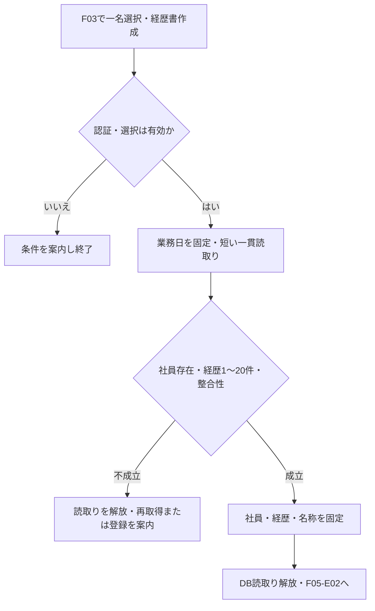
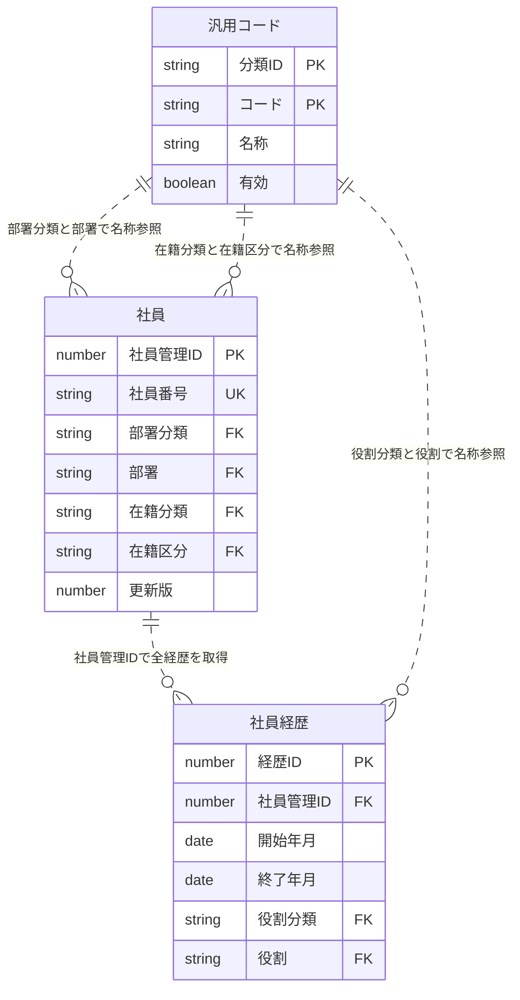
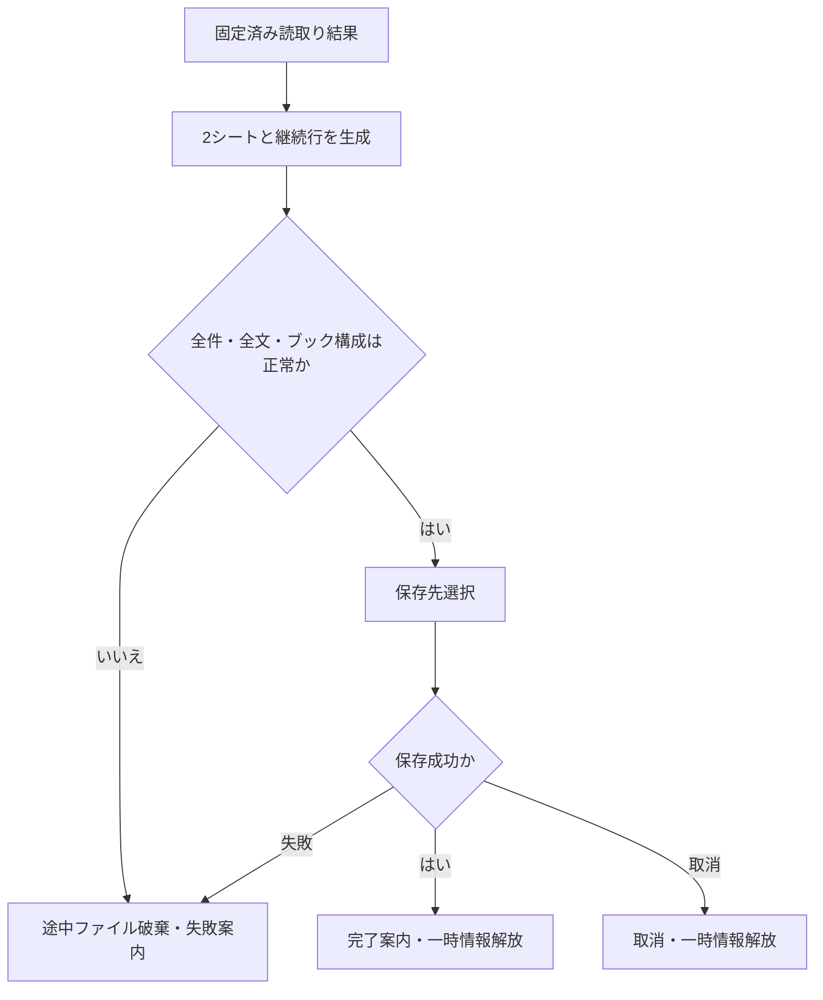
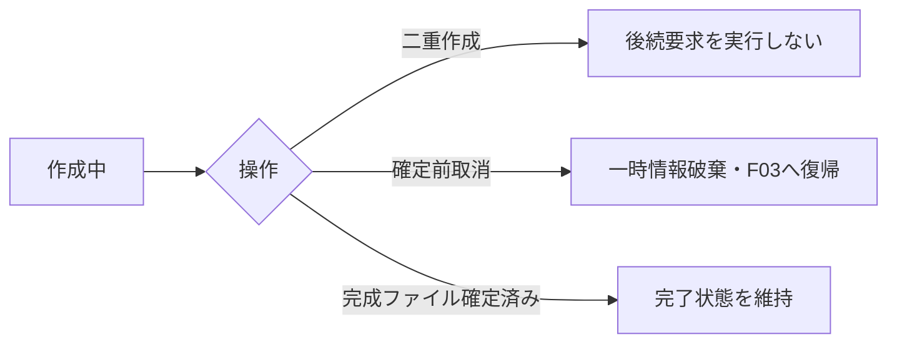

<!-- spec-meta: {"schema":"spec-md/1.0","documentId":"SP2-ACCESS-BAS-F05","version":"1.5","path":"sample-project2/spec/Access/基本設計書/05_経歴書出力.md","sheets":[{"heading":"概要","kind":"GRID","sheet":"01_概要"},{"heading":"項目一覧","kind":"LIST","sheet":"02_項目一覧","key":["項目ID"]},{"heading":"イベント仕様","kind":"GRID","sheet":"03_イベント仕様"},{"heading":"補足説明","kind":"GRID","sheet":"04_補足説明"}],"isolationProfile":"Access"} -->
# 経歴書出力 基本設計書

| 項目 | 内容 |
| --- | --- |
| システム名 | 社員経歴管理システム |
| projectId・対象方式 | sample-project2／Access |
| 機能ID・帳票ID | F05／R01 |
| 版数・改訂日 | 1.3／2026-10-28 |
| 対象読者 | 顧客のIT部門、Agent訓練・DEMOの設計確認者 |
| 状態 | 基本設計。Excel実ファイル生成・アプリ実装・実機印刷は未実施 |

## 概要

### 機能の目的と範囲

F03社員検索で選択した社員1名について、保存済みの社員情報と案件経歴を、日本語の職務経歴書としてExcel形式で出力する。一般職務にも利用し、技術環境と担当工程は任意とする。呼出し時に渡す業務キーは社員IDだけとし、検索一覧の表示値・検索時のrevisionは渡さず、出力開始時点の保存済み全体を一貫再取得する。ログイン済みの管理者・担当者が使用する。社員の一括出力、検索結果一覧のExcel出力、未保存入力の帳票化、PDF、帳票編集画面、送付・メール配信、出力履歴の管理は対象外とする。

出力は `.xlsx` の1ファイルとし、シートは「職務経歴書」「案件経歴」の2枚に固定する。公開事例の記載観点を参考にした本プロジェクト独自様式である。法定様式、JIS様式、採用企業による受入れを保証するものとして扱わない。出典・採用理由・独自設計の区別は[経歴書様式調査](../共通/07_経歴書様式調査.md)に記録する。

### 開始条件と入出力

| 区分 | 対象・扱い |
| --- | --- |
| 開始契機 | F03の「経歴書作成」。現在の検索結果に含まれる社員を1名選択済みであること |
| 権限 | ログイン済みのADMIN・STAFF。未認証・セッション失効は生成開始前に拒否する |
| 画面入力 | 選択社員IDだけ。検索時の版・表示内容は入力しない。基準日は日本の業務日を生成開始時に一度だけ取得する |
| 外部入力ファイル | なし。既存テンプレートのアップロードは受け付けない |
| 永続DB読取り | 社員 m_employee、社員経歴 t_career、汎用コード m_code。部署・在籍・案件役割の名称をコード分類と値の組合せで解決する |
| 永続DB更新 | なし。出力で社員・経歴の更新版を進めない |
| 一時情報 | 整合する時点の社員・経歴・名称・出力基準日・取得日時を保持する読取り結果、生成途中のブック |
| 外部出力ファイル | 職務経歴書_社員番号_yyyyMMdd.xlsx。例：職務経歴書_000001_20261027.xlsx |
| 呼出し後 | Accessの保存先選択へ渡す。取消時はファイルを確定しない。完了・失敗ともF03の条件と選択を保持する |

社員は保存済みであれば経歴0件でも存在できるが、経歴書は1～20件の保存済み経歴がある場合だけ作成できる。出力条件はF03と本機能の双方で検査する。ボタンの無効化だけを検査の代替にしない。

### 帳票レイアウト

画面を新設せず、既存F03から作成する。以下のHTMLは出力帳票の構成を表す架空の仕様見本であり、Accessフォームでも実際のExcelプレビューでもない。実ファイルの改ページ・行高・フォントは後工程で検証する。画面モックとは異なりA4縦の紙面を基準とする。

<!-- report-html-start: R01 -->

<section class="career-report" data-report-id="R01" aria-label="職務経歴書の架空見本">
  <h3>職務経歴書</h3>
  
2026年10月27日現在

  
作成日時（JST）：2026年10月27日 14:30

  <table><tbody><tr><th style="width:24%">氏名</th><td data-item-id="F05-I03">山田 太郎（ヤマダ タロウ）</td></tr><tr><th>社員番号／所属</th><td data-item-id="F05-I02">000001 ／ システム開発部</td></tr></tbody></table>
  <h4>職務要約</h4>
業務システムの設計、開発、テストを担当。利用部門との確認を重ね、操作を簡潔にする改善に取り組んでいます。

  <h4>活かせる経験・知識・技術</h4>
C#による業務画面開発、SQLによるデータ照会、テスト仕様作成。

  <h4>資格</h4>
基本情報技術者試験（2022年取得）

  <h4>自己PR</h4>
利用者への確認事項と対応結果を記録し、認識の相違を早い段階で解消しています。

  
職務経歴書シート：氏名とページ番号をフッターに表示

</section>
<section class="career-report" data-report-id="R01-CAREER" aria-label="案件経歴の架空見本">
  <h3>案件経歴</h3>
山田 太郎 ／ 2026年10月27日現在

  
作成日時（JST）：2026年10月27日 14:30

  <h4 data-item-id="F05-I10">01　販売管理システム改善</h4>
  <table><tbody>
    <tr><th style="width:24%">期間</th><td data-item-id="F05-I11">2025年04月 ～ 現在（1年7か月）</td></tr>
    <tr><th>所属会社／案件</th><td data-item-id="F05-I12">デモシステム株式会社 ／ 製造業向け販売管理</td></tr>
    <tr><th>概要</th><td data-item-id="F05-I13">受注・出荷情報を照会する業務システムの改善。</td></tr>
    <tr><th>担当業務／工程</th><td data-item-id="F05-I14">検索画面の設計とテスト仕様作成。基本設計、実装、テスト。</td></tr>
    <tr><th>実績・工夫</th><td data-item-id="F05-I15">検索条件の整理により、入力手順を簡潔にした。</td></tr>
    <tr><th>開発環境</th><td data-item-id="F05-I16">OS：Windows 言語・FW：C# / ASP.NET Core DB：SQL Server</td></tr>
    <tr><th>役割／チーム人数</th><td data-item-id="F05-I17">メンバー ／ 5名</td></tr>
  </tbody></table>
  
案件経歴シート：直近案件から全件掲載。長文・多数案件は次ページへ継続。

</section>
<!-- report-html-end: R01 -->

### Excelの配置と印刷契約

| 要素 | 設計値・挙動 |
| --- | --- |
| ブック | マクロなしのOffice Open XML。2枚とも表示。秘密情報、接続情報、内部ID、更新版を隠しセル・隠しシートへ書かない |
| 基準紙面 | A4縦、上下左右15mm、ヘッダー・フッター余白7mm。横1ページ・縦自動。ページ数を1に固定して全体を縮小しない |
| 方眼 | 各シートA:Xの24列、各列幅3.0相当、基準行高15pt。これは業務帳票の独自設定であり、仕様書MDの120列方眼とは別の定義 |
| 書体 | 日本語はメイリオ、本文10.5pt、見出し11pt太字、表題18pt。白地、濃紺の見出し線、灰色の罫線。印刷時の実フォント・文字欠けは後工程で確認する |
| 表題と日付 | A1:X2を表題、A3:X3を基準日、A4:X4を作成日時（JST）、A5:F5を氏名ラベル、G5:X5を氏名、A6:F6を社員番号・所属ラベル、G6:X6を値とする。氏名・所属が収まらなければ行を増やす |
| 職務経歴書シート | 8行目から職務要約、活かせる経験・知識・技術、資格、自己PRの順。各章見出しA:X、本文A:X。章見出しの次行から必要行数を展開し、後続章の開始行を後へ送る |
| 案件経歴シート | 1～3行目を表題・氏名・基準日、4行目を作成日時（JST）。5行目から案件連番・案件名、期間、所属会社、概要、担当業務、工程、実績・工夫、開発環境、役割・人数の順。ラベルA:F、値G:X。全20件まで可変行で積む |
| 長文 | 元の改行を保持し、長い論理行を最大32Unicodeスカラー相当の継続行に分ける。結合文字・絵文字の表示単位を途中分割しない。実フォントで横幅に収まらなければさらに分割する。各行を15pt以上で確保し、固定行高の結合セル1個へ全文を詰めない |
| 継続と改ページ | 章・案件の見出しと最初の本文行を同じページに置く。長い案件はページ境界で分割し、次ページに案件連番・案件名・「続き」と対象欄名を再掲する。再掲ラベルは元データに混入しない |
| 行高の上限対策 | 各文字列を複数行・複数セルへ配置し、Excelの1行高409ptや1セル32,767文字の限界に依存しない。全文到達が不可能なら出力を失敗にし、切捨てたブックを渡さない |
| 印刷範囲とフッター | A1:X最終行を印刷範囲とする。氏名、シート名、作成日時（JST）、ページ番号/総ページ数をフッターに表示する。自動拡大で紙幅を超えない |
| 値の型 | 全業務文字列・社員番号・日付表示は文字列として格納し、先頭ゼロと日本語を保持する。利用者入力の先頭が =、+、-、@ でも数式にしない。数式・マクロ・外部リンク・データ接続は使用しない |

32文字は保守的な行分割の設計基準であり、表示幅の実測を代替しない。改ページ位置・余白・文字サイズ・結合セルの行高を実Excelの印刷プレビューで確認するまで、印刷可能性を検証済みとしない。

## 項目一覧

| 項目ID | 項目グループ | 項目名 | コントロール | 必須 | 入力制限 | フォーマット | 初期値 | DBテーブル名 | DB項目名 | 備考 |
| --- | --- | --- | --- | --- | --- | --- | --- | --- | --- | --- |
| F05-I01 | 出力情報 | 出力基準日 | Excelセル | 〇 | - | yyyy年MM月dd日現在 | 業務日 | - | - | 生成中固定。 |
| F05-I02 | 基本情報 | 社員番号・所属 | Excelセル | 〇 | - | 社員番号6桁／部署名 | - | 社員 汎用コード | 社員：社員番号・部署分類・部署 汎用コード：分類ID・コード・名称 | 先頭ゼロ保持。DEPARTMENT参照。 |
| F05-I03 | 基本情報 | 氏名・カナ | Excelセル | 〇 | - | 氏名／カナ | - | 社員 | 氏名・氏名カナ |  |
| F05-I04 | 出力条件 | 選択社員識別子 | - | 〇 | - | - | - | 社員 | 社員管理ID | F03の社員ID1名。未選択不可。検索版は渡さない。 |
| F05-I05 | 出力条件 | 在籍区分 | - | 〇 | - | - | - | 社員 汎用コード | 社員：在籍分類・在籍区分 汎用コード：分類ID・コード・名称 | 在籍判定用。EMPLOYMENT_STATUS参照。退職も対象。 |
| F05-I06 | 職務 | 職務要約 | Excelセル |  | - | 改行 | 未記入 | 社員 | 職務要約 |  |
| F05-I07 | 職務 | 活かせる経験・知識・技術 | Excelセル |  | - | 改行 | 未記入 | 社員 | スキル・得意分野 | 経験年数の自動集計なし。 |
| F05-I08 | 職務 | 資格 | Excelセル |  | - | 改行 | 未登録 | 社員 | 保有資格 | 取得年月は記入どおり。 |
| F05-I09 | 職務 | 自己PR | Excelセル |  | - | 改行 | 未記入 | 社員 | 自己PR |  |
| F05-I10 | 経歴 | 案件連番・案件名 | Excelセル | 〇 | - | 連番2桁／案件名 | 01 | 社員経歴 | 案件名・開始年月・経歴ID | 開始年月・経歴IDの降順。全件掲載。 |
| F05-I11 | 経歴 | 期間・参画月数 | Excelセル | 一部 | - | yyyy年MM月～yyyy年MM月 | 現在 | 社員経歴 | 開始年月・終了年月 | 開始必須。終了空欄は継続中。期間は両端月を含む。 |
| F05-I12 | 経歴 | 所属会社 | Excelセル | 〇 | - | - | - | 社員経歴 | 会社名 | 前職可。匿名表現保持。 |
| F05-I13 | 経歴 | 案件概要 | Excelセル | 〇 | - | 改行 | - | 社員経歴 | 業務概要 |  |
| F05-I14 | 経歴 | 担当業務・担当工程 | Excelセル | 一部 | - | 業務／工程を別表示 |  | 社員経歴 | 担当業務・担当工程 | 業務必須、工程任意。 |
| F05-I15 | 経歴 | 実績・工夫 | Excelセル |  | - | 改行 |  | 社員経歴 | 実績・成果 |  |
| F05-I16 | 経歴 | 開発環境 | Excelセル |  | - | 改行 |  | 社員経歴 | 技術環境 | OS・言語/FW・DBは自由記入。 |
| F05-I17 | 経歴 | 役割・チーム人数 | Excelセル | 〇 | - | 役割名／人数＋名 | - | 社員経歴 汎用コード | 社員経歴：役割分類・役割・チーム人数 汎用コード：分類ID・コード・名称 | PROJECT_ROLE参照。 |
| F05-I18 | 出力情報 | 出力ファイル名 | - | 〇 | - | 職務経歴書_社員番号_yyyyMMdd.xlsx | - | 社員 | 社員番号 | 社員番号・業務日から生成。氏名は含めない。 |
| F05-I19 | 出力情報 | 作成日時（取得日時） | Excelセル | 〇 | - | yyyy年MM月dd日 HH:mm | 取得日時 | - | - | JST。取得時点固定。両シートと印刷フッターへ表示。 |

## イベント仕様

### F05-E01 出力条件確認と一貫読取り

#### 処理概要

選択社員1名と保存済み経歴を、コード名称を含め整合する1時点の内容で取得する。

#### 処理手順

1. **受付・現在権限の確認**
   1. 同じ画面の作成中要求を拒否してMSG-029とする。認証の有効期限を検査し、F03の現結果から選択された社員管理IDが1人分であることを確認する。未選択・複数選択・結果外IDはMSG-011。
   2. F05-DB00で内部利用者IDの現在の利用可能・役割を1件確認する。無効・不存在はMSG-002で再認証、許可外役割はMSG-003で出力しない。検索時の版や表示値は受け取らず、社員の保存済み全体を再取得する。

2. **読取り時点・対象・項目の確認**
   1. Accessは全更新処理と共通の更新ゲートを取得した後に読取り時点を確立する。待ち上限はMSG-027、一貫読取り時点を確立できなければMSG-028。確立した取得日時と、その日時から求めたJSTの基準日を一度固定する。帳票の基準日と作成日時を処理の途中で取り直さない。
   2. 同じ読取り時点で社員1件、当該社員の経歴全件、部署・在籍・役割の名称を取得する。社員0件はMSG-019、複数一致はMSG-020。経歴0件はMSG-012で登録を案内、21件以上はMSG-020で全出力を止める。20件で切り捨てない。
   3. 出力対象社員の番号・氏名・カナ・固定分類・コードと、経歴ごとの内部ID・所属社員・全編集項目を確認する。必須、文字数、人数1～999、月初日で保存された年月、1900-01以上、開始≦終了≦基準年月を検査する。終了未設定は開始≦基準年月で継続中。前職と期間重複は正常で、期間が重なるだけでは除外しない。

3. **参照整合・読取り結果の固定**
   1. 部署分類DEPARTMENT、在籍分類EMPLOYMENT_STATUS、役割分類PROJECT_ROLEとコードの組に対して各名称が1件であることを確認する。停止既存値はその名称を保持する。参照不足・複数一致・分類違い、同一経歴ID重複、別社員の明細、正規化後の11編集値がすべて同じ複数経歴、保存項目の不整合はMSG-020とし、欠落行だけを落として成功させない。会社名/案件名や期間だけの一致は不整合にせず、保存済み全11値重複には入力中のMSG-026を使わない。
   2. 開始年月降順・同年月は経歴ID降順で経歴1～20件を固定する。任意欄の空を許し、全欄の原文・改行・論理経歴件数を生成用データへ保持する。検査成功後にトランザクションと更新ゲートを解放しF05-E02へ進む。Excel生成中はDBを占有しない。

チェックは参照する処理手順の順で行う。共通CHKとMSGの正本は[チェック・メッセージ設計](../共通/04_チェック・メッセージ設計.md)に置く。

| チェックID | 共通規則 | 参照手順・条件 | 不成立MSG | 復帰・変更範囲 |
| --- | --- | --- | --- | --- |
| CHK-F05-01 | CHK-C01・C02 | 手順1.1～1.2：未処理・認証・現在役割・一人選択 | MSG-029／MSG-002／MSG-003／MSG-011 | 出力なし。認証切れはF01、他はF03 |
| CHK-F05-02 | CHK-C12 | 手順2.1：一貫読取り時点を確立できる | MSG-027／MSG-028 | 全読取り解放、F03条件保持 |
| CHK-F05-03 | CHK-C09 | 手順2.2：対象社員がちょうど1件 | MSG-019／MSG-020 | 不存在は選択解除。不整合は管理者確認 |
| CHK-F05-04 | CHK-C10 | 手順2.2：経歴1～20件を全取得 | MSG-012／MSG-020 | 0件は登録案内、超過は全出力取消 |
| CHK-F05-05 | CHK-C03～C06 | 手順2.3：必須・上限・人数・保存年月と相互関係 | MSG-020 | 保存内容は修復せず全出力取消 |
| CHK-F05-06 | CHK-C07～C09 | 手順3.1：分類とコードで各1件、明細の所有と一意性 | MSG-020 | 停止既存は除外しない。不整合は全取消 |
| CHK-F05-07 | CHK-C12 | 手順3.2：全件・全文・順序を固定して資源解放 | MSG-028 | 部分結果を公開しない。再要求は全再取得 |

#### 処理フロー

#### SQL・テーブル関連（ER図）

社員・社員経歴の主キーはそれぞれ社員管理ID・経歴ID。社員経歴の社員管理IDは社員への参照、各分類とコードは汎用コードの複合キー（分類ID・コード）への参照を表す。線は論理参照の多重度であり、実行時のJOINは下表の照合条件で個別に示す。部署分類=DEPARTMENT、在籍分類=EMPLOYMENT_STATUS、役割分類=PROJECT_ROLEを確認し、コード値だけでは名称を結合しない。利用者の有効性再確認は認証の処理として行い、認証情報を帳票データへ結合しない。コード分類は固定値の定義であり、本機能では表自体を読まない。物理FKやSQLの構文は詳細工程で具体化する。

#### DB操作の詳細

| 操作ID | 対象 | 読取り条件・結合キー | 取得する論理項目・件数・順序 | 更新・確定・取消 |
| --- | --- | --- | --- | --- |
| F05-DB00 | 利用者 | 一時認証状態の利用者IDと一致。利用可能であり、現在の利用者役割がADMIN/STAFFであることを確認 | 利用者ID・利用可能・利用者役割、1件。帳票用データには含めない | 更新0件。0件/停止/役割不一致なら読取りを開始しない |
| F05-DB01 | 社員 | F03から渡された社員管理IDと一致。検索時の版・表示値を条件にせず保存済み全体を再取得 | 社員管理ID・社員番号・氏名・氏名カナ・部署分類・部署・在籍分類・在籍区分・職務要約・スキル・得意分野・保有資格・自己PR・更新版。1件 | 更新0件。同じ一貫読取単位内でDB02/03へ。0件なら全出力取消 |
| F05-DB02 | 社員経歴 | 社員経歴.社員管理ID=DB01の社員管理ID | 経歴ID・社員管理ID・開始年月・終了年月・会社名・案件名・業務概要・担当業務・実績・成果・技術環境・役割分類・役割・チーム人数・担当工程の14項目。1～20件、開始年月降順→経歴ID降順 | 更新0件。0件は経歴登録案内。20件超・不整合は全出力取消。欠けた件数で帳票を成功させない |
| F05-DB03 | 汎用コード | 部署：（社員.部署分類・部署）=（分類ID・コード）。在籍：（社員.在籍分類・在籍区分）=同複合キー。役割：（経歴.役割分類・役割）=同複合キー | 分類ID・コード・名称。各参照につき1件、同じキーの名称は同一読取で一度取得して再利用可。停止済みも取得 | 更新0件。参照先0件/複数件は全出力取消し、管理者への確認を案内 |

経歴件数は名称結合前の社員経歴の生の行数で数え、名称参照で行を減らさない。保存済み11編集値完全一致もMSG-020の対象とする。DB01～03を同じ一貫読取時点に固定し、社員・経歴・参照名称を取得し終えたらDB資源を解放する。所属名称は部署の現在名称、在籍・役割も取得時点の名称を採用する。社員・経歴・コードの追加/更新/削除、更新版・更新日時・更新者の変更はすべて0件。Excel生成/保存の失敗によって、DBを変更したり取得後の再照会で別時点を混在させたりしない。

#### 結果・例外時の扱い

MSGの文言は[チェック・メッセージ設計](../共通/04_チェック・メッセージ設計.md)を正本とする。社員未選択はMSG-011、社員不存在はMSG-019、経歴0件はMSG-012、保存内容・参照・件数の不整合はMSG-020、排他待ち上限はMSG-027、一貫取得不能はMSG-028と区別する。複数条件が不成立ならCHK-F05-01からの順で最初の成立原因を案内し、途中の帳票は出さない。

成功は社員1件と経歴1～20件の全量取得、業務DB更新0件。一貫読取り完了後に他操作が更新しても固定済みの値へ混ぜない。取得日時は帳票の「作成日時（JST）」にyyyy年MM月dd日 HH:mmで表示し、基準日は継続期間算定に使う。生成中の日付またぎでも両値を維持する。社員不存在だけはF03の選択を解除し、その他の取得・生成失敗は認証有効なら検索条件を保持する。

### F05-E02 Excelブック生成と受渡し

#### 処理概要

固定した読取り結果から2シートのExcelファイルを組み立て、生成成功時だけ利用者へ渡す。

#### 処理手順

1. **固定内容の配置・期間算定**
   1. F05-E01の固定済み結果だけを使う。取得した論理経歴件数を保持し、生成途中で社員・経歴・コードを再照会しない。取得後に名称が変更されても同一ファイルへ新旧名称を混在させない。
   2. 「職務経歴書」と「案件経歴」の2シートを生成する。社員の保存済み記述と1～20件の全経歴を配置し、案内・基準日・作成日時・継続表示以外の経歴本文を補完しない。未設定の任意欄は既定の空欄表示とし、架空のスキルや資格を加えない。
   3. 完了案件は終了年月、継続中は固定した基準年月まで、両端月込みで `(終年－始年)×12＋終月－始月＋1` を計算する。同月は1か月。前後不正を計算式で丸めずエラーとする。並行参画の月数を通算経験へ加算しない。

2. **全文配置・内容検査・受渡し前認可**
   1. 原文・元改行・先頭ゼロを保持し、長文は継続行と改ページを増やして全文を配置する。論理経歴1件が複数行・ページになっても論理件数は1のまま。セル・行・印刷領域の制約に収まらなければ切捨てや極端な縮小をせず生成失敗とする。
   2. 公開前にブックを読み戻す設計とし、2シート、社員番号・氏名、基準日・取得日時、全経歴IDの内部対応と並び順、原文・改行・全量の一致、月数を検査する。経歴20件目や任意欄の最後まで一致しなければMSG-037。先頭が=・+・-・@等でも原値の文字列として格納し、数式・マクロ・外部リンク・外部参照を含めない。検査済みでもまだ利用者へ渡さない。
   3. 受渡し直前に認証の無操作30分境界とF05-DB00の利用者1件を現在値で再検査する。失効・停止・消失はMSG-002、許可外役割はMSG-003とし、完成済みでも受渡し前なら破棄する。ADMINからSTAFFへの変更でも現在役割が許可内なら継続可。この再検査は認証だけで、帳票本文の再取得ではない。

3. **保存先選択・ファイル確定**
   1. 保存先選択で取消ならMSG-030として一時ブックを破棄する。同名があれば上書き確認し、拒否は保存先選択へ戻す。対話中に時間が経過したら手順2.3を保存確定直前にも行い、未認証状態で最終名を公開しない。
   2. 検査済みの完成ファイルだけを選択先へ確定する。既存ファイルは新しい完成出力の確定まで保持し、権限・容量・ファイル使用中・確定失敗では既存内容を壊さずMSG-013とする。途中ファイルを最終名で公開しない。
   3. ファイル1冊・2シートの確定成功後だけMSG-014と保存したファイル名を示す。一時情報を解放し、認証有効ならF03の条件・選択を保持する。保存完了後の閉じる操作を取消扱いにして完成ファイルを消さない。

チェックは参照する処理手順の順で行う。共通CHKとMSGの正本は[チェック・メッセージ設計](../共通/04_チェック・メッセージ設計.md)に置く。

| チェックID | 共通規則 | 参照手順・条件 | 不成立MSG | 復帰・変更範囲 |
| --- | --- | --- | --- | --- |
| CHK-F05-08 | CHK-C12 | 手順1.1～1.2：固定済み原文・全経歴だけを使用 | MSG-037 | 完成ファイルを公開せず全破棄 |
| CHK-F05-09 | CHK-C06 | 手順1.3：完了・継続の月数が正しく1か月以上 | MSG-020／MSG-037 | 不正を丸めず出力取消 |
| CHK-F05-10 | CHK-C12 | 手順2.1～2.2：2シート・全件・全文・改行・数式等なし | MSG-037 | 検査済みになるまで受渡しなし |
| CHK-F05-11 | CHK-C01 | 手順2.3：受渡し直前も認証有効・現在利用者が許可内 | MSG-002／MSG-003 | 一時ブック破棄。業務データ変更なし |
| CHK-F05-12 | CHK-C12 | 手順3.1～3.3：保存先・上書き承認と完成ファイル確定 | MSG-030／MSG-013 | 取消は確定前破棄。確定失敗は既存ファイル保持。成功はMSG-014 |

#### 処理フロー

#### SQL・テーブル関連（ER図）

帳票本文はF05-E01の固定済み結果だけを使い、業務表の追加ER図は不要。受渡し直前は認証確認として利用者単表を1件参照するが、利用者を帳票データと結合しない。既存の業務関係図はF05-E01を適用する。

#### DB操作の詳細

社員・社員経歴・汎用コードの追加読取り・更新・確定は0件。F05-E01で固定した読取り結果をブックへ使用する。例外は受渡し直前の認証再確認だけで、F05-DB00を再適用して現在の利用者を1件参照し、利用可能・現在役割を検査する（更新0件）。認証再確認の失敗を帳票データの再照会で補わず、DB資源を解放する。Excel作成・ファイル保存・応答開始は業務DBのコミットを意味しない。生成途中のブックを業務DBへ保存しない。

#### 結果・例外時の扱い

内容検査不成立はMSG-037、保存先取消はMSG-030、権限・空き容量・ファイル使用中・書込み/確定障害はMSG-013とする。認証切れ/停止はMSG-002、許可外役割はMSG-003を優先し受渡しを止める。上書き拒否は保存先選択へ戻り、失敗にも保存成功にも数えない。成功は完成ファイル1冊の確定を確認した時だけMSG-014とする。

取消・失敗は業務DB更新0件。確定前の一時出力を破棄し既存ファイルを保持する。確定後のファイルを自動で削除しない。全文・元改行の省略で成功にしない。再出力はF05-E01から全再取得し、前回のブックやスナップショットを流用しない。

### F05-E03 処理中の重複要求と取消

#### 処理概要

同じ操作画面からの二重作成と取消を制御し、不完全な出力を渡さない。

#### 処理手順

1. **作成受付・重複要求抑止**
   1. 同じ操作画面では作成開始から成功・失敗・取消まで作成操作を無効にし、MSG-029を表示する。別画面や他利用者の処理まで一律に禁止しない。
   2. 二重要求は画面状態だけでなく処理の受付側でも拒否し、後続はDB読取り0件・ブック生成0冊とする。既存要求の状態を後続要求で完了扱いへ変えない。

2. **取消・認証失効・資源解放**
   1. 保存先選択の取消・確定前の中断はMSG-030として一時ブックを破棄する。同名上書き拒否は作成全体の取消とせず保存先選択へ戻す。確定成功後の閉じる操作は完了状態を維持し、保存済みファイルを削除しない。
   2. 最終名での確定前の認証失効は、完成済み一時ブックでも破棄しMSG-002で再認証を求める。完成ファイルの確定後に停止・失効を検知しても、保存済みファイルを自動削除しない。
   3. どの終了経路でも、その要求が所有する一時ブック・読取り資源・処理中状態を解放する。他要求の一時資源を消さない。認証有効ならF03を再操作可能にし、次回作成は新しいF05-E01として開始する。

チェックは参照する処理手順の順で行う。共通CHKとMSGの正本は[チェック・メッセージ設計](../共通/04_チェック・メッセージ設計.md)に置く。

| チェックID | 共通規則 | 参照手順・条件 | 不成立MSG | 復帰・変更範囲 |
| --- | --- | --- | --- | --- |
| CHK-F05-13 | CHK-C02 | 手順1.1～1.2：同一画面の先行要求がない | MSG-029 | 後続は取得0件・生成0冊 |
| CHK-F05-14 | CHK-C01・C12 | 手順2.1～2.2：完成ファイル確定前/後と認証失効を区別 | MSG-030／MSG-002 | 確定前だけ破棄し、確定済みファイルは保持 |
| CHK-F05-15 | CHK-C12 | 手順2.3：要求所有の資源と処理中状態を全経路で解放 | MSG-013 | 他要求は変更せず、再要求は新規取得 |

#### 処理フロー

#### SQL・テーブル関連（ER図）

DB操作なし。操作画面の処理状態だけを扱うためER図を省略する。

#### DB操作の詳細

なし。取消によるDB削除・更新や、他の利用者の保存済みデータへの操作を行わない。

#### 結果・例外時の扱い

保存取消はMSG-030、処理中再操作はMSG-029。保存確定後に取消要求が到着しても、完成済みファイルを削除せず完了状態を維持する。失敗・取消時も社員・経歴・コードは更新0件。認証切れはMSG-002を優先し、認証有効の取消ならF03の条件・選択を保持する。

## 補足説明

記号は[共通UI](../共通/03_共通UI・入力設計.md)に従う。初期値は未設定時の代替表示又は生成開始値。保存値がある場合は保存値を使う。空の表示は空欄、初期値が適用されない項目は「-」とする。帳票は保存済み値のみを出力し、補完・切捨てを行わない。文字数制約は参照元のテーブル仕様に従う。Excelセルは出力先で、入力欄やセル保護を追加した意味ではない。

### データの忠実性

出力するのは保存済みの事実であり、社員の能力評価・経験年数・成果の水増しは行わない。前職、並行参画、継続中の案件を許容する。住所、生年月日、性別、写真、ログインID・パスワード、内部ID、監査用更新者は出力しない。社員番号・所属はこのDEMOの社内識別用の独自採用項目であり、すべての応募先が求める項目として説明しない。

### 検査範囲と受入観点

基本設計の静的確認では、F03からの選択連携、項目と保存値の対応、権限、0件・20件、同月・継続期間、停止コード保持、並行更新、一貫読取り、取得日時と基準日の区別、検索版を受け取らない再取得、保存取消、数式に見える文字列、長文の全量配置を確認する。後工程では日本語の長い氏名、1000文字各欄、20案件、長い連続文字、結合文字、元改行、先頭ゼロ、同名ファイル、容量不足を含むExcel生成・読戻し・印刷プレビューを実施する。

今回は仕様本文の作成までとする。実ブックの読戻し、Excelでの表示・改ページ・印刷、Accessからの保存、処理時間測定、実装受入れ、正式採点は未実施。未実施の正式率はnullとする。

### 関連文書

[システム概要](../共通/01_システム概要.md)、[共通UI・入力設計](../共通/03_共通UI・入力設計.md)、[チェック・メッセージ設計](../共通/04_チェック・メッセージ設計.md)、[日付・データアクセス仕様](../共通/05_日付・データアクセス仕様.md)、[経歴書様式調査](../共通/07_経歴書様式調査.md)、[テーブル仕様書](07_テーブル仕様書.md)、[QA](../QA.md)。業務仕様の参照は本方式のspecRoot内で閉じる。

### Pilot確認シナリオ（設計・未実施）

1. CHK-F05-02～07：20件の経歴に長文・元改行・停止役割・同月案件・継続案件・前職・期間重複を混在させ、読取り途中の別更新も重ねる。固定時点の全20件だけを同じ名称で取得し、新旧混在・20件目欠落を許さない。
2. CHK-F05-05・09～10：日付をまたぐ生成でも継続月数と基準日を固定し、同月1か月を確認する。保存年月が月初でない、未来月、21件、コード欠落は全取消。数式に見える先頭文字を文字列として読み戻し、全文一致を確認する。
3. CHK-F05-11～15：生成後、受渡し直前に利用者停止又は無操作失効を発生させる。完成ブックがあっても受渡し0冊。重複要求は後続生成0冊。保存取消はMSG-030、確定失敗はMSG-013、確定成功はMSG-014と区別し、既存ファイルと確定後の完成ファイルを自動削除しない。
