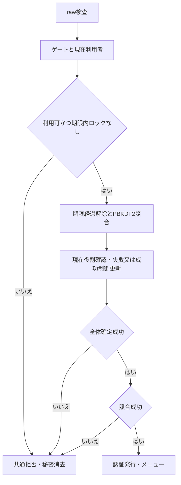
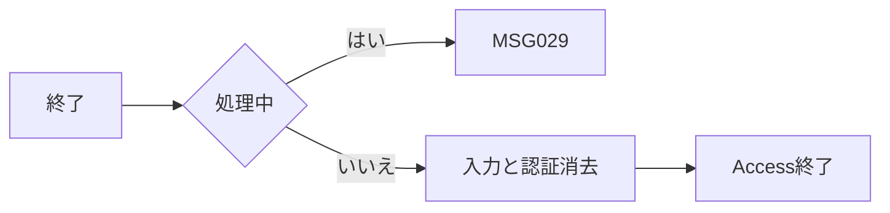

<!-- spec-meta: {"schema":"spec-md/1.0","documentId":"SP2-Access-DET-F01","version":"1.0","path":"sample-project2/spec/Access/詳細仕様書/01_ログイン画面.md","sheets":[{"heading":"概要","kind":"GRID","sheet":"01_概要"},{"heading":"項目一覧","kind":"LIST","sheet":"02_項目一覧","key":["項目ID"]},{"heading":"イベント仕様","kind":"GRID","sheet":"03_イベント仕様"},{"heading":"補足説明","kind":"GRID","sheet":"04_補足説明"}]} -->
# F01 ログイン画面 詳細仕様書

| 項目 | 内容 |
| --- | --- |
| 方式／版／工程 | Access／1.0／2026-10-28／detail-design |
| 入力 | [基本F01](../基本設計書/01_ログイン画面.md)、[要件](../要件定義書.md) REQ-F-002・D-005 |
| 状態 | 詳細設計。CNG・DAO・Access実機未検証、利用者承認未実施 |

## 概要

未連結`frmLogin`から`modSecurity.Authenticate(loginRaw As String,passwordRaw As String) As clsResult`を呼ぶ。利用者m_app_userだけを参照し、失敗回数／ロック期限だけを更新する。社員・経歴・コード更新は0件、外部ファイルなし。資格情報は[共通実装](../共通/方式別/01_共通実装仕様.md)のPBKDF2形式、私有Workspaceとnamed mutex、UTF-8変換を適用する。F01は初期設定済みデータを認証し、通常起動時に利用者を作らない。

Form Detail原点(0,0)、96DPI設計基準1366×768px。基本の幅460pxパネル=6900twip、ID240px=3600twip、パスワード320px=4800twip、入力32px=480twip、ボタン34px=510twip、Yu Gothic UI 11pt。初期ID→秘密→ログイン→終了のTab順。パスワードTextBoxはInputMask="Password"、未連結で原文をログ／DTOへ持ち越さない。基本配置は次の同一断片を使い実機のDPI検査は別とする。

<!-- screen-html-start: F01 -->
<style>
.sp2-f01,.sp2-f01 *{box-sizing:border-box}.sp2-f01{padding:24px;color:#243448;background:#efefef;font:14px/1.5 "Yu Gothic UI",Meiryo,sans-serif}.sp2-f01 .panel{width:460px;max-width:100%;padding:24px;border:1px solid #aab8c5;background:#efefef}.sp2-f01 h3{margin:0 0 16px;font-size:21px}.sp2-f01 label{display:block;margin:10px 0 4px}.sp2-f01 input{height:32px;max-width:100%;padding:4px 8px;border:1px solid #8c9caa;font:inherit}.sp2-f01 .id{width:240px}.sp2-f01 .pw{width:320px}.sp2-f01 .message{min-height:24px;color:#a12222}.sp2-f01 .actions{display:flex;gap:10px;margin-top:18px}.sp2-f01 button{height:34px;padding:3px 18px;font:inherit;border:1px solid #6e8294;background:#efefef}.sp2-f01 .primary{background:#e6e6e6;color:#222}.sp2-f01 :focus-visible{outline:3px solid #b65400;outline-offset:2px}
</style>
<div class="sp2-f01" aria-label="ログイン画面の仕様モック">
<div class="panel"><h3>社員経歴管理システム</h3><p>ログインIDとパスワードを入力してください。</p><div class="message" data-item-id="F01-I03" role="status">&nbsp;</div><label for="sp2-login-id">ログインID</label><input id="sp2-login-id" class="id" data-item-id="F01-I01" data-max-scalars="20" autocomplete="username"><label for="sp2-login-pw">パスワード</label><input id="sp2-login-pw" class="pw" data-item-id="F01-I02" type="password" data-max-scalars="128" autocomplete="current-password"><div class="actions"><button class="primary" data-item-id="F01-I04">ログイン</button><button data-item-id="F01-I05">終了</button></div></div>
</div>
<!-- screen-html-end: F01 -->

## 項目一覧

| 項目ID | 項目グループ | 項目名 | コントロール | 必須 | 入力制限 | フォーマット | 初期値 | DBテーブル名 | DB項目名 | 備考 | 物理Control・出力先 | 状態変数・VBA型 | raw上限・単位 | 正規化／保存上限・NULL | 物理DB列・型 | 入出力・候補・状態 |
| --- | --- | --- | --- | --- | --- | --- | --- | --- | --- | --- | --- | --- | --- | --- | --- | --- |
| F01-I01 | 認証情報 | ログインID | TextBox | 〇 | 半角英数字20字 | - | 空 | 利用者 | ログインID | 大小文字を区別せず照合。前後空白除去・英字大文字化。 | txtLoginId | LoginRaw As String | 20 scalar（正規化前も検査） | 1～20 ASCII、必須／Null不可 | m_app_user.login_id TEXT20 NOT NULL | 入力→大文字ID照合 |
| F01-I02 | 認証情報 | パスワード | TextBox（パスワード） | 〇 | 12～128字 | 伏字 | 空 | 利用者 | パスワード検証情報 | 空白を含め加工しない。原文保存・再表示・ログ出力禁止。検証情報と照合。 | txtPassword | PasswordRaw As String | 128 scalar | 12～128 scalar、原文は保存なし | password_verifier LONGTEXT NOT NULL（原文とは別） | 入力→CNG、失敗／終了時消去 |
| F01-I03 | 案内 | メッセージ | Label | - | - | - | 空 | - | - | 認証失敗は共通文言。 | lblMessage | Result.MessageId As String | 非適用 | 保存なし | 非適用 | MSGを論理文言へ表示 |
| F01-I04 | 操作 | ログイン | CommandButton | - | - | - | - | - | - | 認証成功でメニューへ。 | cmdLogin | Authenticate As clsResult | 非適用 | 保存なし | 非適用（F01-E01が制御2列だけ更新） | Click→F01-E01 |
| F01-I05 | 操作 | 終了 | CommandButton | - | - | - | - | - | - | 認証状態を破棄。 | cmdExit | ExitRequest As Boolean | 非適用 | 保存なし | 非適用 | Click→F01-E02 |

## イベント仕様

### F01-E01 ログイン

#### 処理概要

有効な利用者1件を確認し、ロック制御の原子的確定後に認証を発行する。不存在／停止／ロック／照合・DB失敗の外向き結果を統一する。

#### 処理手順

1. **受付・入力固定**
   1. cmdLogin_ClickでIsBusyを先に確認し、先行中はCHK-F01-01・MSG-029「処理中です。完了までお待ちください。」だけを返す。取得したIDとパスワードを今回要求のローカルStringへ固定し、以降のUI変更で差し替えない。
   2. ID→秘密の順にCHK-F01-02を適用。IDは前後空白除去・ASCII英数字1～20・大文字化、秘密は無加工12～128scalar。不備はMSG-004「{項目名}を入力してください。」又は005「{項目名}の形式または上限を確認してください。」、DB更新0件、ID保持・秘密消去。
2. **排他内で現在制御を判定**
   1. 10秒ゲートを取得しprivate Workspaceを開き、BeginTrans後にlogin_id照合で0/1件を特定、0又は停止はMSG-001、複数／回数0～5以外等は内部Integrityとしても外向き001。現在のpassword_verifier／役割／失敗回数／期限を取り直す（CHK-F01-03/04）。
   2. 現在制御値再取得後のUtcNowを1回固定し、期限>nowなら照合・更新0件、期限<=nowなら0/Nullへ解除した値から今回試行を扱う。ロック判定に表示時の丸めた分やJST日付を使わない（CHK-F01-05/06）。
3. **照合・制御確定・セッション発行**
   1. BCryptDeriveKeyPBKDF2へUTF-8秘密と保存saltを渡し全32byteを比較する。不一致なら現在回数+1、5回目だけnow+15分。既にロック中へ変わった後行要求を6回目へ増やさない。
   2. 一致でも現在is_enabled／role_idがADMIN又はSTAFFであることを同じゲート内で確認する。成功はfailed_count=0／locked_until=Nullだけを設定し、同値なら更新0件を許す。失敗制御変更を業務revisionへ流用しない（CHK-F01-07）。
   3. CommitTrans dbForceOSFlush成功後にだけclsSessionへuser_id／display_name／role_id／LastActivityTickを設定してF02へ。DB確定障害ならセッションを発行せず全外向き001。全経路で秘密ローカルと欄を解放し、DAO／ゲートを閉じる（CHK-F01-08）。

#### 処理フロー



#### SQL・テーブル関連（ER図）

m_app_user単表のため複数表ERは非適用。user_idがPK、login_idが大小無視一意で、入力login_idからPKを解決後はPKだけで制御する。表示名／roleを画面入力から取得しない。

#### DB操作の詳細

```sql
PARAMETERS pLogin Text(20);
SELECT user_id,login_id,display_name,password_verifier,role_id,
 is_enabled,failed_count,locked_until
FROM m_app_user WHERE UCase(login_id)=pLogin;
```

```sql
PARAMETERS pUser Text(40), pFailures Byte, pUntil DateTime;
UPDATE m_app_user SET failed_count=pFailures, locked_until=pUntil
WHERE user_id=pUser;
```

| 操作ID | 入出力・条件・期待件数 | 確定と保持 |
| --- | --- | --- |
| F01-DB01 | pLogin=正規化ID/dbText20、snapshot0/1件。2件はIntegrity | 参照だけ。取得障害も認証を発行しない |
| F01-DB02 | ロック期限>nowは照合0・更新0 | 全列保持。回数加算／延長なし |
| F01-DB03 | 期限経過を0/Nullと今回試行の結果へ一括移送 | 解除だけで中間Commitしない |
| F01-DB04 | 不一致: pFailures=現回数+1/dbByte、pUntil=5ならUTC+15分/dbDate、他はNull、pUser=dbText40。期待1 | user_id/login_id/display_name/password_verifier/role_id/is_enabledは保持 |
| F01-DB05 | 一致: 0/Null、変更あり期待1・既に同値0。対象存在と有効は別確認 | private Workspace単一Tx。Commit後だけセッション発行、失敗は発行0件 |

更新QueryDefへNullのDate Parameterをそのまま渡す。RecordsAffectedが期待外ならRollbackし、回数／期限を部分確定しない。CNG失敗や不正verifierはログへ秘密を載せず共通拒否とする。

#### 結果・例外時の扱い

共通拒否MSG-001「ログインできません。入力内容を確認し、時間をおいて再度お試しください。」でID保持・秘密消去・秘密欄へfocus。ID存在／停止理由／回数／解除時刻は画面へ返さない。内部は受付番号、F01-E01、工程、DAO/CNG分類、取消確認／成否不明だけを記録する。成功確定後に別操作が停止した場合は以後の保護操作が現在値で拒否し、ログイン1回で全期間を保証しない。

### F01-E02 終了

#### 処理概要

入力と認証状態を破棄してAccessを終了し、ロック制御を解除しない。

#### 処理手順

1. CHK-F01-09でIsBusyならMSG-029を返し終了しない。認証制御の途中切断にしない。
2. 非処理中ならtxtLoginId／txtPasswordをNull、clsSessionを破棄し、Requestローカルも解放する。
3. CHK-F01-10としてDB参照／更新0件のままDoCmd.Quit acQuitSaveNoneを呼ぶ。Formデザインや業務入力を暗黙保存しない。

#### 処理フロー



#### SQL・テーブル関連（ER図）

DBなし。認証状態と入力だけを破棄するためER非適用。

#### DB操作の詳細

全表参照／更新0件。failed_count／locked_untilは保持し、強制終了を解除手段にしない。

#### 結果・例外時の扱い

通常終了後の認証状態0件。終了API失敗時も認証を戻さず、再起動はF01から行う。未保存復元と旧ロックの解除は行わない。

## 補足説明

[共通04](../共通/04_チェック・メッセージ設計.md)のCHK-C01～05・09～12とMSGを適用し、PILOT-P01～07を検証計画とする。CNGの600000反復・検証形式・ゲートは詳細採用DQA-A01/02であり利用者承認／実機成功ではない。初期設定モードは配布前の同じfrmLoginを順次再利用し、通常起動から利用者追加・秘密変更を公開しない。
