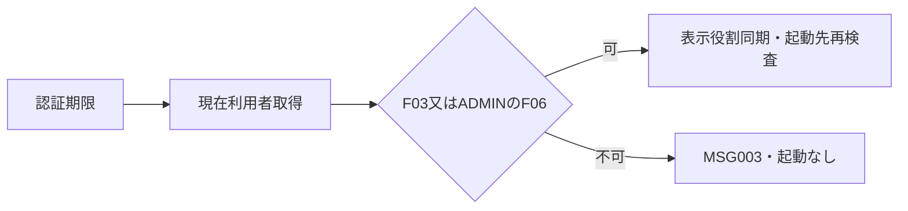
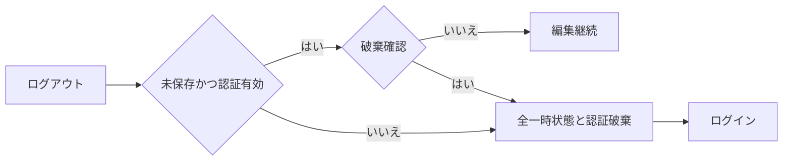

<!-- spec-meta: {"schema":"spec-md/1.0","documentId":"SP2-Access-DET-F02","version":"1.0","path":"sample-project2/spec/Access/詳細仕様書/02_メニュー画面.md","sheets":[{"heading":"概要","kind":"GRID","sheet":"01_概要"},{"heading":"項目一覧","kind":"LIST","sheet":"02_項目一覧","key":["項目ID"]},{"heading":"イベント仕様","kind":"GRID","sheet":"03_イベント仕様"},{"heading":"補足説明","kind":"GRID","sheet":"04_補足説明"}]} -->
# F02 メニュー画面 詳細仕様書

版1.0／2026-10-28。Access／detail-design。[基本F02](../基本設計書/02_メニュー画面.md)と同じID・配置。実機未実施。

## 概要

未連結frmMenuのForm_Loadは`modNavigation.RefreshMenu(session As clsSession) As clsResult`で現在認可と表示同期だけを行い、遷移0件。ボタンClickだけが`modNavigation.OpenFeature(featureId As String,session As clsSession) As clsResult`を呼ぶ。候補はF03とF06だけ、社員登録／出力は検索から起動する。認証DTOのUserIdを現在DB利用者へ照合し、表示名／役割を同期する。社員／経歴／コードや秘密をメニューへ取得しない。

Detail原点(0,0)、1366×768設計、96DPIのpx×15twip、Yu Gothic UI11pt、36pxボタン=540twip。初期focusはcmdEmployeeSearch、Tabは検索→管理者だけコード→ログアウト。STAFFはcmdCodeMaster.Visible=False/Enabled=False、呼出し処理も同じ権限を検査する。拡大時はフォーム内スクロールで到達する。

<!-- screen-html-start: F02 -->
<style>
.sp2-f02,.sp2-f02 *{box-sizing:border-box}.sp2-f02{width:1000px;padding:18px;color:#243448;font:14px/1.5 "Yu Gothic UI",Meiryo,sans-serif}.sp2-f02 .head{display:flex;gap:24px;align-items:center;justify-content:space-between;border-bottom:1px solid #9cabb8;padding-bottom:10px}.sp2-f02 h3{margin:0;font-size:21px}.sp2-f02 .menu{display:flex;flex-direction:column;align-items:flex-start;gap:12px;padding-top:22px}.sp2-f02 button{height:36px;padding:4px 18px;min-width:210px;border:1px solid #7890a3;background:#efefef;font:inherit}.sp2-f02 .head button{min-width:100px}.sp2-f02 p{margin:0;color:#526476}.sp2-f02 :focus-visible{outline:3px solid #b65400;outline-offset:2px}
</style>
<div class="sp2-f02" aria-label="管理者メニューの仕様モック"><div class="head"><h3>社員経歴管理システム</h3><span data-item-id="F02-I01">デモ管理者／管理者</span><button data-item-id="F02-I04">ログアウト</button></div><div class="menu"><button data-item-id="F02-I02">社員検索</button><p>社員の検索・登録・経歴書Excelの作成</p><button data-item-id="F02-I03">汎用コードマスタ</button><p>部署・役割などの選択候補の管理</p></div><div data-item-id="F02-I05" role="status"></div></div>
<!-- screen-html-end: F02 -->

## 項目一覧

| 項目ID | 項目グループ | 項目名 | コントロール | 必須 | 入力制限 | フォーマット | 初期値 | DBテーブル名 | DB項目名 | 備考 | 物理Control・出力先 | 状態変数・VBA型 | raw上限・単位 | 正規化／保存上限・NULL | 物理DB列・型 | 入出力・候補・状態 |
| --- | --- | --- | --- | --- | --- | --- | --- | --- | --- | --- | --- | --- | --- | --- | --- | --- |
| F02-I01 | 利用者情報 | 利用者名・役割 | Label | - | - | - | - | 利用者 | 表示名・利用者役割 | 現在の利用者有効性・役割を確認し、表示名・役割を同期。 | lblActor | Session.DisplayName/RoleId As String | 非適用 | 保存なし、各40／5 scalar参照 | m_app_user.display_name TEXT80、role_id TEXT5、共にNOT NULL | 現在値1件から表示同期 |
| F02-I02 | 操作 | 社員検索 | CommandButton | - | - | - | - | - | - | F03へ。 | cmdEmployeeSearch | FeatureId As String | 非適用 | 保存なし | 非適用 | Click→F03、現在ADMIN/STAFF |
| F02-I03 | 操作 | 汎用コードマスタ | CommandButton | - | - | - | - | - | - | 管理者のみ表示・有効。F06へ。起動先でも権限検査。 | cmdCodeMaster | FeatureId As String | 非適用 | 保存なし | 非適用 | ADMINだけVisible/Enabled、Click→F06 |
| F02-I04 | 操作 | ログアウト | CommandButton | - | - | - | - | - | - | 認証状態を破棄。 | cmdLogout | LogoutRequested As Boolean | 非適用 | 保存なし | 非適用 | Click→F02-E02 |
| F02-I05 | 案内 | メッセージ | Label | - | - | - | 空 | - | - | 起動不可・認証失効案内。 | lblMessage | Result.MessageId As String | 非適用 | 保存なし | 非適用 | MSG表示・認可失敗で起動なし |

## イベント仕様

### F02-E01 機能起動

#### 処理概要

現在利用者1件に基づき許可機能を開く。古い保持ADMINを認可根拠にしない。

#### 処理手順

1. **受付・現在主体**
   1. Form_LoadはRefreshMenuとしてfeatureIdなしで表示同期まで行い、以降の起動処理を実行しない。cmdEmployeeSearch／cmdCodeMasterのClickから渡すfeatureIdだけをF03／F06に限定。IsBusyならMSG-029。セッション未認証／無操作30分以上はMSG-002としてF01へ戻す。
   2. UserIdをdbText40 Parameterへ渡して現在利用者を0/1件取得。0／停止は002、複数は020、取得障害040で起動を止める（CHK-F02-01～03）。
2. **許可と表示同期**
   1. RoleIdがADMIN／STAFF外は003。現在表示名と役割をlblActorへ設定し、STAFFへ変化した場合はコード操作を隠す。F06はADMINのみ、F03は両方。
   2. Clickによる起動要求だけ、認可後にDoCmd.OpenFormで許可Formを未連結初期状態で開く。呼出先にもUserIdを渡し現在認可を再確認させ、表示だけを最終検査にしない。
3. **遷移結果**
   1. 起動成功は1画面だけ。表示失敗では認証が有効ならメニューを維持し、DAO／busyを解放する。業務書込みは0件。

#### 処理フロー



#### SQL・テーブル関連（ER図）

m_app_user単表参照。UserIdはセッションの内部主体とPK一致、他の業務表とのJOINがないためER非適用。

#### DB操作の詳細

```sql
PARAMETERS pUser Text(40);
SELECT user_id,display_name,role_id,is_enabled
FROM m_app_user WHERE user_id=pUser;
```

pUserはclsSession.UserId、snapshotの期待1件。参照だけで更新0件。password_verifier／failed_count／locked_untilは取得しない。初期表示と機能起動時の各要求で再取得する。featureIdをテーブル名や任意Form名へ連結しない。

#### 結果・例外時の扱い

002「認証の有効期限が切れました。未保存の入力は保存されません。再ログインしてください。」は認証破棄／F01へ。003「この操作を実行する権限がありません。」は起動なし・許可メニュー維持。040「データを読み込めませんでした。時間をおいて再実行してください。」は古い権限で起動せず再読込を案内する。020は「保存データに不整合があります。管理者へ連絡してください。」、表示役割を推測して起動しない。

### F02-E02 ログアウト

#### 処理概要

未保存変更の扱いを確認し、一時入力と認証を破棄する。全業務画面のログアウトにも同じ手順を適用する。

#### 処理手順

1. **受付・破棄確認**
   1. 業務要求の処理中ならCHK-F02-04としてMSG-029で待機。処理完了後に認証期限を判定し、既に失効なら確認より002を優先して認証と未保存を破棄する。
   2. 認証有効かつ未保存変更ありだけMSG-015「入力内容を破棄しますか。」。いいえ／取消は元のDTO・focus・認証を保持する（CHK-F02-05/06）。
2. **状態破棄と復帰**
   1. はい又は変更なしなら検索条件／結果／選択、親子draft／除去集合、コードdraftを破棄し、clsSessionをNothingにする。
   2. 業務Formを閉じfrmLoginを開く。ロック制御／業務表を変更しない。認証参照障害や失効でも破棄を拒否しない（CHK-F02-07/08）。

#### 処理フロー



#### SQL・テーブル関連（ER図）

一時状態だけの破棄、DBなしのためER非適用。

#### DB操作の詳細

DB参照／更新0件。未保存を保存するサービス、認証失敗制御解除、社員／コード削除を呼ばない。

#### 結果・例外時の扱い

通常取消はMSGを追加せず元画面／入力を保持。破棄確定は認証0件・DB変更0件、戻る操作で旧Formやセッションを復活させない。失効002が確認中に成立したら編集継続せずF01へ戻る。

## 補足説明

[共通実装](../共通/方式別/01_共通実装仕様.md)と[共通04](../共通/04_チェック・メッセージ設計.md)を適用。PILOT-P05～07で直接起動・現在役割・失効境界を確認する計画とし、実機で認可が動作した証拠とはしない。
