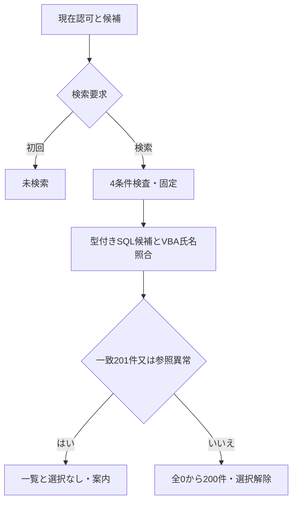
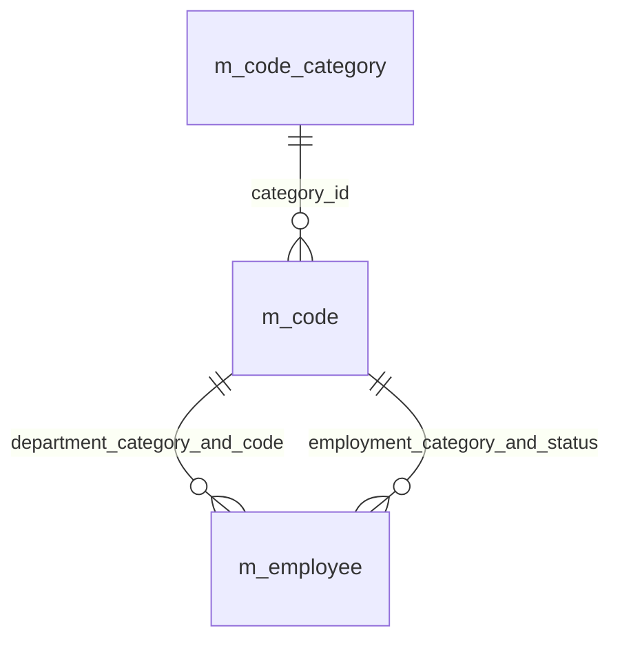
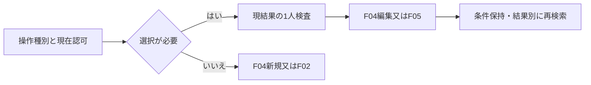

<!-- spec-meta: {"schema":"spec-md/1.0","documentId":"SP2-Access-DET-F03","version":"1.2","path":"sample-project2/spec/Access/詳細仕様書/03_社員検索画面.md","sheets":[{"heading":"概要","kind":"GRID","sheet":"01_概要"},{"heading":"項目一覧","kind":"LIST","sheet":"02_項目一覧","key":["項目ID"]},{"heading":"イベント仕様","kind":"GRID","sheet":"03_イベント仕様"},{"heading":"補足説明","kind":"GRID","sheet":"04_補足説明"}]} -->
# F03 社員検索画面 詳細仕様書

版1.2／2026-10-30。Access／detail-design。[基本F03](../基本設計書/03_社員検索画面.md)の全IDを継承。本改訂の実画面・実入力/受入は未検証。限定技術確認はDQA-UI08参照。

## 概要

`frmEmployeeSearch`は4条件、ListBox全件一覧、検索／クリア／新規／編集／経歴書Excel／メニューを持つ未連結単票Form。`modEmployeeSearch.Search(criteria As clsSearchCriteria,session As clsSession) As clsResult`が現在の利用者を確認後に候補と社員を取得する。検索に経歴をJOINせず、出力と編集の起動には選択EmployeeIdだけを渡す。全永続表更新0件、外部ファイルはF05だけが作る。

[UI部品・状態・検査契約](../共通/方式別/02_UI部品・状態・検査契約.md)のSC-F03を適用する。Headerタイトル/メニュー、Detail条件/結果/選択、Footer対象操作と各原点を分ける。11pt、入力480twip、名称条件3900twip、標準部品・200件全取得/内部スクロール・ページングなし。先頭非表示列はEmployeeId、ColumnWidthsは0;1500;3900;4950;2970;2250;2250。部署列の物理非client配分を明示し、通常識別と選択後全文を別条件にする。I09のreadonly補助txtSelectedDetailsは未選択時330twip/非表示で保存し、選択時だけ1980twip/Detail9450へ展開する。内部スクロール/キー/コピーで氏名40/カナ80/部署40字を全文確認できる。追加DB参照や業務入力ではない。DQA-UI08の物理Section下限への対応であり、5画面/業務/基本HTMLは変更しない。解除時はfocusを先に退避する。展開後も固定Footerへの到達と全文欄へのTab/読取り/コピーを実機条件として確認する。

<!-- screen-html-start: F03 -->
<style>
.sp2-f03,.sp2-f03 *{box-sizing:border-box}.sp2-f03{width:1260px;padding:24px;background:#efefef;color:#000;font:11pt/1.45 "Yu Gothic UI",sans-serif}.sp2-f03 h3{font:700 11pt/1.45 "Yu Gothic UI",sans-serif;margin:0}.sp2-f03 .head{display:flex;justify-content:space-between;align-items:center;margin-bottom:24px}.sp2-f03 .fields{display:flex;align-items:flex-end;gap:16px;margin-bottom:20px}.sp2-f03 label{display:block}.sp2-f03 input,.sp2-f03 select{display:block;height:32px;padding:4px 6px;border:1px solid #888;background:white;color:#000;font:inherit}.sp2-f03 .no{width:110px}.sp2-f03 .name{width:260px}.sp2-f03 select{width:180px}.sp2-f03 button{height:34px;padding:4px 16px;border:1px solid #aaa;background:#f7f7f7;font:inherit;color:#000}.sp2-f03 button:disabled{color:#777}.sp2-f03 .resulthead{margin:0 0 8px;font-weight:bold}.sp2-f03 .grid{height:320px;overflow:auto;border:1px solid #aaa;background:white}.sp2-f03 table{width:1210px;table-layout:fixed;border-collapse:collapse}.sp2-f03 th,.sp2-f03 td{height:28px;padding:3px 8px;text-align:left;white-space:nowrap;overflow:hidden}.sp2-f03 th{position:sticky;top:0;background:#efefef;border-bottom:1px solid #888;font-weight:bold}.sp2-f03 td{border-right:1px solid #ddd}.sp2-f03 .selected{background:#000;color:white}.sp2-f03 .message{min-height:44px;margin:12px 0;overflow-wrap:anywhere}.sp2-f03 .actions{display:flex;gap:12px;border-top:1px solid #aaa;padding-top:16px}.sp2-f03 :focus-visible{outline:2px solid #000;outline-offset:2px}
.sp2-f03 [data-item-id="F03-I05"]{font-weight:bold}
</style>
<div class="sp2-f03" data-screen-id="SC-F03" data-state="searched-selected" aria-label="社員検索 検索済み・選択あり"><div class="head"><h3 data-item-id="F03-I14">社員検索</h3><button data-item-id="F03-I13">メニュー</button></div><div class="fields"><label>社員番号<input class="no" data-item-id="F03-I01" maxlength="6" autofocus></label><label>氏名・氏名カナ<input class="name" data-item-id="F03-I02"></label><label>部署<select data-item-id="F03-I03"><option>すべて</option><option>開発</option></select></label><label>在籍区分<select data-item-id="F03-I04"><option>在職</option><option>すべて</option></select></label><button data-item-id="F03-I05">検索</button><button data-item-id="F03-I06">クリア</button></div><div class="resulthead" data-item-id="F03-I07">検索結果：2件</div><div class="grid" data-item-id="F03-I08" tabindex="0"><table><colgroup><col style="width:100px"><col style="width:260px"><col style="width:330px"><col style="width:220px"><col style="width:150px"><col style="width:150px"></colgroup><thead><tr><th>社員番号</th><th>氏名</th><th>氏名カナ</th><th>部署</th><th>在籍区分</th><th>入社日</th></tr></thead><tbody><tr class="selected" aria-selected="true"><td>000001</td><td>山田 太郎</td><td>ヤマダ タロウ</td><td>開発</td><td>在職</td><td>2022-04-01</td></tr><tr><td>000002</td><td>佐藤 花子</td><td>サトウ ハナコ</td><td>基盤</td><td>在職</td><td>2024-04-01</td></tr></tbody></table></div><div class="message" data-item-id="F03-I09" role="status">選択中の社員：000001　山田 太郎</div><div class="actions"><button data-item-id="F03-I10">新規登録</button><button data-item-id="F03-I11">選択社員を編集</button><button data-item-id="F03-I12">選択社員の経歴書Excel</button></div></div>
<!-- screen-html-end: F03 -->

## 項目一覧

| 項目ID | 項目グループ | 項目名 | コントロール | 必須 | 入力制限 | フォーマット | 初期値 | DBテーブル名 | DB項目名 | 備考 | 物理Control・出力先 | 状態変数・VBA型 | raw上限・単位 | 正規化／保存上限・NULL | 物理DB列・型 | 入出力・候補・状態 |
| --- | --- | --- | --- | --- | --- | --- | --- | --- | --- | --- | --- | --- | --- | --- | --- | --- |
| F03-I01 | 検索条件 | 社員番号条件 | TextBox | 非適用 | 半角数字6桁 | 先頭ゼロ保持 | 空 | 社員 | 社員番号 | 完全一致。未指定は全社員。 | txtEmployeeNo | Criteria.EmployeeNo As Variant | 6 ASCII | Null又は6桁、保存なし | m_employee.employee_no TEXT6 NOT NULL | 完全一致、未指定Null |
| F03-I02 | 検索条件 | 氏名条件 | TextBox | 非適用 | 40字 | - | 空 | 社員 | 氏名・氏名カナ | 氏名・カナの部分一致。原表記を保持し、照合だけ正規化。未指定は全社員。 | txtName | Criteria.NameRaw/NameKey As String/Variant | 40 scalar | key40 scalar以内、空はNull、保存なし | employee_name TEXT80、employee_kana TEXT160、共にNOT NULL | NFKC/空白除去/不変大文字keyの部分一致 |
| F03-I03 | 検索条件 | 部署条件 | ComboBox | 非適用 | 選択のみ | 名称表示／半角数字2桁コード保持 | 空 | 社員<br>汎用コード<br>コード分類 | 社員：部署分類・部署<br>汎用コード：分類ID・コード・名称<br>コード分類：分類ID・分類名 | DEPARTMENTの有効値と停止既存値。未指定は全部署。並び順→コード順。 | cboDepartment | Criteria.Department As Variant | 2 ASCII | Null又はcode2、保存なし | m_employee.department_code TEXT2、m_code.code TEXT2 | DEPARTMENT停止含む、sort_order/code順 |
| F03-I04 | 検索条件 | 在籍区分条件 | ComboBox | 非適用 | 選択のみ | 名称表示／半角数字2桁コード保持 | 01 在職 | 社員<br>汎用コード<br>コード分類 | 社員：在籍分類・在籍区分<br>汎用コード：分類ID・コード・名称<br>コード分類：分類ID・分類名 | EMPLOYMENT_STATUSの固定3値と「すべて」。未指定は全区分。 | cboStatus | Criteria.Status As Variant | 2 ASCII | Null又はcode2、保存なし | m_employee.employment_status TEXT2、m_code.code TEXT2 | EMPLOYMENT_STATUS固定3値＋すべてNull |
| F03-I05 | 操作 | 検索 | CommandButton | - | - | - | - | - | - | 条件を確定して再検索。 | cmdSearch | SearchResult As clsResult | 非適用 | 保存なし | 非適用 | Click→F03-E01 |
| F03-I06 | 操作 | クリア | CommandButton | - | - | - | - | - | - | 初期条件・未検索へ戻す。 | cmdClear | ClearRequested As Boolean | 非適用 | 保存なし | 非適用 | Click→F03-E02 |
| F03-I07 | 検索結果 | 件数・検索状態 | Label | - | - | 件数は整数＋件 | 未検索 | 社員 | 社員管理ID | 取得済み結果から0～200件を算出。未検索・処理中・上限超過は画面状態で管理。 | lblCount | ResultRows.Count As Long | 非適用 | 0～200又は未検索状態、保存なし | 取得社員件数、独立DB列なし | 超過は成功件数を表示しない |
| F03-I08 | 検索結果 | 社員一覧・選択 | ListBox | - | - | 社員番号は先頭ゼロ、入社日はYYYY-MM-DD | 空 | 社員<br>汎用コード | 社員：社員管理ID・社員番号・氏名・氏名カナ・部署分類・部署・在籍分類・在籍区分・入社日<br>汎用コード：分類ID・コード・名称 | 最大200行。1人選択。社員番号昇順。内部番号は非表示で保持。未選択時は編集・Excel不可。 | lstEmployees | ResultRows As Collection/SelectedId As Variant | 非適用 | Long ID又はNull、保存なし | m_employee.employee_id COUNTER、番号/氏名/カナ/日付とコード名称 | 単一選択、非表示ID、callbackはDBなし |
| F03-I09 | 検索結果・案内 | 選択・メッセージ | Label | - | - | - | 未検索案内 | 社員 | 社員番号・氏名 | 検索結果の社員番号・氏名を使用。長い氏名も全文到達可。追加DB参照なし。案内文はDB項目ではない。 | lblSelection | SelectedEmployeeDisplay As String | 非適用 | 保存なし | employee_no TEXT6、employee_name TEXT80 | 選択行の全文とMSG、追加DBなし |
| F03-I10 | 操作 | 新規登録 | CommandButton | - | - | - | - | - | - | F04新規へ。 | cmdNew | EditorMode As String | 非適用 | 保存なし | 非適用 | F04 Create、ID Null |
| F03-I11 | 操作 | 編集 | CommandButton | - | - | - | - | 社員 | 社員管理ID | 検索後1人選択時に有効。社員管理IDをF04へ渡して最新値を取得。 | cmdEdit | SelectedId As Long | 非適用 | 保存なし | m_employee.employee_id COUNTER | 現結果1人だけF04 Editへ |
| F03-I12 | 操作 | 経歴書Excel | CommandButton | - | - | - | - | 社員 | 社員管理ID | 検索後1人選択時に有効。社員管理IDをF05へ渡し、保存済み全体を一貫再取得。経歴0件等はF05で検査。 | cmdExport | SelectedId As Long | 非適用 | 保存なし | m_employee.employee_id COUNTER | 現結果1人だけF05、検索版は渡さない |
| F03-I13 | 操作 | メニュー | CommandButton | - | - | - | - | - | - | F02へ。 | cmdMenu | MenuRequested As Boolean | 非適用 | 保存なし | 非適用 | 条件/一覧/選択破棄→F02 |
| F03-I14 | 画面識別 | 画面タイトル | Label | - | - | - | 社員検索 | - | - | 独立11pt太字。 | lblScreenTitle | Caption As String | 非適用 | 保存なし | 非適用 | Header、DUI-F03-ID |

## イベント仕様

### F03-E01 初期表示・検索

#### 処理概要

初回は候補だけ取得して未検索で待つ。検索時は4条件を固定し、名前照合を含む最終一致件数0～200を表示する。

#### 処理手順

1. **受付・候補整合**
   1. IsBusyはMSG-029、認証期限／現在UserId・有効／役割をRequireCurrent(ADMIN又はSTAFF)で検査。不成立は業務読取前に002/003、取得障害040へ移す（CHK-F03-01）。
   2. 初回はDEPARTMENT／EMPLOYMENT_STATUS分類2件とコードを読む。部署は停止含む最大99件、在籍は固定3件・全有効を確認し、不足／重複／異常は020（CHK-F03-02）。正常は番号／氏名／部署Null・在籍01、未検索・未選択。
2. **条件固定と検査**
   1. 番号→氏名→部署→在籍の順でrawと正規化を検査。番号指定はASCII数字6桁、氏名はraw／正規化後各40scalar、コードは正しい分類の実在値。部署の停止検索は許可する。入力は005、候補不正は016、各欄へ戻す（CHK-F03-03/04）。
   2. 氏名条件だけNFKC→空白除去→不変localeの大文字化でNameKeyを作り、空ならNull。氏名／カナの保存値から同じkeyを計算し`InStr(1,key,NameKey,vbBinaryCompare)>0`で部分一致する。%/_/*/?/[ ]も通常文字で、LIKEパターンへ渡さない。社員番号・部署・在籍はAND（CHK-F03-05）。
3. **候補取得・照合・結果確立**
   1. 型付きSQLで番号／部署／在籍を絞った社員を番号昇順に読む。氏名条件がある時は全候補を逐次照合し、照合成立した社員の201件目で超過とする。氏名照合前の先頭201行で打ち切って真の一致を欠落させない。
   2. 名称は分類＋値のLEFT JOINで停止を含め取得する。部署／在籍各1件でない社員を黙って除外しない。0件=MSG-009、1～200件=全件、201件=MSG-010・一覧／選択なし、参照異常=020（CHK-F03-06/07）。
   3. 成功条件SetとResultRowsを一括設定し旧選択を解除する。F04保存復帰は同じ条件で再検索し、保存EmployeeIdが結果にある場合だけ選択する（CHK-F03-08）。読取失敗時に古いResultRowsを使わない。

#### 処理フロー



#### SQL・テーブル関連（ER図）



分類→コードは物理FK、社員の部署／在籍は別用途の複合FKと表示JOIN。コード値01だけで名称を結合しない。認証用m_app_userは別責務単表参照、経歴は検索対象外。

#### DB操作の詳細

```sql
PARAMETERS pNo Text(6), pDept Text(2), pStatus Text(2);
SELECT e.employee_id,e.employee_no,e.employee_name,e.employee_kana,
 e.department_category,e.department_code,e.employment_category,
 e.employment_status,e.join_date,d.code_name AS department_name,
 s.code_name AS status_name
FROM (m_employee AS e LEFT JOIN m_code AS d
 ON e.department_category=d.category_id AND e.department_code=d.code)
 LEFT JOIN m_code AS s
 ON e.employment_category=s.category_id AND e.employment_status=s.code
WHERE (pNo Is Null OR e.employee_no=pNo)
 AND (pDept Is Null OR e.department_code=pDept)
 AND (pStatus Is Null OR e.employment_status=pStatus)
ORDER BY e.employee_no;
```

| 読取単位 | Parameter・型／取得・件数 | 保持・例外 |
| --- | --- | --- |
| 現在利用者 | pUser=dbText40、m_app_user.user_id一致1件、有効／ADMIN・STAFF | 更新0、秘密を取得しない |
| 分類／候補 | category_id IN 固定2分類、コードはcategory_id Parameter=dbText24、ORDER BY sort_order,code | 部署0～99・在籍3、停止部署表示可、全分類不足は020 |
| 社員＋名称 | pNo=dbText6又はNull、pDept/pStatus=dbText2又はNull。上記SQLから全候補を読みVBA NameKey一致を数える | 最終一致201で全結果破棄。業務固定分類違い／名称Nullも020 |

SELECTはdbOpenSnapshotで全値をResultRowsへコピーしCloseする。String連結SQLで値を構成しない。保存済み氏名／カナを更新せず、検索keyを永続列へ追加しない。全DB更新0件、DBロックを一覧スクロール中に保持しない。

#### 結果・例外時の扱い

MSG-009「該当する社員はいません。」とMSG-010「200件を超えています。条件を絞り込んでください。」を区別し、0件でも成功条件Setは保持、超過は一覧／選択を空とする。016「選択値が利用できません。候補を再確認してください。」は候補更新後に再指定。020「保存データに不整合があります。管理者へ連絡してください。」と040「データを読み込めませんでした。時間をおいて再実行してください。」では部分結果を表示しない。認証失効を除き条件rawを保持する。

### F03-E02 条件変更・クリア

#### 処理概要

条件編集と同時に旧結果を失効させる。正規化後同値でも再検索まで旧IDを再利用しない。

#### 処理手順

1. **変更受付**
   1. txtEmployeeNo/Name_ChangeとCombo_AfterUpdateから通知し、IsBusyならCHK-F03-09・MSG-029で先行要求を維持する。
   2. 実利用者の編集なら結果配列/選択IDを空にしてAppliedValid=False、SearchState=Changed/ResultState=NoResultとしcmdEdit/cmdExportを無効にする。最後のAppliedCriteriaの有無/値は履歴として別保持しても、旧対象の起動へ使用しない。Comboのaccepted code/表示text/PendingRawも分離する。プログラム初期化のSuppressChange旗で認証を迂回しない（CHK-F03-10）。
2. **クリアと待機**
   1. クリアは番号／氏名／部署Null、在籍01、一覧0・選択なし・未検索。候補自体を勝手に別分類へ変えない。
   2. txtEmployeeNoへfocusし明示検索を待つ。DBを参照／更新せず、自動検索しない。

#### 処理フロー


#### SQL・テーブル関連（ER図）

一時状態のみ、DBなしのためER非適用。

#### DB操作の詳細

全表参照／更新0件。候補再読取は次の初期表示／検索へ委ねる。旧ResultRowsに含まれたIDを別経路へ渡さない。

#### 結果・例外時の扱い

条件を元文字に戻しても旧結果は復活しない。未検索は0件検索MSG-009と分ける。変更通知処理で生じた例外は一覧／選択を安全に失効させ、古い対象で後続操作しない。

### F03-E03 新規・編集・経歴書出力・メニュー

#### 処理概要

新規は選択不要、編集とExcelは現結果の1人だけ、メニューは検索状態を破棄する。

#### 処理手順

1. **認証と操作**
   1. セッションと現在役割を再確認し、IsBusyは029。新規はF04へmode=Create・EmployeeId=Null、メニューは条件／結果／選択を破棄してF02へ（CHK-F03-11）。
   2. 編集／Excelは未検索・空・超過・条件変更・未選択／複数／結果外IDをCHK-F03-12で拒否しMSG-011。
2. **対象受渡し**
   1. ResultRowsの選択行EmployeeId:Longだけを渡す。表示番号や氏名からIDを推測せず、検索時revisionはF05へ渡さない。
   2. 編集はF04 mode=Edit、Excelは`ReadReport(id,session)`へ渡し、呼出先が存在と最新内容を再確認する。処理中に要求対象を別選択へ差し替えない。
3. **戻り値と検索復帰**
   1. 起動前のclsSearchReturnStateはraw4条件の表示文字列（空白/大小/全半角を含む）、Unsearched/Changed/Searched、最後に適用した条件の有無/値、ResultRows/選択ID/先頭可視ID/focusを別保持する。F04取消はこれを検索0で復元し、未検索/条件変更後に古い結果を復活させない。保存成功は同じrawを再検査・正規化して再検索し、結果内の保存IDだけを再選択する。元が未検索でも保存成功では再検索し、古いAppliedCriteriaで代替しない。raw不正や再表示失敗は014と別案内にし、保存を再送しない。F05不存在019は選択解除、他失敗/取消は原状態保持。
   2. F05再実行は新しい一貫取得から始め、以前のWorkbook／Snapshotを流用しない。復帰再検索失敗は040、保存済みなら014も維持し保存を再送しない（CHK-F03-13）。

#### 処理フロー



#### SQL・テーブル関連（ER図）

起動自体はDB業務参照なし。現在利用者は単表認証確認で、社員／経歴の再取得はF04／F05に定義するためここで重複ERを置かない。

#### DB操作の詳細

現在認証確認だけm_app_user(user_id)1件、業務更新0件。遷移先へLongの社員ID、mode、clsSearchReturnStateを渡す。取消はDTOの復元だけで業務検索0、保存成功だけF03-E01を同raw条件で呼ぶ。受渡し先が0件又は不整合を返した場合は対応MSGと同じ状態へ戻す。

#### 結果・例外時の扱い

011「社員を1人選択してください。」は後続呼出し0件・一覧上部。019「対象の社員が見つかりません。検索し直してください。」は選択解除。012「経歴を1件以上登録してから出力してください。」は編集を案内し選択を保持する。対象外ID・SQL・内部キーをエラー文へ表示しない。

## 補足説明

Form_Load/初回Activateの原点→txtEmployeeNo、復帰時のHeader可視性とListBox内部位置保持はUI契約の別条件で確認する。選択Changeは同じResultRowsからlblSelectionとtxtSelectedDetailsを更新し、条件Changeは両方を即時消す。Tabは条件→検索/クリア→一覧→readonly全文欄→新規/編集/出力→メニュー。F03保存方式noneの非適用理由を残し、選択/遷移/キーを画像だけで合格にしない。

F03は経歴0件の社員を検索から除外せず、出力可否はF05で判定する。4条件・先頭ゼロ・全半角照合・200/201件・停止部署・条件変更失効をPILOT-P08～11で確認する計画とする。実機・DB検証は未実施。認証の現在参照は[共通実装](../共通/方式別/01_共通実装仕様.md)を使う。
