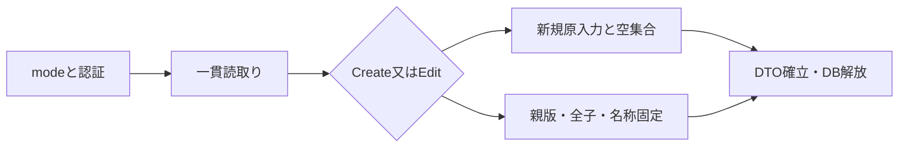
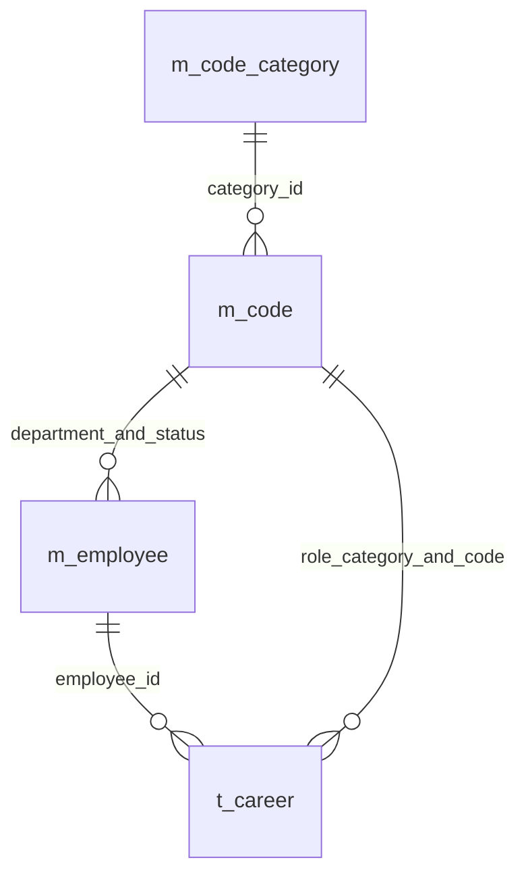
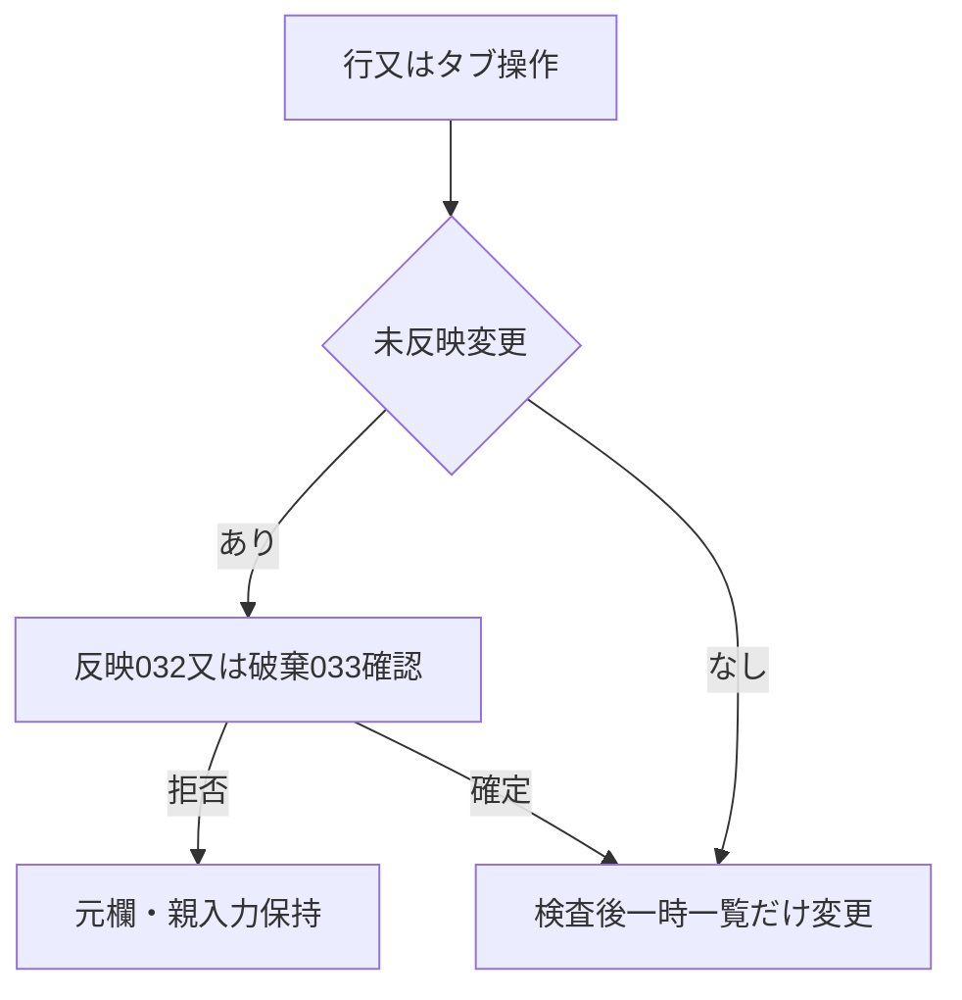
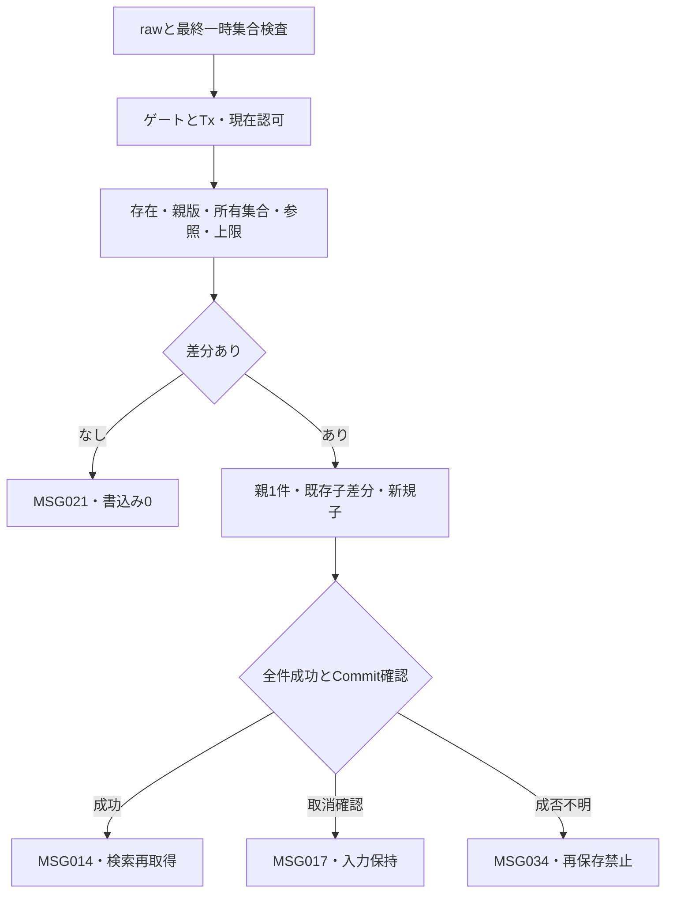
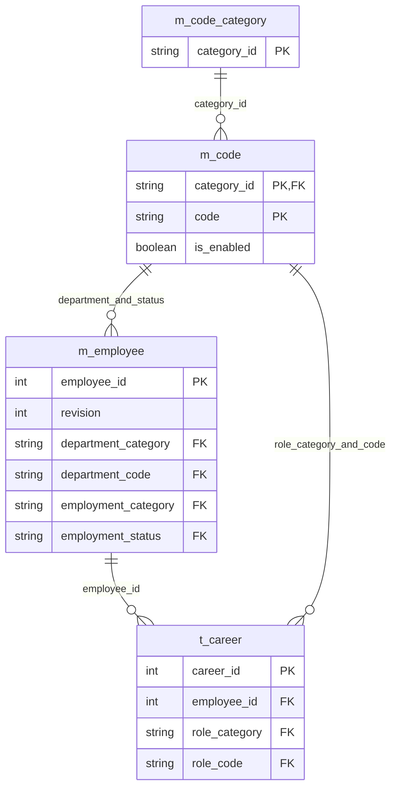
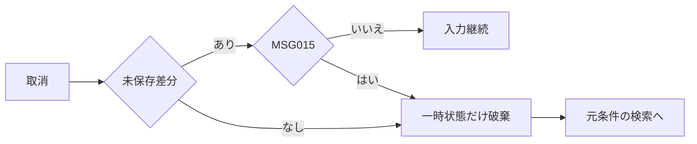

<!-- spec-meta: {"schema":"spec-md/1.0","documentId":"SP2-Access-DET-F04","version":"1.0","path":"sample-project2/spec/Access/詳細仕様書/04_社員登録画面.md","sheets":[{"heading":"概要","kind":"GRID","sheet":"01_概要"},{"heading":"項目一覧","kind":"LIST","sheet":"02_項目一覧","key":["項目ID"]},{"heading":"イベント仕様","kind":"GRID","sheet":"03_イベント仕様"},{"heading":"補足説明","kind":"GRID","sheet":"04_補足説明"}]} -->
# F04 社員登録・経歴登録 詳細仕様書

版1.0／2026-10-28。Access／detail-design。[基本F04](../基本設計書/04_社員登録画面.md)の全29項目・4イベントを維持。実装／DB未実施。

## 概要

未連結frmEmployeeEditorがclsEmployeeEdit、読込原本、反映済みCareers、ActiveDraft、LoadedCareerIds、RemovedCareerIdsを別に保持する。サービス入口は`LoadEditor(mode As String,employeeId As Variant,session)`、`ApplyCareerDraft(edit)`、`SaveEmployee(edit,session)`。新規は内部ID／ExpectedRevision=Null、編集はLongで固定し、Formの表示値で自己申告ID／版を補完しない。入力と明細追加／除去は全体保存前にDBへ書かない。

画面基準1366×768px、本文1260px以内、96DPI・Detail原点(0,0)。社員番号110px=1650twip、日付150px=2250twip、氏名260px=3900twip、カナ330px=4950twip、入力32px=480twip、ボタン34px=510twip、文字11pt。tabEmployeeの基本情報／経歴Pageを切替え、一覧選択と入力領域を分離する。新規番号はEnabled=True/Locked=False、既存番号はEnabled=True/Locked=Trueで選択コピー可、監査と内部IDは常時入力不可。経歴未選択は明細欄を無効にし、追加開始時だけ入力可能。

<!-- screen-html-start: F04-BASIC -->
<style>
.sp2-f04,.sp2-f04 *{box-sizing:border-box}.sp2-f04{width:1260px;padding:12px;color:#243448;background:#efefef;font:14px/1.45 "Yu Gothic UI",Meiryo,sans-serif}.sp2-f04 h3{font-size:21px;margin:0 0 8px}.sp2-f04 .tabs{display:flex;gap:4px;border-bottom:1px solid #aab9c5;margin-bottom:10px}.sp2-f04 button{min-height:32px;padding:4px 14px;font:inherit;border:1px solid #849aa9;background:#efefef}.sp2-f04 .tabs .active{background:#ddd;font-weight:bold}.sp2-f04 .row{display:flex;gap:16px;flex-wrap:wrap;margin:8px 0}.sp2-f04 label{display:block}.sp2-f04 input,.sp2-f04 select,.sp2-f04 textarea{font:inherit;border:1px solid #8a9eac;padding:4px 6px;max-width:100%}.sp2-f04 input,.sp2-f04 select{height:32px}.sp2-f04 .no{width:110px}.sp2-f04 .name{width:260px}.sp2-f04 .kana{width:330px}.sp2-f04 .code{width:180px}.sp2-f04 .date{width:150px}.sp2-f04 .longs{display:grid;grid-template-columns:1fr 1fr;gap:8px 16px}.sp2-f04 textarea{display:block;width:100%;height:88px;resize:vertical;overflow:auto}.sp2-f04 .footer{display:flex;justify-content:space-between;gap:8px;align-items:center;border-top:1px solid #aab9c5;margin-top:12px;padding-top:10px}.sp2-f04 .message{min-height:24px;color:#8e2020}.sp2-f04 .primary{background:#e6e6e6;color:#222}.sp2-f04 :focus-visible{outline:3px solid #b65400;outline-offset:2px}
</style>
<div class="sp2-f04" aria-label="社員登録の基本情報タブ仕様モック"><h3>社員登録［編集］　000001 山田 太郎</h3><div class="tabs" data-item-id="F04-I12"><button class="active">基本情報</button><button>経歴（2件）</button></div><div class="row"><label>社員番号 ※<br><input class="no" data-item-id="F04-I01" value="000001" readonly></label><label>氏名 ※<br><input class="name" data-item-id="F04-I02" value="山田 太郎" data-max-scalars="40"></label><label>氏名カナ ※<br><input class="kana" data-item-id="F04-I03" value="ヤマダ タロウ" data-max-scalars="80"></label></div><div class="row"><label>部署 ※<br><select class="code" data-item-id="F04-I04"><option>01 開発</option></select></label><label>在籍区分 ※<br><select class="code" data-item-id="F04-I05"><option>01 在職</option></select></label><label>入社日 ※<br><input class="date" data-item-id="F04-I06" value="2020-04-01"></label></div><div class="longs"><label>職務要約<textarea data-item-id="F04-I07" data-max-scalars="1000">業務システムの設計・開発を担当。</textarea></label><label>得意技術・スキル<textarea data-item-id="F04-I08" data-max-scalars="1000">C#、ASP.NET、SQL Server</textarea></label><label>資格<textarea data-item-id="F04-I09" data-max-scalars="1000">基本情報技術者試験</textarea></label><label>自己PR<textarea data-item-id="F04-I10" data-max-scalars="1000">利用者の業務を理解して改善を提案します。</textarea></label></div><div class="message" data-item-id="F04-I11" role="status">※は必須です。タブの変更だけでは保存されません。</div><div class="footer"><span>経歴を含めて一括保存します。</span><span><button class="primary" data-item-id="F04-I28">保存</button> <button data-item-id="F04-I29">取消・検索へ戻る</button></span></div></div>
<!-- screen-html-end: F04-BASIC -->

<!-- screen-html-start: F04-CAREER -->
<style>
.sp2-f04c,.sp2-f04c *{box-sizing:border-box}.sp2-f04c{width:1260px;padding:12px;color:#243448;background:#efefef;font:14px/1.4 "Yu Gothic UI",Meiryo,sans-serif}.sp2-f04c h3{font-size:21px;margin:0 0 8px}.sp2-f04c button{min-height:32px;padding:4px 10px;font:inherit;border:1px solid #849aa9;background:#efefef}.sp2-f04c .tabs{display:flex;gap:4px;border-bottom:1px solid #aab9c5;margin-bottom:10px}.sp2-f04c .active{background:#ddd;font-weight:bold}.sp2-f04c .content{display:grid;grid-template-columns:270px 1fr;gap:16px}.sp2-f04c .list{height:310px;overflow:auto;border:1px solid #aab9c5}.sp2-f04c .line{white-space:nowrap;overflow:auto;padding:9px;border-bottom:1px solid #d5dce3}.sp2-f04c .selected{background:#ddd}.sp2-f04c .list-actions{display:flex;gap:5px;margin-top:8px}.sp2-f04c .row{display:flex;gap:12px;flex-wrap:wrap;margin-bottom:7px}.sp2-f04c label{display:block}.sp2-f04c input,.sp2-f04c select,.sp2-f04c textarea{font:inherit;border:1px solid #8a9eac;padding:4px 6px;max-width:100%}.sp2-f04c input,.sp2-f04c select{height:30px}.sp2-f04c .month{width:125px}.sp2-f04c .company,.sp2-f04c .project{width:320px}.sp2-f04c .role{width:160px}.sp2-f04c .team{width:70px}.sp2-f04c .longs{display:grid;grid-template-columns:1fr 1fr;gap:6px 12px}.sp2-f04c textarea{width:100%;display:block;height:62px;overflow:auto;resize:vertical}.sp2-f04c .phases{width:100%;height:48px}.sp2-f04c .footer{display:flex;justify-content:space-between;align-items:center;margin-top:10px;padding-top:10px;border-top:1px solid #aab9c5}.sp2-f04c .message{min-height:24px;margin-top:7px;color:#8e2020}.sp2-f04c .primary{background:#e6e6e6;color:#222}.sp2-f04c :focus-visible{outline:3px solid #b65400;outline-offset:2px}
</style>
<div class="sp2-f04c" aria-label="社員登録の経歴タブ仕様モック"><h3>社員登録［編集］　000001 山田 太郎</h3><div class="tabs"><button>基本情報</button><button class="active">経歴（2件）</button></div><div class="content"><div><div class="list" data-item-id="F04-I13"><div class="line selected">2024-04～継続中　社内販売管理システム</div><div class="line">2020-04～2024-03　受発注システム保守</div></div><div class="list-actions"><button data-item-id="F04-I25">追加</button><button data-item-id="F04-I26">明細へ反映</button><button data-item-id="F04-I27">除去</button></div></div><div><div class="row"><label>開始年月 ※<br><input class="month" data-item-id="F04-I14" value="2024-04"></label><label>終了年月（空＝継続中）<br><input class="month" data-item-id="F04-I15"></label><label>役割 ※<br><select class="role" data-item-id="F04-I23"><option>02 リーダー</option></select></label><label>チーム人数 ※<br><input class="team" data-item-id="F04-I24" value="5"></label></div><div class="row"><label>会社名 ※<br><input class="company" data-item-id="F04-I16" value="デモソフト株式会社" data-max-scalars="100"></label><label>案件名 ※<br><input class="project" data-item-id="F04-I17" value="社内販売管理システム" data-max-scalars="100"></label></div><div class="longs"><label>業務・案件概要 ※<textarea data-item-id="F04-I18" data-max-scalars="1000">販売業務のWeb化。</textarea></label><label>担当業務 ※<textarea data-item-id="F04-I19" data-max-scalars="1000">基本設計、開発、試験。</textarea></label><label>成果・工夫<textarea data-item-id="F04-I20" data-max-scalars="1000">確認作業を標準化。</textarea></label><label>使用技術<textarea data-item-id="F04-I21" data-max-scalars="500">C#、ASP.NET、SQL Server</textarea></label></div><label>担当工程<textarea class="phases" data-item-id="F04-I22" data-max-scalars="200">基本設計、詳細設計、製造、単体・結合試験</textarea></label></div></div><div class="message" role="status">明細への反映・除去は未保存です。最後に「保存」してください。</div><div class="footer"><span>経歴は20件まで。会社名・案件名は匿名表記も可能です。</span><span><button class="primary">保存</button> <button>取消・検索へ戻る</button></span></div></div>
<!-- screen-html-end: F04-CAREER -->

## 項目一覧

| 項目ID | 項目グループ | 項目名 | コントロール | 必須 | 入力制限 | フォーマット | 初期値 | DBテーブル名 | DB項目名 | 備考 | 物理Control・出力先 | 状態変数・VBA型 | raw上限・単位 | 正規化／保存上限・NULL | 物理DB列・型 | 入出力・候補・状態 |
| --- | --- | --- | --- | --- | --- | --- | --- | --- | --- | --- | --- | --- | --- | --- | --- | --- |
| F04-I01 | 基本情報 | 社員番号 | TextBox | 〇 | 半角数字6桁・新規のみ | 先頭ゼロ保持 | 空 | 社員 | 社員番号 | 全社員で一意。編集不可・再採番なし。 | txtEmployeeNo | Edit.EmployeeNo As String | 6 ASCII | 6桁必須、Null不可 | m_employee.employee_no TEXT6 NOT NULL | Create入力、Edit Locked=True |
| F04-I02 | 基本情報 | 氏名 | TextBox | 〇 | 40字 | - | 空 | 社員 | 氏名 | 前後空白除去・原表記保持。 | txtEmployeeName | Edit.Name As String | 40 scalar | 40 scalar、必須／Null不可 | m_employee.employee_name TEXT80 NOT NULL | 前後空白除去、本文原表記 |
| F04-I03 | 基本情報 | 氏名カナ | TextBox | 〇 | 全角カナ・長音・中点・空白80字 | - | 空 | 社員 | 氏名カナ | 半角カナの正規化は共通UIに従う。 | txtEmployeeKana | Edit.Kana As String | 80 scalar | 全角化後80 scalar、必須／Null不可 | m_employee.employee_kana TEXT160 NOT NULL | 半角カナだけ全角化 |
| F04-I04 | 基本情報 | 部署 | ComboBox | 〇 | 選択のみ | 名称表示／半角数字2桁コード保持 | 空 | 社員<br>汎用コード | 社員：部署分類・部署<br>汎用コード：分類ID・コード・名称 | DEPARTMENT有効値。停止既存値は保持・再保存可。 | cboDepartment | Edit.Department As String | 2 ASCII | code2必須、Null不可 | m_employee.department_category TEXT24、department_code TEXT2 | DEPARTMENT有効＋当該停止既存値だけ保持 |
| F04-I05 | 基本情報 | 在籍区分 | ComboBox | 〇 | 選択のみ | 名称表示／半角数字2桁コード保持 | 01 在職 | 社員<br>汎用コード | 社員：在籍分類・在籍区分<br>汎用コード：分類ID・コード・名称 | EMPLOYMENT_STATUSの01在職・02休職・03退職。 | cboStatus | Edit.Status As String | 2 ASCII | code2必須、新規01 | m_employee.employment_category TEXT24、employment_status TEXT2 | 固定3値、classificationは定数設定 |
| F04-I06 | 基本情報 | 入社日 | TextBox | 〇 | 日付10字 | YYYY-MM-DD | 空 | 社員 | 入社日 | 1900-01-01～業務日。日付で保存。 | txtJoinDate | JoinDateRaw As String/Edit.JoinDate As Date | 10 ASCII | 厳密YYYY-MM-DD→Date時刻0、必須 | m_employee.join_date DATETIME NOT NULL | 1900-01-01～固定業務日 |
| F04-I07 | 職務 | 職務要約 | TextBox（複数行） | 非適用 | 1000字 | 改行 | 空 | 社員 | 職務要約 | F05の出力条件は別途検査。 | txtSummary | Edit.Summary As Variant | 1000 scalar | 1000 scalar、空はNull | m_employee.career_summary LONGTEXT NULL可 | 前後空白除去・LF、全文編集 |
| F04-I08 | 職務 | 得意技術・スキル | TextBox（複数行） | 非適用 | 1000字 | 改行 | 空 | 社員 | スキル・得意分野 | 補足なし | txtSkills | Edit.Skills As Variant | 1000 scalar | 1000 scalar、空はNull | m_employee.skills LONGTEXT NULL可 | 自由記入、経験年数集計なし |
| F04-I09 | 職務 | 資格 | TextBox（複数行） | 非適用 | 1000字 | 改行・一資格一行を推奨 | 空 | 社員 | 保有資格 | 取得年月は本文へ記載可。 | txtQualifications | Edit.Qualifications As Variant | 1000 scalar | 1000 scalar、空はNull | m_employee.qualifications LONGTEXT NULL可 | 1資格1行、専用表なし |
| F04-I10 | 職務 | 自己PR | TextBox（複数行） | 非適用 | 1000字 | 改行 | 空 | 社員 | 自己PR | 補足なし | txtSelfPr | Edit.SelfPr As Variant | 1000 scalar | 1000 scalar、空はNull | m_employee.self_pr LONGTEXT NULL可 | 自由記入・LF |
| F04-I11 | 案内 | メッセージ | Label | - | - | - | - | - | - | エラーはタブ・項目を特定。 | lblMessage | Result.MessageId/FieldId As String | 非適用 | 保存なし | 非適用 | 要約＋対象Page/欄focus |
| F04-I12 | 画面切替 | 基本情報・経歴タブ | TabControl | - | - | - | 基本情報 | - | - | 切替で保存しない・入力保持。 | tabEmployee | ActivePage As Integer | 非適用 | 保存なし | 非適用 | Page0基本/Page1経歴、切替で未反映確認 |
| F04-I13 | 経歴一覧 | 経歴一覧 | ListBox | - | - | YYYY-MM～YYYY-MM／継続中 | 空 | 社員経歴 | 経歴ID・開始年月・終了年月・案件名 | 最大20件・0件可。1明細選択。開始年月→内部番号の降順。同順位の未保存行は追加順。0件でも社員保存可、F05不可。 | lstCareers | Edit.Careers As Collection/SelectedCareerKey As Variant | 非適用 | 0～20一時明細、保存前はDBなし | t_career.career_id COUNTER、開始/終了DATETIME、project_name TEXT200 | 1行選択、開始月/内部ID降順 |
| F04-I14 | 経歴 | 開始年月 | TextBox | 条件付 | 年月7字 | YYYY-MM | 空 | 社員経歴 | 開始年月 | 明細あり時必須。1900-01以上、終了年月・業務年月以下。月初で保存。 | txtStartMonth | Draft.StartRaw As String/Draft.StartMonth As Date | 7 ASCII | 厳密YYYY-MM→月初Date、明細あり時必須 | t_career.start_month DATETIME NOT NULL | 1900-01～業務年月 |
| F04-I15 | 経歴 | 終了年月 | TextBox | 非適用 | 年月7字 | YYYY-MM | 空 | 社員経歴 | 終了年月 | 空欄＝継続中。指定時は開始年月以上・業務年月以下。月初で保存。 | txtEndMonth | Draft.EndRaw As String/Draft.EndMonth As Variant | 7 ASCII | 空はNull、他は月初Date | t_career.end_month DATETIME NULL可 | 終了未設定だけ継続 |
| F04-I16 | 経歴 | 会社名 | TextBox | 条件付 | 100字 | - | 空 | 社員経歴 | 会社名 | 明細あり時必須。守秘対象は匿名名可。 | txtCompany | Draft.Company As String | 100 scalar | 100 scalar、明細あり時必須 | t_career.company_name TEXT200 NOT NULL | 匿名名可、前職可 |
| F04-I17 | 経歴 | 案件名 | TextBox | 条件付 | 100字 | - | 空 | 社員経歴 | 案件名 | 明細あり時必須。守秘対象は匿名名可。 | txtProject | Draft.Project As String | 100 scalar | 100 scalar、明細あり時必須 | t_career.project_name TEXT200 NOT NULL | 匿名名可 |
| F04-I18 | 経歴 | 業務・案件概要 | TextBox（複数行） | 条件付 | 1000字 | 改行 | 空 | 社員経歴 | 業務概要 | 明細あり時必須。空白だけは不可。 | txtDescription | Draft.Description As String | 1000 scalar | 1000 scalar、明細あり時必須 | t_career.description LONGTEXT NOT NULL | LF、空白のみ不可 |
| F04-I19 | 経歴 | 担当業務 | TextBox（複数行） | 条件付 | 1000字 | 改行 | 空 | 社員経歴 | 担当業務 | 明細あり時必須。空白だけは不可。 | txtDuties | Draft.Duties As String | 1000 scalar | 1000 scalar、明細あり時必須 | t_career.duties LONGTEXT NOT NULL | LF、空白のみ不可 |
| F04-I20 | 経歴 | 成果・工夫 | TextBox（複数行） | 非適用 | 1000字 | 改行 | 空 | 社員経歴 | 実績・成果 | 補足なし | txtAchievements | Draft.Achievements As Variant | 1000 scalar | 1000 scalar、空はNull | t_career.achievements LONGTEXT NULL可 | 数値成果の強制なし |
| F04-I21 | 経歴 | 使用技術 | TextBox（複数行） | 非適用 | 500字 | 改行 | 空 | 社員経歴 | 技術環境 | 言語・DB・OS等を記述。 | txtTechnologies | Draft.Technologies As Variant | 500 scalar | 500 scalar、空はNull | t_career.technologies LONGTEXT NULL可 | OS/言語/FW/DBを自由記入 |
| F04-I22 | 経歴 | 担当工程 | TextBox（複数行） | 非適用 | 200字 | 改行 | 空 | 社員経歴 | 担当工程 | 自由記述。工程別マスタなし。 | txtPhases | Draft.Phases As Variant | 200 scalar | 200 scalar、空はNull | t_career.phases LONGTEXT NULL可 | 工程自由記入、専用マスタなし |
| F04-I23 | 経歴 | 役割 | ComboBox | 条件付 | 選択のみ | 名称表示／半角数字2桁コード保持 | 空 | 社員経歴<br>汎用コード | 社員経歴：役割分類・役割<br>汎用コード：分類ID・コード・名称 | 明細あり時必須。PROJECT_ROLE有効値。停止既存値は保持・再保存可。 | cboRole | Draft.RoleCode As String | 2 ASCII | code2、明細あり時必須 | t_career.role_category TEXT24、role_code TEXT2 NOT NULL | PROJECT_ROLE有効＋同じ既存行の停止値だけ保持 |
| F04-I24 | 経歴 | チーム人数 | TextBox | 条件付 | 整数1～999・3桁以内 | - | 空 | 社員経歴 | チーム人数 | 明細あり時必須。 | txtTeamSize | TeamSizeRaw As String/Draft.TeamSize As Integer | 3 ASCII | 整数1～999、明細あり時必須 | t_career.team_size SHORT NOT NULL | 0/空を人数1へ補完しない |
| F04-I25 | 操作 | 経歴追加 | CommandButton | - | - | - | - | - | - | 20件未満で有効。未保存明細を追加。 | cmdAddCareer | AddDraft As clsCareerDraft | 非適用 | 保存なし | 非適用 | 最終予定20未満だけ一時追加 |
| F04-I26 | 操作 | 明細へ反映 | CommandButton | - | - | - | - | - | - | 明細編集中のみ有効。検査後バッファへ反映。DB保存なし。 | cmdApplyCareer | ApplyResult As clsResult | 非適用 | 保存なし | 非適用 | ActiveDraft検査→Careers、DB0 |
| F04-I27 | 操作 | 経歴除去 | CommandButton | - | - | - | - | - | - | 明細選択時のみ有効。確認後バッファから除去（未保存）。 | cmdRemoveCareer | RemovedCareerIds As Collection | 非適用 | 保存なし | t_career.career_id COUNTER（E03の明示除去だけ） | 確認031、未保存一時IDはDB削除なし |
| F04-I28 | 操作 | 保存 | CommandButton | - | - | - | - | 社員<br>社員経歴 | 社員：社員管理ID・更新版・更新日時・更新者<br>社員経歴：経歴ID・社員管理ID | 社員・全明細を一括確定。項目別設定値はF04-E03。 | cmdSave | SaveResult As clsResult | 非適用 | 保存なし | m_employee/T03全差分、revision LONG/updated_at DATETIME/updated_by TEXT40 | 全体1Tx、NoChange/CommitUnknown分離 |
| F04-I29 | 操作 | 取消・検索へ戻る | CommandButton | - | - | - | - | - | - | 未保存変更時は破棄確認。 | cmdCancel | CancelRequested As Boolean | 非適用 | 保存なし | 非適用 | 未保存確認015、DB0でF03 |

## イベント仕様

### F04-E01 初期表示

#### 処理概要

新規初期値又は同じ社員の保存済み親子全体とコード候補を一貫して読み、未保存編集単位を確立する。

#### 処理手順

1. **要求・認証**
   1. modeをCreate/Editに限定し、EditはEmployeeId正Longを必要とする。現在認証／ADMIN・STAFFを確認し、重複処理029、失効002、権限003、対象不正019で停止。
   2. 同一更新ゲートとprivate WorkspaceでBeginTransし、現在利用者・必要コード分類・社員／全子を取得する。途中失敗時に一部だけを画面へ設定しない。
2. **新規又は既存の取得**
   1. Createは番号／氏名／カナ／日付／任意欄を空、部署・役割未選択、在籍01、経歴0、Loaded/Removed集合空。内部IDは採番せず新規一時IDだけを使用する。
   2. Editは社員PK1件、経歴0～20件をstart_month DESC,career_id DESCで取得し、親revisionと全子IDを読込原本へ固定する。参照先は分類／コード各1件で、停止した当該既存値は表示可。0親は019、参照／件数／所有不整合020。
3. **DTO設定・表示**
   1. 全値をString／Variant Null／Dateへコピーし、読取Tx／DAO／ゲートを解放する。Form Valueへ設定後にSuppressChangeを解除する。
   2. 新規focus番号、編集focus氏名、Page0を表示。壊れた参照を自動補完しない。既存の修正可能な必須／年月違反は原値を表示し、保存時検査で該当欄を示す。

#### 処理フロー



#### SQL・テーブル関連（ER図）



社員→経歴はPK/FK、部署／在籍／役割は異なる固定分類付き複合FKを名称JOINへ使う。m_app_userの認可は単独参照で社員と結合しない。

#### DB操作の詳細

```sql
PARAMETERS pId Long;
SELECT * FROM m_employee WHERE employee_id=pId;
```
```sql
PARAMETERS pId Long;
SELECT * FROM t_career WHERE employee_id=pId
ORDER BY start_month DESC,career_id DESC;
```

pId=起動時社員ID/dbLong、親期待1・子0～20。Createは親子参照0件、候補だけを取得する。候補はDEPARTMENT／EMPLOYMENT_STATUS／PROJECT_ROLEをdbText24で読む。通常候補は有効のみ、停止した当該既存コードを別途単一現在値として保持する。名前解決の欠落／複数を黙って行除外しない。全業務更新0件。

#### 結果・例外時の扱い

019「対象の社員が見つかりません。検索し直してください。」は検索へ戻り選択解除。020「保存データに不整合があります。管理者へ連絡してください。」と040「データを読み込めませんでした。時間をおいて再実行してください。」は編集単位を確立せず古い値で保存不可。認証失効は002・未保存破棄案内。

### F04-E02 タブ切替・経歴の追加・反映・除去

#### 処理概要

親入力・全反映済み経歴を保持し、ActiveDraftだけを検査／反映／破棄できる。DB操作は0件。

#### 処理手順

1. **未反映の扱い**
   1. 処理中は029、保存結果確認待ち（CommitUnknown）は034で明細変更・追加・反映・除去・タブ切替を開始しない。通常状態だけ、タブ／別行／追加要求時にActiveDraftとその読込原本を保存用正規化後で比較する。
   2. 未反映変更ありはMSG-032「編集中の経歴を一覧へ反映しますか。」。はいは検査して反映、いいえはMSG-033「編集中の経歴を破棄しますか。」、そのはいだけActiveDraftの変更を破棄し、いいえ／取消は元欄へ留まる。
2. **追加・反映**
   1. 最終予定件数20未満だけ追加開始。開始年月・会社・案件・概要・担当業務・役割・人数を必須、人数はInteger1～999、年月は厳密YYYY-MM→月初Date、終了Nullは継続。raw／保存長と他項目条件をCHK-C03～10で検査する。
   2. 11編集値完全一致を同じ社員の他予定行と比較し、重複なら026で後方行を選ぶ。期間重複／前職は許可。反映後も一時Collectionだけを変更し、新規IDをDB採番へ流用しない。
3. **除去と保存連携**
   1. 選択行はMSG-031「この経歴を未保存一覧から除去しますか。」ではいの時だけ予定一覧から除く。保存済みIDはRemoved集合へ、未保存一時IDは破棄だけで削除IDへ入れない。
   2. 反映済み一覧・ActiveDraft・Loaded/Removedの対応を保持する。全体保存要求は未反映のActiveDraftも同じ検査で反映してから最終0～20件を確定する。

#### 処理フロー



#### SQL・テーブル関連（ER図）

DBなし。LoadedCareerIdsの意味はE01で取得した親子に対応し、本イベントで新しいDB対象を発見しないためER非適用。

#### DB操作の詳細

全表参照／追加／更新／削除0件。ListBox callbackはCareersから表示値と一時IDを返しDAOを呼ばない。保存済み経歴の除去もE03の明示除去まで永続化しない。

#### 結果・例外時の扱い

004必須、005形式／上限、007「開始年月・終了年月の前後関係を確認してください。未来の経歴は登録できません。」、016候補、026「同じ内容の経歴が重複しています。経歴{行番号}を確認してください。」を対応欄と要約へ出す。tabEmployee.Valueを経歴Pageへ切替えSetFocus。破棄確認取消は正常な継続、親と反映済み行を消さない。

### F04-E03 社員と経歴の一括保存

#### 処理概要

社員1人と全経歴の差分を、現在認可・親版・所有集合・コード有効性・件数を保護した1確定単位で保存する。

#### 処理手順

1. **受付と事前検査**
   1. IsBusy／CanSaveを確認し、成否不明の後に再保存しない。業務日をJSTで1回固定し、全親入力と未反映経歴を複製する。表の全raw／正規化長・必須・年月・人数を表示順で検査し、形式成立前の派生年月検査を重ねない。
   2. 同社員の11値重複、予定件数0～20、固定分類・現在入力候補を確認する。先頭エラーは基本情報→表示経歴順→明細項目順で設定し、入力を保持する（CHK-F04-01～23の該当規則、CHK-C03～10）。
2. **排他・現在値・差分**
   1. ゲート10秒→private Workspace.BeginTrans→RequireCurrent(ADMIN又はSTAFF)。待ちの間に30分へ達したら002。EditはPK1件とExpectedRevision一致を差分判定より先に検査し、0親019・旧版008。Createは社員番号一意と総数<200を同じゲートで再判定する。
   2. 現在子ID集合とLoaded集合を比較し、保持K／明示除去Rは重複なし・K∪R=Loadedを要求する。未知／他社員／同ID重複／両集合欠落は025、親版同じで現在子が外部変更されていれば020。
   3. 分類／コード各1件、変更又は新規割当は有効、停止保持例外は当該既存行・同じ値だけで判定する。予定件数・11編集値重複・社員番号一意を再確認する。正規化後の親子差分なしは021・全更新0、実変更かつ親版上限は039で全取消。
3. **親子差分の書込み**
   1. Createは社員dynaset.AddNew→全親値とrevision=1／実UTC／主体をFields.Valueで設定→Update→LastModifiedからID取得。EditはPK＋ExpectedRevisionのtyped-key dynaset1件をEditし、変更親値だけとrevision+1／監査を設定する。子のみ差分でも親監査を1回更新する。
   2. 既存子をRに従い条件付きDELETE各1件、変更子だけ同社員／同IDでdynaset.Edit、無変更子は0件。新規はAddNewで親IDと固定役割分類を設定しAutoNumberを同Recordsetから取得する。全子削除再挿入を行わない。
   3. 各対象／件数と最終子集合・件数0～20を照合し、一部成功をCommitしない。内部ID・既存番号・既存子の親IDを入力値で変更しない。
4. **全体確定と復帰**
   1. 全検査・全書込み成功後だけCommitTrans dbForceOSFlush。成功はMSG-014「保存しました。」、新しいEmployeeId／revisionを結果へ返しF03で元条件再検索。
   2. 途中障害はRollback確認済みだけ017、待ち超過・未確定確認済み027、Commit成否不明034でCanSave=False。確定後の再表示だけ失敗は014＋040、保存を再送しない。全経路でDAO／ゲートを解放し、通常失敗は原入力を保持する。

#### 処理フロー



#### SQL・テーブル関連（ER図）



書込み対象はm_employeeとt_careerだけ、m_code_category／m_codeは現在参照、m_app_userは現在認可単表。部署分類はDEPARTMENT、在籍分類はEMPLOYMENT_STATUS、役割分類はPROJECT_ROLEで固定し、各codeとの複合参照を検査する。保存はE01の古いコード状態を信用しない。revisionは親の楽観版でFKではない。

#### DB操作の詳細

```sql
PARAMETERS pId Long, pExpected Long;
SELECT * FROM m_employee WHERE employee_id=pId AND revision=pExpected;
```
```sql
PARAMETERS pEmployee Long, pCareer Long;
DELETE FROM t_career WHERE employee_id=pEmployee AND career_id=pCareer;
```
```sql
PARAMETERS pEmployee Long, pCareer Long;
SELECT * FROM t_career WHERE employee_id=pEmployee AND career_id=pCareer;
```

SELECT書込み用はdbOpenDynaset、DELETEはdbFailOnError・RecordsAffected=1。新規は同じdbのテーブルdynaset.AddNewを使用し、LongTextをTEXT255 Parameterへ渡さずFields.Valueへ代入する。親／子Editは対象1件を確認してからUpdate、0又は複数は全取消。F04の物理更新対応は次を正本とする。

| 操作対象 | 値移送・不変条件・型 | 期待件数・境界 |
| --- | --- | --- |
| m_employee業務 | employee_no=新規のみASCII6、employee_name=Name/String40scalar、employee_kana=Kana/String80、department_category=DEPARTMENT、department_code=選択String2、employment_category=EMPLOYMENT_STATUS、employment_status=String2、join_date=Date時刻0 | 親新規1又は既存変更1。既存番号／IDは不変、Text物理SizeはDB分冊 |
| m_employee長文・監査 | career_summary/skills/qualifications/self_pr=各Variant Null又はString1000scalar→dbMemo、updated_at=確定用UTC Date、updated_by=現在UserId String20scalar、revision=新規1又は現版+1 | 子だけ変更も監査／親版1回、無変更0。原表にない作成監査を追加しない |
| t_career編集値 | start_month=月初Date、end_month=Null又は月初Date、company_name/project_name=String100scalar、description/duties=String1000、achievements=Variant1000、technologies=Variant500、phases=Variant200、role_category=PROJECT_ROLE、role_code=String2、team_size=Integer1～999 | 新規／変更行だけ各1、既存親ID・career_id不変。LongTextはdbMemo Field.Valueで全量 |
| t_career除去 | pEmployee=固定親Long、pCareer=R内の既存Long。両キー一致で1件だけDELETE | 明示R件数だけ削除。欠落行や他社員を削除しない |
| 採番／最終照合 | AddNew/Update後LastModifiedでemployee_id/career_idをLong取得、最終COUNTとID集合を予定集合へ照合 | MAX+1なし、欠番可。全親子を同一Workspaceの1Txで確定／取消 |

社員番号重複は3022→現在の社員番号一意性を確認しMSG-006、版不一致008／対象消失019と分ける。無変更は版一致を確認してから021。物理列型・Nullは[ACE定義](../DB定義/Access/01_DB定義書.md)を適用する。

#### 結果・例外時の扱い

006「この社員番号は登録されています。別の番号を指定してください。」は番号欄、008「別の操作で更新されています。入力を確認してから再読込みしてください。」は全入力保持・破棄確認後再読込。018「社員は200人、経歴は社員1人につき20件までです。」、025「操作対象の経歴を確認できません。再読込みしてください。」は全取消し内部ID詳細を見せない。

017「保存できませんでした。入力を保持しています。再実行してください。」はRollback確認済みだけ。034「保存結果を確認できません。再読込みして反映状態を確認してください。」は成功／取消を断定せず再保存不可、確認して社員番号又はPKで現在値／版を読み直す。039「更新版が上限に達しています。管理者へ連絡してください。」は版を巻き戻さず無変更停止。認証失効は002で未保存破棄案内へ移る。

### F04-E04 取消・検索へ戻る

#### 処理概要

未保存の親・経歴・明示除去予定だけを破棄して元条件の検索へ戻る。保存済み行を取り消すDB更新は行わない。

#### 処理手順

1. **受付と確認**
   1. 保存処理中は029。保存結果確認待ちは034を示し、破棄して戻る場合も結果未確認を保持する。現版原本と一時親子／ActiveDraftに差分がある時又は結果未確認の破棄時は015「入力内容を破棄しますか。」を出す。
   2. いいえ／取消は全一時状態と現在Page／focusを保持する。認証失効時は002が優先し自動保存しない。
2. **破棄・復帰**
   1. はい又は変更なしなら親draft・Careers・ActiveDraft・Loaded/Removed集合を破棄する。
   2. F03へ元条件と結果未確認状態を返す。成否不明後は新規なら社員番号の完全一致検索、既存なら固定PKの再読込で現在内容／版を確認し、保存を再送しない。取消を保存成功／取消済みへ変換しない（CHK-F04-23）。

#### 処理フロー



#### SQL・テーブル関連（ER図）

DBなし。一時状態破棄だけなのでER非適用。F03復帰後の再検索はF03-E01。

#### DB操作の詳細

全表参照／更新／削除0件。経歴除去予定があってもDELETEを発行しない。現在値確認の再読込は入力破棄確認後E01で行い、取消イベントへ暗黙Commitを混ぜない。

#### 結果・例外時の扱い

通常取消は保存済み値と監査／版を変えない。強制終了から未保存復元を保証しない。F03再表示失敗は040、すでに確定した保存を取消済み又は未保存へ戻さない。

## 補足説明

CHK-F04-01～23の基本側判定とCHK-C01～12を本手順へ対応させ、PILOT-P12～32・41の正常／境界／集合／競合／障害を検証計画とする。日本語MSGの差込項目は論理名と表示行番号で、DBキーを出さない。社員の物理／論理削除、子独立版、完全変更履歴、追加テーブルは設けない。QA-022の完全重複・10秒排他等は設計採用、実機・ACEでの確認は未実施。
