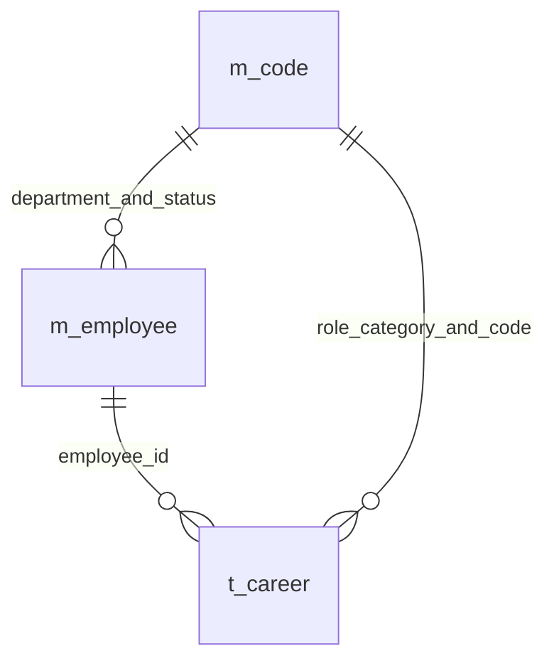
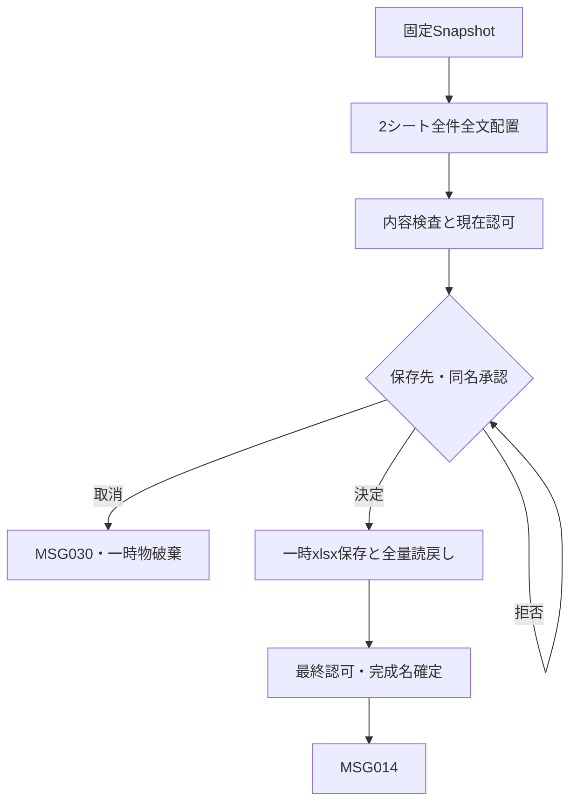
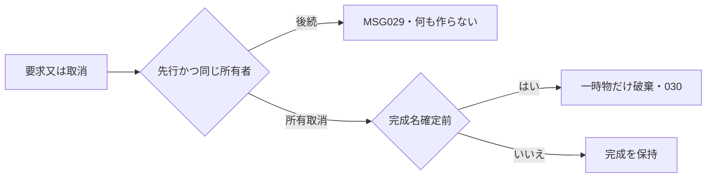

<!-- spec-meta: {"schema":"spec-md/1.0","documentId":"SP2-Access-DET-F05","version":"1.0","path":"sample-project2/spec/Access/詳細仕様書/05_経歴書出力.md","sheets":[{"heading":"概要","kind":"GRID","sheet":"01_概要"},{"heading":"項目一覧","kind":"LIST","sheet":"02_項目一覧","key":["項目ID"]},{"heading":"イベント仕様","kind":"GRID","sheet":"03_イベント仕様"},{"heading":"補足説明","kind":"GRID","sheet":"04_補足説明"}]} -->
# F05 経歴書出力 詳細仕様書

版1.0／2026-10-28。Access／detail-design／R01。[基本F05](../基本設計書/05_経歴書出力.md)の19項目・3イベントと帳票断片を継承。実Excel未生成。

## 概要

F03の1社員IDから`modCareerExport.ExportCareer(employeeId As Long,session As clsSession) As clsResult`を呼ぶ。ReadReportで保存済み全体を一貫取得し、DB解放後に専用Excel.Applicationで1冊を生成する。検索時revision／表示値／未保存F04値を受けず、最新取得の社員・全子・全名称・業務日・取得UTCをclsReportSnapshotへ固定する。出力で全業務表更新0件、出力履歴表・画面・テンプレート入力は追加しない。

2シートは「職務経歴書」「案件経歴」、A4縦、余白15mm、ヘッダー／フッター7mm、A:Xの24列各幅3.0相当、行高15pt以上、メイリオ本文10.5pt／見出し11pt太字／表題18pt。FitToPagesWide=1、FitToPagesTall=False、Zoom=False、Orientation=xlPortrait=1、PaperSize=xlPaperA4=9。縦1頁への強制縮小をしない。基本の次の断片は紙面構成の仕様図で、実印刷の合格ではない。

<!-- report-html-start: R01 -->
<style>
.career-report,.career-report *{box-sizing:border-box}
.career-report{width:680px;max-width:100%;padding:24px 28px;background:#fff;color:#202b38;font:14px/1.6 Meiryo,"Yu Gothic",sans-serif;border:1px solid #aeb8c5}
.career-report h3{margin:0 0 4px;text-align:center;color:#173650;font-size:24px;letter-spacing:3px}
.career-report .sub{margin:0 0 20px;text-align:right;font-size:12px}
.career-report h4{margin:18px 0 6px;padding-bottom:4px;color:#173650;border-bottom:2px solid #173650;font-size:15px}
.career-report table{width:100%;border-collapse:collapse;table-layout:fixed;font-size:12px}
.career-report th,.career-report td{border:1px solid #aeb8c5;padding:7px;vertical-align:top;overflow-wrap:anywhere}
.career-report th{background:#edf1f5;font-weight:bold;text-align:left}
.career-report p{margin:5px 0}.career-report .page{margin:22px 0 0;padding-top:8px;border-top:1px solid #aeb8c5;text-align:right;font-size:11px}
</style>
<section class="career-report" data-report-id="R01" aria-label="職務経歴書の架空見本">
  <h3>職務経歴書</h3>
  <p class="sub" data-item-id="F05-I01">2026年10月27日現在</p>
  <p class="sub" data-item-id="F05-I19">作成日時（JST）：2026年10月27日 14:30</p>
  <table><tbody><tr><th style="width:24%">氏名</th><td data-item-id="F05-I03">山田 太郎（ヤマダ タロウ）</td></tr><tr><th>社員番号／所属</th><td data-item-id="F05-I02">000001 ／ システム開発部</td></tr></tbody></table>
  <h4>職務要約</h4><p data-item-id="F05-I06">業務システムの設計、開発、テストを担当。利用部門との確認を重ね、操作を簡潔にする改善に取り組んでいます。</p>
  <h4>活かせる経験・知識・技術</h4><p data-item-id="F05-I07">C#による業務画面開発、SQLによるデータ照会、テスト仕様作成。</p>
  <h4>資格</h4><p data-item-id="F05-I08">基本情報技術者試験（2022年取得）</p>
  <h4>自己PR</h4><p data-item-id="F05-I09">利用者への確認事項と対応結果を記録し、認識の相違を早い段階で解消しています。</p>
  <p class="page">職務経歴書シート：氏名とページ番号をフッターに表示</p>
</section>
<section class="career-report" data-report-id="R01-CAREER" aria-label="案件経歴の架空見本">
  <h3>案件経歴</h3><p class="sub">山田 太郎 ／ 2026年10月27日現在</p>
  <p class="sub" data-item-id="F05-I19">作成日時（JST）：2026年10月27日 14:30</p>
  <h4 data-item-id="F05-I10">01　販売管理システム改善</h4>
  <table><tbody>
    <tr><th style="width:24%">期間</th><td data-item-id="F05-I11">2025年04月 ～ 現在（1年7か月）</td></tr>
    <tr><th>所属会社／案件</th><td data-item-id="F05-I12">デモシステム株式会社 ／ 製造業向け販売管理</td></tr>
    <tr><th>概要</th><td data-item-id="F05-I13">受注・出荷情報を照会する業務システムの改善。</td></tr>
    <tr><th>担当業務／工程</th><td data-item-id="F05-I14">検索画面の設計とテスト仕様作成。基本設計、実装、テスト。</td></tr>
    <tr><th>実績・工夫</th><td data-item-id="F05-I15">検索条件の整理により、入力手順を簡潔にした。</td></tr>
    <tr><th>開発環境</th><td data-item-id="F05-I16">OS：Windows<br>言語・FW：C# / ASP.NET Core<br>DB：SQL Server</td></tr>
    <tr><th>役割／チーム人数</th><td data-item-id="F05-I17">メンバー ／ 5名</td></tr>
  </tbody></table>
  <p class="page">案件経歴シート：直近案件から全件掲載。長文・多数案件は次ページへ継続。</p>
</section>
<!-- report-html-end: R01 -->

## 項目一覧

| 項目ID | 項目グループ | 項目名 | コントロール | 必須 | 入力制限 | フォーマット | 初期値 | DBテーブル名 | DB項目名 | 備考 | 物理Control・出力先 | 状態変数・VBA型 | raw上限・単位 | 正規化／保存上限・NULL | 物理DB列・型 | 入出力・候補・状態 |
| --- | --- | --- | --- | --- | --- | --- | --- | --- | --- | --- | --- | --- | --- | --- | --- | --- |
| F05-I01 | 出力情報 | 出力基準日 | Excelセル | 〇 | - | yyyy年MM月dd日現在 | 業務日 | - | - | 生成中固定。 | R01/R01Career A3 | Snapshot.BusinessDate As Date | 非適用 | 保存なし、yyyy年MM月dd日文字列 | DB列なし（固定業務日） | 両シートの基準日、生成中不変 |
| F05-I02 | 基本情報 | 社員番号・所属 | Excelセル | 〇 | - | 社員番号6桁／部署名 | - | 社員<br>汎用コード | 社員：社員番号・部署分類・部署<br>汎用コード：分類ID・コード・名称 | 先頭ゼロ保持。DEPARTMENT参照。 | R01 G6:X6 | Snapshot.EmployeeNo/DepartmentName As String | 非適用 | 番号6ASCII/名称40scalarを文字列 | m_employee.employee_no TEXT6、m_code.code_name TEXT80 | 社内識別・先頭ゼロ保持 |
| F05-I03 | 基本情報 | 氏名・カナ | Excelセル | 〇 | - | 氏名／カナ | - | 社員 | 氏名・氏名カナ | 補足なし | R01 G5:X5 | Snapshot.Name/Kana As String | 非適用 | 40/80scalarを文字列 | m_employee.employee_name TEXT80、employee_kana TEXT160 | 元の表示表記を保持 |
| F05-I04 | 出力条件 | 選択社員識別子 | - | 〇 | - | - | - | 社員 | 社員管理ID | F03の社員ID1名。未選択不可。検索版は渡さない。 | 入力引数employeeId | EmployeeId As Long | Long正数 | 保存なし、Null不可 | m_employee.employee_id COUNTER | F03の現結果1人、検索版なし |
| F05-I05 | 出力条件 | 在籍区分 | - | 〇 | - | - | - | 社員<br>汎用コード | 社員：在籍分類・在籍区分<br>汎用コード：分類ID・コード・名称 | 在籍判定用。EMPLOYMENT_STATUS参照。退職も対象。 | 出力判定のみ | Snapshot.Status As String | 非適用 | code2、保存なし | employment_category TEXT24、employment_status TEXT2、m_code.code_name TEXT80 | 退職も出力対象、固定分類検査 |
| F05-I06 | 職務 | 職務要約 | Excelセル | 非適用 | - | 改行 | 未記入 | 社員 | 職務要約 | 補足なし | R01 row8以降の要約block | Snapshot.Summary As Variant | 非適用 | 1000scalar又はNull→未記入表示 | m_employee.career_summary LONGTEXT NULL可 | WriteTextBlock、元改行復元 |
| F05-I07 | 職務 | 活かせる経験・知識・技術 | Excelセル | 非適用 | - | 改行 | 未記入 | 社員 | スキル・得意分野 | 経験年数の自動集計なし。 | R01可変スキルblock | Snapshot.Skills As Variant | 非適用 | 1000scalar又はNull→未記入 | m_employee.skills LONGTEXT NULL可 | 全量、経験年数計算なし |
| F05-I08 | 職務 | 資格 | Excelセル | 非適用 | - | 改行 | 未登録 | 社員 | 保有資格 | 取得年月は記入どおり。 | R01可変資格block | Snapshot.Qualifications As Variant | 非適用 | 1000scalar又はNull→未登録 | m_employee.qualifications LONGTEXT NULL可 | 1資格1行の原文保持 |
| F05-I09 | 職務 | 自己PR | Excelセル | 非適用 | - | 改行 | 未記入 | 社員 | 自己PR | 補足なし | R01可変PR block | Snapshot.SelfPr As Variant | 非適用 | 1000scalar又はNull→未記入 | m_employee.self_pr LONGTEXT NULL可 | 全量、元改行保持 |
| F05-I10 | 経歴 | 案件連番・案件名 | Excelセル | 〇 | - | 連番2桁／案件名 | 01 | 社員経歴 | 案件名・開始年月・経歴ID | 開始年月・経歴IDの降順。全件掲載。 | R01Careerの各案件見出し | Ordinal As Integer/Project As String | 非適用 | 01～20連番と100scalar案件名 | t_career.project_name TEXT200、start_month DATETIME、career_id COUNTER | 開始月/ID降順、IDは帳票に出さない |
| F05-I11 | 経歴 | 期間・参画月数 | Excelセル | 一部 | - | yyyy年MM月～yyyy年MM月 | 現在 | 社員経歴 | 開始年月・終了年月 | 開始必須。終了空欄は継続中。期間は両端月を含む。 | R01Careerの期間行G:X | Start/End As Date/Variant、Months As Long | 非適用 | yyyy年MM月と月差+1、終了Nullは固定年月まで | t_career.start_month DATETIME NOT NULL、end_month DATETIME NULL可 | 案件ごと、並行の通算なし |
| F05-I12 | 経歴 | 所属会社 | Excelセル | 〇 | - | - | - | 社員経歴 | 会社名 | 前職可。匿名表現保持。 | R01Careerの会社行G:X | Company As String | 非適用 | 100scalar、Null不可 | t_career.company_name TEXT200 NOT NULL | 前職/匿名名そのまま |
| F05-I13 | 経歴 | 案件概要 | Excelセル | 〇 | - | 改行 | - | 社員経歴 | 業務概要 | 補足なし | R01Careerの概要block G:X | Description As String | 非適用 | 1000scalar、Null不可 | t_career.description LONGTEXT NOT NULL | 全量、LF保持 |
| F05-I14 | 経歴 | 担当業務・担当工程 | Excelセル | 一部 | - | 業務／工程を別表示 | 空 | 社員経歴 | 担当業務・担当工程 | 業務必須、工程任意。 | R01Careerの担当/工程block G:X | Duties As String/Phases As Variant | 非適用 | 担当1000必須/工程200任意Null | t_career.duties LONGTEXT NOT NULL、phases LONGTEXT NULL可 | 別ラベル、全文復元 |
| F05-I15 | 経歴 | 実績・工夫 | Excelセル | 非適用 | - | 改行 | 空 | 社員経歴 | 実績・成果 | 補足なし | R01Careerの成果block G:X | Achievements As Variant | 非適用 | 1000scalar又はNull | t_career.achievements LONGTEXT NULL可 | 未入力に成果を創作しない |
| F05-I16 | 経歴 | 開発環境 | Excelセル | 非適用 | - | 改行 | 空 | 社員経歴 | 技術環境 | OS・言語/FW・DBは自由記入。 | R01Careerの技術block G:X | Technologies As Variant | 非適用 | 500scalar又はNull | t_career.technologies LONGTEXT NULL可 | 自由記入全量 |
| F05-I17 | 経歴 | 役割・チーム人数 | Excelセル | 〇 | - | 役割名／人数＋名 | - | 社員経歴<br>汎用コード | 社員経歴：役割分類・役割・チーム人数<br>汎用コード：分類ID・コード・名称 | PROJECT_ROLE参照。 | R01Careerの役割/人数行G:X | RoleName As String/TeamSize As Integer | 非適用 | 役割名40scalar/人数1～999を文字列 | role_category TEXT24、role_code TEXT2、team_size SHORT、m_code.code_name TEXT80 | 固定時点の停止名称も掲載 |
| F05-I18 | 出力情報 | 出力ファイル名 | - | 〇 | - | 職務経歴書_社員番号_yyyyMMdd.xlsx | - | 社員 | 社員番号 | 社員番号・業務日から生成。氏名は含めない。 | GetSaveAsFilename初期値 | SuggestedName As String | 非適用 | 職務経歴書_6桁番号_yyyyMMdd.xlsx、保存先は選択 | m_employee.employee_no TEXT6 | 氏名なし、対話後再認可 |
| F05-I19 | 出力情報 | 作成日時（取得日時） | Excelセル | 〇 | - | yyyy年MM月dd日 HH:mm | 取得日時 | - | - | JST。取得時点固定。両シートと印刷フッターへ表示。 | 両シートA4と印刷Footer | Snapshot.CapturedAtUtc As Date | 非適用 | 取得JST表示文字列、保存なし | DB列なし（固定読取時点） | yyyy年MM月dd日 HH:mm、基準日と区別 |

## イベント仕様

### F05-E01 出力条件確認と一貫読取り

#### 処理概要

選択社員1件・経歴1～20件と全名称を同じ読取単位へ固定する。古い検索値と異なっていても、それを出力競合とは扱わない。

#### 処理手順

1. **認証・選択**
   1. IsBusy／RequestIdで同じ画面の後続要求を029へ。現在認証／ADMIN又はSTAFFと正Longの1社員選択を確認し、002/003/011で業務取得前に止める（CHK-F05-01）。
   2. ゲートを最大10秒で取得しprivate DAO WorkspaceでBeginTrans、現在の利用者1件を再確認。待ち超過は027、読取単位成立不能は028（CHK-F05-02）。
2. **親子取得・内容検査**
   1. 取得UTCを一度だけ固定しJST業務日／業務年月を作る。社員PK1件、全経歴を開始月降順→ID降順で読む。0親019、複数親020、0子012、21件以上020とする（CHK-F05-03/04）。
   2. 必須・全scalar上限・人数・月初／範囲／前後・11編集値重複を保存済み不整合として検査する。通常入力不備MSG004等へ丸めず020で全出力を止める（CHK-F05-05）。
3. **全名称固定・解放**
   1. 部署DEPARTMENT・在籍EMPLOYMENT_STATUS・全役割PROJECT_ROLEを分類とcodeで各1件取得。停止していても参照する。所有違い・同ID重複・欠落／複数名称は020、名称不明への補完は禁止（CHK-F05-06）。
   2. 全値をSnapshotへコピーし、整合読取の終了とDAO／ゲート解放を確認してからE02へ。途中結果だけでは進めず、以後の業務再照会をしない（CHK-F05-07）。

#### 処理フロー


#### SQL・テーブル関連（ER図）



m_codeは用途別の複合キーで参照する。固定分類定義は読込時の属性を検査し、m_code_categoryの名称を帳票へ結合する要求ではない。m_app_userは認可確認だけで帳票の対象外。

#### DB操作の詳細

```sql
PARAMETERS pId Long;
SELECT * FROM m_employee WHERE employee_id=pId;
```
```sql
PARAMETERS pId Long;
SELECT * FROM t_career WHERE employee_id=pId
ORDER BY start_month DESC,career_id DESC;
```
```sql
PARAMETERS pCategory Text(24),pCode Text(2);
SELECT category_id,code,code_name,is_enabled FROM m_code
WHERE category_id=pCategory AND code=pCode;
```

F05-DB00はセッションUserId/dbText40で現在利用者1件、DB01はpId/dbLongで社員1件、DB02は同pIdで子1～20件、DB03は固定分類とcodeで各1件。dbOpenSnapshotの値をCollection／Dictionaryへ全コピーし、同じキー名称は1時点値を再利用する。生の経歴件数を名称取得前に数え、JOIN欠落で20件目を失わない。全書込み／更新版変更0件。読取単位を閉じる前に全必要値が揃わなければ全Snapshotを破棄する。

#### 結果・例外時の扱い

012「経歴を1件以上登録してから出力してください。」はF04登録案内、019「対象の社員が見つかりません。検索し直してください。」はF03選択解除、020「保存データに不整合があります。管理者へ連絡してください。」は補完せず停止。028「データを再取得してから、もう一度作成してください。」は一貫取得の再実行を案内。認証有効なら条件／選択を保持し、再作成は本イベントから全再取得する。

### F05-E02 Excelブック生成と受渡し

#### 処理概要

Snapshotの全値を2シートへ組み立て、読戻し一致・受渡前再認可・完成ファイル確定の全段階を通過した時だけ保存完了とする。

#### 処理手順

1. **固定内容の配置**
   1. CreateObjectで専用Excelを作り、1シートから2枚だけにする。元のExcelをGetObjectで接収しない。F05-I01～19を次の固定／可変位置へ出す。番号／日付表示を含め全業務文字列はNumberFormat="@"設定後Value2へCStr、秘密・内部ID・版を隠しセルへ保存しない（CHK-F05-08）。
   2. 職務経歴書はA1:X2表題、A3基準日、A4取得JST、A5:F5氏名ラベル／G5:X5氏名、A6:F6番号所属ラベル／G6:X6値。8行目から要約→スキル→資格→PRをWriteTextBlock(label,text,nextRow)で順に展開する。
   3. 案件経歴は表題／氏名／基準日を1～3行、取得JSTを4行、5行から全案件を固定順で積む。案件連番／案件名→期間／月数→会社→概要→担当→工程→成果→技術→役割／人数の順、ラベルA:F／値G:X。継続は固定BusinessDateの年月まで、両端月を含む月差+1、重複案件を合算しない（CHK-F05-09）。
2. **全文展開と再認可**
   1. 元LFと追加折返しを別に記録し、32scalarを目安に結合文字／絵文字単位を保って分割する。各継続行を15pt以上、実フォント幅に応じさらに分ける。PageSetup後のHPageBreaksを計測し、章／案件見出しと最初の本文が分離すれば見出し前へ改ページ、長い案件は次頁に案件／欄名と続きラベルを挿入する。再掲を元本文へ混ぜず、安定した改ページが得られなければ037として公開しない。
   2. PrintArea=A1:X最終行、Footerに氏名／シート名／取得JST／&P/&Nを設定。2表示シート・全経歴連番と件数・全文逆結合一致・文字列型・式／外部リンク／Connections／マクロ／隠し情報なしを検査する（CHK-F05-10）。
   3. RequireCurrent(ADMIN又はSTAFF)を短いゲート内で再確認し、現在許可内なら続行。ADMIN→STAFFは出力許可内、停止／失効002・許可外003なら完成済みでも渡さず一時物だけ破棄する。業務表を再照会せず同じSnapshotを保持する（CHK-F05-11）。
3. **保存先対話・内容読戻し・確定**
   1. 専用Excel.GetSaveAsFilenameで初期値`職務経歴書_<ASCII6社員番号>_<固定yyyyMMdd>.xlsx`を表示し保存先を選ぶ。Falseは030、同名の明示上書き拒否は保存先へ戻る。対話後も認証を最終確定直前に再確認する。
   2. 選択先ディレクトリ内の要求所有一時名へWorkbook.SaveAs FileFormat=51で保存、閉じてReadOnly=True／UpdateLinks=0で開き全検査を読み戻す。原LF／先頭ゼロ／先頭アポストロフィ／式に見える文字／Unicodeを固定値と完全一致比較し、不一致037は最終名へ出さない。
   3. ブックを閉じ、最終名の上書き確認状態が変わっていないことと現在認可を検査し、共通実装のMoveFileExWで同一ディレクトリから完成名へ確定する。新規は既存名を置換しないflag、承認済み同名だけREPLACE_EXISTINGを許す。成功戻り確認後にだけMSG-014。既存を先に削除しない（CHK-F05-12）。

#### 処理フロー



#### SQL・テーブル関連（ER図）

業務表の追加読取は0件。例外はm_app_user単表の現在認可だけで、F05-DB00を再適用する。E01のSnapshotを使うため別の業務ERを追加しない。

#### DB操作の詳細

現在UserId/dbText40で利用者1件と有効／現在役割を再確認する。社員・経歴・コードの追加読取／更新は0件。Excelは専用Application→Workbook→Worksheet→Rangeを順に所有し、`WriteTextBlock`は次開始行と復元区分情報を返す。可変セル範囲は機能項目IDと案件連番をメモリーの出力対応表に持ち、ブックへ内部IDを埋めない。書体／余白／紙面値は基本設計の独自帳票値で、仕様書用120列方眼を適用しない。

#### 結果・例外時の扱い

037「経歴書の内容を確認できませんでした。管理者へ連絡してください。」は最終受渡0冊、030「処理を取り消しました。」は正常取消、013「経歴書を作成できませんでした。時間をおいて再実行してください。」は資源／保存／確定障害。保存先使用中・容量・権限障害では既存最終ファイルを先に削除せず、未完成物を公開しない。確定済み完成物は後行取消で消さず、自分の一時物／専用Excelだけを解放する。API又は電源断の結果不明をファイル完成と推測せず、DQA-A04の実機確認へ残す。

### F05-E03 処理中の重複要求と取消

#### 処理概要

同じ画面の先行RequestIdを所有者とし、後続要求が先行ブック・busy・一時物を解除しないよう制御する。

#### 処理手順

1. **要求受付**
   1. 先行RequestIdありはCHK-F05-13・MSG-029、後続は取得0件・生成0冊。新要求だけIsBusy=True／CancelRequested=Falseを設定する。
   2. F03のForm.KeyPreview=Trueとし、Form_KeyDownのEsc（KeyCode=27）がExport中だけ自分のRequestIdのCancelRequested=Trueを設定しKeyCode=0で消費する。Form_UnloadはExport中Cancel=Trueとして同じ旗だけを設定し、Formや資源を途中破棄しない。DBゲート／Tx外のWriteTextBlockの各完了・保存先対話復帰のチェックポイントでDoEventsを1回行い、busy/RequestId検査で通常操作の再入を拒否した上で取消／失効旗を読む。DB内・MoveFileExW中はDoEventsを呼ばない。DAO確定やファイル移動APIの途中へ割込んで完了状態を失わない。
2. **取消・終了**
   1. 完成名確定前の取消は030、一時Workbookと一時ファイルを破棄。失効は002を優先する。同名上書き拒否は取消ではなく保存先の再選択。
   2. 移動成功後の取消は完了を維持し完成ファイルを消さない（CHK-F05-14）。
   3. 全経路で要求所有パスだけを確認して削除し、自分のWorkbook.Close(False)／Application.Quit／オブジェクト解放を行う。先行と異なるRequestIdの資源を触らない（CHK-F05-15）。

#### 処理フロー



#### SQL・テーブル関連（ER図）

要求と一時資源の制御だけ、DB操作なしのためER非適用。

#### DB操作の詳細

全DB参照／更新0件。取消で社員／経歴／コード／更新版を変更せず、出力履歴を追加しない。

#### 結果・例外時の扱い

認証有効の終了はF03条件／選択を保持、認証失効はF01へ。自分の一時物解放失敗は受付番号と工程だけを内部記録し、成功・取消を偽装しない。他のExcel.instanceや利用者の開いているブックを強制終了しない。

## 補足説明

PILOT-P35～40に加え、実Excelで`'ABC`、`''ABC`、`'=1+1`、`_x0041_`、先頭=+@-、元LF、補助文字、結合文字を保存・表示・Value2読戻しで原文と比較する。先頭アポストロフィの解釈を原文消失と混同せず不一致なら037、業務値へ恒久的な接頭辞を足して補修しない。全1000scalar・20経歴・同月／継続／前職／並行・印刷改ページの実証はQA-016で未実施。基本と同じ帳票HTMLの存在をOffice生成・可読性合格としない。
