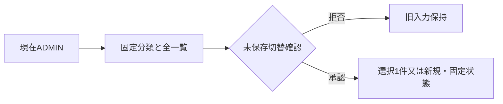
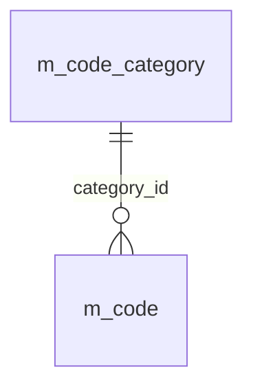
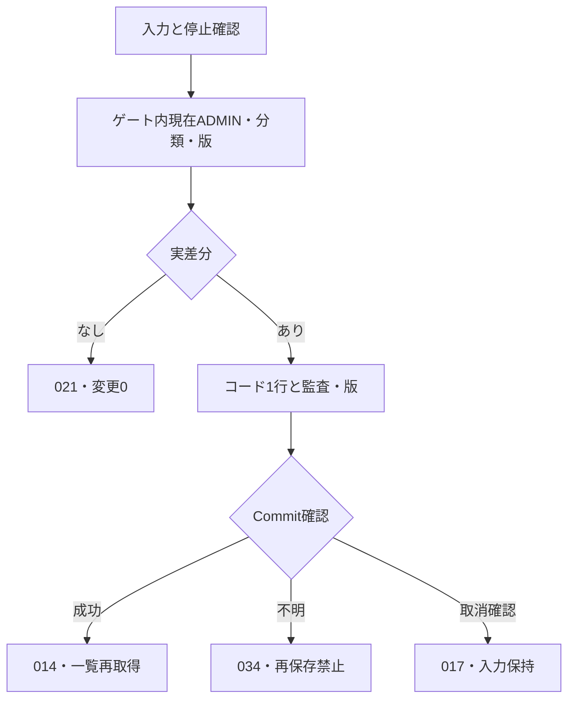
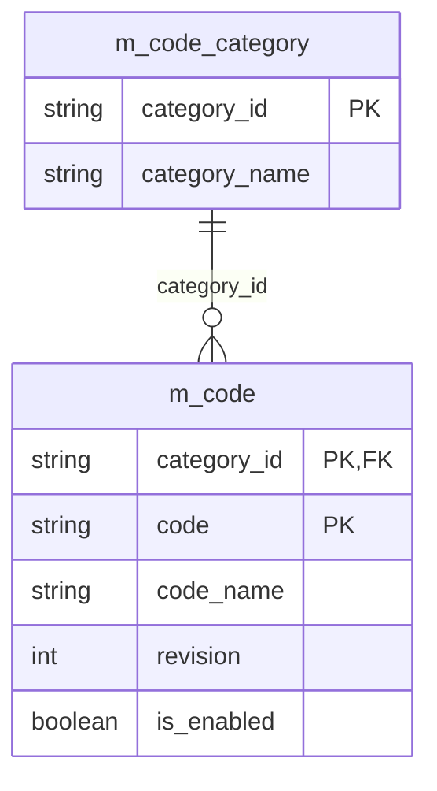
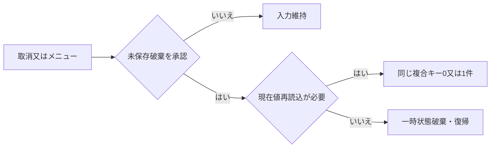

<!-- spec-meta: {"schema":"spec-md/1.0","documentId":"SP2-Access-DET-F06","version":"1.1","path":"sample-project2/spec/Access/詳細仕様書/06_汎用コードマスタ画面.md","sheets":[{"heading":"概要","kind":"GRID","sheet":"01_概要"},{"heading":"項目一覧","kind":"LIST","sheet":"02_項目一覧","key":["項目ID"]},{"heading":"イベント仕様","kind":"GRID","sheet":"03_イベント仕様"},{"heading":"補足説明","kind":"GRID","sheet":"04_補足説明"}]} -->
# F06 汎用コードマスタ画面 詳細仕様書

版1.1／2026-10-29。Access／detail-design。[基本F06](../基本設計書/06_汎用コードマスタ画面.md)の既存12項目/3イベントを保持し、表示Label4項目を同期する。実装/ACE未実施。

## 概要

未連結frmCodeMasterはclsCodeEditと読込原本・現在複合キーを保持し、一覧選択と右側1行編集を分離する。`modCodeMaintenance.LoadCategory(categoryId,session)`／`SaveCode(edit,session)`／`ReloadCode(categoryId,code,session)`が全DB操作を行う。ADMINだけ、分類は固定3種、編集はDEPARTMENTとPROJECT_ROLEだけ。社員・経歴を参照／更新／削除して停止連動処理をしない。

[UI部品・状態・検査契約](../共通/方式別/02_UI部品・状態・検査契約.md)のSC-F06を適用する。Headerはタイトル/分類/対象、Detailは一覧と一件編集、Footerは結果案内。分類2700twip、コード/順序1350、名称5100、入力480、全役割11pt。既存キー・固定在籍の名称/順序/有効はEnabled=True/Locked=True/TabStop=Trueで、readonlyもキー到達/全文/コピー可能。固定在籍の新規/保存だけ操作無効、未選択の入力は無効とする。ListBoxの列定義と4つのLabel見出しを共通配列から配置し、通常選択と右の保存対象を一致させる。I15/I16は独立領域見出しとする。

<!-- screen-html-start: F06 -->
<style>
.sp2-f06,.sp2-f06 *{box-sizing:border-box}.sp2-f06{width:1260px;min-height:650px;padding:24px;color:#000;background:#efefef;font:11pt/1.45 "Yu Gothic UI",sans-serif}.sp2-f06 h3{font:700 11pt/1.45 "Yu Gothic UI",sans-serif;margin:0}.sp2-f06 .head{display:flex;justify-content:space-between;align-items:center;margin-bottom:16px}.sp2-f06 .identity{font-weight:bold;min-height:22px;margin-bottom:20px;overflow-wrap:anywhere}.sp2-f06 .filter{display:flex;gap:16px;align-items:center;margin-bottom:20px}.sp2-f06 select,.sp2-f06 input{height:32px;padding:4px 6px;font:inherit;color:#000;border:1px solid #888;background:white}.sp2-f06 input[readonly]{background:#eee}.sp2-f06 select{width:180px}.sp2-f06 button{height:34px;padding:4px 16px;font:inherit;border:1px solid #aaa;background:#f7f7f7;color:#000}.sp2-f06 .columns{display:grid;grid-template-columns:530px 1fr;gap:24px}.sp2-f06 .grid{height:320px;overflow:auto;border:1px solid #aaa;background:white}.sp2-f06 table{width:528px;border-collapse:collapse;table-layout:fixed}.sp2-f06 th,.sp2-f06 td{height:28px;padding:3px 8px;text-align:left;white-space:nowrap;overflow:hidden}.sp2-f06 th{position:sticky;top:0;background:#efefef;border-bottom:1px solid #888}.sp2-f06 .selected{background:#000;color:white}.sp2-f06 .field{display:block;margin:0 0 12px}.sp2-f06 .code,.sp2-f06 .sort{width:90px}.sp2-f06 .name{width:340px}.sp2-f06 .check{display:flex;align-items:center;gap:8px}.sp2-f06 .check input{height:16px;width:16px}.sp2-f06 .actions{display:flex;gap:12px;margin-top:20px}.sp2-f06 .message{min-height:44px;margin-top:16px}.sp2-f06 :focus-visible{outline:2px solid #000;outline-offset:2px}
.sp2-f06 [data-item-id="F06-I09"]{font-weight:bold}.sp2-f06 h4{font:700 11pt/1.45 "Yu Gothic UI",sans-serif;margin:0 0 8px}
</style>
<div class="sp2-f06" data-screen-id="SC-F06" data-state="department-edit" aria-label="汎用コードマスタ 部署の編集"><div class="head"><h3 data-item-id="F06-I13">汎用コードマスタ</h3><button data-item-id="F06-I11">メニュー</button></div><div class="identity" data-item-id="F06-I14">編集対象：部署　01 開発［編集］</div><div class="filter"><label>分類 <select data-item-id="F06-I01" autofocus><option>部署</option><option>在籍区分</option><option>案件役割</option></select></label><button data-item-id="F06-I08">新規</button></div><div class="columns"><div><h4 data-item-id="F06-I15">コード一覧</h4><div class="grid" data-item-id="F06-I02" tabindex="0"><table><colgroup><col style="width:75px"><col style="width:293px"><col style="width:85px"><col style="width:75px"></colgroup><thead><tr><th>コード</th><th>名称</th><th>並び順</th><th>有効</th></tr></thead><tbody><tr class="selected" aria-selected="true"><td>01</td><td>開発</td><td>1</td><td>〇</td></tr><tr><td>02</td><td>基盤</td><td>2</td><td>〇</td></tr><tr><td>03</td><td>管理</td><td>3</td><td>〇</td></tr></tbody></table></div></div><div><h4 data-item-id="F06-I16">選択コードの編集</h4><label class="field">コード ※<br><input class="code" data-item-id="F06-I03" value="01" readonly></label><label class="field">名称 ※<br><input class="name" data-item-id="F06-I04" value="開発"></label><label class="field">並び順 ※<br><input class="sort" data-item-id="F06-I05" value="1"></label><label class="check"><input data-item-id="F06-I06" type="checkbox" checked>有効（外すと新規選択を停止）</label><p data-item-id="F06-I07">停止しても登録済み社員・経歴の値は保持されます。</p><div class="actions"><button data-item-id="F06-I09">このコードを保存</button><button data-item-id="F06-I10">編集を取消</button></div></div></div><div class="message" data-item-id="F06-I12" role="status">分類とコードは保存後に変更できません。在籍区分は参照専用です。</div></div>
<!-- screen-html-end: F06 -->

## 項目一覧

| 項目ID | 項目グループ | 項目名 | コントロール | 必須 | 入力制限 | フォーマット | 初期値 | DBテーブル名 | DB項目名 | 備考 | 物理Control・出力先 | 状態変数・VBA型 | raw上限・単位 | 正規化／保存上限・NULL | 物理DB列・型 | 入出力・候補・状態 |
| --- | --- | --- | --- | --- | --- | --- | --- | --- | --- | --- | --- | --- | --- | --- | --- | --- |
| F06-I01 | コード分類 | 分類 | ComboBox | 〇 | 選択のみ | 分類名表示／分類ID保持 | DEPARTMENT | コード分類<br>汎用コード | コード分類：分類ID・分類名<br>汎用コード：分類ID | 固定3分類を部署→在籍区分→案件役割の順で表示。分類IDは半角英大文字・下線24字以内。分類の並び順列なし。 | cboCategory | CategoryId As String | 24 ASCII以内 | 固定3分類、Null不可 | m_code_category.category_id TEXT24、m_code.category_id TEXT24 | 部署→在籍→役割の固定順 |
| F06-I02 | コード一覧 | コード一覧 | ListBox | - | - | コード2桁・先頭ゼロ／有効は〇・空欄 | 部署一覧 | 汎用コード | コード・名称・並び順・有効 | 分類当たり最大99行。1件選択、初回は選択なし。停止も表示。並び順→コード昇順。 | lstCodes | CodeRows As Collection/SelectedKey As Variant | 非適用 | 0～99件一時一覧 | m_code.code TEXT2/code_name TEXT80/sort_order SHORT/is_enabled YESNO | sort_order/code順、停止も表示 |
| F06-I03 | コード情報 | コード | TextBox | 〇 | 半角数字2桁（01～99）・新規のみ | 先頭ゼロ保持 | 空 | 汎用コード | 分類ID・コード | 分類内で一意。既存キー変更不可。 | txtCode | Edit.Code As String | 2 ASCII | 01～99、必須／Null不可 | m_code.code TEXT2 NOT NULL | 新規のみ入力、既存Locked=True |
| F06-I04 | コード情報 | 名称 | TextBox | 〇 | 40字・在籍区分変更不可 | - | 空 | 汎用コード | 名称 | 前後空白除去。空白だけは不可。 | txtCodeName | Edit.Name As String | 40scalar | 40scalar、必須／Null不可 | m_code.code_name TEXT80 NOT NULL | 前後空白除去、固定在籍変更不可 |
| F06-I05 | コード情報 | 並び順 | TextBox | 〇 | 整数1～999・3桁以内・在籍区分変更不可 | - | 1 | 汎用コード | 並び順 | 同順位可、コード順で決定。 | txtSortOrder | SortRaw As String/Edit.SortOrder As Integer | 3 ASCII | 整数1～999、Null不可 | m_code.sort_order SHORT NOT NULL | 同順位可、固定在籍変更不可 |
| F06-I06 | コード情報 | 有効 | CheckBox | 〇 | 在籍区分変更不可 | 〇／空欄 | 〇 | 汎用コード | 有効 | 在籍区分は〇固定。部署・役割は停止／再開可。製品はチェック操作、一覧は〇表示。 | chkEnabled | Edit.IsEnabled As Boolean | Boolean | True/False、Null不可 | m_code.is_enabled YESNO NOT NULL | True初期、在籍True固定、停止時確認038 |
| F06-I07 | 案内 | 使用上の注意 | Label | - | - | - | - | - | - | 停止しても保存済み業務データを置換しない。 | lblUsage | UsageText As String | 非適用 | 保存なし | 非適用 | 停止既存参照保持の案内 |
| F06-I08 | 操作 | 新規 | CommandButton | - | - | - | - | - | - | 部署・役割のみ有効。入力中は破棄確認。 | cmdNew | Edit As clsCodeEdit | 非適用 | 保存なし | 非適用 | 許可分類/99未満だけ新規、未保存確認 |
| F06-I09 | 操作 | このコードを保存 | CommandButton | - | - | - | - | 汎用コード | 分類ID・コード・名称・並び順・有効・更新日時・更新者・更新版 | 未選択時・在籍区分は無効。部署・役割1件の追加／更新を確定。 | cmdSave | SaveResult As clsResult | 非適用 | 保存なし | m_codeの許可1行、updated_at DATETIME/updated_by TEXT40/revision LONG | 現在ADMIN/版/件数再確認して1Tx |
| F06-I10 | 操作 | 編集を取消 | CommandButton | - | - | - | - | - | - | 1件編集中のみ有効。未保存変更は破棄確認。 | cmdCancel | CancelRequested As Boolean | 非適用 | 保存なし | m_code複合キー（既存取消の再読込だけ） | 015確認、更新0 |
| F06-I11 | 操作 | メニュー | CommandButton | - | - | - | - | - | - | 変更中は破棄確認。 | cmdMenu | MenuRequested As Boolean | 非適用 | 保存なし | 非適用 | 015確認後F02 |
| F06-I12 | 案内 | メッセージ | Label | - | - | - | - | - | - | キー固定・競合・検査・保存結果。 | lblMessage | Result.MessageId/FieldId As String | 非適用 | 保存なし | 非適用 | 共通日本語MSG・入力保持/欄focus |
| F06-I13 | 画面識別 | 画面タイトル | Label | - | - | - | 汎用コードマスタ | - | - | 独立11pt太字。 | lblScreenTitle | Caption As String | 非適用 | 保存なし | 非適用 | Header |
| F06-I14 | 対象識別 | 分類・コード・名称・モード | Label | - | - | - | 部署／未選択 | コード分類<br>汎用コード | 分類名・コード・名称 | 選択/入力と同期。 | lblCodeIdentity | Edit/Selection As Object | 非適用 | 保存なし | m_code_category.category_name/m_code.code/code_name（表示元） | Header、内部IDなし |
| F06-I15 | 領域識別 | コード一覧見出し | Label | - | - | - | コード一覧 | - | - | 11pt太字。 | lblCodeListHeading | Caption As String | 非適用 | 保存なし | 非適用 | Detail一覧の上 |
| F06-I16 | 領域識別 | 選択コードの編集見出し | Label | - | - | - | 選択コードの編集 | - | - | 11pt太字。 | lblCodeEditHeading | Caption As String | 非適用 | 保存なし | 非適用 | Detail編集欄の上 |

## イベント仕様

### F06-E01 初期表示・分類変更・コード選択・新規

#### 処理概要

現在ADMINを確認し固定分類とその全コードを取得、未保存確認後に選択又は新規状態へ移る。

#### 処理手順

1. **現在認可と固定分類**
   1. IsBusyは029、RequireCurrent(ADMIN)で失効002・STAFF003、取得障害040。分類IDを固定3種に検査し、別分類や未知値は020／016で開始しない（CHK-F06-01～03）。
   2. m_code_categoryの3行と在籍3値の存在・不変属性を検査する。部署初期選択、一覧順sort_order→codeで停止も表示する。
2. **選択切替と一覧**
   1. 分類/行/新規要求は新キーを退避し、IsRestoringSelection中に旧分類/キーへ戻してから、旧入力を可視のまま015「入力内容を破棄しますか。」を確認する。はいだけ切替え、いいえ/閉じるは旧キー/raw/未保存状態/focusを保持する。callback.Requeryで選択を先に消さない。
   2. 分類全コード0～99件を一貫取得し、0件は空一覧・新規可、100件以上／キー範囲外／重複は020。選択は複合キー1件、初回は未選択で編集無効。
3. **新規又は固定表示**
   1. 既存はcategory_id/code/revisionを読込原本へ固定し、キーを読取専用。新規は編集可能分類かつ99件未満のみ、code/name空・sort_order1・有効True、ExpectedRevision=Null。
   2. 在籍分類の新規／保存要求は直接呼出しも023、99件の新規開始は024。全停止・同名・同順だけを整合エラーにしない（CHK-F06-04～07）。

#### 処理フロー



#### SQL・テーブル関連（ER図）



分類PKと汎用コード複合PK/FKの関係。社員／経歴はこの機能の入出力対象外、m_app_userは認可単表だけ。

#### DB操作の詳細

```sql
PARAMETERS pCategory Text(24);
SELECT category_id,code,code_name,sort_order,is_enabled,
 updated_at,updated_by,revision FROM m_code
WHERE category_id=pCategory ORDER BY sort_order,code;
```

固定分類3件はm_code_category全行から正確に3種確認。pCategory=dbText24、snapshot0～99件、在籍は正確3。現在認可UserId/dbText40で1件。全DB書込み0件。一覧callbackへ全値をメモリー配列で渡し、コールバック内でSQLを実行しない。

#### 結果・例外時の扱い

003「この操作を実行する権限がありません。」、023「固定コードの追加・変更・停止はできません。」、024「コードは分類ごとに99件までです。」を区別する。取得失敗040では空の新規へ自動切替せず古い保存操作を無効化。固定属性の破損020は自動修復しない。

### F06-E02 コード保存

#### 処理概要

許可分類の1行だけを、現在認可・複合キー・版・有効状態確認を経て原子的に追加／変更する。

#### 処理手順

1. **受付と停止確認**
   1. IsBusy／CanSave、ADMIN、分類を確認し、固定在籍は無変更要求でも023。codeはASCII2桁01～99、name40scalar必須、sort_order1～999、is_enabledはBooleanを検査し004／005で欄へ。
   2. 既存有効→停止は038「このコードを停止しますか。登録済みデータは保持され、新しい選択ができなくなります。」、拒否は編集継続。新規停止登録は許可し、確認中にDBロックを保持しない。
2. **ゲート・現在版と差分**
   1. 最大10秒ゲート→BeginTrans→現在利用者／ADMINを再確認。分類存在・固定保護・既存キー不変・新規同キー不存在／分類件数を再検査する。
   2. 既存はPK1件とExpectedRevision一致を先に検査する。0件016・旧版008、現在版一致の正規化後同値は021で更新0、実変更かつ2147483647は039。名称／順序の重複は許容する（CHK-F06-08～15）。
3. **書込みと確定**
   1. 新規はINSERT1、既存実変更はPK＋旧版WHEREのUPDATE1を期待する。コードキー／分類と他行を保持し、現在UserId／UTC／新規1又は現版+1を設定する。
   2. RecordsAffected=1を確認してCommit、014「保存しました。」後に同じ分類を再取得し同じキーを選択。重複3022は022、途中障害は全取消017、待ち027、Commit不明034・再保存禁止。再表示だけ失敗は014＋040を維持。

#### 処理フロー



#### SQL・テーブル関連（ER図）



保存対象m_codeのcategory_id＋code複合PK1行、m_code_categoryはcategory_id一致の参照、m_app_userは現在認可単表。保存許可分類はDEPARTMENT又はPROJECT_ROLEだけでEMPLOYMENT_STATUSを拒否する。revisionは同じコードの楽観版。既存社員／経歴を停止に連動して付替え／削除しない。

#### DB操作の詳細

```sql
PARAMETERS pCategory Text(24),pCode Text(2),pName Text(80),
 pSort Short,pEnabled YesNo,pAt DateTime,pActor Text(40),pExpected Long,pNext Long;
UPDATE m_code SET code_name=pName,sort_order=pSort,is_enabled=pEnabled,
 updated_at=pAt,updated_by=pActor,revision=pNext
WHERE category_id=pCategory AND code=pCode AND revision=pExpected;
```

```sql
PARAMETERS pCategory Text(24),pCode Text(2),pName Text(80),
 pSort Short,pEnabled YesNo,pAt DateTime,pActor Text(40);
INSERT INTO m_code(category_id,code,code_name,sort_order,is_enabled,updated_at,updated_by,revision)
VALUES(pCategory,pCode,pName,pSort,pEnabled,pAt,pActor,1);
```

pCategory/dbText24とpCode/dbText2は固定した新規値又は読込キー、pName/dbText80は40scalar以内、pSort/dbInteger、pEnabled/dbBoolean、pAt/dbDateのUTC、pActor/dbText40の現在UserId、版はdbLong。期待1件、0件は対象再確認し不存在016／版008、複数は020。新規の一意3022はMSG-022、99件では合法な未使用キーが存在しないので新規開始自体を拒否する。物理DELETE／キー更新を発行しない。

#### 結果・例外時の扱い

022「この分類とコードは登録されています。」はキー欄・全取消。008は入力保持／破棄確認後再読込、021「変更はありません。」はDB／版／日時／主体を据置。034「保存結果を確認できません。再読込みして反映状態を確認してください。」は成功／取消を断定せずCanSave=False、現在値確認後の明示編集だけを許す。全終了経路でゲート／DAOを解放する。

### F06-E03 取消・メニューへ戻る

#### 処理概要

未保存1行を破棄するか保守を終了する。既存取消／結果不明の現在値確認は同じ複合キーを読み直す。

#### 処理手順

1. **操作と確認**
   1. 処理中029。保存結果確認待ち（CommitUnknown）はMSG-034を再表示し通常取消／メニュー移動を止め、破棄確認後の現在値再読込だけを許可する（CHK-F06-16）。認証期限切れ002又は現在ADMIN喪失003では保存せず終了する。
   2. 通常の未保存変更なら015で確認し、拒否は旧キー・入力・focusを保持する。はい又は差分なしで、新規通常取消はdraftを空にして新規編集modeを終了し未選択へ戻す。入力／保存を無効にする。通常メニューはdraftを破棄してF02へ。
2. **現在値取得と再開**
   1. 既存取消／再読込は元category_id/codeをdbText24/2で照会し1件なら現在値と版を再設定、0件は016・選択解除、複数020。取得障害040は古い値を最新版としない。
   2. 新規成否不明後は同キー0/1件の現在値を照合し、存在しても自分の過去確定と断定しない。0件でも自動再追加せず利用者が新しい編集を始める（CHK-F06-16～18）。

#### 処理フロー



#### SQL・テーブル関連（ER図）

m_code単表の同PK照会でJOINなし、既存分類ERはE01を適用しここでは省略する。

#### DB操作の詳細

```sql
PARAMETERS pCategory Text(24),pCode Text(2);
SELECT category_id,code,code_name,sort_order,is_enabled,updated_at,updated_by,revision
FROM m_code WHERE category_id=pCategory AND code=pCode;
```

期待0/1件、dbOpenSnapshot。通常新規取消／メニュー遷移は業務参照0、全場合の追加／更新／削除0件。現在認可は保護読取前に単表確認する。

#### 結果・例外時の扱い

再取得成功は最新版表示で保存成功014を出さない。0件を同キー自動再追加へ変換せず、040では保存無効・再読込案内。強制終了の未保存復元は保証しない。認証破棄はDB参照障害でも行える。

## 補足説明

I09は「このコードを保存」、I10は「編集を取消」。一件保存と社員全体保存を区別する。Form_Load後の初回Activateは原点→cboCategory、切替/取消拒否は元focus、保存後の一覧取得成功は同じ複合キーを選択し名前欄へ戻す。固定参照のreadonlyもTab対象、無効な新規/保存だけ飛ばす。Dirty/Undo/RefreshでDTO破棄/確定を代替しない。詳細なDUI9条件とDialog分岐・属性/キー/再読込の必要証拠はUI契約へ対応させる。

PILOT-P33/34・停止と社員保存P23・保存障害P30/31/41を検証計画にする。名称／順序重複・新規停止・全停止分類は許容し、F04で有効候補0件の場合の案内と分離する。在籍3値の名称／順序／有効も保護、ADMIN／STAFFは汎用コードへ追加しない。初期3分類9値は[コード設計](../基本設計書/08_コード設計書.md)の採用を継承する。
