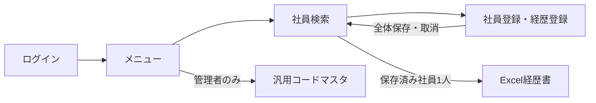

<!-- spec-meta: {"schema":"spec-md/1.0","documentId":"SP2-CSharp_ASPNET-COM-01","version":"1.1","path":"sample-project2/spec/CSharp_ASPNET/共通/01_システム概要.md","sheets":[{"heading":"目的と範囲","kind":"GRID","sheet":"01_目的と範囲"},{"heading":"機能一覧","kind":"LIST","sheet":"02_機能一覧","key":["機能ID"]},{"heading":"業務の流れ","kind":"GRID","sheet":"03_業務の流れ"},{"heading":"権限と対象外","kind":"GRID","sheet":"04_権限と対象外"}]} -->
# 社員経歴管理 システム概要

版1.1／2026-10-29。基本設計、利用者レビュー前。

## 目的と範囲

社員の経歴を一か所で更新し、保存済みの情報から日本語の職務経歴書（.xlsx）を作成する。一般の職務経歴とIT案件の記述を扱えるよう、会社・案件・業務内容を中心に、技術環境と担当工程は任意項目とする。最小DEMOでは単一会社、社員200人以下、社員1人の経歴20件以下、同時操作2人までを設計上の対象とする。件数・速度の実測ではない。

## 機能一覧

| 機能ID | 機能 | 開始・呼出し | 権限 | 基本設計 |
| --- | --- | --- | --- | --- |
| F01 | ログイン | 起動時・再認証時 | 未認証 | [ログイン](../基本設計書/01_ログイン画面.md) |
| F02 | メニュー | ログイン成功時 | ADMIN・STAFF | [メニュー](../基本設計書/02_メニュー画面.md) |
| F03 | 社員検索 | メニュー・社員登録から復帰 | ADMIN・STAFF | [社員検索](../基本設計書/03_社員検索画面.md) |
| F04 | 社員登録・経歴登録 | 検索の新規・編集 | ADMIN・STAFF | [社員登録](../基本設計書/04_社員登録画面.md) |
| F05 | 経歴書出力 | 検索で社員1人選択 | ADMIN・STAFF | [経歴書出力](../基本設計書/05_経歴書出力.md) |
| F06 | 汎用コードマスタ | メニュー | ADMIN | [汎用コードマスタ](../基本設計書/06_汎用コードマスタ画面.md) |

## 業務の流れ

認証後の5画面構成は、公開F01と共通サイト枠を使うF02/F03/F04/F06。F05は出力機能のままである。F02は業務の入口、社員検索/コードへのリンクは全保護画面の左メニューで共有する。F04/F06の未保存変更がある移動は破棄確認を先に行う。

社員は番号、氏名、氏名カナ、部署、在籍区分、入社日を必須とする。職務要約・スキル・資格・自己PRは任意。経歴は会社名・案件名・開始年月・業務概要・担当業務・役割・人数を必須とし、終了年月なしは継続中とする。入社前の前職や並行案件を許容し、経歴の期間重複をエラーにしない。経歴0件でも社員保存できるが経歴書は出力できない。

## 権限と対象外

ADMINは6機能、STAFFは社員登録と出力までを利用できる。社員ごとの閲覧制限は設けない。利用者管理画面・外部認証・パスワード変更・承認・添付・画像・給与・勤怠・社員削除・経歴の一括取込・一括出力・メール送信・PDF出力は対象外。退職は在籍区分で表し、社員や過去経歴を削除しない。経歴行の除去はF04の一時編集で行い、全体保存時に反映する。

アクセスと出力を認証済み利用者へ制限する設計だが、サンプルの稼働環境・認証境界は[採用プロファイル](../プロジェクト情報.md)に従う。初期確認用の氏名・案件はすべて架空とする。
