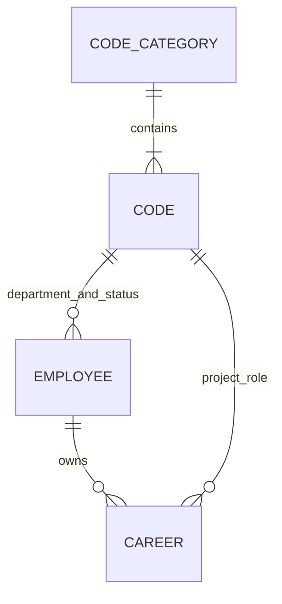

<!-- spec-meta: {"schema":"spec-md/1.0","documentId":"SP2-CSharp_ASPNET-COM-02","version":"1.0","path":"sample-project2/spec/CSharp_ASPNET/共通/02_CRUD図.md","sheets":[{"heading":"CRUD一覧","kind":"LIST","sheet":"01_CRUD一覧","key":["機能ID"]},{"heading":"関連と確定単位","kind":"GRID","sheet":"02_関連と確定単位"}]} -->
# CRUD・テーブル関連

版1.0／2026-10-27。

## CRUD一覧

| 機能ID | 利用者 | 社員 | 社員経歴 | コード分類 | 汎用コード | 外部出力 |
| --- | --- | --- | --- | --- | --- | --- |
| F01 | R/U（失敗回数・ロック） | なし | なし | なし | なし | なし |
| F02 | なし（認証状態のみ） | なし | なし | なし | なし | なし |
| F03 | なし | R | なし | R | R | なし |
| F04 | なし（確定時に有効性再確認） | C/R/U | C/R/U/D | R | R | なし |
| F05 | なし（出力時に有効性再確認） | R | R | R | R | xlsx作成1冊 |
| F06 | なし（保存時に有効性再確認） | なし | なし | R | C/R/U | なし |

## 関連と確定単位

図のCODEからの関係は分類別参照を表す。社員の部署はDEPARTMENT、在籍区分はEMPLOYMENT_STATUS、経歴の役割はPROJECT_ROLEのコードだけに結び付く。別分類の同じコードは別値である。利用者は独立した認証情報で、社員マスタへの連動登録をしない。更新者は利用者IDを記録する。

F04の保存は社員1行とその経歴全行を一つの確定単位とする。経歴行の除去も同一トランザクションで行う。F06はコード1行単位。F05は一貫した読取を終えてからファイルを生成し、出力で社員を更新しない。操作ログ専用テーブルは設けず、社員とコードの最終更新者・日時・版を保持する。ログイン失敗回数等は利用者表の認証制御属性として保持する。
