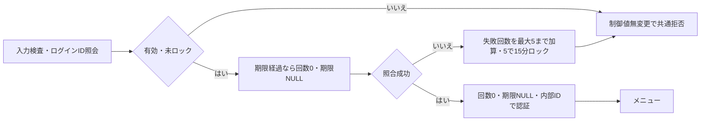

<!-- spec-meta: {"schema":"spec-md/1.0","documentId":"SP2-CSHARP_ASPNET-F01","version":"1.0","path":"sample-project2/spec/CSharp_ASPNET/基本設計書/01_ログイン画面.md","sheets":[{"heading":"概要","kind":"GRID","sheet":"01_概要"},{"heading":"項目一覧","kind":"LIST","sheet":"02_項目一覧","key":["項目ID"]},{"heading":"イベント仕様","kind":"GRID","sheet":"03_イベント仕様"},{"heading":"補足説明","kind":"GRID","sheet":"04_補足説明"}]} -->
# ログイン画面 基本設計書

| 項目 | 内容 |
| --- | --- |
| システム／機能ID | 社員経歴管理システム／F01 |
| 方式／版／日付 | CSharp_ASPNET／1.0／2026-10-27 |
| 読者・状態 | 顧客IT部門向けの基本設計。実装・DB実行・実機試験は未実施 |

## 概要

### 目的と入出力

ログインIDとパスワードを確認して、認証済み利用者だけを[メニュー](02_メニュー画面.md)へ進める。起動時および認証切れ後に表示する。管理者と担当者が使用し、入力は一回の認証要求として処理する。

永続DBは利用者のログインID（login_id）、内部利用者ID（user_id）、パスワード照合情報、有効状態、役割、失敗回数、ロック期限を参照し、失敗回数・ロック期限だけを更新する。パスワード原文を保存しない。認証主体と最後の操作時刻は一時的な認証状態で、外部ファイル入出力はない。利用者の追加、パスワード変更、外部認証連携は対象外。

### 画面設計

WEB系。1366×768 CSS px・100%を基準とする。ログイン欄を幅460pxにまとめ、ID20桁は240px、パスワードは320pxとする。Yu Gothic UI／Meiryoの14px、入力高32px、ボタン高34pxを基準とする。入力エラーは欄の上に表示し、IDを保持してパスワードだけを消去する。初期フォーカスはログインID、Tab順はID→パスワード→ログイン→終了。

<!-- screen-html-start: F01 -->

<h3>社員経歴管理システム</h3>
ログインIDとパスワードを入力してください。

&nbsp;
<label for="sp2-login-id">ログインID</label><input id="sp2-login-id" class="id" data-item-id="F01-I01" data-max-scalars="20" autocomplete="username"><label for="sp2-login-pw">パスワード</label><input id="sp2-login-pw" class="pw" data-item-id="F01-I02" type="password" data-max-scalars="128" autocomplete="current-password">
<button class="primary" data-item-id="F01-I04">ログイン</button><button data-item-id="F01-I05">終了</button>

<!-- screen-html-end: F01 -->

通常・エラー・ロック中は同じ配置を使う。処理中はID・パスワード・操作を無効にし、二重送信を防ぐ。認証切れからの復帰では「認証が切れました。未保存の入力は保存されていません」を表示する。狭幅や拡大時は縦スクロールを許容し、操作を隠さない。

## 項目一覧

| 項目ID | 論理項目名 | 入力・表示・保存 | raw上限 | 正規化・保存上限 | 単位 | 必須・条件 | 初期値 | 未設定時 | 関連DB項目 | 候補元・制約 |
| --- | --- | --- | --- | --- | --- | --- | --- | --- | --- | --- |
| F01-I01 | ログインID | 入力・表示。ログイン照合に使用 | 20 | 20 | 半角英数字 | 必須 | 空 | エラー | 利用者.ログインID（login_id） | 大小文字を区別せず照合。前後空白を除去し英字を大文字化 |
| F01-I02 | パスワード | 入力・伏字表示。原文保存なし | 128 | 12～128 | Unicode文字 | 必須 | 空 | エラー | 利用者.パスワード照合情報 | 空白を含めて加工しない。再表示・ログ出力禁止 |
| F01-I03 | メッセージ | 表示のみ | 非適用 | 非適用 | 非適用 | 常時表示領域 | 空 | 空領域 | 非適用 | 認証失敗の理由を識別できない共通文言 |
| F01-I04 | ログイン | 操作 | 非適用 | 非適用 | 非適用 | 入力可能時 | 操作可 | 非適用 | 非適用 | 認証成功時だけメニューへ遷移 |
| F01-I05 | 終了 | 操作 | 非適用 | 非適用 | 非適用 | 処理中以外 | 操作可 | 非適用 | 非適用 | 認証状態を破棄して終了案内 |

## イベント仕様

### F01-E01 ログイン

#### 処理概要

ID・パスワード・利用者の有効性を確認し、成功時に役割を持つ認証状態を作る。認証規則は[チェック・メッセージ設計](../共通/04_チェック・メッセージ設計.md)に従う。

#### 処理手順

1. 必須・長さ・ログインID形式を検査する。パスワードは正規化しない。
2. 指定ログインID（login_id）で利用者を一件照会する。存在しない・無効な利用者は共通拒否し、認証制御情報を更新しない。
3. 有効な利用者でもロック期限が現在時刻より後なら共通拒否する。この場合はパスワード照合・失敗数加算・期限延長を一切行わない。
4. ロック期限を経過している場合は、失敗回数を0、ロック期限をNULLに戻してから新しい試行として照合する。期限と現在時刻が同じ場合も期限経過とする。
5. 未ロック状態で実際にパスワード照合を失敗した場合だけ失敗回数を1加算する。上限は5で、5回目に現在時刻から15分のロック期限を設定する。6以上にしない。
6. 成功時は失敗回数0・ロック期限NULLとし、内部利用者ID（user_id）を認証主体として表示名・役割・操作時刻とともに認証状態へ設定してメニューへ進む。入力ログインIDを内部利用者IDの代わりに使わない。

#### 処理フロー

#### SQL・テーブル関連（ER図）

利用者一表の検索と更新であるためER図を省略する。他の業務表は読まない。

#### DB操作の詳細

ログインID（login_id）が一致する利用者を最大1件取得する。内部利用者ID（user_id）は認証成功後の主体に使う。存在しない・無効・ロック中なら更新0件であり、ロック中は照合も回数加算も期限延長もしない。有効な未ロック利用者は同じ利用者の現在値を確認し、期限経過時の回数0・期限NULLへの解除と今回の試行結果を一つの確定単位で反映する。実際の照合失敗時だけ回数を1加算し最大5、5回目で現在時刻から15分の期限を設定する。成功は回数0・期限NULL。競合する試行で加算や解除が失われないよう同じ利用者の認証制御更新を直列化し、6以上を保存しない。並び順は非適用。照合情報を画面へ返さない。更新・接続失敗時は認証状態を作らず取消す。

#### 結果・例外時の扱い

成功時だけメニューを表示する。不明ID、無効、誤パスワード、ロック中は「ログインできません。入力内容を確認し、時間をおいて再度お試しください」。残り回数やIDの存在は表示しない。システム障害は別の共通障害文言とし、ID保持・パスワード消去・再入力へ戻す。

### F01-E02 終了

#### 処理概要

ログインを取り止め、入力と認証状態を消去する。

#### 処理手順

入力を消去し、認証状態があれば破棄する。終了案内を表示し、ブラウザーを閉じるよう案内する。

#### 処理フロー

#### SQL・テーブル関連（ER図）

DBなし。ER図は非適用。

#### DB操作の詳細

参照・更新とも0件。認証の失敗回数を終了操作で解除しない。

#### 結果・例外時の扱い

終了案内から業務画面を再表示しても再認証を要求する。処理中は終了を受け付けず結果を待つ。

## 補足説明

無操作30分で認証を失効させる。編集中データを自動保存せず、破棄された旨をログイン画面へ示す。正常ログアウト時の未保存確認は[メニュー](02_メニュー画面.md)に従う。DEMOの初期ログインIDは `demoadmin`（管理者）と `demostaff`（担当者）とし、パスワードは初期化時に別途設定して原文を仕様へ埋め込まない。DEMO用のアプリ認証であり、運用環境・資格情報の用意は[プロジェクト情報](../プロジェクト情報.md)で扱う。

基本設計の自己確認は、必須欠落、大小文字、12/128文字、空白入りパスワード、5回失敗、15分経過、有効停止、認証切れを対象とする。これらの実機確認は未実施。

HTMLの `data-max-scalars` は業務上限の説明属性であり、ブラウザー標準のUTF-16単位のmaxlengthで受理範囲を狭めない。実装時はUnicodeスカラー値で長さを検査し、上限超過を切り捨てずエラーにする。原文を保持したまま該当欄へ戻す。
