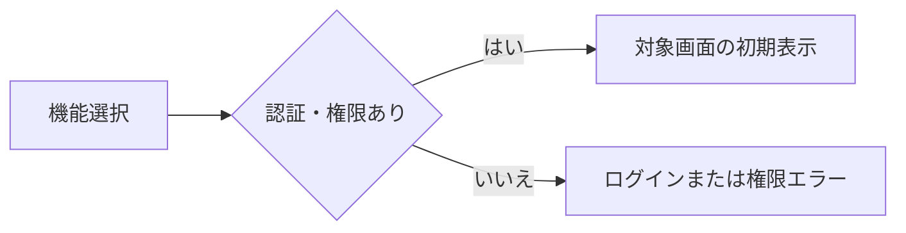
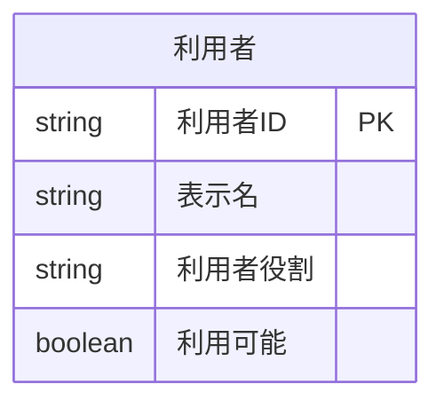
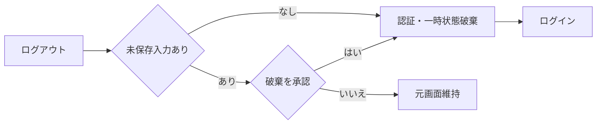

<!-- spec-meta: {"schema":"spec-md/1.0","documentId":"SP2-CSHARP_ASPNET-F02","version":"1.5","path":"sample-project2/spec/CSharp_ASPNET/基本設計書/02_メニュー画面.md","sheets":[{"heading":"概要","kind":"GRID","sheet":"01_概要"},{"heading":"項目一覧","kind":"LIST","sheet":"02_項目一覧","key":["項目ID"]},{"heading":"イベント仕様","kind":"GRID","sheet":"03_イベント仕様"},{"heading":"補足説明","kind":"GRID","sheet":"04_補足説明"}]} -->
# メニュー画面 基本設計書

| 項目 | 内容 |
| --- | --- |
| システム／機能ID | 社員経歴管理システム／F02 |
| 方式／版／日付 | CSharp_ASPNET／1.5／2026-10-28 |
| 読者・状態 | 顧客IT部門向け基本設計。実装・DB実行・実機試験は未実施 |

## 概要

### 目的と入出力

[ログイン](01_ログイン画面.md)成功後に、[社員検索](03_社員検索画面.md)または[汎用コードマスタ](06_汎用コードマスタ画面.md)を起動する。社員登録と経歴書作成は社員検索から開始し、メニューに重複した起動操作を設けない。担当者は社員検索、管理者は両機能を利用する。

利用者名と役割は起動時・機能起動時に利用者を1件再参照して認証状態と同期する。永続DBは利用者の参照だけで更新0件、外部ファイル入出力はない。利用者管理、ダッシュボード、通知は対象外。未認証の起動はログインへ戻す。

### 画面設計

WEB系。1366×768 CSS px・100%。機能ボタンを左上から縦に並べ、利用者とログアウトを同じ画面に置く。Yu Gothic UI／Meiryo14px、ボタン高36px。初期フォーカスは社員検索、Tab順は社員検索→汎用コードマスタ（管理者のみ）→ログアウト。

<!-- screen-html-start: F02 -->

<h3>社員経歴管理システム</h3>デモ管理者／管理者<button data-item-id="F02-I04">ログアウト</button>

<button data-item-id="F02-I02">社員検索</button>
社員の検索・登録・経歴書Excelの作成
<button data-item-id="F02-I03">汎用コードマスタ</button>
部署・役割などの選択候補の管理

<!-- screen-html-end: F02 -->

担当者には汎用コードマスタ操作と説明を表示しない。処理中は起動操作を無効にする。エラーは下段のメッセージ領域へ表示する。拡大・狭幅では折返しと縦スクロールを許容する。

## 項目一覧

| 項目ID | 項目グループ | 項目名 | コントロール | 必須 | 入力制限 | フォーマット | 初期値 | DBテーブル名 | DB項目名 | 備考 |
| --- | --- | --- | --- | --- | --- | --- | --- | --- | --- | --- |
| F02-I01 | 利用者情報 | 利用者名・役割 | Label | - | - | - | - | 利用者 | 表示名・利用者役割 | 現在の利用者有効性・役割を確認し、表示名・役割を同期。 |
| F02-I02 | 操作 | 社員検索 | Button | - | - | - | - | - | - | F03へ。 |
| F02-I03 | 操作 | 汎用コードマスタ | Button | - | - | - | - | - | - | 管理者のみ表示・有効。F06へ。起動先でも権限検査。 |
| F02-I04 | 操作 | ログアウト | Button | - | - | - | - | - | - | 認証状態を破棄。 |
| F02-I05 | 案内 | メッセージ | Label | - | - | - |  | - | - | 起動不可・認証失効案内。 |

## イベント仕様

### F02-E01 機能起動

#### 処理概要

選択機能を認証状態と役割で検査し、許可された画面を初期状態で表示する。

#### 処理手順

1. **受付・認証状態の確認**
   1. 先行する画面遷移中なら後続起動を受け付けずMSG-029とする。
   2. 認証状態の主体が存在し、無操作時間が30分未満であることを確認する。30分ちょうどは失効としMSG-002でF01へ戻す。認証切れを権限不足のMSG-003で置き換えない。

2. **現在利用者・起動権限の確認**
   1. 内部利用者IDで現在の利用者を1件参照する。0件・利用不可はMSG-002で認証を破棄し、現在役割がADMIN/STAFF以外ならMSG-003で遷移しない。参照障害はMSG-040とし古い役割で機能を開かない。複数一致はMSG-020。取得成功後に表示名・役割を一時認証状態と画面へ同期する。
   2. 起動先をF03又はF06に限定する。F03はADMIN/STAFF、F06は現在役割ADMINのみ。画面にない起動先・担当者によるF06直接起動はMSG-003とし遷移しない。現在役割がADMINからSTAFFへ変わっていればF06を非表示にし、古いボタンを押しても拒否する。

3. **画面遷移・起動先での再確認**
   1. 許可された起動先へ主体と更新済みの認証状態を渡し、その画面の初期表示を一度だけ開始する。F03は未検索、F06は部署分類とし、業務検索・未保存入力をメニューで作らない。
   2. 起動先の更新・出力等では現在の利用者情報を別途再確認する。メニューでの確認後に停止される場合もあるため、表示やボタン非表示を最終的な認可保証にしない。起動失敗はメニューへ戻し、再起動時に現在値を再取得する。

チェックは参照する処理手順の順で行う。共通CHKとMSGの正本は[チェック・メッセージ設計](../共通/04_チェック・メッセージ設計.md)に置く。

| チェックID | 共通規則 | 参照手順・条件 | 不成立MSG | 復帰・変更範囲 |
| --- | --- | --- | --- | --- |
| CHK-F02-01 | CHK-C02 | 手順1.1：遷移要求が重複していない | MSG-029 | 先行遷移を維持 |
| CHK-F02-02 | CHK-C01 | 手順1.2：認証あり、無操作30分未満 | MSG-002 | 認証・一時状態を破棄してF01 |
| CHK-F02-03 | CHK-C01・C02 | 手順2.2：許可起動先と現在役割 | MSG-003 | メニュー維持、起動先へ情報を渡さない |
| CHK-F02-07 | CHK-C01・C12 | 手順2.1：現在の利用者が1件・利用可・許可役割 | MSG-002／MSG-003／MSG-020 | 認証無効はF01、他は機能起動なし |
| CHK-F02-08 | CHK-C12 | 手順2.1：現在値の参照成功 | MSG-040 | 古い役割で起動せず、再取得を待つ |

#### 処理フロー

#### SQL・テーブル関連（ER図）

認証とメニュー表示のための利用者単表の参照である。業務表は読まない。

利用者IDは一時認証状態の内部主体と一致させる。ログインIDを別利用者の選択キーに使わない。

#### DB操作の詳細

内部利用者ID一致の利用者を0又は1件読み、表示名・利用者役割・利用可能を得る。初期表示と機能起動時に現在値を確認し、0件/停止はMSG-002、役割不許可はMSG-003、取得障害はMSG-040、複数一致はMSG-020。成功は1件で表示と役割別操作を同期する。利用者の更新は0件で、パスワード検証情報・連続失敗回数・ロック解除日時を変更しない。社員・経歴・コードへの参照/更新も0件。業務データは起動先の初期表示で取得する。

#### 結果・例外時の扱い

認証失効はMSG-002、許可外の機能・役割はMSG-003、処理中の再操作はMSG-029とする。MSGの文言は共通設計を正本とし、画面独自の権限エラー文を重ねない。現在利用者の参照成功は1件、遷移成功は一画面、全DB更新0件。取得障害はMSG-040で起動なし、データ不整合はMSG-020とする。遷移失敗では認証の有効性に問題がない限りメニューを維持する。

### F02-E02 ログアウト

#### 処理概要

認証状態、検索条件・結果・選択、一時入力を破棄してログイン画面へ戻る。各業務画面の共通ログアウト操作にも同じ契約を適用する。

#### 処理手順

1. **ログアウトの受付**
   1. 認証が既に失効していれば未保存確認を待たずMSG-002で認証・一時入力を破棄しF01へ戻る。自動保存は行わない。
   2. 有効な認証状態で他の保存・出力確定が処理中ならMSG-029とし、完了前に重ねてログアウトしない。

2. **破棄確認・認証状態の終了**
   1. 未保存の社員・経歴・コード入力がある場合だけMSG-015で破棄を確認する。「いいえ」は元の画面・タブ・入力・選択を保って終了する。メニュー自体には未保存入力がない。
   2. 確認中に30分の失効条件へ達した場合は「いいえ」であっても業務継続せず手順1.1へ進む。確認の表示だけで操作時刻を延長しない。
   3. 「はい」又は未保存なしの場合は認証状態、検索条件・結果・選択、未保存バッファを破棄してF01へ戻る。DB保存は0件で、戻る操作・フォームの再表示では再認証を要求する。

チェックは参照する処理手順の順で行う。共通CHKとMSGの正本は[チェック・メッセージ設計](../共通/04_チェック・メッセージ設計.md)に置く。

| チェックID | 共通規則 | 参照手順・条件 | 不成立MSG | 復帰・変更範囲 |
| --- | --- | --- | --- | --- |
| CHK-F02-04 | CHK-C01 | 手順1.1・2.2：確認前後も認証が有効 | MSG-002 | 自動保存せずF01、未保存破棄を案内 |
| CHK-F02-05 | CHK-C02 | 手順1.2：他の確定処理が終了済み | MSG-029 | 処理結果を待つ |
| CHK-F02-06 | CHK-C12 | 手順2.1：未保存入力の破棄が承認済み | MSG-015（確認） | いいえは元入力を保持、有効なら継続 |

#### 処理フロー

#### SQL・テーブル関連（ER図）

DBなし。未保存の社員・経歴・コードを更新しないためER図は非適用。

#### DB操作の詳細

DB参照・更新0件。未保存データの確定処理を暗黙に実行しない。

#### 結果・例外時の扱い

未保存確認の文言はMSG-015に統一する。通常の確認取消ではログアウトせず入力を維持する。認証失効時はMSG-002を優先し未保存の内容を保存しない。ログアウト完了後のDB変更0件・認証状態0件を成功条件とし、画面を閉じただけでDBが保存されたとは表示しない。

## 補足説明

項目一覧の記号は、必須の〇＝必須、空欄＝任意、-＝判定対象外、条件付＝備考の条件成立時に必須。真偽は〇＝true、空欄＝false。初期値の空欄は空値・未選択、-は初期値なし。文字数・入力状態・編集時の値・操作可否の共通規則は[共通UI・入力設計](../共通/03_共通UI・入力設計.md)に従う。

権限の正本は[システム概要](../共通/01_システム概要.md)、画面操作の共通契約は[共通UI・入力設計](../共通/03_共通UI・入力設計.md)。担当者の管理機能直接起動、ログアウト後の戻る操作、認証失効は将来の確認観点であり実機未実施。

### Pilot確認シナリオ（設計・未実施）

1. CHK-F02-02～03・07～08：保持役割がADMINでも現在値がSTAFFなら表示と役割を同期しF06起動をMSG-003で拒否する。停止ならMSG-002、読取り障害ならMSG-040で古い権限を使わない。無操作30分ちょうどはMSG-002を優先する。
2. CHK-F02-04～06：未保存の経歴を持つ画面からログアウトし、MSG-015の「いいえ」で入力を維持する。確認中に失効した場合は継続せずMSG-002、DB保存0件とする。
