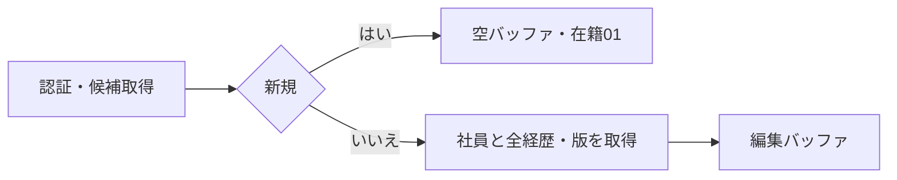
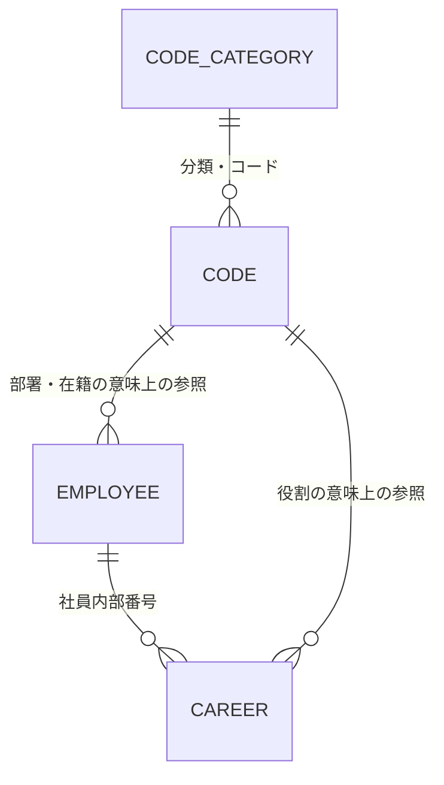
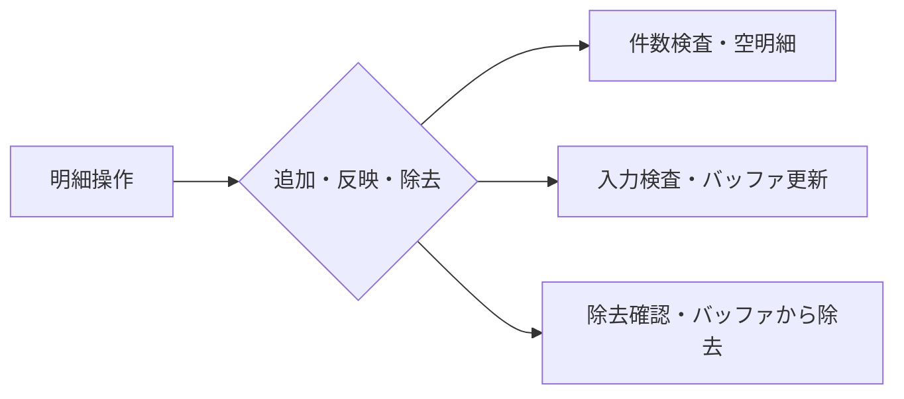
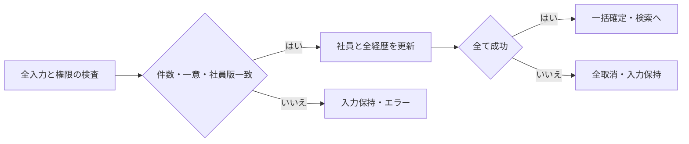
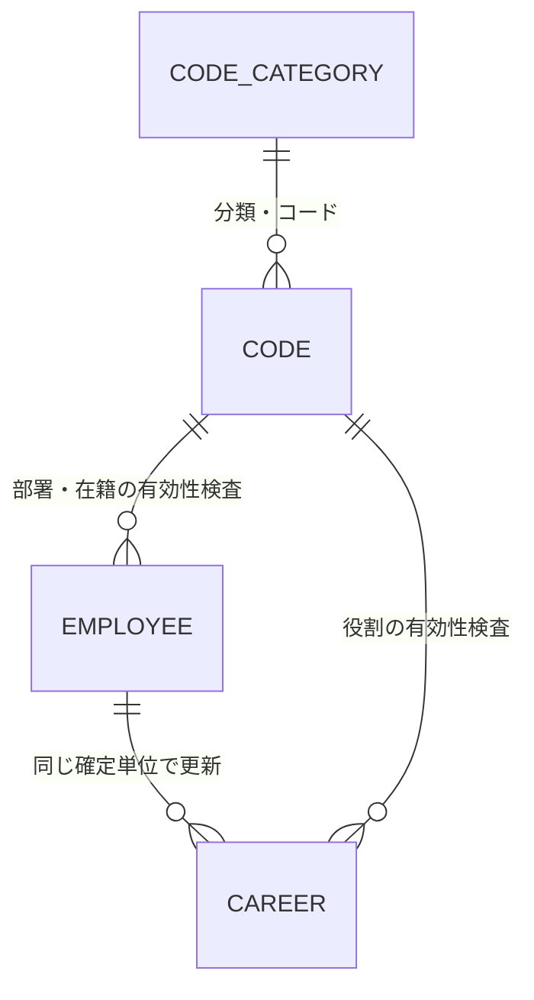
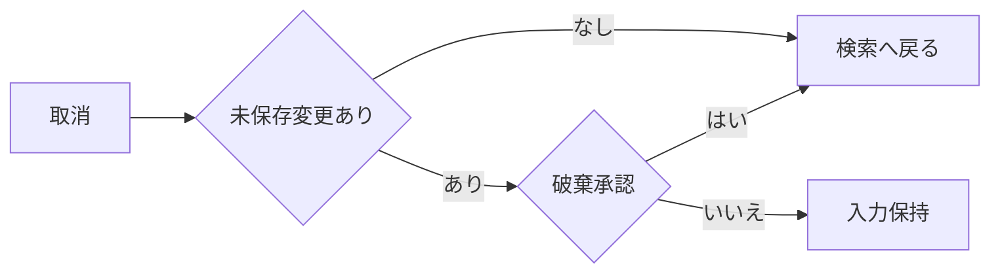

<!-- spec-meta: {"schema":"spec-md/1.0","documentId":"SP2-CSHARP_ASPNET-F04","version":"1.0","path":"sample-project2/spec/CSharp_ASPNET/基本設計書/04_社員登録画面.md","sheets":[{"heading":"概要","kind":"GRID","sheet":"01_概要"},{"heading":"項目一覧","kind":"LIST","sheet":"02_項目一覧","key":["項目ID"]},{"heading":"イベント仕様","kind":"GRID","sheet":"03_イベント仕様"},{"heading":"補足説明","kind":"GRID","sheet":"04_補足説明"}]} -->
# 社員登録画面 基本設計書

| 項目 | 内容 |
| --- | --- |
| システム／機能ID | 社員経歴管理システム／F04 |
| 方式／版／日付 | CSharp_ASPNET／1.0／2026-10-27 |
| 読者・状態 | 顧客IT部門向け基本設計。実装・DB実行・実機試験は未実施 |

## 概要

### 目的と入出力

[社員検索](03_社員検索画面.md)から、社員一人の基本情報と0～20件の経歴を登録・編集する。管理者・担当者とも同じ操作を行う。基本情報タブと経歴タブは同一社員の未保存入力を共有する。社員削除、社員番号訂正、一括登録、承認は対象外で、退職は在籍区分で管理する。

永続DBは社員、社員経歴、コード分類、汎用コードを参照する。保存時は社員一人とその全経歴を一つの確定単位で更新する。画面入力・追加変更除去した経歴・読込時の社員版は未保存の一時情報。外部ファイル入出力はない。経歴書は検索へ戻りF05から作る。

### 画面設計

WEB系。1366×768 CSS px・100%、本文幅1260px以下。Yu Gothic UI／Meiryo14px、入力高32px、ボタン高34px。社員番号110px、日付150px、氏名260px、氏名カナ330pxを基準とし、長文は複数行で欄内スクロールする。タブで表示面積を切替え、保存・取消を常に見つけられる下部に置く。画面に見えないタブの入力も保存検査対象となり、エラー時は該当タブと項目へ移動する。

<!-- screen-html-start: F04-BASIC -->

<h3>社員登録［編集］　000001 山田 太郎</h3>
<button class="active">基本情報</button><button>経歴（2件）</button>

<label>社員番号 ※ <input class="no" data-item-id="F04-I01" value="000001" readonly></label><label>氏名 ※ <input class="name" data-item-id="F04-I02" value="山田 太郎" data-max-scalars="40"></label><label>氏名カナ ※ <input class="kana" data-item-id="F04-I03" value="ヤマダ タロウ" data-max-scalars="80"></label>

<label>部署 ※ <select class="code" data-item-id="F04-I04"><option>01 開発</option></select></label><label>在籍区分 ※ <select class="code" data-item-id="F04-I05"><option>01 在職</option></select></label><label>入社日 ※ <input class="date" data-item-id="F04-I06" value="2020-04-01"></label>

<label>職務要約<textarea data-item-id="F04-I07" data-max-scalars="1000">業務システムの設計・開発を担当。</textarea></label><label>得意技術・スキル<textarea data-item-id="F04-I08" data-max-scalars="1000">C#、ASP.NET、SQL Server</textarea></label><label>資格<textarea data-item-id="F04-I09" data-max-scalars="1000">基本情報技術者試験</textarea></label><label>自己PR<textarea data-item-id="F04-I10" data-max-scalars="1000">利用者の業務を理解して改善を提案します。</textarea></label>

※は必須です。タブの変更だけでは保存されません。

経歴を含めて一括保存します。<button class="primary" data-item-id="F04-I28">保存</button> <button data-item-id="F04-I29">取消・検索へ戻る</button>

<!-- screen-html-end: F04-BASIC -->

<!-- screen-html-start: F04-CAREER -->

<h3>社員登録［編集］　000001 山田 太郎</h3>
<button>基本情報</button><button class="active">経歴（2件）</button>

2024-04 ～ 継続中 社内販売管理システム

2020-04 ～ 2024-03 受発注システム保守

<button data-item-id="F04-I25">追加</button><button data-item-id="F04-I26">明細へ反映</button><button data-item-id="F04-I27">除去</button>

<label>開始年月 ※ <input class="month" data-item-id="F04-I14" value="2024-04"></label><label>終了年月（空＝継続中） <input class="month" data-item-id="F04-I15"></label><label>役割 ※ <select class="role" data-item-id="F04-I23"><option>02 リーダー</option></select></label><label>チーム人数 ※ <input class="team" data-item-id="F04-I24" value="5"></label>

<label>会社名 ※ <input class="company" data-item-id="F04-I16" value="デモソフト株式会社" data-max-scalars="100"></label><label>案件名 ※ <input class="project" data-item-id="F04-I17" value="社内販売管理システム" data-max-scalars="100"></label>

<label>業務・案件概要 ※<textarea data-item-id="F04-I18" data-max-scalars="1000">販売業務のWeb化。</textarea></label><label>担当業務 ※<textarea data-item-id="F04-I19" data-max-scalars="1000">基本設計、開発、試験。</textarea></label><label>成果・工夫<textarea data-item-id="F04-I20" data-max-scalars="1000">確認作業を標準化。</textarea></label><label>使用技術<textarea data-item-id="F04-I21" data-max-scalars="500">C#、ASP.NET、SQL Server</textarea></label>
<label>担当工程<textarea class="phases" data-item-id="F04-I22" data-max-scalars="200">基本設計、詳細設計、製造、単体・結合試験</textarea></label>

明細への反映・除去は未保存です。最後に「保存」してください。

経歴は20件まで。会社名・案件名は匿名表記も可能です。<button class="primary">保存</button> <button>取消・検索へ戻る</button>

<!-- screen-html-end: F04-CAREER -->

新規時の社員番号は入力可能で、内部番号は保存時の自動採番とする。編集時は社員番号を読取専用とし、他の業務項目を編集可能にする。基本情報の新規フォーカスは社員番号、編集は氏名。タブ内は表示順にTab移動し、経歴は一覧→明細項目→追加・反映・除去→保存・取消。未選択の明細欄は追加開始まで無効。読取専用番号も選択・コピー可能とする。

処理中は全変更と二重保存を無効にする。検査失敗時は全入力を保持し該当タブ・欄へ戻す。長い氏名・会社名・案件名は横移動で全文を編集でき、長文は欄内スクロール・拡大で全文へ到達できる。狭幅・拡大では縦スクロールを許容し、画面に合わせた切捨てをしない。

## 項目一覧

| 項目ID | 論理項目名 | 入力・表示・保存 | raw上限 | 正規化・保存上限 | 単位 | 必須・条件 | 初期値 | 未設定時 | 関連DB項目 | 候補元・制約 |
| --- | --- | --- | --- | --- | --- | --- | --- | --- | --- | --- |
| F04-I01 | 社員番号 | 新規入力・表示・保存。編集不可 | 6 | 6 | 半角数字 | 必須・6桁 | 新規は空 | エラー | 社員.社員番号 | 全社員で一意・先頭ゼロ保持・再採番なし |
| F04-I02 | 氏名 | 入力・表示・保存 | 40 | 40 | Unicode文字 | 必須 | 新規は空 | エラー | 社員.氏名 | 前後空白除去・原表記保持 |
| F04-I03 | 氏名カナ | 入力・表示・保存 | 80 | 80 | Unicode文字 | 必須 | 新規は空 | エラー | 社員.氏名カナ | 全角カナ・空白。共通入力規則に従う |
| F04-I04 | 部署 | 選択・表示・保存 | 2 | 2 | 半角数字 | 必須 | 新規は未選択 | エラー | 社員.部署 | DEPARTMENT有効値。既存停止値は保持・再保存可 |
| F04-I05 | 在籍区分 | 選択・表示・保存 | 2 | 2 | 半角数字 | 必須 | 01 在職 | エラー | 社員.在籍区分 | EMPLOYMENT_STATUSの01在職・02休職・03退職 |
| F04-I06 | 入社日 | 入力・表示・保存 | 10 | 日付 | YYYY-MM-DD | 必須 | 新規は空 | エラー | 社員.入社日 | 1900-01-01以上、業務日以下 |
| F04-I07 | 職務要約 | 入力・表示・保存 | 1000 | 1000 | Unicode文字 | 任意 | 空 | 未設定 | 社員.職務要約 | 改行可。F05の出力時条件は別途検査 |
| F04-I08 | 得意技術・スキル | 入力・表示・保存 | 1000 | 1000 | Unicode文字 | 任意 | 空 | 未設定 | 社員.スキル | 改行可 |
| F04-I09 | 資格 | 入力・表示・保存 | 1000 | 1000 | Unicode文字 | 任意 | 空 | 未設定 | 社員.資格 | 一資格一行を推奨。取得年月は文章へ含められる |
| F04-I10 | 自己PR | 入力・表示・保存 | 1000 | 1000 | Unicode文字 | 任意 | 空 | 未設定 | 社員.自己PR | 改行可 |
| F04-I11 | メッセージ | 表示 | 非適用 | 非適用 | 非適用 | 常設 | 必須案内 | 空領域 | 非適用 | エラーはタブ・項目を特定 |
| F04-I12 | 基本情報・経歴タブ | 表示切替 | 非適用 | 非適用 | 非適用 | 常設 | 基本情報 | 非適用 | 非適用 | タブ切替で保存しない・入力保持 |
| F04-I13 | 経歴一覧 | 表示・一人分の単一明細選択 | 非適用 | 20 | 件 | 0件可 | 空 | 保存可・F05不可 | 社員経歴.開始年月・終了年月・案件名 | 開始年月降順→内部番号降順。未保存行は追加順で同順位を固定 |
| F04-I14 | 開始年月 | 入力・表示・保存 | 7 | 日付の月初 | YYYY-MM | 明細がある場合必須 | 空 | 明細エラー | 社員経歴.開始年月 | 1900-01以上、終了年月・業務年月以下 |
| F04-I15 | 終了年月 | 入力・表示・保存 | 7 | 日付の月初 | YYYY-MM | 任意 | 空 | 継続中 | 社員経歴.終了年月 | 指定時は開始年月以上、業務年月以下 |
| F04-I16 | 会社名 | 入力・表示・保存 | 100 | 100 | Unicode文字 | 明細がある場合必須 | 空 | 明細エラー | 社員経歴.会社名 | 守秘対象は匿名名で登録可 |
| F04-I17 | 案件名 | 入力・表示・保存 | 100 | 100 | Unicode文字 | 明細がある場合必須 | 空 | 明細エラー | 社員経歴.案件名 | 守秘対象は匿名名で登録可 |
| F04-I18 | 業務・案件概要 | 入力・表示・保存 | 1000 | 1000 | Unicode文字 | 明細がある場合必須 | 空 | 明細エラー | 社員経歴.業務概要 | 改行可・空白だけ不可 |
| F04-I19 | 担当業務 | 入力・表示・保存 | 1000 | 1000 | Unicode文字 | 明細がある場合必須 | 空 | 明細エラー | 社員経歴.担当業務 | 改行可・空白だけ不可 |
| F04-I20 | 成果・工夫 | 入力・表示・保存 | 1000 | 1000 | Unicode文字 | 任意 | 空 | 未設定 | 社員経歴.成果 | 改行可 |
| F04-I21 | 使用技術 | 入力・表示・保存 | 500 | 500 | Unicode文字 | 任意 | 空 | 未設定 | 社員経歴.使用技術 | 言語・DB・OS等を改行で記述可 |
| F04-I22 | 担当工程 | 入力・表示・保存 | 200 | 200 | Unicode文字 | 任意 | 空 | 未設定 | 社員経歴.担当工程 | 自由記述。工程別マスタは作らない |
| F04-I23 | 役割 | 選択・表示・保存 | 2 | 2 | 半角数字 | 明細がある場合必須 | 未選択 | 明細エラー | 社員経歴.役割 | PROJECT_ROLE有効値。既存停止値は保持・再保存可 |
| F04-I24 | チーム人数 | 入力・表示・保存 | 3 | 1～999 | 人・整数 | 明細がある場合必須 | 空 | 明細エラー | 社員経歴.チーム人数 | 0・小数不可 |
| F04-I25 | 経歴追加 | 操作 | 非適用 | 非適用 | 非適用 | 20件未満 | 操作可 | 非適用 | 非適用 | 新しい未保存明細を編集 |
| F04-I26 | 明細へ反映 | 操作 | 非適用 | 非適用 | 非適用 | 明細編集中 | 未選択時無効 | 非適用 | 非適用 | 明細検査後バッファ反映。DB保存なし |
| F04-I27 | 経歴除去 | 操作 | 非適用 | 非適用 | 非適用 | 明細選択時 | 未選択時無効 | 非適用 | 非適用 | 確認後バッファから除去 |
| F04-I28 | 保存 | 操作 | 非適用 | 非適用 | 非適用 | 認証済み・処理中以外 | 操作可 | 非適用 | 社員・社員経歴 | 全明細を検査して一括確定 |
| F04-I29 | 取消・検索へ戻る | 操作 | 非適用 | 非適用 | 非適用 | 処理中以外 | 操作可 | 非適用 | 非適用 | 未保存変更時は破棄確認 |

## イベント仕様

### F04-E01 初期表示

#### 処理概要

新規なら初期値を設定し、編集なら指定社員と全経歴・候補を一貫して読み込む。

#### 処理手順

認証を確認し、部署・在籍・役割候補を取得する。編集は内部番号で社員一人と経歴0～20件を読み、社員版を保持する。存在しなければ検索へ戻す。新規は社員番号も含め空とし在籍01だけを設定する。経歴が20件を超える外部改変は無断に切捨てず編集開始を止める。

#### 処理フロー

#### SQL・テーブル関連（ER図）

コードは固定分類を伴って参照する。社員の部署分類はDEPARTMENT、在籍分類はEMPLOYMENT_STATUS、経歴の役割分類はPROJECT_ROLEを自動設定し、画面入力にしない。分類とコードの組で参照先を特定する。業務上の参照と物理的なFKの選択は区別し、詳細DB定義は今回作らない。

#### DB操作の詳細

指定社員を最大1件、同じ内部番号の経歴を開始年月降順・内部番号降順で全件取得する。コードは分類を指定し並び順・コード順。候補は有効値と当該レコードで使用中の停止値を取得する。更新は0件。読取りに失敗したら空の編集画面で上書きできないよう開始を止める。

#### 結果・例外時の扱い

停止既存値には「停止」を添えて表示し、同じ値での再保存を許す。新規選択には出さない。編集開始後のコード停止は保存時に再検査する。

### F04-E02 タブ切替・経歴の追加・反映・除去

#### 処理概要

一人の社員の入力を保持しながら経歴を編集する。明細操作だけではDBを変更しない。

#### 処理手順

追加は20件未満に限り空明細を作る。反映は年月・必須・長さ・役割・人数を検査してバッファへ設定する。選択明細の除去は「この経歴を未保存一覧から除去しますか」の承認後に行う。タブや明細を切り替える際の未反映入力は、検査してバッファへ反映するか破棄するかを選べる。取消なら元の編集欄に留まる。親の保存操作では現在の編集中明細も同じ検査を経て反映する。

#### 処理フロー

#### SQL・テーブル関連（ER図）

DBなし。社員・経歴の一時バッファを操作するためER図は非適用。

#### DB操作の詳細

DB参照・更新0件。経歴内部番号は保存済み行の識別用に保持し、新規行は未保存の一時識別子で区別する。未保存操作でDB自動採番を消費する必要はない。

#### 結果・例外時の扱い

明細検査失敗時は入力を保持する。20件時の追加は無効。経歴0件も社員保存は可能で、F05出力時には経歴不足として案内する。経歴期間の重複および入社前の前職経歴を許し、未来予定は受け付けない。

### F04-E03 社員と経歴の一括保存

#### 処理概要

社員一人と全経歴を検査し、一つの確定単位で保存する。社員版で同時更新を検知する。

#### 処理手順

1. 認証と未反映明細を検査し、全タブ・全経歴の必須、長さ、形式、年月、コード参照を再検査する。
2. 新規は社員総数200件以下と番号一意を、編集は内部番号の存在と読込時の社員版一致を確認する。
3. 社員と全経歴に実変更がない場合は更新0件とし、版・更新日時・更新者を据え置いて「変更はありません」を表示する。新規社員は内部番号と版1を設定する。編集は社員項目を更新し版を一つ進める。実変更時に更新日時・更新者を設定する。
4. 経歴の追加・変更・除去を同じ確定単位で反映する。画面が送った内部番号が当該社員の経歴に属することを確認する。
5. 全件成功時だけ確定し、検索へ戻って保持条件で再検索する。途中失敗は全て取消す。

#### 処理フロー

#### SQL・テーブル関連（ER図）

#### DB操作の詳細

新規は社員総数と社員番号重複を同時登録と競合しない確定範囲で検査し、社員1件・経歴0～20件を追加する。編集は社員内部番号と読込版を条件として社員1件を更新し、当該社員の既存経歴を追加・更新・除去後の一覧へ一致させる。社員版不一致なら更新0件として競合扱い。既存経歴の除去だけは確定時に物理削除可とし、社員自体は削除しない。部署分類DEPARTMENT・在籍分類EMPLOYMENT_STATUS・役割分類PROJECT_ROLEを自動固定し、分類とコードの組で参照整合を検査する。部署・役割は既存と同じ停止値の保持だけを許し、新しい選択は有効値に限る。参照したコード版・有効性と確定時の値の競合を検出する。社員と全経歴が無変更なら更新0件とし、社員版・更新日時・更新者を据え置く。実変更のある全操作を成功時確定・失敗時取消とし、一部経歴だけを残さない。

#### 結果・例外時の扱い

重複、201人目、20件超、コード停止、必須欠落は入力を保持して案内する。同時更新は上書きせず「別の操作で更新されました。入力を確認し、再読込してください」。再読込は未保存入力の破棄確認を経て行い、競合した内容を自動で再適用しない。DB障害は全取消、入力保持、保存未完了を明示する。認証失効時は保存しない。

### F04-E04 取消・検索へ戻る

#### 処理概要

未保存の社員・経歴入力を破棄し、元の検索条件へ戻る。

#### 処理手順

未保存変更がなければそのまま戻る。変更があれば破棄確認する。承認は全バッファを破棄して戻り、取消は元のタブ・選択・入力を保持する。保存中は戻る操作を無効にする。

#### 処理フロー

#### SQL・テーブル関連（ER図）

DBなし。一時入力の破棄のみでER図は非適用。

#### DB操作の詳細

DB参照・更新0件。経歴除去のバッファがあっても取消ではDBから消去しない。検索への復帰後の参照はF03で行う。

#### 結果・例外時の扱い

新規・編集とも未保存の変更を保存済みと表示しない。ブラウザーの離脱操作でも可能な範囲で同じ確認を行うが、通信断・強制終了からの入力復元は保証しない。

## 補足説明

長さは[共通UI・入力設計](../共通/03_共通UI・入力設計.md)、日付・確定境界は[日付・データアクセス仕様](../共通/05_日付・データアクセス仕様.md)、項目の保存先は[テーブル仕様](07_テーブル仕様書.md)に従う。内部番号と更新日時・更新者・版は自動であり、業務入力欄にしない。

新規番号の入力、番号先頭ゼロ、20/21件、0件保存、開始終了同月、継続中、前職、期間重複、停止既存保持、明細除去後の取消、同時更新の全取消、長文・エラー時のタブ移動を将来の確認観点とする。今回は実機未実施。

HTMLの `data-max-scalars` は業務上限の説明属性であり、ブラウザー標準のUTF-16単位のmaxlengthで受理範囲を狭めない。実装時はUnicodeスカラー値で長さを検査し、上限超過を切り捨てずエラーにする。原文を保持したまま該当欄へ戻す。
