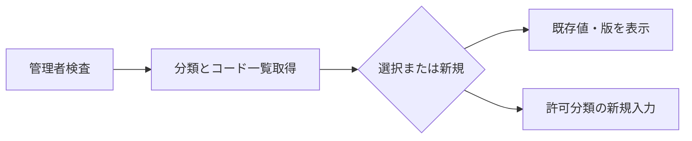
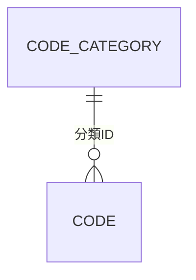
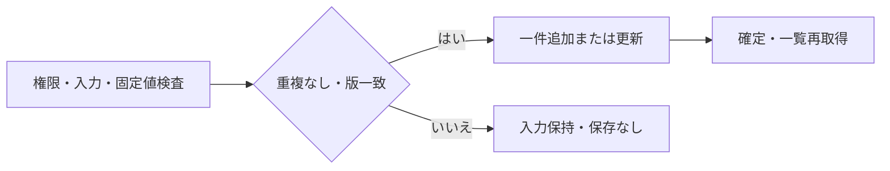
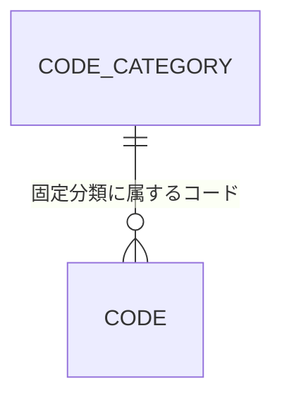
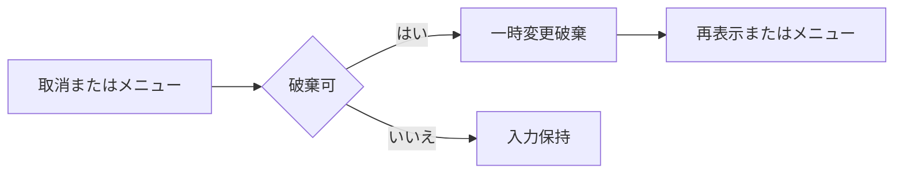

<!-- spec-meta: {"schema":"spec-md/1.0","documentId":"SP2-CSHARP_ASPNET-F06","version":"1.0","path":"sample-project2/spec/CSharp_ASPNET/基本設計書/06_汎用コードマスタ画面.md","sheets":[{"heading":"概要","kind":"GRID","sheet":"01_概要"},{"heading":"項目一覧","kind":"LIST","sheet":"02_項目一覧","key":["項目ID"]},{"heading":"イベント仕様","kind":"GRID","sheet":"03_イベント仕様"},{"heading":"補足説明","kind":"GRID","sheet":"04_補足説明"}]} -->
# 汎用コードマスタ画面 基本設計書

| 項目 | 内容 |
| --- | --- |
| システム／機能ID | 社員経歴管理システム／F06 |
| 方式／版／日付 | CSharp_ASPNET／1.0／2026-10-27 |
| 読者・状態 | 顧客IT部門向け基本設計。実装・DB実行・実機試験は未実施 |

## 概要

### 目的と入出力

[メニュー](02_メニュー画面.md)から管理者だけが起動し、社員・経歴の選択候補を保守する。利用者要求の「範囲用コードマスタ」を汎用コードマスタとして具体化した。分類はDEPARTMENT（部署）、EMPLOYMENT_STATUS（在籍区分）、PROJECT_ROLE（案件役割）の固定3種類とし、分類の追加・名称変更・削除は設けない。

部署と役割はコード追加・名称変更・並び順変更・停止／再開を行う。既存キーの変更・物理削除はしない。在籍区分の01在職・02休職・03退職は意味を固定し、追加・名称変更・並び順変更・有効性変更をすべて禁止し、完全な参照専用とする。

永続DBはコード分類と汎用コードを参照し、一度の保存でコード一件だけを追加・更新する。入力・選択・読込時の版は一時情報。社員・経歴の保存値を書き換えず、外部ファイル入出力もない。

### 画面設計

WEB系。1366×768 CSS px・100%、Yu Gothic UI／Meiryo14px、入力高32px、ボタン高34px。左にコード一覧、右に一件の編集欄を置く。分類180px、コード90px、名称340px、並び順90pxとし、一覧内スクロールを使う。行内に複雑な編集操作を置かず、選択と編集を分ける。

<!-- screen-html-start: F06 -->

<h3>汎用コードマスタ</h3><button data-item-id="F06-I11">メニュー</button>

<label>分類 <select data-item-id="F06-I01"><option>部署</option><option>在籍区分</option><option>案件役割</option></select></label><button data-item-id="F06-I08">新規</button>

<table><thead><tr><th style="width:75px">コード</th><th>名称</th><th style="width:85px">並び順</th><th style="width:75px">状態</th></tr></thead><tbody><tr class="selected"><td>01</td><td>開発</td><td>1</td><td>有効</td></tr><tr><td>02</td><td>基盤</td><td>2</td><td>有効</td></tr><tr><td>03</td><td>管理</td><td>3</td><td>有効</td></tr></tbody></table>

<label class="field">コード ※ <input class="code" data-item-id="F06-I03" value="01" readonly></label><label class="field">名称 ※ <input class="name" data-item-id="F06-I04" value="開発" data-max-scalars="40"></label><label class="field">並び順 ※ <input class="sort" data-item-id="F06-I05" value="1" data-max-scalars="3"></label><label class="check"><input data-item-id="F06-I06" type="checkbox" checked>有効（外すと新規選択を停止）</label>
停止しても、登録済み社員・経歴の値は保持されます。

<button class="primary" data-item-id="F06-I09">保存</button><button data-item-id="F06-I10">取消</button>

分類とコードは保存後に変更できません。

<!-- screen-html-end: F06 -->

新規時はコードを入力可能にし、既存時は読取専用。分類は選択必須で初期値は部署。新規名称は空、並び順は1、有効は選択済み。未選択時の編集欄は無効とする。在籍区分では新規ボタンを無効、名称・並び順・有効性を読取専用にし、保存ボタンを無効にする。処理中は全変更を無効にし、失敗時は入力を保持する。Tab順は分類→新規→一覧→コード→名称→並び順→有効→保存→取消→メニュー。読取専用欄はTab対象外とし、マウス等で選択・コピー可能。40文字の名称は欄内横移動で全文に到達できる。

## 項目一覧

| 項目ID | 論理項目名 | 入力・表示・保存 | raw上限 | 正規化・保存上限 | 単位 | 必須・条件 | 初期値 | 未設定時 | 関連DB項目 | 候補元・制約 |
| --- | --- | --- | --- | --- | --- | --- | --- | --- | --- | --- |
| F06-I01 | 分類 | 選択・表示・保存時のキー | 24 | 24 | 半角英大文字・下線 | 必須 | DEPARTMENT | エラー | コード分類.分類ID、汎用コード.分類ID | 固定3分類。部署→在籍区分→案件役割の固定順。分類に並び順列は設けない |
| F06-I02 | コード一覧 | 表示・単一選択 | 非適用 | 分類当たり99 | 行 | 常設 | 部署一覧 | 空一覧 | 汎用コード.コード・名称・並び順・有効状態 | 停止も表示。並び順昇順→コード昇順 |
| F06-I03 | コード | 新規入力・表示・保存。既存変更不可 | 2 | 2 | 半角数字 | 必須・01～99 | 新規は空 | エラー | 汎用コード.コード | 分類とコードで一意。00不可・先頭ゼロ保持 |
| F06-I04 | 名称 | 入力・表示・保存 | 40 | 40 | Unicode文字 | 必須 | 新規は空 | エラー | 汎用コード.名称 | 前後空白除去。空白だけ不可。在籍区分は変更不可 |
| F06-I05 | 並び順 | 入力・表示・保存 | 3 | 1～999 | 整数 | 必須 | 新規は1 | エラー | 汎用コード.並び順 | 同順位可。コード順で決定。在籍区分は変更不可 |
| F06-I06 | 有効 | 選択・表示・保存 | 非適用 | 真偽 | 非適用 | 必須の二値 | 新規は有効 | 停止 | 汎用コード.有効状態 | 在籍区分は有効固定。部署・役割は停止／再開可 |
| F06-I07 | 使用上の注意 | 表示 | 非適用 | 非適用 | 非適用 | 常設 | 停止既存保持案内 | 非適用 | 非適用 | 保存済み業務データを置換しない |
| F06-I08 | 新規 | 操作 | 非適用 | 非適用 | 非適用 | 部署・役割のみ | 操作可 | 非適用 | 非適用 | 入力中は破棄確認 |
| F06-I09 | 保存 | 操作 | 非適用 | 非適用 | 非適用 | 部署・役割の一件編集中 | 未選択時無効 | 非適用 | 汎用コード | 一件の追加／更新を確定 |
| F06-I10 | 取消 | 操作 | 非適用 | 非適用 | 非適用 | 一件編集中 | 未選択時無効 | 非適用 | 非適用 | 未保存変更の破棄確認 |
| F06-I11 | メニュー | 操作 | 非適用 | 非適用 | 非適用 | 処理中以外 | 操作可 | 非適用 | 非適用 | 変更中は破棄確認 |
| F06-I12 | メッセージ | 表示 | 非適用 | 非適用 | 非適用 | 常設 | キー固定案内 | 空領域 | 非適用 | 競合・検査・保存結果 |

## イベント仕様

### F06-E01 初期表示・分類変更・コード選択・新規

#### 処理概要

管理者権限を確認し、分類の全コードを一覧に読み込んで一件を編集する。

#### 処理手順

認証と管理者役割を確認する。初回は固定3分類を取得し部署を選ぶ。分類変更時は未保存変更の破棄確認を行い、承認後だけ切り替える。選択分類の有効・停止双方を取得する。コード選択で値と版を読込み、新規で空の入力と初期値を設定する。在籍区分では新規開始・保存を拒否し、全項目を参照専用にする。

#### 処理フロー

#### SQL・テーブル関連（ER図）

#### DB操作の詳細

コード分類の固定3件を取得し、部署（DEPARTMENT）→在籍区分（EMPLOYMENT_STATUS）→案件役割（PROJECT_ROLE）の固定順で表示する。分類の並び順列には依存しない。汎用コードは分類ID一致の全件（最大99件）を並び順・コード昇順で読み、選択した分類・コードの一件と版を保持する。停止値を除外しない。更新0件。コード分類不足・不明分類は編集開始を止める。

#### 結果・例外時の扱い

担当者の直接起動は一覧を返さず権限エラーとする。取消した分類変更・コード選択では元の入力と選択を保持する。DB障害は編集欄を空の新規として誤表示せず、取得失敗を表示する。

### F06-E02 コード保存

#### 処理概要

一件のコードを検査し、新規追加または版一致の更新を確定する。

#### 処理手順

1. 管理者・認証を再検査し、分類・コード・名称・並び順・有効状態を検査する。
2. 固定分類以外、コード00、キー変更、在籍区分の追加・名称／並び順／有効性変更をすべて拒否する。
3. 新規は分類とコードの重複を確認して版1で追加する。既存は読込版と一致した一件だけを更新し版を進める。
4. 部署・役割を停止する場合は「登録済みの値は保持し、新しい選択だけを停止する」ことを確認する。
5. 成功時だけ確定して一覧を再取得し、保存コードを再選択する。

#### 処理フロー

#### SQL・テーブル関連（ER図）

社員・経歴は本操作で更新しない。使用中コードを停止しても参照先を削除しない。

#### DB操作の詳細

分類の存在と固定意味を確認し、在籍区分への書込みは0件で拒否する。部署・役割に限り汎用コード一件を追加または更新する。新規重複は分類ID・コードの一意性で拒否する。既存は分類ID・コード・読込版を条件に更新し、更新0件なら競合として取消す。名称・並び順・有効状態・更新情報・版だけを更新し、キーと社員・経歴は変更しない。成功時確定、例外時取消。無変更保存はDB更新・版加算をせず、変更なしを知らせる。

#### 結果・例外時の扱い

重複・形式・固定値違反は入力を保持して該当欄に戻す。競合は上書きせず再読込を案内する。再読込は破棄確認を経る。DB障害は未保存のまま入力保持。停止確認の取消は何も更新しない。

### F06-E03 取消・メニューへ戻る

#### 処理概要

一件の未保存変更を破棄するか、保守を終えてメニューへ戻る。

#### 処理手順

未保存変更時は破棄確認し、取消なら画面を維持する。承認された取消は既存選択の値を再取得し、新規は編集欄を未選択へ戻す。メニュー操作は確認後に一時状態を破棄してF02へ戻る。

#### 処理フロー

#### SQL・テーブル関連（ER図）

既存値の再取得は汎用コード一表だけのためER図を省略する。メニュー遷移だけならDBなし。

#### DB操作の詳細

既存選択時の取消は分類ID・コード一致の最大1件を参照する。更新0件。新規取消・メニュー遷移は参照0件。再取得失敗時は取得済みの古い値を最新版と表示しない。

#### 結果・例外時の扱い

保存中は取消・遷移を受け付けない。存在しなくなったコードは再選択を促し、勝手に同じキーを再追加しない。認証失効時は変更を保存せずログインへ戻る。

## 補足説明

コード体系は[コード設計書](08_コード設計書.md)、保存構造は[テーブル仕様](07_テーブル仕様書.md)、共通の停止既存保持・競合処理は[日付・データアクセス仕様](../共通/05_日付・データアクセス仕様.md)に従う。部署・役割の停止後も既存社員・経歴に名称を表示し、同じ値の再保存を許す。変更して新たに割り当てる値は有効コードに限る。

2桁先頭ゼロ、重複、40文字名称、停止／再開、固定在籍区分の保護、担当者の直接起動、同時更新、取消後の無変更を将来の確認観点とする。今回は実機未実施。

HTMLの `data-max-scalars` は業務上限の説明属性であり、ブラウザー標準のUTF-16単位のmaxlengthで受理範囲を狭めない。実装時はUnicodeスカラー値で長さを検査し、上限超過を切り捨てずエラーにする。原文を保持したまま該当欄へ戻す。
