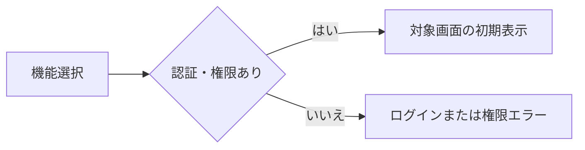
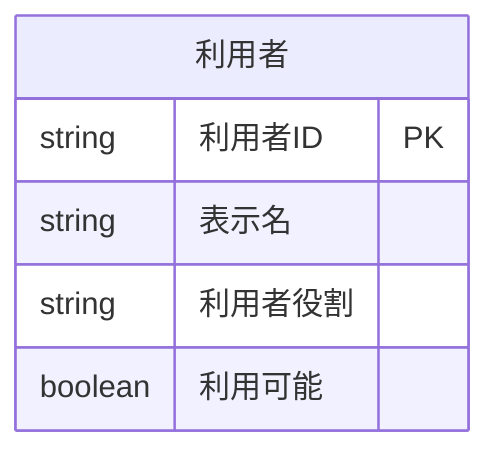
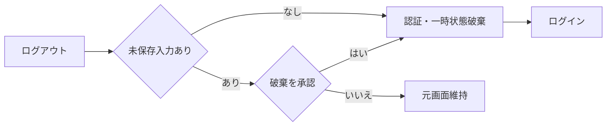

<!-- spec-meta: {"schema":"spec-md/1.0","documentId":"SP2-CSharp_ASPNET-DET-F02","version":"1.2","path":"sample-project2/spec/CSharp_ASPNET/詳細仕様書/02_メニュー画面.md","sheets":[{"heading":"概要","kind":"GRID","sheet":"01_概要"},{"heading":"項目一覧","kind":"LIST","sheet":"02_項目一覧","key":["項目ID"]},{"heading":"イベント仕様","kind":"GRID","sheet":"03_イベント仕様"},{"heading":"補足説明","kind":"GRID","sheet":"04_補足説明"}],"isolationProfile":"CSharp_ASPNET","featureId":"F02"} -->
# メニュー画面 詳細仕様書

| 項目 | 内容 |
| --- | --- |
| projectId / methodId | sample-project2 / CSharp_ASPNET |
| 機能ID / 文書版 | F02 / 1.1 |
| 作成日・工程 | 2026-10-29 / detail-design / canonical-update |
| 対象読者・状態 | 経験5年程度の実装者。設計採用・利用者承認/実装/試験未実施 |
| 原基本設計SHA-256 | 77e2ae351248f1d2f69436c7189f21577a4753e36c91fc208c49a3bef7d6f277 |

## 概要

### 目的と入出力

[ログイン](01_ログイン画面.md)成功後に、[社員検索](03_社員検索画面.md)または[汎用コードマスタ](06_汎用コードマスタ画面.md)を起動する。社員登録と経歴書作成は社員検索から開始する。F02は業務の入口として残し、F02-E01の認可を伴う社員検索/コードへのリンクを全保護画面の共通サイトメニューへ置く。F02本文に同じ起動ボタンを重複させない。担当者は社員検索、管理者は両機能を利用する。

利用者名と役割は起動時・機能起動時に利用者を1件再参照して認証状態と同期する。永続DBは利用者の参照だけで更新0件、外部ファイル入出力はない。利用者管理、ダッシュボード、通知は対象外。未認証の起動はログインへ戻す。

### 画面設計

WEB/BROWSER、CUSTOM（既存2業務の入口）、主P01_HOME・補助P00_APP_SHELL。ダッシュボードの数値や新機能を増やさない。[共通UI](../共通/03_共通UI・入力設計.md)のヘッダー56px・左メニュー208px・現在位置を用い、本文は利用方法を独立見出しで示す。入力16px/操作14px相当・最小高40px。リンクを辿るたびのF02経由は不要。初期フォーカスは社員検索。DOM順はヘッダー→サイトメニュー→本文、主本文へのスキップ手段を詳細工程で定義する。

<!-- screen-html-start: F02 -->

  <header class="header"><a class="brand" href="#F02">社員経歴管理</a>
デモ管理者 ／ ADMIN<button type="button" data-item-id="F02-I04" data-action-id="F02-E02">ログアウト</button>
</header>
  
<nav class="nav" aria-label="サイトメニュー">

サイトメニュー

業務
<a href="#F02" aria-current="page">業務の入口</a><a href="#F03" data-item-id="F02-I02" data-action-id="F02-E01">社員検索</a><a href="#F06" data-item-id="F02-I03" data-action-id="F02-E01">汎用コードマスタ</a>
</nav>
  <main class="main">
業務の入口

<h1>業務の入口</h1>
社員を探して経歴を整え、Excelの職務経歴書を作成します。

    <section class="panel form-page"><h2>利用する業務</h2>
<strong>社員検索</strong>から、社員の新規登録・編集・経歴書の作成を行えます。

<strong>汎用コードマスタ</strong>では、管理者が部署・案件役割の候補を保守できます。

左のサイトメニューは各業務画面でも利用できます。この画面へ戻る必要はありません。
</section>
    <section class="panel form-page"><h2>保存と出力について</h2>
社員情報と経歴は、社員編集画面の最後の保存でまとめて確定します。

経歴書Excelは、社員検索で選択した保存済み社員1人を対象に作成します。

現在の役割に応じた業務だけを表示します。
</section>
  </main>

  

設計確認用：権限・遷移

HOME/P01_HOME＋P00_APP_SHELL。メニュー機能F02と5画面を維持し、ダッシュボード/通知は追加しません。STAFFではコード保守のリンクと本文説明を除き、直接要求も拒否します。

業務を開始できません。現在の利用者情報を再確認してください。古い役割で起動しません。

<!-- screen-html-end: F02 -->

担当者には汎用コードマスタ操作と説明を表示しない。処理中は起動操作を無効にする。エラーは下段のメッセージ領域へ表示する。拡大・狭幅では折返しと縦スクロールを許容する。

### 詳細の適用と実装表示

基本F02の現行版/同一HTMLを採用し、原基本設計SHA欄と今回manifestで入力を固定する。物理型/HTTP/状態は[方式別共通](../共通/方式別/01_共通実装仕様.md)、業務保存/列/SQLは[DB定義](../DB定義/SQLServer/01_DB定義書.md)、採用は[詳細QA](../詳細設計QA.md)へ対応する。静的HTMLは基本と同じ断片で、画面の別正本/製品実行の根拠にしない。

### UI状態・実部品・キー契約

CUSTOM（既存の業務入口）/主P01_HOME・補P00_APP_SHELL。I01は_layoutの現在利用者、I02/03はa[href=/employees]/a[href=/codes]、I04はlogout type=button、I05はOutcome。共通ナビは保護4ページへ同一部分ビューで展開し、href/現在位置と現在DB役割を対応させる。F04/F06変更中の通常クリックはNavigationInputで現在rawを捕捉し破棄/継続を判定してから既存認可へ進む。DUI-01/08/11。

## 項目一覧

| 項目ID | 項目グループ | 項目名 | コントロール | 必須 | 入力制限 | フォーマット | 初期値 | DBテーブル名 | DB項目名 | 備考 | 物理部品・バインド | C#型 | raw上限 | 正規化・保存上限 | 長さ単位 | 未設定・NULL | 物理DB列・型 |
| --- | --- | --- | --- | --- | --- | --- | --- | --- | --- | --- | --- | --- | --- | --- | --- | --- | --- |
| F02-I01 | 利用者情報 | 利用者名・役割 | Label | - | - | - | - | 利用者 | 表示名・利用者役割 | 現在の利用者有効性・役割を確認し、表示名・役割を同期。 | MenuVm.DisplayName/CurrentRole | string/UserRole（表示はASCII役割名） | 入力なし | 表示名40/役割5 | Unicodeスカラー値/ASCII文字 | 不可 | dbo.m_app_user.display_name nvarchar(80) / role_id varchar(5) NOT NULL |
| F02-I02 | 操作 | 社員検索 | Link（a） | - | - | - | - | - | - | F03へ。 | a[F02-I02] → EmployeeController.Index GET /employees | 非適用（遷移操作） | 非適用 | 保存なし | 非適用 | 非適用 | 永続列なし |
| F02-I03 | 操作 | 汎用コードマスタ | Link（a） | - | - | - | - | - | - | 管理者のみ表示・有効。F06へ。起動先でも権限検査。 | a[F02-I03] → CodeController.Index GET /codes | 非適用（遷移操作） | 非適用 | 保存なし | 非適用 | 非適用 | 永続列なし |
| F02-I04 | 操作 | ログアウト | Button | - | - | - | - | - | - | 認証状態を破棄。 | button[F02-I04] → AccountController.Logout POST /account/logout | 非適用（submit操作） | 非適用 | 保存なし | 非適用 | 非適用 | 永続列なし |
| F02-I05 | 案内 | メッセージ | Label | - | - | - | 空 | - | - | 起動不可・認証失効案内。 | MenuVm.Outcome.Message | string? | 入力なし | 日本語MSG表示 | Unicode文字列 | メッセージなしnull | 永続列なし |

## イベント仕様

### F02-E01 機能起動

#### 処理概要

F02と全保護画面の共通サイトメニューから選択された機能を、現在の認証状態と役割で検査する。変更中のF04/F06から移る場合は各画面の破棄/編集継続を先に判定し、明示承認後だけ起動する。機能IDと権限を増やさず、通常起動は初期状態、所有する明示的な検索復帰だけF03の復帰契約に従う。

##### 詳細実装契約

MenuController.IndexがCurrentUserService.RequireAsync(ADMIN|STAFF)で現在DB利用者を検査し、MenuVm(DisplayName,CurrentRole)と起動可能機能を返す。コード保守の起動先はADMINポリシーを重ねる。

#### 処理手順

1. **受付・認証状態の確認**
   1. 先行する画面遷移中なら後続起動を受け付けずMSG-029とする。
   2. 認証状態の主体が存在し、無操作時間が30分未満であることを確認する。30分ちょうどは失効としMSG-002でF01へ戻す。認証切れを権限不足のMSG-003で置き換えない。

2. **現在利用者・起動権限の確認**
   1. 内部利用者IDで現在の利用者を1件参照する。0件・利用不可はMSG-002で認証を破棄し、現在役割がADMIN/STAFF以外ならMSG-003で遷移しない。参照障害はMSG-040とし古い役割で機能を開かない。複数一致はMSG-020。取得成功後に表示名・役割を一時認証状態と画面へ同期する。
   2. 起動先をF03又はF06に限定する。F03はADMIN/STAFF、F06は現在役割ADMINのみ。画面にない起動先・担当者によるF06直接起動はMSG-003とし遷移しない。現在役割がADMINからSTAFFへ変わっていればF06を非表示にし、古いボタンを押しても拒否する。

3. **画面遷移・起動先での再確認**
   1. 許可された起動先へ主体と更新済みの認証状態を渡し、その画面の初期表示を一度だけ開始する。F03は未検索、F06は部署分類とし、業務検索・未保存入力をメニューで作らない。
   2. 起動先の更新・出力等では現在の利用者情報を別途再確認する。メニューでの確認後に停止される場合もあるため、表示やボタン非表示を最終的な認可保証にしない。起動失敗はメニューへ戻し、再起動時に現在値を再取得する。

チェックは参照する処理手順の順で行う。共通CHKとMSGの正本は[チェック・メッセージ設計](../共通/04_チェック・メッセージ設計.md)に置く。

| チェックID | 共通規則 | 参照手順・条件 | 不成立MSG | 復帰・変更範囲 |
| --- | --- | --- | --- | --- |
| CHK-F02-01 | CHK-C02 | 手順1.1：遷移要求が重複していない | MSG-029 | 先行遷移を維持 |
| CHK-F02-02 | CHK-C01 | 手順1.2：認証あり、無操作30分未満 | MSG-002 | 認証・一時状態を破棄してF01 |
| CHK-F02-03 | CHK-C01・C02 | 手順2.2：許可起動先と現在役割 | MSG-003 | メニュー維持、起動先へ情報を渡さない |
| CHK-F02-07 | CHK-C01・C12 | 手順2.1：現在の利用者が1件・利用可・許可役割 | MSG-002／MSG-003／MSG-020 | 認証無効はF01、他は機能起動なし |
| CHK-F02-08 | CHK-C12 | 手順2.1：現在値の参照成功 | MSG-040 | 古い役割で起動せず、再取得を待つ |

##### 詳細実装契約

1. **現在主体の確認**
   1. Cookie/session_id/無操作30分をサーバーで照合し、Shared/Serializableゲートでuser_id1件を現在読取する。停止/不存在/未知役割は保護データを返さない。
   2. 表示名/役割をDB値へ同期する。Cookieの古いroleやformのroleを信用しない。
2. **対象への遷移**
   1. F03はADMIN/STAFF、F06はADMINの許可表で分岐し、通常GETは画面、JSON POST移動は許可時200 NavigationEnvelopeを返してclientが一回GETする。任意returnUrlを受け付けない。
   2. 起動先でも同じCurrentUserServiceを呼ぶ。正常な利用者操作だけ最終利用時刻を更新する。

#### 処理フロー

##### 詳細実装契約

Menu GET /menu → 現Session → SQL-AUTH(user_id) → 現役割 → F03/F06。画面ボタンの表示可否とサービスの認可を別に実行する。

#### SQL・テーブル関連（ER図）

認証とメニュー表示のための利用者単表の参照である。業務表は読まない。

利用者IDは一時認証状態の内部主体と一致させる。ログインIDを別利用者の選択キーに使わない。

##### 詳細実装契約

dbo.m_app_user単表(user_id PK)、単表のため追加ER省略。

#### DB操作の詳細

内部利用者ID一致の利用者を0又は1件読み、表示名・利用者役割・利用可能を得る。初期表示と機能起動時に現在値を確認し、0件/停止はMSG-002、役割不許可はMSG-003、取得障害はMSG-040、複数一致はMSG-020。成功は1件で表示と役割別操作を同期する。利用者の更新は0件で、パスワード検証情報・連続失敗回数・ロック解除日時を変更しない。社員・経歴・コードへの参照/更新も0件。業務データは起動先の初期表示で取得する。

##### 詳細実装契約

SELECT user_id,display_name,role_id,is_enabled FROM dbo.m_app_user WHERE user_id=@actor; @actor nvarchar40、期待1、更新0。Sessionの最終利用はメモリー更新でDB列を追加しない。

#### 結果・例外時の扱い

認証失効はMSG-002、許可外の機能・役割はMSG-003、処理中の再操作はMSG-029とする。MSGの文言は共通設計を正本とし、画面独自の権限エラー文を重ねない。現在利用者の参照成功は1件、遷移成功は一画面、全DB更新0件。取得障害はMSG-040で起動なし、データ不整合はMSG-020とする。遷移失敗では認証の有効性に問題がない限りメニューを維持する。

##### 詳細実装契約

失効MSG-002『認証の有効期限が切れました。未保存の入力は保存されません。再ログインしてください。』、権限MSG-003『この操作を実行する権限がありません。』。権限不足は変更0で許可メニューへ、DB読取障害MSG-040は古い利用者表示を有効扱いしない。

### F02-E02 ログアウト

#### 処理概要

認証状態、検索条件・結果・選択、一時入力を破棄してログイン画面へ戻る。各業務画面の共通ログアウト操作にも同じ契約を適用する。

##### 詳細実装契約

POST /account/logout。所有する未保存状態があればMSG-015の破棄確認を行い、確認済みでCookie/Session/画面状態を破棄する。

#### 処理手順

1. **ログアウトの受付**
   1. 認証が既に失効していれば未保存確認を待たずMSG-002で認証・一時入力を破棄しF01へ戻る。自動保存は行わない。
   2. 有効な認証状態で他の保存・出力確定が処理中ならMSG-029とし、完了前に重ねてログアウトしない。

2. **破棄確認・認証状態の終了**
   1. 未保存の社員・経歴・コード入力がある場合だけMSG-015で破棄を確認する。「いいえ」は元の画面・タブ・入力・選択を保って終了する。メニュー自体には未保存入力がない。
   2. 確認中に30分の失効条件へ達した場合は「いいえ」であっても業務継続せず手順1.1へ進む。確認の表示だけで操作時刻を延長しない。
   3. 「はい」又は未保存なしの場合は認証状態、検索条件・結果・選択、未保存バッファを破棄してF01へ戻る。DB保存は0件で、戻る操作・フォームの再表示では再認証を要求する。

チェックは参照する処理手順の順で行う。共通CHKとMSGの正本は[チェック・メッセージ設計](../共通/04_チェック・メッセージ設計.md)に置く。

| チェックID | 共通規則 | 参照手順・条件 | 不成立MSG | 復帰・変更範囲 |
| --- | --- | --- | --- | --- |
| CHK-F02-04 | CHK-C01 | 手順1.1・2.2：確認前後も認証が有効 | MSG-002 | 自動保存せずF01、未保存破棄を案内 |
| CHK-F02-05 | CHK-C02 | 手順1.2：他の確定処理が終了済み | MSG-029 | 処理結果を待つ |
| CHK-F02-06 | CHK-C12 | 手順2.1：未保存入力の破棄が承認済み | MSG-015（確認） | いいえは元入力を保持、有効なら継続 |

##### 詳細実装契約

1. **破棄範囲の確認**
   1. 現在documentのRawUiEnvelopeを無検証捕捉してDirtyを検査し、未保存ありならMSG-015確認を表示、Noは入力/Sessionを保持する。確認ID/対象/入力digest一致のDiscardだけ内部ConfirmDiscard=trueへ対応させる。
   2. 既に認証期限切れなら未保存は保存されないことを案内し、終了のためのDB再認可は要求しない。
2. **失効と遷移**
   1. ConfirmDiscard=true又は未保存なしでSessionRegistry.RemoveとSignOutAsyncを行い、所有Draftを破棄する。
   2. 200 NavigationEnvelopeの/account/loginへ一回GETし、履歴から戻ってもno-storeと現在認証検査により保護画面を再利用しない。

#### 処理フロー

##### 詳細実装契約

Logout → Dirty? → 破棄確認（Noは編集継続）→ Session/Cookie失効 → Login。

#### SQL・テーブル関連（ER図）

DBなし。未保存の社員・経歴・コードを更新しないためER図は非適用。

##### 詳細実装契約

DB更新/読取0、認証状態破棄だけのためER図省略。

#### DB操作の詳細

DB参照・更新0件。未保存データの確定処理を暗黙に実行しない。

##### 詳細実装契約

SQLなし。m_app_userのis_enabled/Password/failed_countをログアウトで変更しない。

#### 結果・例外時の扱い

未保存確認の文言はMSG-015に統一する。通常の確認取消ではログアウトせず入力を維持する。認証失効時はMSG-002を優先し未保存の内容を保存しない。ログアウト完了後のDB変更0件・認証状態0件を成功条件とし、画面を閉じただけでDBが保存されたとは表示しない。

##### 詳細実装契約

MSG-015『入力内容を破棄しますか。』。Noは元の編集欄、Yesは未保存破棄。DB障害や期限切れでもCookie/メモリー状態破棄は可能。保存途中のcommitをログアウトで取消済みと断定しない。

## 補足説明

原基本設計の業務条件/CHK/MSGと画面配置を保全し、各イベントの「詳細実装契約」に具体的な受渡し・SQL・型・期待件数・確定/取消を追加した。通常の文書内リンクは詳細機能、共通の業務原則は既存共通を参照する。画面HTML断片のコピーは配置の継承であり、基本設計の独自改訂ではない。

文字数はUnicodeスカラー値、nvarchar容量とC#/HTMLのUTF-16を区別する。Razorはrawを保持しRuneLength検証を行い、原入力の上限をmaxlength/StringLengthへ単純置換しない。元項目表の任意空欄は本表で意味を明示したが、業務必須/保存値/初期値は変えていない。定数分類と更新者はサーバーだけが設定する。

入力は[要件定義書](../要件定義書.md)1.0、[基本F02](../基本設計書/02_メニュー画面.md)のspec-meta版1.5、[プロジェクト情報](../プロジェクト情報.md)/[QA](../QA.md)1.6。元F05のメタ版と表紙版の差は詳細QAに記録し、元ファイルは編集しない。

本工程は詳細設計文書の作成と文書確認のみ。アプリ実装・ビルド・実DB・Office/ブラウザー実機・実Excel/印刷・負荷/受入/正式採点は未実施。共通08のPILOT-P01～41は引き続き設計済み・実行未実施、formalScore=null。
