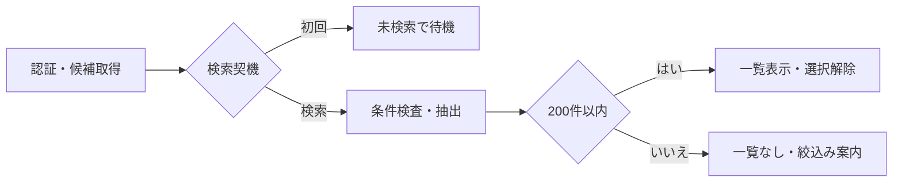
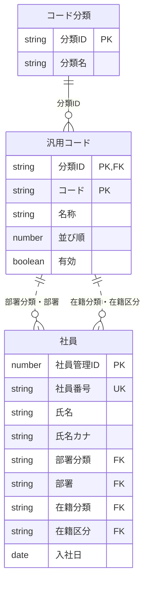
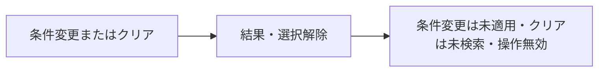
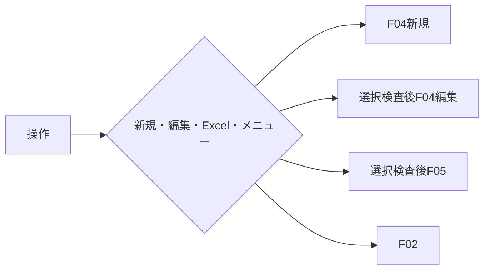

<!-- spec-meta: {"schema":"spec-md/1.0","documentId":"SP2-CSharp_ASPNET-DET-F03","version":"1.2","path":"sample-project2/spec/CSharp_ASPNET/詳細仕様書/03_社員検索画面.md","sheets":[{"heading":"概要","kind":"GRID","sheet":"01_概要"},{"heading":"項目一覧","kind":"LIST","sheet":"02_項目一覧","key":["項目ID"]},{"heading":"イベント仕様","kind":"GRID","sheet":"03_イベント仕様"},{"heading":"補足説明","kind":"GRID","sheet":"04_補足説明"}],"isolationProfile":"CSharp_ASPNET","featureId":"F03"} -->
# 社員検索画面 詳細仕様書

| 項目 | 内容 |
| --- | --- |
| projectId / methodId | sample-project2 / CSharp_ASPNET |
| 機能ID / 文書版 | F03 / 1.1 |
| 作成日・工程 | 2026-10-29 / detail-design / canonical-update |
| 対象読者・状態 | 経験5年程度の実装者。設計採用・利用者承認/実装/試験未実施 |
| 原基本設計SHA-256 | dde728759a0532bcdf0b0df38c22555163356ca33305d07f4256d8050efc8ac5 |

## 概要

### 目的と入出力

[メニュー](02_メニュー画面.md)から社員を探し、[社員登録](04_社員登録画面.md)の新規・編集、または[経歴書Excel出力](05_経歴書出力.md)を開始する。管理者・担当者が使用する。検索条件は社員番号・氏名・部署・在籍区分の4条件に限る。経歴のキーワード検索、一括出力、社員の削除は対象外。

永続DBは社員、部署・在籍区分に対応する汎用コード、コード分類を参照する。検索では更新しない。条件・結果・選択社員は一時情報である。外部ファイル出力はF05を明示操作した時のxlsx一件のみで、検索自体にはない。

### 検索条件と結果

社員番号は6桁の半角数字で完全一致。氏名は前後空白を除いて、照合時だけNFKC・空白除去・英字大小無視で社員氏名または氏名カナに部分一致する。部署と在籍区分は選択値一致。指定された4条件をANDで結合し、未指定は制約にしない。氏名の記号を検索演算子として扱わない。

初回は在籍区分「01 在職」、他は未指定で検索未実行。全条件未指定で検索可能。結果は社員番号昇順で最大200件、ページングなし・一覧内スクロールとする。上限超過時は一部を表示せず条件絞込みを案内する。検索条件を一つでも変更した時点で旧結果と選択を解除し、「条件が変更されました。検索してください」を表示する。

### 画面設計

WEB/BROWSER、SEARCH_LIST。主P02_SEARCH_LIST、補助P00_APP_SHELL/P12_EXPORTを採用する。共通サイト枠と独立した「検索条件」「検索結果」見出しを使い、新規登録をページ主操作、編集を行内リンク、Excelを選択中1人への実行ボタンにする。社員番号110px、氏名条件260px、コード選択180px、入力/操作最小高40px、表/補足14px相当は[共通UI](../共通/03_共通UI・入力設計.md)に従う。表列の幅はHTMLのcolgroupを同一定義の正本とし、最小880pxの表だけ局所横スクロールを許す。長い氏名・部署は折返し、全文を短縮保存しない。

<!-- screen-html-start: F03 -->

  <header class="header"><a class="brand" href="#F02">社員経歴管理</a>
デモ管理者 ／ ADMIN<button type="button" data-action-id="F02-E02">ログアウト</button>
</header>
  
<nav class="nav" aria-label="サイトメニュー">

サイトメニュー

業務
<a href="#F02" data-item-id="F03-I13">業務の入口</a><a href="#F03" aria-current="page">社員検索</a><a href="#F06">汎用コードマスタ</a>
</nav>
  <main class="main">
社員検索

<h1>社員検索</h1>
社員を探して、編集または経歴書の作成へ進みます。

<a class="button primary" href="#F04-new" data-item-id="F03-I10" data-action-id="F03-E03">新規登録</a>

    <section class="panel"><h2>検索条件</h2><form>
<label class="field">社員番号<input class="no" data-item-id="F03-I01" data-max-scalars="6">半角数字6桁・完全一致</label><label class="field">氏名・氏名カナ<input class="name" data-item-id="F03-I02" data-max-scalars="40">氏名またはカナの一部</label><label class="field">部署<select class="code" data-item-id="F03-I03"><option>すべて</option><option>開発</option></select></label><label class="field">在籍区分<select class="code" data-item-id="F03-I04"><option>在職</option><option>すべて</option><option>休職</option><option>退職</option></select></label>

<button type="button" class="primary" data-item-id="F03-I05" data-action-id="F03-E01">検索</button><button type="button" data-item-id="F03-I06" data-action-id="F03-E02">条件クリア</button>クリア後は未検索になります。
</form></section>
    <section aria-labelledby="f03-results">

<h2 id="f03-results" style="margin-bottom:4px">検索結果</h2>検索結果2件・一覧全2件 ／ 社員番号順
<button type="button" data-item-id="F03-I12" data-action-id="F03-E03">選択社員の経歴書Excel</button>

選択中：000001 山田 太郎　／　出力対象はこの社員1人の保存済み経歴です。

    
<table class="employees"><colgroup><col style="width:64px"><col style="width:100px"><col style="width:180px"><col style="width:190px"><col style="width:120px"><col style="width:88px"><col style="width:116px"><col style="width:80px"></colgroup><thead><tr><th scope="col">選択</th><th scope="col">社員番号</th><th scope="col">氏名</th><th scope="col">氏名カナ</th><th scope="col">部署</th><th scope="col">在籍</th><th scope="col">入社日</th><th scope="col">操作</th></tr></thead><tbody><tr class="selected" data-record-id="1"><td><input type="radio" name="employee" checked aria-label="000001 山田太郎を選択"></td><td>000001</td><td>山田 太郎</td><td>ヤマダ タロウ</td><td>開発</td><td>在職</td><td>2022-04-01</td><td><a class="rowaction" href="#F04-1" data-item-id="F03-I11" data-action-id="F03-E03">編集</a></td></tr><tr data-record-id="2"><td><input type="radio" name="employee" aria-label="000002 佐藤花子を選択"></td><td>000002</td><td>佐藤 花子</td><td>サトウ ハナコ</td><td>基盤</td><td>在職</td><td>2024-04-01</td><td><a class="rowaction" href="#F04-2" data-action-id="F03-E03">編集</a></td></tr></tbody></table>
</section>
  </main>

  

設計確認用：未検索・空結果・条件変更・長い値

SEARCH_LIST/P02_SEARCH_LIST＋P00/P12。行の編集リンクを選ぶ操作でその1人を同時選択し、現在結果集合との一致/認証を検査します。表/リンクは静的見本です。

<strong>未検索</strong>
条件を入力して検索してください。一覧と選択はなく、Excelは無効です。

<strong>検索結果0件</strong>
該当する社員がいません。条件を確認してください。適用済み条件は保持します。

<strong>条件未適用</strong>
条件が変更されました。検索してください。入力中raw条件は保持し、旧結果・選択は失効します。

<strong>検索できませんでした</strong>
条件を保持しています。再実行してください。未検索や0件に置き換えません。

<strong>長い名称の確認見本</strong>
株式会社架空業務システム開発技術支援・運用改善研究推進部門の長い部署名称を含む社員情報を、折返しまたは欄内移動で全文確認します。

<!-- screen-html-end: F03 -->

図は検索済みの架空例。未検索・条件未適用・0件・取得失敗を文言で区別する。処理中は二重操作不可、失敗後はraw条件を保持し選択なし。本文のTab順は新規→4条件→検索→クリア→Excel→一覧の選択/行編集（行順）。HTMLの自然なDOM順を用い、正のtabindexで並べ替えない。サイトメニューは共通DOM順、条件編集で旧結果/選択を即失効する。200件固定上限とページングなしはQA-028の理由付き例外。件数Nと全N件の範囲を一致させる。

### 詳細の適用と実装表示

基本F03の現行版/同一HTMLを採用し、原基本設計SHA欄と今回manifestで入力を固定する。物理型/HTTP/状態は[方式別共通](../共通/方式別/01_共通実装仕様.md)、業務保存/列/SQLは[DB定義](../DB定義/SQLServer/01_DB定義書.md)、採用は[詳細QA](../詳細設計QA.md)へ対応する。静的HTMLは基本と同じ断片で、画面の別正本/製品実行の根拠にしない。

### UI状態・実部品・キー契約

SEARCH_LIST/主P02_SEARCH_LIST・補P00_APP_SHELL/P12_EXPORT。I01～04はSearchRawの4値、I05 submit検索、I06 button clear、I07はTotalCount/Status、I08はtable/radio＋I11行a、I09は現在選択、I10はnewのa、I12はexport button、I13は/menuのa。I11はdata-employee-idを結果行IDに対応し、POST open直前に当該行を同時選択する。新規は現在DOMの全raw/seq/scrollを捕捉、未検証条件を検索しない。自然DOM順は基本どおりExcel→一覧、正のtabindex禁止。DUI-04/05/06/09/11/12。

## 項目一覧

| 項目ID | 項目グループ | 項目名 | コントロール | 必須 | 入力制限 | フォーマット | 初期値 | DBテーブル名 | DB項目名 | 備考 | 物理部品・バインド | C#型 | raw上限 | 正規化・保存上限 | 長さ単位 | 未設定・NULL | 物理DB列・型 |
| --- | --- | --- | --- | --- | --- | --- | --- | --- | --- | --- | --- | --- | --- | --- | --- | --- | --- |
| F03-I01 | 検索条件 | 社員番号条件 | TextBox（input） | 任意 | 半角数字6桁 | 先頭ゼロ保持 | 空 | 社員 | 社員番号 | 完全一致。未指定は全社員。 | SearchRaw.EmployeeNo | string（rawは空文字、検証済み条件はstring?） | 検索時6桁又は空。移動/復元用rawは技術上限 | 条件だけ。保存なし | ASCII数字 | raw空文字を保持、明示検索時だけ条件なしへ。欠落/nullキーは400 | dbo.m_employee.employee_no char(6) NOT NULL（検索先） |
| F03-I02 | 検索条件 | 氏名条件 | TextBox（input） | 任意 | 40字 | - | 空 | 社員 | 氏名・氏名カナ | 氏名・カナの部分一致。原表記を保持し、照合だけ正規化。未指定は全社員。 | SearchRaw.Name | string（rawは空文字、検証済み条件はstring?） | 検索時40スカラー。移動/復元用rawは技術上限 | 照合時だけ正規化、永続化なし | Unicodeスカラー値 | raw空文字を保持、明示検索時だけ条件なしへ。欠落/nullキーは400 | dbo.m_employee.employee_name nvarchar(80) / employee_kana nvarchar(160) NOT NULL |
| F03-I03 | 検索条件 | 部署条件 | Select（select） | 任意 | 選択のみ | 名称表示／半角数字2桁コード保持 | 空 | 社員 汎用コード コード分類 | 社員：部署分類・部署 汎用コード：分類ID・コード・名称 コード分類：分類ID・分類名 | DEPARTMENTの有効値と停止既存値。未指定は全部署。並び順→コード順。 | SearchRaw.Department | string（rawは空文字、検証済み条件はstring?） | 検索時2桁又は未指定。移動/復元用rawは技術上限 | 保存なし | ASCII数字 | raw空文字を保持、明示検索時だけ条件なしへ。欠落/nullキーは400 | dbo.m_employee.department_code char(2)、m_code(category_id,code) |
| F03-I04 | 検索条件 | 在籍区分条件 | Select（select） | 任意 | 選択のみ | 名称表示／半角数字2桁コード保持 | 01 在職 | 社員 汎用コード コード分類 | 社員：在籍分類・在籍区分 汎用コード：分類ID・コード・名称 コード分類：分類ID・分類名 | EMPLOYMENT_STATUSの固定3値と「すべて」。未指定は全区分。 | SearchRaw.EmploymentStatus | string（rawは空文字、検証済み条件はstring?） | 検索時2桁又は未指定。移動/復元用rawは技術上限 | 保存なし | ASCII数字 | raw空文字を保持、明示検索時だけ条件なしへ。欠落/nullキーは400 | dbo.m_employee.employment_status char(2)、m_code(category_id,code) |
| F03-I05 | 操作 | 検索 | Button | - | - | - | - | - | - | 条件を確定して再検索。 | button[F03-I05] → EmployeeController.Search POST /employees/search | 非適用（submit操作） | 非適用 | 保存なし | 非適用 | 非適用 | 永続列なし |
| F03-I06 | 操作 | クリア | Button | - | - | - | - | - | - | 初期条件・未検索へ戻す。 | button[F03-I06] → EmployeeController.Clear POST /employees/clear | 非適用（submit操作） | 非適用 | 保存なし | 非適用 | 非適用 | 永続列なし |
| F03-I07 | 検索結果 | 件数・検索状態 | Label | - | - | 件数は整数＋件 | 未検索 | 社員 | 社員管理ID | 取得済み結果から0～200件を算出。未検索・処理中・上限超過は画面状態で管理。 | SearchVm.TotalCount/ResultStatus | int?/enum | 入力なし | 0～200/未検索等、保存なし | 件 | 未検索はnull | 永続列なし。取得集合から計算 |
| F03-I08 | 検索結果 | 社員一覧・選択 | Table・RadioButton | - | - | 社員番号は先頭ゼロ、入社日はYYYY-MM-DD | 空 | 社員 汎用コード | 社員：社員管理ID・社員番号・氏名・氏名カナ・部署分類・部署・在籍分類・在籍区分・入社日 汎用コード：分類ID・コード・名称 | 最大200行。1人選択。社員番号昇順。内部番号は非表示で保持。Excelはラジオで1人選択が必要。行編集は操作行を対象確定し、事前ラジオ選択を要しない。 | SearchVm.Rows/SelectedEmployeeId | IReadOnlyList<SearchRow>/long? | 入力は選択IDだけ | 最大200行 | 行 | 選択なしnull | m_employee / m_code のSQL-SEARCH投影。DB定義参照 |
| F03-I09 | 検索結果・案内 | 選択・メッセージ | Label | - | - | - | 未検索案内 | 社員 | 社員番号・氏名 | 検索結果の社員番号・氏名を使用。長い氏名も全文到達可。追加DB参照なし。案内文はDB項目ではない。 | SearchVm.SelectionText/Outcome | string? | 入力なし | 氏名40/番号6の表示 | Unicodeスカラー値 | 未選択時なし | 取得済みm_employee.employee_name/employee_no。追加SQLなし |
| F03-I10 | 操作 | 新規登録 | Link（a） | - | - | - | - | - | - | F04新規へ。 | a[F03-I10] href=/employees/new → OpenInput Mode=New POST /employees/open → 200 NavigationEnvelope → 一回GET表示 | 非適用（submit操作） | 非適用 | 保存なし | 非適用 | 非適用 | 永続列なし |
| F03-I11 | 操作 | 行の編集 | Link（a） | - | - | - | - | 社員 | 社員管理ID | 検索済みの各行に表示。行リンクは当該1人を同時選択し、現結果集合との一致確認後に社員管理IDをF04へ渡す。事前のラジオ選択を不要とする。 | a[F03-I11,data-employee-id] href=/employees/{id}/edit → OpenInput Mode=Edit POST /employees/open → 200 NavigationEnvelope → 一回GET表示 | 非適用（submit操作） | 非適用 | 保存なし | 非適用 | 非適用 | 永続列なし |
| F03-I12 | 操作 | 経歴書Excel | Button | - | - | - | - | 社員 | 社員管理ID | 検索後1人選択時に有効。社員管理IDをF05へ渡し、保存済み全体を一貫再取得。経歴0件等はF05で検査。 | button[F03-I12] → EmployeeController.Export POST /employees/export | 非適用（submit操作） | 非適用 | 保存なし | 非適用 | 非適用 | 永続列なし |
| F03-I13 | 操作 | 業務の入口 | Link（a） | - | - | - | - | - | - | F02へ。 | a[F03-I13] href=/menu → NavigationInput/GET現在認可 | 非適用（遷移操作） | 非適用 | 保存なし | 非適用 | 非適用 | 永続列なし |

## イベント仕様

### F03-E01 初期表示・検索

#### 処理概要

初回は候補だけを取得し、明示検索時に社員を絞り込む。復帰元が検索済みの場合だけ、その適用済み条件で再取得し、取消時は元選択、保存時は保存社員が結果集合にある場合だけ再選択する。元が未検索/条件未適用ならrawと状態を復元して待機する。

##### 詳細実装契約

EmployeeController.Index/Search → EmployeeSearchService.SearchAsync(actor,criteria,state)。Stateと確定条件を対応付け、全一致を番号順で取得する。氏名/カナの照合は.NET側で同じUnicode規則を使う。

#### 処理手順

1. **受付・候補確認**
   1. 検索処理中の重複操作はMSG-029とし、新しい検索を並行させない。認証の有効性を確認し、失効ならMSG-002でF01へ戻る。読取り開始時に内部利用者IDで現在の利用者を1件確認し、0件/停止はMSG-002、許可役割ADMIN/STAFF以外はMSG-003、参照障害はMSG-040とする。業務条件・社員の存在を返す前に停止する。今回の4条件を一つの条件セットに固定する。
   2. 初回の新規訪問だけは部署・在籍の2分類と候補を読む。復帰状態がある場合は本イベントで在籍01/空条件へ再初期化せず、F03-E03の復帰判断を先に適用する。部署は停止値を含む最大99件、在籍は固定3件が存在することを確認し、在籍01・他未指定・未検索・未選択で待機する。分類不足、固定在籍不足、候補キーの複数一致はMSG-020で開始を止める。

2. **条件検査・抽出条件の組立て**
   1. 明示検索時は社員番号→氏名→部署→在籍の順に検査する。社員番号の指定時は半角数字6桁、氏名は原入力と正規化後40字以内とする。形式違反はMSG-005に項目名を当てはめる。部署・在籍は当該分類に存在する候補のみ受理し、不明値・分類違いはMSG-016とする。
   2. 社員番号は完全一致。氏名指定は、社員氏名又は氏名カナの照合値への部分一致を一組のORとして扱い、番号・部署・在籍の指定条件とはANDで結ぶ。未指定条件は付けず「すべて」はコードとして渡さない。氏名の照合時だけNFKC・空白除去・英字大小無視を適用し、保存値を変えない。
   3. 氏名内の%・_・*・?・[・]等はすべて文字そのものとして検索する。採用DBの検索演算子に変わらないようパラメーター値とパターンのエスケープを区別する。空白除去後に空となる氏名は未指定条件とする。

3. **検索・名称解決・結果設定**
   1. 社員を番号昇順で最大201件目の有無まで取得する。0件はMSG-009・選択なし、1～200件は全件表示、201件目ありはMSG-010・一覧0行・選択なしとする。先頭200件だけを検索成功として表示しない。
   2. 表示対象社員の部署・在籍を分類とコードの組で各1件へ名称解決する。停止部署も表示する。参照先なし・複数一致・固定分類違いはMSG-020とし、不整合行を黙って消した少数結果を返さない。
   3. 検索成功時は確定した条件セットと結果集合を対応付け、旧選択を解除する。元が検索済みの保存成功からの復帰だけは元の適用済み条件で再検索し、保存社員が結果集合に含まれる時だけ再選択する。含まれなければ選択なしとし、検索条件を勝手に変更しない。

チェックは参照する処理手順の順で行う。共通CHKとMSGの正本は[チェック・メッセージ設計](../共通/04_チェック・メッセージ設計.md)に置く。

| チェックID | 共通規則 | 参照手順・条件 | 不成立MSG | 復帰・変更範囲 |
| --- | --- | --- | --- | --- |
| CHK-F03-01 | CHK-C01・C02 | 手順1.1：未処理・認証有効・現在利用者1件/利用可/許可役割 | MSG-002／MSG-003／MSG-029／MSG-040 | 認証切れはF01、他も業務読取り前に停止 |
| CHK-F03-02 | CHK-C07・C10 | 手順1.2：分類2件・在籍3件・部署最大99件と一意性 | MSG-020 | 検索開始なし、管理者確認 |
| CHK-F03-03 | CHK-C03～C05 | 手順2.1：番号6桁、氏名40字、任意空の扱い | MSG-005 | 該当条件へ、結果・選択解除 |
| CHK-F03-04 | CHK-C07・C08 | 手順2.1：指定候補の分類・存在、停止部署の検索許容 | MSG-016 | 条件保持、候補更新後に再指定 |
| CHK-F03-05 | CHK-C04・C12 | 手順2.2～2.3：氏名ORを含む4条件AND、記号はリテラル | MSG-005 | 条件保持。SQL等の内部式は表示しない |
| CHK-F03-06 | CHK-C10 | 手順3.1：201件目なし。0件は正常な空結果 | MSG-010／MSG-009 | 超過は一覧0行、0件は選択なし |
| CHK-F03-07 | CHK-C07・C12 | 手順3.2：各名称参照が正しい分類で各1件 | MSG-020 | 結果全体を出さず、条件保持 |
| CHK-F03-08 | CHK-C12 | 手順3.3：同じ条件セットに対応する一覧・選択だけを採用 | MSG-011 | 旧選択解除、再検索を案内 |

##### 詳細実装契約

1. **状態と条件の確定**
   1. GETの新規表示だけ現在認証後に所有Stateを作り、raw=番号/氏名/部署空・在籍01、未検索とする。ticket付き復帰は初期化より先にSearchReturnCoordinatorを通し、通常back/reloadの有効history.state参照は検索専用snapshotから新Stateへresumeし、ReturnSnapshotが有効Successの時だけLastApplied再取得、それ以外はraw/元状態を無検証復元する。
   2. Search POSTはCSRF、所有/期限/Revisionと4条件のraw形式・候補分類を検査。未指定をnullへ、氏名だけ検索キー化し、エラーは422/原入力保持とする。
2. **読取と状態更新**
   1. Shared/Serializableで現在利用者/部署在籍候補とSQL-SEARCHの候補を読み、同じ読取単位内で氏名/カナにNameKeyのOrdinal部分一致を適用する。名前条件前のTOPで候補を欠落させない。
   2. 最終一致0はMSG-009、201件目はMSG-010で結果/選択を消去、1～200件は番号昇順で全結果を固定。参照分類/名称欠落はMSG-020、INNER JOINで不整合社員を消さない。
   3. 検索成功時はStateRevisionを増やし検証済みLastApplied/結果/Successを同期し、通常検索の旧選択を解除する。復帰は共通CoordinatorのSuccess分岐だけで再取得/条件内対象選択を行う。未検索/未適用の古いLastAppliedを使わない。

#### 処理フロー

##### 詳細実装契約

SearchInput → State/認証 → Scalar/コード検査 → DB候補 → .NET氏名照合 → 0/1～200/201/不整合 → State更新。Reader/Txは結果固定後すぐ解放。

#### SQL・テーブル関連（ER図）

図は本検索が読む3テーブルの論理ER図である。PK・UK・FKは基本設計上の主キー・一意性・論理参照を表し、採用DBの物理制約やJOIN構文を作成済みという意味ではない。汎用コードは部署用と在籍用の2回の名称参照に使う。同じコード「01」でも分類が違えば別行として扱う。

| 関係・参照用途 | 元テーブル・論理項目 | 参照先テーブル・論理項目 | 結合条件・扱い |
| --- | --- | --- | --- |
| 分類の存在・表示名称 | 汎用コード.分類ID | コード分類.分類ID | 分類IDの一致。部署/在籍の分類名を候補見出しに使う |
| 部署名称 | 社員.部署分類・部署 | 汎用コード.分類ID・コード | 部署分類はDEPARTMENTに固定し、2項目の組が一致する1行を参照 |
| 在籍名称 | 社員.在籍分類・在籍区分 | 汎用コード.分類ID・コード | 在籍分類はEMPLOYMENT_STATUSに固定し、2項目の組が一致する1行を参照 |

上表の参照整合と、検索表示用の名称結合は別の責務である。名称参照を理由に停止済み部署の社員を検索から除外しない。参照先が欠ける不整合は、社員を黙って除外して0件や少ない件数とせず取得失敗として案内する。社員経歴は本検索の業務取得対象外。利用者は別責務の認証確認だけに使い、認証情報を一覧へ結合しない。社員経歴は編集開始時のF04、帳票作成時のF05が社員管理IDで別途再取得する。

##### 詳細実装契約

基本ERの社員→部署/在籍分類コードをdbo.m_employee.(department_category,department_code)/(employment_category,employment_status)→dbo.m_code.(category_id,code)へ対応する。分類候補はdbo.m_code_category。実JOINはDB定義SQL-SEARCH、名称欠落はエラー、停止値を除外しない。

#### DB操作の詳細

認証責務として内部利用者ID一致の利用者を1件参照し、利用可能と現在役割を確認する。認証の参照は以下の業務検索ER/DB表とは別で、利用者情報を社員一覧へ結合しない。0件/停止はMSG-002、許可外役割はMSG-003、参照障害はMSG-040、複数一致はMSG-020で業務読取りを止める。利用者を更新しない。初回表示は業務候補だけを読み、社員検索は実行しない。検索時は次の参照を一つの検索結果として組み立てる。すべて参照操作で、社員・社員経歴・コード分類・汎用コードへの追加/更新/削除は0件である。

| 参照単位 | 対象テーブル | 抽出条件・キー | 取得項目 | 件数・順序・結果の設定先 |
| --- | --- | --- | --- | --- |
| 分類確認 | コード分類 | 分類IDがDEPARTMENTまたはEMPLOYMENT_STATUS | 分類ID、分類名 | 対象2分類が揃うこと。部署→在籍の固定順で候補見出しへ設定。不足時は検索を開始しない |
| 選択候補 | 汎用コード | 上記2分類に属する行。部署は停止行も含み、在籍は固定3値 | 分類ID、コード、名称、並び順、有効 | 部署は最大99件、在籍は3件。分類ごと並び順昇順→コード昇順。選択値としてコード、表示には名称と必要な停止表示を使う |
| 社員候補 | 社員 | 社員番号の完全一致、氏名/氏名カナ照合値の部分一致、部署一致、在籍区分一致のうち指定された条件をANDで適用 | 社員管理ID、社員番号、氏名、氏名カナ、部署分類、部署、在籍分類、在籍区分、入社日 | 社員番号昇順。201件目の有無までを判定し、200件以下だけを一覧へ渡す。氏名/カナの照合規則は共通UI・入力設計に従う |
| 一覧の名称解決 | 汎用コード | 上記ERの部署・在籍の複合参照。各社員につき各用途1行 | 部署用の名称、在籍用の名称 | 停止済み部署も名称を表示。参照不足・複数一致は不整合として結果を表示しない |

検索条件の未指定は該当条件を付けない。「すべて」をコード値として照合しない。社員の固定分類を使って名称を解決し、部署と在籍のコード値だけを相互に結合しない。氏名の全半角/空白/大小対応は照合時の計算で、社員の保存表記を更新しない。

一覧へは社員番号、氏名、氏名カナ、部署名称、在籍名称、入社日を設定し、社員管理IDを非表示の選択キーとして保持する。名称結合で社員行を重複させず、1社員を1行として数える。201件目がある場合は200件だけの一覧を返さず、一覧・選択を空にして上限超過を案内する。0件は正常な空結果。参照だけのため保存の確定/取消は非適用で、読取資源を解放して画面へ返す。

##### 詳細実装契約

DB定義SQL-SEARCHと候補SELECTを同じShared Txで呼ぶ。@employeeNo char6?、@department/@status char2?、NameKeyはSQLへ埋め込まず.NET照合。全候補から最終一致201件目で超過、更新0。コード分類の固定3行/在籍固定値は先に照合し、未知送信値はMSG-016。検索条件/氏名をURL・ログへ出さない。

#### 結果・例外時の扱い

入力不正はMSG-005、候補不正はMSG-016、不整合はMSG-020、候補・社員の取得障害はMSG-040とする。認証失効/利用者停止はMSG-002、現在役割の不許可はMSG-003で業務データを返さない。入力条件は認証失効を除き保持し、失敗時は一覧と選択を解除する。0件(MSG-009)、未検索、処理中(MSG-029)、201件目あり(MSG-010)を区別する。成功件数は1社員1行の0～200件、全DB更新0件。氏名の一致人数を理由に自動で一人へ確定しない。

##### 詳細実装契約

MSG-009『該当する社員はいません。』は検索済み0件。MSG-010『200件を超えています。条件を絞り込んでください。』は結果/選択なし。MSG-040『データを読み込めませんでした。時間をおいて再実行してください。』は古い結果を最新として使わせず再検索へ。MSG-020は不明名称補完なし。

### F03-E02 条件変更・クリア

#### 処理概要

旧条件の結果から誤って編集・出力しないよう、条件変更時に結果を無効化する。

##### 詳細実装契約

input/change直後の旧結果失効はブラウザーとPOST /employees/invalidateの双方で行い、ClearはPOST /employees/clear。自動検索・DB更新は行わない。

#### 処理手順

1. **変更受付・旧結果の失効**
   1. 処理中は変更・クリアを受け付けずMSG-029とする。通常時の条件編集は、値が一つでも変わった時点で旧結果と選択を無効にする。
   2. 変更前後で正規化後の照合値が同じでも、条件欄の編集が発生したなら条件未適用（Unapplied）へ戻す。以前の内部社員IDを再利用しない。

2. **初期条件復元・検索待機**
   1. クリアは社員番号・氏名・部署を空、在籍を01へ戻す。一覧0行・選択なし・未検索とし、編集とExcelを無効にする。
   2. 自動検索は行わない。クリア後は社員番号へフォーカスを戻し、明示検索を待つ。DB参照・更新とも0件。

チェックは参照する処理手順の順で行う。共通CHKとMSGの正本は[チェック・メッセージ設計](../共通/04_チェック・メッセージ設計.md)に置く。

| チェックID | 共通規則 | 参照手順・条件 | 不成立MSG | 復帰・変更範囲 |
| --- | --- | --- | --- | --- |
| CHK-F03-09 | CHK-C02 | 手順1.1：検索処理中ではない | MSG-029 | 先行検索の完了を待つ |
| CHK-F03-10 | CHK-C12 | 手順1.2・2.1～2.2：条件変更と旧結果・選択の解除を同時反映 | MSG-011 | 旧選択で編集・出力しない |

##### 詳細実装契約

1. **入力編集と失効**
   1. 一字編集でも即時に結果/選択を消去し編集/Excelを無効化する。正規化後同値・元文字へ戻した時も復活させない。
   2. invalidateを画面単位で直列送信し、サーバーState.Raw=受信全raw/Status=Unapplied/ResultValid=false/Rows空/TotalCount=null/Selection=null/Revision+1。古い応答はRevisionで棄却する。
2. **クリア・待機**
   1. Clearで番号/氏名/部署空・在籍01へ戻し、一覧0/選択なし/未検索。raw条件をCookieへ退避しない。
   2. 番号欄へフォーカス、明示検索を待つ。処理中はMSG-029で拒否し先行処理のBusyを解除しない。

#### 処理フロー

##### 詳細実装契約

条件編集 → 即時旧結果無効 → invalidate(全raw/seq/StateRevision) → Unapplied。Clear → 初期4条件 → 未検索。どちらも自動Searchなし。

#### SQL・テーブル関連（ER図）

DBなし。一時状態だけを変更するためER図は非適用。

##### 詳細実装契約

DB参照/更新0。所有状態の無効化だけなのでER省略。現在Session検査は共通認証契約を適用する。

#### DB操作の詳細

DB参照・更新0件。候補マスタの再取得は次の初期表示・検索時に行う。

##### 詳細実装契約

SQLなし。StateId/StateRevision/TabIdを照合してメモリー状態のみ変更する。候補マスタ再取得は次の初期表示/検索に限定する。

#### 結果・例外時の扱い

条件変更後はUnapplied、クリア後はUnsearchedで、MSG-009の検索済み0件とは区別する。候補再取得は次の初期表示又は検索で行う。条件を元の文字へ戻しても旧結果は復活させず、再検索が必要。処理中の拒否はMSG-029だけを示し、先行要求を二重に実行しない。

##### 詳細実装契約

Unsearched/UnappliedはMSG-009の0件と別表示。State競合409はMSG-041で現在rawを保持し、古い結果復元/自動初期化/再POSTをせず明示再読込を案内。MSG-029『処理中です。完了までお待ちください。』は後続だけ拒否。

### F03-E03 新規・編集・経歴書出力・メニュー

#### 処理概要

新規は選択なしでF04、行編集はその1人を同時選択してF04、Excelは明示選択中の1人でF05を呼ぶ。F04へ遷移する前にraw4条件（空白/大小文字を含む入力そのまま）、適用済み条件の有無/値、未検索/未適用/検索済みの状態、結果集合、選択、表スクロールを所有タブの一時状態へ退避する。新規の開始に検索条件の検査や自動検索を要求しない。

##### 詳細実装契約

POST /employees/openのNewは現在DOMの未検証SearchRaw4/seq/scrollを捕捉し、条件検証/ResultValidを要求せず新EditStateへReturnSnapshotを束縛する。行EditはそのIDを同時選択して現結果一致を検査、Exportは現在server選択と同一の1人だけ。

#### 処理手順

1. **認証・起動操作の判定**
   1. 認証を再確認する。検索・出力等が処理中ならMSG-029とし遷移しない。
   2. 新規は結果・選択なしでもF04新規へ進む。メニューは条件・一覧・選択を破棄してF02へ戻る。新規・メニューで選択必須を要求しない。

2. **選択検査・起動先への受渡し**
   1. 行編集は操作行を同時選択し、編集・Excelとも最後に成功した条件セットから変更がなく、選択がその現結果集合のちょうど1人であることを確認する。未検索、0件、上限超過、未選択、複数選択、結果外IDはMSG-011で開始しない。
   2. 選択結果に保持した社員管理IDだけをF04又はF05へ渡す。社員番号や表示氏名から内部IDを再推測しない。入力された検索版や表示データを呼出先の正本にしない。

3. **復帰・再検索**
   1. F04取消/保存成功とも退避したraw4値と状態を復元する。元が未検索/条件未適用なら旧適用済み値が残っていても自動検索せず、結果と選択を空のまま待つ。在籍初期化・0件扱い・rawの正規化書換えをしない。元が検索済みの場合だけ適用済み条件で再取得し、取消なら元選択、保存成功なら保存社員が含まれる時だけ選択、スクロールは現在行範囲内に補正して復元する。条件から外れたら別社員を代替選択しない。MSG-014は保存成功の時だけ表示する。
   2. F05がMSG-019を返した場合は選択を解除して再検索を案内する。経歴0件(MSG-012)、内容不整合(MSG-020)、一貫取得失敗(MSG-028)、生成・受渡し失敗(MSG-013/037)は検索条件を保持し、F05の復帰状態に従う。再出力は新しい取得から行う。

チェックは参照する処理手順の順で行う。共通CHKとMSGの正本は[チェック・メッセージ設計](../共通/04_チェック・メッセージ設計.md)に置く。

| チェックID | 共通規則 | 参照手順・条件 | 不成立MSG | 復帰・変更範囲 |
| --- | --- | --- | --- | --- |
| CHK-F03-11 | CHK-C01・C02 | 手順1.1：認証有効・先行処理なし | MSG-002／MSG-029 | 認証切れはF01、他は画面維持 |
| CHK-F03-12 | CHK-C02・C09 | 手順2.1：現結果集合の一人だけを選択 | MSG-011 | 編集・出力0件、再選択又は再検索 |
| CHK-F03-13 | CHK-C12 | 手順2.2・3.1～3.2：内部IDだけ受渡し、戻り条件と選択を整合 | MSG-019等（呼出先の結果） | 対象消失は選択解除。他は条件保持 |

##### 詳細実装契約

1. **現在選択の検査**
   1. CSRF/現在認証/所有StateRevisionを照合する。Open/Exportの全rawが保持State.Rawと一字でも違えば、先にRaw更新とUnapplied/結果・選択失効を同時確定する。Newはその無検証raw4/seq/scrollを捕捉してResultValid検査を通さない。Edit/Exportだけ失効反映後のResultValidとSearchRowsに存在するEmployeeId1件を要求し、条件差分があればMSG-011で拒否する。入力のRole/検索表示値/検索時社員版は受理しない。
   2. Edit/Exportの未選択/複数/結果失効はMSG-011でDB/出力0。行Editは操作行の同時選択を先に行い事前radioは不要。Newはこれらの結果検査を経ず、上限は最終保存で再検査する。
2. **呼出し・復帰先固定**
   1. EditはEmployeeService.LoadAsyncで社員/全経歴を同一読取して親版/読込ID集合をサーバー状態へ保存。ExportはReportServiceへ選択IDだけ渡す。
   2. ReturnSnapshot（raw4/LastApplied有無/Status/ResultValid/選択/scroll/所有）をEditStateへimmutableに束縛する。通常リンクは現在DOMを捕捉するJSON POST成功200 NavigationEnvelope→一回GETで進み、Menuは現在認証/dirtyを確認して/menuへ。

#### 処理フロー

##### 詳細実装契約

OpenInput → Newは全raw無検証捕捉／Edit・Exportだけ現在SearchStateの1人検査 → 各担当Service。Export失敗は検索条件を保持、対象不存在だけ選択解除。

#### SQL・テーブル関連（ER図）

遷移の受け渡しだけでDBなし。最新の保存済み社員・経歴の参照は呼出先のイベントに含める。検索後に更新されていても取得時点の最新版を出力するためER図は非適用。

##### 詳細実装契約

Edit/Exportの物理関係は社員PK→経歴employee_id FK＋分類/コードの複合参照。基本ERを継承し、詳細DBのSQL-EMPLOYEE/CAREERSを使用する。New/Menuは業務DB更新0。

#### DB操作の詳細

遷移自体のDB参照・更新0件。社員番号をDBの内部識別子へ暗黙に変換せず、検索結果に保持した内部番号を渡す。F05の現在保存済みの全体を一貫して再取得する処理と、帳票への取得時点表示は[経歴書出力](05_経歴書出力.md)が行う。

##### 詳細実装契約

Editは@employeeId bigintをSQL-EMPLOYEE/CAREERSへ渡し社員1・経歴0～20、既存候補名称それぞれ1。F05は独立した再読取で同じSQLを使う。起動で社員/経歴/版のDML0。

#### 結果・例外時の扱い

F03の遷移自体はDB参照・更新0件。入力された結果外IDをF04/F05へ渡さない。呼出先が社員不存在(MSG-019)を返すまではF03で存在を保証しない。保存後の再検索とF05の再取得は別処理であり、検索後に更新された保存内容の出力を競合エラーとしない。F05への再要求は以前の帳票データを流用せず、経歴0件・不整合・取得失敗の各MSGに応じて登録又は再取得を案内する。

##### 詳細実装契約

MSG-011『社員を1人選択してください。』、対象消失MSG-019『対象の社員が見つかりません。検索し直してください。』。Edit読取不整合MSG-020/障害MSG-040は画面を保存可能にせず、検索へ戻せる状態にする。

## 補足説明

原基本設計の業務条件/CHK/MSGと画面配置を保全し、各イベントの「詳細実装契約」に具体的な受渡し・SQL・型・期待件数・確定/取消を追加した。通常の文書内リンクは詳細機能、共通の業務原則は既存共通を参照する。画面HTML断片のコピーは配置の継承であり、基本設計の独自改訂ではない。

文字数はUnicodeスカラー値、nvarchar容量とC#/HTMLのUTF-16を区別する。Razorはrawを保持しRuneLength検証を行い、原入力の上限をmaxlength/StringLengthへ単純置換しない。元項目表の任意空欄は本表で意味を明示したが、業務必須/保存値/初期値は変えていない。定数分類と更新者はサーバーだけが設定する。

入力は[要件定義書](../要件定義書.md)1.0、[基本F03](../基本設計書/03_社員検索画面.md)のspec-meta版1.5、[プロジェクト情報](../プロジェクト情報.md)/[QA](../QA.md)1.6。元F05のメタ版と表紙版の差は詳細QAに記録し、元ファイルは編集しない。

本工程は詳細設計文書の作成と文書確認のみ。アプリ実装・ビルド・実DB・Office/ブラウザー実機・実Excel/印刷・負荷/受入/正式採点は未実施。共通08のPILOT-P01～41は引き続き設計済み・実行未実施、formalScore=null。
