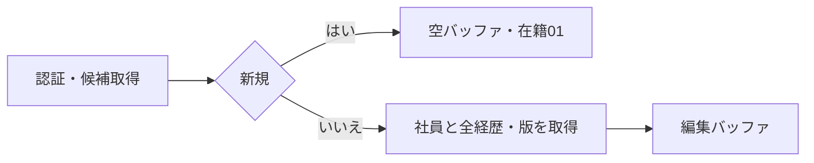
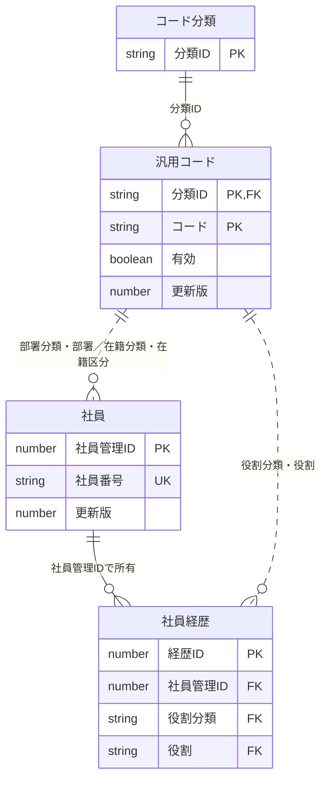
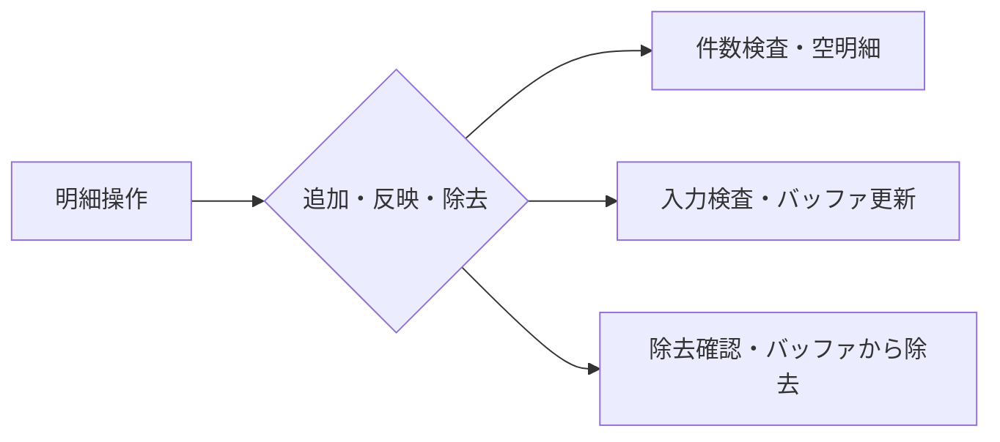
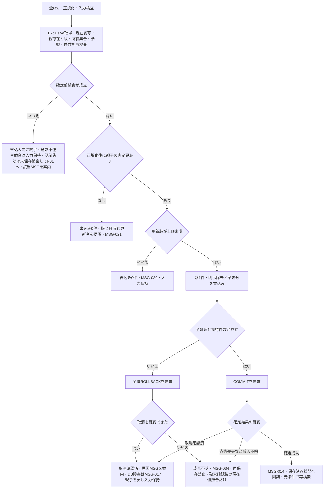
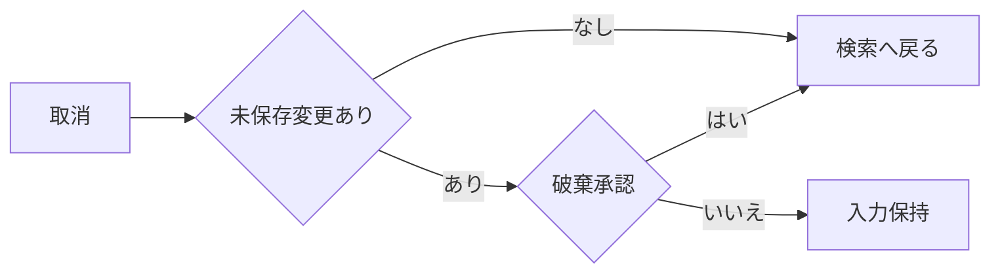

<!-- spec-meta: {"schema":"spec-md/1.0","documentId":"SP2-CSharp_ASPNET-DET-F04","version":"1.0","path":"sample-project2/spec/CSharp_ASPNET/詳細仕様書/04_社員登録画面.md","sheets":[{"heading":"概要","kind":"GRID","sheet":"01_概要"},{"heading":"項目一覧","kind":"LIST","sheet":"02_項目一覧","key":["項目ID"]},{"heading":"イベント仕様","kind":"GRID","sheet":"03_イベント仕様"},{"heading":"補足説明","kind":"GRID","sheet":"04_補足説明"}],"isolationProfile":"CSharp_ASPNET","featureId":"F04"} -->
# 社員登録画面 詳細仕様書

| 項目 | 内容 |
| --- | --- |
| projectId / methodId | sample-project2 / CSharp_ASPNET |
| 機能ID / 文書版 | F04 / 1.0 |
| 作成日・工程 | 2026-10-28 / detail-design / canonical-update |
| 対象読者・状態 | 経験5年程度の実装者。設計採用・利用者承認/実装/試験未実施 |
| 原基本設計SHA-256 | 2e6dc97835556e36314c4c32d4752ad5730f2f498d4513bc3b0dd52718835749 |

## 概要

### 目的と入出力

[社員検索](03_社員検索画面.md)から、社員一人の基本情報と0～20件の経歴を登録・編集する。管理者・担当者とも同じ操作を行う。基本情報タブと経歴タブは同一社員の未保存入力を共有する。社員削除、社員番号訂正、一括登録、承認は対象外で、退職は在籍区分で管理する。

永続DBは社員、社員経歴、コード分類、汎用コードを参照する。保存時は社員一人とその全経歴を一つの確定単位で更新する。画面入力・追加変更除去した経歴・読込時の社員版は未保存の一時情報。外部ファイル入出力はない。経歴書は検索へ戻りF05から作る。

### 画面設計

WEB系。1366×768 CSS px・100%、本文幅1260px以下。Yu Gothic UI／Meiryo14px、入力高32px、ボタン高34px。社員番号110px、日付150px、氏名260px、氏名カナ330pxを基準とし、長文は複数行で欄内スクロールする。タブで表示面積を切替え、保存・取消を常に見つけられる下部に置く。画面に見えないタブの入力も保存検査対象となり、エラー時は該当タブと項目へ移動する。

<!-- screen-html-start: F04-BASIC -->

<h3>社員登録［編集］　000001 山田 太郎</h3>
<button class="active">基本情報</button><button>経歴（2件）</button>

<label>社員番号 ※ <input class="no" data-item-id="F04-I01" value="000001" readonly></label><label>氏名 ※ <input class="name" data-item-id="F04-I02" value="山田 太郎" data-max-scalars="40"></label><label>氏名カナ ※ <input class="kana" data-item-id="F04-I03" value="ヤマダ タロウ" data-max-scalars="80"></label>

<label>部署 ※ <select class="code" data-item-id="F04-I04"><option>01 開発</option></select></label><label>在籍区分 ※ <select class="code" data-item-id="F04-I05"><option>01 在職</option></select></label><label>入社日 ※ <input class="date" data-item-id="F04-I06" value="2020-04-01"></label>

<label>職務要約<textarea data-item-id="F04-I07" data-max-scalars="1000">業務システムの設計・開発を担当。</textarea></label><label>得意技術・スキル<textarea data-item-id="F04-I08" data-max-scalars="1000">C#、ASP.NET、SQL Server</textarea></label><label>資格<textarea data-item-id="F04-I09" data-max-scalars="1000">基本情報技術者試験</textarea></label><label>自己PR<textarea data-item-id="F04-I10" data-max-scalars="1000">利用者の業務を理解して改善を提案します。</textarea></label>

※は必須です。タブの変更だけでは保存されません。

経歴を含めて一括保存します。<button class="primary" data-item-id="F04-I28">保存</button> <button data-item-id="F04-I29">取消・検索へ戻る</button>

<!-- screen-html-end: F04-BASIC -->

<!-- screen-html-start: F04-CAREER -->

<h3>社員登録［編集］　000001 山田 太郎</h3>
<button>基本情報</button><button class="active">経歴（2件）</button>

2024-04 ～ 継続中 社内販売管理システム

2020-04 ～ 2024-03 受発注システム保守

<button data-item-id="F04-I25">追加</button><button data-item-id="F04-I26">明細へ反映</button><button data-item-id="F04-I27">除去</button>

<label>開始年月 ※ <input class="month" data-item-id="F04-I14" value="2024-04"></label><label>終了年月（空＝継続中） <input class="month" data-item-id="F04-I15"></label><label>役割 ※ <select class="role" data-item-id="F04-I23"><option>02 リーダー</option></select></label><label>チーム人数 ※ <input class="team" data-item-id="F04-I24" value="5"></label>

<label>会社名 ※ <input class="company" data-item-id="F04-I16" value="デモソフト株式会社" data-max-scalars="100"></label><label>案件名 ※ <input class="project" data-item-id="F04-I17" value="社内販売管理システム" data-max-scalars="100"></label>

<label>業務・案件概要 ※<textarea data-item-id="F04-I18" data-max-scalars="1000">販売業務のWeb化。</textarea></label><label>担当業務 ※<textarea data-item-id="F04-I19" data-max-scalars="1000">基本設計、開発、試験。</textarea></label><label>成果・工夫<textarea data-item-id="F04-I20" data-max-scalars="1000">確認作業を標準化。</textarea></label><label>使用技術<textarea data-item-id="F04-I21" data-max-scalars="500">C#、ASP.NET、SQL Server</textarea></label>
<label>担当工程<textarea class="phases" data-item-id="F04-I22" data-max-scalars="200">基本設計、詳細設計、製造、単体・結合試験</textarea></label>

明細への反映・除去は未保存です。最後に「保存」してください。

経歴は20件まで。会社名・案件名は匿名表記も可能です。<button class="primary">保存</button> <button>取消・検索へ戻る</button>

<!-- screen-html-end: F04-CAREER -->

新規時の社員番号は入力可能で、内部番号は保存時の自動採番とする。編集時は社員番号を読取専用とし、他の業務項目を編集可能にする。基本情報の新規フォーカスは社員番号、編集は氏名。タブ内は表示順にTab移動し、経歴は一覧→明細項目→追加・反映・除去→保存・取消。未選択の明細欄は追加開始まで無効。読取専用番号も選択・コピー可能とする。

処理中は全変更と二重保存を無効にする。検査失敗時は全入力を保持し該当タブ・欄へ戻す。長い氏名・会社名・案件名は横移動で全文を編集でき、長文は欄内スクロール・拡大で全文へ到達できる。狭幅・拡大では縦スクロールを許容し、画面に合わせた切捨てをしない。

### 詳細の適用と実装表示

基本F04の全項目・全イベント・同一HTML/CSS断片を継承する。stage=detail-design、canonical-update。物理部品・型・APIは[方式別共通](../共通/方式別/01_共通実装仕様.md)、SQL/列/NULL/Sizeは[物理DB定義](../DB定義/SQLServer/01_DB定義書.md)、採用/残件は[詳細QA](../詳細設計QA.md)。HTMLは配置図で実アプリではなく、data-item-idをRazorのid/name/ModelStateに対応させる。CSS座標原点は画面root左上、単位CSS px、1366×768/100%、Yu Gothic UI/Meiryo・14px基準、狭幅/拡大では元CSSの折返し/スクロールを維持する。通常/新規/編集/選択なし/エラー/認証失効/処理中/長文を個別確認し、既存HTML内の寸法が一般基準より具体的な時はその値を優先する。

## 項目一覧

| 項目ID | 項目グループ | 項目名 | コントロール | 必須 | 入力制限 | フォーマット | 初期値 | DBテーブル名 | DB項目名 | 備考 | 物理部品・バインド | C#型 | raw上限 | 正規化・保存上限 | 長さ単位 | 未設定・NULL | 物理DB列・型 |
| --- | --- | --- | --- | --- | --- | --- | --- | --- | --- | --- | --- | --- | --- | --- | --- | --- | --- |
| F04-I01 | 基本情報 | 社員番号 | TextBox（input） | 〇 | 半角数字6桁・新規のみ | 先頭ゼロ保持 | 空 | 社員 | 社員番号 | 全社員で一意。編集不可・再採番なし。 | EmployeeRaw.EmployeeNo | string | 6桁 | 6桁 | ASCII数字 | 不可 | dbo.m_employee.employee_no char(6) NOT NULL |
| F04-I02 | 基本情報 | 氏名 | TextBox（input） | 〇 | 40字 | - | 空 | 社員 | 氏名 | 前後空白除去・原表記保持。 | EmployeeRaw.Name | string | 40 | 40 | Unicodeスカラー値 | 不可 | dbo.m_employee.employee_name nvarchar(80) NOT NULL |
| F04-I03 | 基本情報 | 氏名カナ | TextBox（input） | 〇 | 全角カナ・長音・中点・空白80字 | - | 空 | 社員 | 氏名カナ | 半角カナの正規化は共通UIに従う。 | EmployeeRaw.Kana | string | 80 | 80 | Unicodeスカラー値 | 不可 | dbo.m_employee.employee_kana nvarchar(160) NOT NULL |
| F04-I04 | 基本情報 | 部署 | Select（select） | 〇 | 選択のみ | 名称表示／半角数字2桁コード保持 | 空 | 社員 汎用コード | 社員：部署分類・部署 汎用コード：分類ID・コード・名称 | DEPARTMENT有効値。停止既存値は保持・再保存可。 | EmployeeRaw.DepartmentCode | string | 2桁 | 2桁 | ASCII数字 | 不可 | dbo.m_employee.department_code char(2) NOT NULL、分類DEPARTMENT固定 |
| F04-I05 | 基本情報 | 在籍区分 | Select（select） | 〇 | 選択のみ | 名称表示／半角数字2桁コード保持 | 01 在職 | 社員 汎用コード | 社員：在籍分類・在籍区分 汎用コード：分類ID・コード・名称 | EMPLOYMENT_STATUSの01在職・02休職・03退職。 | EmployeeRaw.EmploymentStatus | string | 2桁 | 2桁 | ASCII数字 | 不可 | dbo.m_employee.employment_status char(2) NOT NULL、分類EMPLOYMENT_STATUS固定 |
| F04-I06 | 基本情報 | 入社日 | TextBox（input） | 〇 | 日付10字 | YYYY-MM-DD | 空 | 社員 | 入社日 | 1900-01-01～業務日。日付で保存。 | EmployeeRaw.JoinDateRaw → EmployeeDraft.JoinDate | string → DateOnly | 10 | date | ASCII YYYY-MM-DD | 不可 | dbo.m_employee.join_date date NOT NULL |
| F04-I07 | 職務 | 職務要約 | TextBox（textarea） | 任意 | 1000字 | 改行 | 空 | 社員 | 職務要約 | F05の出力条件は別途検査。 | EmployeeRaw.CareerSummary | string? | 1000 | 1000 | Unicodeスカラー値 | 空白だけ→DBNull | dbo.m_employee.career_summary nvarchar(2000) NULL |
| F04-I08 | 職務 | 得意技術・スキル | TextBox（textarea） | 任意 | 1000字 | 改行 | 空 | 社員 | スキル・得意分野 | 非適用 | EmployeeRaw.Skills | string? | 1000 | 1000 | Unicodeスカラー値 | 空白だけ→DBNull | dbo.m_employee.skills nvarchar(2000) NULL |
| F04-I09 | 職務 | 資格 | TextBox（textarea） | 任意 | 1000字 | 改行・一資格一行を推奨 | 空 | 社員 | 保有資格 | 取得年月は本文へ記載可。 | EmployeeRaw.Qualifications | string? | 1000 | 1000 | Unicodeスカラー値 | 空白だけ→DBNull | dbo.m_employee.qualifications nvarchar(2000) NULL |
| F04-I10 | 職務 | 自己PR | TextBox（textarea） | 任意 | 1000字 | 改行 | 空 | 社員 | 自己PR | 非適用 | EmployeeRaw.SelfPr | string? | 1000 | 1000 | Unicodeスカラー値 | 空白だけ→DBNull | dbo.m_employee.self_pr nvarchar(2000) NULL |
| F04-I11 | 案内 | メッセージ | Label | - | - | - | - | - | - | エラーはタブ・項目を特定。 | EditVm.Outcome.Message | string? | 入力なし | 日本語MSG表示 | Unicode文字列 | メッセージなしnull | 永続列なし |
| F04-I12 | 画面切替 | 基本情報・経歴タブ | Tab | - | - | - | 基本情報 | - | - | 切替で保存しない・入力保持。 | EditVm.ActiveTab / EmployeeController.Draft Action=SwitchTab | EditTab（Basic/Careers） | Basic/Careers | 保存なし | 列挙値 | 不可 | 永続列なし。タブ切替でDB更新しない |
| F04-I13 | 経歴一覧 | 経歴一覧 | Table・RadioButton | - | - | YYYY-MM～YYYY-MM／継続中 | 空 | 社員経歴 | 経歴ID・開始年月・終了年月・案件名 | 最大20件・0件可。1明細選択。開始年月→内部番号の降順。同順位の未保存行は追加順。0件でも社員保存可、F05不可。 | EditVm.Careers / SelectedClientRowKey | IReadOnlyList<CareerRaw>/Guid? | 0～20行 | 全体保存時に確定 | 行 | 0件可/未選択null | dbo.t_career全14列、親employee_idで所有 |
| F04-I14 | 経歴 | 開始年月 | TextBox（input） | 条件付 | 年月7字 | YYYY-MM | 空 | 社員経歴 | 開始年月 | 明細あり時必須。1900-01以上、終了年月・業務年月以下。月初で保存。 | CareerRaw.StartMonthRaw → StartMonth | string → DateOnly | 7 | 月初date | ASCII YYYY-MM | 明細あり時不可 | dbo.t_career.start_month date NOT NULL |
| F04-I15 | 経歴 | 終了年月 | TextBox（input） | 任意 | 年月7字 | YYYY-MM | 空 | 社員経歴 | 終了年月 | 空欄＝継続中。指定時は開始年月以上・業務年月以下。月初で保存。 | CareerRaw.EndMonthRaw → EndMonth | string? → DateOnly? | 7又は空 | 月初date又はDBNull | ASCII YYYY-MM | 空→継続中/DBNull | dbo.t_career.end_month date NULL |
| F04-I16 | 経歴 | 会社名 | TextBox（input） | 条件付 | 100字 | - | 空 | 社員経歴 | 会社名 | 明細あり時必須。守秘対象は匿名名可。 | CareerRaw.CompanyName | string | 100 | 100 | Unicodeスカラー値 | 明細あり時不可 | dbo.t_career.company_name nvarchar(200) NOT NULL |
| F04-I17 | 経歴 | 案件名 | TextBox（input） | 条件付 | 100字 | - | 空 | 社員経歴 | 案件名 | 明細あり時必須。守秘対象は匿名名可。 | CareerRaw.ProjectName | string | 100 | 100 | Unicodeスカラー値 | 明細あり時不可 | dbo.t_career.project_name nvarchar(200) NOT NULL |
| F04-I18 | 経歴 | 業務・案件概要 | TextBox（textarea） | 条件付 | 1000字 | 改行 | 空 | 社員経歴 | 業務概要 | 明細あり時必須。空白だけは不可。 | CareerRaw.Description | string | 1000 | 1000 | Unicodeスカラー値 | 明細あり時不可 | dbo.t_career.description nvarchar(2000) NOT NULL |
| F04-I19 | 経歴 | 担当業務 | TextBox（textarea） | 条件付 | 1000字 | 改行 | 空 | 社員経歴 | 担当業務 | 明細あり時必須。空白だけは不可。 | CareerRaw.Duties | string | 1000 | 1000 | Unicodeスカラー値 | 明細あり時不可 | dbo.t_career.duties nvarchar(2000) NOT NULL |
| F04-I20 | 経歴 | 成果・工夫 | TextBox（textarea） | 任意 | 1000字 | 改行 | 空 | 社員経歴 | 実績・成果 | 非適用 | CareerRaw.Achievements | string? | 1000 | 1000 | Unicodeスカラー値 | 空→DBNull | dbo.t_career.achievements nvarchar(2000) NULL |
| F04-I21 | 経歴 | 使用技術 | TextBox（textarea） | 任意 | 500字 | 改行 | 空 | 社員経歴 | 技術環境 | 言語・DB・OS等を記述。 | CareerRaw.Technologies | string? | 500 | 500 | Unicodeスカラー値 | 空→DBNull | dbo.t_career.technologies nvarchar(1000) NULL |
| F04-I22 | 経歴 | 担当工程 | TextBox（textarea） | 任意 | 200字 | 改行 | 空 | 社員経歴 | 担当工程 | 自由記述。工程別マスタなし。 | CareerRaw.Phases | string? | 200 | 200 | Unicodeスカラー値 | 空→DBNull | dbo.t_career.phases nvarchar(400) NULL |
| F04-I23 | 経歴 | 役割 | Select（select） | 条件付 | 選択のみ | 名称表示／半角数字2桁コード保持 | 空 | 社員経歴 汎用コード | 社員経歴：役割分類・役割 汎用コード：分類ID・コード・名称 | 明細あり時必須。PROJECT_ROLE有効値。停止既存値は保持・再保存可。 | CareerRaw.RoleCode | string | 2桁 | 2桁 | ASCII数字 | 明細あり時不可 | dbo.t_career.role_code char(2) NOT NULL、分類PROJECT_ROLE固定 |
| F04-I24 | 経歴 | チーム人数 | TextBox（input） | 条件付 | 整数1～999・3桁以内 | - | 空 | 社員経歴 | チーム人数 | 明細あり時必須。 | CareerRaw.TeamSizeRaw → TeamSize | string → short | 3桁 | 1～999 | ASCII整数 | 明細あり時不可 | dbo.t_career.team_size smallint NOT NULL |
| F04-I25 | 操作 | 経歴追加 | Button | - | - | - | - | - | - | 20件未満で有効。未保存明細を追加。 | button[F04-I25] → EmployeeController.Draft Action=Add POST /employees/draft | 非適用（submit操作） | 非適用 | 保存なし | 非適用 | 非適用 | 永続列なし |
| F04-I26 | 操作 | 明細へ反映 | Button | - | - | - | - | - | - | 明細編集中のみ有効。検査後バッファへ反映。DB保存なし。 | button[F04-I26] → EmployeeController.Draft Action=Apply POST /employees/draft | 非適用（submit操作） | 非適用 | 保存なし | 非適用 | 非適用 | 永続列なし |
| F04-I27 | 操作 | 経歴除去 | Button | - | - | - | - | - | - | 明細選択時のみ有効。確認後バッファから除去（未保存）。 | button[F04-I27] → EmployeeController.Draft Action=Remove POST /employees/draft | 非適用（submit操作） | 非適用 | 保存なし | 非適用 | 非適用 | 永続列なし |
| F04-I28 | 操作 | 保存 | Button | - | - | - | - | 社員 社員経歴 | 社員：社員管理ID・更新版・更新日時・更新者 社員経歴：経歴ID・社員管理ID | 社員・全明細を一括確定。項目別設定値はF04-E03。 | button[F04-I28] → EmployeeController.Save POST /employees/save | 非適用（submit操作） | 非適用 | 保存なし | 非適用 | 非適用 | 永続列なし |
| F04-I29 | 操作 | 取消・検索へ戻る | Button | - | - | - | - | - | - | 未保存変更時は破棄確認。 | button[F04-I29] → EmployeeController.Cancel POST /employees/cancel | 非適用（submit操作） | 非適用 | 保存なし | 非適用 | 非適用 | 永続列なし |

## イベント仕様

### F04-E01 初期表示

#### 処理概要

新規なら初期値を設定し、編集なら指定社員と全経歴・候補を一貫して読み込む。

##### 詳細実装契約

EmployeeService.LoadAsync(actor,id?)がEmployeeEditVmとサーバーEditSnapshotを作る。新規は空の親/明細、編集は親版と全読込経歴ID集合を保持し、送信集合検証の基準とする。

#### 処理手順

1. **受付・起動条件の確認**
   1. 認証状態、無操作期限、現在の利用者の有効性・ADMIN/STAFF役割を確認する。失効はMSG-002、認可不成立はMSG-003で終了し、社員情報を返さない。
   2. 起動区分を新規/編集に固定する。編集では社員管理IDを1件だけ受け取り、検索表示値や要求側が指定した更新者を信用しない。

2. **新規・編集データの取得**
   1. 新規は有効な部署・役割と固定在籍3値を取得する。在籍01だけを初期設定し、社員番号・他の基本情報・経歴一覧は空、読込版と保存済み経歴ID集合は未設定にする。
   2. 編集は社員1件、当該社員の全経歴0～20件、参照名称と候補を同じ読取単位で取得する。社員0件はMSG-019、複数件・所有矛盾・21件以上・参照コード不明はMSG-020で編集開始を止める。取得失敗を新規扱いしない。

3. **編集状態の確立・表示**
   1. 編集開始時の社員版、社員番号、親の業務値、全経歴IDと各業務値を読込原本として保持し、別に編集用コピーを作る。現在選択行の明細入力も独立した一時状態とする。
   2. 停止コードは、それを保持している既存社員の部署欄又は既存経歴自身の役割欄に限り「名称（停止）」として表示する。他の行や新規行へ選べる共通候補へ混ぜない。
   3. 読取資源を解放し、基本情報タブを表示する。新規は社員番号、編集は氏名へフォーカスする。読込原本との差分を未保存判定の基準とし、初期表示自体では変更ありにしない。

##### 判定と復帰の対応

| 判定ID・参照 | このイベントでの判定 | 結果・メッセージ・復帰 |
| --- | --- | --- |
| CHK-F04-01を再利用 | 認証期限・利用者有効・現在役割。初期表示では開始時の検査を適用 | 失効MSG-002、権限不足MSG-003。社員データを返さず終了 |
| CHK-F04-15 | 編集の社員が1件、子0～20件・ID一意・所有一致、参照と固定在籍値が正常 | 社員0件MSG-019でF03へ、不整合MSG-020で編集開始停止。部分取得で開かない |
| CHK-F04-16 | 社員・全経歴・名称/候補の取得と読込原本の保持が完了 | 取得失敗MSG-040。元の検索を保持し、空の新規に切り替えず保存を無効化 |
| CHK-F04-17 | 新規/編集の起動区分に応じ、初期値・番号編集可否・候補範囲を設定 | 新規は在籍01/他空、編集は保存値と読込版。停止値は当該既存行だけ表示。初期表示を未保存差分にしない |

##### 詳細実装契約

1. **新規/編集の確定**
   1. owner/session/認証を確認。新規はEmployeeNo入力可、その他初期空・在籍01、経歴0、ExpectedRevisionなし。社員ID/監査値は受理しない。
   2. 編集はShared TxでSQL-EMPLOYEE/CAREERS、分類コードを取得し、社員1/経歴0～20/所有/保存値整合を検査してSnapshotへ固定する。
2. **候補と表示状態**
   1. 部署/役割は有効値＋当該既存行が持つ停止値だけ、在籍は固定3値。並び順/コード順で名称を表示し、未登録はMSG-020で保存不可。
   2. EditStateId/StateRevisionを発行し、初期Tab=基本。新規番号/編集氏名へフォーカス、IDと期待版はサーバー状態へ留める。

#### 処理フロー

##### 詳細実装契約

Open → New空状態 又は Shared一括読取 → 保存値検査 → Snapshot/候補 → EditVm。

#### SQL・テーブル関連（ER図）

本イベントは社員・社員経歴と候補コードを参照する。社員管理IDで親子を対応付け、固定分類とコードの複合参照で部署・在籍・役割の名称を取得する。図のPK・UK・FKは論理設計のキーであり、本イベントの追加/更新/削除は0件。

##### 詳細実装契約

dbo.m_employee.employee_id PK→dbo.t_career.employee_id FK。社員部署/在籍と経歴役割はdbo.m_codeの複合キー。停止コードはLEFT JOIN/辞書で存在確認し、INNER JOINで行を隠さない。

#### DB操作の詳細

| 操作 | 対象・条件 | 取得内容・件数 | 異常時 |
| --- | --- | --- | --- |
| 認証確認 | 利用者ID=認証主体 | 利用可能・利用者役割、1件 | 無効/停止はMSG-002、対象外役割はMSG-003。業務読取なし |
| 親取得（編集） | 社員管理ID=起動引数 | 社員の全16項目、必ず1件 | 0件MSG-019、複数件MSG-020 |
| 子取得（編集） | 社員経歴.社員管理ID=親の社員管理ID | 全14項目、0～20件。開始年月降順→経歴ID降順 | 経歴ID重複・所有矛盾・20件超はMSG-020。切捨てなし |
| 分類・候補取得 | DEPARTMENT、EMPLOYMENT_STATUS、PROJECT_ROLEを分類とコードの複合キーで照合 | 分類・コード・名称・有効。候補は並び順→コード昇順。固定在籍3値、部署/役割は有効値と各既存行自身の現在値 | 未知分類・参照先0件/複数件・固定在籍値の不足/改変はMSG-020 |

親・子・コード名称を一貫して読み、途中で失敗したら全体を破棄して編集を開始しない。本イベントの追加・更新・削除はすべて0件。候補の有効値が0件でも部署/役割を自動補完しない。新規は未選択のままとし、選択できない原因を管理者へ確認する。

##### 詳細実装契約

SQL-EMPLOYEE/CAREERS、@employeeId bigint正数、社員1・経歴0～20・名称各1。新規の候補SELECTのみ、社員件数の事前案内は確定時上限検査の代替にしない。DML/版更新0。

#### 結果・例外時の扱い

| 条件 | メッセージ・復帰 |
| --- | --- |
| 社員消失 | MSG-019「対象の社員が見つかりません。検索し直してください。」。F03の検索条件を保持して戻る |
| データ構造・参照の不整合 | MSG-020「保存データに不整合があります。管理者へ連絡してください。」。空データで保存できる状態にしない |
| DB取得失敗 | MSG-040。元の検索を保持し、取得成功まで保存を有効にしない |
| 既存停止コード | 読込成功。元の行で同じコードを保持できる。保存時の再検査を省略しない |

必須欠落・年月違反等の修正可能な保存値は、取得値を隠したり補完したりせず、編集後の保存検査で対象欄を示す。参照先不明のコードを仮名称に置換しない。

##### 詳細実装契約

対象なしMSG-019、保存異常MSG-020、読込障害MSG-040で入力可能な不完全EditVmを公開しない。成功時の停止既存値は『名称（停止）』で保持し、有効先頭候補へ自動変更しない。

### F04-E02 タブ切替・経歴の追加・反映・除去

#### 処理概要

一人の社員の入力を保持しながら経歴を編集する。明細操作だけではDBを変更しない。

##### 詳細実装契約

POST /employees/draftがEditState内だけで経歴追加/反映/明示除去/行Tab切替を行う。Action=Add/Apply/Remove/Select/SwitchTab、Fields=CareerRaw?、確認はApplyPending/DiscardPending/RemoveRowとYes/No/Cancelの許可組だけを使い、方式別共通のDraftInput/ConfirmationVmへ厳密に対応する。社員/経歴のDB確定は全体保存F04-E03だけ。

#### 処理手順

1. **操作状態・未反映入力の確認**
   1. 保存処理中又は保存結果確認待ちなら明細操作を実行しない。処理中はMSG-029、結果確認待ちはMSG-034を示す。
   2. タブ切替・別明細選択・追加の前に未反映入力を確認する。MSG-032で「はい」は明細検査後に反映、「いいえ」はMSG-033で破棄を確認する。破棄に「はい」で既存行は元の反映値へ戻し、まだ反映していない新規予約行は一時IDごと除く。「いいえ」又は確認取消なら元のタブ・行・入力を維持する。未反映がなければ確認しない。

2. **経歴の追加・反映**
   1. 追加は一覧の保存予定件数が20件未満のときだけ行う。未保存の一時IDを付けた空行を1件予約し、明細を入力可能にする。予約行も20件に数え、未入力だからと無断に保存対象から落とさない。20件ならMSG-018で追加しない。
   2. 反映は明細の11編集項目を共通規則で正規化し、形式/上限、条件付き必須、年月、役割、人数を検査する。失敗なら一覧の反映値を変えず入力を残す。成功なら一時ID又は経歴IDが一致する1行だけへ反映する。
   3. 反映前に、除去予定を除く他明細と11編集値すべてが一致しないことを確認する。同一ならMSG-026で反映しない。年月の重複、同じ会社名・案件名だけの一致は許容する。

3. **経歴の除去・保存への連携**
   1. 除去は選択行を特定してMSG-031を表示する。「はい」で保存予定一覧から除き、既存行は除去予定IDへ、新規予約行は一時IDごと破棄する。「いいえ」は入力を保持する。他行へ除去を転送しない。
   2. 親の保存操作は現在編集中の明細にも同じ検査・反映を行ってからF04-E03へ進む。未入力の新規予約行を残した保存は必須エラーにする。新規行が不要なら利用者が除去する。

| 編集状態 | 許可する操作・遷移 | DB変更 |
| --- | --- | --- |
| 明細未選択 | 追加又は既存行選択。明細欄・反映・除去は無効 | 0件 |
| 反映済み明細選択 | 入力変更で未反映へ。追加・行選択・タブ切替・除去を許可 | 0件 |
| 未反映明細あり | 反映検査、破棄確認又は編集継続。検査失敗で元欄へ戻る | 0件 |
| 保存処理中 | 二重保存・明細変更・遷移を無効 | F04-E03だけが処理 |
| 保存結果確認待ち | 再保存・追加・除去を無効。再読込みで結果を確認 | 自動再実行0件 |

##### 判定と復帰の対応

| 判定ID・参照 | このイベントでの判定 | 結果・メッセージ・復帰 |
| --- | --- | --- |
| CHK-F04-18 | 保存処理中/保存結果確認待ちか | 処理中MSG-029、結果確認待ちMSG-034。明細変更・二重保存を行わない |
| CHK-F04-19 | 行/タブ/追加切替の前に未反映入力があるか | なしは直接移動。ありはMSG-032、反映しない場合MSG-033。確認取消・検査失敗は元タブ/行/入力を保持 |
| CHK-F04-20 | 新規予約行を含む一覧が20件未満か | 20件で追加ボタン無効。直接の追加要求もMSG-018で拒否。除去後の19件なら追加可、DB変更0件 |
| CHK-F04-03、CHK-F04-04、CHK-F04-05、CHK-F04-06、CHK-F04-11を再利用 | 明細反映と親保存前の未反映反映で、経歴に該当する必須・年月・形式/上限・役割・11値完全重複を検査 | MSG-004/005/007/016/026。反映済み一覧を変えず入力保持。全正常時だけ対象1行へ反映 |
| CHK-F04-21 | 除去対象が選択済みで、MSG-031の確認が承認されたか | 未選択は除去無効。はいで既存IDを明示除去集合へ、新規行は一時IDごと破棄。いいえ/確認取消は保持。DB変更0件 |

##### 詳細実装契約

1. **編集中行の扱い**
   1. 所有/StateRevision/現在認可を確認し、編集中変更がある切替はMSG-032を示す。Yesはraw/正規化/必須/年月を検査し反映、NoはMSG-033で編集中分の破棄を確認する。
   2. 反映も破棄もしない時は元行/タブへ留め、親入力と反映済み一時一覧を保持する。失敗は該当経歴/項目へ。
2. **追加・除去・表示順**
   1. 追加は最終一時集合20件未満のみ、ClientRowKey=Guidで新規行を識別しCareerIdを割り当てない。
   2. 除去はMSG-031で確認し既存IDをRemovedSetへ移す。新規行の除去は一時行を消すだけ。読込行を黙って送信省略しない。
   3. 表示は開始年月降順/既存ID降順、新規同順位は追加順。順序だけを業務差分にしない。

#### 処理フロー

##### 詳細実装契約

DraftAction → 未反映確認 → 検査/反映又は限定破棄 → Add/Remove/Select → StateRevision+1。DB保存矢印を設けない。

#### SQL・テーブル関連（ER図）

DBなし。社員・経歴の一時バッファを操作するためER図は非適用。

##### 詳細実装契約

DB書込み0、一時EditStateだけ。候補の現在有効性は保存直前に再検査するため、この反映を確定済みとしない。ER追加なし。

#### DB操作の詳細

DB参照・追加・更新・削除は0件。明細反映・除去は保存予定バッファだけを変更し、利用者が保存を確定するまで永続データへ反映しない。

保存済み経歴は読込時の経歴ID、新規行は画面内で重複しない一時IDで識別する。一時IDを永続IDへ流用せず、未保存操作でDB採番を消費しない。読込原本・反映済み一覧・未反映入力・除去予定IDを区別し、タブや表示順を変えても対応を維持する。表示順だけの変更は業務差分にしない。

##### 詳細実装契約

既存ReadSnapshot/LoadedCareerIds/RemovedSetとDraftのメモリー編集だけ。SqlParameter/commitなし。追加20上限の画面検査と保存の確定時検査を別に実行する。

#### 結果・例外時の扱い

明細の必須欠落はMSG-004、長さ・文字種・整数はMSG-005、年月前後/未来はMSG-007、役割候補不正はMSG-016、完全重複はMSG-026で該当経歴の欄へ戻す。項目名には「経歴{行番号}・開始年月」等を用い、別タブでも対象を特定する。

除去・未反映破棄の確認取消は正常な編集継続で、成功やエラーを表示しない。経歴0件で社員保存は可能だがF05出力は不可。前職と並行案件は許容し、未来予定は受け付けない。

##### 詳細実装契約

MSG-031『この経歴を未保存一覧から除去しますか。』、032『編集中の経歴を一覧へ反映しますか。』、033『編集中の経歴を破棄しますか。』。Noで親/他明細を破棄しない。MSG-004/005/007は原入力保持/該当行へ。

### F04-E03 社員と経歴の一括保存

#### 処理概要

社員一人と全経歴を検査し、一つの確定単位で保存する。社員版で同時更新を検知する。

##### 詳細実装契約

EmployeeService.SaveAsync(actor,EditSnapshot,EmployeeDraft)が親1行と全経歴の差分を同じSerializable/Exclusive Txで確定する。ExpectedRevision/読込ID集合はサーバー所有状態、更新者/分類/日時はサービス設定。

#### 処理手順

1. **受付・事前検査**
   1. 保存操作を1回だけ受理し、全変更を無効にする。既に処理中ならMSG-029で後続要求を実行しない。保存結果確認待ちならMSG-034を示し再送しない。
   2. 認証・現在の役割を検査する。業務日を1回固定し、未反映明細をF04-E02と同じ規則で反映して、全タブ・保存予定全明細を下表で検査する。上限超過を切り詰めない。

2. **排他・現在値と差分の確認**
   1. 同一排他/トランザクションを開始する。利用者の現在有効性・役割を再確認し、編集では現在社員と全経歴を取得して存在・親版一致・所有を確認する。新規は番号一意と追加後200人以下を競合のない境界で確認する。
   2. 保存済みIDの一意、読込集合との対応、最終経歴数0～20件、現在のコード存在・有効性を再検査する。停止値の保持は当該既存行の値不変時だけ許し、新規行・変更行へコピーされた停止値は拒否する。
   3. 正規化後の親業務値と全明細の構成・11編集値を読込原本と比較する。実変更がなくても現在の親版を先に確認する。全無変更なら書込み0件、版・監査値を保持してMSG-021とし、F03へ戻る。新規は空入力でも無変更扱いにしない。

3. **親子データの書込み**
   1. 実変更時は親版の上限を検査し、親の追加1件又は読込版一致更新1件を行う。社員管理IDは自動採番又は元ID、番号は新規入力又は元番号、更新者は認証主体、更新日時は確定単位で固定するUTC時点とする。子だけ変更した場合も親版を1増やす。
   2. 同じ確定単位で既存子の除去→既存子の変更→新規子の追加を行う。各行の経歴IDと社員管理IDを条件にし、予定行ごと1件を必須とする。無変更行は書き換えない。途中で1件でも期待件数に合わなければ全体を取り消す。

4. **全体確定・結果別の復帰**
   1. 最終経歴ID集合・件数が保存予定と一致することを確認し、参照有効性が確定まで保護された状態で全体を確定する。成功を確認してからMSG-014を表示し、F03へ戻って保持条件で再検索する。
   2. 取消完了を確認できた失敗は入力を保持し、下表のメッセージを表示する。確定要求後の通信断等で成否を判定できない場合はMSG-034の結果確認待ちに移り、自動再試行しない。再読込みで保存内容を確認する。

##### 保存チェック

| チェックID | 検査対象・成立条件 | 不成立時・復帰 |
| --- | --- | --- |
| CHK-F04-01 | 認証が期限内で、利用者が有効かつADMIN/STAFF。開始時と確定単位内で確認 | 失効MSG-002、権限MSG-003。保存0件 |
| CHK-F04-02 | 社員番号6桁、氏名40字、カナ80字、入社日10字、職務4欄各1000字。入力前後双方の上限と文字受理規則を満たす | MSG-005。切捨てなし、基本情報の対象欄へ |
| CHK-F04-03 | 番号・氏名・カナ・部署・在籍・入社日が設定済み。経歴あり時は開始・会社・案件・概要・担当業務・役割・人数が設定済み | MSG-004。空白のみも不足、最初の対象タブへ |
| CHK-F04-04 | 入社日1900-01-01～固定業務日。開始/終了1900-01～固定業務年月、開始≦終了。終了未設定だけ継続中 | 入社日MSG-005、経歴年月MSG-007。前職・同月・並行案件は許容 |
| CHK-F04-05 | 経歴の会社/案件各100字、概要/担当業務/成果各1000字、技術500字、工程200字、人数は3桁以内の整数1～999 | MSG-005。対象経歴を選択して入力保持 |
| CHK-F04-06 | 分類を固定値で照合。新規/変更の部署・役割は現在有効、在籍は固定3値。既存停止値は元の同じ行かつ値不変 | 新たな無効選択MSG-016、保存済み参照異常MSG-020 |
| CHK-F04-07 | 保存予定経歴は予約行込み0～20件。新規社員は追加後200人以下 | MSG-018。除去後の最終件数で判定、部分保存なし |
| CHK-F04-08 | 社員番号が全社員で一意。編集番号は読込番号と一致 | 新規重複MSG-006、編集番号改変MSG-005 |
| CHK-F04-09 | 社員が1件存在し、現在の社員版=読込版で、版は整数1～2147483647。無変更判定より先に検査 | 消失MSG-019、版不一致MSG-008、複数件/版範囲異常MSG-020 |
| CHK-F04-10 | 既存経歴IDが重複せず読込集合に含まれ、全行が同じ社員に属する。保持IDと明示除去IDが重複なく読込集合を完全に分割。新規一時IDも一意 | MSG-025。要求全体を拒否し再読込みを案内 |
| CHK-F04-11 | 保存予定の異なる2行で11編集値すべての一致がない | MSG-026。後の経歴を示す。期間の重複だけでは拒否しない |
| CHK-F04-12 | 親子の実変更あり時、現在版が2147483647未満 | MSG-039。全無変更なら版上限でもMSG-021 |
| CHK-F04-13 | 親1件・各子1件、合計追加/変更/除去件数、最終ID集合・件数が予定と一致 | 親条件更新0件は消失MSG-019/版差MSG-008、子の所有/要求矛盾MSG-025、予期しない件数MSG-020で全取消。成否不明はMSG-034 |
| CHK-F04-14 | 排他取得待ちが10秒を超えずDB処理を完了し、確定又は取消の結果を識別できる | 待ち超過MSG-027、取消済みDB障害MSG-017、成否不明MSG-034 |

11編集値は開始年月・終了年月・会社名・案件名・業務概要・担当業務・実績/成果・技術環境・担当工程・役割・チーム人数。共通規則で正規化した保存値を比較し、空の任意値はNULL、年月は月初日、人数は整数として同じ意味にそろえる。ID・役割分類・一覧順を比較に加えず、氏名検索用NFKCを経歴本文へ適用しない。完全重複拒否は今回Pilotの設計採用で、前職・並行案件の許容を維持する。

##### 詳細実装契約

1. **受付・入力全量検査**
   1. POST /employees/saveのCSRF/所有/Revision/CommitStateを検査し、未反映明細を同じ検査で反映する。raw上限→Trim/LF/カナ→保存上限→必須/年月/11値重複を検査する。
   2. 半角番号6桁、親必須6値、経歴必須7値、人数1～999、任意NULL、前職/並行/同月許容を適用。本文を検索正規化しない。
2. **確定境界での再判定**
   1. Exclusive applock10秒取得後、現在利用者有効/ADMIN又はSTAFFを確認し、既存なら社員1件/現在版を差分判定より先に照合する。
   2. LoadedIDs=保持/更新IDsの集合和と明示RemovedIDs、両集合交差なし、ID重複/所有外/未知なしを確認。新規行の既存ID受入禁止。
   3. 現在コード/固定分類/有効性（同じ既存行だけ停止保持）/社員200/経歴20/番号一意/完全重複を再検査する。無変更はTx終了しMSG-021、実変更版上限はMSG-039。
3. **差分DML・全体確定**
   1. SQL-EMPLOYEE-WRITEを親1件へ適用。子だけの変更でも親版/更新属性を1回更新、社員番号/固定分類/ID不変。
   2. 明示除去→既存変更→新規子の順でSQL-CAREER-WRITE、各期待1を照合、同値子は0操作。IDはOUTPUT、欠番可。
   3. 全成功commit応答後にSnapshotを保存済みへ同期しMSG-014、元AppliedCriteriaで再検索する。commit不明は再保存を無効化しMSG-034、部分DML/取消未確認を成功にしない。

#### 処理フロー

##### 詳細実装契約

SaveInput → 全raw/正規化検査 → Exclusive Tx → 現認可 → 親存在/版 → ID集合/参照/件数/重複 → 差分 → 親1/子差分 → commit → 元条件再検索。失敗は全rollback、commit応答欠落だけUnknown。

#### SQL・テーブル関連（ER図）

社員と社員経歴は同じ確定単位で更新する。PK・UK・FKは論理上の識別・参照を示す。社員経歴の所有条件は社員管理IDであり、他社員の経歴IDを本保存へ渡しても更新・除去できない。部署分類DEPARTMENT、在籍分類EMPLOYMENT_STATUS、役割分類PROJECT_ROLEをシステムが設定し、分類とコードの組で存在/有効性を検査する。コード分類・汎用コードは参照だけで本機能から変更しない。

##### 詳細実装契約

基本の社員/社員経歴/汎用コード関係をdboの同名物理表へ対応する。社員更新者はuser_idの当時記録だがFK追加なし。parent employee_id PK、子employee_id FK、役割/部署/在籍は分類と値の複合FK。子にrevision列を増やさない。

#### DB操作の詳細

##### 保存対象・差分と確定境界

保存開始時に、認証主体の有効性、入力検査、読込時の社員管理ID・更新版・経歴ID集合を確認する。社員1人分の基本情報と全経歴を一つの集約として扱い、同一の排他/トランザクション範囲で現在版・社員総数・社員番号の一意性・コードの現在状態を再確認する。経歴だけを変更した場合も社員の更新版を1増やす。親版が一致しない場合は、無変更入力でも自動的に成功とせず競合を案内する。

保存予定の経歴を、読込時の保存済み行に対して「新規追加」「既存変更」「既存無変更」「既存除去」に分ける。保存済み経歴IDの重複・読込集合にないID・別社員IDを拒否する。読込時ID集合Lは保持する既存ID集合Kと明示除去ID集合Rの重複のない和と一致させる。送信から欠落したIDを勝手に除去予定へ変換せず、K/Rの欠落・重複はMSG-025とする。現在DBの子ID集合がLと異なるのに親版が同じ場合は、契約外更新によるMSG-020として全取消する。未保存の追加行を取り消しただけならDB削除は発生しない。保存後の経歴数は追加・継続を合わせて0～20件。新規社員の保存は社員総数200人までで、201人目を同時登録と競合する隙間から通さない。

##### 社員への項目別設定

| 設定先テーブル | 設定先項目 | 移送元・設定値 | 新規・編集・保持の扱い |
| --- | --- | --- | --- |
| 社員 | 社員管理ID | 保存処理の自動採番 | 新規の同じ追加処理が得たIDを使用。編集は読込IDを保持。画面の業務番号やMAX+1で代用しない |
| 社員 | 社員番号 | F04-I01 社員番号 | 新規で設定。編集は保存済み値を保持し、異なる番号の要求を拒否。全社員で一意、先頭ゼロを保持 |
| 社員 | 氏名 | F04-I02 氏名 | 共通の前後空白整理後の表記を設定。氏名照合用の正規化値で上書きしない |
| 社員 | 氏名カナ | F04-I03 氏名カナ | 共通のカナ正規化後の値を設定 |
| 社員 | 部署分類 | 固定値DEPARTMENT | 利用者から入力させず固定する |
| 社員 | 部署 | F04-I04 部署 | 部署分類と組で汎用コードを参照。新規/変更は有効値、既存の同じ停止値は保持可 |
| 社員 | 在籍分類 | 固定値EMPLOYMENT_STATUS | 利用者から入力させず固定する |
| 社員 | 在籍区分 | F04-I05 在籍区分 | 固定3値の保存値を設定。退職でも社員/経歴を削除しない |
| 社員 | 入社日 | F04-I06 入社日 | 検査済み日付を設定。経歴の前職期間を制限する値にはしない |
| 社員 | 職務要約 | F04-I07 職務要約 | 改行を共通規則で整える。空/空白のみはNULL |
| 社員 | スキル・得意分野 | F04-I08 得意技術・スキル | 改行を共通規則で整える。空/空白のみはNULL |
| 社員 | 保有資格 | F04-I09 資格 | 自由記入と改行を保持し、空/空白のみはNULL |
| 社員 | 自己PR | F04-I10 自己PR | 改行を共通規則で整える。空/空白のみはNULL |
| 社員 | 更新日時 | 保存処理のUTC時点 | 新規/実変更の確定単位で設定。無変更なら保存済み値を保持 |
| 社員 | 更新者 | 認証状態の内部利用者ID | 新規/実変更時に設定。ログインIDや画面入力を主体へ代用しない。無変更なら保持 |
| 社員 | 更新版 | 新規1、編集は保存済み版+1 | 親子の実変更がある場合だけ進める。2147483647到達時は無変更で停止 |

##### 社員経歴への項目別設定

| 設定先テーブル | 設定先項目 | 移送元・設定値 | 追加・変更・保持の扱い |
| --- | --- | --- | --- |
| 社員経歴 | 経歴ID | 新規行の自動採番または保存済みID | 新規は保存時に採番。既存は読込IDを保持し、別のIDへ付替えない |
| 社員経歴 | 社員管理ID | 今回保存する親社員の社員管理ID | 全行で親から設定。画面送信の別社員IDを採用しない |
| 社員経歴 | 開始年月 | F04-I14 開始年月 | 検査した年月の1日を表す日付 |
| 社員経歴 | 終了年月 | F04-I15 終了年月 | 指定時は年月の1日、未設定はNULL（継続中） |
| 社員経歴 | 会社名 | F04-I16 会社名 | 共通規則で整えた保存値。必須 |
| 社員経歴 | 案件名 | F04-I17 案件名 | 共通規則で整えた保存値。匿名表記もそのまま保持 |
| 社員経歴 | 業務概要 | F04-I18 業務・案件概要 | 共通規則で整えた保存値。必須 |
| 社員経歴 | 担当業務 | F04-I19 担当業務 | 共通規則で整えた保存値。必須 |
| 社員経歴 | 実績・成果 | F04-I20 成果・工夫 | 改行を保持し、空/空白のみはNULL |
| 社員経歴 | 技術環境 | F04-I21 使用技術 | 改行を保持し、空/空白のみはNULL。技術項目を自動生成しない |
| 社員経歴 | 役割分類 | 固定値PROJECT_ROLE | 利用者から入力させず固定する |
| 社員経歴 | 役割 | F04-I23 役割 | 役割分類と組で汎用コードを参照。新規/変更は有効値、既存の同じ停止値は保持可 |
| 社員経歴 | チーム人数 | F04-I24 チーム人数 | 1～999の検査済み整数 |
| 社員経歴 | 担当工程 | F04-I22 担当工程 | 自由記入を保持し、空/空白のみはNULL |

経歴ごとの独立した更新版は持たず、社員の更新版が全行を代表する。子だけ先に確定する、社員管理IDを別社員へ移す、無変更行を全削除して再追加する処理は行わない。社員経歴の作成日時・作成者等、テーブル仕様にない監査項目は追加しない。

##### 操作条件・期待件数

| 操作 | 対象テーブル | キー・更新条件 | 設定・削除範囲 | 成功時の期待件数・判定 |
| --- | --- | --- | --- | --- |
| 新規社員追加 | 社員 | 社員番号重複なし、追加後200人以下 | 上の16項目 | 1件追加。自動採番IDを同じ確定単位の子に使用 |
| 既存社員更新 | 社員 | 社員管理ID=読込ID、更新版=読込版、親子に実変更あり | 不変ID/番号を保持し、変更値と監査値・更新版を設定 | 1件更新。0件は再確認して社員消失MSG-019又は版競合MSG-008、説明できない0件/2件以上はMSG-020で全取消 |
| 経歴追加 | 社員経歴 | 新規行、社員管理ID=今回の親ID | 上の14項目 | 新規行ごと1件。追加予定件数の合計と一致 |
| 経歴変更 | 社員経歴 | 経歴ID=読込ID、社員管理ID=今回の親ID、親版検査済み | 不変ID/親IDを保持し変更された業務値だけを設定 | 変更行ごと1件。0件または複数件は全取消 |
| 経歴除去 | 社員経歴 | 読込時の保存済み集合から除去された経歴ID、かつ社員管理ID=今回の親ID | 当該経歴1行のみ物理削除 | 除去行ごと1件。所有不一致/消失なら全取消。社員や他の経歴を連鎖削除しない |
| 経歴無変更 | 社員経歴 | 読込値と保存予定値が同じ既存行 | 設定/削除なし | 更新0件。親子の他行に変更があれば親版だけは進む |
| 親子すべて無変更 | 社員・社員経歴 | 現在の親版一致確認後、全業務値と経歴構成が同じ | 設定/削除なし | 全更新0件。更新版・日時・更新者を据え置いて変更なしを案内 |

保存開始から完了までの参照/更新順序は、現在の親と経歴取得→親版/所有/全体制約とコード状態の再確認→親の追加または版一致更新→経歴の差分反映→各操作件数と最終件数の確認→全体確定とする。新規追加時は200人上限と番号一意の判定が同時登録と競合しない境界を使い、コード停止と保存の競合も確定前に検出する。部署/役割は保存前後で同じ停止値を維持する場合だけ許容し、別の停止値への割当は拒否する。

全件成功時だけ一括確定する。親の追加後、子の途中、件数検査、コード/版再検査等のどこで失敗しても全て取消し、新規IDが欠番になっても社員や一部経歴だけを残さない。UIの保存成功は確定完了後にだけ通知する。DB障害・版不一致では入力を保持し、現在値の再読込みは破棄確認を経る。排他API・物理FK・SQL本文は詳細工程で具体化し、今回の基本設計で実行しない。

##### 詳細実装契約

DB定義のSQL-EMPLOYEE-WRITE/CAREER-WRITEと全パラメーターを使用する。親既存WHERE employee_id=@id AND revision=@expected AND revision<2147483647、期待1。子WHERE employee_id=@parent AND career_id=@career、操作各1。新規parent/careerはOUTPUTでlongを取得。業務文字列はnvarcharの明示Size、任意はDBNull.Value、年月date（月初）、UTC datetime2。列別設定は本書の元項目更新表に加え、物理列/型をDB定義で一意に対応する。社員DELETE/全子一括DELETE後の再挿入は行わない。

#### 結果・例外時の扱い

| 結果 | メッセージ・状態・DB結果 |
| --- | --- |
| 全確定を確認 | MSG-014「保存しました。」。親1件と予定子差分のみ確定。読込原本を破棄してF03再検索 |
| 版一致で全無変更 | MSG-021「変更はありません。」。全書込み0件、版・日時・更新者を保持 |
| 版競合 | MSG-008「別の操作で更新されています。入力を確認してから再読込みしてください。」。全書込み取消、入力保持。MSG-015承認後だけ再読込み |
| 形式・必須・年月・番号・コード・上限・完全重複 | CHK-F04-02～11のメッセージ。入力と除去予定を保持し、対象タブ・欄へ戻す。親だけ保存しない |
| 所有/ID要求矛盾 | MSG-025「操作対象の経歴を確認できません。再読込みしてください。」。全取消、入力を自動再適用しない |
| 排他取得前の待ち超過 | MSG-027。書込み開始なし、入力保持、利用者の明示操作で再実行 |
| DB障害で取消確認済み | MSG-017「保存できませんでした。入力を保持しています。再実行してください。」。全体取消、保存成功表示なし |
| 確定又は取消の成否不明 | MSG-034「保存結果を確認できません。再読込みして反映状態を確認してください。」。再保存を止め、入力は画面内に保持する。再読込みにはMSG-015で破棄確認。新規は社員番号の完全一致検索で有無・内容を確認してから新たな操作を開始 |
| 確定後の検索再取得だけ失敗 | MSG-014で保存済みを明示し、検索結果の再取得失敗を別に案内する。保存を再送しない |

エラーの項目名・経歴行番号は画面項目から展開し、DBキーや内部パスを表示しない。成功・失敗・取消確認のいずれでも排他/DB資源を解放する。認証失効時は未保存情報を自動保存せず、共通契約に従って再ログインへ戻る。

##### 詳細実装契約

MSG-006番号重複、008『別の操作で更新されています。入力を確認してから再読込みしてください。』、018件数、025所有/集合、026完全重複、039版上限。取消確認済障害MSG-017は全親子取消/入力保持、待ちMSG-027は変更0、UnknownはMSG-034『保存結果を確認できません。再読込みして反映状態を確認してください。』で再保存不可。成功MSG-014『保存しました。』、後続検索だけの障害はMSG-014＋040を併記し保存再送しない。

### F04-E04 取消・検索へ戻る

#### 処理概要

未保存の社員・経歴入力を破棄し、元の検索条件へ戻る。

##### 詳細実装契約

POST /employees/cancelは未保存親/明細/除去集合を所有EditState単位で破棄して元検索へ戻す。競合/成否不明からの再読込も破棄確認後に現在値を照合する。

#### 処理手順

1. **操作状態・未保存差分の確認**
   1. 保存中は戻る操作を受け付けずMSG-029とする。保存結果確認待ちではMSG-034を示し、破棄して戻る場合も結果未確認であることを保持する。
   2. 親の編集値、経歴追加/変更/除去、一時予約行、現在の未反映明細を含めて未保存変更を判定する。タブ切替や選択行変更だけは変更に数えない。

2. **破棄判断・検索への復帰**
   1. 変更なしならそのままF03へ戻る。変更ありならMSG-015を表示し、「はい」で全バッファと読込原本を破棄、「いいえ」又は確認取消で元タブ・行・フォーカス・入力を維持する。
   2. F03の検索条件を引き継ぎ、一覧を再取得する。除去予定だった経歴はDBに残り、新規未保存行はDBに存在しない。入力を破棄した取消でMSG-014を表示しない。

##### 判定と復帰の対応

| 判定ID・参照 | このイベントでの判定 | 結果・メッセージ・復帰 |
| --- | --- | --- |
| CHK-F04-18を再利用 | 保存処理中か。このイベントでは保存中の遷移拒否に適用 | MSG-029で遷移しない。未確定処理の入力を途中破棄しない |
| CHK-F04-22 | 親・全経歴の追加/変更/除去・予約行・未反映明細に未保存差分があるか | なしはF03へ。ありはMSG-015。はいで全一時状態を破棄、いいえ/確認取消でタブ/行/入力を保持。DB変更0件 |
| CHK-F04-23 | 保存結果確認待ちから戻る操作か | MSG-034を示し、破棄して戻っても保存成否を断定しない。MSG-015承認後にF03へ戻りキー検索で確認。保存を再送しない |

##### 詳細実装契約

1. **破棄の確認**
   1. Dirty又は編集中行があればMSG-015。Noは親入力/明細/RemovedSetをすべて保持、元欄へ。
   2. Yes又は未変更でEditStateを失効し、未保存をDBへ送らずAppliedCriteriaだけを復帰先へ渡す。
2. **検索への復帰**
   1. 元検索済み条件ならSearchServiceで最新検索、未検索起点なら未検索。条件を保存社員に合わせて変えない。
   2. Unknownからは社員番号で現在値/親版を新規照合するまで再保存を許可せず、自動マージ/再送をしない。

#### 処理フロー

##### 詳細実装契約

Cancel → Dirty確認 → No保持 / Yes EditState破棄 → 元検索。再読込は現在値を新しいSnapshotへ。

#### SQL・テーブル関連（ER図）

DBなし。一時入力の破棄のみでER図は非適用。

##### 詳細実装契約

取消自体は業務DB操作0。復帰検索はF03-E01、Unknown確認はdbo.m_employee→dbo.t_careerの既存読取契約を適用し、別の保存結果表は追加しない。

#### DB操作の詳細

DB参照・更新0件。経歴除去のバッファがあっても取消ではDBから消去しない。検索への復帰後の参照はF03で行う。

##### 詳細実装契約

取消でDELETE/UPDATEを発行しない。復帰SQL-SEARCH、再読込SQL-EMPLOYEE/CAREERS、employee_no char6又はemployee_id bigintで既存0/1を識別する。

#### 結果・例外時の扱い

MSG-015の承認は未保存入力だけの破棄であり、保存済み社員・経歴への取消更新ではない。拒否・確認取消なら画面を維持する。検索再取得失敗は保存失敗と混同せずF03の取得異常として扱う。

新規・編集とも未保存を保存済みと表示しない。認証失効では確認後の自動保存を行わない。ブラウザーの離脱やフォームを閉じる通常操作も同じ確認対象とし、通信断・強制終了からの入力復元は保証しない。

##### 詳細実装契約

MSG-015のNoは編集継続。認証期限切れはMSG-002で自動保存せず再ログインし、編集復元なし。再読込失敗MSG-040は現在値未確認としてCanSave=falseのまま。

## 補足説明

原基本設計の業務条件/CHK/MSGと画面配置を保全し、各イベントの「詳細実装契約」に具体的な受渡し・SQL・型・期待件数・確定/取消を追加した。通常の文書内リンクは詳細機能、共通の業務原則は既存共通を参照する。画面HTML断片のコピーは配置の継承であり、基本設計の独自改訂ではない。

文字数はUnicodeスカラー値、nvarchar容量とC#/HTMLのUTF-16を区別する。Razorはrawを保持しRuneLength検証を行い、原入力の上限をmaxlength/StringLengthへ単純置換しない。元項目表の任意空欄は本表で意味を明示したが、業務必須/保存値/初期値は変えていない。定数分類と更新者はサーバーだけが設定する。

入力は[要件定義書](../要件定義書.md)1.0、[基本F04](../基本設計書/04_社員登録画面.md)のspec-meta版1.5、[プロジェクト情報](../プロジェクト情報.md)/[QA](../QA.md)1.6。元F05のメタ版と表紙版の差は詳細QAに記録し、元ファイルは編集しない。

本工程は詳細設計文書の作成と文書確認のみ。アプリ実装・ビルド・実DB・Office/ブラウザー実機・実Excel/印刷・負荷/受入/正式採点は未実施。共通08のPILOT-P01～41は引き続き設計済み・実行未実施、formalScore=null。
