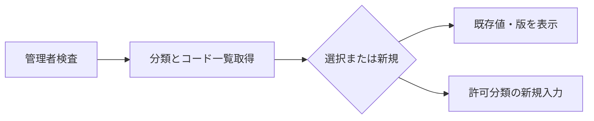
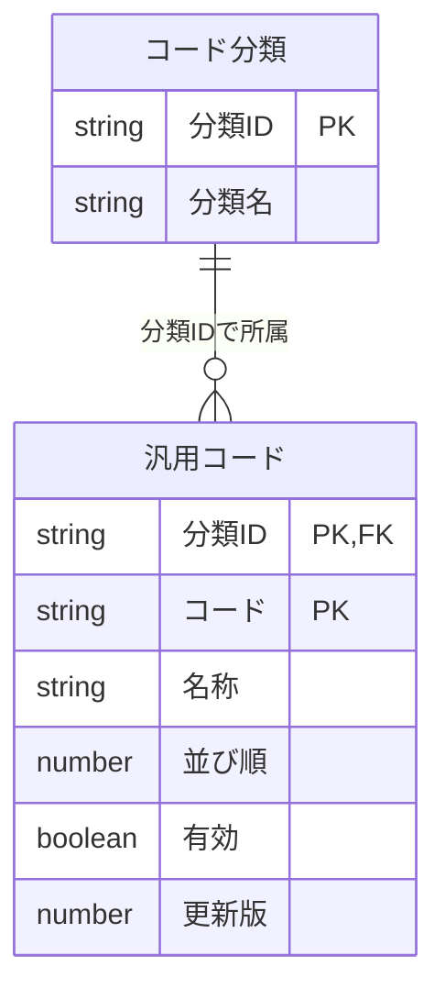
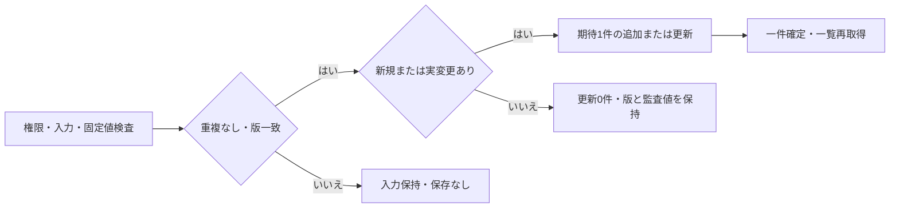
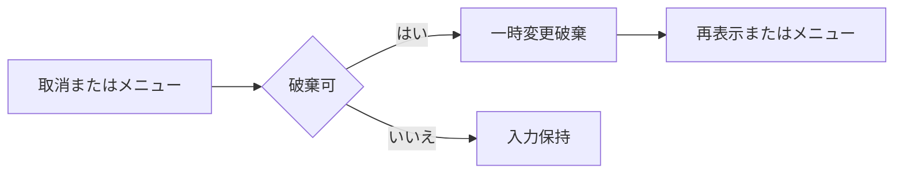
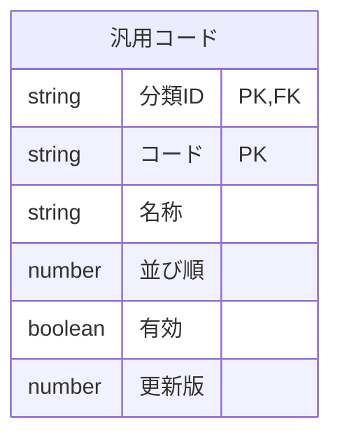

<!-- spec-meta: {"schema":"spec-md/1.0","documentId":"SP2-CSharp_ASPNET-DET-F06","version":"1.1","path":"sample-project2/spec/CSharp_ASPNET/詳細仕様書/06_汎用コードマスタ画面.md","sheets":[{"heading":"概要","kind":"GRID","sheet":"01_概要"},{"heading":"項目一覧","kind":"LIST","sheet":"02_項目一覧","key":["項目ID"]},{"heading":"イベント仕様","kind":"GRID","sheet":"03_イベント仕様"},{"heading":"補足説明","kind":"GRID","sheet":"04_補足説明"}],"isolationProfile":"CSharp_ASPNET","featureId":"F06"} -->
# 汎用コードマスタ画面 詳細仕様書

| 項目 | 内容 |
| --- | --- |
| projectId / methodId | sample-project2 / CSharp_ASPNET |
| 機能ID / 文書版 | F06 / 1.1 |
| 作成日・工程 | 2026-10-29 / detail-design / canonical-update |
| 対象読者・状態 | 経験5年程度の実装者。設計採用・利用者承認/実装/試験未実施 |
| 原基本設計SHA-256 | 53900d15e9a0b371e2183cb06c402d3d547ab386ed85e0a723c37d3348c734ae |

## 概要

### 目的と入出力

[メニュー](02_メニュー画面.md)から管理者だけが起動し、社員・経歴の選択候補を保守する。利用者要求の「範囲用コードマスタ」を汎用コードマスタとして具体化した。分類はDEPARTMENT（部署）、EMPLOYMENT_STATUS（在籍区分）、PROJECT_ROLE（案件役割）の固定3種類とし、分類の追加・名称変更・削除は設けない。

部署と役割はコード追加・名称変更・並び順変更・停止／再開を行う。既存キーの変更・物理削除はしない。在籍区分の01在職・02休職・03退職は意味を固定し、追加・名称変更・並び順変更・有効性変更をすべて禁止し、完全な参照専用とする。

永続DBはコード分類と汎用コードを参照し、一度の保存でコード一件だけを追加・更新する。入力・選択・読込時の版は一時情報。社員・経歴の保存値を書き換えず、外部ファイル入出力もない。

### 画面設計

WEB/BROWSER、SETTINGS＋MASTER_DETAIL。主P13_SETTINGS、補助P05_MASTER_DETAIL/P00_APP_SHELL。共通サイト枠と独立した分類/一覧/編集の見出しを使い、左にコード一覧min260px、右に選択した一件min340px、幅不足は上下配置にする。分類180px、コード/並び順110px、名称340px、入力16px/表・操作14px相当・最小高40pxを共通UIへ対応させる。一覧の名称ボタンで対象を選び、編集欄に分類・コード・名称を明示する。新規はページ主操作。保存は現在のコード1件、取消はその未保存入力だけと文言で区別する。

<!-- screen-html-start: F06 -->

  <header class="header"><a class="brand" href="#F02">社員経歴管理</a>
デモ管理者 ／ ADMIN<button type="button" data-action-id="F02-E02">ログアウト</button>
</header>
  
<nav class="nav" aria-label="サイトメニュー">

サイトメニュー

業務
<a href="#F02" data-item-id="F06-I11">業務の入口</a><a href="#F03">社員検索</a><a href="#F06" aria-current="page">汎用コードマスタ</a>
</nav>
  <main class="main">
汎用コードマスタ

<h1>汎用コードマスタ</h1>
部署・案件役割の選択候補を管理します。

<button type="button" class="primary" data-item-id="F06-I08" data-action-id="F06-E01">新規コード</button>
<section class="panel"><h2>コード分類</h2><label class="field">分類<select class="code" data-item-id="F06-I01"><option>部署</option><option>在籍区分</option><option>案件役割</option></select></label>
在籍区分の3値は参照専用です。
</section>
    
<section class="panel"><h2>コード一覧</h2>
部署 ／ 全3件・並び順→コード順

<table><colgroup><col style="width:72px"><col><col style="width:72px"><col style="width:72px"></colgroup><thead><tr><th scope="col">コード</th><th scope="col">名称・選択</th><th scope="col">順序</th><th scope="col">状態</th></tr></thead><tbody><tr class="selected"><td>01</td><td><button type="button" aria-pressed="true" style="min-width:0;padding:8px">開発</button></td><td>1</td><td>有効</td></tr><tr><td>02</td><td><button type="button" aria-pressed="false" style="min-width:0;padding:8px">基盤</button></td><td>2</td><td>有効</td></tr><tr><td>03</td><td><button type="button" aria-pressed="false" style="min-width:0;padding:8px">管理</button></td><td>3</td><td>有効</td></tr></tbody></table>
</section>
    <section class="panel"><h2>選択したコードの編集</h2>
編集中：部署 ／ 01 開発
<form>
<label class="field">コード 必須<input class="no" value="01" readonly data-item-id="F06-I03">既存キーは変更できません。</label><label class="field">並び順 必須<input class="no" value="1" data-item-id="F06-I05">整数1～999</label>
<label class="field space">名称 必須<input style="width:340px" value="開発" data-item-id="F06-I04" data-max-scalars="40"></label><label class="space" style="display:flex;gap:8px;align-items:center"><input type="checkbox" checked data-item-id="F06-I06">有効</label>
外すと新規選択を停止します。登録済み社員・経歴の値は保持されます。

<button type="button" class="primary" data-item-id="F06-I09" data-action-id="F06-E02">このコードを保存</button><button type="button" data-item-id="F06-I10" data-action-id="F06-E03">変更を取り消す</button>
</form></section>

保存対象は現在編集中のコード1件です。

  </main>

設計確認用：未選択・在籍区分・失敗

SETTINGS/P13_SETTINGS＋P05_MASTER_DETAIL＋P00。分類とコードの選択を編集欄へ一致させます。物理削除や分類追加は行いません。

<strong>コードを選択してください。</strong>
未選択の編集欄と保存/取消は無効です。部署/役割では新規から開始できます。

<strong>在籍区分は参照専用です。</strong>
01在職・02休職・03退職の名称・順序・有効性は変更できません。

<strong>保存できませんでした。</strong>
コードの入力を保持しています。別の対象へ勝手に移りません。

<!-- screen-html-end: F06 -->

新規時はコードを入力可能にし、既存時は読取専用。分類は選択必須で初期値は部署。新規名称は空、並び順は1、有効は選択済み。未選択時の編集欄は無効とする。在籍区分では新規ボタンを無効、名称・並び順・有効性を読取専用にし、保存ボタンを無効にする。処理中は全変更を無効にし、失敗時は入力を保持する。本文のTab順は新規→分類→一覧の名称選択（行順）→コード→並び順→名称→有効→保存→取消。共通ナビは本文より前の自然なDOM順とし、正のtabindexで迂回しない。読取専用コードも通常のTab対象に残し、キーボードで選択・全文確認・コピー可能とする。参照専用の在籍区分も値の確認/コピーへ到達させ、変更実行だけを無効にする。40文字の名称は欄内横移動で全文に到達できる。

### 詳細の適用と実装表示

基本F06の現行版/同一HTMLを採用し、原基本設計SHA欄と今回manifestで入力を固定する。物理型/HTTP/状態は[方式別共通](../共通/方式別/01_共通実装仕様.md)、業務保存/列/SQLは[DB定義](../DB定義/SQLServer/01_DB定義書.md)、採用は[詳細QA](../詳細設計QA.md)へ対応する。静的HTMLは基本と同じ断片で、画面の別正本/製品実行の根拠にしない。

### UI状態・実部品・キー契約

SETTINGS＋MASTER_DETAIL/主P13_SETTINGS・補P05_MASTER_DETAIL/P00_APP_SHELL。I01は固定分類select、I02はtable＋名称buttonで複合キー選択、I03～06はCodeRaw、I08 new、I09 current-code save、I10 cancel（いずれもbutton）、I11は/menuのa。未選択は編集/保存なし。在籍分類は全参照専用、readonly値は通常Tab/コピーへ残し実行だけdisabled。I10/分類/行変更/ナビは現在rawを先に捕捉してdirty判断し、選択と編集対象の分類/コード/名称を一致させる。DUI-01/02/08/09/10。

## 項目一覧

| 項目ID | 項目グループ | 項目名 | コントロール | 必須 | 入力制限 | フォーマット | 初期値 | DBテーブル名 | DB項目名 | 備考 | 物理部品・バインド | C#型 | raw上限 | 正規化・保存上限 | 長さ単位 | 未設定・NULL | 物理DB列・型 |
| --- | --- | --- | --- | --- | --- | --- | --- | --- | --- | --- | --- | --- | --- | --- | --- | --- | --- |
| F06-I01 | コード分類 | 分類 | Select（select） | 〇 | 選択のみ | 分類名表示／分類ID保持 | DEPARTMENT | コード分類 汎用コード | コード分類：分類ID・分類名 汎用コード：分類ID | 固定3分類を部署→在籍区分→案件役割の順で表示。分類IDは半角英大文字・下線24字以内。分類の並び順列なし。 | CodeOpenInput.Category | string | 固定24字以内 | 保存時キー | ASCII英大文字/下線 | 不可 | m_code_category.category_id / m_code.category_id varchar(24) |
| F06-I02 | コード一覧 | コード一覧 | Table・Button | - | - | コード2桁・先頭ゼロ／有効は〇・空欄 | 部署一覧 | 汎用コード | コード・名称・並び順・有効 | 分類当たり最大99行。1件選択、初回は選択なし。停止も表示。並び順→コード昇順。 | CodeVm.Rows/SelectedCode | IReadOnlyList<CodeRow>/string? | 入力は選択2桁 | 分類0～99件 | 件 | 未選択null | dbo.m_code全8列、分類で抽出 |
| F06-I03 | コード情報 | コード | TextBox（input） | 〇 | 半角数字2桁（01～99）・新規のみ | 先頭ゼロ保持 | 空 | 汎用コード | 分類ID・コード | 分類内で一意。既存キー変更不可。 | CodeSaveInput.Code | string | 2桁 | 01～99 | ASCII数字 | 不可 | dbo.m_code.code char(2) NOT NULL |
| F06-I04 | コード情報 | 名称 | TextBox（input） | 〇 | 40字・在籍区分変更不可 | - | 空 | 汎用コード | 名称 | 前後空白除去。空白だけは不可。 | CodeSaveInput.Name | string | 40 | 40 | Unicodeスカラー値 | 不可 | dbo.m_code.code_name nvarchar(80) NOT NULL |
| F06-I05 | コード情報 | 並び順 | TextBox（input） | 〇 | 整数1～999・3桁以内・在籍区分変更不可 | - | 1 | 汎用コード | 並び順 | 同順位可、コード順で決定。 | CodeSaveInput.SortOrderRaw → short | string → short | 3桁 | 1～999 | ASCII整数 | 不可 | dbo.m_code.sort_order smallint NOT NULL |
| F06-I06 | コード情報 | 有効 | CheckBox（input type=checkbox） | 〇 | 在籍区分変更不可 | 〇／空欄 | 〇 | 汎用コード | 有効 | 在籍区分は〇固定。部署・役割は停止／再開可。製品はチェック操作、一覧は〇表示。 | CodeSaveInput.Enabled | bool | true/false明示 | true/false | 真偽 | 不可。欠落をfalse化しない | dbo.m_code.is_enabled bit NOT NULL |
| F06-I07 | 案内 | 使用上の注意 | Label | - | - | - | - | - | - | 停止しても保存済み業務データを置換しない。 | CodeVm.Note | string | 入力なし | 固定の注意文 | Unicode文字列 | 不可 | 永続列なし |
| F06-I08 | 操作 | 新規コード | Button | - | - | - | - | - | - | 部署・役割のみ有効。入力中は破棄確認。 | button[F06-I08] → CodeController.Open New=true POST /codes/open | 非適用（submit操作） | 非適用 | 保存なし | 非適用 | 非適用 | 永続列なし |
| F06-I09 | 操作 | このコードを保存 | Button | - | - | - | - | 汎用コード | 分類ID・コード・名称・並び順・有効・更新日時・更新者・更新版 | 未選択時・在籍区分は無効。部署・役割1件の追加／更新を確定。 | button[F06-I09] → CodeController.Save POST /codes/save | 非適用（submit操作） | 非適用 | 保存なし | 非適用 | 非適用 | 永続列なし |
| F06-I10 | 操作 | 変更を取り消す | Button | - | - | - | - | - | - | 1件編集中のみ有効。未保存変更は破棄確認。 | button[F06-I10] → CodeController.Cancel ReturnToMenu=false POST /codes/cancel | 非適用（submit操作） | 非適用 | 保存なし | 非適用 | 非適用 | 永続列なし |
| F06-I11 | 操作 | 業務の入口 | Link（a） | - | - | - | - | - | - | 変更中は破棄確認。 | a[F06-I11] → CodeController.Cancel ReturnToMenu=true POST /codes/cancel | 非適用（submit操作） | 非適用 | 保存なし | 非適用 | 非適用 | 永続列なし |
| F06-I12 | 案内 | メッセージ | Label | - | - | - | - | - | - | キー固定・競合・検査・保存結果。 | CodeVm.Outcome.Message | string? | 入力なし | 日本語MSG表示 | Unicode文字列 | メッセージなしnull | 永続列なし |

## イベント仕様

### F06-E01 初期表示・分類変更・コード選択・新規

#### 処理概要

管理者権限を確認し、分類の全コードを一覧に読み込んで一件を編集する。

##### 詳細実装契約

CodeController.Index/OpenはADMINポリシーとCurrentUserServiceで現在権限を検査し、固定3分類/選択分類一覧/1行編集又は新規をCodeStateへ設定する。

#### 処理手順

1. **認可・初期前提の確認**
   1. 認証状態・期限と現在のADMIN役割を確認する。STAFFの直接起動はMSG-003で終了し、コード一覧を返さない。失効はMSG-002とする。
   2. 初回は固定3分類を取得し部署を選択する。未知分類・固定3分類不足・在籍3値の改変はMSG-020で編集開始を止める。

2. **切替確認・一覧と選択値の取得**
   1. 分類変更・別コード選択・新規開始の前に、正規化後の編集値と読込原本の差分を確認する。変更ありならMSG-015の「はい」で破棄後に続行、「いいえ」又は確認取消で元の分類・選択・入力を保持する。
   2. 選択分類の全コードを有効/停止とも取得し、並び順→コード昇順で表示する。100件以上、キー重複、コード01～99外等の構造不正はMSG-020で止め、99件に切り詰めない。初回は未選択とし編集欄を無効にする。
   3. 行選択は分類ID・コードで現在値と版を1件取得し、読込キー・版・名称/並び順/有効を原本として保持する。存在しない行はMSG-016で一覧を再取得し、自動的に新規へ切り替えない。

3. **新規・固定コードの状態設定**
   1. 新規はDEPARTMENT/PROJECT_ROLEだけ許可する。分類は選択値に固定し、コード/名称は空、並び順1、有効〇とする。分類内99件なら新規ボタンを無効にする。処理側への新規開始要求も入力値を受け取る前にMSG-024で拒否する。
   2. EMPLOYMENT_STATUSは全欄参照専用、新規と保存は無効とする。直接要求でもMSG-023で拒否する。コード分類自身の追加・変更・削除は設けない。

##### 判定と復帰の対応

| 判定ID・参照 | このイベントでの判定 | 結果・メッセージ・復帰 |
| --- | --- | --- |
| CHK-F06-01を再利用 | 現在の認証と有効なADMIN役割 | MSG-002/003。コード一覧を返さず終了 |
| CHK-F06-13 | 固定3分類/固定在籍3値が正常で、一覧は99件以下・コード01～99・キー一意か | 欠落/改変/100件以上/キー不正はMSG-020。切捨てや仮値補完なし、編集開始停止 |
| CHK-F06-14 | 分類/コード選択/新規開始の前に正規化後の未保存差分があるか | 差分なしは切替、ありはMSG-015。はいで破棄後切替、いいえ/確認取消は元の分類/選択/入力を維持 |
| CHK-F06-15 | 選択行を複合キーで1件取得でき、全値と版を読込原本に保持できたか | 0件MSG-016で一覧再取得、複数件MSG-020、取得失敗MSG-040。古い値を最新版とせず新規へ自動切替しない |
| CHK-F06-02、CHK-F06-07を再利用 | 新規開始の分類が編集可能で、現在一覧が99件未満か | 在籍はMSG-023、99件は新規ボタン無効/直接開始要求MSG-024。開始可ならコード/名称空・並び順1・有効〇。保存時は別に形式/重複を検査 |

##### 詳細実装契約

1. **分類・一覧の読取**
   1. Shared/Serializableで現ADMIN、固定3分類、在籍3値の内容/有効性を確認する。不正な分類文字列をSQL識別子として使わない。
   2. @categoryでm_codeを停止含めsort_order/code昇順で取得し、0～99件を表示。100件/固定値改変はMSG-020。初期はDEPARTMENT/未選択。
2. **選択と新規**
   1. 未保存切替はMSG-015、Noなら元分類/行と入力保持。選択行の複合キーと版をサーバーSnapshotへ保存する。
   2. NewはDEPARTMENT/PROJECT_ROLEのみ、未使用01～99を利用者入力、名称空/順1/有効true。99件ならMSG-024で新規開始不可。既存在籍は参照のみ。

#### 処理フロー

##### 詳細実装契約

ADMIN現在認可 → 固定分類/在籍検査 → 分類一覧 → 選択/新規 → CodeVm。無権限はコード値を返さない。

#### SQL・テーブル関連（ER図）

汎用コードは（分類ID・コード）の複合主キー、コード分類への参照は分類IDである。図のキーは論理設計で、物理FKの構文は後工程で定める。社員・社員経歴は参照先コードを使用する側だが、本保守でそれらの行を読込・置換・削除しない。

##### 詳細実装契約

dbo.m_code.category_id FK→dbo.m_code_category.category_id PK。コードは(category_id,code)複合PK。名称表示は固定分類をWHEREで照合し、別分類の同コードを混ぜない。

#### DB操作の詳細

| 操作 | 条件・取得内容 | 件数・順序・確定 |
| --- | --- | --- |
| 認証確認 | 利用者ID=認証主体の利用可能・利用者役割 | 有効なADMIN1件が必要。業務書込み0件 |
| 分類取得 | コード分類のDEPARTMENT・EMPLOYMENT_STATUS・PROJECT_ROLE。分類ID・分類名 | 固定3件。部署→在籍区分→案件役割の固定順、分類の並び順列なし |
| 一覧取得 | 汎用コード.分類ID=選択分類。コード・名称・並び順・有効・更新版を取得、停止も含む | 0～99件、並び順→コード昇順。0件は空一覧、100件以上はMSG-020 |
| 選択行取得 | 汎用コードの分類ID・コード=選択キー。全8項目取得 | 1件。0件はMSG-016、複数件はMSG-020。読込原本と版を保持 |

分類と一覧を整合する読取単位で取得し、失敗時に空の新規入力へ切り替えない。社員・社員経歴は読取/更新しない。本イベントの追加・更新・削除は0件。

##### 詳細実装契約

SELECT category_id,category_name FROM dbo.m_code_category; 固定3件。SELECT category_id,code,code_name,sort_order,is_enabled,updated_at,updated_by,revision FROM dbo.m_code WHERE category_id=@category ORDER BY sort_order,code; @category varchar24固定許可表、0～99。既存選択は@code char2で1件、DML0。

#### 結果・例外時の扱い

権限違反MSG-003、認証失効MSG-002、固定コード操作MSG-023、構造不整合MSG-020、取得失敗MSG-040を区別する。分類や行変更の確認取消では旧選択・入力を保持する。

一覧の有効欄は〇/空欄、編集は標準CheckBoxで扱う。DBの真偽値を〇という文字列へ変更しない。取得済みの版が古くなっても表示時に自動保存せず、F06-E02で再確認する。

##### 詳細実装契約

MSG-003権限、MSG-020保存不整合、MSG-024『コードは分類ごとに99件までです。』、MSG-040読込障害。名称同一/表示順同一は不整合へ格上げせず許容する。

### F06-E02 コード保存

#### 処理概要

一件のコードを検査し、新規追加または版一致の更新を確定する。

##### 詳細実装契約

CodeService.SaveAsync(actor,CodeSnapshot,CodeDraft)は現在ADMINと固定在籍保護/複合キー/件数/版を同じExclusive Txで検査して1行だけ確定する。

#### 処理手順

1. **受付・入力と停止確認**
   1. 保存を1回だけ受け付け、編集・二重保存・遷移を無効にする。処理中の後続要求はMSG-029、保存結果確認待ちはMSG-034で実行しない。
   2. 認証・ADMINと許可分類を確認する。在籍区分は無変更要求でもMSG-023、未知分類・既存キー改変はMSG-005で拒否する。コード01～99、名称、並び順、有効状態を下表で検査する。
   3. 既存値が有効で、保存予定が停止のときだけMSG-038を表示する。「はい」で続行、「いいえ」又は確認取消で一切保存せず入力を保持する。確認待ち中はDB排他を保持しない。新規停止値の登録・停止継続・再開は停止確認の対象外とする。

2. **排他・現在値と差分の確認**
   1. 同一排他/トランザクション内で利用者有効性・ADMIN・分類存在を再確認する。新規保存は入力形式を検査した後、複合キー重複、追加後99件以下の順に確認する。コード100/00はMSG-005、登録済みキーはMSG-022を先に返す。既存は現在行1件・キー一致・現在版=読込版を確認する。停止確認中に変わった版も拒否する。
   2. 版一致後に正規化した名称・整数の並び順・真偽の有効を比較する。全無変更は書込み処理を省略し、版・監査値を保持してMSG-021を表示し一覧を再取得する。名称の他コードとの重複、並び順同値は許容する。

3. **保存・確定と復帰**
   1. 新規は版1、実変更は現在版+1で、コード1件と更新日時/更新者を同じ確定単位で設定する。現在版2147483647で実変更がある場合はMSG-039で止める。期待1件と異なる場合は全取消する。
   2. 社員保存との競合境界を維持して確定する。コード停止を先に確定した場合、後続の社員新規割当はMSG-016で拒否される。社員割当を先に確定した場合は既存参照として保持し、停止後も名称を表示する。
   3. 確定成功を確認してMSG-014を表示し、一覧を並び順→コード順で再取得して同じ複合キーを選ぶ。成否不明ならMSG-034で再保存を止め、再読込みにより有無・現在値・版を確認する。

##### 保存チェック

| チェックID | 検査対象・成立条件 | 不成立時・復帰 |
| --- | --- | --- |
| CHK-F06-01 | 認証期限内、現在利用者が有効なADMIN。開始時と確定単位内で確認 | MSG-002/003、業務書込み0件 |
| CHK-F06-02 | 分類はDEPARTMENT又はPROJECT_ROLE。EMPLOYMENT_STATUSへの書込みなし | 固定分類MSG-023、不明分類MSG-005 |
| CHK-F06-03 | コードは半角数字2桁01～99、既存は分類とコードが読込キーと一致 | MSG-005。キーを変更して別行更新しない |
| CHK-F06-04 | 名称は前後空白整理後に設定済みで40字以内。不正な制御文字なし | 空/空白のみMSG-004、形式/上限MSG-005、名称欄へ |
| CHK-F06-05 | 並び順は入力3桁以内の整数1～999。有効は真偽二値で、未送信とfalseを混同しない | MSG-005。対象欄へ戻す。DBへ〇文字列を保存しない |
| CHK-F06-06 | 新規の（分類ID・コード）が未登録。名称は同じでも可 | MSG-022。コード欄へ、他行を自動更新しない |
| CHK-F06-07 | 一覧99件なら新規開始不可。保存時も選択分類の有効/停止合計が追加後99件以下 | 新規開始要求はMSG-024。保存要求は形式MSG-005→重複MSG-022を先に判定し、残る件数超過はMSG-024 |
| CHK-F06-08 | 既存の現在行が1件、更新版=読込版で整数1～2147483647。無変更より先に検査 | 0件MSG-016、版差MSG-008、複数件/版範囲異常MSG-020 |
| CHK-F06-09 | 有効→停止に限りMSG-038承認済み、承認後も版一致 | 確認取消は入力保持、版差はMSG-008 |
| CHK-F06-10 | 実変更時の現在版が2147483647未満 | MSG-039。全無変更なら上限でもMSG-021 |
| CHK-F06-11 | 新規又は実変更の書込みが1件、分類/社員/経歴の書込みは0件 | MSG-020で全取消。部分確定なし |
| CHK-F06-12 | 排他取得待ちが10秒を超えず確定/取消の結果を識別できる | 待ち超過MSG-027、取消済み障害MSG-017、成否不明MSG-034 |

コード01～99の分類内一意により、正常な99件分類には合法な未使用キーは残らない。「100件目の合法コード」は設けない。外部fixtureで100件以上・範囲外・キー重複が読み込まれた場合はF06-E01でMSG-020にする。

新規で有効を外した登録も許容する。0件分類への初回登録、名称重複、同じ並び順、すべて停止した分類は、それだけで整合性エラーにしない。F04で新規選択できる候補の有無と、既存停止値を保持できる条件は別に扱う。

##### 詳細実装契約

1. **入力と停止確認**
   1. CSRF/所有StateRevision/CommitState、コード01～99、名称40スカラー、sort1～999、bool有効を検査する。既存在籍は値が同じでも保存要求をMSG-023で拒否する。
   2. 有効→停止はMSG-038『このコードを停止しますか。登録済みデータは保持され、新しい選択ができなくなります。』で明示確認、Noは入力保持。
2. **確定直前と差分**
   1. Exclusive applock10秒後、現在ADMIN、分類存在/固定値、複合キー/現在版、一意/分類99件を再検査する。既存キーはSnapshotと同値必須。
   2. 正規化後同値はMSG-021/DML0。実変更版上限MSG-039、参照先の停止でも既存社員/経歴を削除/置換しない。
3. **1行保存と結果**
   1. SQL-CODE-WRITEへ明示型パラメーターを渡し期待1件、成功commit後だけMSG-014/一覧再読取。更新者は認証actor、UTCは処理確定時点。
   2. commit不明MSG-034で再保存不可、取消確認済み障害MSG-017、確定後一覧障害はMSG-014＋040。全finallyで所有Busy/接続だけを解放する。

#### 処理フロー

##### 詳細実装契約

CodeSaveInput → raw/正規化/停止確認 → Exclusive Tx → 現ADMIN/固定保護/キー/版/件数 → 差分 → 1行DML → commit → 一覧。

#### SQL・テーブル関連（ER図）

汎用コードは（分類ID・コード）の複合主キー、コード分類への参照は分類IDである。図のキーは論理設計で、物理FKの構文は後工程で定める。社員・社員経歴は参照先コードを使用する側だが、本保守でそれらの行を読込・置換・削除しない。

##### 詳細実装契約

更新対象dbo.m_codeだけ、分類はm_code_category FK。利用者は現在認可の独立読取、社員/経歴は保存・連鎖変更しない。基本ERの参照先を物理名へ対応する。

#### DB操作の詳細

##### 更新判断と対象

保存直前に認証主体の有効性とADMIN役割を再確認し、分類ID・コード・読込版を操作対象のキーとする。許可分類はDEPARTMENTとPROJECT_ROLEだけで、EMPLOYMENT_STATUSは未変更の要求を含め保存操作を拒否し、書込み0件とする。新規の分類/コードは入力値を検査して固定し、既存では読込キーと異なる要求を拒否する。

| 操作区分 | 参照・更新条件 | 確定する内容 | 期待件数・確定/取消 |
| --- | --- | --- | --- |
| 新規追加 | 許可分類が存在し、（分類ID・コード）が未登録。コード01～99 | 汎用コード1行を下表の値で追加 | 追加1件だけ成功とする。重複/参照不足/障害なら追加0件、全取消 |
| 既存変更 | 許可分類、キー一致、現在の更新版=読込版、実変更あり | 名称・並び順・有効・更新日時・更新者・更新版だけを変更 | 更新1件で確定。0件は消失/競合、複数件は不整合として取消 |
| 既存無変更 | キー/現在版の一致確認後、名称・並び順・有効が保存済み値と同じ | 何も変更しない | 更新0件。版・日時・更新者も保持し、変更なしを案内 |
| 停止・再開 | 既存変更の条件を満たす。停止時は確認を承認済み | 当該行の有効と監査/版を変更。他の変更入力も同じ一件へ反映 | 更新1件で確定。確認取消/版競合なら0件。社員/社員経歴の更新・削除は0件 |
| 在籍区分・キー変更等の禁止要求 | 保護分類、未知分類、コード00、保存済みキーの変更 | 更新対象にしない | 追加/更新/削除0件で拒否。名称/順序/有効の一部だけも更新しない |

##### 項目別の設定値・保持値

| 対象テーブル | 項目名 | 移送元・設定値 | 新規・編集の扱い |
| --- | --- | --- | --- |
| 汎用コード | 分類ID | F06-I01 分類 | 新規だけ設定。コード分類.分類IDの存在を確認。編集は読込値を保持 |
| 汎用コード | コード | F06-I03 コード | 新規だけ設定。2桁先頭ゼロを保持。編集は読込値を保持 |
| 汎用コード | 名称 | F06-I04 名称 | 共通入力規則で前後空白を整えた40文字以内の必須値 |
| 汎用コード | 並び順 | F06-I05 並び順 | 1～999の検査済み整数。同順位を許容し、表示時にコード順で補完 |
| 汎用コード | 有効 | F06-I06 有効 | 有効/停止の二値。新規初期値は有効。既存参照を削除する意味ではない |
| 汎用コード | 更新日時 | 保存処理のUTC時点 | 新規/実変更時だけ設定。無変更は保持 |
| 汎用コード | 更新者 | 認証状態の内部利用者ID | 新規/実変更時だけ設定。画面入力やログインIDを代用しない。無変更は保持 |
| 汎用コード | 更新版 | 新規1、編集は保存済み版+1 | 実変更時だけ進める。2147483647到達時は無変更で停止 |

コード分類は存在確認と分類名取得の参照だけで、追加/更新/削除0件。汎用コードの物理削除、キー変更、社員/社員経歴のコード付替えや停止連動削除は行わない。名称変更後の検索/帳票は新しい現在名称を参照し、過去名称履歴は追加しない。

##### 確定と取消

一件の保存範囲内で分類存在・一意性または版一致を確認し、コード1行の追加/変更と監査・版を原子的に確定する。停止確認後にも現在版を再確認し、確認中の他更新を上書きしない。社員保存とコード停止の同時実行は共通の排他契約で直列化または競合検出し、無効な新規割当を通さない。

新規重複、実変更を要求した既存更新が0件となった場合、予想外の複数件、接続/更新障害では全体取消し、一覧を成功状態へ更新しない。現在版の一致と業務値の無変更を確認した更新0件は正常な完了であり、競合や取消として扱わない。入力を保持し、競合時の再読込は破棄確認を経る。確定が完了した場合だけ成功を知らせ、並び順→コード順で一覧を再取得して同じキーを選択する。取消・画面終了では未保存入力だけを破棄し、DBの保存済み行を変更しない。

##### 詳細実装契約

DB定義SQL-CODE-WRITE、@category varchar24、@code char2、@name nvarchar80、@sort smallint、@enabled bit、@utc datetime2(7)、@actor nvarchar40、@expected int。既存WHERE category_id/code/revision、期待1。新規前COUNT/複合キー一意を同じTxで検査し、SQL2601/2627はMSG-022。UPDATE0は対象/版を再検査してMSG-008/016、無変更0とは分ける。DELETEなし。

#### 結果・例外時の扱い

| 条件 | メッセージ・復帰・DB結果 |
| --- | --- |
| 保存確定成功 | MSG-014「保存しました。」。対象コード1件のみ確定 |
| 版一致で無変更 | MSG-021「変更はありません。」。全書込み0件、版・監査値維持 |
| 分類/コード重複 | MSG-022「この分類とコードは登録されています。」。入力保持、コード欄へ |
| 固定コードへの保存 | MSG-023「固定コードの追加・変更・停止はできません。」。書込み0件 |
| 99件で新規開始要求/確定時上限超過 | MSG-024「コードは分類ごとに99件までです。」。停止値も含む。保存要求の100/00はMSG-005、既存キーはMSG-022を先に返す |
| 版競合 | MSG-008。自動上書き・自動再試行なし、MSG-015承認後に現在値を再読込み |
| 停止確認拒否 | 更新0件。入力を保持して編集継続、成功表示なし |
| 排他待ち超過 | MSG-027。書込み開始なし、明示操作で再実行 |
| DB障害・全取消確認済み | MSG-017。対象行/監査値/版を一部だけ残さず入力保持 |
| 保存結果不明 | MSG-034。自動再保存禁止、入力を保持。MSG-015承認後に複合キーで再取得して内容・版を確認 |
| 確定後の一覧再取得だけ失敗 | MSG-014で保存済みを明示し、MSG-040で一覧再取得失敗を別に案内。追加/更新を再送しない |

エラー内容は[共通メッセージ](../共通/04_チェック・メッセージ設計.md)の文言を用いる。社員・経歴の参照値を書き換える回復処理は行わない。成功・取消・失敗の全経路でDB資源を解放する。

##### 詳細実装契約

MSG-022『この分類とコードは登録されています。』、023『固定コードの追加・変更・停止はできません。』、024分類上限、008版、039上限。入力不備は原入力/名称又はコードへ戻し、社員/経歴を変更しない。MSG-034/017/027/040の区別は共通05と同じ。

### F06-E03 取消・メニューへ戻る

#### 処理概要

一件の未保存変更を破棄するか、保守を終えてメニューへ戻る。

##### 詳細実装契約

POST /codes/cancelは現在ADMINを確認し、未保存コード1行の破棄確認後に複合キーの最新版を再取得して新原本へ置換する。通常Menuは所有Stateを終了する。保存処理を暗黙実行しない。

#### 処理手順

1. **操作状態・破棄確認**
   1. 保存処理中はMSG-029で取消・遷移を受け付けない。結果確認待ちはMSG-034を再表示し、再読込みを選んだ場合だけ次へ進む。
   2. 未保存差分があればMSG-015を表示する。「いいえ」又は確認取消は分類・選択・値・フォーカスを保持する。「はい」なら未保存入力だけを破棄する。

2. **現在値の確認・復帰**
   1. 既存行の取消/結果確認は、現在の認証・ADMINを確認した後、読込時の分類ID・コードで現在値と版を1件再取得する。最新値を新しい原本に置き換える。旧入力を自動で再適用しない。
   2. 新規入力の通常取消は一時状態を破棄して未選択へ戻す。新規保存結果が不明だった場合は、保存要求した複合キーで有無・内容・版を再取得して結果を確認し、その後に新たな操作を開始する。
   3. メニュー操作は一時状態を破棄してF02へ戻る。新規取消とメニュー遷移自体では業務DBを書き換えない。

##### 判定と復帰の対応

| 判定ID・参照 | このイベントでの判定 | 結果・メッセージ・復帰 |
| --- | --- | --- |
| CHK-F06-16 | 保存処理中又は結果確認待ちか | 保存中MSG-029で取消/遷移不可。結果確認待ちはMSG-034を示し、破棄確認後の再読込みだけへ進む |
| CHK-F06-14を再利用 | 取消・メニュー・再読込み前に未保存差分があるか | MSG-015。いいえ/確認取消は入力保持、はいで未保存分だけ破棄。新規取消/メニューは業務DB参照0件 |
| CHK-F06-01を再利用 | 現在値再取得の前に認証期限・利用者有効・ADMINを確認 | MSG-002/003。未保存を自動保存しない |
| CHK-F06-17 | 通常の既存取消/再読込みで複合キーの現在値を1件取得できたか | 0件MSG-016で選択解除、複数件MSG-020で停止、取得失敗MSG-040で保存無効。成功時に現在値/版を新しい原本とし旧入力を再適用しない |
| CHK-F06-18 | 新規保存結果不明の再取得で要求キーが0件/1件/複数件のどれか | 0件は現在未登録、1件は現在内容/版を利用者確認。複数件MSG-020、取得失敗MSG-040。保存主体/成否を内容一致だけで断定せず、自動再追加しない |

##### 詳細実装契約

1. **取消の確認**
   1. RawUiEnvelopeで未送信の現在コードrawを無検証捕捉して差分を判定し、未保存差分ならMSG-015。Noはコード値/分類/選択を保持し元欄へ。保存処理中はMSG-029で取消/遷移不可、CommitState=UnknownならMSG-034を示し、通常Cancel/MenuによるState破棄を許可せず破棄確認後の明示再読込だけを許可する。
   2. 新規取消は未選択一覧へ。通常の既存取消/明示再読込は現在ADMINを確認して複合キーで現在値1件を取得し、新しい版/Snapshotへ置換する。旧入力は再適用しない。停止確認の取消でis_enabledをDBへ書かない。
2. **遷移と再開**
   1. 通常Menuは破棄確認後CodeStateを破棄して/menuへ。Unknown状態ではMenuに進まず明示再読込だけに制限する。認証切れは未保存を自動保存せずログインへ。
   2. commit不明からの再読込は分類/コードで現在値/版を照合して新しいSnapshotを発行し、自動再送しない。

#### 処理フロー

##### 詳細実装契約

保存中は拒否、Unknownは明示再読込だけ。通常Cancel/Menu → 現ADMIN/Dirty確認 → No保持 / Yes現在1行再読取又はMenu。

#### SQL・テーブル関連（ER図）

再取得は汎用コードの複合主キー（分類ID・コード）で最大1件を読む。単表読取でJOINはない。新規の通常取消・メニュー遷移だけなら業務DB参照はない。

##### 詳細実装契約

取消自体はDB0。明示再読込はdbo.m_code単表、複合PKで0/1件のためER追加なし。

#### DB操作の詳細

既存取消/再読込みは、汎用コードの分類ID・コード=元の選択キーで全8項目を1件取得する。0件なら選択解除しMSG-016、複数件ならMSG-020で編集を止める。取得失敗ならMSG-040とし、古い値を最新版と表示せず保存を無効にする。

新規の保存結果確認は同じ複合キーで0～1件取得する。1件なら要求内容・現在内容・更新版を利用者が確認し、0件なら現在未登録であることを確認する。他操作による変更もあり得るため、内容一致だけで過去の確定主体まで断定しない。追加・更新・削除はいずれも0件。通常の新規取消・メニュー遷移は業務参照0件。

##### 詳細実装契約

SELECT code_name,sort_order,is_enabled,revision FROM dbo.m_code WHERE category_id=@category AND code=@code; @category varchar24、@code char2、期待1/消失0。取消/メニューでUPDATE/DELETE/commitなし。

#### 結果・例外時の扱い

破棄確認を拒否した場合は編集を継続する。既存コードが見つからなくても同じキーを自動再追加しない。認証失効はMSG-002、ADMIN喪失はMSG-003で変更を保存せず終了する。

取消後の再取得成功は最新版表示であり、保存成功MSG-014を表示しない。結果不明後は再取得した内容を利用者が確認してから新たな編集を始める。強制終了時の未保存入力復元は保証しない。

##### 詳細実装契約

MSG-015のNoで入力を捨てない。再読込消失MSG-016は選択解除、複数件MSG-020は停止、取得障害MSG-040は保存無効。現在値1件を確認できた時だけ新原本/現在版へ置換してCanSaveを初期化する。

## 補足説明

原基本設計の業務条件/CHK/MSGと画面配置を保全し、各イベントの「詳細実装契約」に具体的な受渡し・SQL・型・期待件数・確定/取消を追加した。通常の文書内リンクは詳細機能、共通の業務原則は既存共通を参照する。画面HTML断片のコピーは配置の継承であり、基本設計の独自改訂ではない。

文字数はUnicodeスカラー値、nvarchar容量とC#/HTMLのUTF-16を区別する。Razorはrawを保持しRuneLength検証を行い、原入力の上限をmaxlength/StringLengthへ単純置換しない。元項目表の任意空欄は本表で意味を明示したが、業務必須/保存値/初期値は変えていない。定数分類と更新者はサーバーだけが設定する。

入力は[要件定義書](../要件定義書.md)1.0、[基本F06](../基本設計書/06_汎用コードマスタ画面.md)のspec-meta版1.5、[プロジェクト情報](../プロジェクト情報.md)/[QA](../QA.md)1.6。元F05のメタ版と表紙版の差は詳細QAに記録し、元ファイルは編集しない。

本工程は詳細設計文書の作成と文書確認のみ。アプリ実装・ビルド・実DB・Office/ブラウザー実機・実Excel/印刷・負荷/受入/正式採点は未実施。共通08のPILOT-P01～41は引き続き設計済み・実行未実施、formalScore=null。
