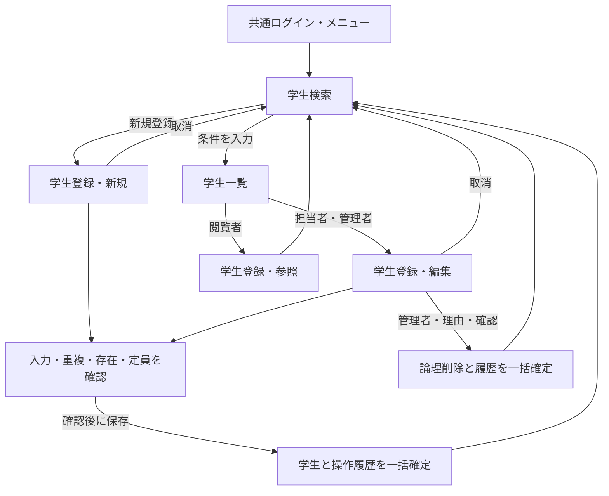

# システム概要・共通業務仕様

## 表紙

| 項目 | 内容 |
| --- | --- |
| 文書ID | COM-STU-001 |
| システム名 | 学生管理システム |
| 版数・作成日 | 2.0／2026-10-10 |
| 状態 | 新規設計案。既存実装の調査結果ではない |
| 対象読者 | 顧客、設計者、開発者、運用担当者 |

## 目的・範囲

学生の基本情報を一元管理し、必要な学生を検索して登録・訂正できるようにする。氏名、国内住所、生年月日、本人連絡先、緊急連絡先、在籍区分、現在／最終所属クラスを扱う。成績、科目、試験、出欠、学費は扱わない。

| 項目 | 本版の範囲 |
| --- | --- |
| 画面 | 学生検索、学生登録の2画面。登録画面は新規・編集・参照・管理者の論理削除を共用 |
| データ | 学生基本情報、クラスマスタ、コード種別マスタ、コード管理マスタ、操作履歴 |
| クラス所属 | 学生1人につき現在／最終所属を最大1件。年度別履歴・兼籍・異動予約は対象外 |
| 業務コード | 性別、在籍区分、都道府県、続柄、学年の5分類 |
| マスタ保守 | 管理者向け保守処理を設計。専用画面は新設しない |
| 認証 | 外部の共通認証・メニュー基盤を利用。ログイン画面・利用者マスタを新設しない |
| 学校 | 単一校。海外住所・複数校でのデータ分離は対象外 |
| 出力 | 今回の納品はMarkdown仕様書。実行アプリ、帳票・CSV・外部送信は含まない |

## 業務フロー・画面遷移

検索から画面を開く際に条件・並び順・表示件数・ページを引き継ぎ、戻ったときに最新データで再検索する。未検索から開いた場合は未検索に戻す。保存結果が検索条件外になっても、条件を無断変更しない。

## 権限

| 操作 | 閲覧者 | 担当者 | 管理者 |
| --- | --- | --- | --- |
| 検索・参照 | 可 | 可 | 可 |
| 新規・一般項目の編集 | 不可 | 可 | 可 |
| 在学・休学から別区分への変更 | 不可 | 可 | 可 |
| 卒業・退学から別区分への訂正 | 不可 | 不可 | 理由付きで可 |
| 論理削除 | 不可 | 不可 | 理由付きで可 |
| マスタ保守 | 不可 | 不可 | 可 |
| 削除復元・物理消去 | 本版対象外 | 本版対象外 | 別途運用設計 |

権限は画面のボタン表示だけでなく、各要求をサーバー側でも確認する。検索できる学校の学生全体が対象であり、本版には担当クラス別の閲覧制限を追加していない。追加する場合は一覧・個別取得・保存・候補表示すべてに同じ制限を適用する。

## 共通業務ルール

| 分類 | 規則 |
| --- | --- |
| 学籍番号 | 学校が付番済みの番号を入力。全角等を整えた後で一意。登録後不変、削除済み番号も再利用不可 |
| 同一人物候補 | 生年月日一致、氏名またはカナの照合値一致を警告。氏名の一意制約ではなく別人確認・理由付きで登録可 |
| 年度 | 4月1日～翌年3月31日。所属年度は入学年度から推定しない |
| 在籍 | 入学・卒業・退学は実績。本日以前の日付のみ。日付の到来で区分を自動変更しない |
| 定員 | 未削除の在学・休学を人数に含める。席を増やす保存直前に再集計 |
| 既存値 | 停止コードや期間外の所属を理由に、無関係な住所訂正等を妨げない。新規選択の有効性とは別判定 |
| 削除 | 論理削除を通常操作とし、卒業・退学とは区別。通常検索・個別参照から除外 |
| 保存 | 学生またはマスタの変更と操作履歴を同じ単位で確定・取消 |
| 未変更 | 正規化後に業務値が同一なら更新日時・版・履歴を増やさない |
| 競合 | 他者変更を上書きしない。入力を保持して最新情報確認を案内 |

## 非機能要件・導入時確認

以下の数値は検証用の設計目標であり、顧客確約済みの性能・運用条件ではない。

| 項目 | 本版の設計 |
| --- | --- |
| 検索上限 | 10,000件。10,001件で上限超過を判定。表示件数20・50・100 |
| 性能評価条件案 | 学生10万件、同時利用20人で評価。代表検索3秒以内、通常保存2秒以内を目標とし実測する |
| 画面 | PCブラウザーを主対象。幅1280px以上を標準、狭い画面は入力1列化、一覧は領域内横スクロール |
| 日時 | 時点はUTC保存、日本時間表示。業務日は要求開始時に日本時間から確定 |
| 文字 | 日本語を含むUnicode。保存長はUnicodeコードポイント数で判定 |
| 検索状態 | 利用者・ログイン状態・タブ単位、最終利用から30分 |
| 警告確認 | 利用者・対象・内容・候補に紐付けた10分間の確認情報 |
| 通信 | HTTPS。氏名・電話をURLへ出さず、個人情報画面はキャッシュしない |
| 入力保護 | パラメーター化した問い合わせ、出力エスケープ、要求偽造対策、過大入力拒否 |
| 操作履歴 | 確定した変更の対象・変更項目・実行者・理由・版を追記。個人情報の値を丸ごと複写しない |
| 障害ログ | 受付番号、処理名、例外分類。氏名・住所・電話・メール・トークン・要求本文は記録しない |
| バックアップ | 暗号化・アクセス制限・復元試験を必要とする。頻度、保管期間、復旧目標は学校側と運用設計で確定 |
| 削除運用 | 個人情報の保持期限・消去手順・バックアップ世代からの消去方針は未指定。本番稼働前の確認事項 |

## 技術構成の位置付け

今回接続した保存先は空のリポジトリで、既存の言語・DB・アプリ構成を確認できなかった。このため詳細仕様の基準実装案を、C#／ASP.NET Core MVC・Razor／.NET 10、PostgreSQL 18、Npgsqlによるパラメーター化SQL、ブラウザーの標準JavaScriptとする。業務上の顧客要求ではなく、今回追加した設計判断である。技術変更時は詳細仕様と試験を更新し、基本設計の業務規則は維持する。

評価用の基準はWebサーバー1台とサーバー内一時状態管理。複数台への展開では一時状態と暗号鍵を共有する基盤が必要であり、単一ノード向けの状態管理をそのまま多重化しない。認証基盤の具体製品や実クラス情報は未指定。詳細なアダプター契約は詳細仕様に定義する。

## 文書・導入手順

顧客が範囲・必須項目・状態変更・削除運用を確認し、開発者が詳細仕様に従って実装する。コード分類5件、コード値70件を投入し、学校の確認済みクラスを登録してから学生を登録する。架空の学生・クラスはテスト環境だけで使用する。実装・試験・本番投入が済んだという記載は本仕様書には含めない。

関連：[設計書一覧](00_設計書一覧.md)／[設計判断](06_要件対応・設計判断.md)
