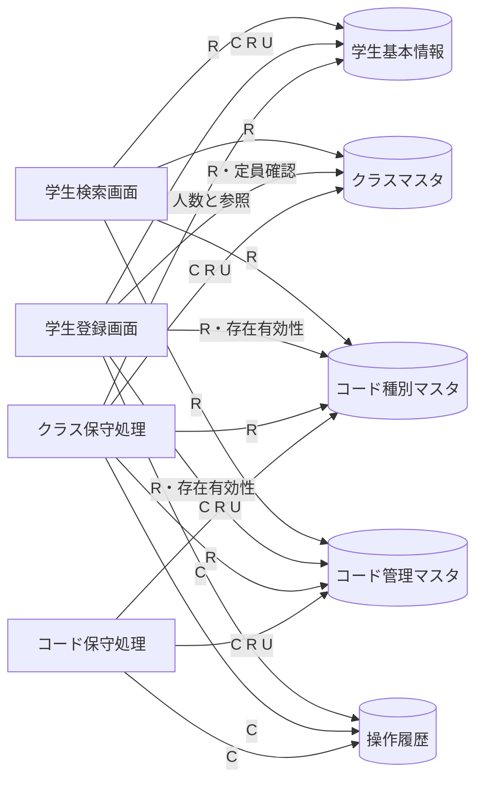
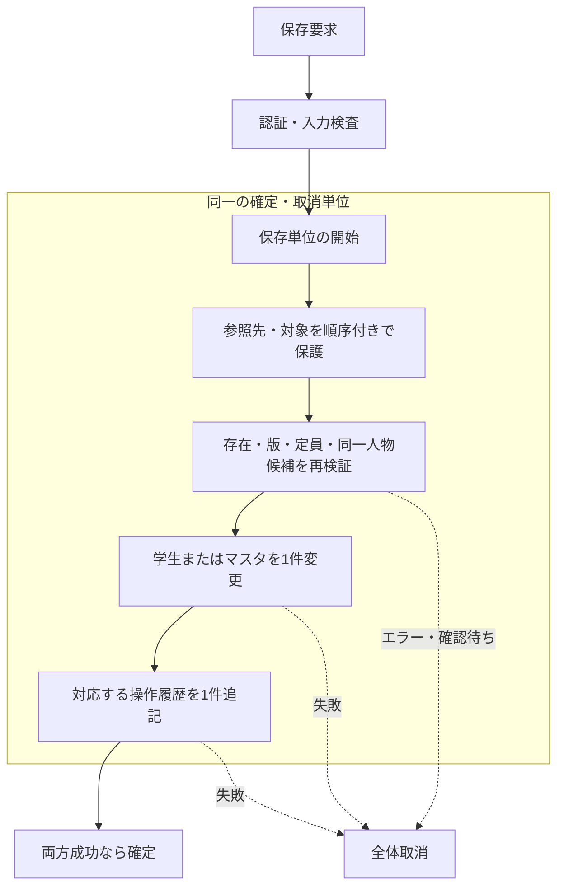

# CRUD図・データ操作一覧

| 項目 | 内容 |
| --- | --- |
| 文書ID | COM-STU-002 |
| 版数・作成日 | 2.0／2026-10-10 |
| 目的 | 画面・共通処理がどの情報を参照・登録・変更するかを明確にする |

## 凡例

C＝新規登録、R＝参照、U＝変更、D＝物理削除、－＝操作なし。本版の通常処理にはDがない。学生の論理削除は削除状態を更新するためUとして記載する。ロックは参照・更新の同時実行制御であり、マスタの業務値変更を意味しない。

## 論理CRUD表

| 処理 | 学生基本情報 | クラスマスタ | コード種別マスタ | コード管理マスタ | 操作履歴 |
| --- | --- | --- | --- | --- | --- |
| 検索画面の初期表示 | － | R | R | R | － |
| 学生検索・並び替え・ページ移動 | R | R | R | R | － |
| 検索条件のクラス候補更新 | － | R | R | R | － |
| 登録画面の新規表示 | － | R | R | R | － |
| 登録画面の編集・参照・再読込 | R | R | R | R | － |
| 所属人数の参考表示 | R | R | － | － | － |
| 学籍番号重複・同一人物候補の確認 | R | R | － | － | － |
| 学生新規登録 | C・R | R・保護 | R・保護 | R・保護 | C |
| 学生更新 | R・U | R・保護 | R・保護 | R・保護 | C |
| 学生論理削除 | R・U | R・保護 | － | － | C |
| 学生更新・変更なし | R | R・保護 | R・保護 | R・保護 | － |
| 編集取消・新規入力クリア | － | － | － | － | － |
| 登録画面から検索へ復帰（検索済み） | R | R | R | R | － |
| クラス登録・変更・停止・再開 | R・人数／参照確認 | C・R・U | R・保護 | R・保護 | C |
| コード種別の保守・初期投入 | － | － | C・R・U | R | C |
| コード値の保守・初期投入 | － | － | R・保護 | C・R・U | C |

コード保守は参照先実体を残し、既存値の意味を変更しない。したがって通常保守で学生やクラスを連鎖更新しない。元版の「参照影響の確認」は事前影響調査として別に行えるが、通常保存経路で学生の全件走査を必須にはしない。保護値・キー・意味変更は参照件数にかかわらず拒否する。クラスの学年変更は削除済みを含む学生参照がないか確認する。

## 論理CRUD図

## 確定・取消の境界

警告への回答待ち中は保存単位を開いたままにしない。確定前の成功メッセージ送信を禁止する。履歴だけが成功して業務変更が失敗する状態、業務だけ成功して履歴がない状態を許容しない。複数コードの初期投入は変更する全行とその履歴を一括確定する。

## 業務DB以外の情報

| 一時情報 | 保持先・目的 | 寿命・分離 |
| --- | --- | --- |
| 共通認証・権限 | 外部認証基盤 | 基盤規約。各要求で確認 |
| 検索条件・ページ | サーバー側一時状態 | 最終利用から30分、利用者・ログイン状態・タブ別 |
| 編集中の入力・読込時情報 | 画面と必要なサーバー側一時状態 | 画面単位。ブラウザー永続領域には保存しない |
| 重複確認情報 | サーバー側一時状態 | 10分、利用者・対象・入力・候補に紐付く |
| 保存成功の通知 | サーバー側の一回限り通知 | 元タブへ渡した後に消費 |
| 障害調査ログ | 運用基盤 | 業務DBの成功履歴と分け、運用方針で保持 |

これらを学生基本情報へ混在させない。検索コンテキストを更新しても学生の更新履歴は作らない。

## 論理・物理の対応（開発者向け参照）

| 論理名 | 詳細仕様で用いる物理名 |
| --- | --- |
| 学生基本情報 | m_student |
| クラスマスタ | m_class |
| コード種別マスタ | m_code_category |
| コード管理マスタ | m_code |
| 操作履歴 | t_operation_log |

物理名は基本設計書へ逆流させない。実際の命令・ロック順・エラー対応は[SQL・トランザクション設計](../詳細仕様書/05_SQL・トランザクション設計.md)を正本とする。
