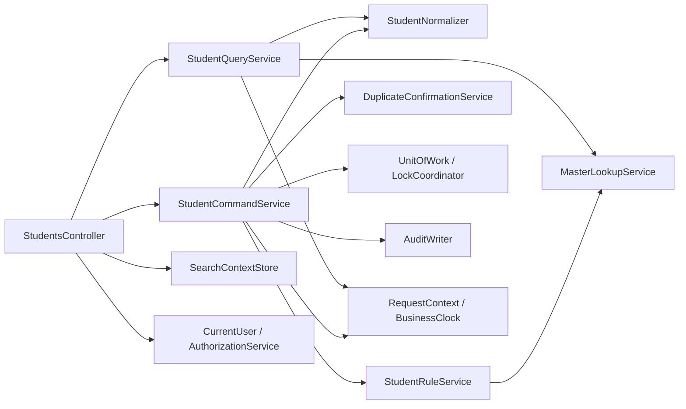

# 共通モジュール設計

| 項目 | 内容 |
| --- | --- |
| 文書ID | COM-STU-003 |
| 版数・作成日 | 2.0／2026-10-10 |
| 読者 | 設計者・開発者・運用担当者 |
| 技術位置付け | 詳細仕様のC#基準実装案に対する契約。実装済みモジュールではない |

## 概要・依存原則

画面ごとに異なる必須判定・コード選択・保存方法を実装しない。共通モジュールは意味の異なる「存在」「新規選択可否」「既存値保持」を区別する。画面側の検査は操作補助であり、サーバー側検証を省略する根拠にしない。



## モジュール一覧・契約

| ID | 論理名／物理名 | 主なメソッド | 入力・戻り値 | 責務・禁止事項 |
| --- | --- | --- | --- | --- |
| MOD-001 | 利用者取得／ICurrentUserAccessor | GetRequiredUser() | 認証済み要求→CurrentUser | 利用者ID・ログインセッションID・権限を取得。本文の利用者IDを採用しない |
| MOD-002 | 権限判定／IAuthorizationService | Demand(user, permission) | 利用者、Permission→成功またはAccessDenied | Read/Create/Update/Delete/MasterMaintain/CorrectClosedStatusを個別判定 |
| MOD-003 | 業務日時／IBusinessClock | CaptureRequestContext(user) | 時刻・利用者→RequestContext | 要求開始時のUtcNow、BusinessDate、SchoolYear、CorrelationIdを1度だけ確定 |
| MOD-004 | 入力正規化／StudentNormalizer | NormalizeSearch(raw)、NormalizeStudent(raw) | 生文字列→正規化済み値＋ValidationIssue[] | 共通NORM-001～012。原表記と照合キーを分離、切捨て不可 |
| MOD-005 | 入力検査／StudentValidator | ValidateInput(draft, context) | StudentDraft→ValidationIssue[] | 必須・文字数・日付・連絡先一式。DB問い合わせを行わない |
| MOD-006 | マスタ候補／MasterLookupService | GetCodesAsync(query)、GetClassesAsync(query) | 用途、日付、既存値→候補一覧 | Search/Assign/Displayを明示。既存値を停止だけで消さない |
| MOD-007 | マスタ存在・業務整合／StudentRuleService | ValidateAsync(old, draft, context, tx) | 保存済み値、入力、同一Tx→問題一覧 | コード・クラス・在籍区分訂正・最終所属期間。画面の「未変更」申告を信用しない |
| MOD-008 | 定員判定／ClassCapacityService | CheckSeatAsync(old, draft, classRow, tx) | 旧席、新席、ロック済クラス→可否 | 席が増える場合だけ人数＋1を判定。必ず同一Txの最新人数 |
| MOD-009 | 重複確認／DuplicateConfirmationService | EvaluateAsync(...)、Issue(...)、Verify(...) | 正規化値、全候補ID/版、認証情報→確認結果 | 学籍番号一意とは別。候補最大20件表示、照合は全候補 |
| MOD-010 | 検索状態／ISearchContextStore | Create、ReadOwned、ReplaceApplied、Clear | 所有者キー、ContextId→SearchContext | 30分スライド期限、タブ別。別所有者は拒否し存在を漏らさない |
| MOD-011 | 画面通知／IFlashMessageStore | Put、Take | 所有者・復帰ID、確定メッセージ→一回読取 | 成功確定後だけ設定。別タブに成功通知を誤配しない |
| MOD-012 | DB確定単位／IUnitOfWork | BeginReadAsync、BeginWriteAsync、CommitAsync、RollbackAsync | 分離レベル、CancellationToken→接続とTx | 同じ接続・Txを関連RepositoryとAuditWriterに渡す。内側で独立Commit禁止 |
| MOD-013 | 排他調整／LockCoordinator | AcquireBirthdayLocksAsync、LockMastersAsync、LockClassesAsync | キーの整列済集合、Tx→保護 | 同生日→分類→コード→クラス→学生の順。順序逆転・ユーザー確認待ち禁止 |
| MOD-014 | 監査追記／AuditWriter | AppendAsync(AuditEvent, tx) | 変更列、対象、前後版、実行者→履歴ID | 同一Txでt_operation_logへ追記。個人情報の値は複写しない |
| MOD-015 | 例外変換／ExceptionMapper | ToProblem(exception, context) | 例外→AppProblem | 制約名・SQLSTATEを許可表でメッセージ化。SQL本文・例外詳細をブラウザーへ出さない |
| MOD-016 | 表示整形／DisplayFormatter | FormatDate、FormatInstant、FormatPostal、MissingName | 型付き値→表示文字列 | 日本時間、郵便番号、未登録「－」。HTMLエスケープは描画層で行う |

## 主要な型・変数

```csharp
public sealed record CurrentUser(string UserId, string LoginSessionId,
                                 IReadOnlySet<Permission> Permissions);
public sealed record RequestContext(CurrentUser User, DateTimeOffset UtcNow,
    DateOnly BusinessDate, int SchoolYear, Guid CorrelationId);
public sealed record ValidationIssue(string MessageId, string? Field,
    IReadOnlyDictionary<string, string> Args);
public sealed record CodeKey(string CategoryId, string CodeValue);
public sealed record DuplicateCandidateVersion(long StudentId, long RowVersion);
public enum CandidatePurpose { Search, Assign, Display }
public enum Permission { Read, Create, Update, Delete, MasterMaintain, CorrectClosedStatus }
```

DB内のID・版はlong。外部JSONのID・版は桁落ちを避けるため10進文字列に変換する。内部型をそのままJSONへシリアライズしない。Raw入力の年月日・IDは文字列として受け、共通パーサーが厳密検証して型付き値へ変換する。

## マスタ候補の共通仕様

| 用途 | コード | クラス |
| --- | --- | --- |
| Search | 指定分類の全値。停止・期間外も含む | 年度・学年で絞る。停止・過去クラスを含む |
| Assign・新しい値 | 分類・値が利用可かつBusinessDateが有効期間内 | 在学・休学なら利用可・当日が期間内。卒業・退学なら在籍期間との重なりを判定 |
| Display・既存値 | 停止・期間外でも名称を表示 | 現在／最終所属を表示。不整合なら元キーを消さず注意を表示 |

返却CodeOptionはCategoryId、Value、Name、DisplayOrder、IsSelectable、IsCurrent、Noticeを持つ。ClassOptionはClassId文字列、SchoolYear、GradeCode、GradeName、ClassCode、ClassName、IsSelectable、IsCurrent、Noticeを持つ。表示名は入力の保存キーにしない。保存ではキャッシュを信用せず、同一Txで存在・版・利用状態を再読込する。

## 一時状態管理

基準実装は単一Webノードのサーバーメモリー。`ConcurrentDictionary`に格納する値は不変スナップショットとし、ContextId単位の排他またはcompare-and-swapで変更する。永続DBのテーブルを追加しない。再起動で失った場合は安全に期限切れとして扱う。

| 状態 | キー・保存内容 | 期限・セキュリティ |
| --- | --- | --- |
| SearchContext | ContextId、UserId、LoginSessionId、TabId、AppliedCriteria、HasSearched、Page、PageSize、Sort、Revision | 最終利用から30分。IDは暗号学的乱数256bit、Base64Url |
| DuplicateConfirmation | Token、所有者、操作種別、StudentId、ExpectedVersion、PayloadHash、全候補ID/版、ExpiresAt | 10分固定。画面から送られる候補一覧を採用しない |
| FlashMessage | 所有者＋元ContextId、成功メッセージと有効期限 | 5分、一回取得。期限切れでもDB確定を取り消さない |

SearchContextは1セッション20個まで。重複確認は1セッション20個までを目安に古い未使用状態から失効させ、失効を明示する。共有同一タブの要求は前回の通信完了まで次操作を無効化する。複数ノード化する場合は共有ストアと認証・暗号鍵共有へ置換し、所有者・有効期限・原子的操作の契約を維持する。

## 重複確認情報の束縛

`PayloadHash`は固定順の正規化済み全業務値、操作種別、対象ID、ExpectedVersionを正規JSONへ変換してSHA-256で計算する。対象外はOperationReason、SearchContextId、CSRFトークン、DuplicateToken、年度・学年の選択補助。これらを変更しても業務値の確認を無効にしないが、理由・選択補助・権限は別途再検証する。候補集合はStudentId昇順の全IDとRowVersionで比較し、表示20件だけで比較しない。

同じトークンへの同時要求はトークン単位で処理権を確保する。すでに使用中の要求はE-COM-003で拒否する。トークン使用中は他の外部待機を行わず保存処理を開始する。結果不明を含むDB書込み開始後の例外ではトークンを失効し、無条件再試行しない。成功後は消費する。事前入力エラーなら使用権を解除し、内容や候補が変わった場合は旧トークンを失効して再警告する。トークンが来ても学籍番号、マスタ、定員、権限、版の検査は省略しない。

## 共通例外・原子性

認証失効→401、権限不足→403、型・CSRF等の不正要求→400、学生不存在→404、業務入力エラー→422、他者更新・重複警告→409、検索上限・0件→200の意味付き応答、DB障害→503を基準とする。処理が完了したか不明な通信断は確定失敗と断定しない。エラー表示にはCorrelationIdを付け、入力を保持して検索確認を案内する。

読取用Txは同一スナップショット、書込用TxはRead Committedと明示ロックを使用する。参照マスタにFOR SHAREを使用する設計理由は、利用状態などキー以外の更新も保存中に抑止するため。詳細は[SQL・トランザクション設計](../詳細仕様書/05_SQL・トランザクション設計.md)。Repositoryはトランザクションを自分で確定しない。

## 共通モジュールの検証

日時は差替え可能なClockで4月1日・日本時間0時を試験する。正規化は同じ入力への再実行で結果不変であることを試験する。認証者変更、別セッション、トークン期限・内容変更、別タブ、DB履歴失敗、同一学生同時更新、定員最終席の同時取得を必須試験とする。詳細試験の正本は[単体・結合テスト仕様](../詳細仕様書/07_単体・結合テスト仕様.md)。
