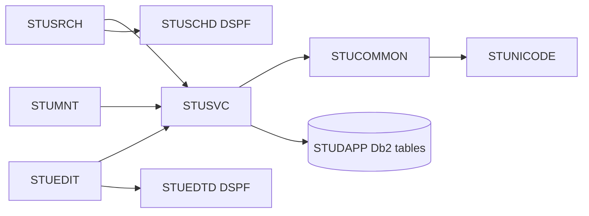

<!-- spec-meta: {"schema":"spec-md/1.0","documentId":"COM-AS400_RPG","version":"6.0","path":"spec/共通/方式別/AS400_RPG/01_共通実装仕様.md","sheets":[{"heading":"オブジェクト・プログラム構造","kind":"GRID","sheet":"01_オブジェクト・プログラム構造"},{"heading":"SQL・コミットメント制御","kind":"GRID","sheet":"02_SQL・コミットメント制御"},{"heading":"DDS・状態・認証","kind":"GRID","sheet":"03_DDS・状態・認証"},{"heading":"共通規約・日付実装","kind":"GRID","sheet":"04_共通規約・日付実装"}]} -->
# AS400／RPG 共通実装仕様

| 項目 | 内容 |
| --- | --- |
| 版数・改訂日 | 6.0／2026-10-11 |
| 対象方式 | AS400／RPG |
| 適用 | 設計上の実装契約。製品コードの実装・コンパイルは未実施 |

開発入力：[学生検索詳細](../../../詳細仕様書/AS400_RPG/01_学生検索画面.md)／[学生登録詳細](../../../詳細仕様書/AS400_RPG/02_学生登録画面.md)／[共通実装](01_共通実装仕様.md)／[DB定義](../../../DB定義/Db2_for_i/01_DB定義書.md)／[方式別開発規約](../../../../docs/開発規約/AS400_RPG.md)／[共通開発規約](../../../../docs/開発規約.md)。

## オブジェクト・プログラム構造

| 区分 | 物理オブジェクト・ソース | 責務 |
| --- | --- | --- |
| プログラム | STUDPGM/STUSRCH、STUEDIT | 検索・登録の画面イベント |
| 表示ファイル | STUDPGM/STUSCHD、STUEDTD | DDS条件・一覧・入力・確認・補助編集 |
| サービスプログラム | STUDPGM/STUSVC | StSearchStudents、StLoadStudent、StSaveStudent、StDeleteStudent、StMaintainClass、StMaintainCode |
| 共通サービス | STUDPGM/STUCOMMON | StAuthorize、StClock、StNormalize、StValidate、StMessage、StConfirm |
| Unicode補助 | STUDPGM/STUNICODE | CCSID変換、Unicode正規化、scalar数、エスケープ編集。別途実装するILE C補助とのバインド契約 |
| 管理者処理 | STUDPGM/STUMNT | IFS承認データの保守投入 |
| SQL表 | STUDAPP | 業務5表＋制御表 |
| COPY | STUTYPES、STUPROTO | Qualified DS、プロトタイプ、結果定数 |
| バインド | STUBND | サービスプログラムの公開手続きとシグネチャー |

共通01～03はStAuthorize/StClock、04～05はStNormalize/StValidate、06～10はStLookupCodes/StLookupClasses/StCheckRules/StCheckCapacity/StFindDuplicates、11はStConfirm、12はSearchContext DS、13はStBeginWork/StEndWork、14はStAppendAudit、15はStMessage。



クラス図ではなく呼出構造図とする。画面側からUPDATE命令を直接発行せず、保存単位をStSaveStudent等へ集約する。

## SQL・コミットメント制御

評価版は補助表`STUDAPP.T_WRITE_GUARD`（システム名STGUARD）を追加：guard_id SMALLINT PRIMARY KEY CHECK(guard_id=1)、lock_bit SMALLINT NOT NULL CHECK IN(0,1)。初期1行(1,0)。業務表ではない。検索の件数・一覧と全書込みが同じ行を更新して短時間保護し、整合する結果を得る。MVCCのスナップショットを仮定しない。

```sql
UPDATE STUDAPP.T_WRITE_GUARD
   SET LOCK_BIT=1-LOCK_BIT WHERE GUARD_ID=1;
SELECT STUDENT_ID,ROW_VERSION FROM STUDAPP.M_STUDENT
 WHERE STUDENT_ID=:studentId AND IS_DELETED=0;
SELECT COUNT(*) INTO :occupancy FROM STUDAPP.M_STUDENT
 WHERE CLASS_ID=:classId AND IS_DELETED=0
   AND ENROLLMENT_STATUS_CODE IN ('01','02')
   AND STUDENT_ID<>:excludeStudentId;
```

新規のexcludeStudentIdは0（自動IDは正数）を用いる。対象読込・マスタ存在・版・定員・全候補検査はゲート取得後。更新は固定列割当と`WHERE STUDENT_ID=:id AND ROW_VERSION=:expectedVersion AND IS_DELETED=0`、ROW_VERSION=ROW_VERSION+1。GET DIAGNOSTICSのROW_COUNTで1件を確認。新規IDはINSERT直後、同じ接続でIDENTITY_VAL_LOCALを取得し、監査INSERTを先行させない。

INSERTは19業務入力＋2照合値＋固定分類＋作成更新＋版1、UPDATEは学籍番号以外18入力＋照合値2＋更新情報、削除は削除4属性と更新情報・版だけ。履歴は同じコミットメント定義内で追記。成功COMMIT、入力・版・確認待ち・例外はROLLBACK。検索は結果をメモリーへコピー後ROLLBACKしてゲート変更を取り消す。全DML対象とゲートがジャーナル対象でなければ起動検査で停止する。[S-11]

SQLRPGLEはCOMMIT(*CS)、同じ名前付きactivation groupを採用、コミットメント定義を共用。Tx中にEXFMT、入力待ち、外部対話をしない。ジョブ終了・MONITOR例外でもRollback経路を通す。DBロック待ち上限は配備設定で有限にし、待ち時間超過時はE-COM-004と再確認。検索も書込みもゲートで直列化するため性能は実機測定が必要。

検索SQLは最大10001件のキーを取得して上限判定。同じ条件とゲート保護下で20/50/100件をOFFSET/FETCHまたはROW_NUMBERで取得。動的値はPREPARE/OPEN USINGでバインド。LIKE ESCAPE '!'のリテラル処理、状態OR、電話OR、日付両端、未所属NULLを維持。名称は分類＋値のLEFT JOINで有効性を条件にしない。ソートは許可4項目＋学生IDだけ。

## DDS・状態・認証

DSPFはDSPSIZ(27 132)、COND/SFLCTL/SFLROW/EDBASE/EDENROLL/EDNOTE/CNFRM/LONGTXTのレコード構成。サブファイルはSFLPAG(10)、SFLSIZ(101)、SFLDSP/SFLDSPCTL/SFLCLRを状態で制御。RRNとstudentIdの対応をresultRowsに持つ。実際のDDS源にはDBCS表示桁とソースCCSIDを反映し、モックの日本語文字幅をそのままDDS列数にしない。[S-10]

検索DSと確認DSはジョブ・利用者・画面識別別。確認DSには対象・版・正規化全入力・全候補ID/版のダイジェスト・10分期限。複数候補はストリーミングで全集合ハッシュを計算し、20件表示で判定を打ち切らない。確認中にゲートを解放し、再確定で候補を再集計。共有のグローバル確認済フラグを設けない。

認証はIBM iの実行ユーザープロファイルと承認済み認可設定から取得。画面のUSERLABELを権限の根拠にしない。業務データファイルの直接変更権限を制限し、許可プログラム経由にする。権限採用を使用する場合は所有者プロファイルを最小権限とし、任意のSQL・IFSパス・コマンドを渡せない設計を必須とする。

## 共通規約・日付実装

対象読者は実務経験５年程度のプログラマー。[検索詳細](../../../詳細仕様書/AS400_RPG/01_学生検索画面.md)／[登録詳細](../../../詳細仕様書/AS400_RPG/02_学生登録画面.md)／[開発規約](../../../../docs/開発規約.md)／[日付正本](../../07_日付・和暦仕様.md)。

共通16の入力は元号識別値・年・月・日という原文字列4値と業務日。出力は正規化日付と和暦表示文字列、または項目エラー。共通17は項目種別と日付／年度にDATE-R01～06を適用する。変換で不正日を補正しない。OS全体の暦設定を変更しない。元号表の版を画面・保存側で一致させる。

| 役割 | 実装仕様 |
| --- | --- |
| 共通16物理名 | StParseBirthDate / StFormatBirthDate、DDS EBERA・EBYEAR・EBMONTH・EBDAY |
| 内部日付型 | date、SQL NULLは別標識 |
| 入力と保存 | 和暦原入力4値から日付を生成。StudentDraft等のbirth_date相当は正規化日付。元号をDBへ重複保存しない |
| 呼出境界 | 本方式はネイティブ画面。和暦原入力4値を業務処理へ渡し厳密変換する。取得時は内部日付を和暦表示に変換。Web JSON契約は本方式に適用しない |
| 表示 | 一覧・参照・重複確認のBirthDateWareki相当文字列は共通16で生成。その他の日付・日時は西暦 |
| 例外 | CHK-032～034、E-DATE-001～003。構文検査後、実在日、元号境界、逆変換、業務範囲、前後関係を順に検査 |
| 参考試験 | DATE-T01～20。ライブラリーの解析成功だけで元号境界を合格にしない |

### 保守入口・方式固有の適合条件

#### Unicode補助・保守・試験

5250表示で変換できない文字は`[U+20BB7]`等で注意を表示し、元Unicode値をDSに保持する。変更していない項目を画面バッファから全上書きしない。変換不能値の編集はF8の明示的Unicode入力モードで`\u{20BB7}`等のエスケープを受け、逆変換・文字数検査して保存。通常入力モードではエスケープを勝手に解釈しない。バックスラッシュ自体は補助モードで二重化する。長文は文字境界単位で分割し全範囲を編集できることを試験する。

`STUMNT`管理者プログラムは承認済みIFS入力を読み、StMaintainClass/Codeを呼ぶ。初期5分類70値、保護値・キー不変、クラス参照・定員・期間と履歴を同じゲートで処理する。

共通T-01～28に加え、5250画面サイズ、SFL10行と取得20/50/100の境界、READC選択、Fキーの権限、DDS桁とUnicode文字数、CCSID往復、ジョブ異常終了のRollback、全表ジャーナル開始、2ジョブ競合を実機検証する。
