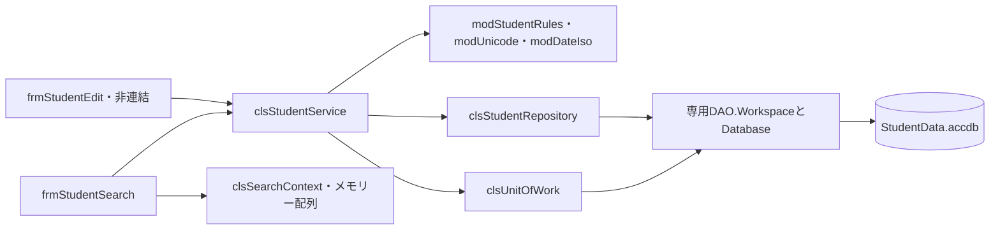

<!-- spec-meta: {"schema":"spec-md/1.0","documentId":"COM-Access","version":"6.0","path":"spec/共通/方式別/Access/01_共通実装仕様.md","sheets":[{"heading":"配置・モジュール構造","kind":"GRID","sheet":"01_配置・モジュール構造"},{"heading":"DAO検索・ページング","kind":"GRID","sheet":"02_DAO検索・ページング"},{"heading":"保存・排他・原子性","kind":"GRID","sheet":"03_保存・排他・原子性"},{"heading":"状態・例外・画面部品","kind":"GRID","sheet":"04_状態・例外・画面部品"},{"heading":"共通規約・日付実装","kind":"GRID","sheet":"05_共通規約・日付実装"}]} -->
# Access 共通実装仕様

| 項目 | 内容 |
| --- | --- |
| 版数・改訂日 | 6.0／2026-10-11 |
| 対象方式 | Access |
| 適用 | 設計上の実装契約。製品コードの実装・コンパイルは未実施 |

開発入力：[学生検索詳細](../../../詳細仕様書/Access/01_学生検索画面.md)／[学生登録詳細](../../../詳細仕様書/Access/02_学生登録画面.md)／[共通実装](01_共通実装仕様.md)／[DB定義](../../../DB定義/Access/01_DB定義書.md)／[方式別開発規約](../../../../docs/開発規約/Access.md)／[共通開発規約](../../../../docs/開発規約.md)。

## 配置・モジュール構造

```text
開発用フロント：StudentClient.accdb
配布用フロント：StudentClient.accde（端末ごとにローカル配置）
共有バックエンド：StudentData.accdb（管理されたLAN共有フォルダー）
Forms/frmStudentSearch, frmStudentEdit, frmDuplicateConfirm, frmDeleteConfirm
Classes/clsStudentDraft, clsStudentService, clsStudentRepository
Classes/clsSearchCriteria, clsSearchContext, clsUnitOfWork, clsConfirmation
Modules/modStudentRules, modUnicode, modDateIso, modClock, modMessages
Modules/modSecurity, modMasterMaintenance, modStudentList, modConnection
```



Option ExplicitとOption Compare Binaryを全業務モジュールに指定。DAO.Workspace/Database/QueryDef/Recordsetは完全修飾し、ADO同名型との曖昧さを避ける。共通01～03＝modSecurity/modClock、04～05＝modUnicode/modDateIso/modStudentRules、06～10＝clsStudentRepository/clsStudentService、11＝clsConfirmation、12＝clsSearchContext、13＝clsUnitOfWork、14＝clsStudentRepository.AppendAudit、15＝modMessages。

## DAO検索・ページング

全要求で専用Workspaceとそこから開いたDatabaseを用い、`QueryDef.Parameters`で値を設定する。数値・日付・クラス・在籍・都道府県・電話などを安全なSQLで先に絞る。氏名やカナの部分一致、学籍番号前方一致は返却行の正規化値をVBAでリテラル比較する。InStrのvbBinaryCompare、StrCompのvbBinaryCompareを明示する。値リスト用の区切り文字列に学生情報を連結しない。

```sql
PARAMETERS pClassId LONG, pFrom TEXT(10), pTo TEXT(10);
SELECT s.* FROM m_student AS s
WHERE s.is_deleted=False
  AND (pClassId Is Null OR s.class_id=pClassId)
  AND (pFrom Is Null OR s.admission_date>=pFrom)
  AND (pTo Is Null OR s.admission_date<=pTo);
```

SQLは条件と型の例。実検索は必要列だけを選択し、年度・学年・在籍・都道府県・電話条件を追加する。クラスとコード名は読取用辞書にロードしてID／分類＋値で参照してよい。学生行を名称欠落やマスタ停止で消さない。表示不要な住所2・メール・緊急氏名・備考を一覧DTOへ保持しない。

1要求内の件数・一覧を揃えるため、t_write_guardのゲート取得後にマスタと学生を読み、全検索条件に一致した行だけを最大10,001件まで数える。10,000件以内なら必要なDTOをメモリーに保持し、許可順序で全体をソートしてから指定ページを抽出する。名前KeyがLONGTEXTでも、先に10001原始行だけを選んでから条件をかける誤実装を禁止する。

ソートはstudentNo／nameKey／admissionDateIso／updatedAtUtcの4種類、同順位StudentId。文字はバイナリー順、日付はISO順、時点はDate値。DB製品を跨いだすべてのUnicode文字の同じ並び順まで保証するものではない。全件一致が多い・選択度が低い検索の走査負荷は実測する。

`lstStudents.RowSourceType="StudentListCallback"`、ColumnCount=12、BoundColumn=1、先頭列幅0。コールバックはメモリー配列の件数・列数・値を返し、コールバックの中でSQLを実行しない。[A-01]

```vb
Public Function StudentListCallback(ctl As Control, id As Variant, _
    row As Variant, col As Variant, code As Variant) As Variant
    '規定のcodeに応じ、初期化／行数／列数／値／終了を返す。
    '値はフォームインスタンスに紐付くキャッシュから取得する。
End Function
```

これは契約の抜粋。公式のRowSourceTypeコールバック引数・処理コードに従い全分岐を実装する。別フォームのキャッシュを上書きしない。セル表示が長いときは表示を省略できるが、全文欄で元値を参照可能にする。

## 保存・排他・原子性

補助`t_write_guard`をバックエンドに追加する。`guard_id LONG PRIMARY KEY`、`lock_bit YESNO NOT NULL`、固定行(1,False)を投入。業務5表には含めない。全学生変更・削除・マスタ保守と、件数・一覧を揃える検索が同じ制御行を使用する。

```vb
'保存単位の骨格。検証・業務書込み・監査の実装は省略している。
Dim ws As DAO.Workspace, db As DAO.Database
Dim inTx As Boolean
On Error GoTo Failed
Set ws = DBEngine.CreateWorkspace("StudentTx", "Admin", "", dbUseJet)
Set db = ws.OpenDatabase(ApprovedBackendPath())
If Not db.Transactions Then Err.Raise vbObjectError + 100, , "Transactions required"
ws.BeginTrans
inTx = True
db.Execute "UPDATE t_write_guard SET lock_bit=Not lock_bit WHERE guard_id=1", dbFailOnError
If db.RecordsAffected <> 1 Then Err.Raise vbObjectError + 101, , "Guard missing"
'この後に最新版・全検査・業務書込み・監査を同じdb/wsで実行する。
ws.CommitTrans dbForceOSFlush
inTx = False
GoTo Cleanup
Failed:
'最初のErr/DAO.Errorsを退避する。Rollback自体の失敗も別記録する。
If inTx Then
    On Error Resume Next
    ws.Rollback
    On Error GoTo 0
End If
'確定不明を含め共通エラーへ変換。ここで成功通知を設定しない。
Cleanup:
'Recordset、QueryDef、Database、Workspaceを確実にClose/解放する。
```

AdminはDAO Workspace生成のための指定であり、業務上の管理者権限を意味しない。処理のUserId・役割はmodSecurityの認証情報から取得する。複数の独立した保存単位を既定Workspaceへ混在させない。DAOのトランザクションはWorkspace範囲なので、業務と履歴を別Workspaceへ分けない。[A-02]

検索はゲート取得後に必要結果をメモリーへコピーし、Rollbackでゲート変更を取消・解放してからUI表示。保存はゲート取得後の別読込みで最新対象の存在・版を照合、マスタ・在籍・定員・全重複候補を検査する。確認待ちや変更なしはRollbackして終了。ダイアログ表示、DoEvents、外部対話をTx中に行わない。

### 業務レコードの書込み

更新の正本方式は、パラメーター付きQueryDefで`student_id=pId AND row_version=pVersion AND is_deleted=False`を条件に**単一表の更新可能dynaset**を開き、対象が1件であることを確認して`Edit`→許可列の`Fields(...).Value`設定→`Update`を行う。文字値はSQLへ連結しない。対象はゲート取得後に読み、全更新経路が同じゲートを守るため、対象検査からUpdateまで別の協調書込みが割り込まない。ゲートに従わない直接ファイル編集は本構成の保証対象外。

通常更新は学籍番号以外の18入力＋生成NameKey/KanaKey＋更新者日時＋版加算。LongTextもRecordset.Fieldsへの値代入で保存し、TEXT(255)へ変換しない。新規はAddNewで19入力＋照合値2＋分類固定値＋作成更新＋版1を設定し、Update直後に`Bookmark=LastModified`で採番StudentIdを取得する。MAX+1は禁止。[A-03]

論理削除は同じ対象・版検査後に削除状態・日時・者・理由と更新情報・版だけを変更。t_operation_logは同じdbの別dynasetへAddNewし、学生とまとめてCommitする。監査失敗は両方Rollback。監査だけ別CurrentDbで実行しない。

補助的な固定短文列の更新例は次のとおり。Execute方式を採用する場合はRecordsAffected=1も必須。

```sql
PARAMETERS pName TEXT(200), pAt DATETIME, pBy TEXT(64), pId LONG, pVersion LONG;
UPDATE m_student SET student_name=pName, updated_at=pAt, updated_by=pBy,
 row_version=row_version+1
WHERE student_id=pId AND row_version=pVersion AND is_deleted=False;
```

これは版付き更新構文の例であり、氏名変更時のNameKey等を省略して本番に用いてよいという意味ではない。全業務更新は前段の許可列定義に従う。

## 状態・例外・画面部品

clsSearchContextは認証者・ログイン状態・Formインスタンス・AppliedCriteria・ページ・ソート・最終利用時点を保持、30分で失効。clsConfirmationは10分、対象・旧版・全正規化業務値・全候補IDと版を対応付け、再保存時に再取得・比較する。表示候補20件だけで一致を判定しない。確認情報はメモリー、フォーム終了・認証変更で破棄。汎用の確認済Booleanだけで警告を迂回させない。

フォームのmBusy、mDirty、mInitializingを分ける。DAOは同期呼出を基準とし、VBAに存在しないTask/Awaitを仮定しない。処理中操作不可、Tx外でも不用意なDoEventsの再入を防ぐ。エラーはラベルと項目別表示、最初の入力不備へSetFocus。サーバー保存済み状態をフォームのDirtyプロパティだけで判断しない。

DAO3022は制約・対象の再確認によって学籍／マスタ重複へ分類。ロック／競合系の3188・3197・3218・3260はDAO.Errorsも確認し、全Rollback後に再確認を案内する。対象なし・版不一致はE-STU-103/105、その他はE-COM-004＋受付番号。ロック競合時に処理途中から自動再実行しない。Commitの応答を失った場合は検索確認、保存失敗と断定しない。

## 共通規約・日付実装

対象読者は実務経験５年程度のプログラマー。[検索詳細](../../../詳細仕様書/Access/01_学生検索画面.md)／[登録詳細](../../../詳細仕様書/Access/02_学生登録画面.md)／[開発規約](../../../../docs/開発規約.md)／[日付正本](../../07_日付・和暦仕様.md)。

共通16の入力は元号識別値・年・月・日という原文字列4値と業務日。出力は正規化日付と和暦表示文字列、または項目エラー。共通17は項目種別と日付／年度にDATE-R01～06を適用する。変換で不正日を補正しない。OS全体の暦設定を変更しない。元号表の版を画面・保存側で一致させる。

| 役割 | 実装仕様 |
| --- | --- |
| 共通16物理名 | modJapaneseDate / cboBirthEra・txtBirthYear・txtBirthMonth・txtBirthDay |
| 内部日付型 | ISO文字列／任意値はVariant Null |
| 入力と保存 | 和暦原入力4値から日付を生成。StudentDraft等のbirth_date相当は正規化日付。元号をDBへ重複保存しない |
| 呼出境界 | 本方式はネイティブ画面。和暦原入力4値を業務処理へ渡し厳密変換する。取得時は内部日付を和暦表示に変換。Web JSON契約は本方式に適用しない |
| 表示 | 一覧・参照・重複確認のBirthDateWareki相当文字列は共通16で生成。その他の日付・日時は西暦 |
| 例外 | CHK-032～034、E-DATE-001～003。構文検査後、実在日、元号境界、逆変換、業務範囲、前後関係を順に検査 |
| 参考試験 | DATE-T01～20。ライブラリーの解析成功だけで元号境界を合格にしない |

### 保守入口・方式固有の適合条件

#### マスタ保守・制約・試験

`modMasterMaintenance`の管理者向け入口から承認済みデータを検査して投入する。通常の画面にマスタ保守機能を増やさない。初期5分類70値、再投入が同値なら無変更、差分なら停止して確認。クラス年度＋コード一意、参照学生がいる学年変更、在籍人数未満の定員、在学・休学がいる利用停止、保護コード変更を拒否し、履歴と一括確定する。

ACCDBの画面・VBAによる権限制御は、共有ファイルを直接変更できる利用者に対する強いDBアクセス境界にはならない。本案は信頼された職員向け評価構成。本番で厳密な閲覧者／担当者／管理者の分離が必要ならサーバーDBまたはAPI方式への変更承認を稼働条件とする。ACCDE化・ナビゲーション非表示をセキュリティ保証と説明しない。

共通T-01～28に加え、非連結フォーム移動で保存されないこと、保存中のDoEvents再入がないこと、Nullと空文字、LongとIntegerの違い、長い住所・備考、Unicode補助文字、ListBoxの区切り文字を含む表示、2つのAccessプロセスの最終席競合、履歴失敗のRollback、共有フォルダー切断、Office32/64bitでのAPI宣言を試験する。
