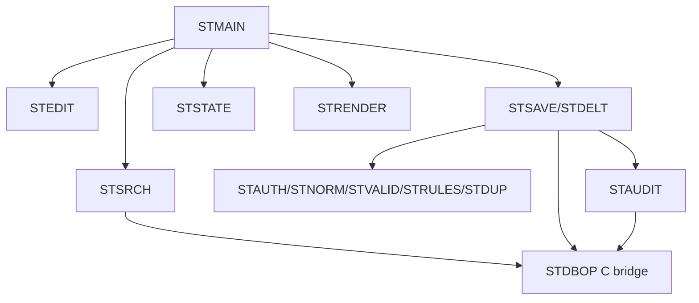

<!-- spec-meta: {"schema":"spec-md/1.0","documentId":"COM-COBOL","version":"6.0","path":"spec/共通/方式別/COBOL/01_共通実装仕様.md","sheets":[{"heading":"PROGRAM-ID・COPY・呼出関係","kind":"GRID","sheet":"01_PROGRAM-ID・COPY・呼出関係"},{"heading":"SQL・エラー処理","kind":"GRID","sheet":"02_SQL・エラー処理"},{"heading":"CGI・Unicode・状態","kind":"GRID","sheet":"03_CGI・Unicode・状態"},{"heading":"共通規約・日付実装","kind":"GRID","sheet":"04_共通規約・日付実装"}]} -->
# COBOL 共通実装仕様

| 項目 | 内容 |
| --- | --- |
| 版数・改訂日 | 6.0／2026-10-11 |
| 対象方式 | COBOL |
| 適用 | 設計上の実装契約。製品コードの実装・コンパイルは未実施 |

開発入力：[学生検索詳細](../../../詳細仕様書/COBOL/01_学生検索画面.md)／[学生登録詳細](../../../詳細仕様書/COBOL/02_学生登録画面.md)／[共通実装](01_共通実装仕様.md)／[DB定義](../../../DB定義/PostgreSQL/01_DB定義書.md)／[方式別開発規約](../../../../docs/開発規約/COBOL.md)／[共通開発規約](../../../../docs/開発規約.md)。

## PROGRAM-ID・COPY・呼出関係

```text
cobol/STMAIN.cob    CGI受付・振分け
cobol/STSRCH.cob    検索・ページ
cobol/STEDIT.cob    新規／既存表示
cobol/STSAVE.cob    登録更新の確定単位
cobol/STDELT.cob    論理削除
cobol/STNORM.cob    正規化呼出
cobol/STVALID.cob   入力チェック
cobol/STRULES.cob   存在・状態・期間・定員
cobol/STDUP.cob     同一人物候補・確認
cobol/STAUDIT.cob   操作履歴
cobol/STSTATE.cob   要求間の検索・確認状態
cobol/STAUTH.cob    共通認証アダプター
cobol/STRENDER.cob  UTF-8 HTML表示
cobol/STMAINT.cob   管理者CLI
copy/ST-REQUEST.cpy, ST-STUDENT.cpy, ST-SEARCH.cpy, ST-RESULT.cpy
copy/ST-DB-REQUEST.cpy, ST-DB-RESULT.cpy
bridge/student_bridge.c  libpq・Unicode・暗号・HTTP入力の境界処理
```

共通01～03＝STAUTH/STCLOCK、04～05＝STNORM/STVALID、06～10＝STMLOOK/STRULES/STDUP、11～12＝STSTATE、13＝STSAVE＋STDBOP、14＝STAUDIT、15＝STMSG/STRENDER。STCLOCK・STMLOOK・STMSGも呼出可能プログラムとして同じcobol配下に実装する。



GnuCOBOLにEXEC SQLのプリコンパイル機能が標準であるとは仮定しない。DB操作は明示したCブリッジのlibpqパラメーターAPIを使う。C側に学生業務を全移植せず、接続・型境界・固定SQL実行・Unicode処理だけを置く。

## SQL・エラー処理

ブリッジはcommand_idから静的SQLを選び、PQexecParamsで値を渡す。HTTPからSQL文字列を受け取らない。接続文字コードUTF-8、型OID・NULLポインター・長さを区別。SQLSTATEと件数をCOBOLへ返し、PQclear/PQfinishの所有権を明確にする。[S-13]

| command_id | SQLの目的・固定規則 |
| --- | --- |
| ST-COUNT | 非削除・共通条件のIDを最大10001件取得して数える |
| ST-LIST | 同条件・同スナップショット、名称LEFT JOIN、必要一覧列のみ、LIMIT/OFFSET |
| ST-LOAD | student_id完全一致＋非削除、書込経路ではFOR UPDATE |
| ST-UQ | student_no全行、削除済み含む、自分除外 |
| ST-DUP | 非削除、自分除外、同birth_dateかつname_keyまたはkana_key一致。全候補をID順に取得 |
| ST-CAP | 非削除01/02、class_id一致、自分除外のcount |
| ST-INSERT | 19入力＋2照合値＋分類＋監査管理値＋版1、RETURNING IDと版 |
| ST-UPDATE | 学籍番号を除く18入力＋2照合値＋更新情報＋版加算。旧版と非削除条件必須 |
| ST-DELETE | 論理削除4属性と更新情報・版だけ。旧版と非削除条件必須 |
| LOG-INSERT | 変更列だけのJSON配列、対象・実行者・前後版・理由・確認有無を追加 |

検索のLIKEは!/%/_をエスケープしてESCAPE '!'、状態は個別の安全なバインド、電話OR、日付両端。許可ソートはstudent_no COLLATE "C"、name_key COLLATE "C"、admission_date、updated_at、同順位student_id。SQLSTATE02000相当の行なしは検索結果空／対象不在を呼出目的で区別する。

読取はReadOnly RepeatableRead。保存はRead CommittedでBEGIN→`SELECT pg_advisory_xact_lock(75310,1)`→別SQLで最新再取得→STRULES・STDUP→更新＋監査→COMMIT。全マスタ保守も同じゲート。確認待ちはROLLBACKしてプロセスを終了できる状態にする。ゲート前の事前読込だけで確定しない。

SQLSTATE23505は制約名でE-STU-101/E-MST-002、23503は参照、UPDATE件数0は不在または版競合、40P01/55P03は再確認、その他はE-COM-004。DB失敗後にCOMMITしない。COMMIT成功の応答が不明ならresult=UNKNOWNで検索確認を案内。

## CGI・Unicode・状態

CGI入力はCONTENT_LENGTHを厳密確認し最大65536byte。標準入力を長さ分だけ読み、不足・超過・不正%エンコード・不正UTF-8・NUL・重複単一項目を拒否。HTMLヘッダー送信は検証結果が決まってから。Content-Type:text/html;charset=UTF-8、Cache-Control:no-store。学生値は&、<、>、引用符を文脈に応じエスケープする。

STNORMはCブリッジのUnicode正規化関数を呼ぶ。NFKC、Unicode scalarの単純大文字対応、空白除去、カナ対応、コードポイント数検査を行い、COBOLのFUNCTION UPPER-CASEやバイト置換だけで日本語を正規化しない。ライブラリー版を固定して共通ベクトルと照合する。

補助`t_runtime_state`を設ける：state_id varchar(64) PK（256bit乱数Base64Url）、owner_id varchar(64)、login_session_id varchar(64)、state_kind varchar(16)、encrypted_payload bytea、expires_at timestamptz、revision bigint、consumed boolean。検索30分・確認10分・成功Flash一回。業務5表ではない。payloadは認証済み暗号化、鍵はWebサーバー秘密管理、所有者と目的を照合、状態の更新・消費は条件付きで原子的に行う。期限切れを定期削除する。

共通認証済みWebサーバーだけがCGIのREMOTE_USERを設定する。利用者が送る同名ヘッダーを信頼せず、CGI実行環境を外部から直接操作させない。認証セッションCookieはSecure/HttpOnly、POSTはセッションに紐付くCSRFトークンを検証。画面のRoleを認証情報にしない。DB資格情報と暗号鍵はソースへ保存しない。

## 共通規約・日付実装

対象読者は実務経験５年程度のプログラマー。[検索詳細](../../../詳細仕様書/COBOL/01_学生検索画面.md)／[登録詳細](../../../詳細仕様書/COBOL/02_学生登録画面.md)／[開発規約](../../../../docs/開発規約.md)／[日付正本](../../07_日付・和暦仕様.md)。

共通16の入力は元号識別値・年・月・日という原文字列4値と業務日。出力は正規化日付と和暦表示文字列、または項目エラー。共通17は項目種別と日付／年度にDATE-R01～06を適用する。変換で不正日を補正しない。OS全体の暦設定を変更しない。元号表の版を画面・保存側で一致させる。

| 役割 | 実装仕様 |
| --- | --- |
| 共通16物理名 | STDATE / ST-DATE-INPUT COPY |
| 内部日付型 | PIC X(10)、SQL NULLは別標識 |
| 入力と保存 | 和暦原入力4値から日付を生成。StudentDraft等のbirth_date相当は正規化日付。元号をDBへ重複保存しない |
| 通信境界 | Webの保存要求はbirthDateInputの4文字列を受け、保存側で厳密変換。既存取得応答のbirthDateはISO日付。入力と応答の型を混同しない |
| 表示 | 一覧・参照・重複確認のBirthDateWareki相当文字列は共通16で生成。その他の日付・日時は西暦 |
| 例外 | CHK-032～034、E-DATE-001～003。構文検査後、実在日、元号境界、逆変換、業務範囲、前後関係を順に検査 |
| 参考試験 | DATE-T01～20。ライブラリーの解析成功だけで元号境界を合格にしない |

### 保守入口・方式固有の適合条件

#### 処理単位

クラスを前提にしない。`STMAIN`がCGI要求を受けて`STSRCH`（検索）、`STEDIT`（登録表示）、`STSAVE`（保存）、`STDELT`（削除）、`STMAINT`（管理者CLI）へ振り分ける。データ構造はCOPY句で共通化する。画面HTMLは`STRENDER`がUTF-8で出力する。

### 保守・試験

`student-maint`はCGI公開外の管理者CLI。STMAINT→同じ検証・保存・監査プログラム。初期5分類70値、差分時上書き禁止、クラス年度内一意、参照時学年不変、定員・期間・保護コード規則を維持する。

共通T-01～28、UTF-8の1～4バイト文字、PIC領域境界、URLデコード不正・重複項目・CONTENT_LENGTH超過、CGI再起動後の状態復帰、C ABIの長さ・NULL・ポインター、DB失敗時のSQLSTATE、全候補を20件だけで判定していないことを試験する。
