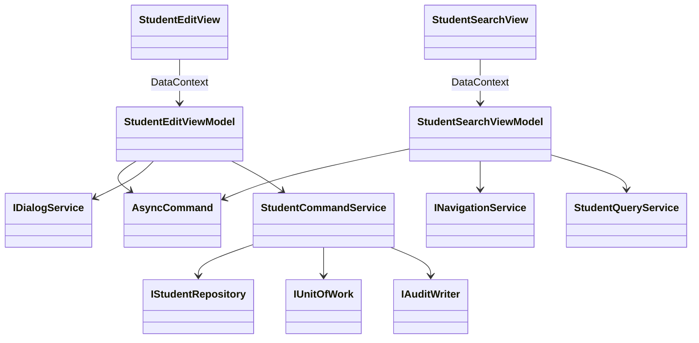

<!-- spec-meta: {"schema":"spec-md/1.0","documentId":"COM-CSharp_WPF","version":"6.0","path":"spec/共通/方式別/CSharp_WPF/01_共通実装仕様.md","sheets":[{"heading":"MVVM構造","kind":"GRID","sheet":"01_MVVM構造"},{"heading":"Repository・SQL","kind":"GRID","sheet":"02_Repository・SQL"},{"heading":"共通処理とUI固有事項","kind":"GRID","sheet":"03_共通処理とUI固有事項"},{"heading":"共通規約・日付実装","kind":"GRID","sheet":"04_共通規約・日付実装"}]} -->
# C#／WPF 共通実装仕様

| 項目 | 内容 |
| --- | --- |
| 版数・改訂日 | 6.0／2026-10-11 |
| 対象方式 | C#／WPF |
| 適用 | 設計上の実装契約。製品コードの実装・コンパイルは未実施 |

開発入力：[学生検索詳細](../../../詳細仕様書/CSharp_WPF/01_学生検索画面.md)／[学生登録詳細](../../../詳細仕様書/CSharp_WPF/02_学生登録画面.md)／[共通実装](01_共通実装仕様.md)／[DB定義](../../../DB定義/PostgreSQL/01_DB定義書.md)／[方式別開発規約](../../../../docs/開発規約/CSharp_WPF.md)／[共通開発規約](../../../../docs/開発規約.md)。

## MVVM構造

```text
StudentManagement.Wpf/Views/StudentSearchView.xaml, StudentEditView.xaml
StudentManagement.Wpf/ViewModels/StudentSearchViewModel.cs, StudentEditViewModel.cs
StudentManagement.Wpf/Controls/NullableDateField.xaml, ClassSelector.xaml
StudentManagement.Wpf/Commands/AsyncCommand.cs
StudentManagement.Wpf/Services/NavigationService.cs, DialogService.cs
StudentManagement.Application/StudentQueryService.cs, StudentCommandService.cs
StudentManagement.Application/StudentNormalizer.cs, StudentValidator.cs, StudentRules.cs
StudentManagement.Domain/Student.cs, StudentDraft.cs, SchoolClass.cs, CodeEntry.cs
StudentManagement.Infrastructure/StudentRepository.cs, UnitOfWork.cs, AuditWriter.cs
```



ViewModelはINotifyPropertyChangedとINotifyDataErrorInfoを実装。AsyncCommandはCanExecute、IsRunning、CancellationToken、非同期例外の通知を持ち、async voidはICommand.Executeの最外部だけに封じる。外部MVVMライブラリー採用を必須にしない。

```csharp
public sealed record SaveCommandData(long? StudentId, long? ExpectedVersion,
    StudentDraft Draft, SelectionHints Hints, ConfirmationData? Confirmation,
    string? OperationReason);
public interface IStudentCommandService {
    Task<SaveResult> SaveAsync(SaveCommandData command, CancellationToken ct);
    Task<SaveResult> DeleteAsync(long id, long version, string reason,
                                CancellationToken ct);
}
```

`StudentDraft`は画面詳細の19入力＋NameKey・KanaKey。C#型は文字列string/string?、日付DateOnly/DateOnly?、ClassId long?。日時DateTimeOffset、件数・ページint。WPF DatePicker.SelectedDateはDateTime?なので専用部品がRawTextを保持してDateOnly?へ変換。不正値をnullとして必須検査だけに変えない。

## Repository・SQL

NpgsqlDataSourceはアプリ単位、接続とTxは処理単位でdispose。QueryServiceはReadOnly RepeatableRead。件数は最大10001件のキーを取得した数、10000以下なら同じTxで一覧ページ。名称は停止値も残すLEFT JOINで分類＋値を結合。WHEREは常にNOT s.is_deleted。AND条件、在籍OR、電話OR、日付両端、未所属NULLを共通の条件ビルダーで件数・一覧両方に使う。

学籍前方、氏名カナ部分は`LIKE $n ESCAPE '!'`。入力の!、%、_を順にエスケープしてからパターンを付加。ソートはstudent_no COLLATE "C"、name_key COLLATE "C"、admission_date、updated_atの許可マッピング、同順位はstudent_id。ユーザーからSQL列名を受けない。

```sql
BEGIN;
SELECT pg_advisory_xact_lock(75310,1);
-- 取得後の別命令で最新対象・マスタを再読込する
SELECT * FROM m_student WHERE student_id=$1 AND NOT is_deleted FOR UPDATE;
SELECT count(*) FROM m_student WHERE class_id=$1 AND NOT is_deleted
 AND enrollment_status_code IN ('01','02')
 AND ($2::bigint IS NULL OR student_id<>$2);
SELECT student_id,row_version FROM m_student WHERE NOT is_deleted
 AND birth_date=$1 AND (name_key=$2 OR kana_key=$3)
 AND ($4::bigint IS NULL OR student_id<>$4) ORDER BY student_id;
-- 全検査後：学生変更と監査追記。確認待ちなら書かずROLLBACK
COMMIT;
```

全学生保存・削除・クラス／コード保守が同じDBゲートを取得する基準案。Read Committedなのでゲート後のステートメントで先行確定を読める。細粒度化はT-15/16/28を維持した別改訂。ユーザー確認待ちでゲートを持たない。

INSERTは19業務入力＋2照合値＋分類固定値＋作成・更新＋版1を設定しRETURNING student_id,row_version。通常UPDATEは19入力から学籍番号を除く18入力＋照合値2＋更新者日時＋版加算。WHERE student_id=$id AND row_version=$old AND NOT is_deleted、RETURNING row_version、0件はE-STU-103/105。DELETEは物理削除せず削除4列と更新情報・版のみ。t_operation_logは同じ接続・Txで1件追加、CREATE/UPDATE/DELETE/DISABLE/ENABLE、変更列だけの配列、理由を記録。失敗は全Rollback。

## 共通処理とUI固有事項

共通01～03＝CurrentUserAdapter、AuthorizationService、BusinessClock。04～05＝StudentNormalizer、StudentValidator。06～10＝MasterLookupService、StudentRules、CapacityService、DuplicateService。11＝ConfirmationStore、12＝SearchContextStore、13＝UnitOfWork、14＝AuditWriter、15＝MessageCatalog。

```xml
<TextBox Text="{Binding Model.StudentName, UpdateSourceTrigger=PropertyChanged,
                ValidatesOnNotifyDataErrors=True}" />
<Button Content="更新" Command="{Binding SaveCommand}" />
<DataGrid ItemsSource="{Binding Items}" IsReadOnly="True"
          AutoGenerateColumns="False" CanUserAddRows="False" />
```

XAMLは実装例の抜粋。列定義は詳細01の全12一覧項目、AutomationProperties.Nameは日本語論理名。値変換と業務検査を分け、DateOnlyを変換器で勝手に現在日へ置換しない。ObservableCollectionの更新はDispatcher経由。タスクの.Result/.WaitによるUIデッドロックを避ける。キャンセル・Window破棄を確かめてから結果を反映。

.NETのFormKC＋Invariant大文字＋Runeベース処理で共通N-01～12を実装。PropertyChangedを正規化中に循環させない。UI上の入力補助に失敗してもサーバー／DB更新入口の検査を省略しない。

## 共通規約・日付実装

対象読者は実務経験５年程度のプログラマー。[検索詳細](../../../詳細仕様書/CSharp_WPF/01_学生検索画面.md)／[登録詳細](../../../詳細仕様書/CSharp_WPF/02_学生登録画面.md)／[開発規約](../../../../docs/開発規約.md)／[日付正本](../../07_日付・和暦仕様.md)。

共通16の入力は元号識別値・年・月・日という原文字列4値と業務日。出力は正規化日付と和暦表示文字列、または項目エラー。共通17は項目種別と日付／年度にDATE-R01～06を適用する。変換で不正日を補正しない。OS全体の暦設定を変更しない。元号表の版を画面・保存側で一致させる。

| 役割 | 実装仕様 |
| --- | --- |
| 共通16物理名 | JapaneseBirthDateField / JapaneseDateService |
| 内部日付型 | DateOnly / DateOnly? |
| 入力と保存 | 和暦原入力4値から日付を生成。StudentDraft等のbirth_date相当は正規化日付。元号をDBへ重複保存しない |
| 呼出境界 | 本方式はネイティブ画面。和暦原入力4値を業務処理へ渡し厳密変換する。取得時は内部日付を和暦表示に変換。Web JSON契約は本方式に適用しない |
| 表示 | 一覧・参照・重複確認のBirthDateWareki相当文字列は共通16で生成。その他の日付・日時は西暦 |
| 例外 | CHK-032～034、E-DATE-001～003。構文検査後、実在日、元号境界、逆変換、業務範囲、前後関係を順に検査 |
| 参考試験 | DATE-T01～20。ライブラリーの解析成功だけで元号境界を合格にしない |

### 保守入口・方式固有の適合条件

#### 共通部品・保守・試験

TextField、NullableDateField、CodeSelector、ClassSelector、MessagePanel、StudentGrid、Pager、ConfirmDialogをUserControl/DataTemplateとして実装。INotifyDataErrorInfoの項目エラーと全体Summaryを同期し、エラーの最初へフォーカスする。業務判定をIValueConverterに入れない。

`StudentMaintenance`のC#コンソール→MasterMaintenanceServiceで管理者保守。初期コード5分類70値、クラスキー不変・年度内一意、参照時の学年変更禁止、定員縮小・停止検査、履歴同時確定。画面数を増やさない。

共通T-01～28に加え、PropertyChanged通知漏れ、非同期Commandの再入、UIスレッド外のObservableCollection変更、Binding入力エラーの保持、DataGridのページ内だけの誤ソート、View終了後の非同期応答、キー操作・DPI・長文を試験する。
