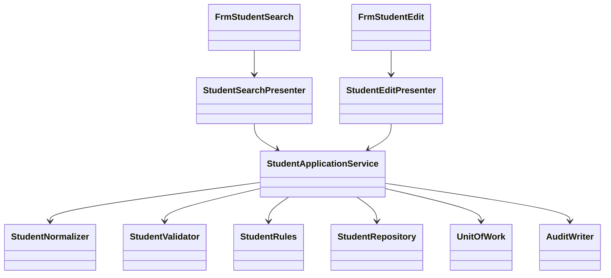

<!-- spec-meta: {"schema":"spec-md/1.0","documentId":"COM-VB.NET_WinForms","version":"6.0","path":"spec/共通/方式別/VB.NET_WinForms/01_共通実装仕様.md","sheets":[{"heading":"構造・命名・型","kind":"GRID","sheet":"01_構造・命名・型"},{"heading":"SQL・保存単位","kind":"GRID","sheet":"02_SQL・保存単位"},{"heading":"共通モジュールの実装","kind":"GRID","sheet":"03_共通モジュールの実装"},{"heading":"共通規約・日付実装","kind":"GRID","sheet":"04_共通規約・日付実装"}]} -->
# VB.NET／WinForms 共通実装仕様

| 項目 | 内容 |
| --- | --- |
| 版数・改訂日 | 6.0／2026-10-11 |
| 対象方式 | VB.NET／WinForms |
| 適用 | 設計上の実装契約。製品コードの実装・コンパイルは未実施 |

開発入力：[学生検索詳細](../../../詳細仕様書/VB.NET_WinForms/01_学生検索画面.md)／[学生登録詳細](../../../詳細仕様書/VB.NET_WinForms/02_学生登録画面.md)／[共通実装](01_共通実装仕様.md)／[DB定義](../../../DB定義/PostgreSQL/01_DB定義書.md)／[方式別開発規約](../../../../docs/開発規約/VB.NET_WinForms.md)／[共通開発規約](../../../../docs/開発規約.md)。

## 構造・命名・型

```text
StudentManagement.WinForms/Forms/FrmStudentSearch.vb, FrmStudentEdit.vb
StudentManagement.WinForms/Controls/NullableDateControl.vb, CodeComboControl.vb
StudentManagement.WinForms/Presenters/StudentSearchPresenter.vb, StudentEditPresenter.vb
StudentManagement.Application/StudentApplicationService.vb, MasterMaintenanceService.vb
StudentManagement.Application/StudentNormalizer.vb, StudentValidator.vb, StudentRules.vb
StudentManagement.Domain/Student.vb, StudentDraft.vb, SchoolClass.vb, CodeEntry.vb
StudentManagement.Infrastructure/StudentRepository.vb, MasterRepository.vb, UnitOfWork.vb
StudentManagement.Infrastructure/ConfirmationStore.vb, AuditWriter.vb, CurrentUserAdapter.vb
StudentManagement.Maintenance/Program.vb
```

`Option Strict On / Option Explicit On / Option Infer On`。型・プロパティPascalCase、ローカルcamelCase、privateフィールド先頭_。FormはPresenterへ操作を委譲、PresenterはFormインターフェイスを使い、業務サービスはWindows.Formsに依存しない。



| 意味 | VB.NET型 | NULL・注意 |
| --- | --- | --- |
| ID・版 | Long／Nullable(Of Long) | Integerへ狭めない。上限前に採番・版加算停止 |
| 人数・並び順・ページ | Integer | 非負。定員はInteger? |
| 日付 | DateOnly／DateOnly? | UIのDateTimeから年月日だけ取得 |
| 時点 | DateTimeOffset | UTC保持、表示時日本時間 |
| 任意文字 | String、Nothing | String.EmptyとDB NULLを正規化で統一 |
| 真偽 | Boolean | DBNullをFalseに黙って変換しない |
| DBパラメーターNULL | DBNull.Value | AddWithValueで型を推測せずNpgsqlDbTypeを指定 |

## SQL・保存単位

`StudentRepository`は型付きNpgsqlParameterを使用し、接続・Txを呼出元から受ける。SQL本文へ入力値・並び順文字列を直接連結しない。識別子を動的にする場合はサーバー定義の許可表から選ぶ。

```sql
-- 全書込み経路とマスタ保守が同じキーを使う評価用の短時間直列化
SELECT pg_advisory_xact_lock(75310, 1);
-- ロック取得後に別ステートメントで最新行・マスタを読む（Read Committed）
SELECT * FROM m_student WHERE student_id=$1 AND NOT is_deleted FOR UPDATE;
SELECT count(*) FROM m_student
 WHERE class_id=$1 AND enrollment_status_code IN ('01','02')
   AND NOT is_deleted AND ($2::bigint IS NULL OR student_id<>$2);
SELECT student_id,row_version FROM m_student
 WHERE NOT is_deleted AND birth_date=$1
   AND (name_key=$2 OR kana_key=$3)
   AND ($4::bigint IS NULL OR student_id<>$4)
 ORDER BY student_id;
UPDATE m_student SET student_name=$1,name_key=$2,
 updated_at=$3,updated_by=$4,row_version=row_version+1
 WHERE student_id=$5 AND row_version=$6 AND NOT is_deleted
 RETURNING row_version;
```

最後のSQLは列割当の抜粋。実更新は画面の学籍番号を除く18保存入力＋生成name_key/kana_keyを固定許可列で更新する。student_no、作成情報、削除情報、分類固定値は一般UPDATEに含めない。新規INSERTは入力＋生成キー＋分類固定値＋作成更新情報＋row_version=1。削除UPDATEはis_deleted、deleted_at/by/reason、updated_at/by、row_versionだけ。更新・削除件数は必ず1件、0なら存在と版を再確認してE-STU-103/105。採番はRETURNING、MAX+1は禁止。

保存順は共通03。Read Committed＋上記ゲート→最新版取得→権限・業務検査→候補確認→学生変更→履歴→Commit。確認待ちはRollbackで抜ける。例外時Rollback、確定結果不明は検索確認。長時間保護を防ぐlock_timeout=5秒、statement_timeout=15秒を評価基準とする。全書込みが規約を守ることが条件で、管理者の直接SQLは通常運用に含めない。

検索はReadOnly RepeatableReadで件数と一覧を揃える。最大10001件のIDを数え、10000以下だけページ取得。FROM m_student s LEFT JOIN m_class c、名称は分類＋値のLEFT JOINで有効性条件を付けない。学籍前方・氏名カナ部分はLIKE ... ESCAPE '!'、状態は型付き配列、電話OR、日付両端。既定student_no COLLATE "C", student_id。氏名順はname_key COLLATE "C"、他はadmission_date/updated_at、常にstudent_idを追加。OFFSETとLIMITは数値パラメーター。

## 共通モジュールの実装

共通01～03＝CurrentUserAdapter/AuthorizationService/BusinessClock、04～05＝StudentNormalizer/StudentValidator、06～10＝MasterRepository/StudentRules/ClassCapacityService/DuplicateService、11＝ConfirmationStore、12＝SearchContext、13＝UnitOfWork、14＝AuditWriter、15＝MessageCatalog/DisplayFormatter。

```vb
Public Interface IStudentApplicationService
    Function SearchAsync(criteria As StudentSearchCriteria, page As Integer,
                         pageSize As Integer, ct As CancellationToken) As Task(Of SearchResult)
    Function SaveAsync(command As StudentSaveCommand,
                       ct As CancellationToken) As Task(Of SaveResult)
    Function DeleteAsync(command As StudentDeleteCommand,
                         ct As CancellationToken) As Task(Of SaveResult)
End Interface
```

StudentSaveCommandはStudentId As Long?、ExpectedVersion As Long?、Draft As StudentDraft、SelectionHints、Confirmation、OperationReason。StudentDraftの全プロパティは物理列対応表の編集可能業務21列（入力19＋生成キー2）。Entityの管理列をUIに双方向バインドしない。

照合キーはString.Normalize(FormKC)、ToUpperInvariant、Runeベースの空白・文字数処理、カナ対応変換。Nothing/空文字を正規化しDBNullへ変換。文字長はString.Lengthだけで判定しない。Npgsql例外はSqlState23505＋制約名で番号重複、23503で参照不整合、40001/40P01/55P03で競合・再確認へ変換。SQL本文を表示しない。

## 共通規約・日付実装

対象読者は実務経験５年程度のプログラマー。[検索詳細](../../../詳細仕様書/VB.NET_WinForms/01_学生検索画面.md)／[登録詳細](../../../詳細仕様書/VB.NET_WinForms/02_学生登録画面.md)／[開発規約](../../../../docs/開発規約.md)／[日付正本](../../07_日付・和暦仕様.md)。

共通16の入力は元号識別値・年・月・日という原文字列4値と業務日。出力は正規化日付と和暦表示文字列、または項目エラー。共通17は項目種別と日付／年度にDATE-R01～06を適用する。変換で不正日を補正しない。OS全体の暦設定を変更しない。元号表の版を画面・保存側で一致させる。

| 役割 | 実装仕様 |
| --- | --- |
| 共通16物理名 | JapaneseBirthDateControl / JapaneseDateService |
| 内部日付型 | DateOnly / DateOnly? |
| 入力と保存 | 和暦原入力4値から日付を生成。StudentDraft等のbirth_date相当は正規化日付。元号をDBへ重複保存しない |
| 呼出境界 | 本方式はネイティブ画面。和暦原入力4値を業務処理へ渡し厳密変換する。取得時は内部日付を和暦表示に変換。Web JSON契約は本方式に適用しない |
| 表示 | 一覧・参照・重複確認のBirthDateWareki相当文字列は共通16で生成。その他の日付・日時は西暦 |
| 例外 | CHK-032～034、E-DATE-001～003。構文検査後、実在日、元号境界、逆変換、業務範囲、前後関係を順に検査 |
| 参考試験 | DATE-T01～20。ライブラリーの解析成功だけで元号境界を合格にしない |

### 保守入口・方式固有の適合条件

#### マスタ保守・例外・試験

`StudentMaintenance.exe`の管理者用VBコンソールから`MasterMaintenanceService`を呼ぶ。入力は承認済みJSONファイルを読み、型付き値に変換する。5分類70値を初期投入、同値再実行は変更なし、差分は黙って上書きしない。クラス年度＋コード一意、同年度・同学年同名は警告、参照学生がいる学年変更・人数未満の定員縮小・在学休学のいる利用停止は拒否。学生保存と同じ同時保存制御・監査を使う。

`ErrorProvider`と全体メッセージに同じエラーを対応付ける。UIイベント以外のAsync Subは禁止し、非同期例外をAwait元で処理。破棄済Formへ結果を反映しない。保存結果不明では再保存前に検索確認を案内。

共通T-01～28に加え、フォーム2枚で条件が混ざらない、DateTimePicker未チェック、IME入力確定前の変換抑止、DPI150/200%、長文、読み取り専用行、フォーム終了中の非同期完了、2プロセス最終席競合を試験する。
