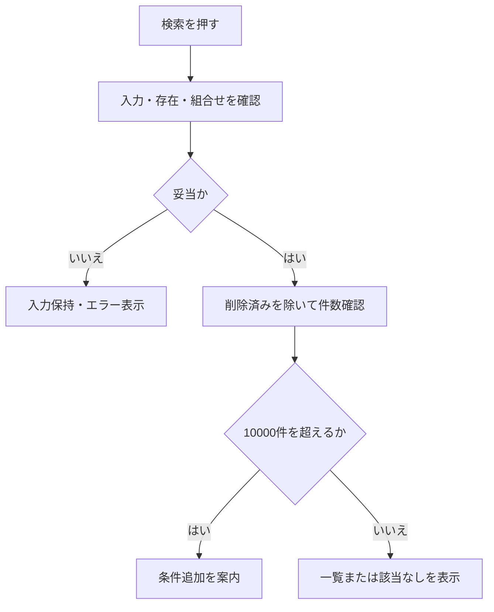

# 学生検索画面 基本設計書

## 表紙

| 項目 | 内容 |
| --- | --- |
| システム名 | 学生管理システム |
| 画面番号 | SCR-STU-001 |
| 版数・作成日 | 2.0／2026-10-10 |
| 対象読者 | 顧客・業務担当者 |
| 状態 | 新規設計案 |
| 対応する詳細仕様 | [学生検索画面](../詳細仕様書/02_学生検索画面.md) |

## 概要

学生の基本情報を条件指定して検索し、学生登録画面の新規・編集・参照へ進む。検索画面では学生情報を変更しない。成績を検索・表示しない。単一校を対象とし、年度・学年は現在または最終所属クラスの属性を示す。過去の年度別所属履歴を検索するものではない。

| 情報 | 内容 |
| --- | --- |
| 開始契機 | 共通メニューからの起動、学生登録画面からの復帰 |
| 利用者 | 閲覧者、担当者、管理者 |
| 参照情報 | 学生基本情報、クラスマスタ、コード種別マスタ、コード管理マスタ |
| 呼出先 | 学生登録画面 |
| 対象外 | 成績、帳票、一覧の直接編集、一括更新、削除済み学生の照会 |

## 画面設計

### 標準画面（静的HTML）

入力欄は配置確認用の文字表現。表示値は架空の例。「検索前」「該当なし」「検索済み」を区別する。以下は検索済みの表示例であり、初回起動時の結果ではない。

<table>
<caption>学生管理システム ／ 学生検索</caption>
<tr><th colspan="4">学生検索</th><td colspan="2">利用者：担当者</td></tr>
<tr><td colspan="6"><strong>メッセージ</strong>：検索が完了しました。検索条件を変更した場合は「検索」を押してください。</td></tr>
<tr><th colspan="6">検索条件</th></tr>
<tr><th>学籍番号</th><td colspan="2">［　　　　　　　　　］</td><th>氏名</th><td colspan="2">［　　　　　　　　　］</td></tr>
<tr><th>氏名カナ</th><td colspan="2">［　　　　　　　　　］</td><th>年度</th><td colspan="2">［すべて　▼］</td></tr>
<tr><th>学年</th><td colspan="2">［すべて　▼］</td><th>クラス</th><td colspan="2">［すべて　▼］</td></tr>
<tr><th>所属条件</th><td colspan="5">□ 未所属のみ　（指定時は年度・学年・クラスを解除）</td></tr>
<tr><th>在籍区分</th><td colspan="5">☑ 在学　☑ 休学　□ 卒業　□ 退学　／未選択はすべて</td></tr>
<tr><th>都道府県</th><td colspan="2">［すべて　▼］</td><th>電話番号</th><td colspan="2">［　　　　　　　　　］</td></tr>
<tr><th>入学日</th><td colspan="5">［年－月－日］ ～ ［年－月－日］</td></tr>
<tr><td colspan="6"><strong>［検索］</strong>　［クリア］　　［新規登録］　［メニューへ］</td></tr>
<tr><th colspan="6">検索結果　2件／1～2件　　表示件数［20件 ▼］　　検索日時：2026/10/10 10:00:00</th></tr>
</table>
<table>
<caption>検索結果一覧</caption>
<thead><tr><th>学籍番号</th><th>氏名</th><th>氏名カナ</th><th>生年月日</th><th>年度</th><th>学年</th><th>クラス</th><th>在籍区分</th><th>住所</th><th>本人電話</th><th>更新日時</th><th>操作</th></tr></thead>
<tbody>
<tr><td>S2026-0001</td><td>見本 太郎</td><td>ミホン タロウ</td><td>2008/05/15</td><td>2026</td><td>学年なし</td><td>C-A Aクラス</td><td>在学</td><td>東京都 見本市見本町1-1</td><td>－</td><td>2026/10/10 09:00:00</td><td>［編集］</td></tr>
<tr><td>S2026-0002</td><td>見本 花子</td><td>ミホン ハナコ</td><td>2008/07/20</td><td>2026</td><td>学年なし</td><td>C-A Aクラス</td><td>休学</td><td>千葉県 見本市見本町2-2</td><td>－</td><td>2026/10/10 09:10:00</td><td>［編集］</td></tr>
</tbody>
</table>

［先頭］ ［前へ］　1／1ページ　［次へ］ ［最後］

<strong>閲覧者の場合：</strong>「新規登録」は表示せず、行の「編集」を「参照」に変更します。

### 表示状態

| 状態 | 条件欄 | 結果欄 | 操作 |
| --- | --- | --- | --- |
| 初回・クリア直後 | 初期条件 | 「条件を指定して検索してください」。件数・日時なし | 一覧操作は使用不可 |
| 検索中 | 入力値を保持 | 処理中表示 | 二重検索を抑止 |
| 入力エラー | 入力値と項目別エラー | 前回結果を消去 | 修正後に検索 |
| 0件 | 実行した条件を保持 | 「該当する学生がありません。」 | ページ操作不可 |
| 上限超過 | 実行した条件を保持 | 絞込みを要求。一部だけの一覧は出さない | 条件追加後に検索 |
| 正常 | 実行した条件 | 件数、一覧、検索日時 | 有効なページ操作 |
| 条件変更・未実行 | 変更値を保持 | 最後に実行した結果と「条件変更は未反映」 | ページ操作は最後の実行条件を使う |
| システムエラー | 入力値を保持 | 前回結果を最新結果として残さない | 受付番号を案内 |

## 項目一覧

### 検索条件・操作

| 番号 | 項目名 | 種類 | 必須 | 形式・桁 | 初期値・検索方法 |
| --- | --- | --- | --- | --- | --- |
| 1 | 学籍番号 | 文字入力 | 任意 | 20文字 | 空。全半角等を整えて前方一致 |
| 2 | 氏名 | 文字入力 | 任意 | 100文字 | 空。空白・英字大小等の差を整えて部分一致 |
| 3 | 氏名カナ | 文字入力 | 任意 | 変換後100文字 | 空。ひらがな・半角カナを整えて部分一致 |
| 4 | 年度 | 選択 | 任意 | 4桁 | すべて。クラスの年度、降順 |
| 5 | 学年 | 選択 | 任意 | 名称表示 | すべて。「学年なし」は未所属と別 |
| 6 | クラス | 選択 | 任意 | 年度・学年・番号・名称 | すべて。年度・学年で候補を絞る |
| 7 | 未所属のみ | チェック | 任意 | 選択／未選択 | 未選択。選択すると年度・学年・クラスを解除 |
| 8 | 在籍区分 | 複数選択 | 任意 | 在学・休学・卒業・退学 | 在学・休学。全解除時は全区分 |
| 9 | 都道府県 | 選択 | 任意 | 名称表示 | すべて |
| 10 | 電話番号 | 文字入力 | 任意 | 入力32文字 | 空。区切りを整えて完全一致。本人または緊急電話 |
| 11 | 入学日・開始 | 日付 | 任意 | 年月日 | 空。開始日を含む |
| 12 | 入学日・終了 | 日付 | 任意 | 年月日 | 空。終了日を含む |
| 13 | 検索 | 操作 | ― | ― | 条件を検査して1ページ目を表示 |
| 14 | クリア | 操作 | ― | ― | 初期条件・未検索へ戻す |
| 15 | 新規登録 | 操作 | ― | ― | 担当者・管理者だけ表示 |
| 16 | メニューへ | 操作 | ― | ― | 共通メニューへ戻る |

### 一覧・結果操作

| 番号 | 項目名 | 取得元・表示規則 |
| --- | --- | --- |
| 17 | 検索件数・表示範囲 | 10,000件以内の実件数。0件と未検索を区別 |
| 18 | 検索日時 | 最後の検索・ページ再取得日時。日本時間 |
| 19 | 表示件数 | 20・50・100件。初期20件 |
| 20 | 学籍番号 | 学生基本情報。文字列順 |
| 21 | 氏名 | 学生基本情報の登録表記 |
| 22 | 氏名カナ | 学生基本情報の変換済み表記 |
| 23 | 生年月日 | 年／月／日。年齢は表示しない |
| 24 | 年度・学年 | 現在／最終所属クラス。未所属は「－」 |
| 25 | クラス | クラス番号＋名称。未所属は「未所属」。停止・期間外は注記 |
| 26 | 在籍区分 | コード管理マスタの名称 |
| 27 | 住所 | 都道府県名＋住所1。住所2は表示しない |
| 28 | 本人電話 | 本人電話のみ。未登録は「－」 |
| 29 | 更新日時 | 日本時間 |
| 30 | 編集／参照 | 対象学生の最新情報を開く |
| 31 | ページ操作 | 先頭・前・次・最後。移動不能な方向は使用不可 |

内部識別情報・画面状態管理情報は顧客の入力項目ではないため、詳細仕様書で定義する。メール、緊急連絡先、住所2、備考は一覧に出さない。

## イベント仕様

### 初期表示

**処理概要**：利用権限を確認し、候補と初期条件だけを表示する。

**処理手順**：利用者を確認する。検索用の在籍区分・学年・都道府県・クラスを取得する。在学・休学、20件、学籍番号昇順を設定し、学生一覧は取得しない。クラス候補が0件でも検索画面自体は使用可能とする。必須コードの設定不足時は管理者への連絡を促し、検索を止める。

**データ操作**：マスタの参照のみ。学生の登録・変更・履歴追記は行わない。

### 検索実行

**処理概要**：入力条件を検査し、非削除の学生を上限付きで検索する。

**処理手順**：入力文字・日付を整え、各桁数、日付の実在・範囲、コードとクラスの存在、年度・学年との一致を確認する。異なる条件はすべて満たす学生を探す。在籍区分は選択したいずれか、電話は本人または緊急連絡先のいずれかへの一致を認める。未指定条件は絞込みに使わない。0件、10,000件以内、上限超過を区別して表示する。

**結果・例外**：入力エラーは項目の近くと画面上部に表示する。入力値は保持し、一覧は消す。検索に失敗したときは受付番号を表示し、古い一覧を最新として扱わない。

### 条件連動

未所属のみを選択すると年度・学年・クラスを解除し、選択不可にする。未所属を解除しても以前の選択値を勝手に復元しない。年度・学年の変更でクラスが適合しなくなった場合はクラス選択を解除し通知する。年度・学年が空のままクラスを選んだ場合はクラスの実際の年度・学年を反映する。この時点では学生検索を実行しない。

### 並び替え・ページ移動

学籍番号、氏名、入学日、更新日時で昇順／降順に変更可能。初期は学籍番号昇順。同順位は内部の一定順とする。氏名順は文字照合順であり、五十音順を保証するものではない。並び替え・表示件数変更は1ページ目へ戻す。ページ移動は最後に実行した条件を使用し、最新データを再検索する。他者の変更でページが消滅した場合は最後の有効ページへ補正する。

### 新規・編集・参照・復帰

新規登録では検索条件を学生の初期値へ流用しない。編集・参照では一覧の行番号ではなく対象学生を識別して最新情報を開く。保存・削除・取消後は元の検索条件・並び順・ページへ戻り、検索済みなら最新データを再検索する。保存した学生が条件外になっても条件を勝手に変更しない。未検索からの遷移なら未検索に戻す。条件の保持期限は最終利用から30分、利用者・ログイン状態・画面タブごとに分離し、期限切れは初期条件に戻して通知する。

## 補足説明

停止・期間外のコード／クラスも検索候補と名称表示に含める。表示名称を取得できない異常があっても学生の行を消さず、不整合を明示する。文字の「%」「_」「!」を入力しても検索対象が意図せず広がらないものとする。検索条件や個人情報を画面アドレス・永続保存へ残さない。

| 受入観点 | 期待結果 |
| --- | --- |
| 初回、クリア | 在学・休学が選択済み、未検索 |
| カナ・空白・全角番号 | 共通変換規則どおりに検索 |
| 停止クラス、卒業 | 過去の最終所属を含めて検索できる |
| 未所属と年度を同時指定 | 矛盾した条件を受け付けない |
| 0件・10,000件・10,001件 | 該当なし・正常一覧・上限警告を区別 |
| 条件変更後にページ移動 | 最後に実行した条件で移動し、未反映を明示 |
| 閲覧者の更新操作 | 操作できない |
| 複数タブから復帰 | 条件・成功メッセージを混同しない |

関連：[学生登録](02_学生登録画面.md)／[共通UI](../共通/04_共通UI部品設計.md)／[共通チェック](../共通/05_チェック・メッセージ設計.md)
